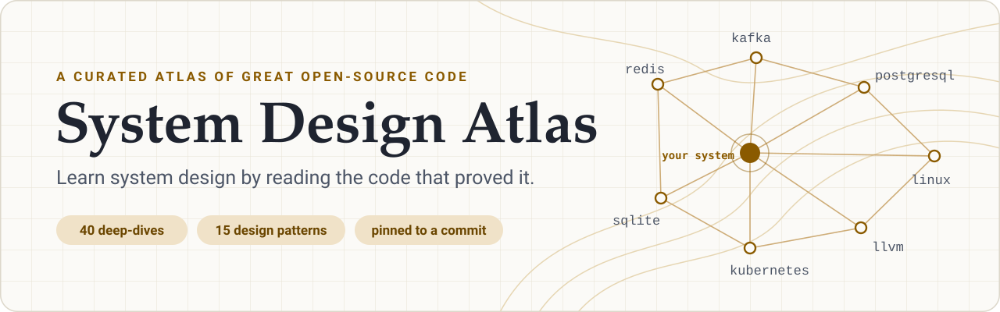

<p align="center">
  <a href="https://acailic.github.io/system-design-atlas/">
    
  </a>
</p>

<p align="center">
  <a href="https://acailic.github.io/system-design-atlas/"></a>
  <a href="#the-deep-dives"></a>
  <a href="PATTERNS.md"></a>
  <a href="https://github.com/acailic/system-design-atlas/actions/workflows/ci.yml"></a>
  <a href="LICENSES.md"></a>
  <a href="CONTRIBUTING.md"></a>
</p>

<p align="center">
  <b><a href="https://acailic.github.io/system-design-atlas/">Website</a></b> ·
  <b><a href="#the-deep-dives">Deep-dives</a></b> ·
  <b><a href="PATTERNS.md">Patterns</a></b> ·
  <b><a href="guides/start-here.md">Start here</a></b> ·
  <b><a href="CONTRIBUTING.md">Contribute</a></b>
</p>

---

**System Design Atlas is a free, curated guide to the open-source codebases that teach system design best.** Each of the 40 deep-dives is written from the source itself: real files, real functions and line-level landmarks, pinned to a specific commit. There are no invented architecture diagrams and no folklore. You read the entry, open the code next to it, and see where each design trade-off is actually paid for.

The projects are chosen because their code *teaches*, not because they are popular: Redis, PostgreSQL, Kafka, the Linux kernel, V8, LLVM, Kubernetes and 33 more.

> [!TIP]
> **The best way to read it is the [website](https://acailic.github.io/system-design-atlas/).** Every deep-dive has rendered architecture diagrams, an "explain like I'm 10" section, an interactive step-through of the system's core request path, and read-aloud on every paragraph. The markdown in this repo is the source of truth; the site is generated from it.

## What's inside every deep-dive

Every entry follows the same [template](contributing/DEEP-DIVE-TEMPLATE.md), so once you've read one you know where everything is in the rest:

| Section | What you get |
|---|---|
| **Explain like I'm 10** | An honest analogy that maps onto the real mechanism, plus why the engineers chose it |
| **Architecture overview** | The major components and how a request moves through them, with Mermaid diagrams |
| **Walkthrough** | The system's spine told as a step-by-step story (a stepper on the website) |
| **Data structures, concurrency, failure** | The structures that carry the design and the threading and crash model around them |
| **API and extension seams** | Where the system is built to be extended, and why there |
| **The defining trade-offs** | Two or three decisions, each with `file:function` evidence and a "when would this be wrong for you" verdict |
| **Reading path** | An ordered route through the actual source. The reading path is the product; the prose is the guide |
| **What to steal** | Design moves you can carry into your own systems |

## Why an atlas, not another book

Books teach system design in the abstract: "use a write-ahead log", "prefer
event loops for I/O-bound work", "content-address your data". Those are true
and useless until you have watched a real codebase pay for them — where the
loop lives, what the log record looks like, what trade was made to get there.

The atlas points at 40 canonical codebases and walks through the
*decisions frozen into their code*: the two or three defining trade-offs,
the data structures that carry the design, the concurrency model, the seams
where the system extends. You read the atlas entry, then you read the code
alongside it. That is the whole method.

## How to use the atlas

1. **Pick a system or a domain** — cache, storage engine, VCS, web server,
   database, runtime… Browse the deep-dives (filterable by domain on the
   website), or start from a [guided path](guides/start-here.md) if you
   don't know where to begin.
2. **Read why it's here.** Every entry in [`catalog.yaml`](catalog.yaml)
   has a "why" paragraph naming the design lesson this codebase is unusually
   good at teaching.
3. **Shallow-clone the project** so you can follow along:
   ```bash
   mkdir -p clones && git clone --depth 1 <repo-url> clones/<id>
   ```
   Deep-dives pin the commit they were written against. Expect small drift;
   file and function landmarks in mature projects stay stable for years.
4. **Read the deep-dive top to bottom once** (architecture → data
   structures → concurrency → trade-offs), then **work the reading path**
   in the actual clone, opening every cited file. The reading path is the
   product; the prose is the guide.
5. **Steal the lessons.** Each deep-dive ends with "what to steal":
   transferable design moves you can apply to your own systems.

Time budget: a deep-dive plus its reading path is a focused 3–8 hours,
depending on the entry's difficulty. Don't rush the reading path.

## The deep-dives

40 systems, listed in the suggested reading order (the website's previous/next links follow it). The level column describes the effort asked of the *reader*.

| # | System | Domain | What its code teaches | Level |
|--:|---|---|---|---|
| 1 | [Redis](deep-dives/redis.md) | `cache` | event loop + purpose-built data structures | 🟡 moderate |
| 2 | [SQLite](deep-dives/sqlite.md) | `database` | layered embedded database architecture | 🔴 demanding |
| 3 | [git](deep-dives/git.md) | `vcs` | content-addressed object model | 🟡 moderate |
| 4 | [LevelDB](deep-dives/leveldb.md) | `storage-engine` | LSM-tree storage engine | 🟡 moderate |
| 5 | [nginx](deep-dives/nginx.md) | `web-server` | master/worker process model | 🔴 demanding |
| 6 | [PostgreSQL](deep-dives/postgresql.md) | `database` | process-per-connection, MVCC, WAL durability | 🔴 demanding |
| 7 | [Kafka](deep-dives/kafka.md) | `queue-log` | append-only log, zero-copy, ISR replication, KRaft metadata | 🔴 demanding |
| 8 | [Kubernetes](deep-dives/kubernetes.md) | `orchestration` | declarative state, informers, reconcile loops | 🔴 demanding |
| 9 | [CPython](deep-dives/cpython.md) | `runtime` | object model, refcounting, adaptive interpreter, GIL | 🟡 moderate |
| 10 | [Moby/Docker](deep-dives/moby.md) | `container` | content-addressed layers, graphdrivers, delegation to containerd/runc | 🔴 demanding |
| 11 | [VS Code](deep-dives/vscode.md) | `editor` | extension host isolation, RPC object graph, LSP/DAP seams | 🟡 moderate |
| 12 | [etcd](deep-dives/etcd.md) | `distributed` | Raft as deterministic FSM, MVCC revisions, ReadIndex reads | 🔴 demanding |
| 13 | [Elasticsearch](deep-dives/elasticsearch.md) | `search-engine` | NRT write path, cluster state diffs, scatter-gather search | 🔴 demanding |
| 14 | [Memcached](deep-dives/memcached.md) | `cache` | slab allocator, segmented LRU, smart clients over smart server | 🟡 moderate |
| 15 | [Apache httpd](deep-dives/httpd.md) | `web-server` | hook-based module platform, filters, pools, swappable MPMs | 🔴 demanding |
| 16 | [ZooKeeper](deep-dives/zookeeper.md) | `distributed` | ZAB consensus, ordered znode tree, sessions + one-shot watches | 🔴 demanding |
| 17 | [NATS](deep-dives/nats.md) | `queue-log` | subject trie routing, minimal text protocol, opt-in JetStream durability | 🟡 moderate |
| 18 | [libuv](deep-dives/libuv.md) | `runtime` | portable event loop: phases, watcher queues, thread pool + async doorbell | 🟡 moderate |
| 19 | [runc](deep-dives/runc.md) | `container` | containers as syscalls: re-exec twin, sync-pipe bootstrap, pivot_root | 🟡 moderate |
| 20 | [Lua](deep-dives/lua.md) | `language` | embeddable language core: one TValue, register VM, C-API virtual stack | 🟡 moderate |
| 21 | [Envoy](deep-dives/envoy.md) | `proxy-lb` | API-driven data plane: worker snapshots, filter chains, xDS hot config | 🔴 demanding |
| 22 | [curl](deep-dives/curl.md) | `networking` | transfer state machine that rents foreign event loops; layered cfilters | 🟡 moderate |
| 23 | [llama.cpp](deep-dives/llama-cpp.md) | `ml-framework` | framework-free LLM inference: ggml tensor graphs, quantization-first, mmap weights | 🟡 moderate |
| 24 | [Node.js](deep-dives/nodejs.md) | `runtime` | V8 + libuv wrapped into one platform: the C++/JS boundary as the core design | 🔴 demanding |
| 25 | [FFmpeg](deep-dives/ffmpeg.md) | `media` | thousands of components behind four uniform C-struct contracts, refcounted zero-copy data, DTS-paced thread-per-component scheduler | 🔴 demanding |
| 26 | [PyTorch](deep-dives/pytorch.md) | `ml-framework` | define-by-run autograd: the eager pass records its own tape over a C++ dispatcher | 🔴 demanding |
| 27 | [Servo](deep-dives/servo.md) | `browser-engine` | supervised message-passing pipelines: the constellation, a DOM pointer vocabulary for Rust + GC, layout as an in-thread visitor, runtime-switchable process topology | 🔴 demanding |
| 28 | [HAProxy](deep-dives/haproxy.md) | `proxy-lb` | budgeted tasklet scheduler, ebtree run queues, socket-handoff seamless reload | 🔴 demanding |
| 29 | [Linux kernel](deep-dives/linux.md) | `os-kernel` | frozen syscall ABI over vtable seams: fair-share EEVDF scheduler, lock-free page cache, RCU reads | 🔴 demanding |
| 30 | [Go runtime](deep-dives/go.md) | `runtime` | M:N goroutines: GMP work-stealing scheduler, integrated netpoller, growable stacks + escape analysis, concurrent GC with a hybrid write barrier | 🔴 demanding |
| 31 | [RocksDB](deep-dives/rocksdb.md) | `storage-engine` | LevelDB paged into production: column families over one WAL, stall ladders and I/O budgets, pluggable compaction | 🔴 demanding |
| 32 | [V8](deep-dives/v8.md) | `runtime` | speculative optimization as architecture: feedback-driven tiering (Ignition → Sparkplug → Maglev → TurboFan), hidden classes, guarded deopt, concurrent GC, isolate-per-realm embedding | 🔴 demanding |
| 33 | [Chromium](deep-dives/chromium.md) | `browser-engine` | a security model that forced the architecture: sandboxed renderer processes, site isolation, Mojo capability IPC, the browser's mirrored frame tree | 🔴 demanding |
| 34 | [Caddy](deep-dives/caddy.md) | `web-server` | goroutines instead of state machines, config as a provisioned document, automatic HTTPS as a subsystem | 🟢 gentle |
| 35 | [Neovim](deep-dives/neovim.md) | `editor` | editor as RPC server: msgpack-RPC UI seam, in-process Lua on the shared libuv loop | 🔴 demanding |
| 36 | [LLVM](deep-dives/llvm.md) | `compiler` | one shared IR as the architectural seam: def-use pointer graph, pass pipeline as parseable data, N frontends × M backends into N+M | 🔴 demanding |
| 37 | [ClickHouse](deep-dives/clickhouse.md) | `database` | columns all the way down: sparse-indexed immutable parts, granule skipping, PREWHERE, vectorized execution | 🔴 demanding |
| 38 | [OpenJDK HotSpot](deep-dives/hotspot.md) | `runtime` | earned speed: tiered C1/C2 compilation with designed deoptimization, and the Serial→Parallel→G1→ZGC collector lineage behind one heap contract | 🔴 demanding |
| 39 | [Prometheus](deep-dives/prometheus.md) | `observability` | pull model made correct by absence-as-data: scrape clocks + staleness markers, WAL-protected head, immutable block compaction, rules as reconcile loops | 🔴 demanding |
| 40 | [TiDB](deep-dives/tidb.md) | `database` | SQL as a thin skin over three services: stateless SQL nodes, one global clock (TSO), Raft-replicated MVCC storage (Percolator 2PC in TiKV) | 🔴 demanding |

Every project in [`catalog.yaml`](catalog.yaml) now has a deep-dive. New candidates are scored against the inclusion bar in [`contributing/CURATION.md`](contributing/CURATION.md).

## Patterns: the lessons that recur

The deep-dives teach systems; the [**patterns index**](PATTERNS.md) teaches *design*. Each pattern below was arrived at independently by two or more of these codebases. When very different teams under different constraints converge on the same shape, it's a real pattern and not a fashion.

| # | Pattern | Seen in |
|--:|---|---|
| 1 | [Content addressing](PATTERNS.md#1-content-addressing-name-things-by-their-hash) | git, Moby |
| 2 | [Write-ahead logging](PATTERNS.md#2-write-ahead-logging-make-the-log-the-truth) | SQLite, PostgreSQL, LevelDB, Kafka, +6 more |
| 3 | [Immutable core, tiny mutable surface](PATTERNS.md#3-immutable-core-tiny-mutable-surface) | git, LevelDB, Kafka, Prometheus |
| 4 | [Supervisor + expendable workers](PATTERNS.md#4-supervisor--expendable-workers) | nginx, PostgreSQL, Redis, httpd, +3 more |
| 5 | [Event loop / readiness demultiplexing](PATTERNS.md#5-event-loop--readiness-demultiplexing) | Redis, nginx, Memcached, libuv, +6 more |
| 6 | [Amortize every unbounded operation](PATTERNS.md#6-amortize-every-unbounded-operation) | Redis, LevelDB, PostgreSQL, Kubernetes, +9 more |
| 7 | [Declarative state + reconcile loops](PATTERNS.md#7-declarative-state--reconcile-loops) | Kubernetes, Moby, NATS, Prometheus |
| 8 | [Quarantine the environment behind one interface](PATTERNS.md#8-quarantine-the-environment-behind-one-interface) | SQLite, LevelDB, nginx, libuv, +1 more |
| 9 | [Versioned data for concurrent readers (MVCC)](PATTERNS.md#9-versioned-data-for-concurrent-readers-mvcc) | PostgreSQL, Kubernetes, LevelDB, etcd, +2 more |
| 10 | [Extension seams placed where the design flexes](PATTERNS.md#10-extension-seams-placed-where-the-design-flexes) | PostgreSQL, nginx, SQLite, Kubernetes, +18 more |
| 11 | [Sequential I/O and zero-copy as throughput primitives](PATTERNS.md#11-sequential-io-and-zero-copy-as-throughput-primitives) | Kafka, LevelDB, git |
| 12 | [Generate the surface from data](PATTERNS.md#12-generate-the-surface-from-data) | Redis, Kubernetes, CPython, FFmpeg, +9 more |
| 13 | [Dumb core, smart edges](PATTERNS.md#13-dumb-core-smart-edges) | Memcached, Kafka, Redis |
| 14 | [Speculate, guard, deoptimize](PATTERNS.md#14-speculate-guard-deoptimize) | V8, CPython, Lua |
| 15 | [The intermediate representation is the architecture](PATTERNS.md#15-the-intermediate-representation-is-the-architecture) | LLVM, SQLite, CPython, PyTorch, +1 more |

## Guides: going wider

The [`guides/`](guides/) folder covers breadth, including projects that don't have a full deep-dive yet (xv6, React, vLLM, Ollama and more):

- **[Start here: guided paths](guides/start-here.md)**: routes for newcomers to systems programming, backend/infra engineers, interview prep, and AI product builders.
- **[How to read a codebase](guides/how-to-read-a-codebase.md)**: trace one request, and the other methods that hold up on huge codebases.
- **[Top 25 most popular systems](guides/top-25.md)**: the greatest hits of open source, ranked, each with its one-line design lesson.
- **[15 domain guides](guides/README.md)**: operating systems, storage, distributed systems, networking, runtimes, compilers, containers, AI inference and more.

## Repository layout

```text
system-design-atlas/
├── deep-dives/          # one deep-dive per system: the core of the atlas
├── PATTERNS.md          # cross-cutting design lessons, linked back into the deep-dives
├── guides/              # guided paths, domain guides, Top 25, how to read a codebase
├── catalog.yaml         # every tracked project: repo, domains, difficulty, scores, "why"
├── contributing/        # curation criteria + the deep-dive template
├── site/                # zero-framework static-site generator + tests
└── docs/                # generated GitHub Pages site (never hand-edit)
```

## Run the website locally

The site is generated from the markdown by a small Node script (`marked` + `js-yaml`, no framework).

```bash
npm ci
npm run serve    # build, then preview at http://localhost:8092 (rebuilds on change)
npm run build    # regenerate docs/
npm test         # staleness gate, SEO/a11y wiring, per-page weight budget
```

## Contributing

Contributions are welcome: new catalog entries, new deep-dives, and especially **landmark fixes** when upstream code moves. Every claim in a deep-dive has to be checkable in a clone at the pinned commit, so reviewers spot-check citations themselves.

- Read [CONTRIBUTING.md](CONTRIBUTING.md) for the checklist and the quality bar.
- Read [contributing/CURATION.md](contributing/CURATION.md) for how projects are selected.
- [Open an issue](https://github.com/acailic/system-design-atlas/issues/new/choose) to suggest a project or report a citation that has drifted.

## License

The prose (deep-dives, guides, patterns, catalog) is licensed [**CC BY 4.0**](LICENSE-CC-BY-4.0.txt): reuse and remix it with attribution. The tooling is [**MIT**](LICENSE). Quoted upstream code is kept minimal and attributed per the snippet policy in [LICENSES.md](LICENSES.md).

<p align="center"><sub>If the atlas helped you understand a system, a ⭐ helps other engineers find it.</sub></p>
