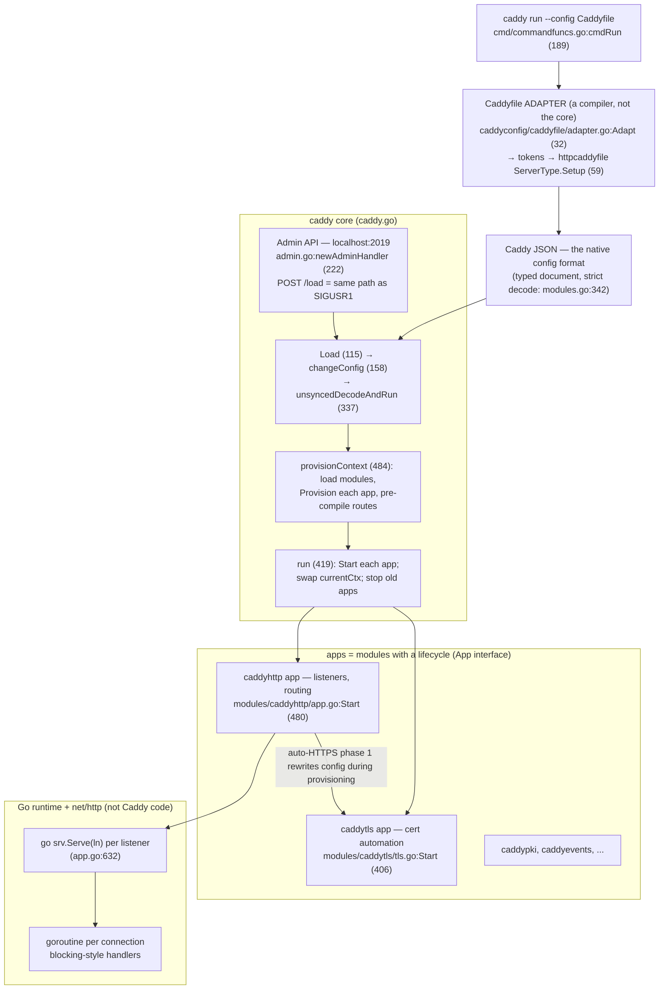
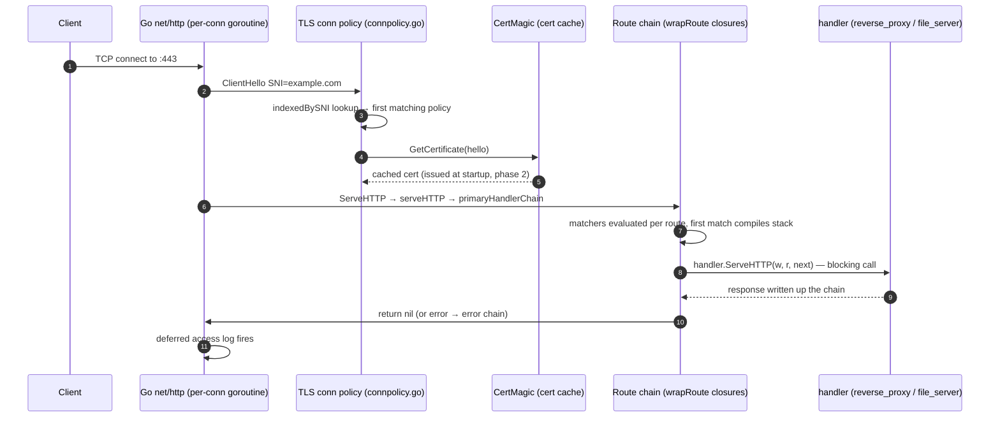
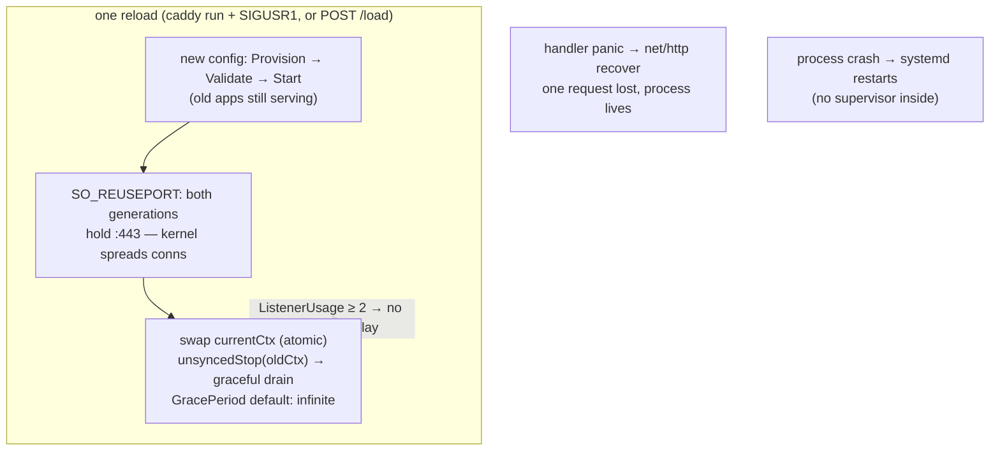

# Caddy: the runtime is the architecture — config as a document, goroutines instead of state machines

> **Atlas id:** `caddy` · **Domains:** `web-server, proxy-lb` ·
> **Upstream:** https://github.com/caddyserver/caddy · **License:** Apache-2.0 ·
> **Pinned commit:** `0584875297136c982cba95d0f889d6b851ace083` (2026-10-16) ·
> Depends on [CertMagic](https://github.com/caddyserver/certmagic) v0.25.6 (go.mod), cited only through Caddy's call sites

Caddy is the web server that took the same requirements nginx solved in
C — thousands of concurrent connections, zero-downtime reload, TLS at
scale — and answered them by *deleting the mechanisms*. There is no
event loop, no worker process model, and no hand-rolled HTTP parser in
the core: Go's runtime provides the concurrency (`go srv.Serve(ln)` and
goroutine-per-connection under it), Go's `net/http` provides the
protocol machinery, and the one thing Caddy itself designs carefully is
**the configuration lifecycle** — a typed JSON document provisioned into
compiled closures and atomically swapped while both old and new
generations serve on the same ports via `SO_REUSEPORT`. The second
thing it designs that nobody else made architectural is **automatic
HTTPS**: certificate issuance is a subsystem that rewrites your config
during provisioning, serves ACME challenges before your own handlers,
and can issue a certificate mid-handshake. This deep-dive teaches where
the idioms of a managed runtime genuinely replace hand-built
architecture — and where Caddy still had to build architecture anyway
(reload, graceful shutdown), the parts that stay hard in any language.

Read it against the [nginx](nginx.md) dive (what disappears when the
runtime schedules your I/O) and the [Apache httpd](httpd.md) dive (how
a runtime-extension platform compares to a compile-time module graph).

## Explain like I'm 10

**A hotel where every guest gets their own helper — and the rulebook can
be swapped without waking anyone.** In nginx's ice-cream shop the workers
take tiny turns so nobody waits; in Caddy's hotel the town simply
provides endless helpers (goroutines), so when a guest (connection)
arrives, one helper walks them all the way to their room — the helper
can *wait* at the elevator without blocking anyone, because waiting is
the town's job, not the helper's. The hotel has one big rulebook (the
JSON config): to change it, the front desk (the core) builds a *brand
new* rulebook first, hires new staff on it, lets them work at the same
doors at the same time (both rulebooks listen on the same port
together), and only then retires the old staff once they finish with
their current guests. And the hotel orders name badges (TLS
certificates) automatically for every name on its mailboxes — from the
official badge office (the ACME certificate authority) — before guests
arrive, or even while one is ringing the bell (on-demand TLS, issued
during the handshake).

**Why the grown-ups did it this way:** when the language runtime already
schedules thousands of waiting helpers cheaply, your design budget is
better spent on the two things the runtime can't give you — swapping
the whole configuration atomically, and making certificates somebody
else's problem.

## 1. Architecture overview

- **The core** (`caddy.go`, ~1,300 lines) is a config lifecycle engine,
  not a server. The `Config` struct holds two kinds of fields: decoded
  scalars (`Admin`, `Logging`) and *raw module payloads* —
  `json.RawMessage` fields tagged `caddy:"namespace=..."` that the core
  does not understand at all. The server machinery lives entirely in
  apps loaded from that raw payload.
- **Apps are modules with a lifecycle**: an `App` is anything with
  `Start()/Stop()` (`caddy.go:App`). The standard distribution wires
  ~133 registered modules (`caddy.RegisterModule` calls in `init()`
  functions; `modules/standard/imports.go` imports them all as blank
  imports — that import list *is* the build). At load time each app is
  instantiated, `Provision`ed, `Validate`d, then `Start`ed; on failure
  everything provisioned is rolled back by cancelling the config's
  context (`caddy.go:run`, 419 — each started app that fails is stopped
  again, and the error path cancels the context so every provisioned
  module cleans up).
- **The Caddyfile is an adapter, not the config**. The native format is
  JSON; `Adapter.Adapt` (`caddyconfig/caddyfile/adapter.go:32`) parses
  tokens, hands server blocks to a registered `ServerType.Setup`
  (`caddyconfig/httpcaddyfile/httptype.go:59`, ~1,800 lines — the
  single biggest file in the Caddyfile world), and marshals the
  resulting `*caddy.Config` to JSON. The core never sees a Caddyfile.
- **The admin API is the control plane**: a localhost HTTP endpoint
  (default `localhost:2019`, `admin.go:1455`) exposing `/load` (the
  same entry point as CLI reloads — `cmd/commandfuncs.go:cmdReload`,
  372, just POSTs there), `/id/...` paths addressing config fragments
  by user-assigned `@id`, and `/stop`. Config changes carry optimistic
  concurrency: an `If-Match` header with a config hash is checked in
  `changeConfig` (`caddy.go:158`).
- **The spine** — one HTTPS request — is: TLS listener → Go's
  per-connection goroutine → handshake (`GetConfigForClient` picks a
  connection policy by SNI, `modules/caddytls/connpolicy.go:118`;
  `GetCertificate` may issue on-demand, `connpolicy.go:292`) →
  `Server.ServeHTTP` (`modules/caddyhttp/server.go:598`) → ACME-challenge
  shortcut + header hygiene (challenge served *before* user handlers,
  inside `ServeHTTP` at 759; hygiene in `serveHTTP`, 846) →
  the pre-compiled route chain
  (`primaryHandlerChain`, built in `app.go:Provision`, 188) → handlers
  (`MiddlewareHandler.ServeHTTP(w, r, next)` — plain blocking calls) →
  error chain → deferred access log.

## Walkthrough: one HTTPS request, handshake to deferred log line

A fresh visitor hits `https://example.com` on a Caddy instance whose
certificate was obtained at startup. Step through it on the site, or
read top to bottom — and notice what is *absent*: no callbacks
installing callbacks, no state machine, just a stack of blocking
function calls on one goroutine.

**Step 1 — The knock, and who answers it.** `caddy run` loaded the
config hours ago: `App.Start` (`modules/caddyhttp/app.go:480`) called
`listenAddr.Listen` (`listeners.go:135`) for each address, wrapped the
listener in TLS (`tls.NewListener`, `app.go:599`) and handed it to
`go srv.server.Serve(ln)` (`app.go:632`). That one goroutine accepts;
Go's `net/http` spawns a goroutine per connection. Caddy code does not
manage either.

**Step 2 — The handshake picks a world.** The listener's `tls.Config`
carries `GetConfigForClient` (`modules/caddytls/connpolicy.go:118`),
which Caddy built by indexing every connection policy by SNI name at
provision time. It finds the policy for `example.com` and returns that
policy's `tls.Config` — each site effectively has its own TLS world
(cipher suites, client auth, ALPN) behind one shared listener.

**Step 3 — The certificate is a subsystem call.** The policy's
`GetCertificate` closure (`connpolicy.go:292`) looks up the pre-built
CertMagic config for the name (`tls.go:getConfigForName`, 897) and
delegates. The cert is in the cache because at startup
`automaticHTTPSPhase2` (`modules/caddyhttp/autohttps.go:869`) called
`tlsApp.Manage` (`modules/caddytls/tls.go:605`) for every qualifying
domain — *after* all listeners were already serving, deliberately, so
the ACME challenge solver can never win the race for ports 80/443
(the port-race comment above the function, lines 858–868).

**Step 4 — Into the chain.** `Server.ServeHTTP` (`server.go:598`) wraps
the request in a `Replacer` (the `{http.request.*}` placeholder
system), arms slowloris-defenses and the deferred access log, then
answers one special case *before* user code: if the request looks
like an ACME HTTP challenge, `tlsApp.HandleHTTPChallenge` (`server.go:759`)
takes it and `ServeHTTP` returns — otherwise `serveHTTP` (846) does the
hygiene (RFC 9112 Host checks, underscore-header drops). Certificate
renewal rides on the same ports your site does, which is why the
challenge must outrank your handlers.

**Step 5 — Routing is pre-compiled.** The request enters
`primaryHandlerChain`, compiled once during provisioning:
`RouteList.Compile` (`modules/caddyhttp/routes.go:239`) folds every
route into a chain of `wrapRoute` closures (256). Each closure
evaluates its matchers at request time (`MatcherSets.AnyMatchWithError`),
skips itself on no-match, enforces route-group mutual exclusion, and on
match stacks the route's handlers around the rest of the chain. A
`MatchHost` with a large list binary-searches — hosts were normalized
and sorted at provision time (`matchers.go:256`).

**Step 6 — A handler is a blocking function.** The matched handler —
say `reverse_proxy` — runs as ordinary sequential code:
`(*Handler).ServeHTTP`
(`modules/caddyhttp/reverseproxy/reverseproxy.go:618`) prepares the
request, then
loops `proxyLoopIteration` (740): select upstream by policy, dial,
stream, retry on failure. In nginx this same trip is the multi-page
`ngx_http_upstream` state machine; here the goroutine may *block* on
the upstream because blocking is the scheduler's problem.

**Step 7 — Errors go through their own chain.** A non-nil return from
the chain jumps to `errorHandlerChain` (compiled from the `errors`
config, `app.go:Provision`) — error handling is routing, not an
afterthought — and finally the deferred access log writes the request
and its duration. The connection goroutine returns to the pool.

**Outcome — One request, zero architecture.** From handshake to log
line, no Caddy code multiplexed anything, registered a callback, or
managed memory: the runtime did all three. Caddy's own code was the
compiled chain, the TLS policy index, and the subsystem calls — exactly
the parts a runtime cannot provide.

## 2. Core data structures — and why these

### The config document with raw module payloads (`caddy.go:Config`)

`Config` mixes decoded fields with `json.RawMessage` module slots
(`StorageRaw`, `AppsRaw` as a `ModuleMap`) tagged
`caddy:"namespace=caddy.storage inline_key=module"`. Decoding is
**strict** — `StrictUnmarshalJSON` (`modules.go:342`) sets
`DisallowUnknownFields()`, so a typo in the config is a load error, not
a silent default. Why: the same document serves humans (via adapters),
the admin API (addressable by `/id/` paths, indexed by
`indexConfigObjects`, `caddy.go:290`), and the compiler
(`provisionContext`), and raw payloads keep the core decoupled from
every module — the core literally cannot name a handler type.

### The compiled route chain (`modules/caddyhttp/routes.go`)

At provisioning, each `Route` loads its matcher modules and handlers
and *pre-wraps* them (`ProvisionHandlers`, 160 — "pre-compile the
middleware handler chain" is the code's own comment);
`RouteList.Compile` (239) then folds the list back-to-front into nested
closures, and `wrapRoute` (256) keeps only matcher evaluation deferred
to request time. Route `Group`s are enforced via a per-request set in
the context — first matching route in a group wins. Why: the hot path
becomes "evaluate cheap matchers, call pre-linked closures" — no
per-request module loading, no interpretation; and grouping gives
nginx-location-style mutual exclusivity without nginx's location
inheritance rules.

### Connection policies indexed by SNI (`modules/caddytls/connpolicy.go`)

`ConnectionPolicies.TLSConfig` (98) builds one outer `tls.Config` whose
`GetConfigForClient` (118) is a lookup: policies are pre-indexed into
`map[string][]*ConnectionPolicy` by SNI name (loop at 108–116), first
match wins, unmatched handshakes are refused. Why: thousands of sites
with different TLS requirements behind one socket — per-handshake work
is a map lookup, not a policy scan. Each policy's inner
`GetCertificate` closure (292) resolves the name to a pre-built
CertMagic config, which is where issuance, renewal, and on-demand logic
live.

### The certificate cache + automation policies (`modules/caddytls/tls.go`)

The TLS app owns a `certmagic.Cache` shared across *configurations*
(`tls.go:48`, created in `Provision` at 220) — reloads don't drop
certificates — and maps names to `certmagic.Config`s through
`AutomationPolicy` objects (`getAutomationPolicyForName`, 906).
`Manage` (605) bins domains by policy and manages each batch
asynchronously (`ManageAsync`), so a slow CA cannot block startup.
Why: certs have a lifetime that outlives any single config generation;
the cache is the seam that makes reload cheap and issuance idempotent.

### The listener usage pool (`listeners.go` + `usagepool.go`)

Every socket Caddy opens goes through `listenReusable`
(`listen_unix.go:107`), which sets `SO_REUSEPORT` (217) *and* records
the listener in `listenerPool` — a `UsagePool` (`usagepool.go:58`) that
counts how many live configurations reference each socket
(`ListenerUsage`, `listeners.go:542`). Why: this count is what lets
graceful shutdown make decisions ("is anyone else still using this
port?"), which is the quiet enabler of zero-downtime reload (section 3).

## 3. Concurrency and failure model

- **Goroutine-per-connection, by delegation.** Caddy spawns exactly one
  goroutine per listener (`go srv.server.Serve(ln)`, `app.go:632`);
  `net/http` spawns one per connection; handlers block freely. There is
  no Caddy scheduler, no accept mutex, no connection state machine —
  the trade nginx made against threads is simply out of scope. A
  handler panic is recovered by `net/http` per connection (one request
  dies, not the process — the recovered panics are routed to ERROR by
  `serverErrorLogger`, `app.go:696`), but there is **no master/worker
  containment**: a crash of the process itself is the OS service
  manager's problem. Where nginx isolates faults architecturally,
  Caddy delegates that too.

- **Zero-downtime reload by overlap, not by handoff.** The unit of
  reload is the whole config. `unsyncedDecodeAndRun` (`caddy.go:337`)
  provisions and starts the *new* config first, swaps `currentCtx`
  (atomic pointer swap under `currentCtxMu`), and only then stops the
  old apps (`unsyncedStop`). This is only possible because both
  generations can hold listeners on the same ports simultaneously —
  `SO_REUSEPORT` on TCP (`listen_unix.go:217`), duplicated file
  descriptors for Unix sockets (`listen_reuseUnixSocket.go`). The
  kernel load-balances new connections across both generations until
  the old one drains. Contrast: nginx's master re-spawns workers on
  inherited fds; HAProxy passes sockets over a unix socket — Caddy
  needs neither ritual, but pays with a brief doubled listener set.

- **Shutdown is staged by who still needs the port.** `App.stop`
  (`app.go:723`) checks `ListenerUsage(...) < 2` — if any listener is
  not shared with the new generation and a `ShutdownDelay` is set, it
  sleeps first (LBs stop sending new traffic), then calls
  `http.Server.Shutdown` per server with a GracePeriod context —
  **default infinite**: Caddy waits forever for in-flight requests
  unless you bound it. Config-change shutdowns return immediately and
  let the grace periods finish in the background
  (`pendingServerShutdowns`), so rapid reloads don't serialize on
  stragglers; process exit (`exitProcess`, `caddy.go:758`) does wait.

- **Config changes are transactional on the raw tree.** `changeConfig`
  (`caddy.go:158`) mutates a generic-decoded copy of the current
  config, marshals it, and if running the new config fails, *restores
  the previous raw config* so the admin API's view never diverges from
  reality. Reload failure leaves the old world exactly as it was.

- **Signals**: SIGTERM/SIGINT → graceful `exitProcess`; SIGQUIT →
  immediate exit; **SIGUSR1 → reload from the last source file**
  (`sigtrap_posix.go:36`, wired by `cmdRun` via `SetLastConfig`,
  `cmd/commandfuncs.go:271`) — nginx-like ergonomics, one signal,
  inside one process.

## 4. API and extension design

- **The real API is the config format.** Caddy's public surface is a
  typed JSON document: every extension point is a
  `caddy:"namespace=..."` slot (`http.handlers`, `http.matchers`,
  `tls.issuance`, `tls.permission`, `caddy.storage`, `admin.api`, ...)
  filled by name. `Context.LoadModule` (`context.go:188`) resolves a
  namespace slot through reflection: it reads the struct tag, looks the
  module up in the registry (`modules.go:RegisterModule`, 138 — called
  from each module's `init()`), unmarshals the raw JSON into a fresh
  instance, and zeroes the raw field so the bytes can be GC'd. Module
  lifecycle is interface-optional: `Provisioner` (296), `Validator`
  (305), `CleanerUpper` (315) — a module implements what it needs.

- **The Caddyfile extends by the same seam**: a module that wants
  friendly syntax implements `UnmarshalCaddyfile(d *Dispenser)`
  (`caddyfile/adapter.go:Unmarshaler`), and
  `caddyfile.UnmarshalModule` connects directive names to module IDs.
  Directive *order* in a site block is a registry the HTTP server-type
  sorts (`httptype.go`'s directive ordering), which is what saves the
  user from writing encode-after-templates correctly by hand.

- **Admin API as the single control surface**: `POST /load` replaces
  the config (same code path as signals); `/id/<name>` patches a
  fragment addressed by a user-set `@id` field; `If-Match` gives
  compare-and-swap on the whole config (`caddy.go:158`). External
  tooling (and `caddy reload`) is just an HTTP client.

- **Honest wart**: the module graph is **compile-time**. Go has no
  portable dlopen, so third-party plugins ship as *build-time* blank
  imports — `modules/standard/imports.go` is the stock list, and the
  sanctioned way to add one is rebuilding via xcaddy. httpd's `mod_so`
  and nginx's dynamic modules load at runtime; Caddy trades that
  operational flexibility for one static binary and a fully typed
  extension surface.

## 5. The defining trade-offs

### Trade-off 1: goroutine-per-connection blocking handlers over evented state machines
- **Tension:** serve many thousands of concurrent connections without
  per-connection threads, and keep the code writable.
- **Choice:** delegate the multiplexing problem to the Go runtime:
  blocking-style handlers, goroutine per connection, one `Serve`
  goroutine per listener.
- **Evidence:** `app.go:632` (`go srv.server.Serve(ln)`) is the whole
  concurrency wiring for a server;
  `modules/caddyhttp/reverseproxy/reverseproxy.go:618` `(*Handler).ServeHTTP`
  is a plain retry loop (740) that *blocks* on upstreams — in nginx the
  identical behavior is the `ngx_http_upstream` callback architecture
  this atlas walked in its dive.
- **Given up:** per-connection memory floor (a goroutine stack vs
  nginx's few-KB connection struct), and the discipline an event loop
  forces: a CPU-hog handler stalls only its goroutine here, but a
  memory-hungry one multiplies across connections with nothing like
  nginx's pools bounding it.
- **Verdict:** right when handler logic is rich and connection counts
  are merely "large" (tens of thousands, not millions per box), and
  radically better for extensibility — module authors write sequential
  code. Wrong when you are selling connections-per-megabyte; that's
  the niche where nginx's C event loop still wins, and where Caddy
  users reach for `max_header_bytes`-style caps to compensate.

### Trade-off 2: one typed config document, provisioned and compiled, over a runtime-interpreted directive tree
- **Tension:** be simultaneously scriptable (API), friendly (Caddyfile),
  and fast (no interpretation per request).
- **Choice:** a single canonical JSON document; friendly syntaxes are
  adapters that *compile to* it; provisioning turns the document into
  closures compiled once per config generation.
- **Evidence:** `caddyfile/adapter.go:32` `Adapt` ends in
  `json.Marshal(cfg)` — the Caddyfile is never interpreted at runtime;
  `StrictUnmarshalJSON` (`modules.go:342`) makes unknown fields fatal;
  `routes.go:180` "pre-compile the middleware handler chain"
  (`ProvisionHandlers`, 160);
  `matchers.go:256` normalizes and sorts host lists at provision time
  so request-time matching binary-searches.
- **Given up:** runtime loading of code (compile-time module graph —
  see section 4's wart), and the ability to hand-edit a live config in
  its friendly form (the API speaks JSON; the Caddyfile is a build
  input, and `caddy reload` re-adapts it each time).
- **Verdict:** right when you can ship the world as one binary and one
  document — the strictness is what keeps 133 modules composable
  without a spec lawyer. Wrong for embedding as a library inside
  another program's control plane that needs dynamic code — the seam
  would have to be plugins again.

### Trade-off 3: certificate management as an architectural subsystem over TLS as configuration
- **Tension:** make HTTPS the default without making certificate
  renewal, challenge serving, and failure a user problem.
- **Choice:** certificates are managed state (a cache shared across
  config generations, renewal goroutines, storage-backed coordination),
  and automatic HTTPS *rewrites the user's config* during provisioning:
  adds TLS connection policies, invents redirect servers on the HTTP
  port, and appends per-domain automation policies.
- **Evidence:** `autohttps.go:77` phase 1 builds redirect routes and
  even whole servers; phase 2 (869) starts `Manage` only after
  listeners are up so ACME's solver can't steal the ports
  (comment at 858–868); ACME challenges are answered before user handlers
  (`server.go:759` → `tls.go:810`); on-demand issuance at handshake
  time is permission-gated by a module (`ondemand.go:119`
  `PermissionByHTTP.CertificateAllowed` — an HTTP `ask` endpoint must
  approve the name) because anyone can send a ClientHello.
- **Given up:** startup determinism (issuance is network I/O with
  retries; a CA outage delays first service on new names — mitigated
  but not eliminated by cache + storage), and some transparency: the
  effective config is your config *plus* what phase 1 injected (visible
  via `caddy adapt` or the admin API's config dump).
- **Verdict:** right when the product promise is "TLS you never think
  about" — Caddy's defining feature is exactly this trade. Wrong in
  closed networks without ACME reachability, which is why the same
  machinery auto-routes internal names to the local CA
  (`InternalIssuer` policies created in phase 1) — the subsystem knows
  when its default issuer is the wrong one.

## 6. Reading path

1. `cmd/commandfuncs.go:cmdRun` (189) — startup: load/adapt config,
   `caddy.Load`, then `select {}`; note `SetLastConfig` (271) arming
   SIGUSR1 and the `--watch` dev loop.
2. `caddy.go:Load` (115) → `changeConfig` (158) → `unsyncedDecodeAndRun`
   (337) — the reload transaction: mutate raw tree, run new world,
   swap `currentCtx`, stop old, autosave; find the revert path on
   failure.
3. `caddy.go:provisionContext` (484) and `run` (419) — module
   lifecycle: storage, admin endpoint, app-by-app
   `Provision`/`Validate`/`Start` with rollback of already-started
   apps. The core's entire job lives in these 250 lines.
4. `modules.go:StrictUnmarshalJSON` (342) + `context.go:LoadModule`
   (188) — the seam itself: struct tags, namespaces, reflection, and
   the zeroing of raw fields for GC.
5. `caddyconfig/caddyfile/adapter.go:Adapt` (32) + skim
   `caddyconfig/httpcaddyfile/httptype.go:Setup` (59) — a friendly
   syntax implemented as a compiler onto the canonical format; watch
   directives pile into "piles" that later become routes.
6. `modules/caddyhttp/app.go:Provision` (188) — per-server setup:
   defaults (timeouts, strict-SNI-host), route compilation (367–385),
   and the call into `automaticHTTPSPhase1` that will mutate this very
   config.
7. `modules/caddyhttp/autohttps.go:automaticHTTPSPhase1` (77) — domain
   qualification, redirect route/server invention, internal-name
   policies; then `App.Start` (480) for listeners and
   `automaticHTTPSPhase2` (869) for the manage call — read the
   port-race comment (858–868) twice.
8. `modules/caddyhttp/routes.go:wrapRoute` (256) — request-time
   routing as closures; then `matchers.go:MatchHost.Provision` (256)
   for the provision-vs-request split.
9. `modules/caddyhttp/server.go:ServeHTTP` (598) → `serveHTTP` (846) →
   `enforcementHandler` (962) — the spine entry; note what happens
   before user handlers (ACME challenge in `ServeHTTP` at 759, header
   hygiene, strict SNI-Host enforcement).
10. `modules/caddytls/connpolicy.go` — `ConnectionPolicies.TLSConfig`
    (98) for the SNI index, then `buildStandardTLSConfig` (279) for
    the `GetCertificate` closure; follow into
    `tls.go:getConfigForName` (897) and `ondemand.go:119` for the
    permission gate on handshake-time issuance.
11. `listen_unix.go:listenReusable` (107) and `reusePort` (217), then
    `listeners.go:ListenerUsage` (542) — the socket-level trick that
    makes overlapping generations possible.
12. `modules/caddyhttp/app.go:stop` (723) — graceful shutdown:
    ShutdownDelay keyed on `ListenerUsage < 2`, infinite default
    GracePeriod, background drain on reload, full wait on exit; close
    the loop against `caddy.go:exitProcess` (758) and
    `sigtrap_posix.go:36`.

You have now traced one visitor from TCP connect through a
handshake-time certificate decision into a pre-compiled route chain —
and, separately, watched a whole new configuration take over the same
ports under live traffic, which is the part the runtime could not do
for you.

## 7. What to steal

- **Compile config once, evaluate cheap matchers at request time**:
  provisioning turns documents into closures (`routes.go:239`), so the
  hot path never re-reads its own configuration — the same shape as
  nginx's phase engine, one language-level simpler.
- **Start the new world before stopping the old one**: provision →
  start → atomic swap → graceful stop (`caddy.go:337`), made safe by
  `SO_REUSEPORT` socket overlap — zero-downtime reload without a
  master process or fd-passing rituals.
- **Make the friendly format a compiler over the canonical one**: the
  Caddyfile is an adapter that outputs JSON (`adapter.go:32`); there is
  exactly one thing to validate, diff, and expose on an API.
- **Buy concurrency from the runtime and spend the budget on
  architecture**: no event loop exists here; the design budget went
  into the config lifecycle and cert automation instead — evidence
  that "which problems disappear" is a real planning question when you
  choose a runtime.
- **Security defaults as config rewriting**: automatic HTTPS doesn't
  prompt — it rewrites your config (redirect servers, connection
  policies) during provisioning (`autohttps.go:77`). Ship opinions by
  transforming the input, not by asking.
- **Gate speculative work behind a permission seam**: on-demand
  issuance at handshake time is only safe because any handshake can
  trigger it, so Caddy makes *approval* a pluggable module
  (`ondemand.go:119`) — resource-triggered actions need an explicit
  policy hook.

## 8. Difficulty and prerequisites

- Difficulty: **gentle** — idiomatic Go, generous comments, and no
  hand-rolled infrastructure to decode; the challenge is conceptual
  (module lifecycle, provisioning phases), not mechanical.
- Budget: ~4 hours for the reading path; steps 2–3 and 6–8 alone (the
  config lifecycle and auto-HTTPS) are a rewarding 2 hours.
- Prerequisites: Go's goroutines/channels at reading level, `net/http`
  handler style (`func(w, r) error` variants here), TLS SNI/ALPN
  vocabulary, and what ACME issuance is (any intro suffices). The
  [nginx](nginx.md) dive makes a superb *pre*-requisite: every Caddy
  mechanism you meet is paired against the C machinery it deletes.

## 9. Further reading

- Caddy docs, "Automatic HTTPS" and "Caddyfile concepts"
  (https://caddyserver.com/docs/) — user-level framing of what phase 1
  implements; "Conventions" documents the data/config directories.
- CertMagic (https://github.com/caddyserver/certmagic) — the library
  doing issuance, renewal, and storage coordination beneath
  `tls.go:Manage`; reading its README first makes the Caddy call sites
  self-explanatory.
- Go's `net/http` server and `SO_REUSEPORT` load balancing — the two
  runtime capabilities this architecture leans on; Vincent Bernat's
  "Load balancing with SO_REUSEPORT" covers the kernel side.
- The [nginx](nginx.md) and [Apache httpd](httpd.md) dives in this
  atlas — read all three as one comparison: state machines vs hook
  platforms vs delegated runtime.
