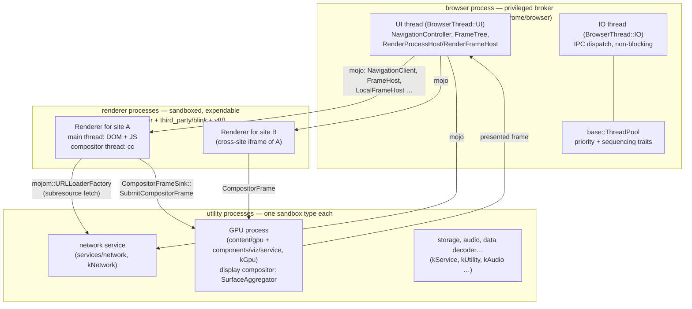
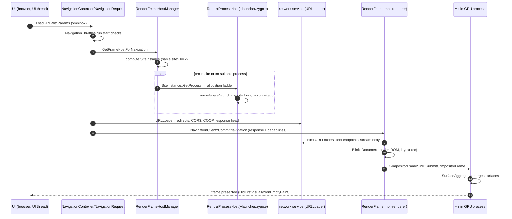
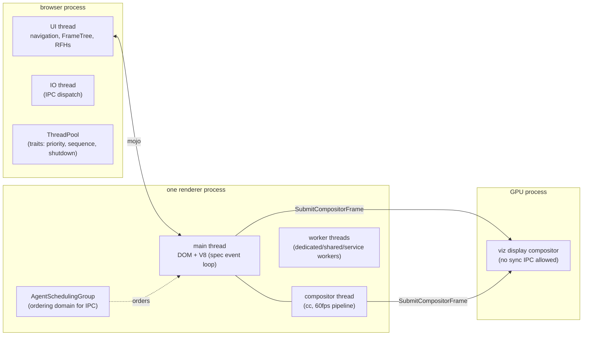

# Chromium: a security model that forced a multi-process operating system for web content

> **Atlas id:** `chromium` · **Domains:** `browser-engine` ·
> **Upstream:** https://github.com/chromium/chromium · **License:** BSD-3-Clause AND others ·
> **Pinned commit:** `2e4ac9790fceb5cc73ce2bb35a1b4835f67a4b7c` (2026-10-16)

Chromium is the most dominant browser engine ever built, and the
lesson it teaches is written into its process map: **the security
model came first, and the architecture was forced by it**. A browser
must run millions of lines of parsing, layout, scripting, and
decoding code over hostile input, so Chromium does not even try to
make that code trustworthy — it makes it *powerless*: web content
runs in sandboxed renderer processes that by design have no
filesystem, no network sockets, and no direct access to the display
(bpf_renderer_policy_linux.cc allowlists syscalls; subresource
fetching happens only through a URLLoaderFactory pipe handed over by
the privileged browser process). Everything a renderer can do is an
IPC message over Mojo, an IDL-generated, typed, versioned message
system spanning ~1,900 `.mojom` interface definitions; everything it
owns is reachable only through capabilities the browser granted it.
The browser process plays operating system: it owns the frame tree
(the browser's *mirror* of every page's DOM tree, FrameTreeNode +
replicated state), allocates renderers to sites through a policy
ladder (SiteInstance → SiteInstanceGroup → RenderProcessHost), and
supervises them with the explicit assumption that any of them may be
compromised — 409 catalogued reasons to kill one on the spot
(content/browser/bad_message.h). Read this dive against
[Servo](servo.md), its catalog pairing: Servo decomposes the same
problem with ownership types and message-passing *inside* one
process by default; Chromium decomposes it with OS processes and
capability IPC *always* — same distrust, two answers, and the
comparison is the point.

## Explain like I'm 10

**A giant restaurant where every website's food is cooked in its own
locked kitchen, by cooks who are locked in too.** The front-of-house
manager (the browser process) takes every order, but never lets any
cook out of the kitchen area: kitchens have no windows and no doors
to the street (the sandbox — a renderer can't touch files or the
network), only a hatch (Mojo IPC) with preprinted order forms
(`.mojom` interface files — you can only ask for things there's a
form for). Cooks (Blink's DOM engine + V8, the JavaScript engine)
for one restaurant chain always work in the same kitchen (site
isolation — a SiteInstance), and never share a kitchen with a rival
chain, so if rival food is poisoned it stays in their kitchen. When
a cook needs groceries, he can't go shopping: he slides a request
form through the hatch and the manager's buyer (the network service
process) fetches it — cooks have no wallets. Finished dishes are not
plated in the kitchen: kitchens send labeled trays (CompositorFrames)
to the plating station (the GPU process running viz, the display
compositor), which lays out every kitchen's trays into one picture
you see on the screen. If a kitchen catches fire (a renderer crash),
only that table gets a sorry-card (the sad tab); the manager simply
lights a new kitchen — and because she kept her own clipboard mirror
of every order (the browser's frame tree), nothing else on the menu
is lost.

**Why the grown-ups did it this way:** a browser downloads and runs
strangers' programs millions of times a day, so instead of promising
the code is safe, the design takes away everything but the hatch —
an OS-enforced sandbox needs a process boundary, and that single
requirement explains almost every other choice in this codebase.

## 1. Architecture overview

- **The browser process is the only trusted process, and it is a
  broker, not a worker.** It runs the UI, owns the disk, sockets,
  and credentials, and every capability a renderer or service
  process holds was handed out by it. Structurally it is split
  between `content/browser` (the embeddable engine core) and
  `chrome/browser` (Chrome-the-product: omnibox, history,
  extensions — ~574 MB vs ~73 MB of source in this clone), joined
  by the `ContentBrowserClient` SPI ("Use this 'escape hatch'
  sparingly", content/public/browser/content_browser_client.h:314).
  Threading is two named threads — `BrowserThread::UI` (all
  navigation and state) and `BrowserThread::IO` ("the highly
  responsive, non-blocking I/O thread for IPC",
  browser_thread.h:86) — plus a process-wide `base::ThreadPool`
  whose tasks carry priority, sequencing, and shutdown traits
  (base/task/thread_pool.h).
- **Renderer processes are hostile-by-assumption and expendable.**
  Each hosts one site's documents and workers: Blink's DOM, style,
  and layout, plus V8 executing JavaScript (V8 is vendored as a
  separate tree at `v8/` — the same engine Node.js embeds, see
  [Node.js](nodejs.md)). The Linux seccomp-bpf policy for them is
  an allowlist on top of a deny-by-default baseline
  (sandbox/policy/linux/bpf_renderer_policy_linux.cc:
  `RendererProcessPolicy::EvaluateSyscall`); there is no file
  access and no socket — network I/O is delegated to the network
  service through `network::mojom::URLLoaderFactory` pipes
  (services/network/public/mojom/url_loader_factory.mojom:68), one
  of which is passed *into* the renderer at commit time with every
  navigation.
- **The GPU process is a separate trust domain because GPU drivers
  are untrusted-input-facing C++ that must be fenced off.** It
  hosts viz, the *display compositor*: renderers submit finished
  `CompositorFrame`s ("the complete output of a compositor meant
  for display", components/viz/common/quads/compositor_frame.h:24)
  through `viz.mojom.CompositorFrameSink::SubmitCompositorFrame`,
  and viz's `SurfaceAggregator`
  (components/viz/service/display/surface_aggregator.h:44) merges
  every frame sink's surfaces into one frame for the screen — one
  process composites untrusted content from many renderers without
  any renderer touching another's pixels. Notably, the GPU process
  bans synchronous IPC outright
  (`mojo::SyncCallRestrictions::DisallowSyncCall()`,
  content/gpu/gpu_main.cc:250) — deadlock prevention as a lockdown.
- **Everything else is a utility process classified by sandbox
  type.** `sandbox/policy/mojom/sandbox.mojom` is the process
  taxonomy as an enum: `kRenderer` ("Hosts untrustworthy web
  content. Blocks as much OS access as possible"), `kGpu`,
  `kNetwork`, `kAudio`, `kService` ("computation only" services
  such as media decoders), `kCdm`, `kPrintCompositor`, … each with
  its own policy — dangerous codecs and parsers get their own
  process class rather than a code audit.
- **Mojo is the connective tissue.** Interfaces are declared in
  `.mojom` IDL and compiled into typed C++/Java/JS bindings;
  `mojo::Remote<T>`/`PendingReceiver<T>` pairs are capabilities
  (mojo/public/cpp/bindings/remote.h:29). Child processes are born
  via a Mojo *invitation* ("invite another process to join the
  calling process's IPC network",
  mojo/public/cpp/system/invitation.h:46) — the renderer launcher
  even attaches the GPU channel pipe to the invitation before the
  child exists (render_process_host_impl.cc:2004
  `mojo_invitation_.AttachMessagePipe`).
- **The spine** is one browser-initiated navigation to first
  presented frame: omnibox → `NavigationControllerImpl::
  LoadURLWithParamsForResult`
  (navigation_controller_impl.cc:1745) → `NavigationRequest` state
  machine + NavigationThrottles → process/site selection
  (`RenderFrameHostManager::GetFrameHostForNavigation`,
  render_frame_host_manager.cc:1931) → possible new renderer
  (`RenderProcessHostImpl::GetProcessHostForSiteInstance`, the
  allocation ladder) → URLLoader in the network service →
  `NavigationClient::CommitNavigation` →
  `RenderFrameImpl::CommitNavigation` (render_frame_impl.cc:2671)
  → Blink builds the document → cc produces a CompositorFrame →
  viz aggregates and presents. The Walkthrough traces exactly this.

## Walkthrough: one navigation, omnibox to first presented frame

**Step 1 — The omnibox never talks to a renderer.** An omnibox
navigation lands in the browser's `NavigationController` as
`LoadURLWithParamsForResult` (content/browser/renderer_host/
navigation_controller_impl.cc:1745): debug URLs are intercepted,
params validated, then control passes to `NavigateWithoutEntry`,
which creates a `NavigationRequest` — a ~14,000-line-per-file
browser-side state machine (content/browser/renderer_host/
navigation_request.cc) that owns the navigation from URL to commit.
The renderer that will display the page is, at this moment,
irrelevant: process placement is a later, separate decision.

**Step 2 — Throttles: policy as a pipeline.** Before any bytes move,
the NavigationRequest runs NavigationThrottles — embedder-supplied
checks (redirects, permissions, Safe Browsing) that may proceed,
defer, cancel, or block; `OnStartChecksComplete`
(navigation_request.cc:6196) is the gate that fires once all start
checks pass, wiring the service-worker handle and the storage
partition. This is where Chrome-the-product gets to veto without
content-the-engine knowing it exists — the same seam VS Code uses
for its extension contributions.

**Step 3 — Where will this document live?** The request reaches
`RenderFrameHostManager::GetFrameHostForNavigation`
(render_frame_host_manager.cc:1931) for its frame's `FrameTreeNode`.
The manager computes the destination `SiteInstanceImpl`
(`GetSiteInstanceForNavigationRequest`): same-site stays in the
current renderer; a cross-site navigation gets a new SiteInstance —
and if that instance needs one, a *speculative* RenderFrameHost
(`CreateSpeculativeRenderFrameHost`, :4483) is created so the old
page stays interactive until commit. This is the site-isolation
decision point, in code.

**Step 4 — Process allocation is a policy ladder.**
`SiteInstanceImpl::GetProcess` bottoms out in
`RenderProcessHostImpl::GetProcessHostForSiteInstance`
(render_process_host_impl.cc:5430): reuse the sole process-per-site host if the policy says so;
reuse a host for a pending/committed same site; match an unmatched
service worker; reuse an empty background host; take a pre-launched
*spare* renderer (`SpareRenderProcessHostManager`); if the process
limit is hit (`GetMaxRendererProcessCount`, :1522 — RAM/2 divided
by an 85 MB-per-tab estimate, clamped 3..82), pick a random suitable
existing host (`GetExistingProcessHost`, :5356 — `base::RandomChoice`
over suitability-filtered hosts); only otherwise launch new.

**Step 5 — A renderer is born holding capabilities.** If launch is
needed, `RenderProcessHostImpl::Init` (:1913) builds the command
line, wraps a `RendererSandboxedProcessLauncherDelegate`, and hands
a `ChildProcessLauncher` a Mojo invitation — with the GPU channel
pipe already attached (:2004). On Linux the launcher asks the
*zygote* — a pre-warmed, already-sandboxed ancestor process — to
fork (`ZygoteCommunication::ForkRequest`,
content/browser/child_process_launcher_helper_linux.cc:88), then
tunes the OOM score so the kernel prefers killing renderers
(`kLowestRendererOomScore`). The child's seccomp filter installs
before any web content runs; its only superpower is the hatch.

**Step 6 — The browser fetches; the renderer waits.** The
NavigationRequest drives the load through the network service: a
`network::mojom::URLLoader` handles redirects, CORS, COOP/COEP,
and returns the response head. When it is safe to commit, the
browser calls `NavigationClient::CommitNavigation`
(content/common/navigation_client.mojom:297 — "Tells the renderer
that a navigation is ready to commit") passing not just the
response but a *capability bundle*: a data pipe with the body,
subresource `URLLoaderFactory`s, a cookie manager, a policy
container, a code-cache host. The renderer never fetched the main
resource; it is handed the results.

**Step 7 — Commit: two trees agree.**
`RenderFrameImpl::CommitNavigation` (content/renderer/
render_frame_impl.cc:2671) binds the loader endpoints, decodes the
body stream, and hands the payload to Blink's DocumentLoader to
build the document — DOM, style, layout — with V8 executing
scripts as the parser yields. Blink reports the commit back
(`DidCommitProvisionalLoad`), and the browser's mirror follows:
`RenderFrameHostManager::CommitPending` (:5281) swaps the
speculative RFH to current, the old RFH is unloaded or demoted to a
proxy, and replicated frame state (origin, sandbox flags, name)
updates in every process that hosts a frame of this tree.

**Step 8 — Pixels: renderers propose, viz decides.** Blink/cc
rasterizes what it can and produces a `CompositorFrame` — draw
quads over shared resources — submitted through the
`CompositorFrameSink` mojo interface the renderer holds toward the
GPU process (bound in Blink's `WidgetBase`,
third_party/blink/renderer/platform/widget/widget_base.cc:185).
There, `SurfaceAggregator` merges this renderer's surface with
every other frame sink (the browser UI's, other iframes') into the
display's frame. Presentation feedback flows back; the first
visually-non-empty paint is reported through `LocalFrameHost`
(`DidFirstVisuallyNonEmptyPaint`, blink.mojom frame.mojom:1396)
— the browser learns what the renderer did, never assuming it was
told the truth (viz distinguishes "painted something" from
"produced a frame" *without trusting any renderer-supplied signal*,
compositor_frame.h:57).

**Outcome — A page on screen, and a system that survived its own
assumptions.** Every renderer involved could have crashed at any
step — the browser's mirror, the capability bundle, and the
allocation ladder make a fresh process a three-function call away;
and every message in the trip was typed IDL, validated, and
kill-worthy, which is exactly how a codebase assembled over
eighteen years runs millions of hostile pages a day without
losing the UI thread.

## 2. Core data structures — and why these

- **`RenderProcessHost` — the supervisor's starved handle.**
  **What:** content/public/browser/render_process_host.h:130 —
  "There will generally be one RenderProcessHost per renderer
  process". It carries routing IDs, mojo pipes, priority clients,
  and lifecycle observers — but no DOM, no frame tree, no page
  content. Its `EnableSendQueue()` (:187) lets the browser send
  messages *before the process exists* and have them delivered
  when it does; `ShutdownForBadMessage` (:212) kills on invalid
  input. **Why:** the same starved-supervisor-record move as
  [Servo](servo.md)'s `Pipeline` (constellation-facing view with no
  DOM pointer) or [Kubernetes](kubernetes.md)' informers: the
  supervisor can supervise, restart, and distrust cheaply because
  it holds projections, not truths.

- **`SiteInstance` / `BrowsingInstance` (+ `SiteInstanceGroup`) —
  the security principal, separated from the process.** **What:**
  `content/browser/browsing_instance.h` — a BrowsingInstance is a
  "unit of related browsing contexts" (windows/frames that can
  script each other); within it, a SiteInstance is the atomic
  same-site group that *must* share a process. Newer still,
  `SiteInstanceGroup` (content/browser/site_instance_group.h:76)
  is "one view of a browsing context group's frame trees within a
  renderer process… a tuning knob, allowing the number of groups
  to vary… without affecting the number of security principals."
  **Why:** the key insight this codebase teaches: *principals* and
  *processes* are different axes. Same-site-synchronous-access is
  a spec fact (HTML agent clusters); process count is a resource
  decision. Keeping them as separate types lets Android share
  processes under memory pressure while desktop isolates — same
  code, different tuning.

- **`FrameTree` / `FrameTreeNode` / `RenderFrameHostManager` — the
  browser's mirrored DOM.** **What:**
  content/browser/renderer_host/frame_tree.h:72 — one per page,
  built from browser-side nodes that exist "in response to frame
  attach and detach events in the DOM"; each node's manager holds
  the `current_frame_host_`, a speculative one during cross-site
  navigations, and proxy hosts for frames living in other
  processes, plus `FrameReplicationState` (origin, sandbox flags,
  name) replicated to every relevant renderer. **Why:** because
  the renderer cannot be trusted to describe its own tree, the
  browser keeps its own — the renderer must even *ask* to create a
  child frame (`FrameHost::CreateChildFrame`,
  content/common/frame.mojom:741). Duplicated state is the price
  of distrust, and the mirror is where jail checks are enforced.

- **Mojo `Remote<T>` / `PendingReceiver<T>` — IPC as capability
  tokens.** **What:** mojo/public/cpp/bindings/remote.h:29 — a
  `Remote` is bound by consuming a `PendingRemote` "received via
  some IPC" or by `BindNewPipeAndPassReceiver()`: message-pipe
  endpoints are values you can pass, store, and revoke; a
  `PendingReceiver` names the *right to be talked to*. New pipes
  ride invitations to newborn processes
  (mojo/public/cpp/system/invitation.h:46), and the
  `BrowserInterfaceBroker` (blink.mojom browser_interface_broker.mojom)
  is the renderer's one sanctioned way to ask for more
  ("GetInterface(GenericPendingReceiver)"), implemented per
  execution context with compile-time binder maps
  (content/browser/browser_interface_broker_impl.h:33). **Why:**
  the process boundary is a capability system: nothing is
  reachable that wasn't granted, and grants are revocable objects
  — the object-capability lesson at industrial scale.

- **`CompositorFrame` + `SurfaceId` — the rendering currency
  between processes.** **What:**
  components/viz/common/quads/compositor_frame.h:24 — draw quads
  over transferable resources, produced by any renderer (or the
  browser UI) and submitted with a `LocalSurfaceId`; viz's
  `FrameSinkManagerImpl` (components/viz/service/frame_sinks/
  frame_sink_manager_impl.h:83) tracks surfaces, and
  `SurfaceAggregator` composes them. **Why:** cross-process
  compositing needs an immutable, serializable unit of "what to
  draw" — the same reason [FFmpeg](ffmpeg.md) refcounts AVFrames:
  zero-copy handoff of buffers between trust domains. The viz side
  even bounds queueing (`max_uncommitted_frames`, frame_sink_manager_impl.h:112).

## 3. Concurrency and failure model

- **What runs concurrently:** processes by the dozen (each with its
  own sandbox class), threads within each. **What is serialized:**
  per-thread task queues. Chromium's rule of thumb is written in
  docs/threading_and_tasks.md: prefer message passing between
  sequences over locks; "always avoid reading/writing to the same
  place in memory from separate threads… Prefer passing messages."
  The renderer's main thread implements the HTML event-loop
  processing model (same spec duty as Servo's script thread), with
  cc's compositor thread separate so scrolling can outrun JS; the
  browser's UI thread owns all navigation state while its IO
  thread only dispatches IPC. `AgentSchedulingGroupHost`
  (content/browser/renderer_host/agent_scheduling_group_host.h:40)
  exists purely to give cross-interface message *ordering* a
  schedulable identity: "the only way to obtain ordering
  guarantees between different Mojo (associated) interfaces and
  legacy IPC messages."
- **Crash containment is the architecture.** A dead renderer
  surfaces as `RenderProcessHostImpl::ProcessDied`
  (render_process_host_impl.cc:5736): reset the mojo receivers so
  "no IPCs or mojo calls from the old process get dispatched after
  it has died," notify observers, re-arm the send queue, and the
  host is reusable — the embedder shows the sad tab
  (chrome/browser/ui/sad_tab_controller.h) and a reload re-runs the
  same allocation ladder. Nothing else loses state, because only
  the mirror lives in the browser.
- **Distrust has a taxonomy.** Every security-relevant invariant on
  the IPC surface is a `BadMessageReason` — 409 of them
  (content/browser/bad_message.h:26) — and tripping one logs
  "Terminating renderer for bad IPC message, reason N"
  (bad_message.cc:29) and kills the process
  (`RenderProcessHost::ShutdownForBadMessage`). Compromised
  renderers get jail-checked on top: `ChildProcessSecurityPolicy::
  CanAccessDataForOrigin` (now being rewritten in Rust,
  content/browser/security/cpsp/child_process_security_policy_impl.rs)
  enforces that a process locked to a site cannot fetch or be
  granted another site's data — the browser re-verifies every
  privileged request, in the broker.
- **Backpressure is policy, in three places.** Navigation:
  NavigationThrottles defer/cancel, and a new navigation
  supersedes an in-flight speculative RFH (wasted-speculative-RFH
  metrics are a named enum, render_frame_host_manager.h:105 — they
  budget the speculation). Rendering: viz drives renderers with
  BeginFrames and bounds `max_uncommitted_frames`. Memory: the
  process-count model itself (`GetMaxRendererProcessCount`) is
  memory budgeting — the fallback ladder exists because RAM is the
  scarce resource.

## 4. API and extension design

- **The public surface is an embedding API: `content` is the
  product.** `content/public/` is the engine's API (RenderProcessHost,
  WebContents, SiteInstance, ContentBrowserClient), `chrome/` is
  one embedder, and Android WebView, ChromeOS, headless, and
  Electron/CEF all build on the same seam. `ContentBrowserClient`
  (content/public/browser/content_browser_client.h:314) is the
  embedder's SPI — 3,455 lines of hooks with a self-aware warning:
  "Use this 'escape hatch' sparingly, to avoid the embedder
  interface ballooning." Compare [Servo](servo.md)'s
  `ServoBuilder`/delegates (engine-first, shell-later) and
  [VS Code](vscode.md)'s extension host: all three became platforms
  by putting the embedder seam in before the product needed it.
- **Risky code becomes a process, not a patch.** The utility
  process pattern (one sandbox class per trust domain,
  sandbox.mojom) means adding a media codec or a font parser is a
  BUILD target plus an enum entry, and the blast radius is a
  process — [HAProxy](haproxy.md)'s "budgeted" philosophy applied
  to capability rather than latency. Mojo's `[ServiceSandbox=…]`
  attribute declares the sandbox right in the IDL.
- **Interfaces are the API design unit.** `.mojom` files declare
  methods, enums, and structs; the generator produces bindings,
  validation, and JS glue. Versioning is by field ordinals, so a
  renderer one milestone behind the browser still parses — an
  upgrade-compatibility contract across millions of
  simultaneously-running versions of the same system.
- **Honest warts.** `WebContentsImpl` is a 13,000-line god object
  (web_contents_impl.cc) that even its neighbors mock
  (render_frame_host_manager.h:185 "TODO(brettw) Clean this up!");
  two IPC systems (legacy IPC routing + mojo) coexist during the
  decades-long migration — `RenderProcessHost` still implements
  `IPC::Listener` while every new surface is mojo; and the mirror
  tree means every renderer-side frame feature must budget a
  browser-side twin, which is why site isolation took years, not
  months.

## 5. The defining trade-offs

### Trade-off 1: OS processes over in-process isolation
- **Tension:** web content is hostile, and proving 45M lines of
  parser/layout/JS memory-safe is hopeless — but the browser must
  keep working anyway.
- **Choice:** sandbox *first* (deny-by-default syscall filters,
  sandbox/policy/linux/bpf_renderer_policy_linux.cc), then place
  the sandbox boundary at an OS process, then route every
  capability through the trusted broker (`URLLoaderFactory` pipes
  for the network, CompositorFrame submission for pixels,
  LocalFrameHost calls for privileged actions).
- **Evidence:** `sandbox.mojom` — the whole process taxonomy as
  capability classes; `RenderProcessHostImpl::Init` passing a
  mojo invitation + GPU pipe to an unborn child (:2004); the
  zygote fork path (child_process_launcher_helper_linux.cc:88)
  making sandboxed process creation cheap; and
  `GetMaxRendererProcessCount` (:1522) pricing the choice in RAM.
- **Given up:** tens of MB and a page-table per site; an IPC hop
  for nearly everything (subresource loads serialize through the
  network service); startup latency (hence spares and zygotes).
- **Verdict:** right when the workload is hostile and machine-wide
  compromise is unacceptable — which is precisely a browser, and
  precisely why Chrome won the security argument while its
  process-agnostic rivals stalled. Wrong for a single-tenant,
  embedded engine: [Servo](servo.md) keeps the same message
  discipline but defaults to threads and buys isolation with Rust's
  type system instead of page tables — and Chromium itself keeps
  `run_renderer_in_process()` (render_process_host_impl.cc:2077)
  for tests, paying proof that both worlds are wanted.

### Trade-off 2: one typed, generated IPC substrate for every boundary
- **Tension:** with many process classes and dozens of teams, ad-hoc
  IPC protocols rot, drift, and become attack surface.
- **Choice:** everything crosses process boundaries as mojo —
  declared in ~1,900 `.mojom` files, compiled to typed bindings
  with wire-format validation and field-ordinal versioning;
  capabilities are pipes (`Remote`/`PendingReceiver`), granted by
  the broker per execution context, and deferrable by policy
  (browser_interface_broker_impl.h:33 — prerendering holds
  binders until activation).
- **Evidence:** the broker maps populated "statically at compile
  time" per host type; `NavigationClient::CommitNavigation`
  passing an entire capability bundle as one typed call
  (navigation_client.mojom:297); associated interfaces under an
  AgentSchedulingGroup to preserve cross-interface ordering
  (agent_scheduling_group_host.h:40).
- **Given up:** simplicity — the type system makes casual
  "just call a function" cross-process work impossible, forces
  interface reviews, and leaves two IPC worlds coexisting while
  the migration finishes; plus a generator toolchain in the build.
- **Verdict:** right when boundaries are many, teams are many, and
  the message surface *is* the security perimeter. This is
  [Redis](redis.md)' commands.json and [PyTorch](pytorch.md)'s
  native_functions.yaml at OS scale: generate the surface from
  data so implementation, validation, and docs cannot drift — and
  here, so a compromised peer cannot speak anything but the
  typed dialect. Wrong for a small fixed set of in-house
  processes, where it is ceremony.

### Trade-off 3: mirrored state and re-verification over trusting the renderer
- **Tension:** the renderer owns the live DOM (only it can run the
  spec's algorithms), yet the browser must make security decisions
  about that DOM (can this process show this origin? navigate
  here? read these cookies?) without trusting its tenant.
- **Choice:** the browser keeps its own frame tree
  (FrameTreeNode + FrameReplicationState) updated by explicit
  replication, requires renderer requests for tree structure
  (`FrameHost::CreateChildFrame`), re-verifies every privileged
  request against policy (`ChildProcessSecurityPolicy::
  CanAccessDataForOrigin`; the "jail/citadel checks" of
  docs/process_model_and_site_isolation.md), and treats
  inconsistency as a killable offense (bad_message.h's 409
  reasons).
- **Evidence:** browsing_instance.h's rule that a BrowsingInstance's
  same-site frames must share a process — enforced by checking the
  mirror at commit (`GetFrameHostForNavigation`); viz refusing to
  trust even a renderer's "I painted something" claim
  (compositor_frame.h:57).
- **Given up:** double bookkeeping and its whole bug class —
  drift between mirror and truth (the enum `WastedSpeculativeRFHCase`
  is one such budget); every new web feature pays a browser-side
  twin; latency on every privileged action.
- **Verdict:** right when the data's owner may be your attacker —
  in any broker over untrusted workers (a cluster scheduler over
  its agents, a kernel over user space). Wrong inside one trust
  domain, where it is pure overhead: [Servo](servo.md)'s layout
  reading the DOM in-thread is the counterexample — safe there
  because the *owner* is trusted-by-construction, not by decree.

## 6. Reading path

1. `docs/process_model_and_site_isolation.md` — the authoritative
   in-tree design doc; read its "Goals" and "Abstractions" first:
   every class below exists to implement a sentence in this file.
2. `sandbox/policy/mojom/sandbox.mojom` — the process taxonomy as
   an enum with one doc comment per sandbox class; note what
   `kRenderer` is *not* allowed.
3. `content/public/browser/render_process_host.h` — the
   supervisor's handle as pure interface: routing, observers,
   `EnableSendQueue`, `ShutdownForBadMessage`. Then
   `render_process_host_impl.cc:1522 GetMaxRendererProcessCount`
   and `:5430 GetProcessHostForSiteInstance` — the allocation
   ladder, policy as a cascade of fallbacks.
4. `content/browser/renderer_host/render_process_host_impl.cc:1913
   Init` — process birth: sandbox delegate, mojo invitation with
   the GPU pipe pre-attached, `run_renderer_in_process()` escape
   hatch. Then `content/browser/child_process_launcher_helper_
   linux.cc:81 LaunchProcessOnLauncherThread` — the zygote fork
   and OOM-score tuning.
5. `content/browser/browsing_instance.h` (class comment) and
   `content/browser/site_instance_impl.h` — principals and the
   same-site sharing rule; then `content/browser/site_instance_
   group.h:76` — the newer tuning knob separating principals from
   processes, and `content/browser/renderer_host/
   agent_scheduling_group_host.h:40` for ordering guarantees as a
   schedulable unit.
6. `content/browser/renderer_host/frame_tree.h` and
   `frame_tree_node.h` — the browser's mirror tree; find
   `current_replication_state()` and ask who writes it and when.
7. `content/browser/renderer_host/render_frame_host_manager.h:134`
   — the long class comment narrating a cross-process navigation;
  then `.cc:1931 GetFrameHostForNavigation` and `:4483
   CreateSpeculativeRenderFrameHost` — where site isolation
   actually decides.
8. `content/browser/renderer_host/navigation_controller_impl.cc:
   1745 LoadURLWithParamsForResult` → `navigation_request.cc:6196
   OnStartChecksComplete` — the browser-side navigation machine;
   skim the throttle result handling only.
9. `content/common/navigation_client.mojom:297` and
   `content/common/frame.mojom:427` — the commit contract and the
   frame interfaces, including `[SupportsUrgent]` priority IPC;
   then the receiving end, `content/renderer/render_frame_impl.cc:
   2671 CommitNavigation` — inventory every capability the
   renderer is handed.
10. `mojo/public/cpp/bindings/remote.h` (doc comment) and
    `mojo/public/cpp/system/invitation.h:46` — pipes as
    capabilities, invitations as birthright; then
    `third_party/blink/public/mojom/browser_interface_broker.mojom`
    with `content/browser/browser_interface_broker_impl.h:33` —
    the broker and its compile-time binder maps.
11. `third_party/blink/renderer/platform/widget/widget_base.cc:185`
    — where a renderer binds its `CompositorFrameSink`; then
    `components/viz/common/quads/compositor_frame.h`,
    `services/viz/public/mojom/compositing/compositor_frame_sink.mojom`,
    and `components/viz/service/display/surface_aggregator.h` —
    the frame currency and the merger; finish at
    `content/gpu/gpu_main.cc:250` (sync-IPC ban).
12. `content/browser/bad_message.h` (count the reasons) and
    `content/browser/security/cpsp/
    child_process_security_policy_impl.rs` — distrust made
    executable, and a security core mid-rewrite in Rust over a
    cxx bridge.
13. `base/task/thread_pool.h`, `content/public/browser/
    browser_thread.h:81`, and `docs/threading_and_tasks.md` —
    the message-over-locks concurrency contract every file above
    obeys.
14. `content/public/browser/content_browser_client.h:306` and the
    directory sizes (`content/browser` vs `chrome/browser`) — the
    engine/product split as the final API lesson; compare with
    [Servo](servo.md)'s embedder API from the other direction.

You have now traced one navigation from omnibox to first presented
frame — through a broker that mirrors what it cannot trust, a
sandbox that makes trust unnecessary, and a message system that
makes the whole boundary auditable — and you have the map to dive
into any one layer (blink, viz, network, mojo) knowing how it got
its boundary.

## 7. What to steal

- **Let the security model draw the architecture** — decide what
  code may not be trusted, fence it with OS primitives, and the
  process map, IPC design, and supervision policy all fall out;
  seen in sandbox.mojom's taxonomy existing *before* any process
  spawns.
- **Separate security principals from processes** — make the
  must-share unit (SiteInstance) a different type from the
  resource-tuning unit (SiteInstanceGroup), so platform memory
  budgets tune isolation without touching the security rules.
- **Supervise with starved handles** — the browser's process host
  holds ids, pipes, and priorities but no page content, so crash
  response is O(1) and the supervisor can't be corrupted through
  its own state (render_process_host.h vs Servo's pipeline.rs).
- **Make IPC capabilities, granted by a broker** — pipes as
  values, a single `GetInterface` choke point with per-context
  binder maps and deferrable policies; every grant auditable and
  revocable in one place (browser_interface_broker_impl.h).
- **Generate the entire message surface from IDL** — 1,900 .mojom
  files mean validation, versioning, and bindings are uniform
  across dozens of teams and process classes; drift becomes a
  build error, not a CVE.
- **Treat invalid input from your workers as a killable,
  catalogued event** — 409 BadMessageReasons with telemetry:
  compromise detection is a first-class subsystem, not a
  crash-report afterthought (bad_message.h).
- **Amortize process creation** — zygote forks and pre-launched
  spare renderers turn "spawn a sandboxed process" from a
  page-load cost into a background one
  (child_process_launcher_helper_linux.cc, SpareRenderProcessHostManager).

## 8. Difficulty and prerequisites

- Difficulty: `demanding`. Realistic budget: 14–18 hours for this
  path — the codebase is among the largest ever assembled (~45M
  lines across ~510k files), and this dive deliberately stays on the
  architecture spine (process model, navigation, IPC, compositing) rather than
  any subsystem's internals; budget each of Blink, V8, and the
  network service as separate future expeditions (V8 already has
  its own catalog entry).
- Prerequisites: comfortable C++ (interfaces, callbacks,
  refcounting); processes vs threads and what a syscall filter
  is (the [runc](runc.md) dive is excellent warm-up for sandbox
  primitives); the same-origin policy and the shape of the HTML
  spec's browsing contexts (the [Servo](servo.md) dive teaches
  the engine-side vocabulary); roughly what compositing is
  (layers → quads → frames). No prior Chromium experience needed
  — but read dive sections 1 and 6 of servo.md first for the
  shared vocabulary of frames, event loops, and pipelines.

## 9. Further reading

- In the clone: `docs/process_model_and_site_isolation.md` (the
  design doc this dive paraphrases), `docs/navigation_concepts.md`
  and `docs/navigation.md` (Life of a Navigation — the same spine
  as the Walkthrough), `docs/design/sandbox.md` +
  `sandbox_faq.md`, `docs/mojo_and_services.md`,
  `docs/threading_and_tasks.md`.
- The [Servo](servo.md) dive in this atlas — the paired engine:
  same distrust, answered with ownership types and in-process
  message passing; read the two trade-off sections side by side.
- chromium.org's Site Isolation pages and
  `docs/security/compromised-renderers.md` (in-tree) for the
  threat model behind jail/citadel checks.
- The web.dev series "Inside look at modern web browser" (parts
  1–4) — the multi-process story told at blog level, good
  orientation before the code.
- [Node.js](nodejs.md) and [CPython](cpython.md) in this atlas
  for the other side of V8 and GC'd runtimes; [nginx](nginx.md)
  and [HAProxy](haproxy.md) for supervisor+expendable-worker
  patterns with far narrower workers; [VS Code](vscode.md) for a
  second look at an engine that became a platform via an embedder
  seam.
