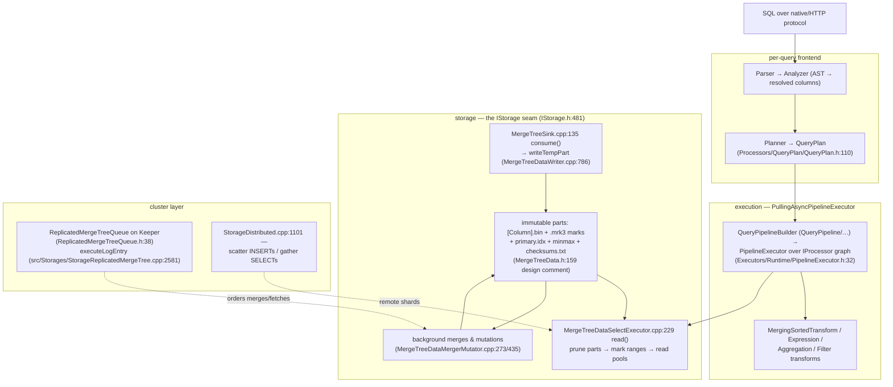
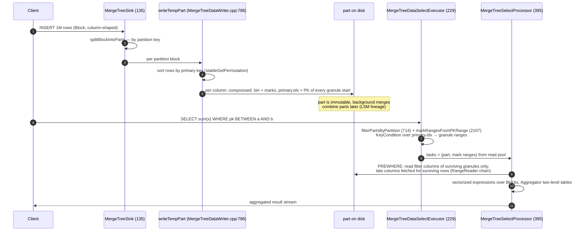
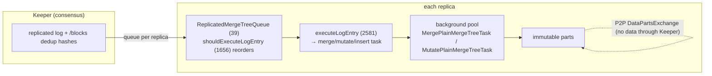

# ClickHouse: columns all the way down — rows are an afterthought

> **Atlas id:** `clickhouse` · **Domains:** `database, distributed` ·
> **Upstream:** https://github.com/ClickHouse/ClickHouse · **License:** Apache-2.0 ·
> **Pinned commit:** `eb9d89e2a30c66eea972b2f11aa279c751616393` (v26.9.24.8-stable, 2026-10-21)

ClickHouse is the analytical database that made "scan a billion rows,
answer in a second" a commodity — and it won that slot not with one
clever algorithm but with one *shape* applied end-to-end: data lives as
columns in memory (`Block`/`IColumn`), as columns on disk (per-column
compressed files inside immutable, primary-key-sorted parts), and is
processed as columns (vectorized functions called once per batch, not
once per row). This deep-dive teaches that shape through the MergeTree
engine — the third storage-engine form in this atlas after
[LevelDB](leveldb.md)/RocksDB (LSM-trees) and
[Elasticsearch](elasticsearch.md) (inverted index): the same
immutable-parts-plus-background-merges skeleton as LevelDB, but the
payload is columns and the payload-side index is *sparse* — one primary
key value per ~8,192 rows, small enough to sit in memory while still
letting every query skip most of the data.

## Explain like I'm 10

**A filing warehouse that stores each field of a form in its own drawer,
and almost never carries a whole form around.** Every column of the
table gets one long drawer (the per-column `.bin` file) holding just
that field for millions of forms, and all drawers in one filing box
(the immutable *part*) are in the same sorted order, so drawer position
234 lines up with drawer position 234. New forms arrive in armfuls (an
INSERT block); a clerk sorts each armful and seals it into its *own*
box (a new part) — existing boxes are never edited, only eventually
recycled. Each drawer carries a bookmark every ~8,192 entries (a
*mark*), recording exactly where to jump; and each box has a tiny tab
card listing just the first entry of every 8,192-stretch for the
sorting fields (`primary.idx` — the *sparse primary index*). When you
ask "show me everyone aged 40," the clerk first reads the cheap age
drawer's tab cards, skips whole stretches that can't contain a 40
(PREWHERE), and only then opens the expensive drawers (long bios,
photos) for the survivors. Clerks never handle one form at a time: they
slide a whole tray of 8,192+ values through the counting machine in one
pass (vectorized execution over a `Block`). When boxes pile up, a night
crew builds bigger boxes by shuffling sorted piles together (background
merges) — never rewriting a sealed box in place.

**Why the grown-ups did it this way:** analytical questions are "sum
this column over a billion rows" — handling rows one at a time costs
more than the math itself, so the stretch (granule/batch) is made the
unit of storage, of skipping, and of computing, letting disks stream
and CPUs vectorize.

## 1. Architecture overview

- **Frontend:** every query text becomes an AST, then a resolved,
  typed analysis (the Analyzer), then a `QueryPlan` that the Planner
  lowers into a pipeline of `IProcessor` nodes. The plan — not the
  interpreter — is where optimization happens; the pipeline is a
  pull-based dataflow graph executed by a thread pool.
- **Storage seam:** a table is an `IStorage`; `IStorage::write`
  (`src/Storages/IStorage.h:481`) hands INSERT blocks to a sink, and
  the select executor turns a WHERE clause into a list of parts and
  mark ranges. Everything MergeTree-specific lives behind this seam —
  the same pipeline machinery serves Kafka, URL, and in-memory tables.
- **The spine** — insert one block, then aggregate over a filtered
  range — is: `MergeTreeSink::consume` → `writeTempPart` (sort by
  primary key, write per-column streams, marks, `primary.idx`) → a new
  immutable part; then for reads `MergeTreeDataSelectExecutor::read` →
  partition/PK/skip-index pruning → mark-range tasks → granule reads
  through the PREWHERE column chain → vectorized expression and
  aggregation transforms → output format. The Walkthrough traces it.

## Walkthrough: one INSERT becomes a part, one SELECT skips most of it

The spine as a story: writes seal sorted boxes; reads skip to the
stretches that matter and open heavy drawers last.

**Step 1 — The block arrives already columnar.** Client and server
exchange `Block`s — the unit of processing in this system is never a
row, but a batch of columns (`src/Core/Block.h:32`, whose class comment
declares it "unit of data processing"). A million-row INSERT is a
handful of long arrays, not a million tuples.

**Step 2 — Split, sort, seal.** `MergeTreeSink::consume`
(`src/Storages/MergeTree/MergeTreeSink.cpp:135`) splits the block by
partition key (`splitBlockIntoParts`), then
`MergeTreeDataWriter::writeTempPartImpl`
(`src/Storages/MergeTree/MergeTreeDataWriter.cpp:786`) sorts each
partition block by the primary key (`stableGetPermutation`), so every
part is one sorted run — exactly LevelDB's "log + sorted run" split,
except the run's columns stay separate on disk.

**Step 3 — Write columns, marks, and the sparse index.**
`MergeTreeDataPartWriterWide::write`
(`src/Storages/MergeTree/MergeTreeDataPartWriterOnDisk.cpp` family,
Wide variant at `MergeTreeDataPartWriterWide.cpp:360`) streams each
column into its own compressed `.bin` file, dropping a *mark* every
granule (default 8,192 rows, `MergeTreeSettings.cpp:72`; adaptive
granularity capped in bytes, `index_granularity_bytes` 10MiB default,
`:1929`) into `.mrk3` — a mark is just
two offsets (`MarkInCompressedFile`,
`src/Formats/MarkInCompressedFile.h:17`). Then
`calculateAndSerializePrimaryIndex`
(`src/Storages/MergeTree/MergeTreeDataPartWriterOnDisk.cpp:255`)
writes `primary.idx`: the primary key of every granule's *first* row.
That is the whole "index" — one key row per 8,192 data rows.

**Step 4 — The query prunes parts.** A SELECT with a WHERE hits
`MergeTreeDataSelectExecutor::read`
(`src/Storages/MergeTree/MergeTreeDataSelectExecutor.cpp:229`):
`filterPartsByPartition` (`:714`) drops whole parts using per-part
`minmax_[Column].idx` files (partition pruning), and
`markRangesFromPKRange` (`:2107`) walks `primary.idx` in memory,
asking the `KeyCondition` (`src/Storages/MergeTree/KeyCondition.h:66`)
whether each granule's key range can still match — survivors become
mark ranges. In a well-partitioned table this one step skips the
majority of bytes without reading them.

**Step 5 — Granule-precise reads with PREWHERE.** The read pool hands
out (part, mark-range) tasks (`MergeTreeReadPoolBase::createTask`,
`src/Storages/MergeTree/MergeTreeReadPoolBase.cpp:387`);
`MergeTreeSelectProcessor::read`
(`src/Storages/MergeTree/MergeTreeSelectProcessor.cpp:395`) executes
them through a chain of `MergeTreeRangeReader`s: the filter columns
are read first (PREWHERE — `MergeTreeWhereOptimizer.cpp:139`
auto-demotes suitable WHERE conjuncts), rows that fail are filtered,
and only surviving rows pull the remaining, possibly wide, columns
(`MergeTreeRangeReader::executePrewhereActionsAndFilterColumns`,
`src/Storages/MergeTree/MergeTreeRangeReader.cpp:1727`). Positional
seeks land via `MergeTreeReaderStream::seekToMark`
(`src/Storages/MergeTree/MergeTreeReaderStream.h:45`): decompress from
this compressed-block offset, skip this many rows.

**Step 6 — Vectorized compute.** Surviving granules are `Block`s; the
pipeline's transforms call functions like `plus` not per row but per
column (`IFunctionBase::executeImpl`,
`src/Functions/IFunction.h:64`), which run tight
`for (i < size) c[i] = a[i] + b[i]` loops the compiler vectorizes
(`BinaryOperation::process`,
`src/Functions/FunctionBinaryArithmetic.h:292` — with an explicit
opt-out for integer division, which no mainstream ISA vectorizes).
GROUP BY fills the `Aggregator`'s hash table
(`src/Interpreters/Aggregator.h:94`), flipping to a two-level table
(`:132`) past a size threshold so the merge phase can parallelize, and
spilling to temporary files (`writeToTemporaryFile`, `:537`) when
`max_bytes_before_external_group_by` is hit.

**Step 7 — Background merges keep the tree shallow.** Later, while
queries run, `MergeTreeDataMergerMutator::selectPartsToMerge`
(`src/Storages/MergeTree/MergeTreeDataMergerMutator.cpp:273`) picks
adjacent sorted parts and `mergePartsToTemporaryPart` (`:435`) k-way
merges them (`MergingSortedAlgorithm`,
`src/Processors/Merges/Algorithms/MergingSortedAlgorithm.h:14`) into a
new part at a higher `level` — the part name carries that level, the
LSM signature. UPDATE/DELETE never edit parts: mutations enqueue
rewrites (`src/Interpreters/MutationsInterpreter.h:66`), executed by the same machinery.

**Outcome — Scans touch only what they need.** The INSERT became a
sealed, sorted, granulated part with no read-modify-write anywhere;
the SELECT read (per surviving granule) only the filter columns, then
only the needed columns of surviving rows — and every byte that *was*
read moved as a contiguous, compressed column stream through
batch-at-a-time arithmetic.

## 2. Core data structures — and why these

### Block — the unit of processing (`src/Core/Block.h:32`)

A `Block` is a list of named, typed columns — "container for set of
columns for bunch of rows… this is unit of data processing" (class
comment at `src/Core/Block.h:26`). Pipelines, formats, functions, the
client protocol: everything exchanges Blocks. **Why:** making the
batch the universal currency amortizes per-call overhead (virtual
dispatch, name/type checks) across 65k+ rows, and lets one engine
serve a whole ecosystem of transforms; the cost is that every
developer must think in column slices (`IColumn::cut`,
`insertRangeFrom`) instead of objects.

### IColumn + PODArray — columns as contiguous memory

`IColumn` (`src/Columns/IColumn.h:114`) is the abstract column;
`ColumnVector<T>` (`src/Columns/ColumnVector.h:25`) wraps a
`PODArray<T>` (`src/Common/PODArray.h:328`) — plain memory padded for
SIMD loads at both ends (`PADDING_FOR_SIMD`), with `insertRangeFrom`
as the bulk-copy primitive. Strings are one `UInt8` char array plus an
offsets array (`ColumnString.h:26`) — never one heap object per value.
**Why:** this is the layout SIMD and memory prefetchers want; compare
PostgreSQL's row pages where every sum(y) walks a row header per
value. The template-explosion cost is real (thousands of typed
specializations) but pays for itself in scan speed.

### The part — an immutable, sorted, columnar file set

Each part directory holds, per column, a compressed `.bin` plus
`.mrk3` marks, and `primary.idx`, `partition.dat`, `minmax_*.idx`,
`checksums.txt` — the layout documented in the design comment at
`src/Storages/MergeTree/MergeTreeData.h:159`. Parts are chosen wide
(one file per column) or compact (single `all.bin`) by expected size
(`choosePartFormat` in `writeTempPartImpl`). **Why:** identical shape
in memory and on disk means reading a column *is* one contiguous
decompress stream; per-column compression exploits intra-column
homogeneity (sortedness makes Delta/DoubleDelta codecs near-free).
Compare LevelDB's SSTables: same immutability, but one payload file
per row-block because its workload is point lookups.

### The sparse primary index + marks

`primary.idx` stores the primary key of each granule's first row — one
index entry per ~8,192 data rows (`MergeTreeDataPartWriterOnDisk.cpp:255`,
the write loop at `:278`). Marks are two file offsets per granule per
column (`MarkInCompressedFile.h:17`). **Why not a B-tree per row?**
An OLAP index doesn't need row-precision: an answer may over-read a
few thousand rows per range boundary, and the index stays small
enough to cache every part's in memory. This is the structural
opposite of PostgreSQL's B-tree-on-tuples — precision traded for scan
amplitude, the right trade when every query aggregates millions of
rows anyway.

### KeyCondition — a WHERE compiled against ranges

`KeyCondition` (`src/Storages/MergeTree/KeyCondition.h:66`) turns the
WHERE into an RPN over key columns, evaluating `checkInRange`
(`:159`) against granule boundaries; `mayBeTrueInRange` (`:196`) is
the prune test. Monotonic functions (`toMonth(date)` is monotonic) are
reasoned about, so `WHERE toMonth(d) = 3` still prunes. **Why:** the
index only pays if the planner can *prove* a granule can't match;
this is ClickHouse's tiny, honest query-optimizer-for-skipping (the
rest of "optimization" is mostly deferred to PREWHERE ordering and
projection choice).

## 3. Concurrency and failure model

- **Queries:** the pipeline is a graph of `IProcessor` nodes
  (`src/Processors/IProcessor.h:122`) executed by `PipelineExecutor`
  (`src/Processors/Executors/Runtime/PipelineExecutor.h:32`) on up to
  `max_threads` workers; MergeTree read tasks are handed out from the
  shared `MergeTreeReadPool` so threads that finish early steal mark
  ranges (`MergeTreeReadPoolBase::refineReadRanges`,
  `src/Storages/MergeTree/MergeTreeReadPoolBase.cpp:482`). No thread
  owns a connection or a table: work is granule-shaped and portable.
- **Crash-safety by immutability:** a half-written part lives in a
  `tmp_insert_` directory and is simply dropped on restart; a part
  becomes visible only after its files and `checksums.txt` are
  complete (see the layout comment, `MergeTreeData.h:159`). Merges
  write to temporary directories too — a crashed merge costs the
  wasted work, never the data. There is no undo log and none is
  needed; recovery is "delete tmp, trust checksums."
- **Replication:** `ReplicatedMergeTree` keeps an ordered log of
  intended operations (INSERT, MERGE, MUTATION, DROP…) in
  ClickHouse Keeper (ZooKeeper lineage); each replica tails its own
  `ReplicatedMergeTreeQueue`
  (`src/Storages/MergeTree/ReplicatedMergeTreeQueue.h:38`), and
  entries may execute out of order when safe
  (`shouldExecuteLogEntry`, `ReplicatedMergeTreeQueue.cpp:1656`;
  `executeLogEntry`, `src/Storages/StorageReplicatedMergeTree.cpp:2581`). Parts
  themselves are exchanged peer-to-peer, not through Keeper.
  INSERT deduplication is also a Keeper fact: block hashes under
  `/blocks/<hash>` make a retried insert idempotent.
- **Overload:** per-query memory accounting (the memory tracker
  threaded through PODArray allocators), external aggregation/sort
  spilling (`Aggregator.h:537`), cancellation checks even inside
  skip-index building (`MergeTreeDataPartWriterOnDisk.cpp` comment),
  and settings-bounded thread pools. A query that blows up dies; the
  table's background machinery keeps its own budgets.

## 4. API and extension design

- **The public surface is SQL + DDL-embedded structure.** Users
  describe *shape* — `ENGINE=MergeTree ORDER BY (a,b) PARTITION BY
  toYYYYMM(d)`, per-column `CODEC(Delta(2), ZSTD)`, skip indices,
  TTLs — and the engine derives all file layout, merges, and expiry
  from that declaration. Configuration of internals is data in the
  schema, the same "declarative shape, reconciling engine" stance as
  Kubernetes resources.
- **Extension seams are all factories with identical grammar:**
  storage engines (`StorageFactory.cpp:57`),
  table functions, scalar functions (`FunctionFactory.cpp:39`),
  aggregate functions (`AggregateFunctions/…registerAggregateFunctions.cpp`),
  data types (`DataTypeFactory.cpp:289`), codecs
  (`Compression/CompressionFactory.cpp`), and input/output formats
  (`Formats/FormatFactory.h:73`). Each registrant gets a name, a
  creator, and generated documentation — settings declare their own
  docs inline (`MergeTreeSettings.cpp:72` style `DECLARE` macros),
  which is how thousands of settings stay user-visible without a
  second handbook.
- **Honest wart:** the engine family tree (MergeTree,
  ReplicatedMergeTree, Replacing/Collapsing/Summing/Aggregating — the
  modes listed at `MergeTreeData.h:190-198` — plus projections,
  KeeperMap, &c.) grew by *subclassing the merge semantics* rather
  than by a small combinator; the payoff is a stable part format, but
  the interaction matrix (replication × TTL × projections ×
  mutations × codec changes) is the system's chronic source of edge
  cases and long queues. And because the index is coarse, point-style
  OLTP workloads (many tiny UPDATEs, single-row reads) run
  pathologically — that is by design, not omission.

## 5. The defining trade-offs

### Trade-off 1: column-major immutable parts over row-major mutable pages
- **Tension:** analytical scans want contiguous columns; updates and
  single-row reads want rows together and mutable.
- **Choice:** parts are per-column compressed files in an immutable
  directory, sorted by primary key; all change is new parts plus
  background rewrites.
- **Evidence:** `writeTempPartImpl` sorts every insert
  (`MergeTreeDataWriter.cpp:786`); column files written per-column
  with marks (`MergeTreeDataPartWriterWide.cpp:360`); the design
  comment `MergeTreeData.h:159` states the invariant "the table
  consists of several sorted parts… merged in the background."
- **Given up:** in-place UPDATE/DELETE (mutations are asynchronous
  part rewrites), fast point lookups (a hit still reads a whole
  granule per column), row-level transactions.
- **Verdict:** for append-mostly aggregation workloads this is the
  winning shape — the same verdict LevelDB reached for key-value,
  transposed. It would be wrong for your order-entry table; that is
  what PostgreSQL (this atlas) is for.

### Trade-off 2: sparse index + granule skipping over dense row indexes
- **Tension:** read less data vs index size and write amplification.
- **Choice:** index only every granule's first key (~8,192 rows,
  `MergeTreeSettings.cpp:72`); over-read at range boundaries;
  compensate with PREWHERE to filter before wide columns are read.
- **Evidence:** `calculateAndSerializePrimaryIndex`
  (`MergeTreeDataPartWriterOnDisk.cpp:255`, "index contains Primary
  Key value for each `index_granularity` row"); pruning in
  `markRangesFromPKRange` (`MergeTreeDataSelectExecutor.cpp:2107`);
  PREWHERE late materialization
  (`MergeTreeRangeReader.cpp:1727`).
- **Given up:** row-precise seeks; queries without useful predicates
  on the primary key read everything (skip indexes and partitions
  soften this).
- **Verdict:** when queries aggregate ranges, a few thousand extra
  rows per boundary is noise while a 100×-smaller index is pure win.
  Wrong for your workload when predicates are mostly on non-key
  columns at high selectivity — that is inverted-index territory
  ([Elasticsearch](elasticsearch.md)).

### Trade-off 3: vectorized batch interpretation over per-row (or full JIT) execution
- **Tension:** interpretation overhead vs code flexibility vs compile
  time.
- **Choice:** every operator, function, and format works on whole
  columns per call; tight loops auto-vectorize; selected hot
  expressions additionally compile to native code via LLVM
  (`USE_EMBEDDED_COMPILER` paths, e.g. `PlusImpl::compile` in
  `src/Functions/plus.cpp`).
- **Evidence:** `IFunctionBase::executeImpl` takes whole columns
  (`src/Functions/IFunction.h:64`); `BinaryOperation::process`
  pointer-loops with explicit vectorization policy
  (`FunctionBinaryArithmetic.h:292`); PREWHERE reorders column reads
  by cost (`MergeTreeWhereOptimizer.cpp:139`).
- **Given up:** row-at-a-time APIs (a UDF gets whole columns in,
  must return whole columns out), and a combinatorial mess of typed
  specializations; codegen would be faster still but is paid only
  where it amortizes.
- **Verdict:** for scan-heavy analytics the batch IS the right unit —
  memory bandwidth, not interpretation, is the ceiling, and this
  design keeps you at that ceiling with plain, debuggable C++.

## 6. Reading path

1. `src/Storages/MergeTree/MergeTreeData.h:159` — the file header's
   design comment: incremental sorting, part file structure, merge
   modes. The whole engine in 50 lines of comments; read it first.
2. `src/Storages/MergeTree/MergeTreeSettings.cpp:72` —
   `index_granularity` 8192 and `index_granularity_bytes` (10MiB,
   adaptive): the granule is the atom of reading; every later
   structure is sized around it.
3. `src/Storages/MergeTree/MergeTreeSink.cpp:135` — `consume`:
   partition split, and the pipeline-facing write entry point
   (`IStorage.h:481` is the seam it hangs from).
4. `src/Storages/MergeTree/MergeTreeDataWriter.cpp:786` —
   `writeTempPartImpl`: sort by primary key, part naming
   (partition_id, block range, *level* — the LSM signature),
   wide-vs-compact choice.
5. `src/Storages/MergeTree/MergeTreeDataPartWriterWide.cpp:360` —
   `write` and `writeSingleMark` (`:457`): one column file at a time,
   marks as (compressed, decompressed) offsets; then
   `MergeTreeDataPartWriterOnDisk.cpp:255` —
   `calculateAndSerializePrimaryIndex`: `primary.idx` = first key per
   granule. Pair with `src/Formats/MarkInCompressedFile.h:17`.
6. `src/Storages/MergeTree/MergeTreeDataSelectExecutor.cpp:714` and
   `:2107` — `filterPartsByPartition` then `markRangesFromPKRange`:
   minmax files and the in-memory sparse index deciding which
   granules exist for this query at all.
7. `src/Storages/MergeTree/MergeTreeSelectProcessor.cpp:395` —
   `read`: the task loop pulling (part, mark-range) work from the
   pool, and `:259 readCurrentTask` running the PREWHERE reader
   chain; then `src/Storages/MergeTree/MergeTreeReaderStream.h:45` —
   `seekToMark`: how a mark becomes a file position.
8. `src/Storages/MergeTree/MergeTreeRangeReader.cpp:1727` —
   `executePrewhereActionsAndFilterColumns`: filter columns read
   first, wide columns only for survivors; the atlas's clearest
   example of cost-ordered lazy materialization.
9. `src/Core/Block.h:26`, `src/Columns/IColumn.h:114`,
   `src/Columns/ColumnVector.h:25`, `src/Common/PODArray.h:328` —
   the in-memory column model every previous step produced or
   consumed; note `insertRangeFrom` as the bulk-mutation verb.
10. `src/Functions/IFunction.h:64` and
    `src/Functions/FunctionBinaryArithmetic.h:292` — the vectorized
    function contract and a canonical tight loop; then
    `src/Interpreters/Aggregator.h:94` for two-level hash tables and
    external spill — batch-ness extends to grouping.
11. `src/Processors/Executors/Runtime/PipelineExecutor.h:32` and
    `ExecutingGraph.h` — the executor that schedules processors over
    ports; queries are just graphs, sources and sinks included.
12. `src/Storages/MergeTree/MergeTreeDataMergerMutator.cpp:273` —
    `selectPartsToMerge` and `:435 mergePartsToTemporaryPart`; then
    `src/Storages/MergeTree/ReplicatedMergeTreeQueue.h:38` and
    `src/Storages/StorageReplicatedMergeTree.cpp:2581 executeLogEntry` —
    background merges and the Keeper-published log that orders them
    on every replica.

You have now traced one row batch from INSERT block to sorted,
granulated, compressed part (and onward through background merges),
and one SELECT from SQL text to granule-pruned PREWHERE reads,
vectorized arithmetic, and a merged aggregation — the full life of
analytical data in ClickHouse.

## 7. What to steal

- **Make the batch the unit everywhere — memory, disk, and calls.**
  One consistent granularity (`Block` in RAM, granule on disk) is why
  the whole engine feels like a library instead of a pile of
  special cases; you saw it in `Block.h:26` and
  `MergeTreeSettings.cpp:72`.
- **Index blocks, not rows, when answers aggregate over ranges.** The
  sparse primary index (`MergeTreeDataPartWriterOnDisk.cpp:255`)
  keeps the index cache-sized while skipping gigabytes — the same
  coarse-index insight as Kafka's sparse offsets and Lucene's
  segment-level terms, applied to columns.
- **Reorder work by data cost, not by query syntax.** PREWHERE
  (`MergeTreeWhereOptimizer.cpp:139`) moves cheap filters ahead of
  expensive column reads at execution time — a general rule for any
  system with heterogeneous fetch costs.
- **Immutable sorted runs + background k-way merges generalize beyond
  LSM key-value.** `MergeTreeDataMergerMutator.cpp:435` shows merges
  as the place to also apply semantics (dedup, collapsing, TTL) —
  compaction as a programmable stage, not just garbage collection.
- **Declarative shape, reconciling engine.** ORDER BY/PARTITION
  BY/CODEC/TTL in DDL describe intent; merges, moves, and expiry are
  derived consequences (`MergeTreeData.h:159`) — Kubernetes' stance,
  inside a storage engine.
- **Factories with self-describing registrations.** Every extension
  axis (engines, functions, codecs, formats) registers name + creator
  + docs in one place (`StorageFactory.cpp:57`); settings generate
  their own documentation. Two thousand knobs stay governable only
  this way.

## 8. Difficulty and prerequisites

- Difficulty: **demanding** — a very large modern-C++ codebase with
  heavy templating; the MergeTree subsystem alone is a directory of
  ~250 files.
- Budget: ~8 hours for the reading path; steps 1–8 are the core
  (write + read spine), 9–12 pay off on a second pass.
- Prerequisites: C++ reading fluency (templates, CRTP); what a B-tree
  and an LSM-tree are (read [LevelDB](leveldb.md) first — ClickHouse
  reuses its run+merge skeleton); basic SIMD/vectorization awareness;
  SQL query execution vocabulary (predicate pushdown, aggregation).

## 9. Further reading

- Upstream docs: "MergeTree table engine", "Sparse primary index",
  and "PREWHERE" pages — the operational twins of the code read here.
- Schulze et al., *ClickHouse: Blazing Fast Analytics for Everyone*
  (PVLDB 17(12), 2024): the architecture paper by the authors,
  including the vectorized-execution rationale and benchmark
  discussion.
- Pair with [LevelDB](leveldb.md) (the LSM skeleton this engine
  transposes to columns), [Elasticsearch](elasticsearch.md) (the
  other inverted-index answer to "find a few of many"), and
  [PostgreSQL](postgresql.md) (the row-major, transactional world
  this design deliberately declines to serve).
