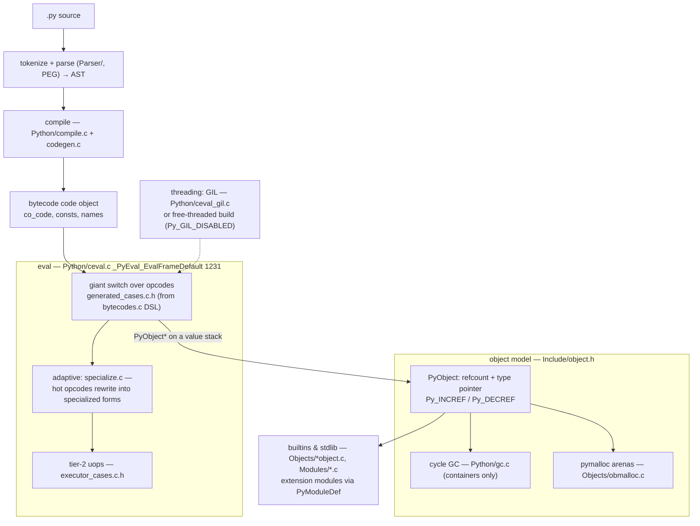
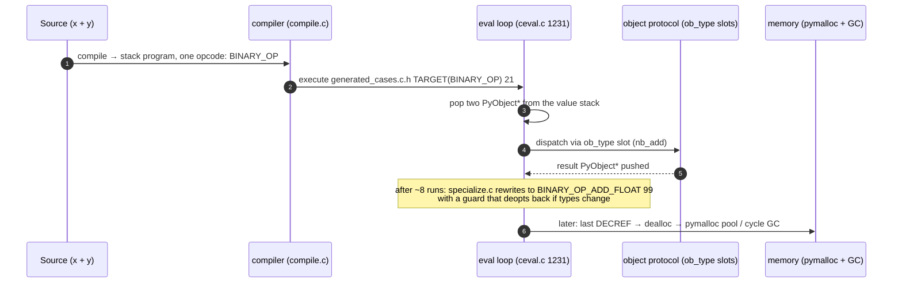
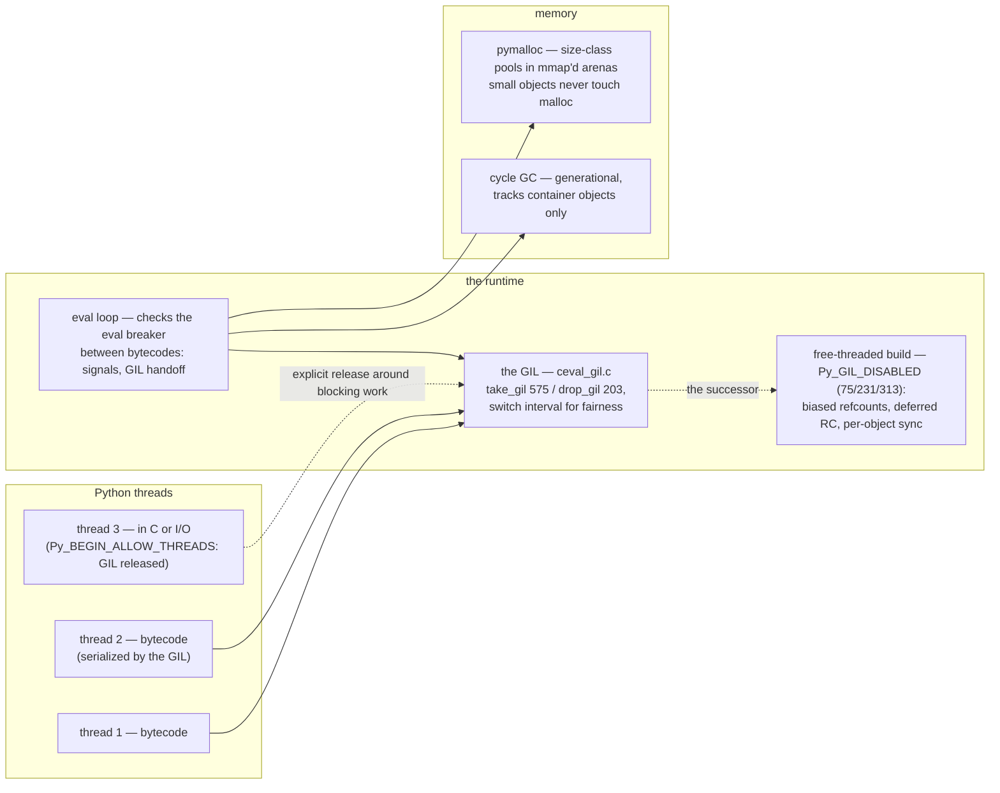

# CPython: the interpreter that won by making extensions easy

> **Atlas id:** `cpython` · **Domains:** `runtime, language` ·
> **Upstream:** https://github.com/python/cpython · **License:** Python-2.0 (PSF) ·
> **Pinned commit:** `0ec3aee262b03276a18aeb23cb9957e1b57c9d08` (2026-10-09, 3.16.0a0 trunk)

CPython is the most widely run language implementation on earth, and it
earned that through design decisions made decades before its
popularity: a **stable, approachable C API over a reference-counted
object model** (which is why NumPy, and thus the scientific stack,
chose it), **batteries-included stdlib**, and the **GIL** — the
trade-off that bought C-extension safety and single-threaded
simplicity at the price of parallelism, now being unbundled via
free-threading (PEP 703). This deep-dive teaches a complete interpreter
in readable C: the bytecode loop, the object protocol, memory
management, and how a runtime's extension contract decides its
ecosystem.

## Explain like I'm 10

**A puppet theater where every puppet wears a name tag.** Every puppet
(every value) wears a tag that counts how many hands are holding it
(the reference count). The moment the count reaches zero, that puppet is
put away INSTANTLY — no waiting for cleanup day. Puppets holding hands
with each other in a circle (reference cycles) never reach zero, so a
periodic inspector (the garbage collector) walks the theater and finds
those circles. And there's one house rule: only one storyteller (the
GIL) may move puppets at a time — outside helpers who build new puppets
(in C extensions) would otherwise yank the same puppet in two
directions at once. Best of all: when the storyteller performs the same
line about eight times, they memorize a shortcut for exactly that line
(adaptive specialization) without changing the story.

**Why the grown-ups did it this way:** the name-tag rule made it safe
for anyone to build new puppets in C — which grew the biggest puppet
collection in the world (NumPy, PyTorch...), a prize worth more than
the parallelism the one-storyteller rule postponed.

## 1. Architecture overview

- The **spine** — one `x + y` — is: the compiler emits
  `BINARY_OP`; the eval loop's `TARGET(BINARY_OP)` case
  (`Python/generated_cases.c.h:21`) pops two `PyObject*` and calls the
  slot in `ob_type`; after ~8 executions the instruction specializes
  to `BINARY_OP_ADD_FLOAT` (`generated_cases.c.h:99`) which inlines
  the float fast-path.

## Walkthrough: x + y, source to destruction

The spine as a story — step through it on the site or read straight
down. One tiny expression exercises the compiler, the eval loop,
specialization, the object protocol, and the allocator.

**Step 1 — Compile to a stack program.** `Python/compile.c` +
`Python/codegen.c` turn the AST for `x + y` into a tiny bytecode
program: load `x`, load `y`, `BINARY_OP` (add). Operands will be
`PyObject*` values on a per-frame stack.

**Step 2 — Enter the loop.** `_PyEval_EvalFrameDefault`
(`Python/ceval.c:1231`) is one `for(;;)` with a colossal switch —
but the cases are *generated*: `Python/bytecodes.c` is the DSL that
produces `generated_cases.c.h` and the tier-2 uop executor.

**Step 3 — Dispatch through the type.** `TARGET(BINARY_OP)`
(`generated_cases.c.h:21`) pops two `PyObject*` and calls the slot in
`ob_type` — behavior lives in the type object, never in the instance
(`Include/object.h:127`). A `float` plus a `float` takes the float
path; a custom class takes its `__add__`.

**Step 4 — The shortcut forms.** After ~8 executions, `specialize.c`
rewrites the instruction in place to `BINARY_OP_ADD_FLOAT` (99): a
guarded fast path that inlines the float add. If a string ever shows
up, the guard fails and the instruction deoptimizes to the generic
case — same semantics, faster common case, portable C everywhere.

**Step 5 — Death by name tag.** When the result's refcount drops to
zero, `Py_DECREF` runs the type's dealloc immediately — deterministic
cleanup. The bytes return to a pymalloc pool (`Objects/obmalloc.c`);
only objects inside reference cycles wait for the generational GC
(`Python/gc.c`).

**Outcome — The complete life of a value.** Source text → bytecode →
generated interpreter → type dispatch → specialized fast path →
reference-counted destruction: you have traced what "everything is an
object" costs and pays, opcode by opcode.

## 2. Core data structures — and why these

### `PyObject`: one header to rule everything (`Include/object.h:127`)

Every value is a `struct _object`: a refcount (with immortal-object
special values, since 3.12 — see the union at the top of the struct)
and a pointer to its type object. Everything else — "methods",
"attributes", "subclassing" — is *behavior of the type object*, not of
instances. Why: one uniform memory layout lets C code hold "any
Python value" as `PyObject*` and dispatch through `ob_type` slots —
the entire C API falls out of this single decision.

### The eval loop as generated switch
(`Python/bytecodes.c` → `Python/generated_cases.c.h`)

The interpreter's cases live in `bytecodes.c` in a DSL; the build
generates the C switch (`generated_cases.c.h`) **and** the tier-2
micro-op executor (`Python/executor_cases.c.h`). Since 3.11,
instructions adapt at runtime (`Python/specialize.c`): hot generic
opcodes rewrite themselves into specialized variants
(`BINARY_OP_ADD_FLOAT`) with guards that deoptimize back to the
generic case. Why: portable C (no JIT per-architecture) plus
data-driven codegen keeps one interpreter across 30+ build targets
while still beating the naive switch by large factors.

### Frames and the value stack (`Python/ceval.c`)

Execution state is a `_PyInterpreterFrame` — locals, a stack of
`PyObject*`, a bytecode pointer — making coroutines/generators cheap:
suspend = save the frame (no thread, no copy of the world). The eval
breaker (checked between bytecodes) is where signals, GIL handoffs,
and async exceptions enter; it is the interpreter's cooperative
scheduling point.

### pymalloc arenas (`Objects/obmalloc.c`)

Small objects come from size-class pools packed into mmap'd arenas
(`ARENAS_USE_MMAP` around line 544); arenas are returned to the OS when
empty. Why: Python programs allocate millions of tiny objects; a
dedicated allocator for the ≤512B world halves the cost of the
refcount-heavy object model. (Free-threaded builds swap in mimalloc.)

### The GIL (`Python/ceval_gil.c`)

One mutex-like lock per interpreter guards the whole object graph:
`take_gil` (575) / `drop_gil` (203) wrap sections of the eval loop,
with a switch-interval so threads rotate fairly. The same file carries
the future: `#ifdef Py_GIL_DISABLED` (75, 231, 313) is the
free-threaded build where the GIL disappears and per-object
synchronization (biased refcounting, deferred RC) takes over.

## 3. Concurrency and failure model

- **Threads exist, but the GIL serializes bytecode** — by design, so
  that C extensions written against a simple memory model do not
  corrupt the heap. I/O and C extensions release the GIL explicitly
  (`Py_BEGIN_ALLOW_THREADS`); that is why Python threads work fine for
  I/O-bound and wrapping-C workloads.
- **The escape hatches are architectural**: multiprocessing (processes
  over the same interpreter), async (event loop *in libraries* — the
  runtime provides generators/frames, not a scheduler), and now the
  free-threaded build (PEP 703) where the interpreter itself goes
  GIL-less.
- **Memory safety by refcounting + cycle GC**: objects die
  deterministically when the last reference drops (`Py_DECREF` →
  dealloc); reference *cycles* are collected by the generational GC
  (`Python/gc.c`, `gc_alloc` at 2012) which tracks only
  container objects. Failure = exceptions: every C API call returns
  NULL/-1 and sets an error indicator — no unwinding machinery beyond
  a per-thread error state plus `try/finally` frames.
- **Startup is bootstrap-by-frozen-module**: `Python/frozen.c`
  compiles importlib *into* the binary so the interpreter can bootstrap
  its module system without a working filesystem story first.

## 4. API and extension design

- The **C API is the product**: `PyModuleDef`/`PyMethodDef`
  registration (see any `Modules/_csv.c`-style module, e.g. module def
  at line 41), `PyObject*` in/out, `METH_VARARGS` calling conventions,
  and the stable ABI (`Py_LIMITED_API`) that lets one compiled
  extension run across versions. This contract is why the ecosystem
  exists; its accidental complexity (borrowed vs owned references) is
  the tax every extension author pays.
- **Everything is overridable from the type object**: `__add__`,
  `__getattr__`, iteration — the slots are the extension surface; pure
  Python and C extensions customize through the same mechanism.
- Honest wart: the GIL's memory-model simplicity made 25 years of
  extensions *possible* and is now the thing being carefully unbundled
  (biased refcounts, `Py_mod_gil` module flag to opt builds) — a live
  lesson in how a founding trade-off is retired without breaking the
  world.

## 5. The defining trade-offs

### Trade-off 1: reference counting + cycle GC over tracing-only GC
- **Tension:** deterministic cleanup and C interop vs collection
  pause profiles.
- **Choice:** every object counts references; containers additionally
  register with the generational cycle collector.
- **Evidence:** `Include/object.h` refcount field + `Py_INCREF`/
  `Py_DECREF`; `Python/gc.c:gc_alloc:2012` for GC-tracked allocation;
  immortal objects (PEP 683) for the refcount-hot static ones.
- **Given up:** perfect cycle handling (the GC only finds cycles among
  tracked containers), refcount churn on every assignment, and the
  famous GIL-refcount interplay in free-threading (biased counting).
- **Verdict:** deterministic `__del__` and trivial C interop (just
  INCREF/DECREF) built the extension ecosystem. GC languages with
  better pause profiles paid in FFI friction — the opposite bet.

### Trade-off 2: the GIL over fine-grained locking
- **Tension:** threads exist in the runtime; C extensions were written
  by non-experts.
- **Choice:** one global lock guarding bytecode execution; extensions
  release it around blocking work.
- **Evidence:** `Python/ceval_gil.c` (`take_gil:575`, `drop_gil:203`,
  switch interval); `#ifdef Py_GIL_DISABLED` showing the successor.
- **Given up:** CPU-parallel Python threads for 25 years; scaling meant
  processes (multiprocessing) or event loops (asyncio).
- **Verdict:** the "wrong" trade-off that was right: it made CPython's
  C API safe enough that NumPy/Pandas/torch could exist, and those —
  not the language — won the workloads. Retiring it (free-threading)
  is a decade-scale surgery precisely because the contract was load-
  bearing.

### Trade-off 3: adaptive bytecode specialization over a JIT
- **Tension:** near-JIT speed without per-platform compiler
  engineering.
- **Choice:** instructions rewrite themselves into guarded
  specializations in the same C switch; an experimental JIT exists
  but the mainstream is specialization.
- **Evidence:** `Python/specialize.c`; the generic `TARGET(BINARY_OP)`
  (`generated_cases.c.h:21`) vs `BINARY_OP_ADD_FLOAT` (99); tier-2
  uops in `executor_cases.c.h`; `Python/bytecodes.c` as single source
  for all tiers.
- **Given up:** peak performance of a real JIT (though 3.13+ brings an
  optional one); complexity budget now spent on two tiers + deopt.
- **Verdict:** portability-first thinking: one codegen source, many
  backends, correctness preserved by guards. The 3.11 speed-ups
  proved the ceiling was higher than "interpreter" implied.

## 6. Reading path

1. `Include/object.h` (lines ~100-260) — `struct _object`, `PyVarObject`,
   refcount macros; read until "everything is this header + a type
   object" feels true.
2. `Objects/typeobject.c` — skim `tp_*` slots and `PyObject_GetAttr`:
   the entire attribute protocol as table lookups.
3. `Python/ceval.c:_PyEval_EvalFrameDefault` (1231) — read the loop
   scaffolding (stack, dispatch, eval-breaker checks), then three
   cases in `Python/generated_cases.c.h`: `TARGET(BINARY_OP)` (21),
   `BINARY_OP_ADD_FLOAT` (99), and `LOAD_FAST`; open
   `Python/bytecodes.c` to see the same cases in their source-of-truth
   DSL.
4. `Python/specialize.c` — how the adaptive rewrite decides (feedback
   counters) and what deoptimizes; then peek at
   `Python/executor_cases.c.h` for tier 2.
5. `Python/compile.c` + `Python/codegen.c` — symbol table pass, scopes,
   and how expressions become stack programs (compile a function with
   `dis` alongside).
6. `Objects/obmalloc.c` (~400-650) — arena mmap, pool size classes,
   the small-object lifecycle; note the free-threading alternative.
7. `Python/gc.c` — `gc_alloc` (2012) and the generation collection
   entry points: tracking containers, untrackable optimizations.
8. `Python/ceval_gil.c` — `take_gil` (575), `drop_gil` (203), the
   switch interval; then the `Py_GIL_DISABLED` blocks (75/231/313) to
   see what free-threading replaces them with.
9. `Objects/unicodeobject.c` (skim ~200 lines of the header comments)
   — the most engineered file in the tree: PEP 393 flexible string
   representation; it teaches what "optimize the dominant object"
   looks like.
10. `Modules/_csv.c` — a complete classic extension: `PyModuleDef`
    (41), method tables (687+), argument parsing, error returns.
    Write a 30-line module yourself against this template.
11. `Python/frozen.c` + `Python/import.c` — bootstrap: the interpreter
    unpacks a frozen importlib to get `import` working; follow the
    first import of a real module end-to-end.

You have now traced `x + y` from source text through compilation,
adaptive interpretation, object dispatch, allocation, and destruction —
the complete life of a Python value.

## 7. What to steal

- **One uniform object header + type slots** makes an FFI tractable:
  CPython's entire embedding story is `PyObject*` + `ob_type`.
- **Reference counting buys determinism and interop**; if you add a
  cycle GC for containers only, you keep most of the benefit at a
  fraction of the cost.
- **Generate your interpreter, don't hand-write it** (bytecodes.c):
  one DSL → switch + uops + metadata kept the codebase portable while
  it got fast.
- **Adaptive specialization over JIT** when portability dominates:
  guarded instruction rewriting is a controllable performance ladder.
- **A founding simplification can be worth more than the feature it
  blocks** — the GIL made the extension ecosystem possible; retiring
  it is possible only because that contract already won.

## 8. Difficulty and prerequisites

- Difficulty: **moderate** — genuinely one of the most readable large
  C codebases; the challenge is breadth, not obscurity.
- Budget: ~6 hours for the reading path; ceval + object model is a
  satisfying 3-hour core.
- Prerequisites: C pointers/structs fluency, what bytecode is, basic
  allocator concepts. No parser theory needed (the PEG parser is
  optional reading).

## 9. Further reading

- PEPs 683 (immortal objects), 703 (free-threading), 659
  (specializing interpreter), 393 (unicode) — each documents a
  trade-off this deep-dive points at in code.
- "Python's new interpreter" talk series (Guido van Rossum /
  Brandt Bucher on 3.11 speed-ups) — the specialization story told by
  its authors.
- The devguide in-repo (`Doc/tools/` + https://devguide.python.org)
  for building and instrumenting your clone.
