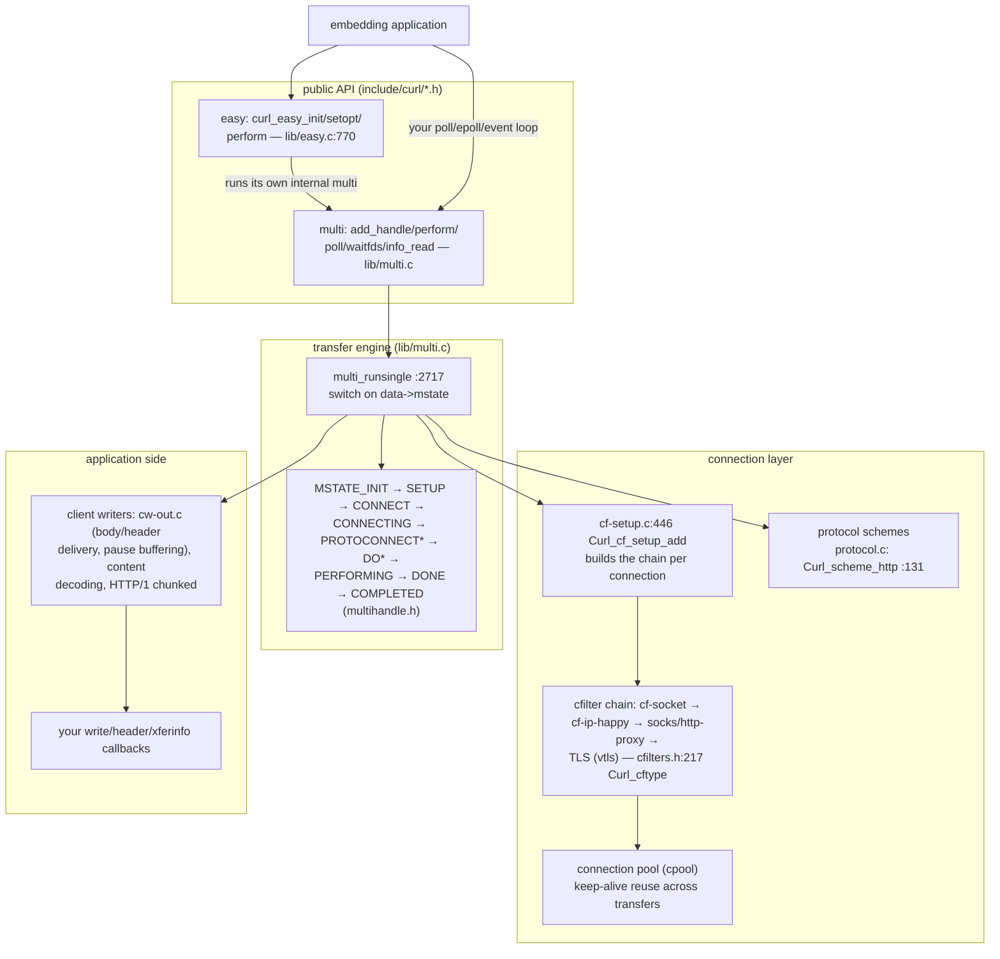
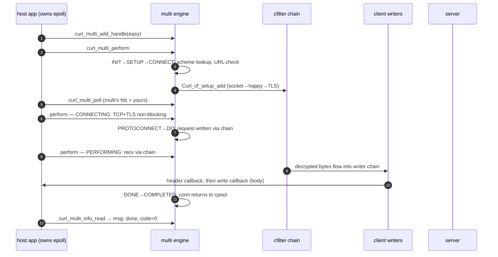

# curl: a transfer state machine designed to live inside someone else's event loop

> **Atlas id:** `curl` · **Domains:** `networking` ·
> **Upstream:** https://github.com/curl/curl · **License:** curl (MIT-style) ·
> **Pinned commit:** `70c084a0123b468fe7078e3fc72c78e1b66394b6` (2026-10-11)

curl is the most portable network client on earth — every protocol
from HTTP/3 to gopher, every platform from mainframes to
microcontrollers, zero required dependencies, one C API, stable for
decades. The design lesson is not "support many protocols"; it is
**how an API composes with someone else's program**. curl refuses to
own the clock: the `easy` interface is a blocking convenience wrapper,
and underneath it the `multi` interface exposes a transfer as an
explicit state machine (`MSTATE_*`) that the *host's* event loop drives
through `curl_multi_perform`/`curl_multi_poll`. Around that engine,
two vtable-based filter chains — connection filters for bytes on the
wire, client writers for bytes to the application — let TLS, proxies,
HTTP/2, and decompression stack like envelopes without any protocol
knowing about the others. Portability and API stability are treated as
architectural commitments, not packaging chores.

Read it against the [nginx](nginx.md) and [Envoy](envoy.md) dives:
those own the process and the event loop; curl is the inversion — a
network engine that must *rent* concurrency from whatever loop,
thread, or coroutine the embedding application already has.

## Explain like I'm 10

**A travel agency that never insists on driving you there.** You can
say "get me this webpage" (the easy interface: `curl_easy_perform`)
and the agency does everything while you wait outside. But you can
also run the switchboard yourself (the multi interface): for every
trip in progress you ask "what happens next, and which phone should I
listen on?" (`curl_multi_perform` + `curl_multi_poll`), and you decide
when to ask again. The agency never grabs the steering wheel — it
works for a hundred travel agents' clocks at once because it keeps
zero of its own. Trips go through **nested envelopes** (connection
filters): your letter (HTTP request) goes into a security envelope
(TLS) which goes into a diplomatic pouch (proxy tunnel) which rides
the postal truck (socket) — each layer adds or peels its own wrapper
without reading the others'. Replies go through the reverse: an
**out-tray sorter** (client writers) that un-gzips, un-chunks, and
hands pages to you in order, and can even *hold* mail politely
(pausing) if you say "my hands are full."

**Why the grown-ups did it this way:** a library that brings its own
threads or event loop fights every program it lives in — so curl made
"you drive, I'll advise" the core contract, and everything else
(protocols, TLS, even the blocking mode) became layers on top.

## 1. Architecture overview

- **Two public interfaces, one engine.** `curl_easy_perform`
  (`lib/easy.c:770 easy_perform`) is sugar: it creates a private
  `multi` handle sized for one transfer and runs the very same state
  machine to completion. Everything below the API is multi-shaped.
- **The state machine is the spine.** `multi_runsingle`
  (`lib/multi.c:2717`) switches on `data->mstate` — `multistate_init`,
  `multistate_setup`, `multistate_connect`, …, `multistate_done` —
  each call advancing one transfer by *one non-blocking step*. States
  live in `lib/multihandle.h` (INIT through MSGSENT) with the
  pollset each state wants declared in a parallel switch
  (`multi.c:1146`).
- **Connection filters stack by vtable.** A connection is a chain of
  `Curl_cfilter` nodes (`cfilters.h`), each typed by a
  `Curl_cftype` (line 217) with `do_connect/do_send/do_recv/
  adjust_pollset` methods. `cf-setup.c` assembles the chain in order
  — socket, then Happy Eyeballs (dual-stack racing), then proxy
  tunnels, then TLS — so an HTTPS request through a SOCKS proxy is
  four wrappers, none aware of the others. `Curl_conn_send/recv`
  (`cfilters.c:1003/…`) enter the chain's top.
- **Protocols are data + a protocol vtable.** Each URL scheme is a
  `struct Curl_scheme` instance (`protocol.c:131` for http, `:145`
  for https) carrying flags and a `Curl_protocol` implementation;
  lookup is `Curl_getn_scheme` (`protocol.c:608`). Adding SFTP or
  MQTT changes no engine code.
- **The application side mirrors it.** Client writers (`cw-out.c`
  and friends) form the response-side chain that delivers headers and
  bodies to your callbacks — including the buffering rules that make
  `CURL_WRITEFUNC_PAUSE` work (the file's own design comment at
  `cw-out.c:37` is a small masterpiece of pause-protocol reasoning).

## Walkthrough: one HTTPS GET, foreign event loop to body callback

The spine as a story — on the site you can step through it with Next;
in the repo it reads top to bottom.

**Step 1 — Attach a transfer.** `curl_easy_init` + a pile of
`CURLOPT_*` (URL, headers, `CURLOPT_WRITEFUNCTION`) build the
`Curl_easy` — a struct holding *everything* one transfer is
(options, state, buffers, connection pointer). `curl_multi_add_handle`
puts it in the multi's transfer table keyed by a 32-bit id.

**Step 2 — INIT/SETUP.** Your first `curl_multi_perform` calls
`multi_runsingle`; `multistate_init` → `multistate_setup` parse the
URL (`urlapi.c`), resolve the scheme via `Curl_getn_scheme`
(`protocol.c:608`), and decide credentials, ports, and redirects
context. No socket yet.

**Step 3 — CONNECT, filters assemble.** `multistate_connect` creates
(or reuses, via the connection pool) a `connectdata` and calls
`Curl_cf_setup_add` (`cf-setup.c:446`), which stacks filters in
order — `cf_setup_add_ip_happy` (line 173), proxy filters
(`cf_setup_add_socks`/`_http_proxy`), `cf_setup_add_origin_filters`
(line 228) for TLS. Each filter's `do_connect` returns "done" or
"call me again" — the whole handshake is non-blocking by
construction.

**Step 4 — The host polls.** `curl_multi_waitfds`/`curl_multi_poll`
(`multi.c:1295`/`:1660`) report which sockets each transfer wants to
read or write (per-state pollsets via `mstate_*_pollset`); your epoll
waits on those alongside everything else your app does. curl never
sleeps for itself.

**Step 5 — DO/DOING.** On writability, `multistate_do` hands the
protocol its turn; the HTTP protocol writes the request *through the
filter chain* (`Curl_conn_send`), so TLS-encrypting or proxy-wrapping
happens below it invisibly. Happy Eyeballs may still be racing
families here.

**Step 6 — PERFORMING.** `multistate_performing` reads via
`Curl_conn_recv`, feeds bytes to the client-writer chain: HTTP/1
chunked peeling, content-decoding (gzip), then `cw-out` — which
invokes your header callback and `WRITEFUNCTION` with ordered body
chunks. If your callback returns pause, `cw-out` buffers and the
engine stops asking to read until you unpause (`cw-out.c:37`'s
documented rules).

**Step 7 — DONE.** The final byte, close, or error moves the handle
to `multistate_done` → `multi_done` (`multi.c:673`): the connection
is *not* closed but returned to the pool if keep-alive applies;
messages are queued for the app.

**Outcome — Completion is a message, not a return value.**
`curl_multi_info_read` hands you `{msg: DONE, code: CURLE_OK}` and
you remove the handle. The connection sits warm in the pool for the
next transfer; the state machine is parked at `MSTATE_COMPLETED`,
holding zero timers, threads, or secret sleeps.

## 2. Core data structures — and why these

- **`struct Curl_easy` — one transfer, one struct.**
  **What:** options (`set`), dynamic state (`state`), the attached
  connection, callbacks, buffers, progress — the transfer's whole
  biography.
  **Where:** `lib/urldata.h`; created by `curl_easy_init`
  (`lib/easy.c:368`).
  **Why:** making the *transfer* (not the connection or the request)
  the unit gives you redirect-following for free (same easy handle,
  new SETUP pass) and makes the multi handle just a table of these —
  contrast designs where a connection owns state and redirects
  become surgery.

- **`struct Curl_multi` — a scheduler, not a server.**
  **What:** a 32-bit-id→handle transfer table, an internal `admin`
  easy handle for self-wakes, the connection pool, shutdown tracking,
  and the event bookkeeping that answers "when should you call me
  again?".
  **Where:** `lib/multihandle.h`; `multi_runsingle` walks exactly one
  easy per invocation.
  **Why:** no threads, no timers of its own — every blocking
  decision is exported as pollsets and timeout hints. This is what
  lets libevent/libuv/epoll hosts embed curl as *one more fd source*
  (the same "rent your clock" contract as [libuv's](libuv.md)
  loop, offered from the tenant side).

- **`Curl_cfilter` + `Curl_cftype` — the wire-side vtable chain.**
  **What:** a singly linked stack of filters over one socket;
  `cfilters.h:217` declares the type vtable (`do_connect`,
  `do_send`, `do_recv`, `adjust_pollset`, `query`…).
  **Where:** instances in `cf-socket.c`, `cf-ip-happy.c`,
  `cf-h1-proxy.c`, `cf-https-connect.c`, `vtls/…`; assembly in
  `cf-setup.c:446`.
  **Why:** protocol-vs-transport matrix explodes combinatorially
  (https via socks5 over IPv6 …); filters turn the matrix into a
  linear stack composition. The chain also *queries* upward
  (`query`) — how the engine learns "is this TLS?" without a type
  flag — and `adjust_pollset` is how a filter makes the engine wait
  on its private fds (TLS handshakes, DNS).

- **`struct Curl_scheme` / `Curl_protocol` — protocols as data.**
  **What:** scheme metadata (default port, credential rules, flags
  like `PROTOPT_SSL`, `PROTOPT_CONN_REUSE`) plus an implementation
  pointer; `protocol.c:131` shows http/https sharing one
  implementation with different flags.
  **Why:** the engine's branches key off *flags*, not scheme names —
  so "add a new TLS-wrapped protocol" is a table entry plus flag
  reuse, the registered-component pattern [FFmpeg](ffmpeg.md) also
  runs (and curl runs it in ~200 lines).

- **The client-writer chain (`cw-*`).**
  **What:** response bytes flow through `cw-out` (terminal delivery
  to callbacks, with pause buffering — design comment at
  `cw-out.c:37`), content decoders, and protocol-specific peelers.
  **Why:** symmetry with connection filters keeps "bytes toward the
  app" as composable as "bytes toward the wire"; pause/resume —
  backpressure from *your* callback — becomes one filter's local
  problem instead of the engine's.

## 3. Concurrency and failure model

- **The host provides concurrency; curl provides progress.** No
  worker threads exist (the threaded DNS resolver is the deliberate
  exception, isolated behind `Curl_async`). Thousands of transfers
  share one thread because every state-machine step is non-blocking
  and every wait is a pollset report.
- **Waking from outside:** `curl_multi_wakeup` writes to an internal
  socketpair consumed through the `admin` handle (`multi.c:355`,
  `:409`) — the same self-pipe trick nginx uses, so a timer or
  another thread can interrupt a sleeping poll without touching the
  host's loop.
- **Failure is per-transfer, always reported.** Any state can fail;
  the handle goes DONE with a `CURLcode`, the connection is torn down
  (or pooled if reusable — `multi_done` at `multi.c:673` checks
  protocol `done` handlers first), and a `CURLMsg` is queued for
  `curl_multi_info_read`. Errors never escape as exceptions or
  process state — they are mailbox messages, the contract an evented
  host needs.
- **Crash-safety and half-states:** connections mid-handshake are
  owned by their filter chain; if the easy handle is removed early,
  `multi_done(premature=TRUE)` closes rather than pools. The pause
  protocol (a *deliberate* half-state, bounded by
  `DYN_PAUSE_BUFFER` → `CURLE_TOO_LARGE`) shows the design's
  discipline: even backpressure has explicit limits instead of
  unbounded buffering.
- **Overload behavior:** rate limiting is itself a state
  (`MSTATE_RATELIMITING` — "let time pass, ignore sockets"), and
  connection-pool ceilings cap fan-out; an overloaded host observes
  slowdowns, never secret internal queues.

## 4. API and extension design

- **The easy surface is one function wide:** configure via the
  `CURLOPT_*` universe, act with `perform`, inspect with
  `getinfo`. The multi surface is four verbs — add/remove,
  perform/wait, read-info — because those four are exactly what an
  event loop integration needs.
- **Seams:** connection filters (write a filter, register a setup
  function), protocol schemes (data table entry), client writers,
  and above all the callback family (write/header/progress/socket-
  function) — extension without linking into internals, the same
  "no new concepts, new registrations" economy as the scheme table.
- **ABI stability is engineered, not hoped:** `CURL_EAPI_ENTER`
  guards in `lib/easy.c:849` validate handles against misuse;
  `CURLOPT_*` grows by appending (never renumbering); deprecated
  functions stay declared forever (`multi.h` still ships
  `curl_multi_socket` from 1999). The cost is paid in API surface
  sprawl — the honest wart: `setopt` is a stringly-typed mega-switch
  where the compiler cannot check option/type pairs, a 25-year-old
  compromise that every wrapper library works around.

## 5. The defining trade-offs

### Trade-off 1: rented event loops over an owned reactor
- **Tension:** transfers are inherently asynchronous; libraries that
  run their own threads/loops fight every embedding application.
- **Choice:** export the asynchrony — explicit states, pollsets,
  timeout hints, `curl_multi_poll`/`waitfds`, and a wakeup pipe;
  own no clock, spawn no threads.
- **Evidence:** `multi.c:2717 multi_runsingle` (one non-blocking
  step); `multi.c:1146` (per-state pollsets); `curl_multi_wakeup` +
  admin handle (`multi.c:355`).
- **Given up:** one-line "just fetch this" simplicity at the engine
  layer (easy API re-implements it as a wrapper, `easy.c:770`) and
  any internal scheduling cleverness like happy-eyeballs scheduling
  must itself be pollset-driven.
- **Verdict:** unambiguously right for a library — this is why curl
  embeds everywhere from PostgreSQL extensions to games. Your
  *application* server should invert it and own the loop
  ([nginx](nginx.md)); a tenant must rent.

### Trade-off 2: filter vtable chains over monolithic protocol code
- **Tension:** N protocols × M transports (proxy types × TLS × IP
  families) in one C codebase.
- **Choice:** two orthogonal chains — `Curl_cfilter` toward the
  wire, client writers toward the app — each node a small vtable.
- **Evidence:** `cfilters.h:217`; assembly order in
  `cf-setup.c:446` (`ip_happy` → `socks`/`http_proxy` → origin TLS).
- **Given up:** call-chain indirection on the hot path and stack
  traces that need `CURL_TRC` tracing to follow; a naive single-file
  HTTP fetch is genuinely simpler to read.
- **Verdict:** right once the matrix exceeds ~2×2, which it did by
  2001. The same reasoning produced HTTP/2's layering in [Envoy]
  (envoy.md); curl's version is notable for doing it in C with zero
  allocation churn per call.

### Trade-off 3: forever-stable C ABI over expressive API evolution
- **Tension:** fix bugs and add HTTP/3 for thirty years without ever
  breaking a compiled consumer (embedded firmware, OS vendors).
- **Choice:** append-only enums, opaque handles, `curl_off_t` for
  large-file safety, runtime feature discovery, deprecation without
  removal.
- **Evidence:** `include/curl/multi.h` (1999-era functions still
  declared, `CURL_DEPRECATED` annotated); `easy.c:849`'s EAPI guards
  catching handle misuse across versions.
- **Given up:** the ability to reshape the API even when wrong —
  hence `CURLOPT_*`'s unchecked void-pointer folklore and the
  `curl_easy_escape` renames that had to *add* rather than fix.
- **Verdict:** right when you are infrastructure (curl is linked by
  roughly everything); wrong for an internal library where forcing
  recompiles is cheap honesty.

## 6. Reading path

1. `README.md` + `docs/` layout — the portability manifesto ("no
   dependencies beyond a C89-ish compiler" carries design weight
   here); then `include/curl/curl.h` skimmed for the API's shape.
2. `lib/easy.c:770 easy_perform` — watch the blocking API *create an
   internal multi* and run it; the easy/multi split in one function.
3. `lib/multihandle.h` — the `MSTATE_*` enum with the file's state
   comments; hold this map in your head for the rest of the walk.
4. `lib/multi.c:2717 multi_runsingle` — the spine's switch; then pick
   three states and read their `multistate_*` functions
   (`multistate_connect`, `multistate_do`, `multistate_performing`).
5. `lib/multi.c:1146` — the parallel pollset switch; notice how
   "what does this state wait on?" is *declared*, adjacent to the
   states.
6. `lib/cfilters.h` — the `Curl_cftype` vtable (line 217) and
   `Curl_cfilter` node; then `lib/cfilters.c:1003 Curl_conn_recv`
   and `Curl_conn_send` to see the chain walk on every I/O.
7. `lib/cf-setup.c:446 Curl_cf_setup_add` — chain assembly; follow
   `cf_setup_add_ip_happy` (line 173) into `cf-ip-happy.c` for Happy
   Eyeballs racing (connect to both families, keep the winner).
8. `lib/protocol.c:131` `Curl_scheme_http` and the scheme table
   nearby; then `Curl_getn_scheme` (line 608) — protocols as data.
9. `lib/cw-out.c:37` — read the design comment block first, then
   `Curl_cwt_out` (line 490): pause buffering as the terminal
   writer's local concern.
10. `lib/multi.c:673 multi_done` — teardown, keep-alive decisions,
    and the connection's return to the pool; then the cpool reuse
    path in `lib/connect.c`.
11. `lib/multi.c:1295 curl_multi_waitfds` and `:1660
    curl_multi_poll` — the composition surface your own epoll would
    use; finally `curl_multi_wakeup` + the `admin` handle (`:355`)
    for cross-thread wakes.

You have now traced one HTTPS GET from an application's event loop,
through an explicit transfer state machine, two stacked filter
chains, and a callback delivery path with pause semantics — the full
tenant's-side story of network asynchrony.

## 7. What to steal

- **Export your state machine; rent your concurrency.** The
  perform/wait/info trio plus pollsets is the minimal contract for
  embedding any async engine in a foreign loop — steal it whole for
  DNS resolvers, client pools, or worker queues.
- **Two vtable chains (wire-side and app-side) dissolve the
  protocol×transport matrix** — and let backpressure (pause) live in
  exactly one terminal filter (`cw-out.c:37`'s rules).
- **One struct per unit of work** (the easy handle, not the
  connection) makes lifecycle features — redirects, retries, reuse —
  local state changes instead of cross-object surgery.
- **Declare what each state waits on, next to the state**
  (`mstate_*_pollset`) — pollability as documentation, and the
  evented host needs zero engine knowledge.
- **Self-pipe/admin-handle wakeup** for interrupting hosts without
  touching their loops — the trick to steal whenever your library
  must be callable from another thread.
- **Treat API stability as architecture:** append-only options,
  opaque handles, runtime feature probes. Thirty years of "it still
  links" is a feature users can build businesses on.

## 8. Difficulty and prerequisites

- Difficulty: `moderate`. Realistic budget: 5–6 hours for this path;
  add 2 if you also read a vtls backend.
- Prerequisites: solid C (structs of function pointers, `poll(2)`);
  comfort with non-blocking sockets and `epoll`-style thinking —
  the [libuv](libuv.md) dive is the perfect companion read; HTTP/1.1
  verbs at the level of "GET has headers" (RFC 9110 skim, 20 min).

## 9. Further reading

- `docs/MULTI-EVENT.md` and `docs/INTERNALS.md` in the curl repo —
  the maintainers' own guides to the event model and internals.
- Daniel Stenberg, *Everything curl* — https://everything.curl.dev/
  (chapters on the multi API and connection filters).
- RFC 8305 (Happy Eyeballs) — what `cf-ip-happy.c` implements.
- The [libuv](libuv.md) and [Envoy](envoy.md) dives in this atlas —
  the loop-owner perspective this design deliberately rents from.
