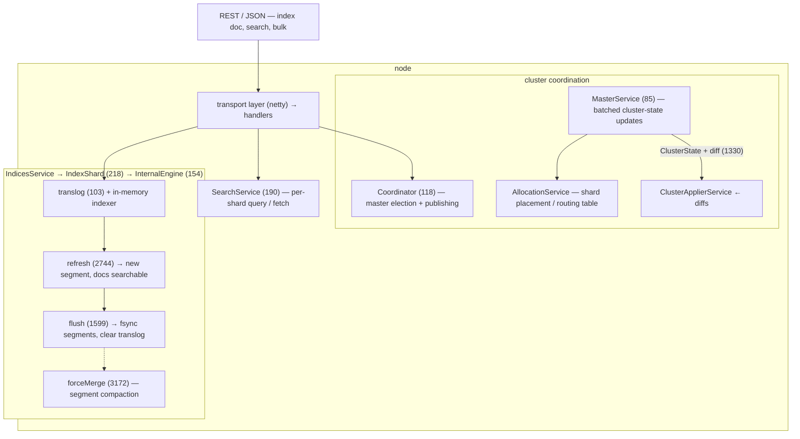
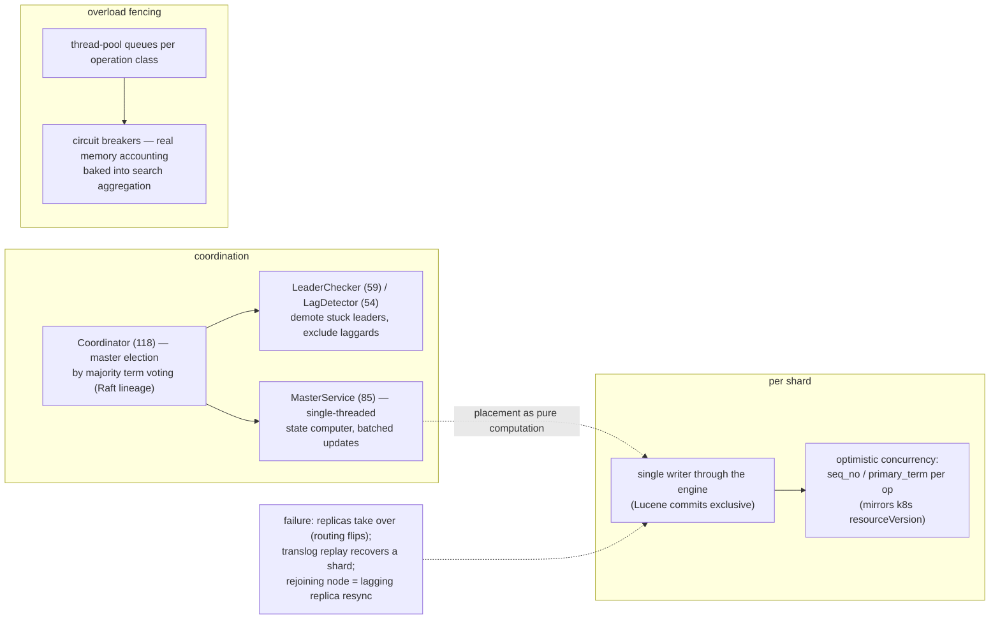

# Elasticsearch: a search engine behind a friendly distributed façade

> **Atlas id:** `elasticsearch` · **Domains:** `search-engine, distributed, database` ·
> **Upstream:** https://github.com/elastic/elasticsearch · **License:** SSPL-1.0 OR Elastic-License-2.0 (Apache-2.0 until 7.10) ·
> **Pinned commit:** `36a8b81764d3448666ad213c3b47762e5fa22d42` (2026-10-10, master)

Elasticsearch made full-text search universal infrastructure — not by
out-engineering Lucene, but by *wrapping* it: a distributed façade of
JSON-over-HTTP indices and shards over Lucene's immutable inverted-index
segments, with schema-on-the-fly and one declarative routing layer.
This deep-dive teaches the three layers of that wrapping: the
**near-real-time write path** (translog → refresh → flush → merge, the
same LSM lineage as LevelDB in this atlas), the **cluster state** (a
single master-computed, diff-published world model), and
**scatter-gather query execution** across shards — and what each layer
costs at scale.

## Explain like I'm 10

**A library with a "today" drawer.** When a new book's index card
arrives, the librarian drops it into a "today" pile (the in-memory
buffer) — writing to the pile is instant, so nobody waits. Every second
or so, a librarian photocopies the whole pile into a new fixed card
catalog that anyone can search (a refresh opens a new segment) — THAT is
why new things take about a second to become findable (near-real-time).
Every card written is also noted in a safety diary (the translog), so a
power cut loses nothing even though the photocopy isn't permanent yet;
and periodically the small catalogs are glued into bigger ones (segment
merges) so the shelves don't overflow with tiny catalogs. Searching a
huge library: each department (shard) finds its own top-10 cards, the
head librarian merges the lists and fetches only the winning books
(two-phase search).

**Why the grown-ups did it this way:** photocopying once a second keeps
writing fast while search still feels instant — and keeping "can be
found" (refresh) separate from "is safe forever" (translog fsync) lets
each run at the speed its job needs.

## 1. Architecture overview



- The **spine** — index one document, then find it — is: the write
  lands in the shard's translog and Lucene's in-memory buffer
  (`InternalEngine`); a `refresh` (2744, default every ~1s) opens a
  new *segment* making the doc searchable; a later `flush`
  (`Engine.java:1599`) fsyncs segments and clears the translog;
  background merges (`forceMerge:3172` machinery) compact segments.
  A search fans out to each shard's `SearchService` (190), merges
  sorted top-ids, then fetches full documents (two-phase).

## Walkthrough: index one document, then find it

The spine as a story — step through it on the site or read straight
down. The key insight: "searchable" and "durable" are two different
clocks ticking at different speeds.

```mermaid
sequenceDiagram
    autonumber
    participant C as Client
    participant E as InternalEngine (154)
    participant T as translog (103)
    participant L as Lucene segments
    participant S as SearchService (190)
    C->>E: PUT doc (routed to shard by _id)
    E->>T: append + checkpoint — ack (durable)
    E->>L: add to in-memory buffer (not searchable yet)
    Note over E,L: ~1s later: refresh (2744) → new segment → searchable
    C->>S: GET _search
    S->>S: query phase: each shard returns sorted top-K ids
    S->>S: coordinator merges, then fetch phase pulls full docs
    S-->>C: results
    Note over L: later: flush (1599) fsyncs segments, clears translog;<br/>forceMerge (3172) compacts segments
```

**Step 1 — Route the document.** The PUT lands on any node; the
coordinating layer hashes the `_id` to pick the shard — the shard is
the unit of indexing, search, and failure (`IndexShard`, 218).

**Step 2 — Write it twice, cheaply.** `InternalEngine` (154) appends
the operation to the per-shard translog (`Translog.java:103`, with its
checksummed checkpoint) AND to Lucene's in-memory buffer. The translog
append makes it durable; the buffer makes it *almost* searchable.

**Step 3 — The photocopy.** About once a second, `refresh` (2744)
turns the in-memory buffer into a new immutable segment — now the
document is findable by search. Nothing was fsynced yet: searchable ≠
durable, by design.

**Step 4 — Search fans out.** The client's search hits a coordinating
node, which scatters the query phase to one copy of every shard
(`SearchService:190` per shard) — primaries or replicas, the routing
table decides.

**Step 5 — Top-K, two phases.** Each shard runs the query and returns
only sorted top-K ids + sort keys; the coordinator merges those lists,
then runs the fetch phase for just the final page's documents —
`AbstractSearchAsyncAction` / `FetchSearchPhase` orchestrate fan-out,
merge, timeouts, and partial-failure policy.

**Step 6 — The slow clocks.** Later, `flush` (`Engine.java:1599`)
fsyncs segments and clears the translog; background merges compact
small segments into bigger ones (the `forceMerge:3172` machinery).
Crash before flush? The translog replays on restart — recovery is
`IndexShard` replaying the diary against the last flushed segments.

**Outcome — Found in a second, safe forever.** The document became
searchable ~1s after the write (refresh), durable at the translog
policy's speed, and findable across any number of shards — because
finding was reduced to merging sorted top-K lists.

## 2. Core data structures — and why these

### Lucene segments — immutable inverted indexes

Each refresh writes a new segment file: term dictionary → postings,
column-stride doc values, stored fields. Segments are write-once:
searchers open them lock-free, merges create new files, deletes are
tombstone bitsets until merge. Why: the same immutability bet as
LevelDB's SSTables and git's packs — cheap concurrent readers, cheap
crash semantics, amortized reorganization (see PATTERNS.md #3, #6).

### The translog (`index/translog/Translog.java:103`)

Every mutation appends to a per-shard log with a checksummed
checkpoint file before acknowledgment; recovery replays it against
the last flushed segments. Why: segments fsync'd only at flush would
make "searchable" ≠ "durable"; the translog is the WAL that decouples
the two (refresh cadence from durability level), exactly SQLite's
WAL-vs-checkpoint split at search-engine cadence.

### Cluster state + diffs (`cluster/ClusterState.java:122`)

The entire world model — nodes, indices, mappings, shard routing
table — is one immutable object; the master computes new versions in
`MasterService` (85) and publishes **diffs** (`ClusterStateDiff`,
line 1330) that every node applies (`ClusterApplierService`).
Why one object: routing decisions, mappings, and node roles must be
consistent *with each other*; composing them in a single versioned
value (like Kubernetes' desired state, raft-published like etcd)
makes "the cluster's opinion" well-defined.

### The routing table + allocation

`AllocationService` (with deciders: awareness, disk thresholds,
shuffling) computes which node holds which shard. Why declarative:
placement is recomputed from cluster state by rules, not negotiated
peer-to-peer — a reconcile model (Kubernetes' pattern) inside a
database.

## 3. Concurrency and failure model

- **Per-shard single writer, per-operation versioning**: writes to a
  shard serialize through the engine (Lucene commits are exclusive);
  optimistic concurrency (`if_seq_no`/`if_primary_term`) mirrors
  K8s resourceVersion — each shard is a small versioned log of
  seq_no/primary_term.
- **Coordination**: `Coordinator`
  (`cluster/coordination/Coordinator.java:118`) elects a master by
  majority term voting (a Raft-lineage design replacing Zen
  discovery), `LeaderChecker`/`LagDetector` (59/54) demote and
  exclude stuck leaders/laggards; `CoordinationState` (33) is the
  voting record.
- **Failure**: replica shards take over when primaries die (the
  routing table just flips); translog replay recovers a shard on
  restart; a node rejoining is a lagging replica resynced by
  operations replay / peer recovery — never partial trust.
- **Overload**: thread-pool queues per operation class, circuit
  breakers on request/jvm memory (real memory accounting baked into
  search aggregation) — search's unboundedness is fenced early, a
  lesson from years of OOM incidents.



## 4. API and extension design

- **The façade *is* the product**: JSON documents + mappings (schema
  discovered at index time), one REST verb set, bulk batching. The
  Lucene surface (analyzers, codecs, similarity) is exposed *as
  config*, not as code — most users never meet the engine that does
  the work.
- **Pluggability inherited by wrapping**: analyzers per language,
  similarity models, ingest pipelines, snapshot repositories, and
  the whole plugin SPI — carefully versioned because the engine
  sits underneath.
- Honest wart: hiding a JVM engine behind a friendly API produced the
  system's chronic costs — heap pressure (caches, aggregations),
  shard-count proliferation (each shard is a Lucene instance with
  files and translogs), and mapping explosions. The 7.x+ era is
  largely the façade learning to say "no" (limits, data tiers,
  searchable snapshots).

## 5. The defining trade-offs

### Trade-off 1: near-real-time refresh over immediate searchability or strict durability
- **Tension:** indexing throughput and search latency vs visibility
  and durability guarantees.
- **Choice:** writes ack from translog; docs become searchable only
  at refresh (~1s); durability set per request (wait_for) or by
  translog fsync policy.
- **Evidence:** `InternalEngine.refresh` (2744) vs `Engine.flush`
  (1599); `Translog` (103) as the durability decoupler; segment
  merges via `forceMerge` (3172) re-amortizing.
- **Given up:** read-your-writes within the refresh window unless
  configured; the operational three-clock model (translog/refresh/
  flush) that every user must eventually understand.
- **Verdict:** the LSM-lineage insight applied to search: visibility,
  durability, and compaction are separate dials — systems that fuse
  them pay in throughput or consistency.

### Trade-off 2: master-computed cluster state with diff publish over peer negotiation
- **Tension:** cluster-wide consistency of routing vs node autonomy.
- **Choice:** one elected master owns state transitions; all nodes
  apply diffs; shards follow the routing table.
- **Evidence:** `Coordinator` (118) election; `MasterService` (85)
  batching updates; `ClusterState`+diff (122/1330); `AllocationService`
  as the pure function from state to placement.
- **Given up:** master as throughput bottleneck for metadata
  (mitigated by batching), brief unavailability during elections,
  big-state publish costs on huge clusters.
- **Verdict:** deterministic placement from a single versioned model
  beat gossiping placement every time it was tried — the same
  convergence as etcd/K8s: consensus + reconcile + diffs.

### Trade-off 3: scatter-gather two-phase search over centralized execution
- **Tension:** query a large corpus across many nodes without moving
  everything.
- **Choice:** query phase (each shard returns sorted top-K ids+sort
  keys) → coordinating node merges → fetch phase pulls documents for
  the final page.
- **Evidence:** `SearchService` (190) per-shard phases;
  `AbstractSearchAsyncAction`/`FetchSearchPhase`
  (`action/search/`) orchestrating the two phases and timeouts.
- **Given up:** total recall guarantees for deep paging (from/size
  caps), cost of sorting everything for top-K, tail latency = slowest
  shard (mitigated by cancellation and shard-tiering).
- **Verdict:** the only shape that scales top-K search horizontally;
  its costs are why scroll/search_after/PIT exist — each a repair of
  a scatter-gather pathology.

## 6. Reading path

1. `server/.../index/engine/InternalEngine.java` — class header
   comments (154) then `refresh` (2744): watch a new segment become
   the searchable point while writers continue.
2. `server/.../index/translog/Translog.java` (103) + `Checkpoint.java`
   — append + fsync policy; recovery reads it back. Pair with
   `Engine.flush` (1599) to see the translog cleared exactly when
   segments become self-sufficient.
3. `server/.../index/shard/IndexShard.java` (218) — the shard as the
   unit of failure/recovery/primacy; skim its listener plumbing to
   engine and cluster events.
4. `server/.../cluster/ClusterState.java` (122 + diff 1330) — what
   "the cluster's world" contains; then
   `cluster/service/MasterService.java` (85): state updates batched
   on a queue — the master is a single-threaded state computer.
5. `server/.../cluster/coordination/Coordinator.java` (118) —
   election and publishing; `CoordinationState` (33), `LeaderChecker`
   (59), `LagDetector` (54): the failure detectors around a
   term-based vote — compare with etcd's raft deep-dive.
6. `server/.../cluster/routing/allocation/AllocationService.java` —
   placement as pure computation over cluster state (deciders list);
   trace one "node left" event to reassigned replicas.
7. `server/.../search/SearchService.java` (190) — per-shard execute
   of query and fetch phases; note lazy reader snapshots (searchers
   pin segments open).
8. `server/.../action/search/AbstractSearchAsyncAction.java` +
   `FetchSearchPhase.java` — the coordinator: fan-out, merge,
   fail-partial policy, timeouts; run a search with
   `?preference=_local` and shard-level `explain` to feel it.
9. `server/.../gateway/GatewayMetaState.java` (70) — the bootstrap:
   recovery of metadata and dangling indices on first master
   election.
10. `modules/analysis-*` and `server/.../index/analysis/` — the
    façade's most-used extension point: text → tokens as pluggable
    config.

You have now traced one document from JSON write to translog to
segment to merged index, and one query through election-consistent
routing to two-phase scatter-gather — the full life of a search
request.

## 7. What to steal

- **Separate visibility from durability** (refresh vs translog):
  making "readable" and "safe" independent clocks buys throughput
  *and* tunable consistency — the LSM lesson generalized to search.
- **One versioned cluster-state object, diff-published** — placement,
  mappings, and membership consistent by construction; reconcile by
  recomputation, not negotiation.
- **Top-K two-phase execution** wherever merging sorted results
  across shards/hosts: gather ids, merge, then hydrate; cap deep
  paging by design, not apology.
- **Wrap fierce engines behind declarative config** (Lucene behind
  JSON): accessibility is an architecture, and it decides who your
  users are.
- **Budget for your façade's success**: the hardest parts of ES at
  scale (shard counts, heap, mappings) are *unmanaged popularity* —
  build the limits in early.

## 8. Difficulty and prerequisites

- Difficulty: **demanding** — large Java codebase; Lucene concepts
  assumed (see prerequisites), plus distributed coordination
  vocabulary.
- Budget: ~7 hours for the reading path; steps 1–5 are the core.
- Prerequisites: inverted indexes at a tutorial level, what a segment
  merge policy does, optimistic versioning (see the Kubernetes
  deep-dive), Java reading fluency.

## 9. Further reading

- Lucene docs on segments/NRT (the engine this façade wraps);
  McCandless et al., *Lucene in Action* chapters 2–3 for segment
  anatomy.
- The Elasticsearch reference: "Near real-time search", "Translog",
  and "Shard allocation awareness" pages — operational twins of the
  code read here.
- Compare with [LevelDB](leveldb.md) (the same
  immutable-segment + amortized-merge skeleton) and
  [etcd](etcd.md) (the same consensus/diff-publishing
  skeleton, in the small).
