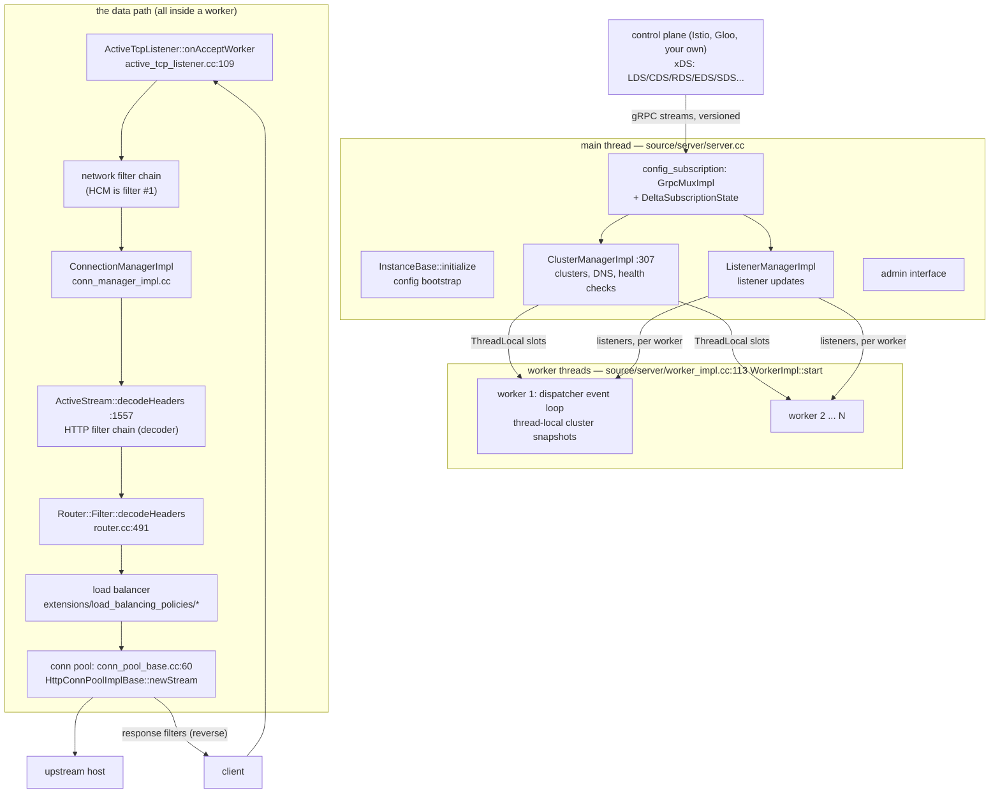
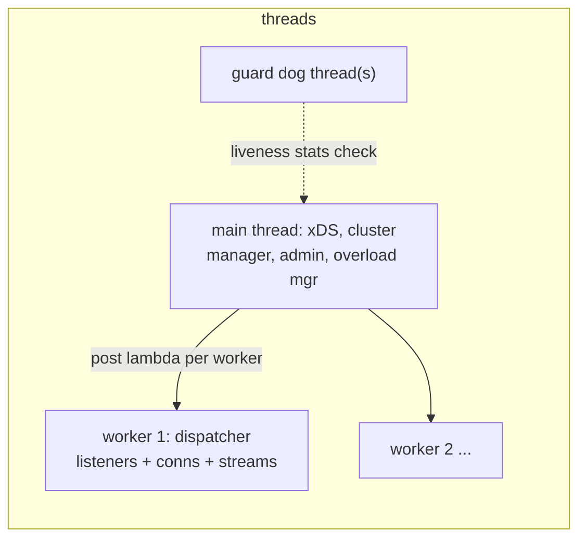

# Envoy: a fleet of single-threaded proxies steered by an API

> **Atlas id:** `envoy` · **Domains:** `proxy-lb, distributed` ·
> **Upstream:** https://github.com/envoyproxy/envoy · **License:** Apache-2.0 ·
> **Pinned commit:** `7fe1fd087cfa0074a5e71110fec50b18766d13ba` (2026-10-11)

Envoy is the data plane the service-mesh era standardized on — the
proxy under Istio, AWS App Mesh, and countless edge gateways. Its
design lesson is bigger than "fast proxy": **configuration,
observability, and overload behavior are architectural, not
features**. Every worker thread runs its own event loop against its
own immutable snapshot of the config; a control plane streams
versioned resources over xDS (LDS/CDS/RDS/EDS…) which are validated,
applied atomically, and ACK/NACKed — so routing changes take effect
with zero dropped connections. Everything a request touches is a
*chain*: network filters on the connection, HTTP filters on the
stream, both assembled from registered factories; the router is just
the last filter, and the load balancer itself is a registered policy.
The dive teaches how to build a system that is simultaneously a hot-
reconfigurable fabric, a metric firehose, and a defense line that
sheds load the moment headers arrive.

Read it against [nginx](nginx.md) (the config-file-and-reload
generation) and [curl](curl.md) (the tenant that rents loops):
Envoy is what a proxy becomes when *the API is the product* —
programmability pushed all the way into the control plane.

## Explain like I'm 10

**A sorting facility where every sorter has their own manual — and
head office rewrites the manuals by phone.** Letters (connections)
arrive at loading docks (listeners) and ride conveyor belts
(filter chains) past inspection stations: an ID checker (TLS), a
form reader (HTTP codec), stampers and annotators (HTTP filters),
and finally the routing desk (the router filter) which picks a truck
(company car — an upstream connection from the pool) to a warehouse
(host, chosen by the round-robin/least-request rulebook). Every
sorter (worker thread) works alone with their *own copy* of the
manual (a thread-local config snapshot) — sorters never fight over
one binder. When head office (the main thread) gets a new page by
phone (an xDS stream from your control plane), it reprints just the
changed pages and hands every sorter a new binder before the old one
is collected — belts never stop (draining, not restarting). Every
station ticks counters (stats) for every letter; when the bins
overflow (overload manager), the front door refuses new letters
before they cost anything, and the facility can drain one sorter at
a time for repairs without closing.

**Why the grown-ups did it this way:** a proxy's hardest problems are
not forwarding bytes — they are changing the rules while traffic
flows and staying honest when overloaded — and both require the
*architecture* (snapshots, chains, counters, shedding points), not a
feature bolted on later.

## 1. Architecture overview



- **Process model:** one process, `--concurrency` worker threads plus
  a main thread. Each worker owns an event loop
  (`source/server/worker_impl.cc:113 WorkerImpl::start` — thread
  creation, then `threadRoutine` parks in the dispatcher) and its own
  listener registrations; shared state flows through *thread-local
  slots* that the main thread updates by posting to each worker.
- **The two filter stacks are the whole data plane.** Downstream:
  accepted connection → network filter chain (TLS transport sockets,
  then the HTTP connection manager) → per-stream HTTP filter chain →
  router. Upstream: mirrored in reverse through a connection pool.
  Filters are built by *registered factories* (e.g.
  `HttpConnectionManagerFilterConfigFactory`,
  `extensions/filters/network/http_connection_manager/config.cc:347`),
  which is how every Envoy feature — auth, rate limit, fault
  injection, wasm — enters the same conveyor belt.
- **Configuration is a subscription, not a file.** xDS resources
  arrive as versioned updates on gRPC streams
  (`source/extensions/config_subscription/grpc/xds_mux/grpc_mux_impl.cc`;
  delta/SotW state machines in `delta_subscription_state.cc:187
  handleGoodResponse`), pass validation, are applied via config
  providers, and are ACKed with the version that took — NACK on
  rejection. Static files bootstrap the same machinery.
- **Clusters and their state** live in `ClusterManagerImpl`
  (`source/common/upstream/cluster_manager_impl.cc:307`): endpoints
  from EDS/DNS, health checking, priority sets — all reduced to
  per-worker *load-balancer snapshots* so a worker never locks to
  pick a host.
- **Observability is in the spine:** every object carries a stats
  scope; the HCM attributes timing to each stream
  (`conn_manager_impl.cc` stream-info plumbing), and the overload
  manager's stop-accepting-requests action is checked *in
  `decodeHeaders`* — shedding before a filter chain is even
  allocated.

## Walkthrough: one request, client socket to upstream and back

The spine as a story — on the site you can step through it with Next;
in the repo it reads top to bottom.

```mermaid
sequenceDiagram
    autonumber
    participant C as client
    participant W as worker (event loop)
    participant A as ActiveTcpListener
    participant H as HCM ActiveStream
    participant R as Router::Filter
    participant U as upstream host (pool)

    C->>W: TCP connect to listener port
    W->>A: onAcceptWorker (active_tcp_listener.cc:109)
    A->>A: connection balancer may hand off to another worker
    A->>H: filters built; HCM reads via codec
    H->>H: decodeHeaders (conn_manager_impl.cc:1557): overload check, route snapshot
    H->>R: HTTP filter chain decodes; router is terminal
    R->>R: cluster snapshot → LB (round_robin) → host
    R->>U: conn_pool newStream (conn_pool_base.cc:60)
    U-->>R: onPoolReady → encodeHeaders upstream
    U-->>H: response headers → encoder filter chain (reverse order)
    H-->>C: write via connection transport socket
    H->>H: stream destroyed; stats/timers recorded
```

**Step 1 — Accept.** The worker's `ActiveTcpListener::onAcceptWorker`
(`active_tcp_listener.cc:109`) receives the socket; the *connection
balancer* may immediately hand it to another worker's listener
(`pickTargetHandler` — moving work, not sharing it, the thread-local
credo).

**Step 2 — Build the chain.** `ActiveTcpSocket` runs pre-bind
filters, then matching picks a filter chain and
`newActiveConnection` creates the `ConnectionImpl`, whose read
callback drives the network filter stack; the HCM factory's
`createFilterFactoryFromProtoTyped` (`config.cc:292`) installed the
manager at config time — no runtime dispatch by name.

**Step 3 — Decode headers.** The HTTP codec hands headers to
`ConnectionManagerImpl::ActiveStream::decodeHeaders`
(`conn_manager_impl.cc:1557`): record timings, snap the route config
(`snapped_route_config_` — an immutable snapshot pointer), *then* the
overload check — `drop_request_due_to_overload` can refuse here,
before any filter allocates (the comment: memory discipline beats
politeness).

**Step 4 — The HTTP filter chain.** Filter-manager walks decoder
filters (auth, rate limit, fault injection…) each returning
`Continue` or `StopIteration`; the router is the terminal decoder
(`router.cc:491 Filter::decodeHeaders`) — it is *a filter like the
others*, which is why retries and shadowing compose with everything.

**Step 5 — Pick a host.** The router reads its thread-local cluster
snapshot (`LB` context), and the registered policy — e.g. round
robin in `extensions/load_balancing_policies/round_robin/
round_robin_lb.cc`, `ZoneAwareLoadBalancerBase::chooseHost` in
`load_balancer_impl.cc:658` — returns a host from the priority set.

**Step 6 — Pool and encode.** `HttpConnPoolImplBase::newStream`
(`conn_pool_base.cc:60`) finds or creates a pooled upstream
connection (HTTP/2: an existing one gains a stream) and calls the
router back via `onPoolReady` (line 84); the router encodes headers
upstream through the pool's codec.

**Step 7 — Response, in reverse.** Upstream headers enter the
*encoder* filter chain in reverse order, timing attributes accumulate
on the stream info, and the connection writes through its transport
socket (TLS lives below, invisible to every layer above).

**Outcome — Everything counted, nothing locked.** The stream
destructs, counters and histograms flush to sinks, the pooled
connection stays warm. Across the whole trip no mutex was held on
the hot path and no config was read that could change mid-request —
snapshots made that possible.

## 2. Core data structures — and why these

- **The thread-local snapshot (TLS slots).**
  **What:** each worker holds pointers to immutable config/host-set
  objects; updates build a new object, then publish per-thread.
  **Where:** `tls_.registerThread(*dispatcher_, false)` in
  `worker_impl.cc:57`; cluster LB snapshots built in
  `cluster_manager_impl.cc` (`ThreadAwareLoadBalancer` pair at line
  932).
  **Why:** copy-on-write replaces locking on the hot path — the same
  trade [Kubernetes](kubernetes.md) makes with informer caches.
  Cost is memory per worker and update latency; the proxy workload
  (read millions, update rarely) is exactly right for it.

- **`ConnectionImpl` — an evented socket with a filter stack.**
  **What:** file-event callbacks (`connection_impl.cc:712
  onFileEvent` → `onReadReady` :758) pump bytes into read filters;
  writes buffer and flush on writability; watermarks signal the
  codec above for backpressure.
  **Why:** one connection object per worker-owned fd keeps all
  connection state single-threaded; close/timeout logic lives with
  the events that cause it.

- **`ActiveStream` — one HTTP stream's world.**
  **What:** headers/body/trailers, the filter manager, stream info
  (timings, metadata, reasons), snapshots of route/cluster —
  everything a filter may touch for one request.
  **Where:** `conn_manager_impl.cc:1557 decodeHeaders` populates it;
  filter-chain creation at line 1776.
  **Why:** concentrating per-stream state lets filters be stateless
  factories and makes the *stream* the unit of destruction, timing,
  and overload accounting.

- **`ClusterManagerImpl` + priority/host sets.**
  **What:** the main-thread registry of clusters, their endpoint
  membership (EDS/DNS/static), health states, and the conn-pool map;
  per-priority `HostSet`s feed the LB.
  **Where:** `cluster_manager_impl.cc:307`.
  **Why:** separating *membership* (slow, shared) from *selection*
  (hot, thread-local) is the seam that makes LB lock-free.

- **The registered LB policy.**
  **What:** load balancing moved into
  `source/extensions/load_balancing_policies/*` — each policy a
  small class with `chooseHost` (`load_balancer_impl.cc:658`), the
  EDF scheduler (`edf_scheduler.h`) available for smooth weighted
  picking.
  **Why:** even the core scheduling decision is an extension — the
  strongest statement of the "everything registers" philosophy, and
  the reason new policies (ORCA-weighted, locality-aware) ship
  without core surgery.

## 3. Concurrency and failure model



- **One loop per worker, zero shared hot state.** Workers never
  block on shared locks for a request; config crosses threads as
  posted snapshots (the pattern to steal: *move work to threads,
  move state as copies*). The guard dog (`guarddog_impl.cc`) watches
  every dispatcher's heartbeat and kills a wedged process —
  fail-fast as a concurrency policy.
- **Failure of an upstream:** outlier detection and active health
  checks mutate host sets (main thread), flowing into new snapshots;
  the router retries per policy; circuit breakers bound pools,
  pending requests, and retries per cluster — backpressure is
  *configurable capacity*, not queue growth.
- **Failure of the process:** drain managers close listeners
  gradually (`drain_manager_impl.cc`), workers finish in-flight
  streams, and hot restart (`hot_restart_impl.cc`) can hand sockets
  to a successor — though xDS-driven config updates made restarts
  the rare path, the machinery remains the deepest crash-story in
  the proxy world.
- **Overload is architectural:** the overload manager maps resource
  pressures (heap, pending streams) to actions; HCM checks
  stop-accepting-requests in `decodeHeaders` (`conn_manager_impl.cc`
  ~1610) and can skip filter-chain creation — shedding at the
  cheapest possible point, the [Kafka](kafka.md)-style "reject early"
  lesson applied to a proxy.

## 4. API and extension design

- **The public API is a protocol, not a library:** xDS resource
  types (Listener, Cluster, Route, Endpoint, Secret, Runtime, …)
  with versions, deltas, ACK/NACK semantics — implemented across
  `source/extensions/config_subscription/grpc/*`. A control plane is
  *any* program speaking it; Istio is one such program.
- **In-process seams:** network/HTTP filter factories (registered
  via `LEGACY_REGISTER_FACTORY`, e.g. `config.cc:347`), transport
  sockets, access loggers, stat sinks, tracers, DNS resolvers,
  LB policies — every subsystem ends in a registry lookup. Third
  parties add C++ extensions or load WebAssembly filters without
  forking.
- **Honest wart:** the cost of "everything is a registered proto-
  configured extension" is surface area — generated code volume,
  long compiles, and a config schema so large that validation
  visitors (static vs dynamic) are their own subsystem. Envoy
  trades cognitive locality for composability; smaller systems
  should not reach for this size of machinery reflexively.

## 5. The defining trade-offs

### Trade-off 1: per-worker thread-local snapshots over shared state
- **Tension:** N event loops must see *consistent* routing/endpoint
  state without contending.
- **Choice:** main thread owns updates; workers get immutable
  snapshot pointers via TLS slots.
- **Evidence:** `worker_impl.cc:57` (registerThread);
  `cluster_manager_impl.cc:932` (thread-aware LB pairs built with
  clusters).
- **Given up:** instant propagation (update latency per worker),
  memory duplication, and the discipline cost — every shared thing
  must be redesigned as snapshot-or-post.
- **Verdict:** right for read-heavy hot paths with rare updates
  (also [Kubernetes's](kubernetes.md) informer verdict). Wrong for
  frequently-mutated shared counters — which is why stats are
  per-thread aggregated instead.

### Trade-off 2: xDS streaming config over static files + reload
- **Tension:** operators need routing to change *now*, per-instance,
  without dropping connections; files+restart (the nginx model)
  can't.
- **Choice:** versioned resources over gRPC subscriptions, validated
  then applied atomically, with ACK/NACK closing the loop to the
  control plane.
- **Evidence:** `grpc_mux_impl.cc` (mux over one ADS stream);
  `delta_subscription_state.cc:187 handleGoodResponse`,
  `:292 getNextRequestAckless`, `:373 getNextRequestWithAck`;
  config providers applying updates.
- **Given up:** the simplicity of "the config file *is* the truth";
  debugging now needs both sides' versions, and the API becomes a
  compatibility contract you must version forever.
- **Verdict:** right the moment a control plane exists above you —
  it is *why* Envoy became the mesh substrate. Wrong for
  single-binary tools where a reload signal suffices.

### Trade-off 3: observability and shedding in the spine, not beside it
- **Tension:** proxies fail silently unless measured; overloaded
  proxies fail *catastrophically* unless they refuse work.
- **Choice:** every object owns a stats scope; timings ride the
  stream info; overload gates header decoding.
- **Evidence:** `decodeHeaders` overload drop
  (`conn_manager_impl.cc:1557`+); `ScopeTrackerScope` scoping in
  the same function; guard-dog thread liveness
  (`guarddog_impl.cc`).
- **Given up:** hot-path branches and code volume — a minimal
  forwarder would be half the code.
- **Verdict:** right for infrastructure others depend on; the
  moment you can't see it, you can't operate it. Smaller services
  get the same honesty cheaper with middleware/metrics libraries —
  Envoy shows the fully architectural version.

## 6. Reading path

1. `source/exe/main.cc` → `source/server/server.cc`
   (`InstanceBase::initialize`, `startWorkers` at line 966) — the
   boot order: bootstrap parse → clusters/listeners → workers last.
   Note how late traffic starts.
2. `source/server/worker_impl.cc:113 WorkerImpl::start` +
   `threadRoutine` — one event loop per worker; then
   `tls_.registerThread` (line 57) to understand who may touch what.
3. `source/common/listener_manager/active_tcp_listener.cc:109
   onAcceptWorker` — accept, rebalancing (`pickTargetHandler`), and
   `newActiveConnection` below it.
4. `source/common/network/connection_impl.cc:712 onFileEvent` →
   `:758 onReadReady` — bytes to read filters; also the watermark
   callbacks that backpressure the codec.
5. `source/extensions/filters/network/http_connection_manager/
   config.cc:292` + `:347` — a filter factory end to end; every
   other extension follows this exact shape.
6. `source/common/http/conn_manager_impl.cc:1557 decodeHeaders` —
   the busiest function in the repo: timing snaps, overload drop,
   route snapshot, then filter-chain creation (line 1776).
7. `source/common/router/router.cc:491 Filter::decodeHeaders` —
   route entry, cluster lookup, retries/shadow policy; note how
   little is special about being "the router".
8. `source/common/upstream/cluster_manager_impl.cc:307` — cluster
   initialization and the thread-aware LB build (line 932); then
   `extensions/load_balancing_policies/round_robin/round_robin_lb.cc`
   and `chooseHost` in
   `load_balancing_policies/common/load_balancer_impl.cc:658`.
9. `source/common/http/conn_pool_base.cc:60 newStream` → `:84
   onPoolReady` — pooling, ready callbacks, and why HTTP/2 changes
   only the stream-per-conn arithmetic.
10. `source/extensions/config_subscription/grpc/xds_mux/
    grpc_mux_impl.cc` + `delta_subscription_state.cc:187` — one
    multiplexed stream, per-type state machines, ACK/NACK.
11. `source/server/overload_manager_impl.cc` and the overload drop
    in step 6 — close the loop between resource pressure and the
    front door. Finish with `guarddog_impl.cc` for fail-fast.

You have now traced one request through two filter stacks, a
thread-local host pick, a pooled upstream stream, and back — plus
the machinery that rewrites the rules while it flows.

## 7. What to steal

- **Publish immutable snapshots per consumer thread** — the
  lock-free-reads pattern for any read-heavy shared state
  (worker_impl.cc + cluster manager show the full plumbing).
- **Make the terminal consumer of a chain just another chain
  element** — the router being an HTTP filter is why retries,
  shadowing, and auth compose; steal for pipelines of any kind.
- **Version your config protocol and close the loop with ACK/NACK**
  — xDS's core discipline; apply to any agent/controller pair.
- **Shed load at the earliest decode point, before allocation** —
  the `decodeHeaders` overload drop is the cheapest survivability
  line in any server.
- **Register everything via factories with config protos** —
  new behavior becomes a new file, never a core edit (see
  `config.cc:347` for the shape).
- **Move work between threads, don't share it** — the connection
  balancer handing fresh sockets to less-loaded workers is the
  pattern to steal for your own accept loops.

## 8. Difficulty and prerequisites

- Difficulty: `demanding`. Realistic budget: 8 hours for this path;
  make it two sittings — the xDS half reads best after the data
  path.
- Prerequisites: strong C++ (smart pointers, callbacks-as-closures);
  event-loop thinking (the [libuv](libuv.md) dive helps);
  HTTP/1.1-2 framing basics; gRPC streams at the conceptual level.
  No prior service-mesh knowledge needed — the dive builds it.

## 9. Further reading

- Envoy's own architecture overview —
  https://www.envoyproxy.io/docs/envoy/latest/intro/arch_overview/arch_overview
  (read "Thread model", "Filters", "Overview of xDS" after this dive).
- The xDS protocol definitions — https://github.com/envoyproxy/data-plane-api
  and the `xds_protocol` docs (versions, delta xDS, resource
  warming).
- Matt Klein, *Envoy's architecture* and his service-mesh-era
  write-ups (the "universal data plane" framing this dive leans on).
- The [nginx](nginx.md), [curl](curl.md), and [Kubernetes](kubernetes.md)
  dives in this atlas — the reload-generation proxy, the renting
  tenant, and the informer-snapshot cousin.
