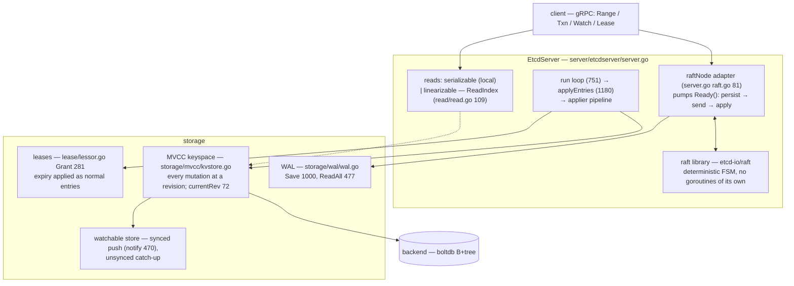
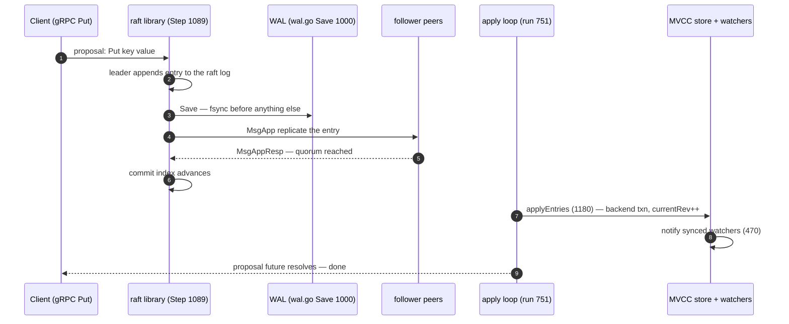
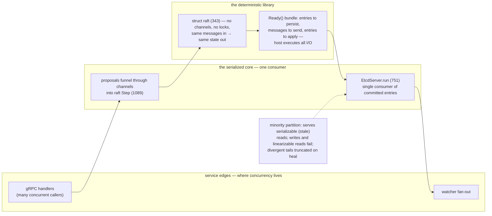

# etcd: Raft as a deterministic state machine, keyspace as MVCC history

> **Atlas id:** `etcd` · **Domains:** `distributed, database` ·
> **Upstream:** https://github.com/etcd-io/etcd (core raft in
> https://github.com/etcd-io/raft) · **License:** Apache-2.0 ·
> **Pinned commits:** server `f061acd0902d489041448cdd19d71a345d27b9f5`
> (2026-10-08), raft lib `638f42739b77572b5708eb0d8a776a272ade71ed` (2026-10-09) ·

etcd is the coordination store beneath Kubernetes and countless
platforms: a small replicated key-value service whose entire design is
**consensus made deployable**. Two decisions carry it: the Raft
consensus module is a **deterministic, event-driven state machine**
with no goroutines of its own (the host pumps it), and the applied
keyspace is an **MVCC log of revisions** (v3) rather than a flat map —
which is what made watches and transactions correct. This deep-dive
teaches the gap between a consensus paper and a service: leases,
linearizable reads, and why every read needs an explicit consistency
decision.

## Explain like I'm 10

**A club notebook that most members must agree on.** etcd is a club with
one precious notebook (the keyspace). Any important note (a Put) is
only written after MOST members agree on the next line (a quorum in the
Raft vote) — so the notebook never contradicts itself, even if some
members nap or storm off. Every line gets a number (a revision), so you
can ask "read me the notebook as of line 500" (a watch) or "read me only
notes newer than line 500." Even "this note expired at noon" goes
through the notebook (leases), so a member who missed the meeting can
never secretly disagree later. And reading has two speeds: quick,
straight from your copy (maybe slightly old), or confirmed-fresh — the
leader first checks the club still agrees, then answers (ReadIndex).

**Why the grown-ups did it this way:** with most-members agreement,
even power cuts and split rooms can't produce two disagreeing
notebooks — the difference between "probably fine" and "provably
agreed," which is exactly what Kubernetes needs under it.

## 1. Architecture overview

- The **spine** — one `Put` — is: gRPC handler wraps it as a proposal →
  raft `Step` appends to the `raftLog` → WAL `Save` persists the entry
  (`wal.go:1000`) → leader replicates; on quorum commit, the server's
  `run` loop (`server.go:751`) `applyEntries` (1180) → the applier
  runs a backend transaction on the MVCC store, bumping `currentRev`
  (`kvstore.go:72`) → watchers are notified
  (`watchable_store.go:470`) → the client's proposal future resolves.

## Walkthrough: one Put, proposal to watch notification

The spine as a story — step through it on the site or read straight
down. Count the places where durability is bought before visibility.

**Step 1 — Wrap the wish as a proposal.** The gRPC handler turns
`Put(key, value)` into a raft proposal and funnels it into `Step`
(`etcd-io/raft/raft.go:1089`) — a single message-driven function. The
raft state machine itself owns no goroutines: it only computes what
should happen next.

**Step 2 — Persist before you promise.** The leader appends the entry
to its log and the host's `raftNode` adapter writes it to the WAL
(`wal.go:Save:1000`, length-crc framed records) — persistence ordering
is the host's explicit responsibility in the Ready contract.

**Step 3 — Ask the club.** The entry ships to followers in `MsgApp`;
peers persist it and answer `MsgAppResp`. When a quorum has it, the
commit index advances — the line is now official.

**Step 4 — Apply, don't improvise.** The server's single consumer loop
(`run`, 751) picks up committed entries and `applyEntries` (1180) hands
them to the applier, which runs a backend transaction on the MVCC
store — deterministic, or it's a design bug.

**Step 5 — Stamp and shout.** The mutation lands at a fresh revision
(`currentRev`, `kvstore.go:72`); synced watchers are notified by push
(`watchable_store.go:470`) — watchers that joined at an older revision
are caught up from history first by `syncWatchers`.

**Step 6 — The future resolves.** The client's Put returns only now:
persisted on a quorum, applied, visible to watchers. Reads that need
guaranteed freshness go through ReadIndex (`read/read.go:109`) — the
leader confirms its commit index with one heartbeat round, then serves
from local state.

**Outcome — A write that survives the worst night.** As long as a
majority of members (and their disks) live, this Put survives crashes,
partitions, and restarted peers — and every watcher sees it at a
numbered point in history.

## 2. Core data structures — and why these

### The raft state machine (`etcd-io/raft/raft.go:343`)

`struct raft` holds the *entire* node state: role, term, votes, the
log, progress trackers for peers. All transitions happen inside
`Step(msg)` (1089) — a single message-driven function with a big
dispatch (e.g. `MsgVote` handling at 1212) — and `tickElection`/
`tickHeartbeat` (850/862) convert the host's clock into logical time.
Why goroutine-free: a consensus library that owns no concurrency is
**deterministic** — the same message sequence always yields the same
state, which is why etcd's raft ships with a simulated-network test
harness that found bugs no integration test could. (The same property
makes Raft's cousin design in Kafka's KRaft — see that deep-dive —
event-sourced and testable.)

### The raft log with unstable tail (`log.go:25`, `log_unstable.go:37`)

`raftLog` composes a stable (storage-backed) section and an
`unstable` in-memory tail; `append` (133) only mutates the tail until
the host persists it. Why the split: the library must never pretend
durability it doesn't own — the boundary between "in memory" and
"saved" is an explicit, inspectable type.

### The MVCC revision keyspace (`storage/mvcc/kvstore.go:53`)

v3 stores every mutation at key
`(main_rev, sub)=(key, value, tombstone)` — history is the store;
"current value" is the latest rev ≤ your read rev. `currentRev`
(kvstore.go:72) is the clock of the database. Why: watchers replay
exact history, transactions compare revisions atomically, and
compaction truncates the past by rev — the same MVCC pattern as
PostgreSQL (see PATTERNS.md), implemented on a tiny B+tree (boltdb).

### Watchable store: synced and unsynced watcher sets
(`storage/mvcc/watchable_store.go:56`)

Watchers are partitioned by whether their start revision is already
visible in the backend; synced watchers get events pushed
(`notify:470`), unsynced ones are caught up by `syncWatchers` scanning
history — converging to the synced set. Why: a watcher joining at an
arbitrary past revision is a *batch* problem, but steady-state
notification must be a *push* problem; the store physically separates
the two regimes.

### WAL (`storage/wal/wal.go:73`) and leases (`lease/lessor.go:145`)

The WAL frames raft entries/snapshots in length-crc records
(`Save:1000`, `SaveSnapshot:1044`, recovered by `ReadAll:477`).
Leases (`Grant:281`) attach TTLs to keys through the same raft log —
expiry runs only on the leader, applied as normal entries. Why: even
timeouts flow through consensus, so a partitioned minority can never
resurrect expired keys differently than the majority.

## 3. Concurrency and failure model

- **One goroutine per concern, one raft**: `EtcdServer.run` is the
  single consumer of committed entries; clients' proposals funnel
  through channels into `Step`. Concurrency lives at the *service*
  edges (gRPC handlers, watcher fan-out), not inside consensus.
- **The Ready() contract**: raft never does I/O; it exposes a `Ready`
  bundle (entries to persist, messages to send, entries to apply) and
  the host (`server/etcdserver/raft.go:81 raftNode`) executes it —
  persistence ordering is the host's responsibility, formalized.
- **Failure/partition semantics**: a minority partition keeps serving
  serializable (possibly stale) reads but fails writes and
  linearizable reads; on heal, the follower's divergent log tail is
  truncated by term/commit rules. Learners and `MoveLeader`
  (`server.go:1238`) smooth leadership changes.
- **Crash recovery** = WAL replay + snapshot + backend consistency
  check (apply/ has an explicit corruption detector). Anything not
  through the log does not exist — same WAL discipline as PostgreSQL
  and LevelDB in this atlas.

## 4. API and extension design

- The API is **gRPC with explicit consistency choices**: `Range`
  (`v3_server.go:106`) decides serializable vs linearizable per
  request; `Txn` composes compare/success/failure batches; `Watch`
  streams revisions; `Lease` grants TTLs. Small surface, sharp
  semantics — every method answers "what consistency do I get?".
- **The read path is the extension story**: linearizable reads use
  ReadIndex (`etcdserver/read/read.go` — the `linearizableReadLoop`
  around line 109): the leader records its commit index, confirms via
  one round of heartbeats, then serves from local state — correct
  reads without a log entry per read. A textbook optimization, made
  operational (timeouts, waiting for apply index `waitAppliedIndex`,
  backoff on leader change).
- Honest wart: every write is a full cluster round trip — etcd is
  deliberately tiny (metadata, not data); teams that put queues or
  blobs in it meet the design's ceiling (default quotas, ~10k writes/s
  class), which is the intended guardrail, not a flaw.

## 5. The defining trade-offs

### Trade-off 1: consensus as a deterministic library over a threaded service
- **Tension:** consensus must be exactly right; threads make
  reproducibility hard.
- **Choice:** raft library owns state and logic only; the host pumps
  messages/ticks and executes I/O described by `Ready`.
- **Evidence:** `raft struct` (`raft.go:343`) — no channels, no locks;
  `Step` (1089) as the single entry; the adapter
  `server/etcdserver/raft.go:81`.
- **Given up:** some performance tricks available to consensus that
  owns its scheduling; extra host complexity to honor the
  persist-before-send ordering.
- **Verdict:** determinism made the library exhaustively testable
  (simulated nets) and reusable (Kafka's KRaft descends from this
  design). For any correctness-core subsystem: separate the state
  machine from its I/O.

### Trade-off 2: MVCC revision store over flat key-value
- **Tension:** watchers and transactions need history; a map is
  cheaper.
- **Choice:** every mutation gets a global revision; current state is
  a query; compaction bounds history.
- **Evidence:** `store`/`currentRev` (`kvstore.go:53/72`);
  `watchableStore.notify` (470) + unsynced catch-up regime.
- **Given up:** write amplification (boltdb rewrites), compaction as
  an operational task, value size discipline.
- **Verdict:** v2 (flat, in-memory, TTL keys) was replaced by v3
  precisely because watch correctness and transactions required
  history — a system-level admission that "just a map" was the wrong
  core model.

### Trade-off 3: explicit read consistency (serializable default opt-in to linearizable) over one-size reads
- **Tension:** reads dominate (config polling); not all reads need
  quorum freshness.
- **Choice:** local serializable reads by default; `serializable=false`
  triggers ReadIndex confirmation.
- **Evidence:** `Range` (`v3_server.go:106`) branching; the
  `linearizableReadLoop` (`read/read.go:109`) machinery.
- **Given up:** default surprises (stale reads after partition heal
  unless clients opt in); two read code paths to maintain and reason
  about.
- **Verdict:** consistency-as-a-parameter is honest distributed
  design — hide it and clients get either waste (quorum everything)
  or silent staleness. Every distributed API should make this choice
  explicit.

## 6. Reading path

1. `raft/raft.go:343` — `struct raft`: inventory the state (term,
   role, votes, log, progresses); this one struct is the paper's
   Figure 2 made literal.
2. `raft.go:tickElection` (850) / `tickHeartbeat` (862) — time as
   injected ticks; then `campaign` (1025) → `becomeLeader` (933), and
   `becomeFollower` (891): all role changes in one file.
3. `raft.go:Step` (1089) — walk one message of each kind: `MsgVote`
   (1212), `MsgApp`, `MsgAppResp` — notice commit index advance and
   message sending are *return effects*, not actions.
4. `raft/log.go:25` + `log_unstable.go:37` — `append` (133): where
   "durable" is an explicit boundary.
5. `server/etcdserver/raft.go:81` (`raftNode`) — the bridge: how the
   host loops over `Ready()`, persisting to WAL before sending, then
   applying — the ordering contract in code.
6. `server/etcdserver/server.go:run` (751) → `applyEntries` (1180) →
   `apply/uber_applier.go` — proposals become backend transactions;
   errors here are design bugs (apply must be deterministic).
7. `server/storage/wal/wal.go` — `Save` (1000), `SaveSnapshot`
   (1044), `ReadAll` (477): the restart story.
8. `server/storage/mvcc/kvstore.go` — revision allocation,
   `TxnBegin`, compaction entry points; keep `currentRev` (72) in
   mind as the database clock.
9. `server/storage/mvcc/watchable_store.go` — `syncWatchers` vs
   `notify` (470): the two watcher regimes; start a watch at an old
   revision with etcdctl while reading.
10. `server/lease/lessor.go:Grant` (281) — expiry as consensus
    entries; then `server/etcdserver/read/read.go` (~109) —
    ReadIndex: linearizable reads without log writes.
11. Finish with `server/etcdserver/v3_server.go:Range` (106) — one
    method, both consistency modes, the API honest about each.

You have now traced one Put through consensus, persistence, apply,
watch, and read-consistency — the complete distance from a Raft paper
to a production service.

## 7. What to steal

- **Make correctness-critical cores deterministic and I/O-free**:
  pump them from the edges (the Ready pattern) and you can simulate
  what you can never reproduce in production.
- **Give data a global revision** (MVCC) if watches or transactions
  matter — flat stores converge to this design eventually, painfully.
- **Make read consistency an explicit API choice**, never an ambient
  accident; ReadIndex shows the middle path between quorum-everything
  and stale-by-default.
- **Route even timeouts through consensus** (leases): a partitioned
  minority expiring keys on its own clock is a split-brain you
  designed yourself.
- **Split regimes, not just functions** (synced/unsynced watchers):
  batch catch-up and push steady-state are different problems — make
  the split structural.

## 8. Difficulty and prerequisites

- Difficulty: **demanding** — the raft library is readable by design,
  but consensus vocabulary is assumed.
- Budget: ~7 hours for the reading path; steps 1–6 are the core.
- Prerequisites: read the Raft paper first (extended version,
  https://raft.github.io); Go concurrency; what a WAL buys (see the
  LevelDB deep-dive's WAL section).

## 9. Further reading

- Ongaro & Ousterhout, "In Search of an Understandable Consensus
  Algorithm" (Raft) — then re-read step 3 against the paper.
- The etcd docs' consistency and hardware tuning pages
  (https://etcd.io/docs/) — operational framing of these trade-offs.
- `etcd-io/raft`'s `README.md` and the interop/test harness
  (`rafthttp` simulated tests) — determinism as a testing strategy.
