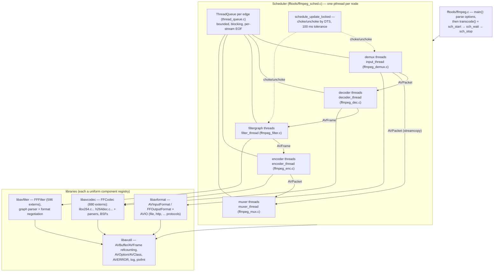
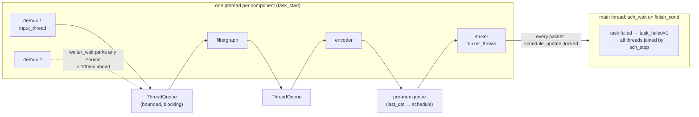

# FFmpeg: two thousand components behind four boring interfaces

> **Atlas id:** `ffmpeg` · **Domains:** `media, networking` ·
> **Upstream:** https://github.com/FFmpeg/FFmpeg ·
> **License:** LGPL-2.1-or-later OR GPL-2.0-or-later (per binary) ·
> **Pinned commit:** `4a122520444dc78ed5bc3ee4d35bbd15f220c67f` (2026-10-12)

FFmpeg is the Swiss army knife of media — it demuxes, decodes,
filters, encodes, and muxes essentially every audio/video format
that exists — and its design lesson is that none of that scale
required clever per-format machinery. Every demuxer, decoder,
filter, and encoder is a plain C struct implementing one small
callback contract, discovered through generated lists at link
time (no runtime plugin registry), and everything they exchange
is one of two refcounted value types: `AVPacket` (compressed) and
`AVFrame` (decoded). The `ffmpeg` CLI threads these components
into a directed acyclic graph and runs **one pthread per
component**, pacing them with a single global rule — no source
may run more than 100 ms of output-time ahead of the slowest
consumer. This deep-dive teaches how far "boring uniform
interfaces + shared memory model + one pacing rule" scales:
at this commit, 880 codec declarations, ~600 filters, ~370
demuxers and ~190 muxers — every one registrable in a single
program.

## Explain like I'm 10

**A factory where every machine speaks the same plug.** Packages
arrive from trucks (the **demuxers** take containers apart into
**packets** — still-wrapped presents). Unwrapping machines
(**decoders**) open them into flat pictures and sounds
(**frames**). A workshop (**filters**) crops, scales, and mixes
frames. Wrapping machines (**encoders**) repack frames into new
presents, and packing stations (**muxers**) interleave them into
new boxes, in timestamp order. Every machine's plug is the same
shape, so any machine can feed any other (the **scheduler** wires
them into a flowchart and gives each its own worker). Photos are
never photocopied when two machines want the same one: each pins
the original to its corkboard (a **reference count**), and only
the last one out recycles it. And the foreman enforces one rule:
if any shipping lane is more than a tenth of a second behind, the
fast lanes' trucks wait (the **choke**), so no worker drowns in
presents.

**Why the grown-ups did it this way:** with hundreds of codecs
written by hundreds of people across its per-architecture ports
(x86, ARM/AArch64, MIPS, PowerPC, RISC-V, LoongArch), one shared
plug, one memory model, and one pacing rule mean every codec gets
the same correctness machinery for free — special cases would
have multiplied by two thousand.

## 1. Architecture overview



- **libavutil** is the foundation nothing may depend upward from:
  `AVBuffer`/`AVBufferRef` (refcounted bytes, `libavutil/buffer.c`),
  `AVFrame` and `AVPacket` (the two value types), `AVClass` +
  `AVOption` (one generic option system for every component,
  `libavutil/opt.c`), `av_log`, `AVERROR` codes, pixel/sample
  format descriptors. It contains no media logic — it is the
  vocabulary.
- **libavformat** owns containers and byte I/O. Demuxers are
  `AVInputFormat` structs whose `read_packet` callback the generic
  `ff_read_packet` loop drives (`libavformat/demux.c:652`); muxers
  register `write_packet` behind the generic interleaver
  (`libavformat/mux.c:369` picks `ff_interleave_packet_per_dts`
  when a file has more than one interleaved stream). Protocols
  (file/http/pipe) are a second registry under `AVIOContext`.
- **libavcodec** is the largest library: every decoder/encoder is
  one `FFCodec` struct (`libavcodec/codec_internal.h:129`) whose
  public first member is `AVCodec`. Wrappers around external
  projects (`libavcodec/libx264.c`) sit beside native codecs
  (`libavcodec/h264dec.c`) — same struct, same contract. Threading
  (slice vs frame, `libavcodec/pthread.c:54`), bitstream filters,
  and parsers are generic layers under the same roof.
- **libavfilter** turns ~600 filter structs into graphs: a text
  parser (`graphparser.c`), an engine where each link holds a
  frame queue and filters are *activated* when their inputs
  change (`avfilter.c:ff_filter_activate`), and a format
  negotiation pass that auto-inserts `scale`/`aresample` where
  formats mismatch (`avfiltergraph.c:query_formats`).
- **fftools** is the CLI layer: `ffmpeg.c:main` parses options,
  builds the component graph through `sch_add_*`/`sch_connect`,
  then starts it and waits. It owns no media logic — its whole
  job is wiring, pacing, and reporting.

**The spine:** one transcode walks
`ffmpeg_demux.c:input_thread` → `av_read_frame` →
`ffmpeg_sched.c:sch_demux_send` → `ffmpeg_dec.c:decoder_thread`
→ `avcodec_send_packet`/`receive_frame` →
`ffmpeg_filter.c:filter_thread` → `av_buffersrc_add_frame` →
`av_buffersink_get_frame` → `ffmpeg_enc.c:encoder_thread` →
`avcodec_send_frame`/`receive_packet` →
`ffmpeg_mux.c:muxer_thread` → `av_interleaved_write_frame`.
Every arrow crosses a bounded `ThreadQueue` that owns the frames
in flight by reference.

## Walkthrough: one transcode, file to file

The spine as a story — on the site you can step through it; in
the repo it reads top to bottom.

```mermaid
sequenceDiagram
    autonumber
    participant DMX as input_thread (demux)
    participant LAVF as av_read_frame (libavformat)
    participant DEC as decoder_thread
    participant FG as filter_thread
    participant ENC as encoder_thread
    participant MUX as muxer_thread
    DMX->>DMX: waiter_wait — blocked until scheduler unchokes
    DMX->>LAVF: av_read_frame(ctx, pkt)
    LAVF-->>DMX: refcounted AVPacket (probe done on first packets)
    DMX->>DEC: sch_demux_send → tq_send (blocks if queue full)
    DEC->>DEC: avcodec_send_packet / avcodec_receive_frame
    DEC->>FG: sch_dec_send → buffersrc (via ThreadQueue)
    FG->>FG: filter graph activated; pull from buffersink
    FG->>ENC: sch_filter_send (frame ref, no copy)
    ENC->>ENC: avcodec_send_frame / avcodec_receive_packet
    ENC->>MUX: sch_enc_send → pre-mux queue
    MUX->>MUX: sch_mux_receive → of_write_packet
    MUX-->>DMX: every send updates last_dts; choke re-evaluated
```

**Step 1 — The main thread builds a graph, not a loop.**
`ffmpeg.c:main` (line 995) allocates a `Scheduler`, then
`ffmpeg_parse_options` opens inputs and outputs, which register
nodes via `sch_add_demux`, `sch_add_dec`, `sch_add_enc`,
`sch_add_mux`, `sch_add_filtergraph` (`ffmpeg_sched.c:615-899`)
and wires edges with `sch_connect` (line 957) — a typed bipartite
graph: demux streams may feed decoders or muxers (streamcopy),
decoders feed filtergraphs or encoders (subtitles), filtergraph
outputs feed encoders. `start_prepare` (line 1625) then rejects
any unconnected sink, and `check_acyclic` (line 1589) walks every
filtergraph upstream to prove the graph is a DAG — before any
thread exists.

**Step 2 — Threads start downstream-first.** `sch_start` (line
1741) first initializes muxers whose streams are all ready, then
starts threads in order encoders → filtergraphs → decoders →
demuxers (`task_start`, line 404, is a thin `pthread_create`
wrapper). Downstream threads are already parked on their input
queues when upstream ones begin pushing, so the first packet has
a complete path to the output file.

**Step 3 — A demux thread reads until it is choked.**
`ffmpeg_demux.c:input_thread` (line 843) loops `av_read_frame`.
That call descends into `libavformat/demux.c:ff_read_packet`,
which buffers early packets while `probe_codec` still guesses the
codec, then drives the demuxer's `read_packet` callback; the
return is always made refcounted (`av_packet_make_refcounted`,
`demux.c:704`). The thread then calls `sch_demux_send` (line 2179 of the
scheduler), whose first act is `waiter_wait` — if this demuxer is
ahead of the trailing consumer by more than
`SCHEDULE_TOLERANCE` (100 ms, line 45), the thread sleeps here
until the global schedule updates.

**Step 4 — The decoder turns packets into frames on demand.**
`ffmpeg_dec.c:decoder_thread` (line 163+) receives a packet from
its queue and calls `avcodec_send_packet`, then drains
`avcodec_receive_frame` in a loop. Inside libavcodec,
`decode_simple_internal` (`libavcodec/decode.c:431`) invokes the
codec's single callback — `codec->cb.decode(avctx, frame,
&got_frame, pkt)` — whose contract is almost embarrassingly
plain: return bytes consumed, set `got_frame`. The generic glue
handles partial consumption (`pkt->data += consumed`), draining
(send a NULL packet to flush `AV_CODEC_CAP_DELAY` codecs), and
defends against buggy decoders (invalid frames are logged as
`AVERROR_BUG`; a decoder that loops on drain is force-stopped
after ~20+ attempts).

**Step 5 — The filter thread owns a lazily built graph.**
`ffmpeg_filter.c:filter_thread` (line 3480) cannot configure its
graph until every input's format (width, sample rate, channel
layout) is known — the first decoded frame supplies that
(`ifilter_has_all_input_formats`). Once built, incoming frames go
to `av_buffersrc_add_frame` (the graph's doorway), the engine
activates filters downstream (`avfilter.c:ff_filter_activate`),
and `read_frames` pulls whatever is ready from `av_buffersink_get_frame`.
One extra ThreadQueue stream (index `nb_inputs`) carries control
messages — a command typed interactively rides the same queue as
frames, boxed in an `AVFrame`'s opaque buffer.

**Step 6 — The encoder thread frames in, packets out.**
`ffmpeg_enc.c:encoder_thread` (line 998) receives frames from
its queue, and for each: `avcodec_send_frame`, then loops
`avcodec_receive_packet` until `EAGAIN` (`ffmpeg_enc.c:722-734`)
— the mirror image of the decoder API, so both directions of the
codec contract are pull-based and one-buffer-deep. Opening the
encoder has its own wrinkle: the first frame's parameters decide
encoder settings, but audio sync queues need the encoder's frame
size to chunk that very frame — `SchEnc` resolves the circle with
an `open_cb` fired on first frame (`ffmpeg_sched.c`, comment at
the `open_cb` field).

**Step 7 — The muxer interleaves and feeds the schedule.**
`ffmpeg_mux.c:muxer_thread` (line 403) pulls packets via
`sch_mux_receive`; `of_write_packet` lands in libavformat, where
`av_interleaved_write_frame` buffers one packet per stream and
releases, each round, the stream whose buffered packet has the
lowest DTS (`ff_interleave_packet_per_dts`, `mux.c:977`).
Critically, every packet sent to a mux stream updates
`SchMuxStream.last_dts` (`send_to_mux`, `ffmpeg_sched.c:2009`) —
this is the signal the whole pacing loop runs on.

**Outcome — Output proceeds at the speed of the slowest stream.**
Each send to any node triggers `schedule_update_locked` (line
1422), which recomputes the *trailing DTS* across all mux streams
and unchokes only those demux/filter sources whose outputs stay
within 100 ms of it. When every mux finishes — or any task fails
— `sch_wait` (line 1807) returns, `sch_stop` chokes all sources
and joins all threads in reverse dependency order, and `main`
writes trailers. The file, not the process, is the only state.

## 2. Core data structures — and why these

### AVBuffer / AVBufferRef (`libavutil/buffer.c`, `libavutil/buffer_internal.h`)

**What:** an opaque heap block with an `atomic_uint refcount`
(`buffer_internal.h:45`), plus a one-pointer `AVBufferRef` handle
the rest of the codebase passes around. `av_buffer_ref` bumps the
count; the last `av_buffer_unref` runs the embedded `free`
callback. **Why:** this is the entire memory-safety story of the
pipeline — a packet handed to three queues and two codecs is three
refcounts, zero copies, and one eventual free. The alternative —
ownership transfer or deep copies — would either leak under every
error path or copy gigabytes per second of raw video. Pools
(`av_buffer_pool_init`, `buffer.c:284`) recycle freed entries
behind the same interface, so decoder frame allocation and
ThreadQueues reuse memory without any layer knowing.

### AVPacket and AVFrame (`libavformat/avcodec.h` era → `libavcodec/packet.h`, `libavutil/frame.c`)

**What:** the two value types. `AVPacket` is compressed data +
timestamps + stream index; `AVFrame` is decoded data (planes in
`frame->buf[]`, each an `AVBufferRef`), format, dimensions,
channel layout, and a side-data list. **Why one pair for
everything:** every component boundary — demux→dec, dec→filter,
filter→enc, enc→mux — passes the *same* two types, which is what
makes `sch_connect` able to wire any component to any consumer
generically. The frames-vs-packets split is also exactly where
the universality lives: subtitles skip filters (packet-ish
frames), streamcopy skips decode (packet straight to mux), and
neither needs a special scheduler node type.

### FFCodec (`libavcodec/codec_internal.h:129`)

**What:** the component contract: an embedded public `AVCodec p`
(name, media type, id, capabilities — all a caller may read),
then a private half: `priv_data_size`, `init`/`close`/`flush`,
and a **union of callbacks** (`cb.decode` / `cb.receive_frame` /
`cb.encode` / `cb.receive_packet` / subtitle variants) selected by
`cb_type`. **Why a union of nearly-identical callbacks:** codecs
are old, and three calling conventions survived (bytes-consumed,
decoupled receive, subtitle); the union lets the generic layers
support all three without asking new codecs to match a 2005
signature. The cast `ffcodec(avctx->codec)` (line 325) gets the
private view back from the public pointer — the same
embed-public/keep-private trick as `FFFilter` (`libavfilter/filters.h:282`)
and `FFStream` in libavformat. A third party adds a codec (or
wraps x264, `libavcodec/libx264.c`) by writing one struct and
adding one line to the registry — no headers forked.

### Scheduler graph + ThreadQueue (`fftools/ffmpeg_sched.c:80-310`, `fftools/thread_queue.c`)

**What:** `Scheduler` holds typed arrays (`SchDemux`, `SchDec`,
`SchFilterGraph`, `SchEnc`, `SchMux`); each node stores its
destination list plus a `SchTask` (thread + function pointer).
Edges are `ThreadQueue`s: a bounded FIFO of packets-or-frames
with one mutex, one read condition variable, and *per-stream
write condition variables* (`thread_queue.c:52-55`), where
`tq_send` blocks the producer while `can_write` is false and
`tq_send_finish`/`tq_recv_finish` propagate per-stream EOF flags.
**Why queues as edges instead of callbacks:** the queue is the
unit of backpressure (bounded), of ordering (FIFO per edge), and
of shutdown (EOF handshake) — three concerns that callback-style
pipelines have to re-invent per component. The scheduler adds
only *when* producers may run (choke) on top of *how much* they
may produce (queue bound).

## 3. Concurrency and failure model



- **What runs concurrently:** every component is its own pthread
  (`task_wrapper`, line 2716 — task function, then `task_cleanup`,
  then error merge). What is *serialized* is exactly two things:
  each ThreadQueue's mutex, and the scheduler's `schedule_lock`
  held only for choke/unchoke bookkeeping — never for data. Codec
  internals may add their own layer (slice threading fans a frame
  across workers; frame threading decodes several frames
  concurrently and clones state between them,
  `libavcodec/pthread.c:54` choosing the mode) — the scheduler
  neither knows nor cares.
- **Backpressure is two-tier.** Tier one: bounded queues; a
  producer blocks in `tq_send` (`thread_queue.c:148`) when the
  edge is full. Tier two: *pacing*; `schedule_update_locked`
  (line 1422) computes the trailing DTS over every mux stream and
  chokes any demux/filter source whose output streams exceed it
  by `SCHEDULE_TOLERANCE` (100 ms, line 45), parking the thread in
  `waiter_wait` (line 320). The two compose: queues cap *memory*,
  the schedule caps *skew* — without tier two, a transcode
  mapping two inputs of different speed would buffer the fast
  input's entire remainder. The header of `ffmpeg_sched.h`
  honestly admits the limit: badly interlaved inputs or
  speed-changed streams can still force unbounded buffering and
  eventual failure.
- **Failure is global and immediate.** Any task returning an
  error sets `sch->task_failed` under `finish_lock` and signals
  `finish_cond` (`task_wrapper`); `sch_wait` returns true, and
  `sch_stop` (line 2770) chokes every source, then joins threads
  upstream-to-downstream. `EOF` is *normal termination*
  everywhere — the same code path, different sign. There is no
  crash-recovery story because there is no persistent state: an
  `ffmpeg` run is a pure function from input files to output
  files; restart *is* recovery. Per-packet decode errors default
  to "log and continue" (`exit_on_error` off in `input_thread`),
  matching media reality — one corrupt frame should not void the
  whole encode.
- **Buggy components are treated as input.** The generic decode
  path validates every returned frame (`frame_validate` returns
  `AVERROR_BUG`), caps drain loops (`nb_draining_errors`), and
  resets MMX state (`emms_c()`) in case an asm block forgot —
  defensive glue around two thousand independently-written
  callbacks is not paranoia, it is the design.

## 4. API and extension design

- **The public surface is contexts + send/receive pairs.** Open a
  thing (`avformat_open_input`, `avcodec_open2`), then push/pull:
  `avcodec_send_packet`/`avcodec_receive_frame` and its encode
  mirror, `av_buffersrc_add_frame`/`av_buffersink_get_frame`. Each
  direction holds at most one item and returns `EAGAIN` — which
  makes the API composable with any outer loop (the scheduler, or
  your app) without threads leaking into libraries.
- **Extension seam one: compile-time components.** Adding a codec
  or filter is one source file plus one entry in the registry list
  (`libavfilter/allfilters.c`, or `configure`'s `*_LIST`), from
  which `print_enabled_components` (`configure:8774`) *generates*
  `codec_list.c`/`filter_list.c` — a static C array iterated by
  `av_codec_iterate` (`allcodecs.c:949`). No dlopen, no runtime
  registration API to get wrong: the "plugin system" is the
  linker. External encoders (x264, aom) are wrapped in the same
  struct, so from `avcodec_find_encoder` they are indistinguishable
  from native codecs.
- **Extension seam two: per-arch SIMD as function-pointer
  tables.** DSP primitives live in plain structs of function
  pointers (`H264ChromaContext`); per-arch init functions assign
  asm implementations behind CPU-flag guards —
  `ff_h264chroma_init_x86` (`libavcodec/x86/h264chroma_init.c:56`)
  picks MMXEXT/SSE2/SSSE3/AVX variants of `put/avg_h264_chroma_mc*`
  with `EXTERNAL_SSSE3(cpu_flags)` checks, after the C versions
  were assigned as defaults. Dispatch happens once at init, never
  per pixel — the reason a 4K decode pays zero dispatch overhead
  while still using AVX2.
- **One option system for everything.** `avcodec_open2`
  (`libavcodec/avcodec.c:145`) shows the mechanism end to end:
  each codec's private options are an `AVOption` table reachable
  through the `AVClass` pointer stored at the *first field of the
  codec's private data*; generic code allocates `priv_data_size`
  bytes, plants the class pointer, applies defaults
  (`av_opt_set_defaults`), then applies the user's dict —
  including child objects (`AV_OPT_SEARCH_CHILDREN`). The same
  machinery gives per-stream filter options, protocol options,
  and device options one syntax and one help system.
- **The honest warts.** Codec `init` runs under a global
  per-codec mutex (`lock_avcodec(codec2)`, `avcodec.c:329-343`)
  because many legacy codecs keep static state — thread-safety at
  the component boundary is enforced, not assumed. Lookups are
  linear scans over the registry (`find_codec`, `allcodecs.c:983`)
  — fine for hundreds of entries, unthinkable for millions. And
  `AVCodecContext` itself is one giant struct shared by all
  codecs, with deprecation shims (`FF_API_INIT_PACKET` inside
  `ff_read_packet`) kept for a compatibility horizon measured in
  years — the tax of being everyone's dependency.

## 5. The defining trade-offs

### Trade-off 1: one callback contract over per-component APIs
- **Tension:** codecs span 30 years, three calling conventions,
  subtitles, hardware, external libraries — bespoke APIs would fit
  each better.
- **Choice:** every component implements the same struct with a
  bytes-consumed/got-output callback (or its decoupled-queue
  variant), and all orchestration — threading, draining, partial
  input, timestamps — lives in generic glue.
- **Evidence:** `libavcodec/decode.c:431` `decode_simple_internal`
  — the single call `codec->cb.decode(avctx, frame, &got_frame,
  pkt)` plus the generic partial-consumption arithmetic
  (`pkt->data += consumed`) that no individual codec had to
  implement; the same shape in `avcodec.c:342` (`codec2->init`)
  and `avfiltergraph.c` negotiation.
- **Given up:** fit. The contract leaks capability flags in
  exchange for uniformity — `FF_CODEC_CAP_SETS_PKT_DTS`,
  `SETS_FRAME_PROPS`, `AV_CODEC_CAP_DELAY` are exactly the
  special cases the glue must know about, and the capability-flag
  list is long. New needs (hardware frames, HDR metadata, Film
  Grain) accrete fields on shared structs rather than on the
  components that need them.
- **Verdict:** right when the component count is in the hundreds
  and contributors are strangers to each other — the generic
  layer is where correctness concentrates, and it is tested once
  for all 880 codecs. Wrong for a system with five well-known
  components, where the flags would just be typed fields.

### Trade-off 2: refcounted shared buffers over copying handoffs
- **Tension:** raw 8-bit 4K video is ~25 MB *per frame* (~1.5 GB/s
  at 60 fps); every
  pipeline stage touching it multiplicatively would melt memory
  bandwidth.
- **Choice:** all payload moves as `AVBufferRef` bumps; queues and
  graphs store references; `av_packet_make_refcounted` in
  `ff_read_packet` (`demux.c:704`) guarantees the invariant at the
  system's entry; pools recycle the same storage (`buffer.c:284`).
- **Evidence:** `ThreadQueue` stores frames in a
  `AVContainerFifo` by reference (`thread_queue.c:48`); a
  decoder frame flows demux→decode→filter→encode→mux as refcounts
  with the pixels written exactly once. The rule is enforced
  socially: writers needing to mutate shared data must call
  `av_frame_make_writable` first — the refcount makes sharing
  cheap and mutation *detectable*, not impossible.
- **Given up:** simple ownership. Every bug class refcounting
  invents (use-after-free across threads, cycles via side data)
  becomes possible; lifetime reasoning is now a pipeline-wide
  property. And the ThreadQueue's frame-count bound is coupled to
  decoder frame pools — see the assert in `queue_alloc`
  (`ffmpeg_sched.c:387-391`) warning that changing queue size
  touches decoder code.
- **Verdict:** right for moving dense immutable media between
  concurrent stages — the alternative is copying or single-thread
  processing. Wrong when data is small and mutation-heavy;
  refcounting then buys leaks without buying bandwidth.

### Trade-off 3: global DTS pacing over per-edge flow control
- **Tension:** one output file interleaves streams from many
  inputs of different speeds; local backpressure alone lets a
  fast input fill all queues while a slow one crawls — memory
  grows until failure.
- **Choice:** one global schedule. Every packet reaching a mux
  updates `last_dts`; `schedule_update_locked`
  (`ffmpeg_sched.c:1422`) computes the trailing DTS across *all*
  output streams and chokes any source more than
  `SCHEDULE_TOLERANCE` (100 ms, line 45) ahead, parking it in
  `waiter_wait` until the world moves.
- **Evidence:** the choke arithmetic in `schedule_update_locked`
  (`ms->last_dts - dts >= SCHEDULE_TOLERANCE → skip unchoke`) and
  its admission in the header comment: with fundamentally
  mismatched rates "there will be increasing amounts of buffering
  followed by eventual transcoding failure" — pacing bounds skew,
  it cannot abolish it.
- **Given up:** throughput independence and some latency: every
  source is throttled by the slowest consumer globally, and the
  schedule lock serializes bookkeeping across all threads. A
  stream that could finish instantly cannot.
- **Verdict:** right when the product is *one interleaved file
  whose streams must stay temporally together* — the 100 ms
  window is the definition of "together". Wrong for independent
  outputs (per-file quotas beat one global trailing DTS) — and
  note the design answers by making the muxer, not the codec, the
  center of gravity.

## 6. Reading path

1. `fftools/ffmpeg.c:main` (line 995) and `transcode` (line 901) —
   how thin the CLI became: parse, `sch_start`, wait, stop.
   Everything else is in threads.
2. `fftools/ffmpeg_sched.h` — read the whole architecture comment
   first; it is the design document for the DAG, and it names
   every component type you will meet.
3. `fftools/ffmpeg_sched.c:957` `sch_connect` — the typed edge
   table: which source may feed which sink, asserted one case at
   a time; then `check_acyclic` (line 1589) and `start_prepare`
   (line 1625) for what is validated before threads exist.
4. `fftools/ffmpeg_demux.c:input_thread` (line 843) — the demux
   loop: `av_read_frame`, error policy, loop/seek handling, and
   the send into the scheduler.
5. `libavformat/demux.c:652` `ff_read_packet` — probing while
   streaming (the raw_packet_buffer), the `FFERROR_REDO`
   convention, and `av_packet_make_refcounted` at the entry to
   the pipeline.
6. `libavcodec/decode.c:734` `avcodec_send_packet` then `:431`
   `decode_simple_internal` — the one-callback contract, partial
   consumption, drain, and the buggy-decoder defenses; pair with
   `libavcodec/encode.c`'s mirror for the encode side.
7. `libavcodec/codec_internal.h:129` `FFCodec` — the struct, the
   `cb` union, and `ffcodec()`; then `libavcodec/allcodecs.c:940-946`
   + `configure:8774` `print_enabled_components` to see where the
   registry comes from.
8. `libavutil/buffer.c` — `av_buffer_create`, `buffer_ref`,
   `buffer_unref`, `av_buffer_pool_get`; then `libavutil/frame.c`
   `get_video_buffer` (line 75) for how AVFrame rides AVBuffer.
9. `fftools/ffmpeg_filter.c:filter_thread` (line 3480) — deferred
   graph configuration, buffersrc in / buffersink out, and the
   control-stream trick (frames carrying commands).
10. `libavfilter/avfilter.c:1455` `ff_filter_activate` (read the
    scheduling rationale comment above it) and
    `libavfilter/avfiltergraph.c:529` `query_formats` — the
    activation model and the negotiation that auto-inserts
    `scale`/`aresample`.
11. `fftools/ffmpeg_sched.c:1422` `schedule_update_locked` with
    `trailing_dts`/`progressing_dts` (lines 438, 460) and line 45
    `SCHEDULE_TOLERANCE`; then `thread_queue.c:148` `tq_send` for
    the bounded half of backpressure.
12. `libavcodec/x86/h264chroma_init.c:56` — SIMD as a second
    extension axis: default C tables overwritten per CPU flags,
    once, at init.

You have now traced one transcode from a container on disk
through demux, decode, filtering, encode, and interleaved muxing
— and the scheduler that kept every stream within a tenth of a
second of every other.

## 7. What to steal

- **Make the registry a generated static list, not a runtime
  API**: configure-time `codec_list.c` means plugins are
  compile-time facts — no ABI surface to break, no load-order
  bugs, and iteration order is reproducible (`allcodecs.c:946`).
- **Put correctness glue in the generic layer, not in components**
  — frame validation, drain caps, and partial consumption live in
  `decode.c`, written once and inherited by every codec.
- **Bound your edges with queues, then pace your sources globally**
  — ThreadQueues cap memory; the DTS schedule caps skew; together
  they make "transcode anything into one interleaved file" a
  two-rule system (`schedule_update_locked`).
- **Move dense data by refcount, not by copy** — one
  `AVBufferRef` design serves packet queues, frame graphs, side
  data, and hardware frames with the same lifetime rules
  (`libavutil/buffer.c`).
- **Dispatch once, at init** — SIMD selection via function-pointer
  tables filled under CPU-flag guards keeps per-pixel hot loops
  free of any branching (`x86/h264chroma_init.c`).
- **Separate the public view from the private half of a component**
  — embed `AVCodec` in `FFCodec` (and `AVFilter` in `FFFilter`)
  so external code sees a stable, minimal struct while internals
  evolve (`codec_internal.h:129`).

## 8. Difficulty and prerequisites

- Difficulty: **demanding**. The codebase is enormous, the C is
  dense and macro-heavy, and the interesting design lives
  across two layers (fftools scheduling + library contracts).
- Budget: ~8–10 hours for the reading path; double it if you also
  build and step through a transcode in gdb. Skim §1 and §6
  (4 hours) if you only want the architecture story.
- Prerequisites: comfortable C (function pointers, unions,
  `static` structs); refcounting semantics; pthreads
  (mutex/condvar at working level); media vocabulary — what a
  packet vs frame is, why DTS and PTS differ (the
  [libavformat docs](https://ffmpeg.org/documentation.html) gloss
  this; `doc/demuxers.texi` in-tree). Threaded decoding
  (`doc/multithreading.txt`) and filter writing
  (`doc/writing_filters.txt`) are excellent second readings, both
  in-repo.

## 9. Further reading

- FFmpeg documentation hub — https://ffmpeg.org/documentation.html —
  the doxygen API docs are the reference for the
  `avcodec_send_packet`/`receive_frame` contract.
- In-tree design notes (at the pinned commit): `doc/filter_design.txt`
  (the filter engine's design), `doc/multithreading.txt` (frame vs
  slice threading), `doc/writing_filters.txt` (the component
  contract from the author's side).
- `doc/ffmpeg.texi` — the CLI manual: the option-parsing layer the
  scheduler sits on top of, including `-filter_complex` graph
  syntax that becomes `sch_connect` edges.
- The `ffmpeg_sched.h` header comment itself — one of the
  clearest architecture documents in the tree, written by the
  rewrite's author (Anton Khirnov, 2023).
