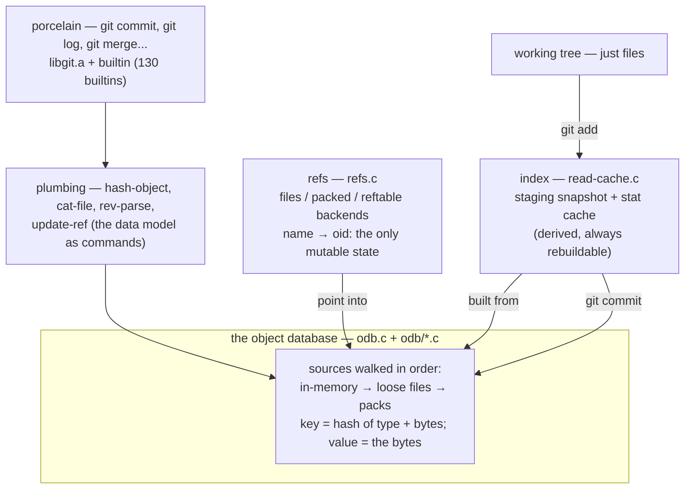
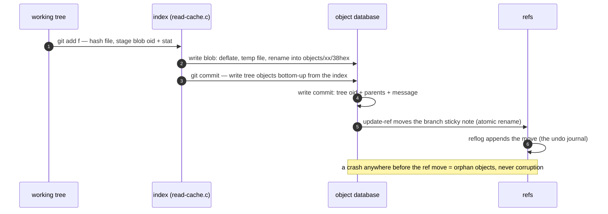
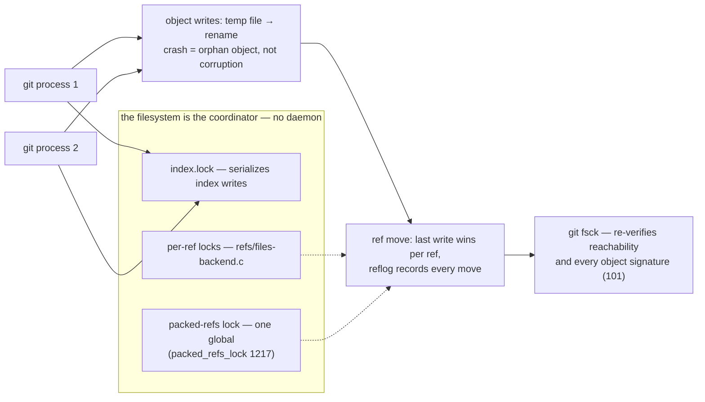

# git: the version control that is really a content-addressed database

> **Atlas id:** `git` · **Domains:** `vcs, storage-engine` ·
> **Upstream:** https://github.com/git/git · **License:** GPL-2.0 ·
> **Pinned commit:** `e9019fcafe0040228b8631c30f97ae1adb61bcdc` (tag v2.55.0, 2026-06-29)

git displaced every centralized VCS incumbent with one structural bet:
the repository is a **persistent, content-addressed object database** —
immutable blobs, trees, commits, and tags keyed by the hash of their
bytes — with a minuscule mutable layer (refs: named pointers into the
DAG) on top. Branching, merging, history rewriting, dedup, verification,
and offline work are all *derived* operations on that model. This
deep-dive teaches what choosing the right core data model buys you, and
what it costs (garbage, packs, and protocol complexity).

## Explain like I'm 10

**A photo album where nothing is ever erased.** Every time you save your
drawing, git takes a brand-new photo of each changed file (a **blob**), a
new photo of each folder's list of contents (a **tree**), and a new photo
of the whole moment (a **commit**) — and names each photo by a
fingerprint of its exact pixels (the SHA hash). Identical photos get
identical fingerprints, so they are stored only once, and if anyone
sneakily changes one pixel, the fingerprint changes and the trick is
caught. A branch is just a sticky note (a **ref**) pointing at a favorite
photo; "merging" means comparing two photo collections and adding only
the photos you're missing — you never need to phone a central office,
because every computer that cloned the album owns every photo.

**Why the grown-ups did it this way:** never overwriting anything means
history can always be verified, duplicates disappear for free, and two
people (or two laptops, offline) can always compare and combine safely —
without anyone having to be in charge.

## 1. Architecture overview

- Four object types (`src` of truth: `object.c:29`
  `object_type_strings[]`): **blob** (file bytes), **tree** (directory
  listing: mode+name+child oid), **commit** (tree oid + parent oids +
  author/message), **tag** (signed pointer). Everything else — branches,
  HEAD, tags-as-ref, remotes — is a *ref*, a mutable file/mapping
  `name → oid`.
- The **spine** — "git add + git commit" — is: working file → blob
  (`odb_write_object`) → new tree (bottom-up) → new commit (points at
  tree + parents) → move one ref. Note the asymmetry: writes create
  immutable objects; the *only* mutation is the ref update.

## Walkthrough: git add + git commit, fingerprint to sticky note

One save, end to end — step through it on the site or read it here. The
sequence matters: objects are written first, the pointer moves last.

**Step 1 — Fingerprint the file.** `git add f` runs the write path:
`builtin/hash-object.c:hash_object` (38) → `odb_write_object` — note that
by default "write" only *computes* the id; persistence is a flag. The
content is prefixed `<type> <size>\0`, hashed, and deflated
(`object-file.c:write_object_file_prepare`, 329).

**Step 2 — Store the blob immutably.** `write_loose_object_common` (704)
writes a temp file and renames it into
`.git/objects/<2-hex>/<38-hex>` — the fanout directory. The rename is
the atomicity: an object either exists whole or not at all.

**Step 3 — Stage it.** The index (`read-cache.c:do_read_index`, 2198)
gains a `cache_entry`: path, oid, stat data. The stat cache is why
`git status` is O(changed files) — unchanged files are never re-hashed.

**Step 4 — Write the trees.** `git commit` turns the index into tree
objects bottom-up: one flat sorted list per directory
(`tree.c:parse_tree_buffer`, 175), each named by its own hash, parents
referenced by fingerprint — `decode_tree_entry` (17) shows the
`<mode> <name>\0<raw oid>` format.

**Step 5 — Write the commit.** `commit.c:parse_commit_buffer` (516) is
the format in prose: `tree <oid>`, `parent <oid>`..., author, message.
A new commit points at the new tree and at the old HEAD as parent —
the DAG grows by append, never by edit.

**Step 6 — Move the sticky note.** `update-ref` writes the new oid under
`.git/refs/heads/<branch>` (temp file + rename) and the reflog appends a
line. This one-line file update is the *entire* mutation git performed
for your commit.

**Outcome — History you can prove.** Everything else — log, diff, merge,
push — is derived by walking fingerprints. If the process died at any
earlier step, you'd have unreferenced objects (garbage for `git gc`),
never a broken repository.

## 2. Core data structures — and why these

### The object database with swappable sources (`odb.c`, `odb/`)

`odb_read_object` (`odb.c:744`) → `odb_read_object_info_extended`
(`odb.c:656`) walks a list of **sources**: in-memory (`odb/source-inmemory.c`),
loose files (`odb/source-loose.c`), packs (the classic `packfile.c`
machinery). Writes go through `odb_write_object_ext` (`odb.c:988`).
Why layered sources: correctness first (loose objects are trivially
inspectable), performance later (packs), plus testing and partial-clone
backends — all without touching the model. Note
`odb/source-loose.c:odb_source_loose_read_object_info` (line 206) and
the vtable registration at line 712.

### Content addressing: the object ID is the checksum

An object's key is the hash of `<type> <size>\0<bytes>` — computed while
writing (`object-file.c:write_object_file_prepare`, line 329, hashing
through the deflate in `write_loose_object_common`, line 704). Verifying
an object (`object-file.c:check_object_signature`, line 101) is re-hashing
it. Storage path = `.git/objects/<2-hex>/<38-hex>` (fanout directory).
Why: **integrity, dedup, and addressing collapse into one mechanism.**
Identical content stored once; corruption detectable by construction;
no registry to maintain.

### The index (`read-cache.c`)

A flat, sorted array of `cache_entry` (path, oid, stat data) — the
staging area between working tree and tree objects, loaded by
`do_read_index` (`read-cache.c:2198`). Why a *derived* cache: because the
truth is the object DAG, the index can be deleted and rebuilt; its stat
cache makes `git status` O(changed files), not O(files).

### Refs (`refs.c` + backends)

A ref is `name → oid`. The files backend keeps loose files under
`.git/refs/` with a packed-refs fallback (`refs/files-backend.c:files_read_raw_ref`,
line 596; `refs/packed-backend.c:packed_refs_lock`, line 1217); a
reftable backend (`refs/reftable-backend.c`) offers a log-structured
alternative. Reflogs record every movement. Why: the entire mutable state
of a distributed system reduced to ~a hundred tiny files with atomic
rename semantics — cheap to lock, cheap to audit.

### Packs + deltas (`builtin/pack-objects.c`, `diff-delta.c`)

Loose objects are wasteful, so packs concatenate objects with per-object
headers and a fanout index for binary search (`packfile.c:bsearch_pack`,
line 2002); similar objects are stored as deltas against bases
(`builtin/pack-objects.c:try_delta`, line 2789; `diff-delta.c:create_delta`,
line 320), with `pack-revindex.c` mapping offsets→order to resolve chains.
Why: the immutable model makes repacking a pure function — pack any
subset, delete the rest, nothing breaks.

## 3. Concurrency and failure model

- **Concurrency is file-lock granularity**: `.git/index.lock` serializes
  index writes; ref updates take per-ref locks (`refs/files-backend.c`);
  packed-refs takes one global lock (`packed_refs_lock:1217`). No daemon,
  no shared memory — the filesystem is the coordinator.
- **Crash safety via atomicity of the tiny mutable surface**: object
  writes complete into a temp file then rename; a crashed commit leaves
  unreferenced objects (garbage, not corruption) because refs moved last.
  `git fsck` re-verifies reachability and signatures.
- **The reflog is the undo journal** — every ref move appends a history
  line, making "destructive" operations recoverable.
- **Failure of trust** (bitrot, hostile mirrors) is caught by the model
  itself: `check_object_signature` re-hashes content; transport
  (`index-pack`) verifies every received object's hash before install.

## 4. API and extension design

- **Plumbing before porcelain**: the data model is directly exposed as
  commands — `hash-object` (`builtin/hash-object.c:64`), `cat-file`,
  `update-ref`, `rev-list`. Porcelain is shell/UI over plumbing; users
  and scripts share the same substrate (the "scriptable core" decision
  that made CI possible).
- **Swappable backends at every layer**: odb sources (incl. alternates —
  borrow objects from other repos on disk), ref backends (files vs
  reftable), **hash algorithm polymorphism** (`hash.h:struct git_hash_algo`,
  line 275): v2.55 writes compatibility oids during SHA-1↔SHA-256
  interop (`compat_oid` parameter of `odb_write_object_ext`) — a live
  lesson in migrating a hash-addressed ecosystem without a flag day.
- The wart: config/UI surface sprawl, and the wire protocol grew
  negotiation features (partial clone, promisor remotes) that strain the
  "everything is local objects" simplicity.

## 5. The defining trade-offs

### Trade-off 1: immutable content-addressed core over mutable state
- **Tension:** version history wants cheap edits; distributed use wants
  verifiable, deduplicated, mergeable state.
- **Choice:** all history immutable and hash-addressed; mutation confined
  to ref pointers.
- **Evidence:** `odb_write_object` never overwrites (new bytes ⇒ new
  oid); a commit that changes one character writes a new blob, new trees
  up the path, new commit (`commit.c:parse_commit_buffer:516` shows the
  parent links that build the DAG); ref move is a one-line file update.
- **Given up:** in-place anything. Every save produces garbage; every
  "edit" is add; storage and GC become core concerns (→ trade-off 3).
- **Verdict:** right when history integrity, distribution, and
  branch/merge are the product. Wrong for hot mutable data — the lesson
  generalizes: pick immutability where *derivation* (diffs, merges,
  sync) dominates.

### Trade-off 2: full local replica over central server
- **Tension:** collaboration needs shared state; networks fail.
- **Choice:** every clone holds the complete DAG; sharing (fetch/push)
  is object transfer + ref negotiation between peers.
- **Evidence:** `git clone` copies the odb; `alternates` even lets repos
  share object stores locally; `git log`/`git diff` never touch the
  network.
- **Given up:** global ordering/permissions, cheap single-source
  backups; "server" products (GitHub) became the trust and auth layer
  *outside* the model.
- **Verdict:** right for development workflows (offline speed,
  forking culture); the price is that identity of humans/repos is
  metadata, not model — patch-ids, mailmaps, signing keys all bolt on.

### Trade-off 3: loose objects + lazy packing over one canonical format
- **Tension:** write path wants cheap appends; disk/network want density;
  reads want random access.
- **Choice:** write loose (one zlib file per object), periodically
  repack with deltas (`try_delta`), keep packs immutable once written.
- **Evidence:** `odb/source-loose.c` for the write/read-loose path;
  `builtin/pack-objects.c` for the compaction; `pack-revindex.c` exists
  purely to reverse-map pack offsets so delta chains can be walked.
- **Given up:** read locality (a 3-byte blob may need its base's base),
  and a real GC story (unreachable-but-locked objects can accumulate).
- **Verdict:** right because both formats serve different phases of the
  object lifecycle — hot (fresh, inspected) vs cold (packed, shipped).
  Systems that merge the two pay on both ends.

## 6. Reading path

1. `object.c` (whole file, ~250 lines) — the four types as an enum and
   a type-name table (line 29); the in-memory `struct object` header all
   parsed objects share.
2. Hands-on: in a scratch repo run `git init; echo hi > f; git add f`,
   then `find .git/objects -type f` and `git cat-file -p <oid>` — you
   have just exercised everything step 3 describes.
3. `builtin/hash-object.c:hash_object` (line 38) → `odb.h:odb_write_object`
   (inline, line 557; note `ODB_WRITE_OBJECT_PERSIST` — by default
   "write" only *computes* the id!) → `object-file.c:write_object_file_prepare`
   (329) + `write_loose_object_common` (704): header `<type> <len>\0`,
   hash, deflate, temp-file-then-rename into the fanout path.
4. `tree.c:parse_tree_buffer` (175) + `tree-walk.c:decode_tree_entry`
   (17) — the tree entry format `<mode> <name>\0<raw oid>`; directories
   are flat sorted lists, recursively addressed.
5. `commit.c:parse_commit_buffer` (516) — the commit format is prose:
   `tree <oid>`, `parent <oid>`..., author/committer lines; notice the
   graft/shallow hooks that let history be spliced.
6. `odb.c:odb_read_object` (744) → `odb_read_object_info_extended` (699)
   — the source walk (in-memory → loose → packed); then
   `odb_read_object_peeled` (762) for tag→commit→tree dereferencing.
7. `object-file.c:check_object_signature` (101) — the model's free
   integrity check; pair with `git fsck` in your scratch repo.
8. `refs.c:refs_read_ref` (464) → `refs/files-backend.c:files_read_raw_ref`
   (596) with the packed-refs fallback, then `refs/packed-backend.c:packed_refs_lock`
   (1217) — the entire mutable state of the system.
9. `read-cache.c:do_read_index` (2198) + `set_index_entry` (134) — the
   index as derived cache; `git ls-files --debug` makes it visible.
10. `builtin/pack-objects.c:try_delta` (2789) + `packfile.c:bsearch_pack`
    (2002) + `diff-delta.c:create_delta_index` (135) — how density is
    bought with copy-window heuristics and binary-searchable fanouts.
11. `revision.c:prepare_revision_walk` (3974) and `merge-ort.c:merge_ort_internal`
    (5303) — the payoff: log/blame/merge are pure graph algorithms over
    the DAG, no special cases for "the server's copy".

You have now traced content → object → tree → commit → ref → pack, and
seen every mutation the system allows.

## 7. What to steal

- **Make the core immutable and content-addressed; confine mutation to a
  pointer layer** — verification, dedup, and distribution fall out of
  the addressing scheme (CAS avant la lettre: S3, Nix, OCI images all
  rediscovered this).
- **Derive caches aggressively** (index, commit-graph, packs): when
  truth is append-only and hash-named, caches are always rebuildable —
  you can add performance structures for years without migrations.
- **Expose the data model directly in the API** (cat-file/hash-object):
  scriptability and debuggability come from letting users touch the
  substrate.
- **Migrate breaking changes with dual-write interop**
  (`compat_oid`) — a hash-format ecosystem can be moved across
  algorithms without a flag day if new writes speak both.
- **Atomic-rename + append-only reflogs as your only "transactions"** —
  filesystem primitives, correctly sequenced, replace a database.

## 8. Difficulty and prerequisites

- Difficulty: **moderate** — the model is simple; the C is plain; the
  challenge is holding the DAG in your head while reading merge/repack.
- Budget: ~5–7 hours for the reading path with a scratch repo at hand.
- Prerequisites: DAGs and topological ordering; zlib at a "it's
  compression" level; comfort with `.git` as a directory you can `ls`.

## 9. Further reading

- `Documentation/gitformat-*.txt` in the repo (object, index, pack, and
  reftable formats — the specs the code implements).
- `Documentation/technical/` — especially `protocol-capabilities.txt`,
  `partial-design.txt` (partial clone/promisors).
- Linus Torvalds' original Google talk on git (2007) — the design
  argument in the author's own words.
