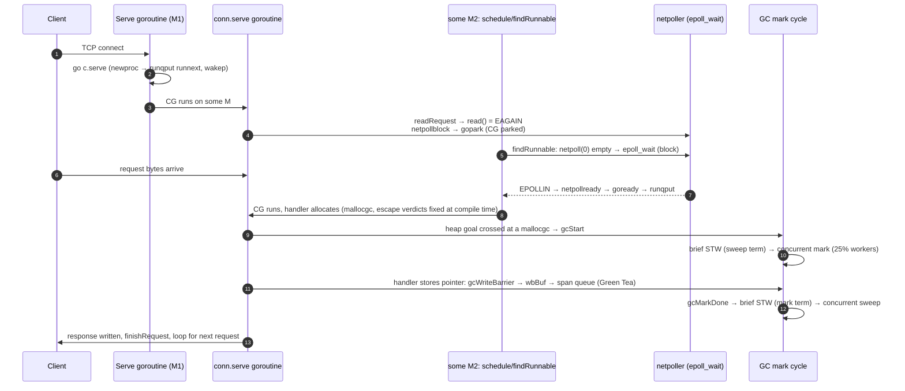

# Go runtime: two letters that hide a tiny operating system

> **Atlas id:** `go` · **Domains:** `runtime, language` ·
> **Upstream:** https://github.com/golang/go · **License:** BSD-3-Clause ·
> **Pinned commit:** `2aae1000ea1d4b28923b96db28acf4e3b99d6aff` (2026-10-19, go1.27.3)

The Go runtime is a scheduler, a memory allocator, a garbage collector,
and a network poller living underneath a two-letter keyword — and its
design thesis is **cheapness as a compiler–runtime contract**: a
goroutine costs ~2 KiB because stacks start small and grow by copying
(`copystack`), the scheduler multiplexes millions of them onto a handful
of OS threads with per-P shards and work stealing (`findRunnable`),
"blocking" reads actually park in an integrated epoll loop (`netpoll`),
heap allocation stays rare because compile-time escape analysis keeps
values on those growable stacks (`cmd/compile/internal/escape`), and
the concurrent garbage collector runs *while your handler executes* —
paid for by a write barrier the compiler emits into every pointer store
(`gcWriteBarrier`). This deep-dive walks one `net/http` request through
all of it: goroutine birth, socket park and steal-wake, the escape
verdict, and a GC cycle whose mark phase your own handler's stores
feed.

Read it against [libuv](libuv.md) and [Node.js](nodejs.md) — the
single-threaded event loop is the *other* famous answer to "many
concurrent I/O flows": libuv demultiplexes readiness and calls you
back; Go parks the whole goroutine in the runtime and keeps your code
looking sequential. And read it below the [Linux kernel](linux.md)
dive: the runtime is a user-space tenant of the very scheduler
machinery that dive walks (EEVDF virtual time, vruntime, wait queues),
and it deliberately re-implements a dumber one — run queues plus
stealing, no fairness policy — because it owns its "processes" down to
the stack pointer. Go's cloud-infrastructure ubiquity (Docker,
Kubernetes, Terraform, etcd — all in this catalog or its lineage) is
the popularity dividend of exactly this bet: servers written in
straight-line code that scale anyway.

## Explain like I'm 10

**A kitchen where the orders are sticky notes.** In most kitchens, one
chef per customer, and hiring a chef is slow and expensive (an OS
thread with a big fixed stack). Here, every order is written on a
small sticky note (a goroutine with a 2 KB stack) and the kitchen has
just a few chefs (OS threads, `m`s) working at numbered stations
(procs, `p`s — one per CPU you allow). A chef takes the top note from
his station's spike (the run queue, `runqget`); when a note needs the
oven ("read the socket"), the chef pins it to the oven's board — no
chef waits — and grabs the next note (the park: `gopark`, the oven
board is the netpoller, an epoll set). When the oven dings, a bell
rings for *some* idle chef, who unpins the note and spikes it at any
station (`goready`). If a chef's spike is empty he walks to a random
other station and takes half the pile from its *back* (work stealing,
`stealWork`) — so notes keep moving without a head chef handing
everything out. Sticky notes start small; if a recipe outgrows one,
the chef copies it onto a bigger note mid-recipe, carefully re-drawing
the arrows that pointed at it (stack copying, `copystack`, which is
why you may keep pointers to your own locals). Meanwhile the cleaners
(the garbage collector) mark everything still in use *while cooking
continues*: whenever a chef hands an ingredient from one note to
another shelf during cleaning week, he scribbles it on his pad first
(the write barrier, `gcWriteBarrier`) so the cleaners never miss it;
and if a chef cooks too long without yielding, the manager taps his
shoulder with a signal stick (preemption: `sysmon` + SIGURG).

**Why the grown-ups did it this way:** cheap concurrency is not one
trick — the notes must start tiny (growable stacks), anyone must be
able to pick one up (stealing), waiting must free the chef (the
netpoller), and cleaning must not stop cooking (concurrent GC with a
write barrier); all four are one contract, and the language's `go`
keyword cashes it in.

## 1. Architecture overview

```mermaid
flowchart TD
    subgraph user["user code — your program"]
        HTTP["net/http server.go:3529 Serve<br/>one goroutine per connection (c.serve)"]
        CODE["your handler: allocates, stores pointers, calls go func()"]
    end

    subgraph sched["scheduler — runtime/proc.go"]
        NEWP["newproc :5334 (the go keyword)"]
        SCH["schedule :4150 / findRunnable :3404<br/>local runq → global runq → netpoll(0) → steal"]
        STEAL["stealWork :3843 — 4 passes, random victim order"]
    end

    subgraph gmp["G · M · P — runtime/runtime2.go"]
        G["g :471 — stack + gobuf + status (~2 KB start)"]
        M["m :616 — OS thread; g0 stack; curg"]
        P["p :774 — the shard: runq[256], runnext,<br/>mcache, wbBuf, gcw, timers"]
    end

    subgraph poller["netpoller — runtime/netpoll.go + netpoll_epoll.go"]
        PD["pollDesc rg/wg semaphore words<br/>netpollblock :548 CAS park"]
        EPOLL["netpoll :113 — epoll_wait(128 events)<br/>netpollopen :64: one ET registration, both directions"]
    end

    subgraph mem["memory — runtime/malloc.go, mheap.go"]
        ESC["escape analysis (compile time)<br/>cmd/compile/internal/escape"]
        MCACHE["mcache per P — size classes,<br/>mallocgc :1067 lock-free fast path"]
    end

    subgraph gc["GC — runtime/mgc*.go"]
        START["gcStart :733 — 2 brief STWs, concurrent mark"]
        WB["gcWriteBarrier asm_amd64.s:1306<br/>+ wbBuf buffer (mwbbuf.go)"]
        GT["Green Tea mark (1.27 default)<br/>span queues, dual mark/scan bits"]
        ASSIST["gcAssistAlloc :499 — allocators pay off GC debt"]
    end

    subgraph under["underneath (not this codebase)"]
        KERNEL["Linux kernel scheduler — EEVDF, per-CPU runqueues<br/>(the Linux dive walks this)"]
    end

    HTTP --> CODE --> NEWP
    CODE -->|pointer store during mark| WB
    CODE -->|new object| ESC --> MCACHE
    CODE -->|socket read| PD --> EPOLL
    EPOLL -->|netpollready| SCH
    NEWP --> P
    SCH --> STEAL --> M
    G -. multiplexed onto .-> M -. needs a .-> P
    MCACHE --> START --> GT
    WB --> GT
    START --> ASSIST
    M --> KERNEL
```



- **Three letters, three owners.** A `g` (runtime2.go:471) is a
  goroutine: a stack, a saved context (`sched gobuf`), a status word.
  An `m` (runtime2.go:616) is an OS thread with two stacks of its own
  (`g0` for runtime code, `gsignal`). A `p` (runtime2.go:774) is a
  *license to execute Go code* on an m — GOMAXPROCS of them exist —
  and owns everything hot: the local run queue (`runq [256]`,
  `runnext`), the `mcache` allocator shard, the write-barrier buffer,
  GC work queues, the timer heap. The M:N mapping is: many Gs, a few
  Ms, and Ps as the shards that keep the common path lock-free.
- **The spine:** one HTTP request from `Serve`'s accept loop
  (`go c.serve(connCtx)`, server.go:3604) through goroutine birth
  (`newproc`), a blocking-style socket read that parks in the
  netpoller (`netpollblock` → `gopark`), the steal-driven wake, and a
  GC cycle interleaved with the handler's own allocations and pointer
  stores. Section 6 orders the whole walk.
- **The runtime is the whole platform's stdlib basement:** `net`,
  `os`, and `time` are thin wrappers whose blocking entry points
  (like `internal/poll.(*FD).Read`, fd_unix.go:141) drop into runtime
  functions through `//go:linkname` — the seam between stdlib and
  runtime is private-API-shaped by design.
- **What it does NOT do:** no fair-share scheduling policy (no
  priorities, no virtual-time fairness like the kernel's EEVDF — a
  spin-friendly loop relies on 10 ms retake preemption), no GC
  compaction or generations, and no supervision/restart of crashed
  goroutines — an unrecovered panic takes the process down.

## Walkthrough: one HTTP request, socket to scheduler to GC and back

On the site you can step through this; in the repo it reads top to
bottom. The same trip, drawn:



**Step 1 — Accept, then a two-letter spawn.** `(*Server).Serve`
(server.go:3529) loops on `l.Accept()` and, per connection, calls
`go c.serve(connCtx)` (server.go:3604) — the entire concurrency
decision of Go's HTTP stack is this one line. The `go` statement
compiles to a call to `runtime.newproc` (proc.go:5334), which wraps
the function closure in a recycled `g` (`gfget`, proc.go:5558 —
goroutine structs are pooled), sets up its ~2 KB stack, and puts it
on the current P's `runnext` slot (`runqput`, proc.go:7529) — the
"wake me next" fast path for parent→child handoff — then calls
`wakep` (proc.go:3227) so an idle thread can pick it up immediately.

**Step 2 — The handler allocates, and most of it never touches the
heap.** When `conn.serve` (server.go:1949) parses the request
(`readRequest`, server.go:1032) and dispatches to your handler
(`serverHandler.ServeHTTP`, server.go:2157), every `&User{...}` you
build got its allocation verdict at *compile time*: escape analysis
(`cmd/compile/internal/escape`, `escape.Funcs`, escape.go:125) keeps
a value on the goroutine's stack unless its address could outlive the
frame. Values that stay on the stack are free — freed by simply
returning, invisible to the GC, and safe because the frame can grow
(`newstack`, stack.go:1055, copies the stack and adjusts pointers to
locals). Values that escape pay `mallocgc` (malloc.go:1067): a
lock-free bump from the P's `mcache` span for their size class, tiny
sizes coalesced (`mallocgcTiny`, malloc.go:1208).

**Step 3 — A "blocking" read is a park.** Your handler reads the
body; `internal/poll.(*FD).Read` (fd_unix.go:141) tries `read(2)`,
gets `EAGAIN`, and calls `waitRead` (fd_unix.go:170) —
`poll_runtime_poll_wait` → `runtime.poll_runtime_pollWait`
(netpoll.go:342) → `netpollblock` (netpoll.go:548): a CAS loop on the
`pollDesc`'s `rg` word (`pdNil → pdWait`, consuming `pdReady` if the
event already fired) and then `gopark` (proc.go:457), which stores
the wait reason, switches to the scheduler on the g0 stack
(`mcall(park_m)`), and marks the G `_Gwaiting`. The OS thread never
blocked on the socket; the *goroutine* did. Contrast the [libuv](libuv.md)
loop, where this same moment would end your callback and return
control to the loop — in Go your callback simply pauses, stack and
all.

**Step 4 — The freed thread goes hunting.** With the conn goroutine
parked, its M re-enters `schedule` (proc.go:4150) →
`findRunnable` (proc.go:3404), the broker loop: local run queue
(`runqget`), then global queue (half of it, `globrunqgetbatch`),
then a non-blocking `netpoll(0)` probe, then work stealing
(`stealWork`, proc.go:3843: four passes over Ps in random order,
stealing half a victim's queue, timers and `runnext` only on the
last pass), then idle GC marking, then timers — and only then parks
the thread in `stopm` (proc.go:3007). The spinning-thread budget
(`2*nmspinning < busy Ps`, and the design comment at the top of
proc.go) is the anti-thrash governor on this hunt.

**Step 5 — The oven dings; the note finds a chef.** The client's
bytes arrive; some thread blocked in `netpoll`
(netpoll_epoll.go:113, `epoll_wait` over a 128-event batch — every
socket was registered once, edge-triggered, for both directions, by
`netpollopen`, netpoll_epoll.go:64) sees `EPOLLIN`:
`netpollready` (netpoll.go:494) CASes the `pollDesc` word to
`pdReady` and hands the parked G to `goready` (proc.go:493) →
`ready` (proc.go:1133), which marks it runnable, queues it on some
P's run queue, and wakes a thread if needed. Your handler resumes
with the request bytes exactly where `readRequest` left off — the
park/wake pair is invisible to it, which is the entire product.

**Step 6 — Meanwhile, a GC cycle starts under the handler.** Heap
allocations accumulate; one `mallocgc` crosses the pacer's heap goal
(the check is in the allocation path itself, malloc.go:1340–1341,
`gcTrigger{kind: gcTriggerHeap}`) and `gcStart` (mgc.go:733) runs:
a brief stop-the-world for sweep termination (mgc.go:835), then
concurrent mark. Marking runs on dedicated background workers
(`gcBgMarkWorker`, mgc.go:1766, dispatched by
`gcController.findRunnableGCWorker`, mgcpacer.go:859 — 25% of GOMAXPROCS
dedicated, plus fractional workers to hit the exact CPU goal) *and*
on allocating goroutines themselves: `gcAssistAlloc` (mgcmark.go:499)
makes each allocation scan its fair share first — GC backpressure
proportional to allocation rate. Your handler's `node.Next = &Node{}`
during mark does not go straight to memory: the compiler-inserted
`gcWriteBarrier` (asm_amd64.s:1306) appends the old and new pointers
to the P's write-barrier buffer (`wbBuf`, mwbbuf.go:42) in ~20
instructions, flushing to the GC's grey work when full. In go1.27 the
grey work is Green Tea — *spans*, not objects, are queued
(FIFO span queues; dual mark/scan bitmaps in each span), so scanning
visits memory in size-class-sized, cache- and prefetch-friendly
batches (mgcmark_greenteagc.go header).

**Step 7 — Termination, sweep, and the loop continues.** When the
grey set drains, `gcMarkDone` (mgc.go:997) does the second brief
stop-the-world (mgc.go:1066), scans what little remains, flips to
sweep (`sweepone`, mgcsweep.go:359, concurrent with your handler),
and the pacer (`mgcpacer.go`) sets the next heap goal from GOGC /
GOMEMLIMIT. Your handler writes the response and returns;
`finishRequest` flushes; `conn.serve` loops to read the *next*
request on the same goroutine — or, when the connection closes, the
G exits through `goexit` and its struct returns to the `gfput` pool.

**Outcome — One request, four subsystems, zero application locks.**
The request was served by a goroutine that was created, parked,
stolen or woken, scheduled, and garbage-collected around — all from
`go` + blocking-looking code, with the only visible costs being a
couple of 2 KiB stacks, some mcache bumps, and a pointer-append in a
write barrier.

## 2. Core data structures — and why these

### g — the goroutine as (stack + saved context) (runtime2.go:471)

A `g` is remarkably small: `stack` bounds, a `sched` gobuf (SP, PC,
a few registers — everything `gogo` must restore), an atomic status
word, and pointers for its role relationships (`m.curg`, sudogs for
channel/netpoll waits). That is the whole trick: a goroutine is
*just* a resumable stack, so creating one is a pooled-struct
allocation plus a 2 KiB stack (`stackMin`, stack.go:78), not an
8 MiB mmap + kernel task. Status transitions (`_Grunnable`,
`_Grunning`, `_Gwaiting`, `_Gsyscall`…) are the runtime's entire
state machine; every subsystem in this dive is machinery for moving
Gs between those states honestly.

### p — the shard that makes the hot path lock-free (runtime2.go:774)

The `p` is the design decision that carries the scheduler: GOMAXPROCS
processors, each owning `runq [256]guintptr` plus the `runnext` slot
(a single-word CAS fast path for "run this freshly readied G next",
runtime2.go:820 — see `runqput`, proc.go:7529), the `mcache`
allocation shard, the `wbBuf` write-barrier buffer, the GC work
queues, and the timer heap. Producer and consumer of the local run
queue are the same P in the common case, so the queue is a
single-producer/single-consumer ring with acquire/release ordering —
no locks on scheduling, allocating, or barrier-recording until work
must move *between* Ps, and only then does stealing or the global
queue appear. It is per-CPU sharding (cf. the kernel's per-CPU
runqueues in the [Linux](linux.md) dive) expressed as an
object.

### pollDesc rg/wg — the waiter *is* the goroutine (runtime/netpoll.go)

Each polled fd has two atomic words, `rg`/`wg`, cycling through
`pdNil/pdWait/pdReady` (and holding a `*g` pointer while parked).
`netpollblock` (netpoll.go:548) CASes `pdNil → pdWait`, parks the G
with `gopark`, and stores the G in the word; the waker
(`netpollunblock`, netpoll.go:591) CASes the G out and returns it to
`goready`. Note what is absent: no wait-queue objects, no lock
protecting "who is waiting" — the wait is a state of the semaphore
word itself, and the goroutine (which cannot be freed while parked)
is its own wait node. Sockets register with epoll once,
edge-triggered for both directions (`netpollopen`,
netpoll_epoll.go:64 — unlike [libuv](libuv.md), whose watcher masks
are re-armed per poll); readiness is remembered in `rg`/`wg`, so the
edge trigger is only ever a nudge.

### Size-class spans + mcache — allocation without a lock (malloc.go, mheap.go)

The heap is cut into `mspan`s, each serving one of ~68 size classes;
each P's `mcache` holds a free slot per class, so `mallocgc`
(malloc.go:1067) is: size class → mcache span → bump pointer, with
the tiny allocator batching sub-16-byte objects into shared slots
(`mallocgcTiny`, malloc.go:1208). Only when a span runs dry does it
refill from the central `mcentral`/`mheap` under a lock — the
classic sharded-allocator shape, and also the anti-fragmentation
answer to Go's non-compacting GC: free lists live *inside* each span
by size class, so fragmentation cannot mix sizes within a span. The
GC trigger check rides the same path (`gcTrigger{kind: gcTriggerHeap}`
at malloc.go:1341), which is why "allocation *is* the GC clock."

### Dual mark/scan bits + FIFO span queues — the Green Tea grey set (mgcmark_greenteagc.go)

The classic grey set was a stack of object pointers (`gcDrain`,
LIFO); in go1.27 (baseline-on, `internal/buildcfg/exp.go:86`) the
unit of grey work became the *span*: first pointer to an object sets
its mark bit and queues the span (FIFO,
`spanQueue.put`, mgcmark_greenteagc.go:377); later, the span's
pending marks are diffed against its scan bits
(`scanObject`, mgcmark_greenteagc.go:1187) and the newly-marked
objects — adjacent in the span, same size class — are scanned as a
batch, with generated SIMD scanners in `internal/runtime/gc/scan`.
Deliberately trading immediacy (delaying scans to accumulate) for
locality: the same trade LevelDB's LSM makes with writes, made by a
GC with its heap.

## 3. Concurrency and failure model

- **What runs concurrently:** any number of Gs; at most GOMAXPROCS at
  a time own a P and execute Go code; Ms beyond that exist only for
  blocked-in-syscall or cgo work (`entersyscall` detaches the P so
  the scheduler keeps running). GOMAXPROCS itself is now
  container-aware by default (cgroup CPU quota, proc.go:939–947) —
  a rare case of the runtime reading the *host's* scheduling intent.
- **Preemption is layered:** cooperative checks at function
  prologues and channel operations; `sysmon`'s `retake`
  (proc.go:6681) force-preempts any G running past
  `forcePreemptNS = 10 ms` (proc.go:6679) by sending SIGURG
  (`sigPreempt`, signal_unix.go:74; handler `asyncPreempt`,
  preempt.go:305) — a signal-based interrupt to a thread executing
  arbitrary compiled code, safe because the signal handler lands on
  the m's gsignal stack and folds the CPU state into a goroutine
  switch. `suspendG` (preempt.go:106) is the stop-the-world
  machinery's per-G handshake built on the same signals.
- **The memory model is a promise the scheduler keeps:** happens-before
  edges come from channels (a send parks/readies via the same
  `gopark`/`ready` pair you saw on sockets), mutexes, and atomics;
  the runtime's stores during mark are ordered by the write barrier.
  The [Go memory model](https://go.dev/ref/mem) is the user-facing
  contract of exactly these mechanics.
- **Failure is loud, per-goroutine, then fatal:** `panic` unwinds
  only the panicking goroutine (its own stack, its own defers);
  an unrecovered panic kills the whole process — there is no
  supervision or restart built in (contrast pattern 4's supervisor
  workers in [PATTERNS.md](../PATTERNS.md): Go pushes that
  responsibility to the process layer — let it crash, let systemd
  restart). Out-of-memory is likewise a hard crash after GC cycles
  fail to reclaim under the GOMEMLIMIT-enforced goal.
- **Overload behavior:** the GC *is* the backpressure — allocate
  faster than mark drains and `gcAssistAlloc` bills your allocations
  scanning time, slowing exactly the goroutines causing the pain;
  the CPU limiter (`gcCPULimiter`, mgcpacer.go) caps total GC CPU so
  the pacer would rather fall behind than steal the machine.

## 4. API and extension design

- **The public surface is a language, not a library:** `go`,
  `select`, channels are the concurrency API; the `runtime` package
  exposes the knobs (`GOMAXPROCS`, `Gosched`, `GC`, `SetFinalizer`,
  `LockOSThread`), and `GODEBUG`/`GOMEMLIMIT`/`GOEXPERIMENT`
  environment variables are the operational interface — the runtime
  is one of the few systems whose config surface is mostly *env
  vars*, versioned by the compatibility promise (godebug defaults
  flip per release).
- **The seams are deliberately non-public.** stdlib ↔ runtime runs on
  `//go:linkname` private symbol injection (`poll_runtime_pollWait`
  at netpoll.go:342 is reached that way from `internal/poll`); the
  runtime comment above `goready` (proc.go:472–478) keeps a "hall of
  shame" list of outside packages linknaming into it — a seam used
  *against* its designers (gvisor et al.), tolerated under issue
  67401's freeze rules. cgo is the sanctioned foreign-code seam, at
  the price of leaving the scheduler's control for the call's
  duration.
- **Pluggability is compile-time, not runtime:** GOEXPERIMENT flags
  ship alternative implementations in-tree (the Green Tea mark lives
  beside the classic one, `mgcmark_greenteagc.go` /
  `mgcmark_nogreenteagc.go`, selected at toolchain build time) —
  the runtime's answer to the kernel's `sched_class` vtables is "no
  plugin policies at all; ship experiments and pick a winner."
- **Honest warts:** scheduler behavior is invisible to OS tooling
  (a "thread" running 10,000 goroutines confuses `top` and priority
  knobs); `LockOSThread` exists precisely because the M:N mapping
  leaks (GUI threads, C libraries that assume thread identity); and
  the GC's non-compacting choice means heap layout churns — external
  fragmentation and page-fault behavior are why the
  `arena`/off-heap escape hatch (`runtime/arena.go`) exists at all.

## 5. The defining trade-offs

### Trade-off 1: M:N work-stealing goroutines over 1:1 threads or an event loop
- **Tension:** servers want 100k+ concurrent flows; OS threads cost
  an 8 MiB default stack and a µs-scale context switch, while event
  loops ([libuv](libuv.md), [Node.js](nodejs.md)) buy scalability by
  forcing continuation-passing style onto every I/O-bound program.
- **Choice:** goroutines — 2 KiB resumable stacks multiplexed by the
  runtime onto GOMAXPROCS-worth of threads, with per-P run queues,
  stealing, and an integrated netpoller so that *blocking-style*
  code parks cheaply.
- **Evidence:** `newproc` → `runqput(next)` + `wakep`
  (proc.go:5334–5342) — spawn is queue bookkeeping; `findRunnable`
  (proc.go:3404) with `stealWork`'s four random-order passes
  (proc.go:3843) — load balancing with no central queue; the park
  handshake `netpollblock` (netpoll.go:548) → `gopark` (proc.go:457)
  vs. `netpoll` (netpoll_epoll.go:113) → `goready` — an epoll loop
  the programmer never sees; `copystack` (stack.go:929) making the
  2 KiB start safe.
- **Given up:** OS-level fairness and isolation — no per-goroutine
  CPU shares or priorities (the kernel's EEVDF gives every task
  provable lag bounds; Go's runq+steal gives statistical balance
  only, policed by the 10 ms `retake`); every G is hostage to one
  address space and one GC; cgo and locked threads punch holes in
  the multiplexing; and scheduler-internal queues are opaque to ops.
- **Verdict:** right when concurrency is data-shape-shaped — many
  mostly-waiting flows per core, which is nearly every server (and
  is why Docker, Kubernetes, and most of the cloud-native stack are
  written in Go). Wrong when you need per-task scheduling *policy*,
  hard isolation between tasks, or a handful of CPU-bound pipelines
  — use processes/threads and let the kernel scheduler (the
  [Linux](linux.md) dive) do its job.

### Trade-off 2: concurrent tri-color mark with a hybrid write barrier over stop-the-world or refcounting
- **Tension:** whole-heap collection pauses (original Go GC, 2014)
  are unacceptable at web-service tail latencies; reference
  counting can't free cycles and taxes *every* store always.
- **Choice:** mark while the mutators run, keep it correct with a
  hybrid Yuasa-deletion + Dijkstra-insertion barrier on pointer
  stores, two brief STW bookends per cycle, a CPU-budgeted pacer,
  and allocation assists as the throttle.
- **Evidence:** the barrier and its proof sketch are the header of
  `runtime/mbarrier.go` —

  ```go
  //     writePointer(slot, ptr):
  //         shade(*slot)
  //         if current stack is grey:
  //             shade(ptr)
  //         *slot = ptr
  ```

  (© The Go Authors, BSD-3-Clause) — compiled into every pointer
  store as the buffered `gcWriteBarrier` (asm_amd64.s:1306: two
  pointer appends to `p.wbBuf`, flushing to `wbBufFlush` only when
  full — a handful of instructions on the fast path); the STW bookends at mgc.go:835 and :1066; the CPU budget in
  `findRunnableGCWorker` (mgcpacer.go:859) and `gcCPULimiter`; the
  throttle in `gcAssistAlloc` (mgcmark.go:499) reached from the
  allocation path itself (malloc.go:1340). The barrier is what let
  Go stop re-scanning stacks mid-cycle (the 17503
  "eliminate-rescan" proposal referenced in mbarrier.go).
- **Given up:** compaction and generational collection — the heap
  stays where allocation put it (fragmentation handled by size
  classes; relocation would break the pointer-into-goroutine-stack
  assumptions elsewhere); some mutator throughput during mark (the
  barrier + assists are a tax of roughly a few percent, felt most by
  pointer-heavy workloads); and *p99 sensitivity*: the GC runs
  concurrent, but assists convert allocation spikes into latency.
- **Verdict:** right for high-allocation-rate services that need
  sub-millisecond pauses without giving up `malloc`-style ergonomics
  — Go's whole server ecosystem is the proof. Wrong for
  deterministic-latency or footprint-minimal systems (arenas,
  free-lists, or ARC/RC designs — the [Redis](redis.md) and
  [CPython](cpython.md) choices — buy predictability with
  programmer discipline).

### Trade-off 3: compiler–runtime co-design (escape analysis + growable stacks) over fixed stacks or an all-heap model
- **Tension:** 2 KiB stacks only work if deep or surprising frames
  can grow — but movable stacks break every raw pointer into a
  frame; and "everything on the heap" (early JVM-style, or naive
  safe languages) forfeits the cache locality and zero cost that
  make stack allocation the default in C.
- **Choice:** contiguous stacks that start at `stackMin` 2048 bytes
  (stack.go:78) and grow/shrink by copying with pointer adjustment;
  a compile-time dataflow pass deciding stack vs. heap for every
  value; and the two decisions wired together — escape analysis
  exists *because* stacks are real and movable, and stack scanning
  (cheap, at safepoints) is what makes non-escaping allocation free.
- **Evidence:** `newstack` (stack.go:1055) reached from the
  `morestack` prologue check (asm_amd64.s:597) → `copystack`
  (stack.go:929) with its `adjustinfo.delta` walk that rewrites
  pointers *into the frame itself*, including sudogs on channels;
  escape analysis's two invariants and location-graph algorithm are
  the header of `cmd/compile/internal/escape/escape.go`, entered via
  `Funcs` (escape.go:125) — observable by any reader with
  `go build -gcflags=-m`.
- **Given up:** assembly and cgo frames cannot grow (g0 stacks are
  fixed and generous instead); deep-recursion workloads pay repeated
  stack copies; interior-pointer tricks in runtime/asm must respect
  the adjustment protocol; and the compiler is forever coupled to
  runtime internals (no independent implementations of either).
- **Verdict:** right when the unit of work is small and numerous —
  millions of 2 KiB stacks fit where thousands of 8 MiB threads
  don't, and escape analysis keeps the steady-state allocation rate
  (the GC's clock) low. Wrong for systems that can bound stack depth
  by construction — fixed stacks are then simpler and copy-free.

## 6. Reading path

Work this in the clone (`git clone --depth 1 -b go1.27.3
https://github.com/golang/go clones/go` — or from the canonical
go.googlesource.com mirror; the SHA matches). Budget two sittings:
scheduler (stops 1–6), then memory/GC (stops 7–12).

1. `src/runtime/runtime2.go:471` `type g struct`, `:616` `type m
   struct`, `:774` `type p struct` — read the field comments as the
   vocabulary of every later stop; find `runq [256]`, `runnext`,
   `mcache`, `wbBuf`, `gcw` on the p, and `curg`/`g0` on the m.
2. `src/runtime/proc.go` lines 30–110, the scheduler design comment
   (work-stealing rationale, spinning-thread budget, handoff rules) —
   the runtime's own design doc; then `:5334` `newproc` →
   `:7529` `runqput` (watch the `runnext` CAS) and `:3227` `wakep`.
3. `src/runtime/proc.go:4150` `schedule` → `:3404` `findRunnable` —
   read the *order* of sources (local → global → netpoll probe →
   steal → idle GC → timers → `stopm`:3007) and the spinning
   invariants; then `:3843` `stealWork` (random victim order,
   timers/`runnext` only on the final pass).
4. `src/net/http/server.go:3529` `(*Server).Serve` — the accept
   loop; `:3604` the `go c.serve(connCtx)` line; `:1949`
   `conn.serve`, `:1032` `readRequest`, `:2157` the
   `ServeHTTP` dispatch. The user-space half of the spine.
5. `src/internal/poll/fd_unix.go:141` `(*FD).Read` — the EAGAIN →
   `waitRead` (:170) handoff; `src/runtime/netpoll.go:342`
   `poll_runtime_pollWait` → `:548` `netpollblock` (the
   `pdNil/pdWait/pdReady` CAS dance) → `src/runtime/proc.go:457`
   `gopark` (`mcall(park_m)`). The park.
6. `src/runtime/netpoll_epoll.go:36` `netpollinit` (epoll + the
   break eventfd), `:64` `netpollopen` (one edge-triggered
   registration, both directions — compare libuv's per-poll mask
   updates), `:113` `netpoll` (the `epoll_wait` loop),
   `:81` `netpollBreak`; back in `netpoll.go:494` `netpollready` →
   `netpollunblock:591` → `proc.go:493` `goready` → `:1133`
   `ready`. The wake.
7. `src/runtime/stack.go:1055` `newstack` → `:929` `copystack` —
   read `adjustinfo` and `adjustpointers`; then the prologue side in
   `src/runtime/asm_amd64.s:597` `runtime·morestack`. The 2 KiB bet
   being paid.
8. `src/cmd/compile/internal/escape/escape.go` — the header comment
   (invariants, location graph, parameter tags), then `:125` `Funcs`.
   Compile the walkthrough's handler with
   `go build -gcflags=-m .` and watch the verdicts.
9. `src/runtime/malloc.go:1067` `mallocgc` → `:1208` `mallocgcTiny`
   → `:996` `mcache.nextFree`; the size-class table (68 classes) in
   `src/internal/runtime/gc/sizeclasses.go`; `:1340` the `gcTrigger` check that
   makes allocation the GC's clock.
10. `src/runtime/mgc.go:733` `gcStart` — walk the phases:
    sweep-termination STW (:835), concurrent mark setup, background
    workers (`:1766` `gcBgMarkWorker`), `:997` `gcMarkDone`, the
    second STW (:1066), `:1360` `gcMarkTermination`; then
    `src/runtime/mgcpacer.go:859` `findRunnableGCWorker` for the
    25% dedicated + fractional worker split and the CPU limiter.
11. `src/runtime/mbarrier.go` — the hybrid-barrier header (pseudocode
    and proof sketch); `src/runtime/asm_amd64.s:1306`
    `gcWriteBarrier<>` (the buffered fast path and `wbBufFlush`);
    `src/runtime/mwbbuf.go:42` `wbBuf`. Where your handler's stores
    pay for concurrency.
12. `src/runtime/mgcmark_greenteagc.go` — the header (dual mark/scan
    bits, FIFO span queues), `:377` `spanQueue.put`, `:1187`
    `scanObject`; contrast `mgcmark_nogreenteagc.go:143` for the
    classic per-object scan; then `src/runtime/mgcsweep.go:359`
    `sweepone`. Finish with preemption completing M:N:
    `src/runtime/proc.go:6679` `forcePreemptNS` + `:6681` `retake`,
    `src/runtime/preempt.go:305` `asyncPreempt`, and
    `src/runtime/signal_unix.go:74` `sigPreempt = _SIGURG`.

You have now traced one HTTP request end-to-end — born by a two-letter
keyword, parked on a semaphore word, stolen awake, allocated by a
compile-time verdict, and marked concurrently around its own pointer
stores — through every subsystem that makes `go` a keyword worth
having.

## 7. What to steal

- **Make the unit of concurrency a resumable stack, not a thread**
  (`newproc` + `copystack`): once spawn is pooled-struct cheap and
  frames can grow, "one goroutine per connection/actor/request"
  stops being an architecture risk and becomes the default — Java's
  Loom virtual threads and Kotlin coroutines are this lesson
  arriving elsewhere.
- **Shard the hot path into P-like carriers and steal, don't share**
  (`p.runq`/`mcache`/`wbBuf`, `stealWork`): make the common case
  single-owner lock-free, and let idle workers *pull* half a queue
  instead of everyone pushing through a central one.
- **Park by writing your continuation into the thing you wait on**
  (`pollDesc.rg/wg`): the waiter is the goroutine and the wait is a
  CAS on a semaphore word — no wait-queue objects, no lock, one
  handoff edge case (the already-ready race) handled by the state
  machine.
- **Make background work a CPU budget with debt, not a thread**
  (`gcController` 25% goal + `gcAssistAlloc`): pacing tied to the
  *cause* of the work (allocation) automatically throttles the
  abuser and protects everyone else — backpressure as a ledger.
- **Batch by locality when you must sweep through memory** (Green
  Tea's dual mark/scan bits, FIFO span queues): delaying work until
  its neighborhood accumulates turned a correctness-driven scan into
  a prefetch-friendly one — the LSM compaction insight, applied to
  a GC.
- **Co-design the boundary you own** (escape analysis ↔ growable
  stacks ↔ write barrier): Go's cheapness lives in a contract
  between compiler and runtime that neither could honor alone;
  identify your system's equivalent pair and design them together.

## 8. Difficulty and prerequisites

- Difficulty: **demanding**. Realistic budget: 10–12 hours — two
  sittings for the reading path, best done with a Go program running
  under `GODEBUG=schedtrace=1000,scheddetail=1` beside you, and
  `go build -gcflags=-m` for stop 8.
- Prerequisites: fluent Go (channels, defer, select); scheduler
  basics from the [libuv](libuv.md) dive (what an event loop buys
  and costs — this dive is its antithesis) and optionally the
  [Linux](linux.md) dive's scheduler section (runqueues, vruntime —
  the layer underneath); tri-color marking in one sitting (the Go
  GC guide linked below suffices); enough x86-64 to read the short
  `gcWriteBarrier`/`morestack` assembly stops (skippable — the
  surrounding Go code carries the semantics).

## 9. Further reading

- `src/runtime/proc.go`'s top-of-file design comment — the
  scheduler's own design document; read it before any blog post.
- *A Guide to the Go Garbage Collector* —
  https://go.dev/doc/gc-guide — the pacer, GOGC/GOMEMLIMIT, and
  assists from the user's side.
- Proposal 17503, *Eliminate STW stack re-scanning* —
  https://github.com/golang/proposal/blob/master/design/17503-eliminate-rescan.md
  — the design doc behind the hybrid write barrier, cited from
  `mbarrier.go` itself.
- The Green Tea mark header in `src/runtime/mgcmark_greenteagc.go`
  and the 2025 Go blog GC posts — the locality-first redesign this
  dive's step 6 walks.
- The Go memory model — https://go.dev/ref/mem — the user-facing
  contract of the park/ready and barrier mechanics.
- R. D. Blumofe & C. E. Leiserson, *Scheduling Multithreaded
  Computations by Work Stealing* (1999) — the theory the run queue
  + stealing split implements.
- E. W. Dijkstra et al., *On-the-fly garbage collection: an exercise
  in cooperation* (1978) — the insertion half of Go's barrier;
  `mgc.go`'s header credits it directly.
- The sibling atlas dives: [libuv](libuv.md) and [Node.js](nodejs.md)
  (the event-loop answer to the same C10K question),
  [CPython](cpython.md) (reference counting as the opposite GC bet),
  and [Linux](linux.md) (the host scheduler the M:N layer rides on).
