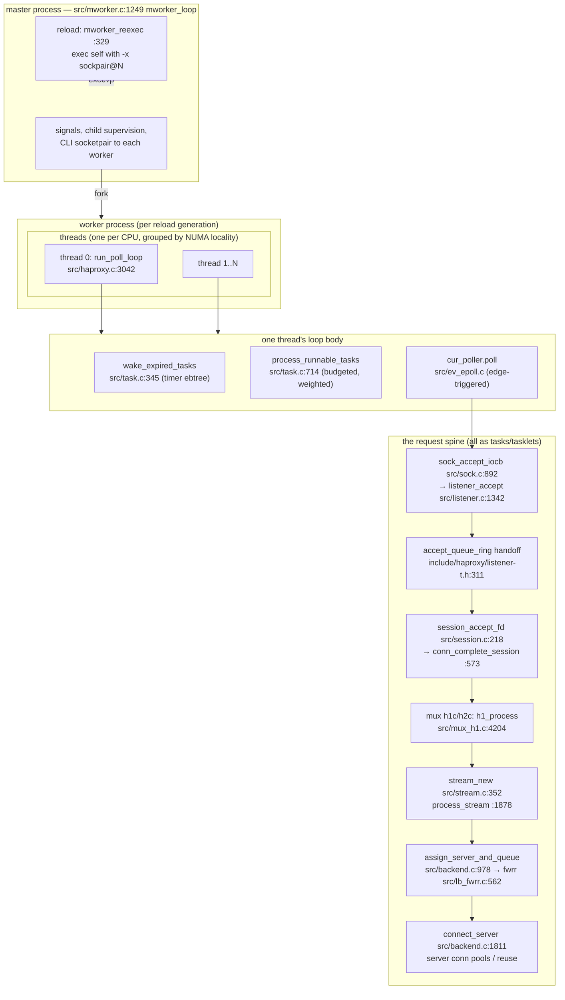
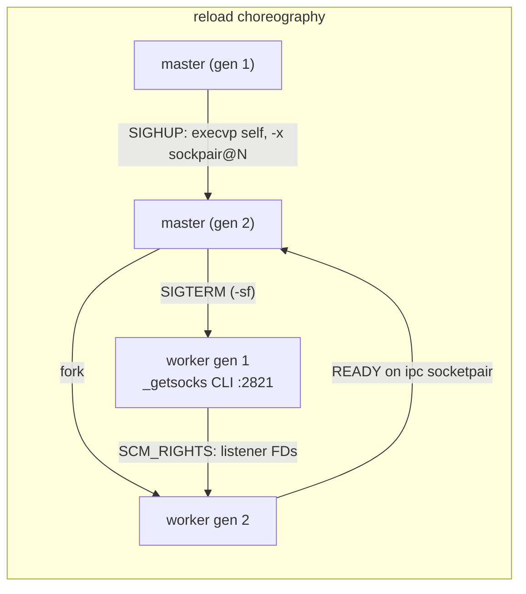

# HAProxy: a proxy where every hot path runs against a visible budget

> **Atlas id:** `haproxy` · **Domains:** `proxy-lb` ·
> **Upstream:** https://github.com/haproxy/haproxy · **License:** GPL-2.0 ·
> **Pinned commit:** `37f3ad8aa35bb34b2363b73541780df6c7226270` (2026-10-14)

HAProxy is the load balancer that refuses to drop traffic — the one
deployed in front of banks, exchanges, and CDNs where a restart is an
incident report. The design lesson this dive teaches is **latency
discipline as architecture**: nothing in the hot path may block, burst,
or grow without bound, and every one of those constraints is a *visible,
counted budget in the code* — a run-queue depth the scheduler drains in
weighted slices, a three-level accept counter, a global buffer pool with
a waiting list, per-thread memory caches measured in bytes. Connections
are not threads: each is a small state machine (session → stream) riding
a task scheduled on per-thread elastic-binary-tree run queues, woken by
edge-triggered pollers. And reloads are honest about what a proxy
actually owns: the master re-executes the binary and the *old* worker
hands its listening sockets to the new worker over a socketpair, so the
front door never closes.

Read it against [nginx](nginx.md) (same problem, process-per-worker and
config-reload generation) and [Envoy](envoy.md) (same era, API-driven
control plane): HAProxy is the maximalist answer to "what if the
scheduler itself is the product" — compare its budgeted tasklet
scheduler with [libuv](libuv.md)'s phases or [Redis](redis.md)'s
single loop.

## Explain like I'm 10

**A restaurant where every waiter works alone with a to-do list that is
never allowed to get long.** Each waiter (a thread) has a to-do list
ordered by when you wrote the item down (the run queue, an elastic
binary tree keyed by a counter), plus an alarm-clock shelf (the timer
tree) where sticky notes ring at set times (task expiry ticks). The
kitchen door bell (the poller, epoll) never rings twice for the same
thing — the waiter remembers "door said ready" (the ready/active bits)
so it only re-checks what actually went quiet. When a waiter gets an
order that takes too long, they slice it and put the rest back on the
list (a task yielding) — because the manager (the watchdog timer)
panics and fires anyone stuck for more than a second. Trays (buffers)
come from a shared tray pool and every waiter keeps a small private
stack (the thread-local pool cache); when trays run out, waiters queue
at the counter (the buffer wait queue) and the kitchen wakes exactly as
many as trays freed up. And when the restaurant changes its menu (a
config reload), the old shift doesn't close the doors: the new shift
lines up behind them and the old shift *hands over the front-door keys*
(the listening sockets, passed as file descriptors) before clocking
out.

**Why the grown-ups did it this way:** a proxy at a million connections
cannot afford to block, to thrash a shared lock, or to allocate without
a ceiling — so the design makes every limit an explicit, countable
thing the code checks before doing work, instead of hoping the OS
behaves.

## 1. Architecture overview



- **Process model:** with `-W` (today, `master-worker`), a small master
  supervises one worker process per configuration generation
  (`src/mworker.c:1249 mworker_loop` — it runs the same poll loop with
  jobs=1, mostly to catch signals and child deaths). The worker is the
  data plane: threads pinned one per CPU, arranged in *thread groups*
  by cache locality (`doc/design-thoughts/thread-group.txt`; `tg_ctx`,
  `tgid` in `include/haproxy/thread-t.h`) so a >64-thread machine
  doesn't pay cross-socket cache-line rent on every wakeup.
- **Each thread is a complete scheduler + poller.** The loop
  (`src/haproxy.c:3042 run_poll_loop`) does exactly three things:
  wake expired timers, drain a budgeted slice of runnable tasks, sleep
  in the poller until the next timer. Everything else in HAProxy —
  proxying, health checks, DNS, the CLI, Lua — exists as tasks or
  tasklets queued into that loop. This is rule 7 of the project's own
  `doc/internals/core-principles.txt`: no blocking calls, no long
  loops, complex processing must be split into small steps and yield.
- **Layers under a stream, bottom-up:** poller (`src/ev_*.c`) reports
  FD readiness into `fdtab[]`; `sock_conn_iocb`
  (`src/sock.c:1090`) drives the *connection*; an XPRT stack (raw,
  SSL…) carries it; a *mux* (h1c/h2c/qcc — `conn_install_mux_fe`,
  `src/connection.c:349`) demultiplexes it into per-request *streams*
  through a stream connector (`stconn`); the stream
  (`process_stream`, `src/stream.c:1878`) runs analysers, picks a
  backend server, and bridges the two sides over `struct buffer`s.
  The naming rule (`doc/internals/core-principles.txt` §8): `*c` =
  per-connection, `*s` = per-stream.
- **Where the spine is:** client socket → `sock_accept_iocb` →
  `listener_accept` → (maybe another thread's ring) →
  `session_accept_fd` → `h1_process` → `stream_new` →
  `process_stream` → `assign_server_and_queue` → `fwrr_get_next_server`
  → `connect_server` → backend mux → response in reverse. The
  Walkthrough walks exactly this.

## Walkthrough: one HTTP request, listener socket to backend and back

```mermaid
sequenceDiagram
    autonumber
    participant C as client
    participant L as listener_accept (thread A)
    participant R as accept_queue_ring (thread B)
    participant M as h1c mux (thread B)
    participant S as stream task (thread B)
    participant U as backend conn (pool)

    C->>L: TCP connect
    L->>L: budgets: maxaccept, cps/sps freq ctrs, 3-level CAS counts
    L->>R: ring push (least-loaded thread picks up)
    R->>M: session_accept_fd → session; mux installed
    M->>M: h1_process parses request → h1c_frt_stream_new
    M->>S: stream_new allocates from pool; stream task queued
    S->>S: process_stream: analysers, rules, headers
    S->>S: assign_server_and_queue → fwrr_get_next_server
    S->>U: connect_server (or reuse idle conn)
    U-->>S: h1s back side demuxes response
    S-->>C: mux encodes to h1c obuf → sock_conn_iocb sends
    S->>S: stream released; buffers offered to waiters
```

**Step 1 — Accept under budget.** The listener's fd callback
`sock_accept_iocb` (`src/sock.c:892`) calls `listener_accept`
(`src/listener.c:1342`). Before touching `accept()`, the code checks
its budgets: `maxaccept` per wake, global and frontend conn/sess
per-second frequency counters (`freq_ctr_remain`), then pre-increments
three counters — listener `nbconn`, proxy `feconn`, process `actconn` —
each by CAS with a planned rollback, so a full listener *pauses itself*
by re-arming with a timer instead of accepting and dropping.

**Step 2 — Hand the connection to the least busy thread.** If the
listener is bound to several threads, the accepting thread doesn't keep
the connection: it pushes it onto a per-thread lock-free ring
(`struct accept_queue_ring`, `include/haproxy/listener-t.h:311` —
1024 slots, 16-bit head/tail packed in one atomic word,
`accept_queue_push_mp` at `src/listener.c:124`), waking that thread's
tasklet. Two rotating indexes pick the least-loaded thread: round-robin
for short connections, by connection count for long ones — work is
*moved*, never shared.

**Step 3 — A session, not yet a request.** On the owning thread,
`session_accept_fd` (`src/session.c:218`) allocates a `session` (the
client connection's lifetime) from a pool, runs L4/L5 rules, and
`conn_complete_session` (`src/session.c:573`) installs the frontend
mux chosen by the listener (`conn_install_mux_fe`,
`src/connection.c:349`). At this point there is still no HTTP anywhere.

**Step 4 — The mux parses; a stream is born.** When bytes arrive, the
H1 mux task runs `h1_process` (`src/mux_h1.c:4204`): it peeks the
buffer for an HTTP/2 preface (an upgrade path!), else parses the
request with `h1_process_demux`, creating the `h1s` via
`h1c_frt_stream_new` (`src/mux_h1.c:981`), which calls `stream_new`
(`src/stream.c:352`) — the per-request state machine, pool-allocated,
with its own task. Data crosses the mux/stream boundary as HTX blocks,
not raw bytes.

**Step 5 — The stream task runs the rules.** `process_stream`
(`src/stream.c:1878`) is the proxy proper: it syncs receives on both
sides, runs the analyser chain (TCP rules, HTTP processing, ACLs,
header rewrites), and — critically — never loops waiting: if it cannot
get a buffer, `stream_alloc_work_buffer` (`src/stream.c:824`) queues
the stream on the buffer wait list and the task yields
(`t->expire = TICK_ETERNITY`, `goto leave`). A loop detector even
crashes the process with a dump if a stream wakes 100k times without
progress (`stream_dump_and_crash`).

**Step 6 — Pick a server from a tree.** `assign_server_and_queue`
(`src/backend.c:978`) calls the configured LB lookup; for
`roundrobin` it is `fwrr_get_next_server` (`src/lb_fwrr.c:562`):
servers live in two eb32 trees ("init"/"next") keyed by position;
picking a server takes `eb32_first`, then `fwrr_update_position`
re-queues it at `pos + weight/eweight` — weighted round-robin as tree
insertion, O(log n) picks with the tree doing the fairness math.

**Step 7 — Connect (or reuse) and answer.** `connect_server`
(`src/backend.c:1811`) takes an idle pooled backend connection if
safe-mode allows, else creates one (the backend mux may be H2, so one
socket carries many streams). The response walks the mirror image:
backend `h1s` demux → stream → frontend mux encodes into `h1c->obuf` →
`sock_conn_iocb` sends. The stream then frees its buffers, and
`__offer_buffers` (`src/dynbuf.c:128`) wakes exactly as many waiters
from the buffer queues as buffers were released — the global memory
budget enforcing itself.

**Outcome — Counted at every step, never blocked anywhere.** The
connection either completed, was retried, or was refused *early* —
maxconn fullness pauses the listener, not the kernel's backlog; buffer
exhaustion parks streams instead of ballooning memory; and no mutex was
ever held across a syscall on this path.

## 2. Core data structures — and why these

- **The task + per-thread run queue / timer tree.**
  **What:** `struct task` (process fn, context, `state` bits, `nice`,
  `expire`, and two eb32 nodes `rq`/`wq`); `struct tasklet` — the
  smaller cousin without timers. Per thread: `th_ctx->rqueue` (eb32
  keyed by `rqueue_ticks` + `nice * runqueue_depth` offset — niceness
  *is* the tree key, `__task_wakeup`, `src/task.c:218`) and
  `th_ctx->timers` (eb32 keyed by expiry tick, `__task_queue`,
  `src/task.c:295`).
  **Why:** the run queue's key trick makes priority scheduling free —
  a nice'd task is inserted "in the past/future" of the same tree, no
  second structure. And the tree is an **ebtree**:
  `include/import/ebtree.h:170` documents deletion as
  `min=1, max=1, avg=1` — a task can be woken, re-queued, killed, and
  moved between threads with O(1) removal from the queue, which a heap
  or red-black tree cannot promise.

- **`fdtab[]` — a per-direction 2-bit state machine, not "events".**
  **What:** each entry has `state` with *active* and *ready* bits per
  direction (the full diagram is a comment at `src/fd.c:1–53`), an
  `iocb` callback, and membership in per-thread update lists. Pollers
  only compute `if (active && !ready) poll`.
  **Why:** "ready" caches the last EAGAIN, so an FD reported ready
  that goes quiet again stops generating events — the condition for
  *edge-triggered* epoll correctness — and cross-thread FD migration
  (`fd_takeover`, used by connection takeover between thread groups)
  becomes a matter of moving who owns the update, not fighting over
  epoll registrations.

- **`struct buffer` + the buffer wait queue.**
  **What:** a 4-word struct — `size`, `area`, `data`, `head`
  (`include/haproxy/buf-t.h:34`) describing a wrapping window; storage
  comes from the buffer pool, and when the global budget
  (`tune.buffers.limit`) is exhausted, waiters register a
  `buffer_wait` on per-thread priority queues
  (`b_requeue`, `include/haproxy/dynbuf.h:265`).
  **Why:** making the buffer an inline 4-word header lets *any*
  container own zero-copy data in transit, and making buffer
  acquisition fallible turns total memory into a scheduler-visible
  condition: streams park, get woken precisely when buffers free
  (`__offer_buffers`, `src/dynbuf.c:128`), and the OOM killer never
  enters the story.

- **The pool cache — three-tier recycling.**
  **What:** every runtime type (`connection`, `stream`, `task`…) has a
  `pool_head`; allocation tries the thread-local cache first
  (`pool_get_from_cache`, `include/haproxy/pool.h:305` — hottest
  object first, LRU on the side), refills from the shared cache, then
  from mmap. Per-thread `pool_cache_bytes`/`pool_cache_count` are
  tracked so caches can be trimmed (`pool_evict_from_local_cache`,
  `src/pool.c:745`).
  **Why:** the caches are sized and counted *in bytes*, because the
  project treats memory as a budget to be displayed (`show info`'s
  pools stats), not an implementation detail of malloc — core
  principle #3: "pools are used for runtime allocation; malloc/free
  are for boot code only."

- **`accept_queue_ring` — cross-thread handoff without a lock.**
  **What:** a 1024-slot ring per thread; `idx` is one atomic word
  holding 16-bit head and tail; multi-producer push via CAS retry,
  single-consumer pop by the owner tasklet
  (`src/listener.c:80 pop_sc`, `:124 push_mp`).
  **Why:** the alternative — a shared accept mutex or letting the
  kernel's single accept queue decide placement — serializes the very
  front of the hot path. The ring makes thread placement a
  micro-decision costing one CAS, in the same family as [Envoy's
  connection balancer](envoy.md) and [Memcached's accept
  round-robin](memcached.md).

## 3. Concurrency and failure model



- **Threads share nothing on the hot path.** Each thread has its own
  run queue, timers, update lists, trash chunks, pool caches, and
  buffer queues; cross-thread activity happens by queuing *to the
  other thread* (`__task_wakeup` posting into
  `rqueue_shared` under a spinlock, or `shared_tasklet_list` as an
  mt-list). The only locks are spinlocks and RW locks —
  `core-principles.txt` §6 bans sleeping locks outright, because a
  thread preempted while spinning is survivable but a thread
  preempted on a mutex with the fdtab half-updated is not.
- **The watchdog makes latency a hard contract.** Each thread arms a
  POSIX CPU-time timer; `wdt_handler` (`src/wdt.c:66`) warns after
  `warn-blocked-traffic-after` ms (default 100) of no scheduler
  progress and, past one second, marks `TH_FL_STUCK` so the *next*
  pass calls `ha_panic()` — fail-fast as a scheduling policy, the
  same verdict as [Envoy's guard dog](envoy.md) but enforced on CPU
  time, not wall clock.
- **Crash of a worker is an incident, not an outage:** the master
  restarts it (children supervised in `mworker_catch_sigchld`,
  `src/mworker.c:570`); in-flight connections on that worker are lost,
  the listening sockets are not — which is why the *master*, not the
  worker, is the process expected to stay up.
- **Reload is the interesting failure path:** SIGHUP → master
  re-executes itself with `-sf <old pids> -x sockpair@N`
  (`mworker_reexec`, `src/mworker.c:329`); the new worker, before
  binding, sends `_getsocks` over the socketpair and the old worker
  streams its listener FDs + metadata via SCM_RIGHTS with ack
  flow control (`sock_get_old_sockets`, `src/sock.c:469`; sender
  `_getsocks`, `src/cli.c:2821`). The new worker binds by *reusing*
  those FDs, signals READY, and only then does the master TERM the
  old worker, which drains in-flight streams (`stopping` in
  `run_poll_loop`) and exits. Not one SYN is lost.
- **Backpressure is layered budgets:** accept-rate frequency counters
  and 3-level maxconn gate the front door (`listener_accept`);
  `maxqueue` per server bounds waiting streams; the buffer pool
  parks streams that would otherwise balloon memory; and
  `runqueue_depth` (default 280, auto-scaled ~1/√threads,
  `src/haproxy.c:2491`) bounds scheduler latency per poll iteration.
  Overload shows up as *deliberate pauses with timers*, never as
  unbounded queues.

## 4. API and extension design

- **The operator API is a configuration grammar + a runtime CLI.**
  Config keywords self-register in linked lists
  (`struct cfg_kw_list`, `cfg_register_keywords` — every subsystem's
  parser from `src/cfgparse*.c`), which is how HAProxy grows keywords
  without a central switch. The same self-registration produces the
  runtime API: CLI keywords, `show info`/`show stat` fields, and the
  master CLI reached over the very socketpairs that supervise workers.
- **Internal seams are vtables at every layer boundary:** `struct
  protocol` (accept/bind/connect per socket family — `sockpair@`,
  `abns@`, `unix@` are *protocol families*, `src/proto_sockpair.c`),
  `struct xprt_ops` (raw/SSL handshakes as stackable transports),
  `struct mux_ops` (h1/h2/FCGI/QCP — registered via
  `register_mux_proto`, chosen by ALPN/protocol sniffing), `struct
  poller` (epoll/kqueue/evports/poll/select self-register and are
  benchmarked at boot — `src/ev_*.c`), LB algorithms as whole files
  behind `lbprm` (`src/lb_fwrr.c`, `lb_fwlc.c`, `lb_chash.c`…), and
  filters (`src/flt_*.c`) inside the stream.
- **Out-of-process extension exists too:** Lua actions/fetches
  (`doc/lua.txt`) and SPOE for external agents — but they run as
  *applets in the scheduler*, subject to the same yield rules as
  everything else, which is why a slow Lua loop cannot stall a thread
  (the watchdog would kill it).
- **Honest wart:** the extension surface is compile-time. There is no
  plugin ABI like [nginx](nginx.md) modules or [Envoy](envoy.md)'s
  extensions; adding a keyword or mux means rebuilding HAProxy. The
  grammar's string-array parsing (`char **args`) also shows its
  1990s C roots — `strconv` helpers everywhere, and keyword conflicts
  between sections are resolved by registration order. The price of
  "everything is a registered keyword" is that the *contract* users
  actually program against (the config file) has no formal schema.

## 5. The defining trade-offs

### Trade-off 1: tasks under an explicit scheduler over a thread per connection
- **Tension:** hundreds of thousands of concurrent connections cannot
  each afford a thread's stack and context switches, but a single
  loop can be starved by one expensive connection.
- **Choice:** every activity is a task/tasklet on per-thread run
  queues; the scheduler runs a *weighted, budgeted slice* per loop —
  five tasklet classes (RT/URGENT/NORMAL/BULK/HEAVY) get fair shares
  of `runqueue_depth` (weights 1/64/60/4/1,
  `process_runnable_tasks`, `src/task.c:714`), and long operations
  must split themselves and yield (core principle #7).
- **Evidence:** `src/task.c:714 process_runnable_tasks` — the weights
  table and the HEAVY cap that throttles self-wakers (e.g. SSL
  handshakes) to protect latency; `src/haproxy.c:3042 run_poll_loop`
  calling it between timer wakes and polls; the watchdog
  (`src/wdt.c:66`) that turns a violation into a crash.
- **Given up:** the simplicity of blocking code — every protocol
  handler is a resumable state machine; and per-connection CPU
  isolation (a thread-per-connection design pins a bad actor to one
  core, HAProxy's budgets only *bound* it).
- **Verdict:** right at proxy scale, where per-connection work is
  tiny and I/O-bound; it is the same bet [nginx](nginx.md) took with
  state machines, but HAProxy went further and made the *scheduler
  itself* fair and observable. Wrong for systems whose per-connection
  work is CPU-heavy and irregular — there you want workers you can
  saturate (PATTERNS.md #4 territory) or per-stream
  processes.

### Trade-off 2: process-replacement reload with FD handoff over a live config API
- **Tension:** routing rules must change without dropping connections
  or SYN packets, but the operator's source of truth is a file, not a
  control plane.
- **Choice:** reload = new process. The master re-execs and the new
  worker *pulls* the listening sockets from the old worker
  (`_getsocks` over a socketpair, SCM_RIGHTS), binds by reuse, then
  the old generation drains.
- **Evidence:** `src/mworker.c:329 mworker_reexec` (the `-x
  sockpair@N` argv dance); `src/sock.c:469 sock_get_old_sockets`
  (socketpair-in-socketpair, ack-per-batch flow control);
  `src/cli.c:2821 _getsocks` (sender walks receivers, sends FD +
  path/iface metadata); `src/haproxy.c:4030+` the READY handshake.
- **Given up:** instant, per-object config changes (Envoy's xDS
  streams updates without touching processes); cheap frequent
  reconfiguration; and any state that is not sockets must be rebuilt
  (stick tables sync is limited, Lua state restarts).
- **Verdict:** exactly right when the config is file-declared and
  reloads are occasional events, because process replacement is the
  strongest garbage collection there is — leaked state, fragmented
  memory, and half-applied config all die with the old worker.
  Wrong when config churns per-second; that is the world where
  [Envoy's](envoy.md) subscription API wins by design.

### Trade-off 3: counted budgets over dynamic resource absorption
- **Tension:** under overload, a proxy either refuses early or dies
  late; the OS defaults (malloc growth, listen backlog, accept rate)
  refuse nothing and just degrade.
- **Choice:** every unbounded resource has a visible budget and a
  backpressure behavior: pools report bytes, caches trim themselves,
  buffer allocation queues, listeners pause on maxconn/rate limits,
  the run queue runs in slices.
- **Evidence:** `include/haproxy/pool.h:305 pool_get_from_cache` +
  `pool_cache_bytes` accounting; `src/dynbuf.c:128 __offer_buffers`
  (wake N waiters for N freed buffers); `src/listener.c:1342
  listener_accept`'s `freq_ctr_remain` gates and CAS'd
  listener/proxy/process counters; `src/haproxy.c:2491`'s
  √threads-scaled `runqueue_depth`.
- **Given up:** peak throughput per connection (a check-then-work
  step on every hot path) and simplicity — budgets must be tuned,
  and a budget set too low *is* the outage you were avoiding.
- **Verdict:** right for infrastructure whose failure mode must be
  "slower, visibly" rather than "dead, silently". For a
  latency-microoptimized inner loop (per-packet work), the checks
  would be overhead; HAProxy gets away with it because its budget
  checks are a few atomics against memory it already owns.

## 6. Reading path

1. `doc/internals/core-principles.txt` — the project's own rules;
   read §3 (pools), §6 (no sleeping locks), §7 (tasks must yield)
   before any code. This file is the design doc the code obeys.
2. `src/haproxy.c:3042 run_poll_loop` — the entire loop in 100
   lines: wake timers, run tasks, decide sleep, poll. Everything
   else hangs off it.
3. `src/task.c:714 process_runnable_tasks` — the budgeted scheduler:
   the five tasklet classes, the weights table, the HEAVY cap, the
   local/shared run-queue merge, then `run_tasks_from_lists`.
4. `src/task.c:218 __task_wakeup` + `:295 __task_queue` — how a task
   enters the run queue (key = tick + nice offset) and the timer
   tree (key = expiry); notice both are ebtrees and why deletion is
   O(1).
5. `src/fd.c:1–53` — the per-direction active/ready state machine as
   a comment; then `fd_update_events` (`src/fd.c:678`) and the iocb
   dispatch loop. This is what makes edge-triggered epoll safe.
6. `src/ev_epoll.c` — `__do_poll`: epoll_wait results folded into
   `fdtab[]` state, never delivered directly; compare with how
   `poll` would do it in `src/ev_poll.c`.
7. `src/listener.c:1342 listener_accept` — accept under budgets:
   freq counters, three CAS'd counters with rollback, then the
   ring-balancing logic below it (`accept_queue_push_mp` at
   `src/listener.c:124`).
8. `src/session.c:218 session_accept_fd` → `:573
   conn_complete_session` — the session layer: L4/L5 rules, mux
   install; note the embryonic session *task* that keeps the
   handshake alive without a stream yet.
9. `src/mux_h1.c:4204 h1_process` — bytes to streams: preface
   peeking (H2 upgrade), `h1c_frt_stream_new` (`:981`),
   `h1_process_demux`, error paths that recycle the connection for
   the next request (keep-alive as mux state).
10. `src/stream.c:352 stream_new` → `:1878 process_stream` — the
    proxy's brain: sync receives, analyser flags, the buffer-wait
    yield (`stream_alloc_work_buffer`, `:824`), and the
    call-rate loop detector that crashes on pathological wakeups.
11. `src/backend.c:978 assign_server_and_queue` →
    `src/lb_fwrr.c:562 fwrr_get_next_server` — weighted round robin
    as two rotating eb32 trees; then `src/backend.c:1811
    connect_server` for the backend-side connection lifecycle and
    reuse accounting.
12. `src/mworker.c:329 mworker_reexec` → `src/sock.c:469
    sock_get_old_sockets` → `src/cli.c:2821 _getsocks` — the reload
    spine end to end: re-exec, socketpair bootstrap, `_getsocks`
    CLI, SCM_RIGHTS batches with acks, and finally the READY/TERM
    handoff in `src/mworker.c:570 mworker_catch_sigchld`.

You have now traced one request from SYN to response through
scheduler, poller, listener, session, mux, and stream — and one
seamless reload from SIGHUP to old-worker exit, without losing a
socket.

## 7. What to steal

- **Make every unbounded resource a counted budget with a park path**
  — run-queue depth, buffer waiters, accept rates: the pattern
  (`freq_ctr_remain` gates, `__offer_buffers` waking exactly N
  waiters) applies to any server that must degrade gracefully.
- **Put priority in the queue key, not in a second structure** —
  `__task_wakeup` adding `nice * runqueue_depth` to the ebtree key
  is a one-line trick for any sorted work queue.
- **Choose trees with O(1) deletion for hot mutable queues** —
  ebtrees for timers and run queues; most queues are removed-from
  more than searched, which is exactly what ebtree's unbalanced
  design buys (`include/import/ebtree.h:170`).
- **Hand work across threads by ring, not by lock** —
  `accept_queue_ring`'s packed-head/tail word plus one tasklet
  consumer is the minimal honest cross-thread queue.
- **Let the supervisor own only the sockets, and hand them between
  generations with SCM_RIGHTS** — reload semantics that keep the
  front door open without sharing memory between old and new code
  (`_getsocks` over a socketpair).
- **Arm a watchdog on CPU time, not wall time** — `wdt_handler`
  distinguishes "slow but progressing" from "stuck", warns at 100ms,
  panics at 1s; steal the two-stage warn/panic before it kills you.

## 8. Difficulty and prerequisites

- Difficulty: `demanding`. Realistic budget: 9–10 hours; split into
  runtime (scheduler/poller/fd) and request path (mux/stream/LB), and
  save the reload choreography for a third sitting — it crosses three
  files and two processes.
- Prerequisites: comfortable C (macros, `container_of`, atomics);
  epoll edge-triggered semantics (the [libuv](libuv.md) dive helps);
  HTTP/1.1 framing; timer-wheel alternatives (why a tree beats a
  linear heap here needs only big-O intuition). No prior
  load-balancer knowledge required.

## 9. Further reading

- `doc/internals/core-principles.txt` in the repo — the project's
  own constitution; the rare design doc the code still obeys.
- `doc/internals/sched.pdf` (and `sched.fig`) — Willy Tarreau's
  original scheduler design notes; read after section 1.
- `doc/design-thoughts/thread-group.txt` — the NUMA thread-group
  design that split `tid` from `tgid`.
- `doc/internals/mworker.md` and `doc/internals/fd-migration.txt` —
  the master-worker and FD-takeover designs behind section 3.
- Willy Tarreau's HAProxy talks and write-ups (the "20 years of
  HAProxy" series) for the history of decisions this dive sees the
  current shape of.
- The [nginx](nginx.md), [Envoy](envoy.md), and [Memcached](memcached.md)
  dives in this atlas — the other three answers to "how should a
  proxy handle concurrency": worker processes, worker threads with
  snapshots, and rented loops.
