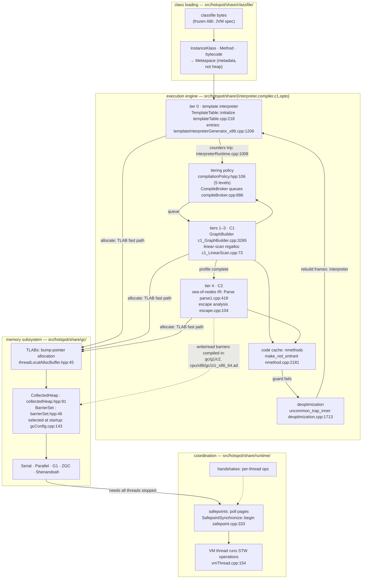
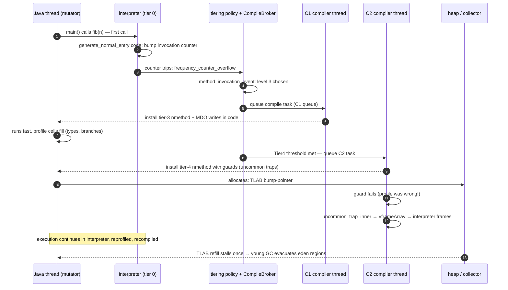
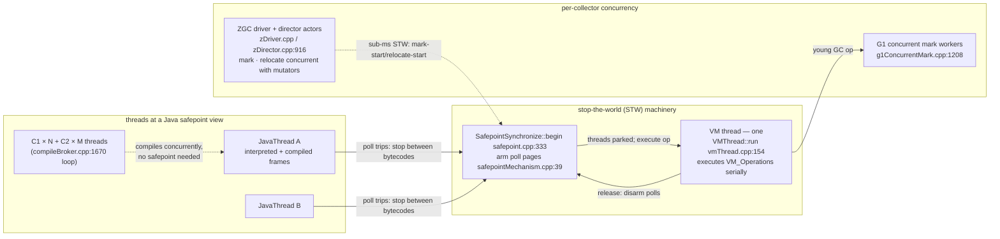

# OpenJDK HotSpot: watch first, compile later, retract anytime

> **Atlas id:** `hotspot` · **Domains:** `runtime, language` ·
> **Upstream:** https://github.com/openjdk/jdk · **License:** GPL-2.0-only WITH Classpath-exception-2.0 ·
> **Pinned commit:** `815ff4dc327fe17f2433c7d115a5a503af10f3c4` (jdk-27-ga, 2026-08-19)

HotSpot is the virtual machine inside every OpenJDK build — the code
that turns Java bytecode into machine code and keeps billions of
objects alive on millions of servers and desktops. The design lesson this
dive teaches is **earned speed**: HotSpot refuses to guess expensive
things up front. Every method starts life being *walked* by a template
interpreter; the runtime watches which methods actually get hot
(invocation and backedge counters), escalates them through cheaper and
dearer compilers (C1, then C2) on background threads — and, because
those compilers were allowed to *speculate* on what the profile said,
it keeps the ability to **throw the optimized code away instantly**
(deoptimization) the moment reality disagrees. The same philosophy
shapes memory: garbage collection is not one algorithm but five
(Serial, Parallel, G1, ZGC, Shenandoah) behind a single
`CollectedHeap`/`BarrierSet` contract, an evolutionary lineage from
"stop everything and sweep" to "clean up while the program keeps
running, one region at a time."

Read it as the heavyweight rival of the atlas's V8 entry: two engines
that independently converged on tiered, profile-driven, deoptimizable
compilation (V8's Ignition→Sparkplug→Maglev→TurboFan against
interpreter→C1-profiled→C1→C2). [CPython](cpython.md) is the same
idea's middle point (adaptive interpreter, no JIT) and [Lua](lua.md)
the control experiment (no speculation at all). Focus is two spines,
not the whole tree: the tiering story (bytecode → interpreter →
compilers → deopt) and the memory story (TLAB → region → concurrent
collector) — a codebase this size is read with a map, never cover to
cover.

## Explain like I'm 10

**A kitchen that learns your favorite dishes and keeps a safety copy
of every recipe.** When you first order a dish (call a method), the
cook follows the recipe card line by line (the interpreter, walking
bytecodes) — slow but always right, and it never mistakes the recipe.
The manager keeps tally marks (the invocation counters): this dish got
ordered 200 times. So the sous-chef (C1, the quick compiler) writes a
streamlined version of the recipe on a whiteboard — with a twist:
while cooking, they also jot down what they actually see ("onions
always", "pan is always medium" — the profile, a MethodData notebook).
If the dish keeps selling, the head chef (C2, the slow compiler)
writes the definitive version: every step assumes "onions, medium
heat" and skips the checks. But there's a house rule that makes this
safe: pinned next to each assumed step is a tripwire (the uncommon
trap). The first time someone orders it without onions, the tripwire
fires, the whiteboard is marked "do not use" (the compiled code is
made not-entrant), and the cook instantly falls back to following the
recipe card from the exact same step (deoptimization rebuilds the
interpreter frame) — because being right beats being fast. Meanwhile
the cleaning crew works under a standing contract: whoever runs the
kitchen may swap crews at the start of the day (pick the collector at
startup, behind one door). The old crew cleaned everything at night,
all at once (Serial — stop the world); the new crews clean a few
shelves every hour (G1's regions, sized so the interruption meets a
time goal) or even while cooking is going on, tagging shelf labels
with colored stickers so anyone grabbing a jar knows instantly whether
it has been checked (ZGC's colored pointers and load barriers).

**Why the grown-ups did it this way:** a general-purpose runtime
cannot know which methods deserve effort or which object lifetimes
dominate — so instead of guessing statically, it pays a tiny
observation tax everywhere and buys the right to speculate and to
retract, which is what lets one binary serve both a 50ms CLI run and a
10-year server.

## 1. Architecture overview

- **The frozen ABI is the classfile format, not a syscall table.**
  `javac` compiles Java source to verified bytecode; HotSpot's
  loaders (`src/hotspot/share/classfile/`) turn it into runtime
  metadata — `InstanceKlass`, `Method`, bytecodes, constant pool — in
  *Metaspace*, off the Java heap. This layer does not optimize
  anything; it materializes what the compiler already decided. The
  seam facing the world is a 30-year-stable binary format plus JNI and
  JVMTI, which is the contract every JVM language (Kotlin, Scala,
  Groovy…) and every tool (debuggers, profilers) programs against.
- **The execution engine is a pipeline of code *qualities*, not one
  compiler.** Tier 0 is the template interpreter: at startup, one
  generator walks a table of bytecode→machine-code templates
  (`TemplateTable::initialize`, `templateTable.cpp:218`) and emits a
  dispatch table where every bytecode jumps directly to generated
  machine code — there is no fetch-decode loop in C. C1
  (`src/hotspot/share/c1/`) compiles fast, optimizes moderately, and
  at tier 3 *also emits profile updates into the code it generates*.
  C2 (`src/hotspot/share/opto/`) compiles slowly from that profile
  into aggressively speculative code. A single policy module
  (`compilationPolicy.hpp:106`, whose header comment is the design
  document for the five levels) decides transitions; background
  compiler threads consume two priority queues
  (`CompileBroker`, `compileBroker.cpp:886`).
- **The memory subsystem is a plug-in behind two interfaces.**
  `CollectedHeap` (`collectedHeap.hpp:91`) is the heap's abstract
  contract (`allocate_new_tlab`, `is_in`, `collect` are pure virtual);
  `BarrierSet` (`barrierSet.hpp:46`) is the reference-access contract.
  At startup `GCConfig::select_gc` (`gcConfig.cpp:143`) reads the
  `-XX:+Use…GC` flags and one per-collector factory builds the heap
  (`Universe::initialize_heap`, `universe.cpp:957` →
  `G1Arguments::create_heap` `g1Arguments.cpp:269`, and siblings).
  The depth of the seam is visible in the directory tree: every
  collector implements barrier *emission* per compiler and per CPU —
  `share/gc/g1/c1/`, `share/gc/g1/c2/`, and ZGC even feeds its load
  barrier into C2's matcher through the architecture-description file
  `cpu/x86/gc/z/z_x86_64.ad`.
- **Coordination is explicit: safepoints, a VM thread, and
  handshakes.** Compiled code contains polls; arming a global state
  makes threads trap at their next poll
  (`SafepointMechanism`, `safepointMechanism.cpp:39`). A single VM
  thread serially executes stop-the-world operations
  (`VMThread::run`, `vmThread.cpp:154`); handshakes
  (`runtime/handshake.cpp`) do per-thread surgery (like deoptimizing
  one frame) without stopping the world.
- **Where the spine is:** one method's life — `Threads::create_vm`
  (`threads.cpp:447`) loads the main class → first call enters the
  interpreter (`JavaCalls::call_virtual`, `javaCalls.cpp:162` →
  `generate_normal_entry` `templateInterpreterGenerator_x86.cpp:1206`)
  → counters trip → `InterpreterRuntime::frequency_counter_overflow`
  (`interpreterRuntime.cpp:1008`) → policy queues C1 → C2 → an
  uncommon trap deoptimizes it. In parallel, the objects it allocates
  flow TLAB → region → collector. The Walkthrough walks exactly this.

## Walkthrough: one method's life, from bytecode to tier-4 code and back

**Step 1 — The method is loaded, not compiled.** When `main`'s class
resolves, the classfile's per-method bytecode becomes a `Method` in
Metaspace; nothing has been compiled and nothing will be until the
runtime has *evidence*. The first call goes through
`JavaCalls::call_virtual` (`javaCalls.cpp:162`) into the method's
*interpreter entry* — machine code generated at JVM startup by
`TemplateInterpreterGenerator::generate_normal_entry`
(`templateInterpreterGenerator_x86.cpp:1206`): it builds the frame,
copies arguments into locals, and ends with a jump through the
dispatch table to the first bytecode's template
(`__ dispatch_next(vtos)`, `:1345` of the same file; the jump itself
is `InterpreterMacroAssembler::dispatch_next`,
`interp_masm_x86.cpp:790`).

**Step 2 — Counters, not opinions, trigger compilation.** The
generated entry also increments an invocation counter; loops bump a
backedge counter. These live packed in `InvocationCounter`
(`invocationCounter.hpp:36` — the bit format `[count|carry|…]` is at
`:40`), hanging off the method's `MethodCounters`. When the packed
count reaches its limit, the entry's own slow-path label fires
(`invocation_counter_overflow` handler at
`templateInterpreterGenerator_x86.cpp:1346`) into
`InterpreterRuntime::frequency_counter_overflow`
(`interpreterRuntime.cpp:1008`), which asks the policy.

**Step 3 — The policy is a published decision table.**
`CompilationPolicy::event` (`compilationPolicy.cpp:788`) →
`method_invocation_event` (`:1413`) decides the next tier using
flag-encoded thresholds — interpreter→C1-profiled when invocations
pass `Tier3InvocationThreshold` (default 200,
`compiler_globals.hpp:175`), profiled-C1→C2 at
`Tier4InvocationThreshold` (default 5000, `:193`). Crucially the
thresholds are *scaled by compiler queue length* (the formula is
documented in `compilationPolicy.hpp:192`, s = queue_size_X / (TierXLoadFeedback × compiler_count_X) + 1): when C2 is backed up,
the bar to enter its queue rises — backpressure wired into the
promotion rule itself. `CompilationPolicy::compile` (`:834`) hands
the task to `CompileBroker::compile_method`
(`compileBroker.cpp:1225`), which parks it on the C1 or C2 queue
(`:886–891`) and returns; the Java thread keeps interpreting.

**Step 4 — C1 compiles fast and self-instruments.** A background
compiler thread (`CompileBroker::compiler_thread_loop`,
`compileBroker.cpp:1670`) picks the task and runs C1
(`c1_Compiler.cpp:254`): `GraphBuilder`
(`c1_GraphBuilder.cpp:3265`) walks bytecode into an HIR, inlines
small callees (`try_inline`, `:3493`), lowers to LIR, and linear-scan
allocates registers (`c1_LinearScan.cpp:73`). Tier-3 code is
two-purpose: it runs *and* records — the generated code updates
`MethodData` cells (branch counts, observed receiver types) as it
executes, so the profile improves at machine speed. The install is
invisible to running callers: entry points are patched behind the
method's adapters (i2c/c2i trampolines, `sharedRuntime.cpp:1483`).

**Step 5 — C2 compiles from the profile, guarded.** When the tier-3
counters (kept in the MDO for exactly this transition,
`compilationPolicy.hpp:181`) clear the tier-4 bar, C2 starts from bytecode *plus* the MDO (read
through the compiler interface, `ciMethod::ensure_method_data`,
`ciMethod.cpp:1007`). `Compile::Compile` (`compile.cpp:636`) drives
`Parse::Parse` (`parse1.cpp:419`) — bytecodes become nodes in a
sea-of-nodes graph (`Parse::do_one_bytecode`, `parse2.cpp:1985`; the
IR's dominator machinery calls itself "the sea of nodes",
`loopnode.hpp:1220`). Profile-supported guesses become machine code
with a tripwire attached: a receiver that was always one class makes
the call site a direct inlined call whose slow path is
`GraphKit::uncommon_trap` (`graphKit.cpp:2161`). Escape analysis
(`ConnectionGraph::do_analysis`, `escape.cpp:104`) can delete
allocations entirely — the barrier emission even *knows* how to drop
the GC barrier for scalar-replaced objects
(`PhaseMacroExpand::can_eliminate_allocation`, `macro.cpp:615`).

**Step 6 — Reality disagrees: deoptimize, don't crash.** A new
subclass arrives at the monomorphic call site: the tripwire executes
`Deoptimization::uncommon_trap_inner` (`deoptimization.cpp:1713`),
which uses the nmethod's recorded debug info to rebuild interpreter
frames from the compiled frame (`Deoptimization::create_vframeArray`,
`:1392`), marks the code `not_entrant`
(`nmethod::make_not_entrant`, `nmethod.cpp:2181` — itself performed
through an nmethod *entry barrier*, so threads already inside finish
safely), and execution resumes in the interpreter at the exact
bytecode. Deopt is also *wholesale*: when class loading invalidates
an assumption a compiler registered as a dependency,
`CodeCache::mark_for_deoptimization` (`codeCache.cpp:1347`) marks
every dependent nmethod, and a handshake deoptimizes live frames
(`Deoptimization::deoptimize_all_marked`, `deoptimization.cpp:1030`).
Retraction is not an error path; it is the mechanism that makes
speculation honest.

**Step 7 — The method allocates; memory work is budgeted and
concurrent.** `new` in tier-4 code is an inline bump-pointer against
the thread's TLAB (`ThreadLocalAllocBuffer`,
`threadLocalAllocBuffer.hpp:45`; compiled allocation is built by
`GraphKit::new_instance`, `graphKit.cpp:3792`; the interpreter's
first allocation takes the runtime call
`InterpreterRuntime::_new`, `interpreterRuntime.cpp:215`). When the
TLAB refill finds eden exhausted, the collector runs *as a VM
operation*: threads park at poll pages, and G1 evacuates only the
young collection set chosen to meet its pause-time goal
(`G1YoungCollector::collect`, `g1YoungCollector.cpp:1111`; the goal
is installed in `G1Policy`'s MMU tracker,
`g1Policy.cpp:57`). ZGC instead shrinks each stop to well under a
millisecond by doing mark and relocation *concurrently*, coordinated by its own
driver threads (`ZDriverMinor`/`ZDriverMajor::run_thread`,
`zDriver.cpp:436+`).

**Outcome — Speed that was earned, kept honest, and paid for on a
budget.** The hot method ends up as tier-4 machine code with real
guards; its wrong guesses fell back instantly; its garbage was
collected in pauses sized by policy, not by heap size — and every
piece of that machinery (interpreter, compilers, collectors) is
swappable machinery behind published contracts inside one process.

## 2. Core data structures — and why these

- **`MethodData` (the MDO) + `InvocationCounter` — the runtime's
  notebook.**
  **What:** per-method profile cells — invocation/backedge counts,
  per-branch taken/not-taken, observed receiver types at call sites —
  plus the older, cheaper per-method packed counters.
  **Where:** `methodData.hpp:1938` (`class MethodData`), layout
  philosophy in the file's own header comment (`:41` — "All data in
  the profile is approximate"), `ProfileData` subclasses at `:304`;
  counters at `invocationCounter.hpp:36`.
  **Why:** the whole tiering bet rests on *cheap, approximate,
  self-collected evidence*. The MDO is deliberately lossy (bounded
  cells, cooperative updates) because its consumer is a heuristic,
  not an audit — the file comment says bad or missing data merely
  *degrades* compilation decisions. Compare V8, which after
  interpreters moved feedback into the bytecode operands themselves:
  same need, different placement of the notebook.

- **`nmethod` — compiled code that describes itself.**
  **What:** the unit of installed machine code: instructions plus
  scopes (bytecode↔machine-state mappings for deopt), an oops list
  (embedded references for GC scanning), dependencies (assumptions to
  be invalidated), and a lifecycle state (`in_use` → `not_entrant` →
  unloaded).
  **Where:** `nmethod.cpp:2181` (`make_not_entrant`); dependency
  invalidation from `codeCache.cpp:1347`.
  **Why:** in a runtime that mutates code *and* moves objects,
  generated code must be data: GC walks nmethod oops, deopt walks
  nmethod scopes, class-loading walks nmethod dependencies. Making
  code cache–resident objects the common currency is what lets three
  engines (five tiers) and five collectors interoperate without knowing
  about each other.

- **`markWord` / the object header — four jobs in one machine
  word.**
  **What:** every object's first word holds: lock state, identity
  hash, GC age (for survival tenuring), and — with compact object
  headers, default-on in this JDK (`globals.hpp:131`) — the class
  pointer itself, packed into bits 43–64 of the mark
  (`markWord.hpp:146`).
  **Where:** `markWord.hpp:81` (`class markWord`), age at `:248`;
  object base at `oop.hpp:47` (`class oopDesc`).
  **Why:** one word carries identity, synchronization, and memory
  management because *everything else* would be a per-object tax on
  every allocation; the packing decisions (which bits mean what) are
  simultaneously a JIT concern (header size), a locking concern, and
  a GC concern (age bits) — negotiated in one place.

- **`ThreadLocalAllocBuffer` — allocation as a private strip.**
  **What:** each thread gets a slab of eden and allocates by
  bump-pointer with zero synchronization; refill is the only shared
  moment.
  **Where:** `threadLocalAllocBuffer.hpp:45`; the heap-side contract
  `CollectedHeap::allocate_new_tlab` (pure virtual,
  `collectedHeap.hpp:152`); `obj_allocate` at
  `collectedHeap.inline.hpp:36`.
  **Why:** object allocation in Java is *the* hot path, so the design
  moves it out of the collector entirely — the heap hands out slabs,
  the collector reclaims them wholesale. Every collector can afford
  this because each defines "eden" itself: a `DefNewGeneration`, a
  set of G1 young regions, or a sequence of ZGC young pages
  (`zObjectAllocator.cpp:63`).

- **The region and its indexes — geography as a GC interface.**
  **What:** G1 cuts the heap into same-size regions
  (`G1HeapRegion`, `g1HeapRegion.hpp:71`; sizing with power-of-two
  clamping at `g1HeapRegion.cpp:69`); each tracks a remembered set of
  incoming references, today a compact hierarchical card structure
  (`G1CardSet`, `g1CardSet.hpp:187`) fed by card-table dirtying —
  one byte per 512 bytes of heap (`cardTable.hpp:49`). ZGC's unit is
  the page (`ZPage`, `zPage.hpp:39`) with remembered *state in the
  pointer itself* — colored metadata bits
  (`zAddress.hpp:48` documents the bit layout).
  **Why:** regions/pages turn unbounded whole-heap work into bounded
  per-region work you can *choose* to do (G1's pause goal) or *move
  off the mutator* (ZGC's concurrent relocation,
  `zForwarding.hpp:44` + `zRelocate.cpp:354`). The remembered set is
  the price of locality: G1 pays in per-region bookkeeping, ZGC pays
  on every single reference load — the two currencies of the same
  trade (see trade-off 2).

## 3. Concurrency and failure model

- **What runs concurrently:** everything that can be — compilation
  (background threads, queues), concurrent marking (G1's marker
  threads, ZGC's marker threads), ZGC relocation, serviceability. The
  *compiler* never needs the world stopped; the *code cache install*
  is lock-ordered with safepoints.
- **What is serialized:** stop-the-world operations, and they are
  serialized *through a queue and one thread* — a mutator submits a
  `VM_Operation`, the VM thread executes it after every Java thread
  has parked at a poll (`SafepointSynchronize::begin`,
  `safepoint.cpp:333`; polling machinery arming per-thread poll words
  and pages, `safepointMechanism.cpp:39–58`; the executor is
  `VMThread::run` → `evaluate_operation`,
  `vmThread.cpp:154`/`:273`). Handshakes generalize the mechanism to
  a subset of threads (`runtime/handshake.cpp`).
- **Crash and restart:** HotSpot makes no attempt at in-process
  recovery — an unrecoverable error kills the process (fail-fast is
  the policy; `hs_err` files are the post-mortem). Durability, if
  needed, lives one level up in the application. What the runtime
  *does* guarantee is consistency *at every safepoint*: a safepoint is
  exactly the state where every object reference is precisely
  describable, which is what GC and deopt both consume.
- **Backpressure exists at both hot paths:** compilation self-throttles
  by scaling thresholds with queue depth
  (`compilationPolicy.hpp:192`), and allocation pressure becomes GC:
  a stalled allocation triggers the collector it waits for
  (`handle_alloc_stalling_for_young` in `zDriver.cpp:436+`; G1's
  humongous/full-GC equivalents). Overload shows up as *slower*, not
  as corruption.

## 4. API and extension design

- **The public surface is layered and mostly frozen:** the JVM spec
  (bytecode + classfile), JNI for native code, JVMTI for agents, and
  `-XX` flags as the operator API. The stability lesson mirrors
  [Linux](https://github.com/torvalds/linux): the classfile format is
  the syscall table — 30 years stable — which is why the JVM language
  ecosystem (Kotlin, Scala, Clojure…) exists without forking the VM.
- **The internal seams are where the design flexes:**
  the **GC seam** is a startup-time factory plus two contracts —
  `CollectedHeap` pure virtuals (`collectedHeap.hpp:286` `is_in`,
  `:358` `collect`), `BarrierSet` for every reference access
  (`barrierSet.hpp:46`), each collector implementing barrier emission
  per compiler and per architecture (`gc/g1/c1/g1BarrierSetC1.cpp:48`
  pre-barrier, `gc/g1/c2/g1BarrierSetC2.cpp:199` load emission,
  `cpu/x86/gc/z/z_x86_64.ad:61` — ZGC's load barrier expressed in
  C2's matcher DSL). The **compiler seam** is `AbstractCompiler` +
  `CompileBroker` level dispatch; tiers are just implementations of
  it. The **loading seam** is the class-loader delegation model; the
  **serviceability seam** is JVMTI/JFR.
- **Honest wart:** the `-XX` flag surface — hundreds of
  product/develop/experimental flags across `globals*.hpp` — is the
  real-world API for tuners, and it is contract-free: names persist
  by convention, not specification, and the useful ones
  (`Tier4InvocationThreshold`, `MaxGCPauseMillis`,
  `gc_globals.hpp:321`) sit beside obsolete ones forever. This is the
  accumulated interest on 25 years of "expose the knob" decisions,
  and every flag is a seam somebody now owns.

## 5. The defining trade-offs

### Trade-off 1: observed, tiered, retractable speculation over static compilation
- **Tension:** a general-purpose runtime cannot know which code
  matters, yet peak speed requires whole-program, type-stable
  assumptions; guessing wrong statically ships wrong forever.
- **Choice:** interpret first; *measure* (counters → MDO); compile in
  two cost/quality tiers on background threads; compile *from* the
  profile but attach a designed retraction path (uncommon traps,
  dependency invalidation) instead of conservative pessimism.
- **Evidence:** threshold flags with queue-scaled backpressure
  (`compiler_globals.hpp:193`, `compilationPolicy.hpp:192`);
  trap emission `graphKit.cpp:2161`; teardown
  `nmethod.cpp:2181` + `codeCache.cpp:1347`; frame reconstruction
  `deoptimization.cpp:1713`/`:1392`.
- **Given up:** startup predictability (warmup is real: tier 3 is
  ~30% slower than tier 2 by the policy's own comment,
  `compilationPolicy.hpp:130`) and simplicity — three execution
  engines and an adapter layer to move between them. The static
  alternative (AOT) is not ignored: class-data-sharing and the AOT
  cache (`share/cds/aotCacheAccess.cpp` and neighbors) pre-digest
  *metadata* so startup avoids the cold interpreter, while still
  deferring code speculation to the runtime.
- **Verdict:** right when processes are long-lived and heterogeneous
  (the JVM's server heritage; the same bet V8 made for browsers).
  Wrong for run-once tools where 5000 invocations never arrive —
  which is precisely where `-Xint`, AOT caches, and native-image
  compilers live.

### Trade-off 2: bounded/concurrent pauses over raw collection throughput
- **Tension:** compacting a live heap while mutating it is either
  *fast* (stop every thread, do it in one go) or *invisible* (do it
  concurrently, paying coordination on every access) — not both.
- **Choice:** ship the whole evolutionary lineage as swappable
  implementations. Serial/Parallel: maximum throughput, stop the
  world (`PSScavenge::invoke` `psScavenge.cpp:305`,
  `PSParallelCompact::invoke` `psParallelCompact.cpp:930`,
  `SerialFullGC::invoke_at_safepoint` `serialFullGC.cpp:688`).
  G1: regioned heap, per-pause collection sets sized against a
  declared pause goal (`MaxGCPauseMillis`, `gc_globals.hpp:321`,
  wired at `g1Policy.cpp:57`), remembered sets to scan only what
  points into the chosen regions (`g1CardSet.hpp:187`), concurrent
  marking (`g1ConcurrentMark.cpp:1208`) with a snapshot-at-start
  pre-barrier (`g1BarrierSetRuntime.cpp:53`). ZGC: the end of the
  line — pointers carry collection metadata (colors,
  `zAddress.hpp:48`) and *every reference load* runs a barrier
  (`zBarrier.inline.hpp:461`), buying mark/relocate that proceeds
  while Java runs, with stop-the-world reduced to two thread-stack
  scans measured in microseconds.
- **Evidence:** the latency/throughput dial is *code you can choose
  at startup* — `gcConfig.cpp:143` selects, `universe.cpp:957`
  instantiates, and the choices differ in exactly these structures.
- **Given up:** peak throughput at the low-latency end (barrier on
  every load, remapping work, floating garbage from snapshots), and
  raw simplicity everywhere: G1's remembered sets and ZGC's colored
  pointers are years of engineering that a stop-the-world collector
  simply does not need.
- **Verdict:** the lineage exists because the workload decides:
  batch analytics pays G1/ZGC's tax for nothing — Parallel wins;
  a user-facing service pays any pause at its SLA price — ZGC wins.
  This is the cleanest "policy vs mechanism" split in the atlas:
  mechanism shipped as swappable equals, policy left to deploy-time.

### Trade-off 3: one collector contract over bespoke memory systems
- **Tension:** five collectors want five different heap layouts,
  pointer representations, and barriers — but every compiler,
  interpreter, and JNI path touches references.
- **Choice:** every reference access in the runtime funnels through
  the `BarrierSet`/`Access` decorator API; every heap implements
  `CollectedHeap`; the compilers ask the *current* barrier set to
  emit code. One binary ships all five collectors.
- **Evidence:** `barrierSet.hpp:46`; per-compiler emission
  directories (`share/gc/g1/c1`, `share/gc/g1/c2`,
  `cpu/x86/gc/z/`); ZGC's load barrier reaching into C2's matcher
  (`z_x86_64.ad`); the factory chain `universe.cpp:957` →
  `g1Arguments.cpp:269`.
- **Given up:** freedom of the object model — colored pointers took
  years to land *because* the contract assumed plain addresses, and
  compaction itself must be expressible behind `is_in`/`collect`
  for *every* caller. Barrier calls are also a tax the JIT must
  then optimize away when it can.
- **Verdict:** right because the *variety is the product* — the same
  engine must run a phone and an exchange. A bespoke memory system
  wins when there is exactly one workload, which for HotSpot there
  never was. The vtable-at-the-joint mechanism is [Linux's
  driver-model](https://github.com/torvalds/linux) trick rediscovered
  inside a runtime: contract at the boundary, replaceability behind
  it.

## 6. Reading path

1. `share/compiler/compilationPolicy.hpp:104–240` — the design
   document for tiering, written as a class comment: five levels, the
   predicates, the queue-scaling formula, the stale-method purge.
   Read this before any code; everything below implements it.
2. `share/interpreter/templateTable.cpp:218` — the interpreter as a
   DSL: one `def()` per bytecode, flags and type-state in a table;
   then `templateInterpreter.cpp:58` (`initialize_code`) to see the
   table *become* a dispatch table of generated code at startup.
3. `cpu/x86/templateInterpreterGenerator_x86.cpp:1206` —
   `generate_normal_entry`: the prologue every interpreted call runs;
   note the counter bump and the overflow slow path at `:1346`, then
   `interp_masm_x86.cpp:790 dispatch_next` — the jump that *is* the
   interpreter loop.
4. `share/interpreter/invocationCounter.hpp:36` +
   `share/oops/methodData.hpp:41` — the two evidence structures:
   packed per-method counters, and the approximate, cell-based MDO
   (its header comment states the "data may be wrong, decisions
   merely degrade" philosophy).
5. `share/interpreter/interpreterRuntime.cpp:1008` — the interpreter
   asking for help: `frequency_counter_overflow` into
   `share/compiler/compilationPolicy.cpp:788` (`event`) →
   `:1413` (`method_invocation_event`) → `:834` (`compile`). This is
   the tiering spine in four functions.
6. `share/compiler/compileBroker.cpp:1225` — `compile_method`:
   queues, priorities, duplicate suppression; then `:1670
   compiler_thread_loop` for the consuming side, and `:886` for the
   two queues the policy watches.
7. `share/c1/c1_GraphBuilder.cpp:3265` and `:3493` — C1's bytecode
   walk and inliner; then `share/c1/c1_LinearScan.cpp:73` for the
   register allocator. C1 is small enough to read as one pipeline:
   bytecode → HIR → LIR → code, with profile *writes* emitted as
   ordinary instructions.
8. `share/opto/parse1.cpp:419` and `share/opto/parse2.cpp:1985` —
   C2 building the sea-of-nodes IR; then `share/opto/graphKit.cpp:2161
   GraphKit::uncommon_trap` (speculation with a designed exit) and
   `share/opto/escape.cpp:104` (speculation that deletes work:
   allocations that never escape).
9. `share/runtime/deoptimization.cpp:1713` → `:1392` — one uncommon
   trap end-to-end: trap request → vframeArray → rebuilt interpreter
   frames; then `share/code/nmethod.cpp:2181 make_not_entrant` and
   `share/code/codeCache.cpp:1347` for the wholesale invalidation
   side. Deopt is the load-bearing wall of the whole design; read it
   twice.
10. `share/gc/shared/collectedHeap.hpp:91` + `share/memory/universe.cpp:957`
    + `share/gc/shared/gcConfig.cpp:143` — the GC seam: contract,
    instantiation, selection. Follow one factory (`g1Arguments.cpp:269`)
    and note how little the runtime above it knows.
11. `share/gc/serial/` — the lineage's origin: `serialHeap.cpp:398`
    (young collection dispatch), `defNewGeneration.cpp:543`
    (copying young), `serialFullGC.cpp:688` (mark-sweep-compact old),
    `cardTableRS.cpp:34` (the remembered set as a card table). Every
    later collector is a modification of exactly these four ideas.
12. `share/gc/g1/` — incremental pauses: `g1YoungCollector.cpp:1111`
    (the pause), `g1Policy.cpp:57` (the pause-time goal), 
    `g1HeapRegion.hpp:71` + `g1HeapRegion.cpp:69` (geography and its
    sizing), `g1CardSet.hpp:187` (remembered sets as compact card
    structures), `g1ConcurrentMark.cpp:1208` (the concurrent cycle).
13. `share/gc/z/` — the frontier: `zAddress.hpp:48` (metadata *in the
    pointer*), `zBarrier.inline.hpp:461` (the load barrier every oop
    load runs), `zPageAllocator.cpp:1401` (pages), `zRelocate.cpp:354`
    (concurrent relocation with forwarding tables, `zForwarding.hpp:44`),
    and the actor-shaped control system `zDriver.cpp` +
    `zDirector.cpp:916` that decides *when* to collect.
14. `share/runtime/safepoint.cpp:333` + `share/runtime/vmThread.cpp:154`
    — the coordination layer all of the above stands on: arming polls,
    stopping threads, serializing STW operations. End by watching a
    young G1 GC pick its region set knowing it must fit this budget.

You have now traced one method from bytecode through three execution
engines (five tiers) and back — and one allocation from a TLAB through the whole
collector lineage, behind one contract.

## 7. What to steal

- **Tier every expensive computation: start dumb, instrument cheaply,
  escalate selectively** — the 200/5000-threshold ladder
  (`compiler_globals.hpp:175/193`) is a pattern for caches, planners,
  and ML serving: pay observation cost always, optimization cost only
  where the evidence says.
- **Make retraction a designed, exercised control-flow path, not an
  error** — every speculative fast path in HotSpot ships with its own
  uncommon trap; if you cannot cheaply fall back, you cannot afford
  to speculate. Register assumptions explicitly (the `Dependencies`
  registry) so invalidation is wholesale and complete.
- **Wire backpressure into the promotion rule, not just the queue** —
  scaling compile thresholds by queue depth (`compilationPolicy.hpp:192`)
  keeps overload from compounding; any system that promotes work to
  slower, more expensive handlers should copy it.
- **Put the whole policy in one published decision module** — five
  execution levels and every transition live in one readable file
  (`compilationPolicy.hpp`); teams that scatter tiering decisions
  across call sites cannot reason about them.
- **Swap whole subsystems behind factory + narrow interface** — five
  collectors, one binary, zero recompiles of the runtime above
  (`collectedHeap.hpp` + `gcConfig.cpp`); the mechanism is the same
  vtable-at-the-joint move as Linux's driver model.
- **When coordination happens on every access, move the state into
  the pointer** — ZGC's colored bits turn "is this reference safe?"
  into a mask test next to the load (`zAddress.hpp`,
  `zBarrier.inline.hpp:461`); it is the same instinct as generation
  counters on cached entries, applied to memory management.

## 8. Difficulty and prerequisites

- Difficulty: `demanding`. Realistic budget: 12–14 hours across four
  sittings — tiering spine (stops 1–6, ~4h), compilers (7–9, ~3h),
  deopt (9, reread, ~1h), GC lineage (10–13, ~4h), coordination
  (14, ~1h). The reading path is the map; do not wander into
  `classfile/` or `services/` on your first trip.
- Prerequisites: able to read Java bytecode (any JVM internals
  overview suffices); comfortable with x86-64 assembly fragments
  (the interpreter is *generated* asm — C++ reading alone will not
  show it); basic GC vocabulary (mark/sweep/copy/compact,
  generational hypothesis — the G1/ZGC JEPs below cover it); graph
  coloring intuition for register allocation. No Java programming
  knowledge required beyond syntax.

## 9. Further reading

- The tiering design as upstream wrote it: the comment block at
  `src/hotspot/share/compiler/compilationPolicy.hpp:104` in any
  recent JDK clone — start here, always.
- *The Java HotSpot Performance Engine* (Sun/Oracle white paper,
  2007/2011) — the tiering-era engine's own account; old but the
  concepts map cleanly onto today's code.
- Urs Hölzle, Chambers & Ungar, *Optimizing Dynamically-Typed
  Object-Oriented Languages Via Polymorphic Inline Caches* (ECOOP
  1991) and *Debugging Optimized Code with Dynamic Deoptimization*
  (PLDI 1992) — the Self papers deoptimization and profile-guided
  speculation came from; HotSpot is their direct descendant.
- Cliff Click, *Combining Analyses, Combining Optimizations* (PhD
  thesis, Rice, 1995) — the origin of C2's sea-of-nodes IR.
- JEP 333 (ZGC), JEP 377 (ZGC production), JEP 474/477 (generational
  ZGC), JEP 307 (G1 parallel full GC), JEP 291 (CMS removal) — the
  lineage of trade-off 2 as primary sources.
- Bacon, Cheng & Rajan, *A Unified Theory of Garbage Collection*
  (OOPSLA 2004) — why every collector is a point on one
  throughput/latency dial; read before the G1/ZGC stops.
- The [CPython](cpython.md), [Lua](lua.md), and [Node.js](nodejs.md)
  dives in this atlas — the same runtime questions (what to
  specialize, when to collect, how to embed) answered with opposite
  bets; and the atlas's V8 entry, HotSpot's great rival in tiered
  compilation.
