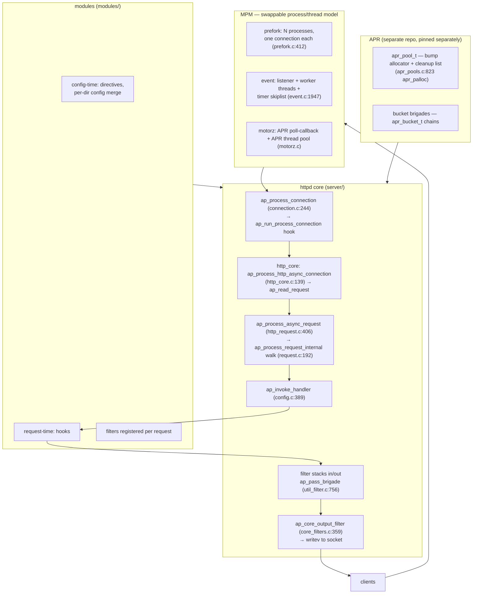
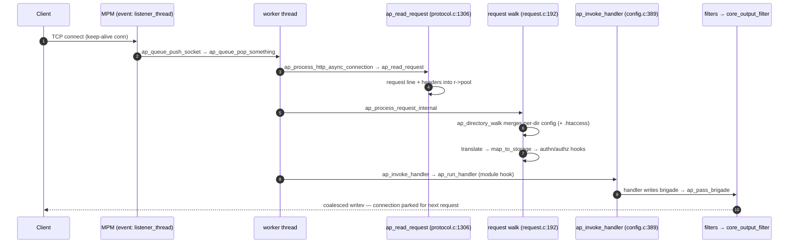
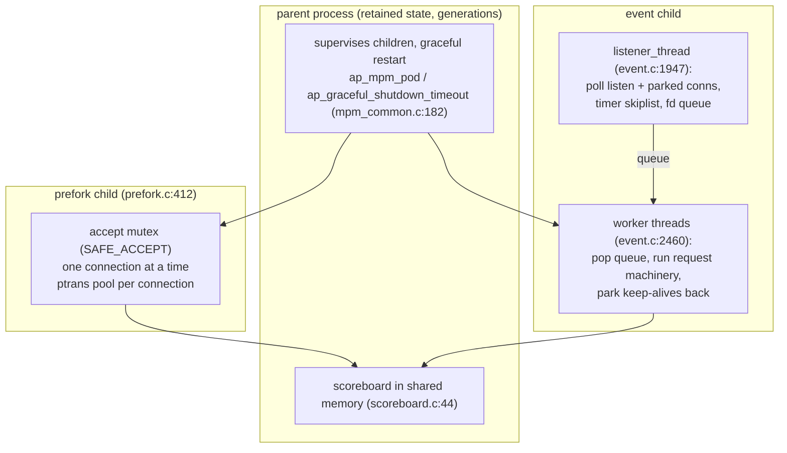

# Apache httpd: the web server as a hook-running extension platform

> **Atlas id:** `httpd` · **Domains:** `web-server` ·
> **Upstream:** https://github.com/apache/httpd · **License:** Apache-2.0 ·
> **Pinned commit:** `f6b14daf428c3c4ea5fe153486797c081a821548` (2026-10-10, trunk) ·
> APR evidence pinned separately: apache/apr `c5db070f0800834ec9cbfef4a44862cdf87ccdf0` (2026-08-07)

Apache httpd dominated the early web and stayed dominant for decades,
and its thesis is the inverse of nginx's minimalism: **the server is an
extension platform, not a fast path**. Everything — URL-to-file mapping,
authentication, response generation, even the connection concurrency
model — is a registered hook (`ap_hook_*`) that any module can slot
into, and data flows between hooks as bucket brigades through stacked
filters. This deep-dive teaches how that hook-and-filter architecture
scaled an ecosystem (one binary served CGI farms, PHP hosts, and
proxies), what the per-request cost of runtime-extensibility is, and
how the Multi-Processing Module seam lets prefork, event, and the new
motorz MPM live behind one server API.

Read it against the [nginx](nginx.md) dive to see the two answers to
"what is a web server": a pipeline of modules over pools, versus a
state machine in a worker process.

## Explain like I'm 10

**A restaurant where the conveyor belt is the restaurant.** In Apache's
kitchen there is no head chef doing everything — there is a conveyor
belt (the filter chain: buckets of soup/bytes pass from station to
station) and a big rulebook of *stations* (the hooks): one for
understanding the order, one for checking the guest list, one for
cooking, one for garnishing, one for the bill. Anyone can rent a station
(modules register hooks with `ap_hook_*`), and the restaurant itself
just runs the belt and calls stations in order — even "who carries the
plates to the table" is a rented station (the MPM: prefork hires one
waiter per table; event hires a team with a dispatcher watching the
dining room). The magic rule: every plate served on a paper mat that is
thrown away when the guest leaves (a memory pool per request — nothing
is ever washed and reused, the mess vanishes with the table).

**Why the grown-ups did it this way:** if every job is a hook, then one
compiled binary can become anything a module author imagines — the
server stays small *because* it refuses to do anything itself.

## 1. Architecture overview

- **APR** (Apache Portable Runtime) is the environment seam: pools,
  buckets, threads, and OS calls behind one C API. The pool allocator
  (`memory/unix/apr_pools.c:823`, in the separately-pinned APR clone) is
  a bump allocator whose "free" is a lifetime event.
- **httpd core** (`server/`) is a hook dispatcher plus config engine.
  The request spine: `ap_process_connection` (`server/connection.c:244`)
  → `ap_run_process_connection` (hook, implemented by
  `modules/http/http_core.c:139` for plain HTTP) → `ap_read_request`
  (`server/protocol.c:1306`) → `ap_process_async_request`
  (`modules/http/http_request.c:406`) → `ap_process_request_internal`
  (`server/request.c:192`, the phase walk) → `ap_invoke_handler`
  (`server/config.c:389`) → output filter stack →
  `ap_core_output_filter` (`server/core_filters.c:359`) → writev.
- **Modules** register hooks at startup (`register_hooks`, e.g.
  `modules/http/http_core.c:355`) and directives that build per-server
  and per-directory config. `mod_so` (`modules/core/mod_so.c`) loads
  compiled modules at config time via `apr_dso_sym` (line 276) — the
  `LoadModule` line in every httpd.conf.
- **The MPM** is the one hook set that decides process/thread layout
  (`server/mpm/`): at this pinned commit trunk ships `prefork`,
  `event`, `motorz`, `simple`, `winnt`, `mpmt_os2`, `netware`, `worker`
  — the cross-platform MPM `motorz` arrived (APR poll callbacks with
  built-in timers over a simple APR thread pool), and `event` has
  superseded `worker` as the default threaded MPM, keeping its
  threading but adding an async listener for keep-alive connections.

## Walkthrough: one GET, accept to writev

The spine as a story — on the site you can step through it with Next;
in the repo it reads top to bottom.

**Step 1 — The MPM hands the connection to the machinery.** In `event`,
the single `listener_thread` (`server/mpm/event/event.c:1947`) polls
listening sockets plus parked connections, and pushes ready ones onto
the fd queue; a `worker_thread` (line 2460) pops one and calls
`ap_process_connection` (`server/connection.c:244`), which immediately
delegates to the `process_connection` hook — the MPM does not know what
HTTP is.

**Step 2 — The connection becomes a request.** The core HTTP module's
`ap_process_http_async_connection` (`modules/http/http_core.c:139`)
drives the state machine and calls `ap_read_request`
(`server/protocol.c:1306`): request line, headers, all allocated from
the request pool `r->pool` — nothing will be individually freed.

**Step 3 — The policy gauntlet walks.** `ap_process_async_request`
(`modules/http/http_request.c:406`) runs `ap_process_request_internal`
(`server/request.c:192`): URI normalization, `translate_name` and
`map_to_storage` hooks decide the file, then `ap_directory_walk` (line
680) merges per-directory config down the path — opening `.htaccess`
files per directory via `ap_parse_htaccess` (`server/config.c:2000`)
when `AllowOverride` permits — then authn/authz hooks run.

**Step 4 — A handler is invoked, not called.** `ap_invoke_handler`
(`server/config.c:389`) gives modules one `insert_filter` chance, then
`ap_run_handler` walks the registered handlers until one returns
something other than `DECLINED`. For `GET /index.html` the core
default handler streams the file as bucket brigades into the output
filter stack.

**Step 5 — Brigades flow downhill.** Each filter (`mod_deflate`,
chunking, HTTP headers) transforms a brigade and calls
`ap_pass_brigade` (`server/util_filter.c:756`) to hand it to the next;
the stack ends in `ap_core_output_filter` (`server/core_filters.c:359`),
which coalesces buckets and `writev`s to the socket (its
`writev_nonblocking`, line 649).

**Step 6 — The request dies, the memory vanishes with it.** The
response completes; the request pool is cleared/destroyed (its cleanup
callbacks close files, unlock mutexes), and the connection either parks
in the event MPM's timer queue for the next keep-alive request or
lingering-closes.

**Outcome — The client has its bytes.** One request walked MPM →
connection hooks → request walk → module handler → filter stack →
writev, touching six extension seams — and *none of those seams was
written by the server core*.

## 2. Core data structures — and why these

### The hook array — extension as sorted callback lists (`server/config.c:85-175`)

`AP_IMPLEMENT_HOOK_RUN_ALL(int, pre_config, ...)` and friends expand to
a per-hook-type array of `{function, order}` entries, sorted by module
and declared precedence (`APR_HOOK_FIRST/MIDDLE/LAST`), with generated
`ap_run_*` and `ap_hook_*` functions. The server core itself registers
almost nothing (see `modules/http/http_core.c:355` — even "speak HTTP"
is a module). Why arrays-of-callbacks over direct calls: the binary
must serve content types and protocols that did not exist when it was
compiled; the cost is one indirect call plus ordering ambiguity per
phase.

### Per-directory config vectors + merge functions (`server/config.c:285`)

Every module gets one config slot per directory context — an array of
pointers (`ap_conf_vector_t`) — and `ap_merge_per_dir_configs`
(`server/config.c:285`) merges two vectors by calling each module's
`merger_func` (cached in `merger_func_cache`). `ap_directory_walk`
(`server/request.c:680`) applies `<Directory>` sections down the path
and `.htaccess` contents (`ap_parse_htaccess`, `server/config.c:2000`)
on top, per request, with a walk cache (`prep_walk_cache`) to avoid
re-stats on subrequests. This is *the* feature that made shared hosting
work: users configure the server without touching its config.

### Bucket brigades — streaming without buffering (`server/util_filter.c:756`)

A brigade is a doubly-linked list of `apr_bucket`s (memory, file, mmap,
pipe, flush, EOS — each with its own read/copy/setaside vtable). Filters
consume and produce brigades; a file download is a handful of
file-backed buckets with offsets, not bytes in RAM; `ap_pass_brigade`
(line 756) is the single "next, please" call. Why: handlers must be
composable over unbounded bodies; the brigade is the unit of flow
control between them, and EOS is the end-of-stream signal every filter
sees.

### APR pools — allocation by lifetime (`apr/memory/unix/apr_pools.c:823`)

`apr_palloc` bumps a pointer inside the pool's active node, keeping
partially-free nodes ordered by max free space (the `free_index` dance
in `apr_pools.c:823-880`); `apr_pool_clear` (line 933) resets the
allocator and runs registered cleanups; `apr_pool_destroy` (line 985)
frees. The hierarchy — `pconf` (config lifetime, survives graceful
restart) → `pchild` (process) → `ptrans` ("transaction", tagged at
`prefork.c:464`) → `r->pool` (request) — means no per-object `free`
exists on the request path at all. Why over malloc/free: leak-proofing
a world of a thousand modules, at the price of peak memory
(under-estimated pools grow) and no eager reclamation inside a request.

### The scoreboard — cross-process state (`server/scoreboard.c:44`)

`ap_scoreboard_image` is a shared-memory table of per-slot
`worker_score`s (what each process/thread is doing, per-request timing
when `ExtendedStatus` is on). It is how the parent MPM decides to spawn
or retire children (`perform_idle_server_maintenance`,
`server/mpm/event/event.c:3240`) and how `mod_status` renders a live picture —
supervision as data structure, not protocol.

## 3. Concurrency and failure model

- **The MPM is the concurrency answer, chosen at build time.** Prefork
  (`server/mpm/prefork/prefork.c:412` `child_main`): each child
  serialize-accepts with a mutex (`SAFE_ACCEPT(accept_mutex_on())`,
  line 591) and handles one connection at a time — a crashing module
  kills one child, one connection. Event
  (`server/mpm/event/event.c`): one `listener_thread` per child polls
  everything (line 1947) and pushes work to `worker_thread`s (line
  2460); keep-alive connections that are just *waiting* are parked and
  polled instead of occupying a thread — the C10K answer, retrofitted
  under the same server API. `motorz` (`server/mpm/motorz/motorz.c`,
  per its `MOTORZ.README`) is the trunk's bid for a single MPM on every
  platform: Prefork's process framework with the Simple MPM's
  poll-callback event structure, feeding a simple APR thread pool.
- **Crash containment is the process model.** A segfault kills a child;
  the parent (via scoreboard + `ap_reclaim_child_processes`) respawns
  it. Graceful restart sends children a "finish current requests then
  exit" signal through the pipe-of-death and starts a new *generation*
  with the re-parsed config — old processes drain while new ones
  already accept (bounded by `ap_graceful_shutdown_timeout`,
  `server/mpm_common.c:182`).
- **Per-request failure is pool failure.** Any module can abort a
  request by returning an error from a hook; cleanup happens by pool
  destruction, so half-written requests do not leak per-object state.
  The lingering-close path (`ap_lingering_close`) drains the socket so
  a client never sees RST mid-response.
- **Backpressure** lives in the filters: `ap_core_output_filter`
  buffers bounded amounts and returns `AP_EAGAIN` up the stack when the
  client stalls — in event MPM that parks the connection instead of
  blocking a worker; in prefork it simply blocks that child.

## 4. API and extension design

- **The module is the unit of extension**: a `module` struct
  (`STANDARD20_MODULE_STUFF`, `include/http_config.h:489`) with a
  directive table (per-dir/per-server config creators + merger) and a
  `register_hooks` that calls `ap_hook_translate_name`,
  `ap_hook_handler`, `ap_hook_access_checker`, … Loadable at config
  time through `mod_so`'s `LoadModule` → `apr_dso_sym`
  (`modules/core/mod_so.c:276`). The same server binary plus different
  `LoadModule` sets is a static file server, a PHP host (`mod_proxy` +
  php-fpm), or a TLS-terminating reverse proxy.
- **Filters are the streaming seam**: `ap_register_output_filter`
  (`server/util_filter.c:290`) with a type (`AP_FTYPE_PROTOCOL`,
  `AP_FTYPE_CONTENT_SET`, …) fixes the stacking order; a module inserts
  its filter per request from the `insert_filter` hook. This is how
  `mod_deflate` or `mod_headers` compose with any handler.
- **The MPM seam** makes even the process model replaceable
  (`server/mpm/`), selected by `--with-mpm` at build time — the
  decision nginx hard-codes (master + workers) exposed as a plug-in
  contract. `ap_mpm_query(AP_MPMQ_IS_ASYNC, ...)` lets modules adapt.
- **The honest warts**: (1) hook *ordering* is module-relative
  (FIRST/MIDDLE/LAST), so two modules fighting for a phase need
  `mod_so`-era `LoadModule` order tricks — there is no total order
  contract; (2) `.htaccess` costs filesystem stats on every request
  (`ap_directory_walk` → `ap_parse_htaccess`), which is exactly why
  nginx refuses the feature and why every httpd tuning guide says
  `AllowOverride None`; (3) pool lifetimes are global policy, so a
  module wanting fine-grained memory discipline has to fight the
  runtime.

## 5. The defining trade-offs

### Trade-off 1: extensibility as the product over a fixed fast path
- **Tension:** be everything to every deployment (CGI, PHP, proxy,
  auth schemes) without forking the server per use.
- **Choice:** every phase is a hook array; content flows as brigades
  through stacked filters; config is data merged per directory at
  request time.
- **Evidence:** the walk in `ap_process_request_internal`
  (`server/request.c:192`) is hook call after hook call;
  `ap_invoke_handler` (`server/config.c:389`) doesn't even have a
  built-in "serve a file" — `ap_run_handler` delegates, and the core
  default file handler is just another registrant
  (`server/core.c:6152`, `APR_HOOK_REALLY_LAST`);
  `modules/http/http_core.c:355` registers HTTP itself via hooks.
- **Given up:** the fast path. Every request pays hook dispatch,
  per-dir config merging, and brigade indirection that nginx's
  single-purpose state machine skips; the RPS gap between the two
  servers on static files is this trade measured in benchmark units.
- **Verdict:** right when third parties must extend the server without
  recompiling it (the shared-hosting and enterprise eras — this is why
  httpd won them). Wrong when the workload is one fixed thing at
  maximum efficiency — which is exactly the niche nginx took.

### Trade-off 2: pools over individual allocation
- **Tension:** a thousand modules, millions of requests, zero leak
  review authority.
- **Choice:** allocation by lifetime (`r->pool` per request, `ptrans`
  per connection, `pconf` per config generation); cleanup as registered
  callbacks at pool destruction.
- **Evidence:** `apr_palloc` (`apr/memory/unix/apr_pools.c:823`) never
  frees individually; `apr_pool_clear` (line 933) is the request-recycle
  primitive; the prefork child creates a `ptrans` "transaction" pool per
  connection (`server/mpm/prefork/prefork.c:464`).
- **Given up:** eager reclamation (a 1GB response buffers up to its
  pool's lifetime if a filter holds it), peak-memory spikes on
  mis-sized pools, and any module that wants real streaming discipline
  must use `setaside` buckets and careful brigade hygiene.
- **Verdict:** right for a plugin ecosystem where no one can audit
  frees; a leak becomes impossible *by construction*. Wrong for
  tight-memory embeddings — and it is no accident nginx, with no plugin
  API, chose pools too but scopes them to the request cycle only.

### Trade-off 3: per-directory runtime config over compiled-in layout
- **Tension:** let unprivileged users configure server behavior for
  their subtree (shared hosting) without reloading the server.
- **Choice:** config layers merge per request — `<Directory>` walk,
  `<Location>` walk, then `.htaccess` files parsed off disk mid-request.
- **Evidence:** `ap_directory_walk` (`server/request.c:680`) walking
  sections and calling `ap_merge_per_dir_configs`
  (`server/config.c:285`); `ap_parse_htaccess` (`server/config.c:2000`)
  opening and parsing user files on the hot path, with a per-request
  cache (`r->htaccess` chain) and the `r->taint |= AP_TAINT_HTACCESS`
  marker showing the security cost being tracked.
- **Given up:** per-request filesystem stats and parse cost, plus a
  whole class of surprises (options a user re-enabled in a subdir) —
  the feature is both the reason shared hosting existed and the reason
  every performance guide disables it.
- **Verdict:** right when your users are tenants you cannot trust with
  the main config; wrong when you own the whole server — then it is
  pure overhead, and the industry's move to nginx/Caddy configs with a
  reload is the verdict playing out.

## 6. Reading path

1. `server/main.c` — startup: config tree parse → `pre_config` /
   `post_config` hooks → MPM's `ap_mpm_run`. Notice how early the core
   hands everything to hooks.
2. `include/http_config.h:461-489` — the `module` struct and
   `STANDARD20_MODULE_STUFF`; then `AP_DECLARE_MODULE` at 467 to see
   the DSO plumbing fields.
3. `server/config.c:85-175` — `AP_IMPLEMENT_HOOK_RUN_ALL/FIRST`
   expansions: the arrays, the sort, the generated `ap_run_*`. This is
   the whole extension mechanism in forty lines of macros.
4. `modules/http/http_core.c:139` `ap_process_http_async_connection` —
   HTTP itself as a module: read request, run
   `ap_process_async_request`, park or close the connection.
5. `server/protocol.c:1306` `ap_read_request` — request line + headers
   into `r->pool`; note `ap_get_mime_headers` and how nothing is freed
   individually.
6. `server/request.c:192` `ap_process_request_internal` — the phase
   walk: normalize → translate → `map_to_storage` → directory walk →
   authn/authz → `type_checker` → done. Read it once for one request,
   once for a subrequest (`ap_sub_req_lookup_uri` reuses the walk
   cache).
7. `server/request.c:680` `ap_directory_walk` + `server/config.c:2000`
   `ap_parse_htaccess` — the per-directory merge story, including the
   `.htaccess` cache chain on `r`.
8. `server/config.c:285` `ap_merge_per_dir_configs` — the vector merge
   with cached merger functions; config composition as an algebra.
9. `server/config.c:389` `ap_invoke_handler` — insert_filter, filter
   init, then `ap_run_handler` walking registrants until one commits.
10. `server/util_filter.c:756` `ap_pass_brigade` and
    `server/core_filters.c:359` `ap_core_output_filter` — brigades
    downhill to coalesced `writev`; this is where streaming meets the
    socket.
11. `apr/memory/unix/apr_pools.c:823` (`apr_palloc`) and 933
    (`apr_pool_clear`) — the allocator and its recycle primitive, from
    the separately-pinned APR clone.
12. `server/mpm/prefork/prefork.c:412` `child_main`, then
    `server/mpm/event/event.c:1947` `listener_thread` and 2460
    `worker_thread` — the two concurrency answers behind the same
    hooks; finish with `server/mpm_common.c:182` for graceful
    shutdown timeout plumbing.

You have now traced one GET from accept to writev across six extension
seams, and seen the process model swap (prefork ↔ event) without the
request machinery noticing.

## 7. What to steal

- **Make the platform the product, not any one behavior**: when every
  phase is a hook, your ecosystem — not your code — answers future
  requirements (`server/config.c` hook macros).
- **Give extension points *data* to own and *merge rules* to compose**
  (per-dir config vectors + `merger_func`s): modules stay orthogonal
  because composition is defined, not improvised.
- **Stream as a linked list of typed chunks** (bucket brigades): file,
  memory, and generated content compose through one interface, and EOS
  is a first-class citizen.
- **Allocate by lifetime, not by object** (APR pools): free an epoch,
  not a pointer — leak-proofness is structural, not disciplinary.
- **Put the concurrency model behind a seam** (the MPM): you will need
  to change it someday (thread → async → io_uring) and the request
  machinery must not care.
- **Supervise via a shared data structure** (the scoreboard): spawning,
  retiring, and observability read the same truth, so the parent, the
  children, and `mod_status` never disagree.

## 8. Difficulty and prerequisites

- Difficulty: **demanding**. Macro-heavy C, a two-repo codebase, and
  the architecture is in the conventions (hooks, pools, filters), not
  in any single file.
- Budget: ~8-10 hours for the reading path; the phases and filter
  stacks repay a second pass with a debugger attached.
- Prerequisites: C preprocessor fluency (the hook system is macros);
  what a DSO is; the [nginx](nginx.md) dive for the contrasting model;
  basic POSIX process/thread semantics.

## 9. Further reading

- Apache HTTP Server documentation — https://httpd.apache.org/docs/ —
  especially "Modules" and the MPM sections.
- N. Kew, *The Apache Modules Book: Application Development with
  Apache* (Prentice Hall, 2007) — the module/hook model explained by a
  modules author.
- The `CHANGES` file at the pinned commit — the arrival of `motorz` and
  `event`'s supersession of `worker` as the threaded default read as a
  history of the process-model trade-offs.
