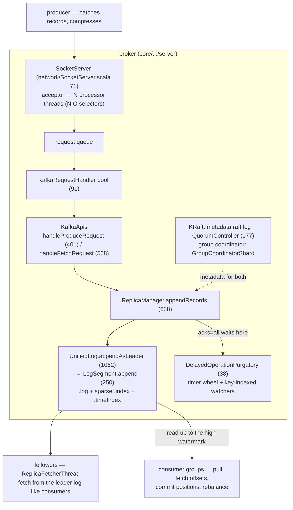
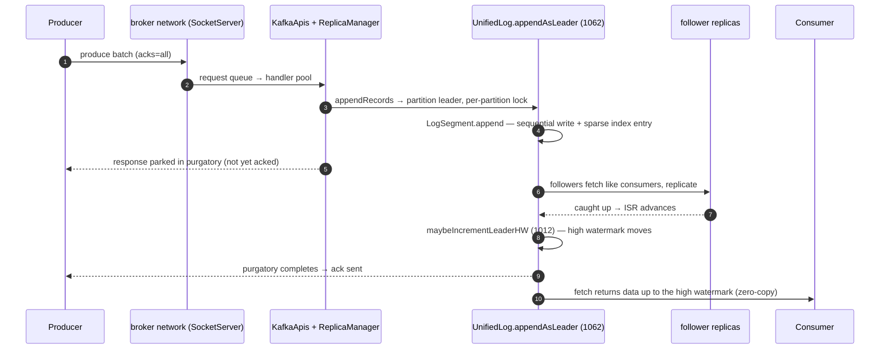
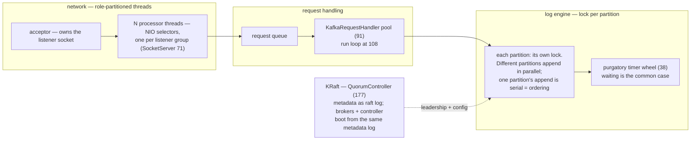

# Kafka: the append-only log as an operating system for data

> **Atlas id:** `kafka` · **Domains:** `queue-log, distributed, storage-engine` ·
> **Upstream:** https://github.com/apache/kafka · **License:** Apache-2.0 ·
> **Pinned commit:** `3de09ca09784900318b56091d46d3803c4d5adc9` (2026-10-10, trunk)

Kafka became the nervous system of every large data platform with a
design inversion: instead of a smart message router, it is a **dumb,
append-only, partitioned commit log** that exploits the one thing disks
and networks do at full speed — sequential transfer — and pushes
intelligence (what to consume, how fast, where you are) into clients.
This deep-dive teaches the throughput architecture (batching, zero-copy,
sparse indexes), the replication machinery (ISR + high watermark), and
the newest lesson: Kafka's own metadata became an event-sourced raft log
(KRaft), the system eating its own dog food.

## Explain like I'm 10

**A conveyor belt of numbered boxes.** Kafka is a very long belt that
only moves forward (the append-only log). Senders drop sealed boxes onto
it (batches of records), and each box gets a number as it lands
(its offset). Every reader (a consumer group) walks the belt at their own
pace — fast walkers and slow walkers never collide — and each remembers
their box number in a little notebook (committed offsets... stored on
ANOTHER belt, because everything in Kafka is a belt). The belt is long
(retention), so a brand-new reader can go back to box 1 and replay
everything. Copies of the belt run at friends' houses (replicas), and a
special marker (the high watermark) shows how far the belt has been
copied — readers may only read up to the marker, never past it.

**Why the grown-ups did it this way:** belts (disks and networks) are
fastest when moving in one direction without stopping — and storing each
reader's position as data means nobody has to keep a giant "who received
what" list.

## 1. Architecture overview

- The **spine** — one produce — is: `handleProduceRequest`
  (`core/src/main/scala/kafka/server/KafkaApis.scala:401`) →
  `ReplicaManager.appendRecords` (638) → partition leader →
  `UnifiedLog.appendAsLeader`
  (`storage/src/main/java/org/apache/kafka/storage/internals/log/UnifiedLog.java:1062`)
  → `LogSegment.append` (`LogSegment.java:250`) writes batches
  sequentially and appends sparse index entries; with `acks=all` the
  response waits in purgatory until followers replicate.
- A *partition* is the unit of everything: ordering, leadership,
  retention, parallelism. Topics are just names over partition sets.

## Walkthrough: one produce with acks=all, then a consumer reads it

The spine as a story — step through it on the site or read straight
down. Watch where the record becomes durable and where it becomes
visible: those are two different moments.

**Step 1 — The batch leaves.** The producer groups records into a
compressed batch with a base offset and CRC — the batch is the unit of
send, of append, and of retry, so throughput is paid once, everywhere.

**Step 2 — Into the broker.** An acceptor hands the connection to a
processor thread (NIO selector, `network/SocketServer.scala:71`); the
request lands on a queue consumed by a `KafkaRequestHandler`
(`server/KafkaRequestHandler.scala:91`), which calls
`KafkaApis.handleProduceRequest` (401).

**Step 3 — Append to the leader.** `ReplicaManager.appendRecords` (638)
routes to the partition leader; `UnifiedLog.appendAsLeader` (1062) takes
the per-partition lock — one partition's append is serial, and that
serialness IS the ordering guarantee — and `LogSegment.append` (250)
writes the batch sequentially, adding one sparse index entry per ~4KB.

**Step 4 — Wait in purgatory.** With `acks=all`, the produce response
parks in `DelayedOperationPurgatory` (`server-common/.../purgatory/`, 38)
— a timer wheel plus per-key watchers — until the ISR replicates the
record or the request times out.

**Step 5 — Followers copy the belt.** `ReplicaFetcherThread`s (30) fetch
from the leader exactly like consumers; the leader truncates divergent
tails using leader epochs (zombie-leader fencing). When the in-sync set
has the record, `maybeIncrementLeaderHW` (`cluster/Partition.scala:1012`)
moves the high watermark.

**Step 6 — Ack, and only then visible.** Purgatory completes the parked
response → the producer's ack returns. Consumers fetching see data only
up to the high watermark (`handleFetchRequest` 568 → `LogSegment.read`
435), served from the page cache to the socket by zero-copy
`transferFrom` (`FileRecords.writeTo:280`).

**Outcome — Durable, then visible.** One batch is now: (a) on the
leader's disk, (b) on every in-sync replica, (c) readable by any
consumer — and replayable forever by any NEW consumer that starts at
offset 0. The dumb belt did all the work.

## 2. Core data structures — and why these

### The log segment trio: `.log`, `.index`, `.timeIndex`
(`storage/.../log/LogSegment.java:65`)

Data lives in immutable-ish segment files (rolled by size/time);
appends go only to the active one (`LogSegment.append:250`). The offset
index is **sparse** — every ~4KB of data, one (relativeOffset, position)
pair — mmapped (`AbstractIndex.java:72`) and searched by binary search
(`AbstractIndex.java:501-513`). Why sparse: an entry per byte would
itself be big data; binary search over a sparse index + one sequential
scan of ≤4KB bounds any offset lookup. This is the entire "database"
of the consumer side.

### Record batches (`clients/.../record/`)

Producers group records into compressed batches with base offsets and
CRCs; the broker treats a batch as the unit of append, replication, and
validation. Why batches: throughput everywhere — fewer syscalls, fewer
network frames, compression amortization. The batch is also the
transaction and idempotence unit (producer epochs, sequence numbers).

### The high watermark and leader epochs
(`core/.../cluster/Partition.scala:1012/1091`)

Each partition's leader advances the *high watermark* (HW) — the offset
replicated to all in-sync replicas (`maybeIncrementLeaderHW:1012`) —
and shrinks the ISR on follower timeouts (`maybeShrinkIsr:1091`).
Consumers see only ≤HW data. Why: one number reconciles "durable
enough" with "readable now" across replicas without distributed
transactions.

### Delayed-operation purgatory
(`server-common/.../purgatory/DelayedOperationPurgatory.java:38`)

`acks=all` produces and timed fetches park in purgatory — a timer wheel
+ key-indexed watchers structure — until replication satisfies them or
they time out. Why: waiting is the common case in a replicated log;
making it O(1)-ish per event (not per poll) is what keeps tail latency
sane.

## 3. Concurrency and failure model

- **Threading is role-partitioned per broker**: acceptor → processor
  threads (NIO selectors, one per listener group,
  `network/SocketServer.scala:71`) own sockets; a request queue feeds a
  pool of `KafkaRequestHandler`s (`server/KafkaRequestHandler.scala:91`,
  run loop at 108); each partition's log has its own lock — so appends
  to different partitions on one broker proceed in parallel, and one
  partition's append is serial (the ordering guarantee *is* the lock).
- **Replication**: followers run `ReplicaFetcherThread`s
  (`server/ReplicaFetcherThread.scala:30`) fetching from the leader's
  log like consumers; the leader truncates followers' divergent tails
  using leader epochs (fencing zombie leaders). Failure → the
  controller (now `QuorumController` on the KRaft raft log,
  `metadata/.../QuorumController.java:177`) elects an ISR member.
- **Durability is config**: `acks` + `min.insync.replicas` define the
  replication barrier; unclean leader election is (by default) refused —
  consistency over availability, the deliberate opposite of AP systems.
- **Consumers hold their position**: offsets are committed into the
  `__consumer_offsets` topic (log all the way down); a group rebalances
  partition ownership on membership changes — the new-generation
  coordinator is itself an event-sourced state machine in
  `group-coordinator/.../GroupCoordinatorShard.java`.

## 4. API and extension design

- The wire API is **versioned request/response schemas** (generated
  from JSON): brokers negotiate versions with clients — a rolling-
  upgrade contract that has kept a decade of mixed client/broker
  versions interoperating.
- The consumer/producer are **client libraries**, not protocol minions:
  batching, compression, partitioners, and retry policy live
  client-side (`clients/` module — the same Java code brokers use).
- Extension points are storage-level: tiered storage
  (`storage/.../remote/`), pluggable serializers/connect API (separate
  repo), and the log-compact ("compacted") retention mode that turns a
  topic into a key→latest-value table.
- Honest wart: rebalancing consumer groups has been the operational
  sore spot for a decade — the new KIP-848 protocol exists because
  global coordination on the hot path is genuinely hard.

## 5. The defining trade-offs

### Trade-off 1: dumb sequential log + zero-copy over a "smart" store
- **Tension:** millions of messages/sec on commodity disks and 10GbE.
- **Choice:** append-only segments; sparse index maps offsets to
  positions; serving a fetch copies bytes from page cache to socket
  with `transferFrom`/`sendfile`
  (`clients/.../record/internal/FileRecords.java:writeTo:280`) —
  zero-copy, no user-space buffer churn.
- **Evidence:** `LogSegment.append:250` (sequential), `AbstractIndex`
  mmap+binarySearch (501-513), `FileRecords.writeTo:280`
  (`destChannel.transferFrom`).
- **Given up:** key-based random access (it's an offset log, not a
  database — consumers wanting keys build tables or use compaction),
  and disk-space discipline via retention policies instead of deletes.
- **Verdict:** right when the workload is a firehose with replay;
  wrong for point lookups — which is why Kafka Streams builds state
  stores *on top of* the log, not inside it.

### Trade-off 2: pull-based consumers with committed positions over push
- **Tension:** deliver events without overrunning slow consumers.
- **Choice:** consumers fetch at their own pace; positions are data
  (committed to a topic); groups split partitions among members.
- **Evidence:** fetch path `handleFetchRequest:568` →
  `LogSegment.read:435` slices from the HW; offsets committed to
  `__consumer_offsets`; `GroupCoordinatorShard` (event-sourced
  coordinator).
- **Given up:** push latency floor (poll interval), and a nontrivial
  client (every consumer embeds a mini distributed system for
  rebalancing).
- **Verdict:** backpressure for free and replayability forever — the
  two properties that made Kafka an integration backbone. Push systems
  (NATS core, MQTT) win on latency-to-slow-clients, and lose replay.

### Trade-off 3: ISR + high watermark replication over quorum commits
- **Tension:** replicate durably without slowing every write to the
  slowest replica.
- **Choice:** write to the leader + all in-sync replicas (`acks=all`);
  ISR membership is elastic (`maybeShrinkIsr:1091`); the high watermark
  gates consumer visibility (`maybeIncrementLeaderHW:1012`).
- **Evidence:** both functions in `core/.../cluster/Partition.scala`;
  leader-epoch fencing in `ReplicaFetcherThread.scala:30`.
- **Given up:** strict majority quorums — a mis-set `min.insync.replicas`
  or unclean election can lose data (the default forbids it, choosing
  unavailability).
- **Verdict:** tuned for throughput with tunable durability; the same
  dial Raft fixes with consensus — which Kafka itself adopted for its
  *metadata* (KRaft), where correctness beats throughput.

## 6. Reading path

1. `core/.../server/KafkaApis.scala:handleProduceRequest` (401) — the
   front door: validation, idempotence/txn checks, the local-vs-remote
   partition dispatch.
2. `core/.../server/ReplicaManager.scala:appendRecords` (638) and
   `appendRecordsToLeader` (586) — where replication policy meets the
   log; note the purgatory handoff for `acks=all`.
3. `storage/.../log/UnifiedLog.java:appendAsLeader` (1062) — per-
   partition lock, segment roll policy, index upkeep; then
   `LogSegment.append` (250): the actual sequential write + index
   entry append.
4. `storage/.../log/AbstractIndex.java` — mmap (72), sparse-entry
   layout, binary search (501-513); run `kafka-dump-log` on a test
   segment if you want to see it live.
5. Fetch side: `KafkaApis.handleFetchRequest` (568) →
   `LogSegment.read` (435) → `FileRecords` slicing; then
   `FileRecords.writeTo` (280) — the zero-copy send to the socket.
6. `server-common/.../purgatory/DelayedOperationPurgatory.java` (38) —
   how waiting requests complete on replication events instead of
   polling.
7. `core/.../cluster/Partition.scala` — `maybeIncrementLeaderHW`
   (1012) and `maybeShrinkIsr` (1091): trace how one produce becomes
   visible to consumers.
8. `core/.../server/ReplicaFetcherThread.scala` (30, `processPartitionData`
   at 113) — followers are consumers; epoch fencing on truncation.
9. `group-coordinator/.../GroupCoordinatorShard.java` — the new
   coordinator as event-sourced state machine (metadata events in,
   responses out).
10. `core/.../server/KafkaRaftServer.scala` (49) +
    `metadata/.../QuorumController.java` (177) — brokers and the
    controller both boot from the same raft metadata log; the
    controller is a deterministic function over metadata events.
11. `core/.../network/SocketServer.scala` (71) +
    `core/.../server/KafkaRequestHandler.scala` (91) — the broker's
    thread architecture: selectors vs handler pool, one queue in
    between.

You have now traced one message from producer batch to replicated,
zero-copied, consumer-visible record — and seen how Kafka rebuilt its
own control plane on the same log abstraction.

## 7. What to steal

- **Make the sequential log your storage primitive**: batching +
  zero-copy + sparse indexes is a repeatable throughput recipe, not a
  Kafka accident.
- **Offsets as data**: storing consumer positions in the log itself
  removed a whole class of coordinator state (compare: external ZK
  offsets, the thing it replaced).
- **Backpressure by pull**: consumers that fetch control their own
  fate; no broker-side queue accounting per slow client.
- **Version every wire message**: generated, negotiated schemas made
  a decade of rolling upgrades survivable — most systems die here.
- **Event-source your control plane** (KRaft/QuorumController):
  deterministic functions over an append-only metadata log replace
  fragile external consensus — the deepest pattern in this codebase.

## 8. Difficulty and prerequisites

- Difficulty: **demanding** — three languages of concern (Scala
  plumbing, Java log engine, generated protocol), plus distributed
  systems vocabulary.
- Budget: ~8 hours for the reading path; replication semantics need a
  second pass.
- Prerequisites: what a commit log is; replication and quorums at a
  textbook level; Java/Scala reading fluency; mmap basics.

## 9. Further reading

- Kafka's design doc in-repo: `docs/design.html` (the original 2011
  design rationale, still the best single read).
- KIP-500 (KRaft) and KIP-848 (new consumer groups) proposals — the
  two architecture migrations this reading path witnesses.
- Kreps, Narkhede, Rao — "Kafka: a Distributed Messaging System for
  Log Processing" (the original paper).
