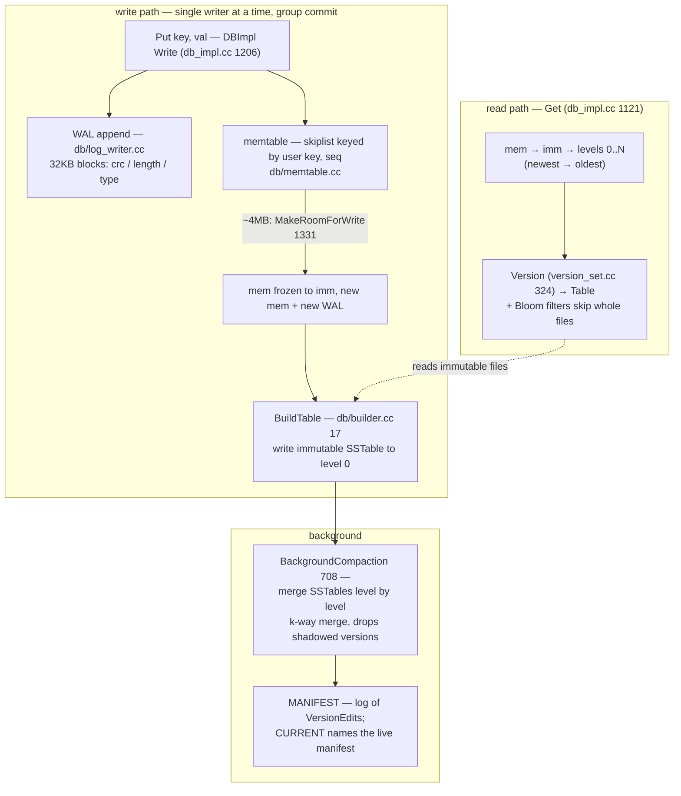
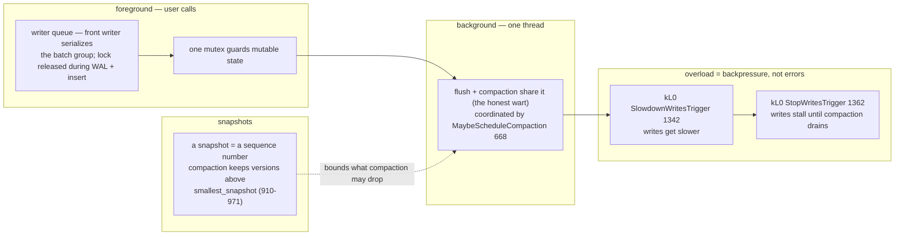

# LevelDB: the LSM-tree in its teachable form — logs, levels, and immutable tables

> **Atlas id:** `leveldb` · **Domains:** `storage-engine` ·
> **Upstream:** https://github.com/google/leveldb · **License:** BSD-3-Clause ·
> **Pinned commit:** `bb74ef739973a70ca9f0d90788a1da89b788c0ad` (2026-10-08)

LevelDB is Google's distilled storage engine (Jeff Dean & Sanjay
Ghemawat, the Bigtable tablet lineage): an ordered key-value store built
entirely from **append-only structures** — a WAL, an in-memory skip
list, and immutable sorted files (SSTables) organized in levels and
merged by background compaction. It is the smallest complete
implementation of the write-optimized (LSM) answer to B-trees, small
enough to read end-to-end in a week, and it begat RocksDB and a decade
of storage engines. This deep-dive teaches the fundamental trade:
**sequential writes + amortized reorganization vs read amplification**,
with almost no incidental complexity around it.

## Explain like I'm 10

**A diary, a scratch page, and a tidy-up robot.** When you tell LevelDB
something (`Put`), it does two fast things: writes the fact in pen in a
diary you never re-read (the WAL — its only job is to survive a crash)
and scribbles it on a scratch page (the memtable). When the scratch page
fills up (~4MB), it is copied neatly into a labeled folder (an immutable
SSTable) and filed into a drawer, and folders from fuller drawers keep
getting merged into bigger, tidier folders by a tidy-up robot
(compaction) that works in the background. Each folder wears a magic
sticker (a Bloom filter) that says "this key is DEFINITELY not in here,"
so a lookup can skip most drawers without opening them.

**Why the grown-ups did it this way:** writing in pen at the back of a
notebook is much faster than erasing and rewriting sorted pages in place
— so writes stay blazing fast, and the tidying happens later, a little at
a time, off the critical path.

## 1. Architecture overview



- Two threads of control: **the foreground** (user calls: Get/Put/Write)
  and **one background compaction thread**, coordinated by one mutex and
  condition variables (`db/db_impl.cc:MaybeScheduleCompaction`, line 668).
- The **spine** — one `Put` — is: `DBImpl::Write` → WAL record → memtable
  insert → (maybe) `MakeRoomForWrite` (line 1331) freezes/flushes.

## Walkthrough: one Put, through crash and back out of Get

The complete life of an LSM record — step through it on the site, or
read it straight down.

```mermaid
sequenceDiagram
    autonumber
    participant C as Caller (Put)
    participant W as DBImpl Write 1206
    participant L as WAL (log_writer.cc)
    participant M as memtable skiplist
    participant BG as compaction thread
    participant D as disk (SSTables + MANIFEST)
    C->>W: Put key, val
    W->>L: append record (crc, block-framed) — mutex released
    W->>M: insert (user_key, seq) — newest sorts first
    Note over W,M: durable here; readable by any Get that starts now
    M->>D: at ~4MB: freeze mem, BuildTable → L0 SSTable
    BG->>D: merge levels, install via MANIFEST VersionEdit
    Note over BG,D: crash? reopen = replay WAL + replay MANIFEST
    C->>W: later: Get key
    W->>M: mem → imm → levels, Bloom filters skip files
```

**Step 1 — One writer, many passengers.** `DBImpl::Write` (1206) parks
the caller in a writer queue; the front writer becomes the serialization
point and `BuildBatchGroup` merges everyone waiting into one batch —
group commit for free.

**Step 2 — The pen stroke.** The batch is appended to the WAL: 32KB
blocks of `<crc | length | type>` with FULL/FIRST/MIDDLE/LAST framing
(`db/log_format.h`). A torn write can corrupt at most one block; the
reader resyncs at the next block boundary. The mutex is *released*
during this append and the memtable insert — the slow parts run without
the lock.

**Step 3 — Scribble on the scratch page.** Each key/value lands in the
skiplist as `(user_key, sequence_number)` with the newest version
sorting first (`db/dbformat.h`) — lookups always see the latest value,
and this is what makes snapshots cheap later.

**Step 4 — The page fills.** At ~4MB, `MakeRoomForWrite` (1331) freezes
the memtable (`mem_` becomes `imm_`), starts a fresh one, and hands the
frozen page to `BuildTable` (`db/builder.cc:17`): iterate in order, emit
prefix-compressed blocks, an index entry per block, a Bloom filter, and
the fixed footer — an immutable file appears.

**Step 5 — The robot tidies.** The single background thread merges
levels (`BackgroundCompaction`, 708): a k-way merge re-sorts runs,
drops versions shadowed below the oldest snapshot (910–971), and
installs the new layout by appending a `VersionEdit` to the MANIFEST
(`VersionSet::LogAndApply`, 777). Files are only deleted after that
edit is durable.

**Step 6 — Crash, restart, replay.** On reopen, `VersionSet::Recover`
(861) replays MANIFEST edits to rebuild the layout, and the WAL is
replayed into a fresh memtable — stopping at the first bad crc. An
orphan SSTable from a crashed flush is adopted or deleted, never
half-visible, because *installation is the manifest write*.

**Step 7 — Read it back.** `DBImpl::Get` (1121) takes a snapshot seq,
then walks mem → imm → levels via `Version::Get` (324); Bloom filters
skip whole files, and the first version found (newest wins) is the
answer.

**Outcome — Append, merge, never rewrite.** The key was durable at step
2, searchable at step 3, and ordered-by-merge forever after — the LSM
bargain: fast writes today, amortized sorting later.

## 2. Core data structures — and why these

### MemTable = arena + skip list (`db/memtable.cc`, `db/skiplist.h`)

The skiplist (`db/skiplist.h:40`, `kMaxHeight = 12`, `kBranching = 4`
at lines 100/242) keys entries by `(user_key, sequence_number)` with
descending sequence, so the newest version sorts first and lookups see
the latest value. Memory comes from an `Arena` (`util/arena.h:16`) —
bump allocation, freed wholesale; the skip list needs no per-node
dealloc because the memtable lives and dies as a unit. Why a skip list
not a red-black tree: lock-free-friendly, simpler code, and — crucial
for a structure dumped to a sorted file — iteration order falls out of
the same descent as search.

### The WAL record format (`db/log_format.h`, `db/log_writer.cc`)

Records are 32KB blocks of `<4-byte crc | 2-byte length | 1-byte type>`
(`kHeaderSize` at `log_format.h:30`) with types FULL/FIRST/MIDDLE/LAST
(`enum RecordType`, line 14) for splitting large batches across blocks.
Why blocks: a torn write at crash time corrupts at most one block, and
the reader resyncs at the next block boundary — recovery reads the log
and stops at the first bad crc. The log is *the* durability boundary;
everything after it is a cache.

### SSTables (`table/`)

A table is: data blocks (prefix-compressed key/value chunks) + an
optional filter block (Bloom) + an index block (one entry per data
block, its key ≥ all keys in that block) + a fixed **footer** with the
index/metaindex handles and magic number (`table/format.cc:Footer::EncodeTo`,
line 32). Reads use a two-level iterator (`table/two_level_iterator.cc:18`):
index block → data block. Why immutable sorted files: write once, then
mmap/read-only forever — no torn structures, trivially shareable
between readers and the compactor, cheap crc verification per block.

### Version / VersionSet / MANIFEST (`db/version_set.cc`)

The *current layout* (which files, which levels, which compaction
pointers) is itself an append-only log: every compaction appends a
`VersionEdit` to the MANIFEST; `CURRENT` names the live manifest;
`VersionSet::Recover` (line 861) replays edits at startup. Why: the file
layout is mutable state, and LevelDB refuses special treatment — mutable
state gets the same log+replay discipline as user data
(`VersionSet::LogAndApply`, line 777).

## 3. Concurrency and failure model

- **One foreground mutex** guards everything mutable; the big lesson is
  *what runs outside it*: WAL append + memtable insert happen with
  `mutex_.Unlock()` (see `DBImpl::Write`, db_impl.cc:1206-1258 — a
  single front-of-queue writer acts as the serialization point for the
  whole batch group, so the lock is dropped during the slow parts).
- **Group commit**: queued writers are merged by `BuildBatchGroup` into
  one WAL record — batching under load for free.
- **Snapshots are sequence numbers** (`db/snapshot.h`): reads pin a seq;
  compaction must retain versions above `smallest_snapshot`
  (`db/db_impl.cc:910-971`) — MVCC with two dozen lines, because the
  key already carries the version.
- **Failure/recovery**: on open, replay WAL into a fresh memtable
  (`DBImpl::Recover`); if the MANIFEST is torn, its log format means
  replay stops at the last complete edit. A crash mid-flush leaves an
  orphan SSTable that is either adopted (via manifest edit) or deleted —
  never half-visible, because *installation is the manifest write*.
- **Overload = backpressure, not errors**: too many L0 files → writes
  slow down (`kL0_SlowdownWritesTrigger`, db_impl.cc:1342), then stall
  (`kL0_StopWritesTrigger`, line 1362) until compaction drains —
  `MakeRoomForWrite` (1331) is where the engine chooses delay over
  unbounded memory.



## 4. API and extension design

- The public surface (`include/leveldb/`) is a masterclass in small C++
  APIs: `DB::Put/Get/Delete/Write(WriteBatch)`, `Iterator` (with the
  Seek/Next/Valid contract), `Slice` (non-owning view — no string
  copies across the boundary), `Status` (state machine, not
  exceptions).
- **Seams, each one interface**: `Comparator` (custom key orders — the
  engine never assumes bytes), `Env` (`include/leveldb/env.h` — all OS
  dependency: files, time, threads; `env_posix.cc`/`env_windows.cc` are
  the two real implementations), `FilterPolicy` (pluggable Bloom or
  none), `Cache` (block cache as a sharded LRU, swappable), plus
  C bindings (`db/c.cc`) for embedding from other languages.
- Honest wart: a single background thread means compaction and flush
  contend; no range deletes; no built-in checksums per-file beyond
  blocks. RocksDB exists to fix exactly these — read it next to see
  *how requirements erode a clean design*.

## 5. The defining trade-offs

### Trade-off 1: LSM (log + merge) over B-tree (in-place update)
- **Tension:** disks/streaming media love sequential appends; point
  reads love sorted in-place pages.
- **Choice:** writes only append (WAL) or insert (memtable); sorted
  order is created later by merging immutable files.
- **Evidence:** `DBImpl::Write` (1206) touches only log + skiplist;
  ordering emerges in `BackgroundCompaction` (708) → `DoCompactionWork`
  merging iterators (a k-way merge over `MergingIterator`).
- **Given up:** read path touches memtable + imm + every level whose
  range covers the key (`Version::Get`, version_set.cc:324) — read
  amplification is the tax; mitigated by Bloom filters
  (`util/bloom.cc:CreateFilter`).
- **Verdict:** right for write-heavy/scan-heavy workloads (queues,
  feeds, telemetry); wrong for strict p99 point-read stores — the
  exact inverse of a B-tree engine like SQLite's layer.

### Trade-off 2: immutable files + manifest over mutable file map
- **Tension:** the level layout changes constantly; changing it safely
  under crashes needs its own transaction mechanism.
- **Choice:** files never change; layout changes are logged edits;
  live layout = replay of log.
- **Evidence:** `VersionSet::LogAndApply` (777) writes the edit
  *then* installs the new `Version`; deletes of obsolete files happen
  only after the edit is durable.
- **Given up:** an extra level of indirection at startup (replay), and
  orphan-file GC.
- **Verdict:** this is the "WAL your own metadata" pattern — steal it
  for any system whose *configuration* must survive crashes.

### Trade-off 3: leveled compaction with write-stall backpressure over proportional resources
- **Tension:** merge work must keep up with write rate; bounding space
  and read amp requires *eventually* compacting everything.
- **Choice:** level sizes grow ×10 (`MaxBytesForLevel`,
  version_set.cc:41); L0 overlaps, deeper levels are disjoint sorted
  runs; compaction picks by score (`size/level_bytes`, line 1056);
  when L0 backs up, writes slow then stall (MakeRoomForWrite, 1331).
- **Evidence:** the two triggers (`kL0_SlowdownWritesTrigger` 1342,
  `kL0_StopWritesTrigger` 1362) — latency degradation as a designed
  control system input, not an accident.
- **Given up:** bounded worst-case write latency (stalls are real);
  tuning is per-workload.
- **Verdict:** right when throughput is the product and slowdowns are
  acceptable; RocksDB's tiered compaction and rate limits are the
  industrial-strength evolution of this same dial.

## 6. Reading path

1. `include/leveldb/db.h` + `include/leveldb/write_batch.h` — the whole
   user contract in two headers (~200 lines): note `Slice`, `Status`,
   and that Delete is Put with a tombstone.
2. `db/db_impl.cc:DBImpl::Write` (1206) — the write spine end-to-end:
   writer queue, group commit, WAL append (mutex released!), memtable
   insert, sequence bump.
3. `db/log_format.h` (whole file, ~35 lines) + `db/log_writer.cc` —
   the record/block framing; then `db/log_reader.cc:ReadRecord` for the
   crash-resync story.
4. `db/skiplist.h` — one of the most-commented skip lists anywhere:
   read the template, the height probability (line 242), and the memory
   barriers discussion; then `db/memtable.cc` (200 lines) to see the
   `(key,seq)` internal-key encoding (`db/dbformat.h`).
5. `db/db_impl.cc:MakeRoomForWrite` (1331) — where flushes are
   triggered and where writes learn to wait; identify the two
   triggers.
6. `db/builder.cc:BuildTable` (17) + `table/table_builder.cc` — watch
   a memtable iteration become an immutable file: blocks, restart
   points (prefix compression), index entries.
7. `table/format.cc` (Footer, line 32) + `table/table.cc` — read path
   of one file: footer → index → two-level iterator → block; then
   `table/filter_block.cc` + `util/bloom.cc` — the Bloom filter that
   makes level scans affordable.
8. `db/db_impl.cc:DBImpl::Get` (1121) — the full read spine: snapshot
   seq, mem → imm → Version search, ref-counting to read lock-free.
9. `db/version_set.cc:Version::Get` (324) — per-level file selection
   (`SomeFileOverlapsRange`, level search order); notice seeks count as
   compaction-triggering reads (seek compaction).
10. `db/db_impl.cc:BackgroundCompaction` (708) and `DoCompactionWork`
    — the k-way merge, dropping shadowed versions below
    `smallest_snapshot` (lines 910-971), installing via
    `VersionSet::LogAndApply` (777).
11. `db/version_set.cc:VersionSet::Recover` (861) — startup as replay:
    CURRENT → manifest edits → Version; then `db/repair.cc` — the
    disaster-recovery tool that rebuilds a manifest from orphan files.

You have now traced one key from `Put` to disk, through crash, restart,
compaction, and back out of `Get` — the complete life of an LSM record.

## 7. What to steal

- **Make writes append-only and buy order later** — sequential I/O plus
  background merge is the throughput recipe for any disk-bound system.
- **Log your own metadata** (manifest pattern): configuration changes
  get the same crash-safety machinery as data, instead of ad-hoc
  two-phase file swaps.
- **Version your keys, snapshot by sequence number** — MVCC falls out
  of carrying the version in the key; readers never block writers.
- **Degrade before you fail**: slowdown triggers then stop triggers
  (MakeRoomForWrite) turn overload into latency, protecting
  correctness and memory bounds.
- **Quarantine the OS behind one class** (`Env`) — LevelDB ports to a
  new platform by implementing an interface, not by sprinkling ifdefs.

## 8. Difficulty and prerequisites

- Difficulty: **moderate** — the friendliest complete engine in the
  atlas; comments are plentiful and the C++ is deliberately plain.
- Budget: ~6 hours for the reading path; the whole `db/` + `table/`
  core is readable in a focused week.
- Prerequisites: skip lists (LevelDB's own comments suffice), what a
  Bloom filter is (any 5-minute explainer), mmap basics for reading
  `table.cc`.

## 9. Further reading

- The LevelDB README and `doc/` directory in-repo (log format, impl
  notes).
- O'Neil et al., "The Log-Structured Merge-Tree" (1996) — the paper
  this engine implements.
- RocksDB's wiki (https://github.com/facebook/rocksdb/wiki) — read as
  "what production demanded after this design."
