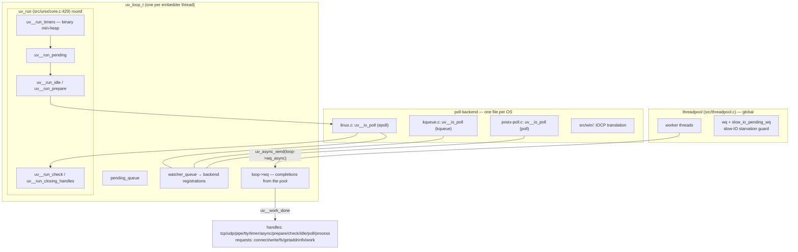
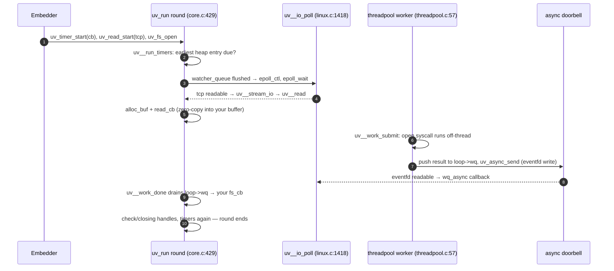

# libuv: the event loop distilled into a portable, embeddable library

> **Atlas id:** `libuv` · **Domains:** `runtime, networking` ·
> **Upstream:** https://github.com/libuv/libuv · **License:** MIT ·
> **Pinned commit:** `4080d7d965fdf291f37ec72677fc5a2ace8fa361` (2026-10-10)

libuv is the event loop Node.js was built on, and its design thesis is
**distillation**: take the event loop pattern — poll readiness, dispatch
callbacks — and reduce it to a vocabulary of two object kinds (handles
and requests) plus one cross-thread escape hatch (the async handle),
so that the same ~500-line core runs on epoll, kqueue, event ports,
IOCP, and less famous pollers unchanged. The loop is not a framework
that owns your program; it is a *data structure* you embed. This
deep-dive teaches the loop's phase structure (`uv_run`), the
watcher/pending queue machinery under every platform backend, and the
two designs that make single-threaded async workable in practice:
mutex-plus-eventfd handoff for other threads, and a starvation-guarded
thread pool for blocking work.

Read it after [Redis](redis.md) (a bespoke loop) and
[nginx](nginx.md) (a loop per worker process): libuv is what those
machines look like when the goal is *portability as the product* —
it is also the missing diagram behind every "Node.js event loop"
blog post, in the code.

## Explain like I'm 10

**A receptionist who never watches anything for long.** The
receptionist (the event loop) keeps a wall of numbered mailboxes — one
per thing she watches (a socket, a timer) — and a big board that
lights up a mailbox when it has news (the poller: epoll on Linux,
kqueue on Macs). She works in rounds: first she checks the alarm clock
list (the timer heap — earliest alarm first), then anything colleagues
left on her desk while she was away (the pending queue), then she takes
one nap on the board's buzzer until *some* mailbox lights or the next
alarm is due (`uv__io_poll`), handles what lit up, runs the
end-of-round chores (check handles, closing handles), and starts over.
Some jobs need a delivery van (a blocking syscall like reading a big
file): she hands those to the assistants in the back room (the thread
pool), but the assistants never talk to her directly — they finish,
drop the result in her inbox, and ring a *special doorbell*
(`uv_async_send` → an eventfd write) that lights a mailbox on the
board, so she finds out during her normal round.

**Why the grown-ups did it this way:** one serial round-robin keeps
every callback's reasoning single-threaded, while the doorbell trick
lets the outside world wake the loop without ever sharing a lock with
the callbacks themselves.

## 1. Architecture overview



- **The loop is a struct, not a singleton.** `uv_loop_init` gives you a
  `uv_loop_t` with its own queues, timer heap, backend fd, and ref
  counts (`include/uv.h:1957` `struct uv_loop_s`). Embedding means
  owning the struct — Node runs one; embedders run several.
- **The spine of every event**: a handle registers interest
  (`uv__io_start`, `src/unix/core.c:955` — adds the watcher to
  `loop->watcher_queue`, indexed by fd in `loop->watchers[]`) → next
  `uv__io_poll` flushes pending registration changes to the backend
  and blocks in epoll/kevent → readiness invokes the watcher's callback
  → completion work that must defer lands in `pending_queue`
  (`uv__io_feed`, `core.c:1062`) and runs as `POLLOUT` callbacks in
  `uv__run_pending`.
- **Backends are files, not classes**: `src/unix/linux.c:1418`
  (`uv__io_poll` over epoll), `src/unix/kqueue.c:165`,
  `src/unix/posix-poll.c:134`, `src/win/` implementing the same
  internal contract over IOCP — the platform seam is one function
  signature plus a convention.
- **Handles vs requests**: handles are long-lived (a TCP socket, a
  timer) and ref-counted; requests are one-shot operations with a
  completion callback (a `write`, an `fs` stat, a DNS lookup). The
  distinction drives lifetime: `uv_close` retires handles at the end
  of the round (`uv__run_closing_handles`), while requests retire when
  their callback fires.

## Walkthrough: one timer, one socket read, one threadpool file read

The spine as a story — on the site you can step through it with Next;
in the repo it reads top to bottom.



**Step 1 — Register interest, lazily.** The embedder starts a timer
(leaf in a binary min-heap, `src/timer.c`), subscribes to socket
reads (`uv_read_start` → `uv__io_start`, `core.c:955`, queuing the
stream's watcher with `POLLIN`), and calls `uv_fs_open` — which
packages a `uv_fs_t` request and calls `uv__work_submit`
(`src/threadpool.c:276`) instead of doing the syscall.

**Step 2 — The round begins with due timers.** `uv_run`
(`src/unix/core.c:429`) calls `uv__run_timers` first (a
backwards-compatibility order for `UV_RUN_DEFAULT`), which pops heap
entries whose timeout ≤ `loop->time` into a ready list and fires their
callbacks.

**Step 3 — Pending work, then the poll.** `uv__run_pending` drains
completions parked by `uv__io_feed` (`core.c:1062`); idle/prepare
handles run if present — embedders use prepare/check as "before and
after poll" hooks. Then `uv__backend_timeout` (`core.c:403`) computes
the poll timeout from the next timer (or 0 if anything is pending),
and `uv__io_poll` (`linux.c:1418`) flushes the `watcher_queue` into
epoll, then blocks in `epoll_wait` for up to that timeout.

**Step 4 — Readiness becomes your callback.** The socket is readable;
epoll returns; the stream watcher's `uv__stream_io` calls `uv__read`
(`src/unix/stream.c:1033`), which invokes *your* `alloc_cb` for a
buffer, `read(2)`s into it, and calls *your* `read_cb` with the slice
— zero copies beyond the one you controlled.

**Step 5 — The pool finishes the file open.** A worker thread
(`threadpool.c:57` `worker`) took the `uv_fs_t` off the global `wq`,
ran the blocking `open` outside the loop, then — the crucial handoff —
locked `loop->wq_mutex`, appended the request to the *loop's* queue,
and called `uv_async_send(&loop->wq_async)` (`threadpool.c` inside
`worker`), which wrote 1 to the loop's eventfd (`src/unix/async.c`,
`uv__async_send`).

**Step 6 — The doorbell rings through the front door.** The eventfd is
itself registered with the poller, so the *next* poll returns it
readable; the `wq_async` handle's callback `uv__work_done`
(`threadpool.c:319`) swaps out `loop->wq` under the mutex and invokes
each request's `done` — your `fs_cb` runs on the loop thread, with
loop state safely single-threaded.

**Step 7 — Close out the round.** `uv__run_check` runs check handles,
`uv__run_closing_handles` (`core.c:370`) finishes handles marked by
`uv_close` (calling their `close_cb`), timers get one more pass, and
`uv__loop_alive` (`core.c:395`) decides whether another round happens:
only if active handles, active requests, pending work, or closing
handles remain — an unref'd timer or async does not keep the process
alive.

**Outcome — Three sources of events, one serial loop.** A timer, a
socket, and a threadpool completion all became callbacks on the same
thread in one round — no application-level locks anywhere.

## 2. Core data structures — and why these

### uv__io_t — the watcher (`include/uv/unix.h:90`)

```c
struct uv__io_s {
  uintptr_t bits;                  /* callback pointer, bit-packed */
  struct uv__queue pending_queue;
  struct uv__queue watcher_queue;
  unsigned int pevents;   /* pending mask — applied at next poll */
  unsigned int events;    /* current mask — what the backend has */
  int fd;
};
```

One struct per pollable thing, embedded (not pointed to) inside tcp,
pipe, tty, and signal handles. The two-queue design is the pattern to
steal: `watcher_queue` membership means "my event mask changed, tell
the backend at the next poll" (so `uv__io_start` is O(1) — it queues
and returns, and `uv__io_poll` batches the `epoll_ctl` calls);
`pending_queue` membership means "fire my callback before the next
poll" (how cross-thread and error completions defer safely). The
callback stored as bit-packed `bits` keeps the watcher one cache line
of hot state.

### The intrusive queue (`src/queue.h`)

A sentinel-based doubly-linked intrusive list used for *every*
collection in the loop: watcher queue, pending queue, handle queues,
the threadpool's `wq`. Why intrusive over container-of-pointers: no
allocations ever (queues link through the objects themselves), O(1)
remove given the node, and `uv__queue_data` (container_of) recovers the
owner — the same reason the Linux kernel uses them.

### The timer min-heap (`src/timer.c`, `src/heap-inl.h`)

Timers live in a binary min-heap ordered by `timeout` (ties broken by
insertion id — `timer_less_than`, `src/timer.c:37`); `uv__run_timers`
pops only the due prefix, and re-inserts repeating timers
(`uv_timer_again`). Why a heap over a sorted list: start/stop is
O(log n) with no shifting; why over a timing wheel: the use case
(millions of mostly-idle timers with wide spans) fits a heap, and a
wheel's fixed tick granularity would leak into user-visible timing.

### The loop's fd table (`loop->watchers[]`, `maybe_resize`)

Watchers are indexed by fd in a growable array (`core.c:955` —
`loop->watchers[w->fd] = w`). Why an array over a hash map: fds are
dense small integers on every Unix, and the array makes "which
watcher owns this fd" a load, not a lookup. (Windows pays a reverse
mapping because handles aren't small integers — the cost of the
portability seam showing through.)

### The threadpool's queues (`src/threadpool.c`)

A global `wq` guarded by one mutex+condvar, *plus* a separate
`slow_io_pending_wq` with the `run_slow_work_message` sentinel
(`worker`, line 57): slow I/O (fsync-class) work may occupy at most
`(nthreads+1)/2` workers (`slow_work_thread_threshold`, line 50), so
a disk-flood cannot starve every DNS lookup. Why process-global: one
pool serves all loops in the process (Node has one loop; embedders
still share), sized by `UV_THREADPOOL_SIZE` at startup.

## 3. Concurrency and failure model

- **One thread runs callbacks; nobody else touches loop state.** Every
  cross-thread path funnels through the same shape: producer locks the
  loop's `wq_mutex` only long enough to append and `uv_async_send`
  (eventfd write on Linux, `EVFILT_USER` on kqueue, a pipe elsewhere —
  `src/unix/async.c`). The loop wakes, drains, runs `done` callbacks.
  This is the pattern the [Redis](redis.md) dive shows in reverse
  (I/O threads handing clients *back* to a serial core).
- **Blocking work is quarantined by kind**: CPU-bound and fs operations
  go to the pool with explicit slow-IO budgets; anything async-capable
  (sockets, DNS via the pool, signals via a self-pipe) stays on the
  loop. The embedder's contract is "no blocking in callbacks" — the
  library cannot enforce it, which is Node's entire performance
  culture in one sentence.
- **Failure is error propagation, not recovery.** Syscall failures come
  back as `int` UV_* codes on requests and handles; a failed read
  delivers an `EOF`/error to the callback, never a panic. Handle
  teardown is the delicate part: `uv_close` (`core.c:161`) marks the
  handle, its `close_cb` fires only in `uv__run_closing_handles`
  after in-flight requests drain — closing is a *protocol*, not a
  free, which is the price of safe cancellation in a callback world.
- **Loop lifetime is ref counting.** `uv__loop_alive` (`core.c:395`)
  counts active handles and requests; `uv_unref` lets a handle exist
  without keeping the process alive (how Node keeps timers that don't
  prevent exit). Run out of refs and `uv_run` returns — graceful exit
  is "nothing is left to do," and the flags dance in
  `src/uv-common.h:306-321` is where it is paid.

## 4. API and extension design

- **The public API is the object vocabulary**: ~15 handle types
  (`uv_tcp_t`, `uv_udp_t`, `uv_pipe_t`, `uv_tty_t`, `uv_timer_t`,
  `uv_prepare_t`, `uv_check_t`, `uv_idle_t`, `uv_async_t`,
  `uv_poll_t`, `uv_process_t`, `uv_signal_t`, `uv_fs_event_t`,
  `uv_fs_poll_t`, `uv_stream_t` as the shared base) and ~10 request
  types. Handle structs embed `uv_handle_t` fields via macros
  (`UV_HANDLE_FIELDS`), which is how C does inheritance — and the
  reason ABI layout is versioned carefully (`include/uv.h`).
- **The seams for embedders are deliberate**: `uv_prepare_t` /
  `uv_check_t` expose before-poll and after-poll phases so foreign
  event loops can interleave (this is how Qt, Luvit-era loops, and
  Node's own integration work); `uv_poll_t` lets you inject *any* fd
  into the loop; `uv_async_t` is the thread-boundary primitive every
  embedding needs.
- **The thread pool is a fixed-size contract** (`UV_THREADPOOL_SIZE`,
  capped at 1024 by `MAX_THREADPOOL_SIZE`): no priorities, no
  cancellations mid-syscall (`uv_cancel` only works while queued).
  Simple, and honest about OS limits — you cannot cancel an in-flight
  `fsync`.
- **The honest warts**: the API's C-inheritance macros make handles
  awkward to wrap in other languages (every binding re-implements the
  layout care); error handling is return-code-only with no context;
  and the "loop is a struct" design means no built-in scheduler
  fairness — a malicious callback chain starves everything, which
  Node's ecosystem periodically rediscovers.

## 5. The defining trade-offs

### Trade-off 1: one portable loop core over per-platform optimal designs
- **Tension:** Node needed the same semantics on Windows (IOCP —
  completion-based) and Unix (readiness-based), in 2011.
- **Choice:** normalize everything to "readiness + callbacks" in the
  core; on Windows, fake readiness by issuing overlapped reads eagerly
  and buffering (`src/win/`); on Unix, pick the best poller per
  platform behind `uv__io_poll`.
- **Evidence:** `src/unix/core.c:429` `uv_run` contains zero platform
  `#ifdef`s — the phase logic is shared; per-platform code is exactly
  one function per file (`linux.c:1418`, `kqueue.c:165`,
  `posix-poll.c:134`; the Windows counterpart `uv__poll` in
  `src/win/core.c:424` blocks in `GetQueuedCompletionStatusEx` instead);
  the watcher's two-queue design
  (`uv__io_start` / `uv__io_feed`) exists so the core can defer all
  backend registration to poll time.
- **Given up:** the extra buffering on Windows (an IOCP-native design
  would avoid the readiness emulation), and some performance that a
  hand-rolled epoll-only loop (à la Redis's `ae`) keeps by skipping the
  general machinery.
- **Verdict:** right when portability *is* the product — libuv's value
  is that millions of lines of Node code run unmodified on five
  platforms. Wrong for a single-platform server squeezing the last
  10%; write `ae` instead.

### Trade-off 2: mutex-plus-async handoff over lock-free cross-thread designs
- **Tension:** other threads (pool workers, embedder threads) must
  hand results to the loop without data races, and the loop must not
  spin waiting for them.
- **Choice:** producers append to a loop-owned queue under a plain
  mutex, then write an eventfd — the write is the wakeup, and *all*
  callbacks run on the loop thread.
- **Evidence:** the tail of `worker` (`threadpool.c`) —
  `uv__queue_insert_tail(&w->loop->wq, ...)`, `uv_async_send`,
  `uv_mutex_unlock`, in that order; the drain side `uv__work_done`
  (`threadpool.c:319`) swaps the queue under the same mutex and runs
  callbacks; `uv__async_send` (`src/unix/async.c`) is the whole
  wake-up mechanism, including the eventfd EAGAIN drain.
- **Given up:** cross-thread latency (one loop round of delay, and a
  syscall per wakeup) and any ability to run callbacks off-loop —
  a lock-free queue with concurrent callbacks would be faster in
  microbenchmarks and wildly harder to keep correct under the API's
  single-threaded promise.
- **Verdict:** right whenever the callback contract is single-threaded
  — which is the entire value of an event loop to its embedder. Wrong
  for throughput-focused pipe stages, where you accept locks in
  callbacks instead (memcached's worker design) and drop the loop.

### Trade-off 3: ref-counted loop lifetime over explicit lifecycle management
- **Tension:** "when does the loop stop?" needs an answer that embedders
  cannot get wrong.
- **Choice:** the loop runs while active handles/requests exist;
  handles may `unref` themselves out of the count; exit is simply
  "nothing left."
- **Evidence:** `uv__loop_alive` (`core.c:395`) — four conditions,
  no configuration; `uv__backend_timeout` (`core.c:403`) refusing to
  sleep when work is pending; the ref-flag macros
  (`src/uv-common.h:306-321`) implementing add/remove on the active
  count.
- **Given up:** precise control — a lingering ref'd async or a
  half-drained request keeps the process alive mysteriously ("why
  won't Node exit?" is this trade's support cost), and debugging means
  walking your own handle graph.
- **Verdict:** right for embedded runtimes where "exit when idle" must
  be the default-correct behavior. Wrong for servers with explicit
  shutdown choreography — which is why those embedders learn
  `uv_unref` discipline early, or manage their own liveness above the
  loop.

## 6. Reading path

1. `include/uv.h:1957` `struct uv_loop_s` — read the fields as a map
   of the design: queues, timer heap, `watchers`, `backend_fd`,
   `wq` + `wq_async`, `active_handles`. Every section of this dive is
   one field.
2. `src/unix/core.c:429` `uv_run` — the round, start to finish;
   match each call to a phase and to the walkthrough above. Note the
   pending-queue drain capped at 8 iterations after poll — a
   starvation guard in the core itself.
3. `src/unix/core.c:955` `uv__io_start` and `:1062` `uv__io_feed` —
   the two queues' entry points; then `uv__run_pending` for how the
   pending side fires (as `POLLOUT`).
4. `src/unix/linux.c:1418` `uv__io_poll` — the flush of
   `watcher_queue` into `epoll_ctl`, the `epoll_wait` block, the
   dispatch loop with its batching counter (`count = 48`); compare
   `src/unix/kqueue.c:165` to see how little changes per platform.
5. `src/timer.c` — `uv_timer_start` inserting into the heap,
   `timer_less_than` (line 37), `uv__run_timers`, and
   `uv__next_timeout` (line 143) feeding `uv__backend_timeout`
   (`core.c:403`).
6. `src/unix/stream.c:1033` `uv__read` and `:1505` `uv__read_start` —
   the alloc-callback protocol that keeps data copies user-owned;
   notice `uv__io_feed` on the error path.
7. `src/unix/async.c` — `uv_async_init`, `uv_async_send`, and
   `uv__async_send`: the eventfd write (and its EAGAIN handling) that
   is the loop's entire cross-thread surface; then find where the
   async watcher is registered like any other poller fd.
8. `src/threadpool.c` — `post` (143), `worker` (57) with the
   slow-IO threshold dance, `uv__work_submit` (276), `uv__work_done`
   (319). Read `worker` twice: once for the queue mechanics, once for
   the starvation guard comments.
9. `src/queue.h` — the intrusive queue, whole file; it is the
   vocabulary every other file speaks.
10. `src/unix/core.c:395` `uv__loop_alive`, `:370`
    `uv__run_closing_handles`, and `:161` `uv_close` — lifetime and
    the closing protocol; then `src/uv-common.h:306-321` for the ref
    counting the lifetime depends on.
11. `include/uv/unix.h:90` `struct uv__io_s` next to a handle like
    `uv_tcp_t` — see how the watcher is embedded and why the
    two-queue design lets one struct serve both registration and
    deferral.

You have now traced a timer, a socket read, and a threadpool
completion through one loop round — and seen the three mechanisms
(phases, watcher queues, the async doorbell) that every event loop
built on libuv inherits.

## 7. What to steal

- **Separate "what changed" from "fire me now"** (the watcher's
  `watcher_queue` vs `pending_queue`): deferring backend registration
  to poll time makes event-mask updates O(1) and batchable — the
  quiet trick under `uv__io_start`.
- **Cross-thread = mutex + a pollable doorbell** (`uv_async_send`):
  never let another thread run your callbacks; make it wake the loop
  and let the loop do everything (`threadpool.c` tail).
- **Budget your worst citizens explicitly**: the threadpool's
  half-the-workers cap for slow I/O is three lines that prevent an
  entire failure mode (`slow_work_thread_threshold`).
- **Make lifetime ref counting, not choreography** (`uv__loop_alive`
  + `unref`): "exit when idle" as a default-correct invariant beats
  "exit when someone remembers to" every time.
- **Phases are an embedding API** (`prepare`/`check`): exposing
  before-poll and after-poll hooks is what lets your loop live inside
  someone else's program without owning the main thread.
- **Intrusive queues for zero-allocation hot paths** (`src/queue.h`):
  when every operation is a list operation, container allocation is
  the tax you stop paying.

## 8. Difficulty and prerequisites

- Difficulty: **moderate**. Clean small C; the challenge is holding
  the phase machinery in your head, not parsing syntax.
- Budget: ~3-4 hours for the reading path; libuv is famous for being
  readable in a weekend — `core.c`, `stream.c`, `threadpool.c`, and
  `async.c` are the whole story.
- Prerequisites: `select`/`poll`/`epoll` at a working level (man
  pages suffice); condition variables; the [Redis](redis.md) dive's
  event-loop section for a minimalist sibling of this design.

## 9. Further reading

- libuv documentation — https://docs.libuv.org/ — the design overview
  page restates the phase model this dive walks.
- N. Marathe, *An Introduction to libuv* — the community book that
  first mapped the API to the phases.
- The `src/unix/core.c` and `src/threadpool.c` header comments — among
  the best "why" comments in the systems C canon.
