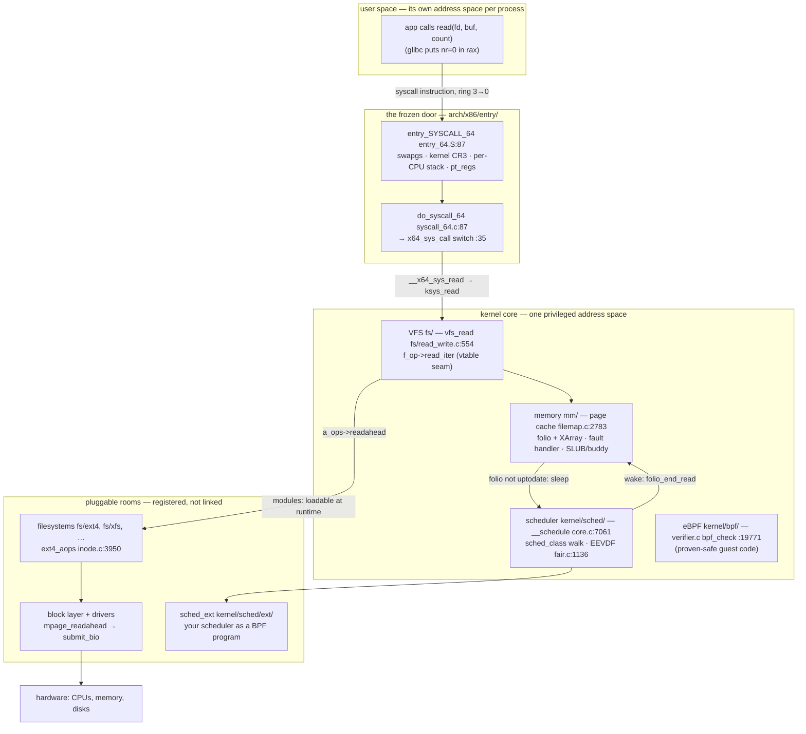
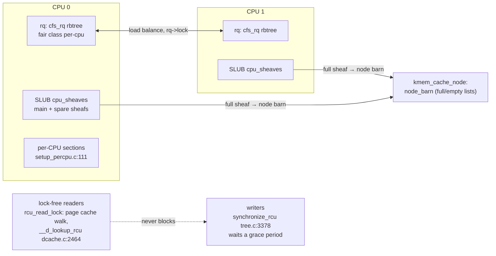

# Linux kernel: one frozen door, ten thousand pluggable rooms

> **Atlas id:** `linux` · **Domains:** `os-kernel` ·
> **Upstream:** https://github.com/torvalds/linux · **License:** GPL-2.0 ·
> **Pinned commit:** `8d3ae59288f1e7d58d76558a6ee96d533bc5019f` (v7.2, 2026-08-16)

The Linux kernel is the most deployed piece of software in existence —
billions of devices, one codebase, thirty-plus years of daily change by
thousands of engineers who have never met. The design lesson this dive
teaches is **contract discipline at planetary scale**: exactly one
interface is frozen forever (the syscall ABI — syscall number 0 has meant
`read` since the first release), while everything behind that door is
*designed to be
rewritten* — including whole subsystems. The mechanism that makes that
possible is the humble C struct of function pointers: a vtable at every
layer boundary (`file_operations`, `sched_class`, `address_space_operations`),
so new filesystems, scheduling policies, and drivers slot in without
touching the core. Around the seams, the kernel scales by *sharding*
rather than locking: per-CPU copies of hot data, lock-free reads under
RCU, and a fair-share scheduler (EEVDF) that turns each CPU into
thousands of virtual ones.

Read it against [Redis](redis.md) (a kernel-shaped server: one loop,
vtables everywhere) and [libuv](libuv.md) (which rents from the kernel
the readiness interface this dive's spine touches); the kernel is the
ur-example of both patterns. Focus is the four load-bearing subsystems —
syscall entry, VFS, the page cache, and the scheduler — not the whole
tree: tens of millions of lines are read with a map, never cover to
cover.

## Explain like I'm 10

**A giant hotel whose front desk never changes, but whose rooms are
rebuilt every night.** Every guest (a program) rings the same numbered
doorbells that were installed 30 years ago (the syscall table — bell
number 0 always means "read me a book"): the desk's layout is the one
promise the hotel never breaks. Whatever you ask for — a book (a file),
a message to a friend (a socket) — the desk clerk looks it up on a
clipboard of phone numbers (the `file_operations` vtable) and hands your
request to the right specialist, so the hotel can hire new specialists
any day without retraining the clerk. Each receptionist (a CPU core)
serves thousands of guests by giving everyone tiny turns, and keeps a
note of who got less than their fair share so far (the scheduler's
"lag"); the guest most owed and soonest due gets the next turn. If the
book you want isn't on the shelves (the page cache), you take a nap in a
numbered bed instead of blocking the desk (the task sleeps, marked
`TASK_KILLABLE`, and the receptionist immediately serves someone else);
when the courier (block I/O) delivers the book, he taps your shoulder
(the wake-up) and you get back in line. And if a guest hands the clerk a
bad address, the clerk doesn't get hurt — a safety net under the counter
(the exception table) catches the fall and hands back "invalid address."

**Why the grown-ups did it this way:** freezing the front door is what
lets the inside be rebuilt constantly — you can only afford to replace a
subsystem every few years if the outside contract never moves.

## 1. Architecture overview



- **The kernel is a library that runs in privileged mode, not a
  process.** There is no kernel "main loop" and no message passing: a
  kernel subsystem is just another function on your call stack, entered
  through the syscall door. The layer map above is a *call* map — from
  `vfs_read` to `ext4_aops` to the block layer is ordinary C calls
  (some through vtables), in the caller's context, on the caller's
  behalf. Everything the atlas teaches about event loops
  ([Redis](redis.md), [nginx](nginx.md)) lives one ring lower: the
  kernel *is* the thing those loops rent.
- **The frozen layer: syscall entry** (`arch/x86/entry/`). Owned by the
  architecture: it transitions CPU state (segment, stack, address space
  via `SWITCH_TO_KERNEL_CR3`), materializes the register file as a
  `struct pt_regs` (`arch/x86/include/asm/ptrace.h:103`), and dispatches
  by number. The numbers themselves live in one data file,
  `arch/x86/entry/syscalls/syscall_64.tbl` — 443 lines; `read` is 0,
  `write` is 1, unchanged for decades.
- **The policy-free layer: VFS** (`fs/`). `vfs_read`
  (`fs/read_write.c:554`) knows *what a read is* (permission, bounds,
  position, accounting) and nothing about bytes on disks: it ends in
  `file->f_op->read_iter` — a function pointer chosen by whoever opened
  the file. ext4, a pipe, a socket, `/dev/null`: same door, different
  clipboard.
- **The caching layer: the page cache** (`mm/filemap.c`). One shared
  cache in front of *all* storage: pages keyed by (mapping, index) in an
  XArray. Reads copy out of it; misses populate it via readahead; the
  memory-reclaim code shrinks it when memory runs short — the kernel's
  biggest and most contended cache.
- **The CPU broker: the scheduler** (`kernel/sched/`). Every blocking
  operation in the kernel funnels into `__schedule`
  (`kernel/sched/core.c:7061`), which asks a chain of scheduling
  classes — ordered *by memory address* (`SCHED_DATA`,
  `include/asm-generic/vmlinux.lds.h:153`: stop → deadline → rt → fair →
  ext → idle) — for the next task, and swaps register state.
- **Where the spine is:** `read(fd, buf, count)` from the syscall
  instruction → `entry_SYSCALL_64` → `do_syscall_64` → `x64_sys_call`
  → `ksys_read` → `vfs_read` → `f_op->read_iter` (`ext4_file_read_iter`)
  → `filemap_read` → page-cache hit (copy) or miss (readahead → bio →
  sleep → `__schedule` → interrupt → wake → retry → copy) → return via
  `sysret`. The Walkthrough walks exactly this.

## Walkthrough: one read(), doorbell to bytes and back

```mermaid
sequenceDiagram
    autonumber
    participant U as user program (rax=0)
    participant E as entry_SYSCALL_64
    participant D as do_syscall_64 / ksys_read
    participant V as vfs_read → ext4_file_read_iter
    participant PC as filemap_read (page cache)
    participant IO as readahead → mpage → submit_bio
    participant S as __schedule / pick_eevdf
    participant IRQ as I/O completion → folio_end_read

    U->>E: syscall instruction (ring 3 → 0)
    E->>D: pt_regs on kernel stack; rax preset to -ENOSYS
    D->>V: fdget_pos(fd) → vfs_read → f_op->read_iter
    V->>PC: generic_file_read_iter → filemap_read
    alt folio in cache & uptodate
        PC->>PC: copy_folio_to_iter → copy_to_user
    else miss
        PC->>IO: page_cache_sync_ra → ext4_aops->readahead → submit_bio
        PC->>S: folio_put_wait_locked(TASK_KILLABLE) → io_schedule
        S->>S: pick_next_task → pick_eevdf → __switch_to (next task runs)
        IRQ->>PC: mpage_read_end_io → folio_end_read: PG_locked cleared
        IRQ->>S: wake_up_process → task runnable, TIF_NEED_RESCHED
        PC->>PC: retry: folio now uptodate → copy_to_user
    end
    PC-->>D: bytes copied, f_pos advanced
    D-->>U: return value in rax → sysretq (rcx==rip, r11==flags)
```

**Step 1 — The doorbell.** Userspace puts the syscall number in `rax`
(0 = `read`) and arguments in `rdi`, `rsi`, `rdx`, then executes the
`syscall` instruction, which the CPU answers by jumping to a
model-specific register — pointing at `entry_SYSCALL_64`
(`arch/x86/entry/entry_64.S:87`). Three lines of assembly do the
security-critical swap: `swapgs` (switch to the kernel's GS base so
per-CPU data is reachable), `SWITCH_TO_KERNEL_CR3` (mitigate
Meltdown-class attacks), and
`movq PER_CPU_VAR(cpu_current_top_of_stack), %rsp` — the kernel stack of
*this* CPU's current task. The registers are
then pushed in `pt_regs` order, and — a small masterstroke —
`PUSH_AND_CLEAR_REGS rax=$-ENOSYS`: the return slot starts as "invalid
syscall," so any dispatch failure already holds the right answer.

**Step 2 — One door, one dispatcher.** `do_syscall_64`
(`arch/x86/entry/syscall_64.c:87`) first runs
`syscall_enter_from_user_mode` — the choke point where seccomp filters,
ptrace, and audit hook every entry — then bounds-checks the number with
`array_index_nospec` (Spectre hardening) and dispatches through
`x64_sys_call` (`arch/x86/entry/syscall_64.c:35`), a giant `switch`
generated from the syscall table, whose cases call thin `__x64_sys_*`
stubs that pull arguments out of `pt_regs`. The generated switch
compiles to a jump table; the old `sys_call_table[]` array survives a
few lines above only because tracing still wants the addresses. Our case
lands in `SYSCALL_DEFINE3(read)` (`fs/read_write.c:723`), which calls
`ksys_read` (`fs/read_write.c:705`) — the same function the kernel calls
internally when *it* needs to read a file. One door, no side entrances.

**Step 3 — The VFS counter.** `ksys_read` resolves the fd to a
`struct file` with `fdget_pos` (`fs/file.c:1252`) — which takes the file-position
lock so concurrent reads can't tear `f_pos` — then hands off to
`vfs_read` (`fs/read_write.c:554`). `vfs_read` is policy, not
mechanism: check the file was opened for reading (`f_mode`), probe the
user buffer without touching it (`access_ok`), verify bounds
(`rw_verify_area`), clamp to `MAX_RW_COUNT` — then end in two function
pointer calls: legacy `f_op->read` or, for every modern filesystem,
`new_sync_read` (`fs/read_write.c:483`), which packages the request as a
`kiocb` + `iov_iter` and calls `f_op->read_iter`. That pointer was
decided when the file was opened; for an ext4 file it is
`ext4_file_read_iter` (`fs/ext4/file.c:130`). The kernel never asks
"what kind of file is this" — it asks the file.

**Step 4 — The cache lookup.** `ext4_file_read_iter` handles ext4's
special cases (DAX, direct I/O) and defers the common case to
`generic_file_read_iter`, which lands in `filemap_read`
(`mm/filemap.c:2783`): a loop of look-then-copy. The lookup,
`filemap_get_pages` (`mm/filemap.c:2682`), calls `filemap_get_read_batch`
(`mm/filemap.c:2470`), which walks the page cache — `mapping->i_pages`,
an XArray (`include/linux/fs.h:474`) — *entirely under `rcu_read_lock()`*
with no locks taken: each entry found is pinned with `folio_try_get`,
and if it changed underneath, the walk just retries. Reads of the
hottest structure in the system synchronize by refcount, not by lock.

**Step 5 — Hit: copy to the stranger's memory.** A cached, up-to-date
folio is copied with `copy_folio_to_iter` (`include/linux/uio.h:201`) →
`copy_page_to_iter` (`lib/iov_iter.c:361`) → `_copy_to_user`
(`lib/usercopy.c:22`) → `raw_copy_to_user`
(`arch/x86/include/asm/uaccess_64.h:145`) → `copy_user_generic` — a string of tiny wrappers
that end in one `rep movs`-style copy with the CPU's user-access bit
(`stac`/`clac`) enabled. User memory is *not trusted*: it may be unmapped
or changed concurrently. The safety net is the **exception table** —
every usercopy instruction is annotated, and if the copy page-faults,
`fixup_exception` (`arch/x86/mm/extable.c:299`) looks up the faulting
instruction in `search_exception_tables`, and rewinds execution to a
recovery stub that returns `-EFAULT` instead of crashing the kernel.
Bad pointers become error codes, never oopses.

**Step 6 — Miss: order the book, plug the batch.** No folio found means
readahead: `filemap_get_pages` calls `page_cache_sync_ra` →
`page_cache_ra_unbounded` (`mm/readahead.c:222`), which allocates a
*window* of folios around the request (the mapping's readahead heuristics
pick the size), marks them locked-but-not-uptodate, and submits them via
`read_pages` (`mm/readahead.c:160`) → `a_ops->readahead` — the second
vtable seam — which for ext4 is `ext4_readahead`
(`fs/ext4/readpage.c:415`, registered in `ext4_aops`,
`fs/ext4/inode.c:3950`) →
`mpage_readahead` (`fs/mpage.c:358`). The requests accumulate inside a
`blk_plug` (batching) and leave as bios via `mpage_bio_submit_read`
(`fs/mpage.c:70`, with `bi_end_io = mpage_read_end_io` installed). The
disk is now working for us; the CPU is free.

**Step 7 — The nap.** Back in `filemap_get_pages`, the last folio of the
batch is not yet uptodate, so `filemap_update_page` (`mm/filemap.c:2559`)
hits its comment-marked destiny — "This is where we usually end up
waiting for a previously submitted readahead to finish" — and calls
`folio_put_wait_locked(folio, TASK_KILLABLE)`. This lands in
`folio_wait_bit_common` (`mm/filemap.c:1250`): the task enqueues itself
on a wait queue *hashed from the folio's address*
(`folio_wait_table`, `mm/filemap.c:1074` — folios don't carry their own
lock objects), does `set_current_state(TASK_KILLABLE)`, and calls
`io_schedule()` (`kernel/sched/core.c:8149`) — which notes the task is
about to sleep on I/O (for pressure-stall accounting) and calls
`schedule()`.

**Step 8 — The CPU changes hands.** `__schedule`
(`kernel/sched/core.c:7061`) takes the run-queue lock, deactivates the sleeping task
(`try_to_block_task`), and asks `pick_next_task` for a replacement. The
pick walks the scheduling classes *in address order* — the linker
script `SCHED_DATA` (`include/asm-generic/vmlinux.lds.h:153`) lays out
stop, deadline, rt, fair, ext (the BPF pluggable class), idle so that
priority is pointer comparison (`sched_class_above`,
`kernel/sched/sched.h:2823`). For a normal desktop the fair class wins,
and its `pick_task_fair` reduces to `pick_eevdf`
(`kernel/sched/fair.c:1136`): find the runnable entity with the earliest
*virtual deadline* among those *eligible* (owed service: `vlag >= 0`,
checked by `entity_eligible`, `kernel/sched/fair.c:939`). The entities
live in an augmented red-black tree (`cfs_rq->tasks_timeline`); a
leftmost-first fast path usually answers in O(1), with a heap-style
search over tree min-vruntimes as fallback. Then `__switch_to`
(`arch/x86/kernel/process_64.c:610`) swaps the register/FP/address-
space state, and the CPU runs someone else entirely. Our reader is off
the CPU, costing nothing.

**Step 9 — The courier taps the shoulder.** The disk finishes; the block
layer's interrupt path runs the bio's `bi_end_io`:
`mpage_read_end_io` (`fs/mpage.c:45`) iterates the bios' folios and
calls `folio_end_read` (`mm/filemap.c:1535`), which atomically XORs
`PG_locked` and (on success) sets `PG_uptodate` in the folio's *flags* —
the lock and the "data is ready" bit live in the page itself — and wakes
the hashed wait queue. Each waiter's `wake_page_function`
(`mm/filemap.c:1139`) is checked against the bit; the matching task is
sent to `try_to_wake_up` (`kernel/sched/core.c:4251`), which re-enqueues
it on a run queue and, if it preempts, marks the running task with
`TIF_NEED_RESCHED` (`resched_curr`, `kernel/sched/core.c:1233`).

**Step 10 — Return through the same door.** The woken task resumes
inside `folio_wait_bit_common`, retries, finds the folio uptodate, and
loops back up: `filemap_read`'s loop copies the bytes (Step 5),
`ksys_read` writes back the advanced `f_pos`, the byte count lands in
`pt_regs->ax`. `do_syscall_64` runs `syscall_exit_to_user_mode`
(signals, resched points, work), and because the saved state is a clean
64-bit context (`rcx == rip`, `r11 == flags`), the fast exit applies:
`syscall_return_via_sysret` pops registers, switches back to the user
page tables, `swapgs`, `sysretq`. The program continues as if nothing
happened — which is the entire point.

**Outcome — One door held, one turn of the CPU, zero wasted waits.**
Bytes sit in the user buffer; the syscall ABI never noticed that
underneath it, four subsystems, two vtable seams, one lock-free cache
lookup, one disk nap, one red-black-tree scheduling decision, and one
interrupt-driven wake-up had to cooperate to keep the promise.

## 2. Core data structures — and why these

- **`struct pt_regs` — the ABI, frozen in a struct.**
  **What:** the pushed register file (`rax`…`r15`, `rip`, `flags`,
  segment registers), defined for x86-64 at
  `arch/x86/include/asm/ptrace.h:103`; every syscall stub unpacks its arguments from it, every
  context switch swaps it.
  **Why:** the register order *is* the calling convention of the
  syscall ABI — stabilizing it structurally is why syscall number 0
  still dispatches to `read` while everything around it was rewritten.
  Wrapping "whatever the CPU pushed" in one struct also lets the same
  entry code serve interrupts, faults, and syscalls (`pt_regs` is the
  only argument `fixup_exception` needs to redirect execution).

- **`struct sched_entity` + `cfs_rq->tasks_timeline` — fair sharing as
  one augmented rbtree.**
  **What:** per-task scheduling state (`include/linux/sched.h:575`):
  `vruntime` (virtual runtime), `vlag` (virtual lag — service owed,
  negative = received too much), `deadline` (virtual deadline =
  vruntime + slice/weight), plus an `rb_node`. The run queue
  (`cfs_rq`) holds them in an *augmented* red-black tree
  (`rb_root_cached`, `include/linux/rbtree_types.h:32`): each subtree
  caches its minimum `vruntime` and minimum `slice`, maintained on
  insert/erase by callbacks in `__enqueue_entity`
  (`kernel/sched/fair.c:1040`).
  **Why:** EEVDF needs two queries — "who is eligible?" and "who has
  the earliest deadline among them?" — and the augmentation lets
  `pick_eevdf`'s heap-style search prune whole subtrees using cached
  minima, the same trick interval trees use. The rejected alternatives
  are visible in the tree's own history: a plain FIFO of runqueues (the
  pre-2007 O(1) scheduler) couldn't prove fairness; an un-augmented
  rbtree would force a full walk per pick. `rb_root_cached` adds one
  word (leftmost pointer) to make "next" O(1) in the common case.

- **`struct file` + `struct file_operations` — the object and its
  vtable.**
  **What:** an open file (`fs/read_write.c` walks `f_mode`, `f_pos`,
  `f_op`) plus the operation table defined at `include/linux/fs.h:1921`
  — from `llseek` to `read_iter` to `mmap`, `fsync`, `uring_cmd`. ext4
  instantiates it at `fs/ext4/file.c:974` (`ext4_file_operations`).
  **Why:** this is the seam that makes "everything is a file" an
  engineering statement rather than a slogan: the same `vfs_read` copy
  path serves ext4, pipes, and `/dev/null` because they hand it
  different tables — dispatch costs one predictable indirect call.
  The struct ends in `__randomize_layout`, a reminder that every
  pointer-shaped contract here is also an attack surface, mitigated by
  compile-time shuffling.

- **`struct folio` + `mapping->i_pages` (XArray) — the cache as an
  index.**
  **What:** a folio (one-to-many base pages) carrying its state in
  flags bits (`PG_locked`, `PG_uptodate`, checked/set atomically in
  `folio_end_read`), indexed in each file's `address_space` by page
  offset into an XArray (`include/linux/fs.h:474`).
  **Why:** page-cache lookups are the kernel's hottest read path, so
  the XArray is designed for exactly this: lock-free iteration under
  RCU (see `filemap_get_read_batch`) with slot-internal tags
  (dirty/writeback) folded into the same structure. And encoding
  lock-ness and uptodate-ness *in the cached object itself* (not in
  wrapper locks) is what lets an interrupt-path function like
  `folio_end_read` publish completion with two atomic bit operations
  and no lock objects at all.

- **`struct sched_class` — policy as a vtable, priority as an address.**
  **What:** the scheduling-class interface (`kernel/sched/sched.h:2585`):
  `enqueue_task`, `dequeue_task`, `pick_task`, `wakeup_preempt`…
  Instances: `stop`, `deadline`, `rt`, `fair`, `ext`, `idle` — placed in
  that order by the `SCHED_DATA` linker block so class priority is
  pointer order (`include/asm-generic/vmlinux.lds.h:153`).
  **Why:** it keeps the scheduler core (`__schedule`) ignorant of
  policy, which is why Linux could swap CFS for EEVDF in one release
  and why `sched_ext` (`kernel/sched/ext/internal.h:288`,
  `struct sched_ext_ops`) can add a *user-authored* scheduling policy
  as a BPF program without the core noticing. Using linker layout for
  the priority order means `for_each_active_class` is a pointer walk —
  no dispatch table to maintain.

## 3. Concurrency and failure model



- **The unit of concurrency is the CPU, not the task.** Each CPU owns a
  run queue (`cpu_rq`), and most hot kernel data is *replicated*
  per-CPU (`setup_per_cpu_areas`, `arch/x86/kernel/setup_percpu.c:111`)
  precisely so common operations need no shared write at all: the
  scheduler's queues, statistics counters, and — in v7.2's redesigned
  SLUB — the allocator itself. The new allocator gives each CPU a
  `struct slub_percpu_sheaves` (`mm/slub.c:433`): a `main` sheaf (an
  array of free object pointers) to pop from, a `spare`, and a per-node
  "barn" (`node_barn`, `mm/slub.c:409`) where full/empty sheaves are
  exchanged when a CPU's own supply runs out — allocation touches no
  shared line in the steady state, and the *slow* path
  (`___slab_alloc`, `mm/slub.c:4428`) is a refill, not a scan.
- **Locking is tiered by expected hold time, and sleeping under a
  spinlock is a bug.** Spinlocks guard short, non-sleeping regions (the
  run-queue lock in `__schedule` is the canonical example); mutexes and
  folio locks are for regions that may sleep. The page cache shows the
  third tier: many "locks" aren't lock objects at all but atomic flag
  bits *in the folio* (`PG_locked`), with waiters parked on
  address-hashed wait queues (`folio_wait_table`, `mm/filemap.c:1074`)
  — no per-page allocation, no false sharing.
- **Readers never block writers: RCU.** The page-cache walk in Step 4
  and the dentry lookup (`__d_lookup_rcu`, `fs/dcache.c:2464`) run
  under `rcu_read_lock()` (`include/linux/rcupdate.h:82`) with no locks
  and no refcounts on the *structure* (the folio refcount protects
  only the object). A writer replacing an entry then waits one *grace
  period* — all CPUs passing through a quiescent state — via
  `synchronize_rcu` (`kernel/rcu/tree.c:3378`) before freeing memory.
  This is the kernel's answer to the MVCC idea the atlas meets in
  [PostgreSQL](postgresql.md): readers see a stable snapshot and pay
  nothing for it; writers pay the deferral.
- **Failure is scoped: bad user pointers become `errno`s; oopses kill
  tasks; panics halt machines.** The exception-table net (Step 5) turns
  the most common fault (user pointers) into a return value. A fault
  *outside* an annotated instruction kills only the offending task (an
  "oops": its context is never scheduled again, the rest of the system
  keeps running — the mirror image of [HAProxy](haproxy.md)'s
  worker-kill philosophy, with processes as the containment unit).
  Only unrecoverable inconsistency halts the machine (`panic`).
- **Backpressure is memory reclaim, and its last resort is a killer.**
  When memory runs short, the page cache is squeezed by `kswapd`
  (`mm/vmscan.c:7399`) walking LRU lists per node; a read that cannot
  get memory fast enough stalls (`psi_memstall_enter` marks the task)
  rather than fails. If reclaim cannot keep up, `out_of_memory`
  (`mm/oom_kill.c:1103`) scores and kills (`select_bad_process`,
  `mm/oom_kill.c:362`) the process that most cheaply frees memory —
  degradation with a visible event, not silent corruption.

## 4. API and extension design

- **The public surface is the syscall ABI, and it is data.** One file,
  `arch/x86/entry/syscalls/syscall_64.tbl`, maps numbers to symbols;
  new calls are appended, numbers are never reused or renumbered — a
  a pre-0.9 binary still rings the same doorbells on v7.2 — the
  kernel's own stable-API document puts it plainly: "I have old
  programs that were built on a pre 0.9something kernel that still
  work just fine" (`Documentation/process/stable-api-nonsense.rst`).
  Everything else
  is explicitly *not* an ABI: "we do not break userspace" refers to
  this door only, as the kernel's own blunt document
  (`Documentation/process/stable-api-nonsense.rst`) explains to driver
  authors who ask for stable internal interfaces.
- **Extension seams are structs of function pointers at every layer
  boundary:** `file_operations` (filesystems, but also sockets, pipes,
  devices — the same seam covers them all),
  `address_space_operations` (`ext4_aops`) for page-cache population,
  `sched_class` for CPU policy, and modules
  (`kernel/module/main.c:3422 load_module`) for loading whole
  subsystems at runtime — checked for signature and symbols against
  the *running* kernel (the internal API is unstable by policy, so a
  module is only valid for the exact build it was compiled against).
- **The newest seam runs guest code safely in the kernel: eBPF.** A
  BPF program is loaded by `bpf_check` (`kernel/bpf/verifier.c:19771`),
  a static analyzer that *proves* — instruction by instruction
  (`do_check_main`, `kernel/bpf/verifier.c:18579`) — that the program
  terminates, touches only permitted memory, and fits helper contracts,
  before a single instruction executes. The proven-then-run model is
  what lets `sched_ext` expose *CPU scheduling itself* as a safe
  extension point: an ops struct of BPF functions
  (`kernel/sched/ext/internal.h:288`) implementing `select_cpu`,
  `enqueue`, `dispatch`, hot-swappable at runtime, with the kernel
  always able to fall back to the fair class.
- **Honest wart: the ABI freezes the 1970s, and extensions leak through
  it.** The syscall interface is so stable it still encodes its
  ancestors' mistakes — `ioctl` has become the escape hatch for
  anything that doesn't fit "read/write a buffer", producing
  device-specific binary structs across the boundary that are stable
  *by convention* only, with compat_64 layers
  (`compat_ioctl` in `struct file_operations`) as the permanent tax.
  And the frozen-numbers policy means deprecating a syscall is
  effectively impossible: the kernel still implements `fork` against
  1980s semantics it would never design today.

## 5. The defining trade-offs

### Trade-off 1: one address space with vtable seams over isolated services
- **Tension:** a kernel needs defense in depth (bad drivers must not
  kill the machine) *and* raw speed (every syscall crosses the
  boundary); message-passing isolation pays a context switch per
  boundary crossing.
- **Choice:** a monolith — drivers, filesystems, and core share one
  privileged address space and call each other directly (through
  vtables); fault containment is per-*task*, not per-*subsystem*.
- **Evidence:** `fs/read_write.c:554 vfs_read` → `f_op->read_iter` is
  a plain indirect call in the caller's context — no IPC anywhere on
  the spine; the exception table (`arch/x86/mm/extable.c:299`) is the
  chosen mechanism for *the one fault class users cause directly*; and
  eBPF's verifier (`kernel/bpf/verifier.c:19771`) exists precisely
  because the kernel has no isolation to offer untrusted code by
  construction — it must *prove* safety instead.
- **Given up:** a crashing filesystem takes the machine with it (a
  microkernel would restart it); security boundaries between
  subsystems are convention, not architecture (the whole hardening
  industry — SMEP, KPTI's CR3 switch in `entry_SYSCALL_64`, structure
  randomization like `__randomize_layout` on `file_operations` —
  exists to re-add walls the design omitted).
- **Verdict:** right when the hot path is entry-dominated (syscalls
  are microseconds) and the code is curated by a central community
  that *does* review everything. Wrong when subsystems come from
  mutually distrusting vendors — which is exactly why phones
  (Qualcomm's microkernel-modem split) and cloud hypervisors draw the
  boundary one ring lower.

### Trade-off 2: fair-share virtual time (EEVDF) over strict priorities or FIFO
- **Tension:** one CPU, thousands of tasks: any policy must answer
  "who next?" in nanoseconds while *also* being provably fair across
  seconds, and latency-sensitive tasks must win without being
  explicitly marked.
- **Choice:** every fair-class task accumulates `vruntime`; its owed
  service is tracked as `vlag` (lag); each gets a virtual deadline
  `deadline = vruntime + slice/weight`
  (`update_deadline`, `kernel/sched/fair.c` — the code comments spell
  out `vd_i = ve_i + r_i/w_i`); the next task is the eligible one with
  the earliest deadline, found in an augmented rbtree.
- **Evidence:** `kernel/sched/fair.c:1136 pick_eevdf` (leftmost-first
  with heap-style subtree pruning),
  `kernel/sched/fair.c:5968 place_entity` (on wakeup, lag is *preserved* — the comment derives
  the full placement algebra so a briefly-sleeping task neither gains
  nor loses its fair share), `kernel/sched/fair.c:79` (the default
  slice, 0.7 ms) and `entity_eligible` (`:939`) gating who may run at
  all.
- **Given up:** the simplicity and O(1)-ness of runqueue FIFOs; some
  worst-case throughput (constant bookkeeping: the tree must be
  updated every enqueue/dequeue/preemption); and *precise* guarantees —
  lag decays for long sleepers (documented in
  `Documentation/scheduler/sched-eevdf.rst`), so fairness is
  statistical, not a hard promise.
- **Verdict:** right for a general-purpose system serving mixed,
  unmarked workloads — latency sensitivity falls out of short slices
  (a task with a small slice has an earlier deadline) instead of
  requiring priority configuration. Wrong where workloads are known
  and static (batch HPC wants partitioned cores, not sharing), which
  is why the class ladder *above* fair (rt, deadline) still exists —
  and why `sched_ext` lets you replace this entire policy for your
  workload without patching the kernel.

### Trade-off 3: per-CPU sharding and RCU over one big lock
- **Tension:** kernel data (run queues, allocator freelists, cache
  indices) is read and written by every CPU simultaneously; a single
  lock serializes the whole machine on one cache line.
- **Choice:** replicate hot state per-CPU (run queues, counters,
  SLUB's sheaves) and make read-mostly shared structures traversable
  with no locks at all under RCU, deferring reclamation to grace
  periods.
- **Evidence:** per-CPU allocator state (`struct slub_percpu_sheaves`,
  `mm/slub.c:433` — main/spare sheaves per CPU, shared "barn" lists
  only on overflow); lock-free page-cache walk (`filemap_get_read_batch`
  under `rcu_read_lock`, `mm/filemap.c:2470`) and dcache lookup
  (`__d_lookup_rcu`, `fs/dcache.c:2464`); the writer's side of the
  bargain, `synchronize_rcu` (`kernel/rcu/tree.c:3378`). This was
  earned the hard way: the pre-2.6 kernel really did have one Big
  Kernel Lock; its removal is the defining scalability project of the
  2000s.
- **Given up:** memory (each CPU holds private free objects and queue
  copies — replication costs RAM); *consistency* (readers may see
  stale-but-valid snapshots: a just-unlinked dentry or a folio mid-
  promotion is fine to observe); and enormous complexity — RCU
  correctness arguments are among the hardest review burdens in the
  tree, and grace-period latency is a new worst case to manage.
- **Verdict:** right whenever read-mostly data is hotter than the
  write rate — which is the common shape of infrastructure state
  (routing tables, configuration, caches — see the same instinct in
  [Envoy's](envoy.md) read-copy snapshots and [Kubernetes's](kubernetes.md)
  informer caches). Wrong for write-hot data with strong consistency
  needs (page *dirtying* uses locks/atomics, not RCU); there, shard
  by key instead, which is exactly what per-CPU structures are.

## 6. Reading path

1. `arch/x86/entry/syscalls/syscall_64.tbl` — the ABI as a data file:
   443 lines, `0 common read sys_read`. Everything in this dive hangs
   off this table staying frozen.
2. `arch/x86/entry/entry_64.S:87 entry_SYSCALL_64` — the door: `swapgs`,
   kernel CR3, per-CPU stack switch, pt_regs construction, and the
   `rax=$-ENOSYS` default. Read the exit path below it too
   (`syscall_return_via_sysret`) to see the door open both ways.
3. `arch/x86/entry/syscall_64.c:87 do_syscall_64` and
   `:35 x64_sys_call` — dispatch: entry-from-user-mode hooks,
   `array_index_nospec`, the generated switch, and the old
   `sys_call_table[]` kept only for tracing.
4. `fs/read_write.c:723` → `:705` → `:554` → `:483` — the VFS counter
   end to end: `SYSCALL_DEFINE3(read)` → `ksys_read` (fdget_pos locks
   the position) → `vfs_read` (access_ok, rw_verify_area,
   `MAX_RW_COUNT`) → `new_sync_read` packaging a kiocb + iov_iter.
5. `include/linux/fs.h:1921 struct file_operations` beside
   `fs/ext4/file.c:974 ext4_file_operations` and
   `:130 ext4_file_read_iter` — the seam: 30+ slots of function pointers,
   instantiated per filesystem; notice `__randomize_layout` at the end.
6. `mm/filemap.c:2783 filemap_read` → `:2682 filemap_get_pages` →
   `:2470 filemap_get_read_batch` — the cache loop and the lock-free
   XArray walk under RCU; `include/linux/fs.h:474` is the index being
   walked.
7. `mm/readahead.c:222 page_cache_ra_unbounded` → `:160 read_pages` →
   `fs/ext4/readpage.c:415 ext4_readahead` (registered at
   `fs/ext4/inode.c:3950 ext4_aops`) →
   `fs/mpage.c:358 mpage_readahead` — the miss path: folios allocated and locked, bios
   built inside a `blk_plug`, `submit_bio` at `fs/mpage.c:74`.
8. `mm/filemap.c:2559 filemap_update_page` →
   `:1250 folio_wait_bit_common` — the nap: hashed wait queues
   (`folio_wait_table`, `:1074`), `set_current_state(TASK_KILLABLE)`,
   `io_schedule()`. Note the entire sleep protocol is ~40 lines using
   flags-in-folio, not lock objects.
9. `kernel/sched/core.c:7061 __schedule` → `:6124 __pick_next_task`,
   with `kernel/sched/sched.h:2585 struct sched_class` and
   `include/asm-generic/vmlinux.lds.h:153 SCHED_DATA` — the CPU broker:
   rq lock, task deactivation, the class walk where priority *is*
   address order. Then `arch/x86/kernel/process_64.c:610 __switch_to`
   for what a context switch physically swaps.
10. `kernel/sched/fair.c:1136 pick_eevdf` → `:5968 place_entity` →
    `:1040 __enqueue_entity` — EEVDF's three moves: pick (earliest
    virtual deadline among eligible, subtree-pruned), place (lag
    preservation on wakeup — read the comment's algebra), enqueue
    (augmented rbtree with cached subtree minima).
11. `kernel/sched/core.c:4251 try_to_wake_up` ←
    `mm/filemap.c:1535 folio_end_read` (called from
    `fs/mpage.c:45 mpage_read_end_io`) —
    the wake: two atomic bit-XORs publish completion, the wait queue
    routes to `wake_page_function` (`mm/filemap.c:1139`), the task
    re-enqueues and possibly sets `TIF_NEED_RESCHED`
    (`kernel/sched/core.c:1233 resched_curr`).
12. `lib/usercopy.c:22 _copy_to_user` →
    `arch/x86/include/asm/uaccess_64.h:145 raw_copy_to_user` →
    `arch/x86/mm/extable.c:299 fixup_exception` — the copy across the trust boundary and its
    safety net: `search_exception_tables(regs->ip)` rewinding a fault
    to `-EFAULT`.

You have now traced one `read()` from the `syscall` instruction to
bytes in user memory — through two vtable seams, a lock-free cache
lookup, a disk-driven nap and red-black-tree wakeup, and back out the
same frozen door — and met every recurring shape of kernel design on
the way.

## 7. What to steal

- **Freeze exactly one interface; design everything else to be
  replaceable** — the syscall table is a data file that never renames,
  while schedulers and allocators were swapped wholesale: pick your
  product's equivalent of `syscall_64.tbl` and defend it with the same
  fanaticism, then stop promising anything else
  (`Documentation/process/stable-api-nonsense.rst` is the template
  for saying so out loud).
- **Make every layer boundary a struct of function pointers** —
  `vfs_read` → `f_op->read_iter` and `read_pages` → `a_ops->readahead`
  show vtables at the two boundaries where variety is highest; a new
  filesystem is a new table, not a core patch.
- **Let hot readers run lock-free with refcounts as the lifeline** —
  the page-cache walk pins folios under `rcu_read_lock` and retries on
  movement: any read-mostly index (config, catalog, cache) can adopt
  this shape; the writers pay for it, and only them.
- **Encode ordering in memory layout** — `SCHED_DATA` makes scheduler
  class priority a pointer comparison, and `rb_root_cached` makes
  "leftmost" one word: when a chain of policies must be walked per
  operation, let the linker or the container carry the order.
- **Put wait queues in shared hashed tables, and locks in the object's
  bits** — `folio_wait_bit_common` sleeps on a folio-address-hashed
  queue while the "lock" is `PG_locked` itself: per-object lock
  *allocations* are a tax you usually don't owe.
- **Prove safety before running foreign code, rather than sandboxing
  it at runtime** — `bpf_check`'s verifier buys kernel-resident
  extensions without isolation hardware; for plugin systems this is
  the difference between an extension marketplace and a liability.
- **Fail safe by default at the boundary** —
  `PUSH_AND_CLEAR_REGS rax=$-ENOSYS` makes "unhandled" the pre-written answer, and the
  exception table makes the worst user input a return value: wire your
  entry points so the failure answer exists *before* dispatch.

## 8. Difficulty and prerequisites

- Difficulty: `demanding`. Realistic budget: 12–14 hours — the reading
  path alone is a focused day; split it entry+VFS / page cache+sleep /
  scheduler+wakeup into three sittings, and keep a running diagram of
  the spine as you go.
- Prerequisites: comfortable C, especially function-pointer structs and
  reading inline assembler (the [Redis](redis.md) dive is a gentler
  warm-up for both); x86-64 basics — registers, the `syscall`
  instruction, rings (Intel SDM Vol. 3 or any osdev intro suffices);
  virtual memory (page tables, faults — the [runc](runc.md) dive's
  pivot_root section touches adjacent machinery); red-black trees at
  the level of `Documentation/core-api/rbtree.rst` (in-tree, 2 pages).
  No prior kernel-hacking experience required — that's the point of
  following one spine.

## 9. Further reading

- `Documentation/scheduler/sched-eevdf.rst` — the kernel's own EEVDF
  explainer with the 1995 EEVDF paper and Zijlstra's 2023 proposal
  links;
  read after stop 10.
- `Documentation/scheduler/sched-ext.rst` — sched_ext: scheduling
  policies as BPF programs, the newest instantiation of the vtable
  lesson.
- `Documentation/process/stable-api-nonsense.rst` — the canonical
  statement of the frozen-door / replaceable-inside contract, in the
  kernel's own voice.
- `Documentation/core-api/rbtree.rst` — the augmented-rbtree mechanics
  behind `tasks_timeline` (and its contrast with radix trees, the
  XArray's ancestor).
- The comment blocks quoted in this dive are themselves primary
  sources: `kernel/sched/fair.c`'s lag algebra above `place_entity`,
  and the pre-amble of `arch/x86/entry/entry_64.S`.
- Books: Robert Love, *Linux Kernel Development* (the gentlest
  orientation); Wolfgang Mauerer, *Professional Linux Kernel
  Architecture*; Arpaci-Dusseau & Arpaci-Dusseau, *Operating Systems:
  Three Easy Pieces* (free online — the VM and scheduling chapters are
  the best preparation for sections 2–5); Michael Kerrisk, *The Linux
  Programming Interface* (the user side of the frozen door).
- The [Redis](redis.md), [libuv](libuv.md), and [runc](runc.md) dives
  in this atlas — three systems that are, in different ways, thin
  layers over the machinery this dive walked: an event loop, a
  readiness interface, and a namespace sandwich.
