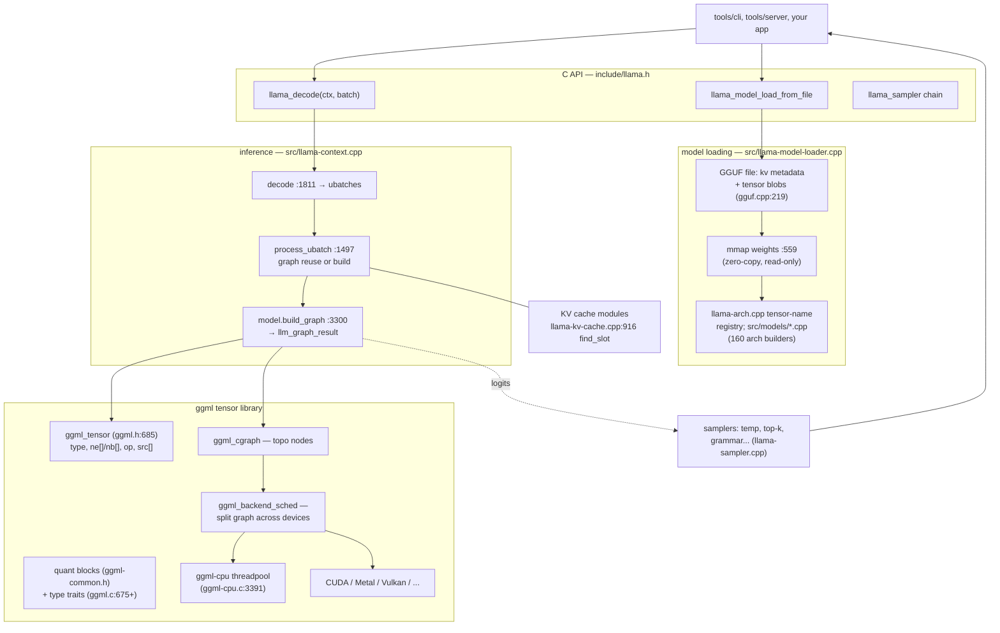
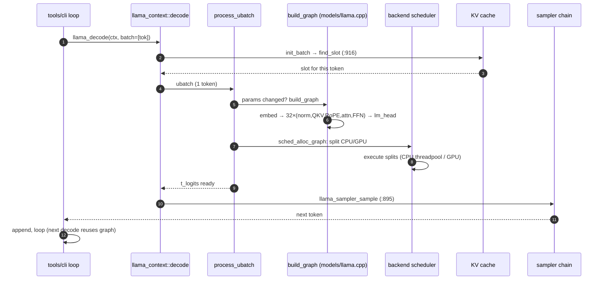

# llama.cpp: LLM inference with no framework — tensors, a graph, and quantization as the product

> **Atlas id:** `llama-cpp` · **Domains:** `ml-framework` ·
> **Upstream:** https://github.com/ggml-org/llama.cpp · **License:** MIT ·
> **Pinned commit:** `f2cc7282ce0042641df55e0e563b75e824e2b647` (2026-10-11)

llama.cpp runs large language models on laptops, phones, and
single-GPU boxes that no "AI framework" considers a target — in pure
C/C++ with zero required dependencies. The design lesson is
radical subtraction: **there is no runtime, no operator registry
serving a scripting layer, no autograd in the serving path — just a
tensor struct, a dataflow graph built fresh per inference batch, a
scheduler that splits that graph across whatever backends exist
(CPU cores, GPUs), and a file format (GGUF) whose dominant citizen
is quantized weights**. The same engine serves 160+ model
architectures because an architecture is *a C++ function that builds
a graph* (`src/models/*.cpp`), not a plugin ABI. Inference is:
load memory-mapped weights → for each batch of tokens, build the
graph, allocate it across devices, execute it, read the logits —
repeat one token at a time.

Read it against PyTorch-class frameworks: those optimize for
*research flexibility* (dynamic everything, Python); llama.cpp
optimizes for *deployment everywhere* (static graph per shape, C,
quantization first). It is the [SQLite](sqlite.md) of ML runtimes:
one portable core, a file format, and a fierce refusal to depend on
anyone.

## Explain like I'm 10

**A bakery that rebuilds its conveyor belt for every cookie — and
stores flour in tiny compressed jars.** The recipe (the model
architecture, one C++ builder per model family) says: mix, shape,
bake, glaze, in that order. For each cookie (one new token), the
bakers assemble *exactly that conveyor* (the compute graph) from
recipe steps, feed in the day's ingredients (your prompt tokens),
and out comes one cookie plus a strong hint about the next one. The
huge pantry of pre-measured ingredients (the weights — billions of
numbers) is stored in **tiny compressed jars** (4-bit quantization):
each jar holds 32 measurements squished into a few bytes, good
enough that cookies taste the same. The jars live on warehouse
shelves that everyone reads straight from (mmap — the weights are
never copied into the kitchen, because nothing ever writes to a
jar). If the kitchen has both a hand mixer and a pro oven (CPU and
GPU), a supervisor (the backend scheduler) reads the conveyor's
steps and assigns each step to the appliance that suits it, handing
half-finished dough across the counter exactly where needed. The
day's log of every dough already kneaded (the KV cache) is kept in
pigeonholes so kneading never repeats.

**Why the grown-ups did it this way:** when the weights are
gigabytes of read-only data and the math is known at load time, the
winning design is a *file format plus a graph evaluator* — not a
framework — and compressing the weights 8× moves "runs LLMs" from
the datacenter to the backpack.

## 1. Architecture overview

- **The public API is five object kinds** — model, context, batch,
  sampler, backend — and deliberately C (`include/llama.h`), so every
  language binds it and the ABI survives a fast-moving project.
- **Loading is file-format-first.** `llama-model-loader.cpp` opens
  the GGUF container (metadata KV pairs + raw tensor blobs,
  `ggml/src/gguf.cpp:219`), decides mmap (`:559`), and the arch
  registry (`llama-arch.cpp` — tensor *names* to slots) lets
  `src/models/llama.cpp load_arch_tensors` map `blk.0.attn_q.weight`
  onto typed fields without per-format code.
- **An architecture is a graph-builder class.** `llama_model_llama`
  (`src/models/models.h:147`) implements `load_arch_hparams`,
  `load_arch_tensors`, and `build_arch_graph` — whose constructor
  (`src/models/llama.cpp:99`) emits the transformer as ggml ops:
  embed → per-layer {RMSNorm, QKV+RoPE, attention via the KV-cache
  input, FFN or MoE} → final norm → lm_head. One hundred fifty-nine
  sibling files do Grok, Qwen, BERT… — the seam that keeps the core
  small.
- **Inference is batch → graph → execute.** `llama_context::decode`
  (`src/llama-context.cpp:1811`) splits the batch into micro-batches
  against KV-cache capacity; `process_ubatch` (`:1497`) reuses the
  previous graph when its shape-defining parameters match, else
  rebuilds (`model.build_graph`, `llama-model.cpp:3300`) and asks
  `ggml_backend_sched_alloc_graph` to place it; `graph_compute`
  executes; logits are read from the result tensor.
- **ggml underneath** is a self-contained tensor library: a tensor
  is `{type, ne[4], nb[4], op, src[], view_src}` (`ggml.h:685`) —
  *data optional* (weights are views into the mmap); a graph is a
  topologically sorted node array; quantized formats are structs of
  super-blocks (`ggml-common.h`) with per-type trait tables
  (`from_float`/`vec_dot`, `ggml.c:675+`) that kernels dispatch
  through.

## Walkthrough: one generated token, prompt to sampled word

The spine as a story — on the site you can step through it with Next;
in the repo it reads top to bottom.

**Step 1 — Batch arrives.** The tool loop (or server stream) calls
`llama_decode` with the new token(s); `decode`
(`src/llama-context.cpp:1811`) validates shapes, then
`memory->init_batch` splits work into ubatches the cache can seat —
`llama-kv-cache.cpp:916 find_slot` chooses contiguous pigeonholes
for each token's position, reporting `FAILED_PREPARE` when full
(see section 3).

**Step 2 — Graph decision.** `process_ubatch` (`:1497`) computes
the graph's shape parameters (token count, cache slots, positions);
if they match the previous graph's — the steady-state case when
generating one token at a time — the graph is *reused* (`n_reused`
in the perf stats), with only input tensors re-filled. A changed
batch shape rebuilds from scratch.

**Step 3 — Build the graph.** `model.build_graph`
(`llama-model.cpp:3300`) → `build_arch_graph` → the arch class
constructor (`src/models/llama.cpp:99`): `build_inp_embd`,
`build_inp_pos`, attention-input bookkeeping, then the per-layer
loop emitting `ggml_rope_ext`, `build_attn` (which binds KV-cache
tensors as graph inputs), `build_ffn`/`build_moe_ffn`, closing with
`ggml_build_forward_expand` — pure construction, no execution, no
activation memory yet.

**Step 4 — Allocate across devices.** `ggml_backend_sched_alloc_
graph` walks the graph, picks each node's backend by buffer-type
preferences (weights live where they were loaded; activations
follow compute), and inserts *split* points where data must cross
devices (`ggml/src/ggml-backend.cpp:915 ggml_backend_sched_split`).

**Step 5 — Execute.** `graph_compute` runs the scheduled splits: a
CPU split enters `ggml-cpu.c:3391 ggml_graph_compute`'s thread pool
(a spin barrier — `ggml_barrier` at `:576` — choreographs
`n_threads` workers over the node list; each node dispatches
through the type-trait tables into quantized kernels); GPU splits
enqueue on device streams.

**Step 6 — Read logits, sample.** `res->get_logits()` hands the
lm_head output to the sampler chain (`src/llama-sampler.cpp:895
llama_sampler_sample`): temperature → top-k → top-p → grammar… each
sampler's `apply` mutating the candidates array — the
[Redis](redis.md) commands-table pattern applied to decoding
policy.

**Outcome — One token out, state persisted in the cache.** The new
token's K/V rows already sit in their pigeonholes; the loop calls
`decode` again and step 2's reuse path fires. The graph, the
scheduler, the mmap — everything persists; nothing about the model
itself was mutated to produce the token.

## 2. Core data structures — and why these

- **`ggml_tensor` — descriptor-first objects.**
  **What:** type + shape (`ne`) + byte strides (`nb`) + op + up to
  two `src[]` + `view_src` (`ggml/include/ggml.h:685`); `data` may
  be null (pure graph node) or a view into a buffer.
  **Why:** separating *description* from *storage* makes
  graph-building allocation-free, views zero-copy, and weights
  mmap-able — the descriptor/physical split [SQLite's](sqlite.md)
  VFS uses, at tensor granularity.

- **Quantized super-blocks + type-trait tables.**
  **What:** formats like `block_q4_K` — dozens of values packed
  with per-block scales (`ggml-common.h`); per-type trait tables
  (`ggml.c:675+`: `from_float`, `vec_dot`, …) that matmul kernels
  call through.
  **Why:** quantization stays a *storage and kernel* concern — the
  graph says `MUL_MAT`, the trait table supplies the dot product —
  so new formats (Q4_0 → Q_K → IQ) ship without touching the graph
  layer. The jar analogy is literal: the file *is* the memory
  layout.

- **`ggml_cgraph` — a flat topological array.**
  **What:** `nodes[]`/`leafs[]` plus a visited hash set
  (`ggml-impl.h:341`), built by forward expansion from the output.
  **Why:** a flat array is scheduler-friendly (backend splits are
  contiguous ranges), cache-friendly, and trivially checkable —
  versus object-graph walking, which interpreter-style designs pay
  for at every dispatch.

- **The KV cache as a slot map.**
  **What:** per-layer K/V tensors plus position-indexed occupancy;
  `find_slot` (`llama-kv-cache.cpp:916`) seats ubatches
  contiguously; unified vs. recurrent variants behind one memory
  interface.
  **Why:** making *attention state* an explicitly managed resource
  (defrag, shifting, eviction) turns "context overflow" from an
  error into admission control — [Kafka's](kafka.md) retention
  insight applied to tensor memory.

- **The sampler chain.**
  **What:** `struct llama_sampler {iface, ctx}`
  (`include/llama.h:1427`) with name/apply/accept/reset/clone/free
  callbacks; chains compose them over a `llama_token_data_array`.
  **Why:** decoding policy composes without the engine knowing any
  policy — a miniature of the project's whole "graph + registered
  plugins" thesis.

## 3. Concurrency and failure model

- **One graph, many threads, no shared mutable state.** Execution
  parallelism is *within* a node: the CPU thread pool
  (`ggml-cpu.c:3391`) splits each op's row range across workers
  synchronized by a spin barrier (`:576`). The graph itself is
  single-owner — contexts never share schedulers — so there is no
  locking on the inference path; servers run one context (or one
  per slot) per thread.
- **Async pipelines are explicit.** With `pipeline_parallel`, the
  next graph may be enqueued while the previous computes;
  `process_ubatch` *synchronizes before rewriting input tensors*
  (`if (cparams.pipeline_parallel) ggml_backend_sched_synchronize`)
  — the code comment names the hazard exactly. Correctness lives at
  graph boundaries, not in ambient magic.
- **Context-full is a return code, not a crash.** `find_slot` fails
  → `LLAMA_MEMORY_STATUS_FAILED_PREPARE` → `decode` first tries
  cache optimization (the defrag/shift retry loop,
  `llama-context.cpp:1921`), and only then returns `1` ("make
  room, then call me again") — graceful degradation baked into the
  API contract.
- **Failure mid-compute:** backend errors surface as
  `GGML_STATUS_*` from `graph_compute`; `decode`'s error path
  removes the failed ubatch's positions from the cache (the
  `pos_min` cleanup) so the KV cache never retains tokens from a
  failed pass.
- **Numerics honesty:** quantized `vec_dot` kernels are
  SIMD-architecture-specific, so bit-exact reproducibility across
  CPUs is *not* promised — a real failure-mode note for anyone
  diffing outputs between machines.

## 4. API and extension design

- **The C surface is the product.** `include/llama.h` exposes
  model/context/batch/sampler/backend as opaque handles with
  default-parameter structs (`llama_model_default_params`), every
  field commented. The header is the design document the way
  `lua.h` is for [Lua](lua.md).
- **Four extension seams, no plugin ABI:** (1) new model
  architectures — a file in `src/models/`, a registration in
  `models.h` and `llama-arch.cpp`; (2) new quant formats — block
  struct + trait-table entries + kernels; (3) new backends —
  implement ggml's backend/buffer interface (CUDA, Metal, Vulkan,
  SYCL already do); (4) new samplers — an iface struct.
- **ggml is itself the reusable engine** — whisper.cpp and siblings
  consume it directly; llama.cpp is "ggml plus LLM opinions." The
  layering that made [libuv](libuv.md) reusable beyond Node, in ML
  clothes.
- **Honest wart:** velocity shows. The API accumulates deprecation
  shims (`llama_batch` legacy vs `llama_batch_ext` — two `decode`
  overloads at `llama-context.cpp:1811`/`:4570`), parameter structs
  grow dozens of fields, and graph-reuse heuristics
  (`can_reuse` on topology fingerprints) are cleverness that leans
  on its comments. Stability discipline lags [curl's](curl.md) by
  choice — the project picked iteration speed.

## 5. The defining trade-offs

### Trade-off 1: build the graph per batch over a precompiled engine
- **Tension:** inference is a loop of near-identical graphs; a
  compiled engine or JIT could skip build overhead.
- **Choice:** construct the graph each ubatch; *reuse* it only when
  the shape parameters match.
- **Evidence:** `src/llama-context.cpp:1497 process_ubatch` —
  `res->can_reuse(gparams)` vs `model.build_graph(gparams)` +
  `ggml_backend_sched_alloc_graph`.
- **Given up:** per-token microseconds and "compile once"
  simplicity; graph reuse became a real subsystem.
- **Verdict:** right when shapes legitimately vary (prefill vs
  decode, batch sizes, cache slots) and 160 architectures share one
  executor — the builder *is* the porting layer. Wrong for a
  fixed-shape embedded pipeline, where a static schedule wins.

### Trade-off 2: quantization as the on-disk format over fp16/fp32
- **Tension:** model quality vs the memory bandwidth (and capacity)
  of consumer hardware.
- **Choice:** weights live *natively* in 2–8-bit blocks; kernels
  dequantize inline inside `vec_dot`; the file format is the memory
  layout, so mmap costs nothing.
- **Evidence:** `ggml-common.h` block structs with
  `static_assert`s on size; trait tables at `ggml.c:675+`; loader
  mmap path `llama-model-loader.cpp:559`.
- **Given up:** some accuracy (mitigated by per-block scales),
  fp32 debuggability, and a formats × ops × architectures kernel
  matrix to maintain.
- **Verdict:** the decision that created the project's audience —
  8× smaller weights put LLMs on laptops and phones, and
  bandwidth-bound matmuls often run *faster* quantized. Wrong where
  accuracy is contractual (training, careful evals).

### Trade-off 3: zero dependencies and mmap over any platform layer
- **Tension:** portability across phones/SBCs/servers vs the
  conveniences of runtimes, allocators, and package ecosystems.
- **Choice:** C/C++ with no required deps; GGUF as a
  self-describing container; weights mapped read-only; OS quirks
  behind small shims.
- **Evidence:** the loader's mmap decision (`:559`) and its
  alignment checks (`:688` — an embedded GGUF whose data section is
  misaligned fails fast rather than corrupting).
- **Given up:** unified memory management, telemetry, plugin
  ecosystems "for free" — the project rebuilds scheduling, thread
  pools, and file I/O itself.
- **Verdict:** right for a tool whose differentiator is *runs
  anywhere with the model file and nothing else* — the
  [curl](curl.md) verdict in ML clothes. Wrong inside a platform
  that already owns those layers.

## 6. Reading path

1. `include/llama.h` — skim the five object kinds and the
   default-params structs; the comment density is the design doc.
2. `ggml/include/ggml.h:685` `ggml_tensor` — the descriptor that
   everything else manipulates; note `data` is optional and views
   carry `view_src`.
3. `ggml/src/ggml-common.h` — pick `block_q4_K` (or any Q_K
   format); read the `static_assert` sizes; this is the jar.
4. `src/llama-model-loader.cpp` — `use_mmap` decision (`:559`), the
   GGUF metadata pass, tensor-count reconciliation, and the
   embedded-GGUF alignment check (`:688`).
5. `src/llama.cpp` `llama_model_load_from_file_impl` — hparams,
   vocab, per-arch dispatch; then `src/models/llama.cpp
   load_arch_hparams` + `load_arch_tensors` to see names become
   typed tensor fields.
6. `src/models/models.h:147` `struct llama_model_llama` — the
   arch-class seam: hparams loader, tensor loader, graph builder in
   ~100 lines of declaration.
7. `src/models/llama.cpp:99` the `graph<embed>` constructor — read
   it top to bottom as executable transformer math; the MoE branch
   is one `if` on a null gate pointer.
8. `src/llama-context.cpp:1811 decode` — batch splitting, the
   FAILED_PREPARE retry loop (`:1921`), then `:1497
   process_ubatch` for the reuse-or-build decision and
   `set_inputs`.
9. `ggml/src/ggml-backend.cpp:915` — the scheduler's split
   structures; skim `ggml_backend_sched_alloc_graph` to see how
   backend choice and cross-device copies are inserted.
10. `ggml/src/ggml-cpu/ggml-cpu.c:3391 ggml_graph_compute` +
    `:576 ggml_barrier` — the thread pool's barrier choreography;
    then one trait-table dispatch in `ggml.c:675+`.
11. `src/llama-kv-cache.cpp:916 find_slot` — slot assignment as
    admission control; then `src/llama-sampler.cpp:895
    llama_sampler_sample` and the chain in `:966
    llama_sampler_chain_add`.
12. `tools/cli/cli.cpp:33 llama_cli` (main.cpp is a 5-line shim) and
    `tools/cli/cli-context.cpp:413 cli_context::run` — the loop that
    ties it together: decode → sample → print → append.

You have now traced one token from a batch call through a
freshly-built (or reused) tensor graph, a cross-device schedule, a
quantized matmul, a cache slot, and a sampler chain — the complete
anatomy of "LLM inference with no framework."

## 7. What to steal

- **A dataflow graph as the universal IR** — describe computation
  declaratively, then schedule/allocate/optimize it; per-shape
  specialization falls out of rebuild-vs-reuse for free.
- **Type-trait tables for numeric formats** — one dispatch seam
  made a whole quantization ecosystem possible; use it for any
  pluggable encoding (codecs, compression, wire formats).
- **Treat giant read-only data as a file you mmap, not memory you
  load** — zero-copy, instant startup, shared page cache; the
  weights never being written is a *design* fact, not luck.
- **Make context/state an explicit, budgeted resource** (the KV
  cache) with admission control and eviction policy — overflow
  becomes a negotiation, not an OOM.
- **Split the portable engine (ggml) from the domain (llama)** —
  reuse arrived for free in whisper.cpp et al.
- **Compose policy (sampling) as a chain of small interface
  objects** — configuration language for decisions, not flags in
  the engine.

## 8. Difficulty and prerequisites

- Difficulty: `moderate`. Realistic budget: 6–7 hours for this path;
  add 2 if you also read a quantized matmul kernel in full.
- Prerequisites: comfortable C++; what a matrix multiply is;
  transformer vocabulary at the level of "attention reads K/V from
  the cache, Q comes from the token" (any 10-minute attention
  explainer suffices — the graph builder in step 7 is the tutorial).
  No CUDA/GPU knowledge required — the CPU path tells the whole
  story.

## 9. Further reading

- The repo's own `docs/` — especially the GGUF format spec and the
  server/tool docs; `ggml/docs` for backend interface notes.
- The repo's initial commit `26c0846` ("Initial release", 2023-03-10)
  and the README history — the "no framework" thesis in the author's
  own words.
- *Attention Is All You Need* (Vaswani et al., 2017) — one read
  of the graph builder makes the paper concrete.
- The [SQLite](sqlite.md) and [curl](curl.md) dives in this atlas —
  the two design lineages (portable core + file format; zero-dependency
  portability) this project consciously or not extends to ML.
