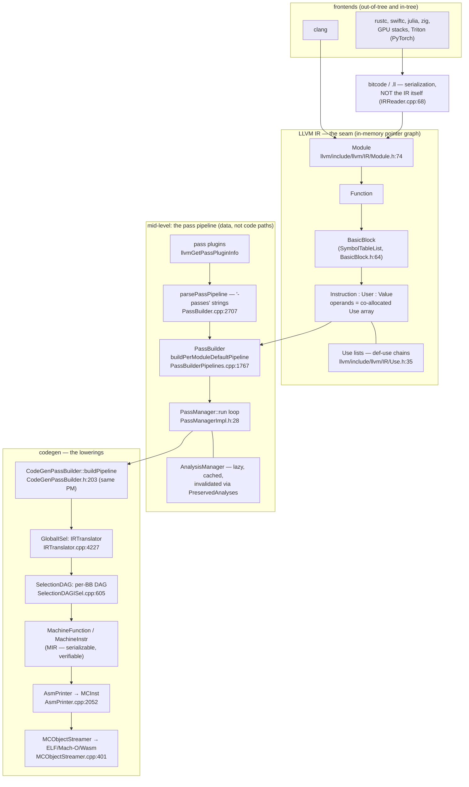
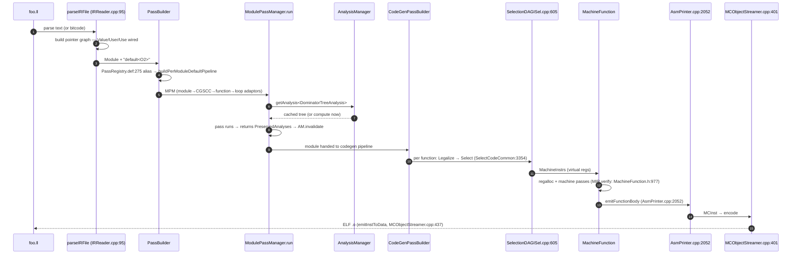
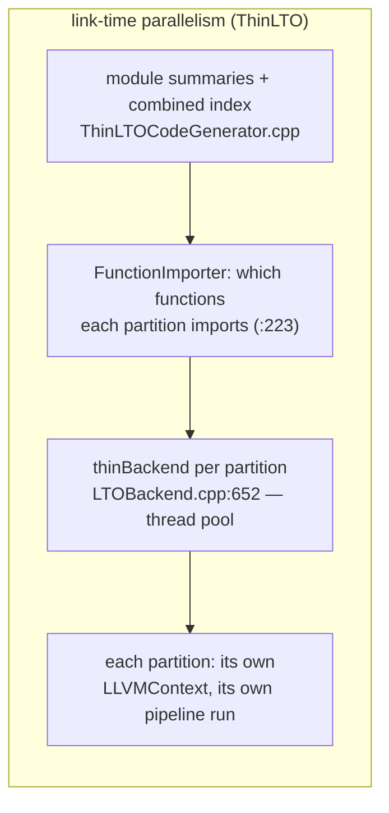

# LLVM: one shared IR, and the pass pipeline as its plugin architecture

> **Atlas id:** `llvm` · **Domains:** `compiler` ·
> **Upstream:** https://github.com/llvm/llvm-project ·
> **License:** Apache-2.0 WITH LLVM-exception ·
> **Pinned commit:** `7a941dfb2877a0b8cf30323fefa85ad019e0b0f5` (2026-10-19, tag `llvmorg-23.1.4`)

LLVM is the compiler infrastructure the industry breathes through: clang,
Rust, Swift, Julia, Zig, several GPU stacks, and the Triton kernels behind
PyTorch's `torch.compile` all lower their languages onto it. The design
lesson this dive teaches is **the IR as the architectural seam**: freeze
one intermediate representation good enough that N frontends and M
backends can meet in the middle — turning an N×M problem into N+M — and
then make *every* transformation a small, composable pass over that IR,
scheduled by a pipeline that is itself data (a string you can parse,
print, and extend from a plugin). The price is paid up front, in the IR's
own data structure: an in-memory pointer graph whose def-use links every
pass must keep consistent, checked by a Verifier — and in a stack of
three more IRs below it (MachineFunction, SelectionDAG, MCInst) as the
IR walks down toward bytes.

Read it against [CPython](cpython.md) (bytecode as a poor man's IR: no
SSA, a stack machine, and an interpreter doing in-place specialization
where LLVM rewrites the program), the V8 engine behind [Node.js](nodejs.md)
(tiering Ignition→Maglev→TurboFan is the same bet — speed comes from a
pipeline of IRs, each tier one more lowering), and [PyTorch](pytorch.md)
(TorchInductor's generated Triton/C++ kernels bottom out in LLVM): three
systems that stopped short of the full compiler-infra answer, and one
that built only that.

## Explain like I'm 10

**A giant airport hub where every airline agrees to repack luggage into
standard pallets.** Each airline (a frontend: clang, rustc, swiftc) dumps
its weirdly shaped bags into identical pallets (LLVM IR), and every
destination factory (a backend: x86, ARM, RISC-V, GPUs) only knows how to
unpack pallets — nobody ships bags directly. On the pallet floor, every
note is tied to the notes that use it with red thread (the use lists);
when a robot replaces one note, everyone holding its thread is handed the
new note automatically (`replaceAllUsesWith`). Sorting robots (the
passes) each do one small job — "remove duplicate notes", "flatten
corridors" — and a foreman (the `PassBuilder`) reads a checklist
(`-passes=...`, literally a string) to decide which robots run in what
order. There is a clipboard (the `AnalysisManager`) where facts about the
pallets get written down ("which corridor leads where" — the dominator
tree); every robot must cross off the clipboard facts its changes made
stale (`PreservedAnalyses`), or the clipboard lies and the next robot
trusts garbage. When the pallets reach the destination factory they are
re-packed twice more into local crates (machine instructions) before
being loaded onto trucks (object files).

**Why the grown-ups did it this way:** with 20+ languages and 25+ CPU
targets, nobody can afford to write a compiler for every pair — so the
design makes the meeting point (the IR) a stable, checkable contract, and
everything else a replaceable robot over it.

## 1. Architecture overview

- **The IR is the product; everything else is replaceable.** A `Module`
  owns `Function`s (a `SymbolTableList`, `llvm/include/llvm/IR/Module.h:74`),
  a `Function` owns `BasicBlock`s (`llvm/include/llvm/IR/Function.h:67`),
  a `BasicBlock` owns `Instruction`s (`llvm/include/llvm/IR/BasicBlock.h:64`)
  as intrusive lists — no vector-of-statements, no re-parsing. An
  `Instruction` *is a* `User` *is a* `Value`: one object that knows its
  operands (the uses it makes) and is known by its users (the uses made
  of it). The textual `.ll` files and binary bitcode are serializations
  of this graph — `llvm::parseIR` (`llvm/lib/IRReader/IRReader.cpp:68`)
  sniffs the buffer and hands back the same pointer graph either way.
- **The optimizer is not a phase; it is a scheduled list of passes.**
  `opt -O2` literally rewrites itself into the pipeline string
  `default<O2>` (`llvm/tools/opt/optdriver.cpp:775–786`), which the
  PassBuilder parses — `default<O2>` is registered as an ordinary
  pipeline alias in the pass registry table
  (`llvm/lib/Passes/PassRegistry.def:275`, a `MODULE_PASS_WITH_PARAMS`
  entry exactly like user-visible passes). Inside, the default pipeline
  composes sub-pipelines: `buildPerModuleDefaultPipeline`
  (`llvm/lib/Passes/PassBuilderPipelines.cpp:1767`) chains
  `buildModuleSimplificationPipeline` (`:1120`) then
  `buildModuleOptimizationPipeline` (`:1515`), nesting module→CGSCC→
  function→loop managers via adaptor passes.
- **Codegen is the same architecture repeated one level down.** After
  IR-level passes, `CodeGenPassBuilder::buildPipeline`
  (`llvm/include/llvm/Passes/CodeGenPassBuilder.h:203`) schedules the
  machine passes through the *same* new-PM machinery (a
  `MachineFunctionPassManager`, `llvm/include/llvm/CodeGen/MachinePassManager.h`),
  down through instruction selection — the classic path builds a
  per-basic-block DAG of `SDNode`s (`SelectionDAGISel::runOnMachineFunction`,
  `llvm/lib/CodeGen/SelectionDAG/SelectionDAGISel.cpp:605`), the newer
  GlobalISel path translates IR to generic machine instructions
  (`IRTranslator::runOnMachineFunction`,
  `llvm/lib/CodeGen/GlobalISel/IRTranslator.cpp:4227`) — into a
  `MachineFunction` of `MachineInstr`s, then `AsmPrinter` lowers to
  `MCInst`s and `MCObjectStreamer::emitInstruction`
  (`llvm/lib/MC/MCObjectStreamer.cpp:401`) encodes them into an object
  file. Four representations, each with its own verifier.
- **Targets are data too.** `llvm/lib/Target/` is ~25 CPU/GPU targets,
  each described largely in TableGen `.td` files (X86 alone: 163 files,
  e.g. `llvm/lib/Target/X86/X86.td`); TableGen (`llvm/include/llvm/TableGen/Record.h`,
  `Record`/`RecordKeeper`) expands those records into generated C++
  tables the selectors and assemblers consume. Even the IR's own
  intrinsics are a TableGen file (`llvm/include/llvm/IR/Intrinsics.td:794`,
  `class Intrinsic`).
- **Where the spine is:** `.ll`/bitcode → `parseIRFile` → Module graph →
  `PassBuilder` → `PassManager::run` (passes + analyses + invalidation)
  → `CodeGenPassBuilder` → SelectionDAG/GlobalISel → MachineFunction →
  regalloc → `AsmPrinter` → MC layer → `.o`. The Walkthrough walks
  exactly this, minus frontend.

## Walkthrough: one add function, from .ll text to an ELF object file

**Step 1 — Text becomes a pointer graph.** `llvm::parseIRFile`
(`llvm/lib/IRReader/IRReader.cpp:95`) sniffs the buffer, dispatches to
the `.ll` parser or the bitcode reader (`parseIR`, `:68`), and returns a
`Module`. Nothing "holds" the program as text anymore: each `%result =
add i32 %a, %b` line becomes an `Instruction` object whose two operands
are pointers to the `Value`s for `%a`/`%b`, wired through co-allocated
`Use` records. Names (`%a`) live in a symbol table for serialization and
debugging; identity in memory is the pointer.

**Step 2 — The pipeline is parsed like any input.** `opt` never
special-cases optimization levels: `-O2` becomes the string
`default<O2>` (`llvm/tools/opt/optdriver.cpp:775–786`) and
`PassBuilder::parsePassPipeline` (`llvm/lib/Passes/PassBuilder.cpp:2707`)
parses it against the registry, where `default` is a table entry
(`llvm/lib/Passes/PassRegistry.def:275`) whose expansion calls
`buildPerModuleDefaultPipeline` — the same parser that accepts
`-passes='instcombine,loop-unroll'` or an out-of-tree plugin's name.

**Step 3 — Passes run inside one loop with one contract.**
`PassManager::run` (`llvm/include/llvm/IR/PassManagerImpl.h:28`) is the
whole engine: for each pass — ask instrumentation to allow/skip, run it,
call `AM.invalidate(IR, PassPA)` with the pass's returned
`PreservedAnalyses`, and intersect the aggregate set. A pass that
rewrites CFG must return `PreservedAnalyses::none()`; one that only
deleted dead instructions returns the set minus, say, the dominator
tree. `default<O2>` expands into nested managers
(`buildPerModuleDefaultPipeline`, `PassBuilderPipelines.cpp:1767`:
simplification `:1800`, then optimization `:1803`) so loops get function
passes without re-walking the module.

**Step 4 — Analyses are computed lazily, cached, and invalidated by
contract.** The first pass to ask for
`DominatorTreeAnalysis` (`llvm/include/llvm/IR/Dominators.h:270`) pays
for it; later passes get it from the `AnalysisManager` cache — until a
pass fails to preserve it. Even cross-level invalidation is explicit:
when a module pass deletes a function, a proxy result walks the cached
function analyses and clears them
(`FunctionAnalysisManagerModuleProxy::Result::invalidate`,
`llvm/lib/IR/PassManager.cpp:41`). Wrong `PreservedAnalyses` = stale
dominator tree = miscompiled binary; the contract is load-bearing.

**Step 5 — Instrumentation is a plugin point too.** The same loop
fetches `PassInstrumentation` as an analysis
(`PassInstrumentationCallbacks`, `llvm/include/llvm/IR/PassInstrumentation.h:74`):
`-print-after-all`, IR-change reports (`-print-changed`), the pass
verifier
(`VerifyInstrumentation`,
`llvm/lib/Passes/StandardInstrumentations.cpp:1456`), and
`-time-trace` (`TimeProfilingPassesHandler`, `:1572`) are all just
registered callbacks — and `runBeforePass` can skip a pass entirely
(e.g. `optnone` functions).

**Step 6 — Selection: IR becomes target instructions.** The codegen
pipeline reaches `SelectionDAGISel::runOnMachineFunction`
(`llvm/lib/CodeGen/SelectionDAG/SelectionDAGISel.cpp:605`), which lowers
each basic block to a DAG, legalizes target-unsupported operations, and
pattern-matches it into `MachineInstr`s
(`SelectAllBasicBlocks`, `:646`, defined `:1656`; table-driven matching
in `SelectCodeCommon`, `:3354`, generated from the target's `.td`
patterns). FastISel (`llvm/lib/CodeGen/SelectionDAG/FastISel.cpp:1543`)
tries a quick path first and falls back to the DAG. GlobalIsel takes
the other route through `IRTranslator`
(`llvm/lib/CodeGen/GlobalISel/IRTranslator.cpp:4227`) — same
destination, more incremental passes.

**Step 7 — Machine code is emitted through one last IR.** Virtual
registers are assigned physical ones (a scheduling problem over the
`MachineFunction`, whose own `MachineInstr`s can be serialized to MIR
text via `printMIR`, `llvm/include/llvm/CodeGen/MIRPrinter.h`, and
verified by `MachineFunction::verify`,
`llvm/include/llvm/CodeGen/MachineFunction.h:977`). The
`AsmPrinter::emitFunctionBody` (`llvm/lib/CodeGen/AsmPrinter/AsmPrinter.cpp:2052`)
lowers each `MachineInstr` to an `MCInst`, and
`MCObjectStreamer::emitInstruction` (`llvm/lib/MC/MCObjectStreamer.cpp:401`)
encodes it straight into object-file fragments
(`emitInstToData`, `:437`) — ELF, Mach-O, or Wasm, chosen by the
target's object writer.

**Outcome — One function crossed four representations, each seam
contractual.** `.ll` text → IR graph → optimized IR graph →
MachineFunction/MCInst → object file; every crossing is a serialized,
verifiable, separately testable format — which is exactly why 25+ targets
and 20+ languages can share this machinery.

## 2. Core data structures — and why these

- **`Value`/`User`/`Use` — the IR as a self-maintaining graph.**
  **What:** every IR entity is a `Value`
  (`llvm/include/llvm/IR/Value.h:75`, one `SubclassID` byte driving
  `isa`/`dyn_cast`); a `User` is a `Value` that has operands; each
  operand slot is a `Use` (`llvm/include/llvm/IR/Use.h:35`) — four
  pointers: the used `Val`, the owning `User`, and `Next`/`Prev` links
  threading it into the *used value's* doubly-linked use list. Operand
  arrays are co-allocated *before* the `User` object itself
  (`User::User`, `llvm/include/llvm/IR/User.h:119` —
  `Use *Operands = reinterpret_cast<Use *>(this) - NumUserOperands`),
  with the default `operator new` deleted (`User.h:54`, `void
*operator new(size_t) = delete`) so the choice
  (inline vs "hung-off" for resizable users like PHINodes) is explicit.
  **Why:** def-use chains are the queries every pass asks
  ("who uses this value?"), and mutation is the hot path:
  `Value::replaceAllUsesWith` (`llvm/lib/IR/Value.cpp:553`) walks the
  use list and rewires every user in O(uses) — no re-scan of the module,
  no patching of names. The alternative — an AST with symbol tables, or
  immutable IR rebuilt per transform — pays O(module) per edit.

- **The intrusive `SymbolTableList` containers.**
  **What:** `BasicBlock`s and `Instruction`s live in
  `SymbolTableList`s (`BasicBlock.h:64`, `Function.h:67`), built on the
  intrusive `ilist` (`llvm/include/llvm/ADT/ilist.h`): the list lives
  *inside* the nodes, no separate node allocation.
  **Why:** passes splice, move, and delete instructions constantly —
  `splice`/`erase` are pointer surgery, never container copies, and an
  iterator stays valid across re-parenting. The symbol table half keeps
  `%names` resolvable only when someone asks (name lookup is a service,
  not identity).

- **The `AnalysisManager` cache + `PreservedAnalyses`.**
  **What:** per-IRUnit (module/function/loop/machine-function) maps from
  analysis identity key → cached result
  (`llvm/include/llvm/IR/PassManager.h:277`,
  `Analysis.h:112`); passes return a `PreservedAnalyses` set that
  `AM.invalidate` uses to evict. **Why:** it makes "run Dominators once,
  reuse until the CFG changes" a *declared contract* rather than
  convention — compile time is the product's second output, and this is
  the memoization discipline that keeps O2 pipelines feasible. The
  rejected alternative (recompute on every request) is what made the
  legacy pass manager's analysis churn expensive.

- **`MachineFunction`/`MachineInstr` — the second IR, honestly
  serialized.** **What:** post-selection code as instructions over
  *virtual* registers with operands that are registers, immediates,
  frame indices, or block refs (`llvm/include/llvm/CodeGen/MachineInstr.h:72`);
  printable/parsable as MIR (`printMIR`,
  `llvm/include/llvm/CodeGen/MIRPrinter.h`) and checked by its own
  verifier (`MachineFunction::verify`, `MachineFunction.h:977`).
  **Why:** machine-level passes (scheduling, regalloc) need register
  classes and physical facts LLVM IR deliberately doesn't have — but the
  *methodology* (serializable IR + verifier + pass pipeline, even the
  same `MachineFunctionPassManager` with per-pass
  `MachineFunctionProperties` contracts in
  `llvm/include/llvm/CodeGen/MachinePassManager.h`) is
  cloned from the layer above.

- **TableGen `Record`s — target descriptions as data.**
  **What:** a small records language (`llvm/include/llvm/TableGen/Record.h`)
  in which each target's registers, instructions, selection patterns,
  and calling conventions are declared (X86: `llvm/lib/Target/X86/X86.td`
  and 160+ sibling `.td` files); the `llvm-tblgen` tool expands them
  into generated C++ that selection and assembly consult.
  **Why:** a new CPU mostly should not write C++ — it should describe
  itself, the same "generate the surface from data" move as
  [PyTorch's](pytorch.md) `native_functions.yaml` or [FFmpeg's](ffmpeg.md)
  configure-generated component lists.

- **`LLVMContext` + uniquing tables.** **What:** the context owns the
  type and constant uniquing tables (`llvm/include/llvm/IR/LLVMContext.h:62–69`,
  tables in `llvm/lib/IR/LLVMContextImpl.h:1538` — `ConstantUniqueMap`
  at `:1636`), so `ConstantInt::get(i32, 42)` is pointer-equal everywhere
  (`llvm/include/llvm/IR/Constants.h:125`). **Why:** value numbering of
  constants and types for free — equality becomes pointer comparison for
  the majority of leaves in the IR graph; the cost is that a context
  provides no locking, so threaded compilation uses one context per
  thread (see section 3).

## 3. Concurrency and failure model

- **Inside one compile, the IR world is single-threaded.** `LLVMContext`
  "provides no locking guarantees, so you should be careful to have one
  context per thread" (`llvm/include/llvm/IR/LLVMContext.h:67–69`), and
  passes mutate shared graphs — there is no lock story to cite because
  there are no locks. Concurrency is bought *outside* the IR: at module
  granularity.
- **ThinLTO parallelizes across partitions, not within them.** Pre-link,
  each module gets a summary index; the linker merges indexes, and the
  `FunctionImporter` (`llvm/lib/LTO/ThinLTOCodeGenerator.cpp:223`) plans
  which functions each backend should import; then each partition runs
  `thinBackend` (`llvm/lib/LTO/LTOBackend.cpp:652`) on its own thread
  with its own context. Even plain parallel codegen refuses to share:
  `splitCodeGen` (`LTOBackend.cpp:516`) serializes module partitions to
  *bitcode on the main thread* "in order to avoid data races" and each
  worker deserializes into a fresh context (`:520–568`) — the honest
  boundary of a mutable pointer-graph design: serialize at the seam,
  never share the graph.
- **Failure = corrupted invariants, so verification is a lifecycle.**
  The IR Verifier (`llvm/lib/IR/Verifier.cpp:148`, an `InstVisitor`
  walking every invariant; `VerifierPass::run`, `:8093`) runs on input,
  output, and optionally after every pass (`-verify-each`); machine code
  gets its own verifier (`MachineFunction::verify`). A crash mid-pass
  prints "Running pass X on function Y" from the pretty-stack machinery
  wired into the run loop (`StackTraceEntry`,
  `llvm/include/llvm/IR/PassManagerImpl.h:29–50`) — the same
  instrumentation seam as the timers. `-run-twice` re-runs pipelines to
  shake out stateful passes; `llvm-reduce` and the `.ll`/MIR round-trips
  make minimal reproducers a *format property*, not a heroic effort.
- **Backpressure does not exist; compile-time budgets do.** Nothing
  throttles the optimizer from outside — instead the design fights
  quadratic pass behavior structurally: the analysis cache
  (section 2), `optnone`/`optsize` as IR *attributes* that passes
  respect, and instrumentation (`-time-trace`) to find the offenders.
  Compile time is managed as a measured property of pipelines, the way
  [HAProxy](haproxy.md) manages latency as a budget.

## 4. API and extension design

- **The public surface is the IR and the pass contracts, not a
  compiler binary.** LLVM ships as libraries: frontends construct IR
  with `IRBuilder` (`llvm/include/llvm/IR/IRBuilder.h`) or the C API
  (`llvm-c/Core.h` — the seam out-of-tree frontends bind), then hand a
  `Module` to a `PassBuilder`-composed pipeline and a `TargetMachine`
  that emits files (`addPassesToEmitFile`,
  `llvm/include/llvm/Target/TargetMachine.h:431`; new-style
  `CodeGenPassBuilder::buildPipeline`, `CodeGenPassBuilder.h:203`).
- **Passes are the plugin unit, and the seam is deliberate.** An
  out-of-tree `.so` exposes one C symbol, `llvmGetPassPluginInfo`
  (`llvm/include/llvm/Plugins/PassPlugin.h:129–138`), returning a
  `PassPluginLibraryInfo` (`:45`) whose callback receives the
  `PassBuilder` and registers pipeline-parsing callbacks, extension
  points, or analyses. `PassPlugin::Load`
  (`llvm/lib/Plugins/PassPlugin.cpp:16`) is dlopen + symbol lookup + a
  strict API-version check (`LLVM_PLUGIN_API_VERSION`, header `:36`) —
  plugins are version-pinned to their LLVM build, by design. This is the
  seam the Enzyme autodiff compiler and many research passes grow
  through, and inside the default pipeline itself the same mechanism
  runs:
  `invokePipelineStartEPCallbacks` fires extension points mid-pipeline
  (`PassBuilderPipelines.cpp:1794`).
- **The pipeline string is an API.** `-passes='function(mem2reg),...'`
  with nested managers, parameters (`loop-unroll<full-unroll-max-count=N>`),
  and printable back (`PassManager::printPipeline`,
  `llvm/include/llvm/IR/PassManager.h:203`; `opt -print-pipeline-passes`,
  `NewPMDriver.cpp`) — the optimizer's configuration is data that tools
  round-trip, the [Redis](redis.md)-commands.json / [Kubernetes](kubernetes.md)
  schema move applied to a compiler.
- **Honest wart:** the C++ API has *no* stability policy — every release
  can (and does) break it, so out-of-tree users ride the release train
  or pin; the C API is smaller and slower-moving but forever trailing.
  The pass registry's `.def` macro tables (`PassRegistry.def`) are
  compile-time — adding pass *names* means rebuilding, though adding
  passes at runtime is first-class via plugins. And the legacy pass
  manager still coexists (`llvm/lib/IR/LegacyPassManager.cpp`, ~1.5k
  lines) because not all codegen plumbing migrated; two parallel
  extension surfaces is a real maintenance tax.

## 5. The defining trade-offs

### Trade-off 1: one shared, mutable IR for all languages and targets
- **Tension:** M languages × N targets is M×N compilers; only a shared
  meeting point makes it M+N. But the meeting point must be rich enough
  for every language's semantics and low enough for every target's
  machine — an impossible average in the abstract.
- **Choice:** a low, RISC-like, SSA IR (`LangRef`, `llvm/docs/LangRef.md`)
  with explicit escape hatches: intrinsics declared in TableGen
  (`Intrinsics.td:794`) for everything LLVM doesn't model (GC
  safepoints, coroutines, vendor ops), metadata and debug info as
  side-channels (`llvm/include/llvm/IR/Metadata.h`), function
  attributes as a parallel vocabulary, and a `DataLayout` string the
  frontends must honor (`llvm/lib/IR/DataLayout.cpp:201` parses it) so
  the IR is never lying about memory.
- **Evidence:** the intrinsic list is the invoice for "low IR":
  `llvm/include/llvm/IR/Intrinsics.td` is 3.2k lines of semantics LLVM
  chose *not* to understand; PHINode (`llvm/include/llvm/IR/Instructions.h:2701`)
  plus the GEP instruction (address arithmetic, not pointer math) show
  the IR bending toward both worlds.
- **Given up:** high-level optimization — LLVM re-finds structure
  (inlining, SROA) that a source-level IR would have kept for free;
  frontends like Rust lower guarantees into checks LLVM can remove but
  not reason about; the long-running literature on low IRs losing
  source-level optimization opportunity is this trade's receipt.
- **Verdict:** right when the frontends *want* to be thin and targets
  churn (exactly the CPU/GPU world); wrong when the product is
  source-level insight — which is why MLIR (built by the same
  community) exists: a meta-IR for defining *higher* seams, and why
  [CPython](cpython.md) and V8 keep richer, language-specific bytecode
  tiers instead.

### Trade-off 2: aggressive in-place mutation of a shared graph over immutable IR
- **Tension:** optimization is constant rewriting; every transform is
  cheaper if edits are pointer surgery — but any pass can corrupt any
  invariant of a shared mutable graph, and parallelism inside one module
  becomes nearly impossible.
- **Choice:** the `Use`-list machinery makes every edit locally
  consistent (`replaceAllUsesWith`, `Value.cpp:553`; operand arrays
  co-allocated, `User.h:119`); correctness pressure is routed into the
  Verifier lifecycle and crash tooling (section 3) rather than into
  immutability; thread-safety is achieved by not sharing (one
  `LLVMContext` per thread; bitcode serialization between threads).
- **Evidence:** `Value::doRAUW` (`Value.cpp:518`) — the entire mechanism
  is one while-loop over the use list, the IR's most-executed edit;
  `splitCodeGen`'s serialize-to-bitcode-then-parallelize dance
  (`LTOBackend.cpp:520–568`); `-verify-each` and `VerifyInstrumentation`
  (`StandardInstrumentations.cpp:1456`).
- **Given up:** functional-style IRs (immutable nodes, persistent
  data structures) would give free snapshots, trivial parallel passes,
  and no verifier — at the cost of allocation churn and copying on
  every transform, a trade successor IRs like MLIR and Cranelift
  deliberately re-priced with more value-oriented operation models.
- **Verdict:** right when one machine optimizes one module
  sequentially and compile time must stay flat (pointer edits are
  nearly free); wrong when you need concurrent passes, undo, or
  IR-diff tooling as a first-class feature — then you pay for
  immutability (or for MLIR-style value-typed operations).

### Trade-off 3: the pipeline as parseable, pluggable data over fixed phases
- **Tension:** every consumer wants a slightly different optimizer
  (Rust's aliasing rules, PGO, sanitizers, research passes) — but an
  optimizer is only correct as a *sequence*, and order-sensitivity is
  where compilers rot.
- **Choice:** the pipeline is a first-class string parsed against a
  registry (`parsePassPipeline`, `PassBuilder.cpp:2707`; registry table
  `PassRegistry.def`), default pipelines are aliases in that same table
  (`PassRegistry.def:275`), and plugins inject passes at every level,
  including inside defaults via extension-point callbacks
  (`PassBuilderPipelines.cpp:1794`). Analyses ride along under an
  explicit preservation contract (`PreservedAnalyses`,
  `llvm/include/llvm/IR/Analysis.h:112`).
- **Evidence:** `opt -O2` → `"default<O2>"`
  (`optdriver.cpp:775–786`); `printPipeline` round-trips what actually
  ran (`NewPMDriver.cpp`, print at `:545+`); the proxy-invalidation
  machinery that keeps nested managers honest
  (`PassManager.cpp:41`).
- **Given up:** guaranteed phase structure — nothing stops a plugin
  from scheduling disaster (a pass that lies in its
  `PreservedAnalyses` miscompiles silently downstream); pipeline
  strings are configuration whose failure mode is *performance*, not
  errors; and the number of orderings to test grows combinatorially,
  which is why the default pipelines are curated by hand
  (`PassBuilderPipelines.cpp` is the museum).
- **Verdict:** right for an infrastructure project whose users are
  compiler engineers — the string is the interface between rustc and
  LLVM's optimizer. Wrong for an application compiler with one fixed
  behavior, where the same freedom is untestable surface area.

## 6. Reading path

1. `llvm/docs/LangRef.md` — the IR contract, the document every
   frontend and backend signs. Read the module/function/instruction
   overview and one intrinsic's spec; this is the "constitution" the
   code below enforces.
2. `llvm/include/llvm/IR/Use.h:35` then `User.h:119` — the def-use
   machinery and the co-allocation trick (`operator new` deleted at
   `User.h:54`); draw the four pointers of a `Use` and the
   doubly-linked list hanging off a `Value` before moving on.
3. `llvm/lib/IR/Value.cpp:518` — `Value::doRAUW`: the IR's hottest
   edit; note the constant-uniquing special case (`handleOperandChange`)
   and the PHI-successor fixup at the end.
4. `llvm/include/llvm/IR/BasicBlock.h:64` + `llvm/include/llvm/ADT/ilist.h`
   — intrusive lists everywhere: instructions are nodes *in* their
   block; `splice` is pointer surgery. Then `Module.h:74`/`Function.h:67`
   for the same pattern one level up.
5. `llvm/include/llvm/IR/PassManagerImpl.h:28` — the new PM's entire
   engine in ~90 lines: instrumentation hooks, run, invalidate,
   intersect. Everything else in the optimizer is a passenger.
6. `llvm/lib/Passes/PassRegistry.def:275` and `llvm/tools/opt/optdriver.cpp:775`
   — watch `-O2` become the string `default<O2>` and resolve through
   the same table as every other pass; then
   `PassBuilderPipelines.cpp:1767` for what the alias expands into
   (simplification `:1120` → optimization `:1515`).
7. `llvm/include/llvm/IR/PassInstrumentation.h:74` +
   `llvm/lib/Passes/StandardInstrumentations.cpp:1572` — the
   instrumentation seam: pick one client (`-print-changed`,
   `-time-trace`, the pass verifier at `:1456`) and see it is only
   registered callbacks.
8. `llvm/lib/IR/PassManager.cpp:41` — cross-IRUnit invalidation: the
   proxy that clears function analyses when a module pass deletes
   functions; this is where the `PreservedAnalyses` contract meets
   reality.
9. `llvm/include/llvm/Plugins/PassPlugin.h:45` +
   `llvm/lib/Plugins/PassPlugin.cpp:16` — the whole plugin mechanism:
   one C symbol, a version check, a callback holding the PassBuilder.
10. `llvm/lib/CodeGen/SelectionDAG/SelectionDAGISel.cpp:605` — IR meets
    target: per-BB DAG build, legalize, then `SelectAllBasicBlocks`
    (`:646`) into MachineInstrs; note the FastISel quick path
    (`FastIsel.cpp:1543`) and fallback.
11. `llvm/include/llvm/CodeGen/MachineInstr.h:72` +
    `llvm/include/llvm/CodeGen/MIRPrinter.h` — the second IR: virtual
    registers, serializable MIR, its own verifier
    (`MachineFunction.h:977`); then `AsmPrinter.cpp:2052` →
    `MCObjectStreamer.cpp:401` for the last lowering into object files.
12. `llvm/lib/Target/X86/X86.td` (or any target's root `.td`) +
    `llvm/include/llvm/IR/Intrinsics.td:794` — targets *and* IR
    semantics as TableGen data; close the loop by noticing
    `SelectCodeCommon` (`SelectionDAGISel.cpp:3354`) consumes tables
    generated from these very files.

You have now traced one function from `.ll` text through a
data-scheduled optimizer into machine code — across four IRs, each with
a verifier, all joined by def-use chains and preservation contracts.

## 7. What to steal

- **Put a serializable intermediate representation at every internal
  seam, and make the seams verifiable** — `.ll`, bitcode, and MIR give
  LLVM minimal reproducers, diffable outputs, and testing (`lit` +
  FileCheck over the *format*) as free consequences of the design.
- **Make identity pointer-equal by uniquing at creation** — types and
  constants (`LLVMContextImpl.h:1636`) turn equality checks into
  comparisons everywhere downstream; anywhere equality is hot, don't
  hash later, unique earlier.
- **Let the heavy mutation live in one structure that maintains its own
  invariants incrementally** — `replaceAllUsesWith` keeps def-use
  truth current at every edit, so no pass re-derives it; pair it with a
  verifier you can run at every boundary (section 3's lifecycle).
- **Express configuration as a parseable/printable language over a
  registry** — the `-passes` string makes the optimizer's behavior
  inspectable (`-print-pipeline-passes`), diffable in code review, and
  extendable by plugins without recompiling the tool; this is the
  pattern behind every "config is data" system in this atlas.
- **Make invalidation an explicit contract, not a cache-flush** —
  `PreservedAnalyses` + proxy invalidation is the discipline to copy
  whenever analysis results and mutations share a program; stale caches
  are the silent miscompilers of any pipeline architecture.
- **Parallelize by serializing at the seam, not by locking inside** —
  `splitCodeGen`'s bitcode handoff admits the honest boundary of shared
  mutable state; choose the boundary deliberately instead of sprinkle
  locks where they'll deadlock.

## 8. Difficulty and prerequisites

- Difficulty: `demanding`. Realistic budget: 8–10 hours — split into
  the IR core (stops 1–4), the pass pipeline (5–8), and codegen
  (9–12); each sitting stands alone.
- Prerequisites: comfortable C++ (templates, multiple inheritance,
  placement allocation); SSA form basics (what a phi node is — ten
  minutes of reading `LangRef`'s phi section suffices); rough compiler
  vocabulary (frontend/backend, register allocation). The
  [CPython](cpython.md) bytecode dive is good calibration for "an IR
  you can interpret"; no prior LLVM experience required — but keep
  `llvm/docs/LangRef.md` open throughout.

## 9. Further reading

- `llvm/docs/LangRef.md` in the repo — the LLVM IR reference, the
  single most load-bearing document in the project.
- `llvm/docs/NewPassManager.md` and `llvm/docs/WritingAnLLVMPass.md` —
  the pass manager design and the official tutorial this dive's
  sections 2–4 walk in code.
- Chris Lattner's CGO 2004 paper "LLVM: A Compilation Framework for
  Lifelong Program Analysis & Transformation" and the 2002 master's
  thesis "LLVM: An Infrastructure for Multi-Stage Optimization" — the
  original N×M→N+M argument, straight from the author.
- The [CPython](cpython.md), [Node.js](nodejs.md), and [PyTorch](pytorch.md)
  dives in this atlas — the language-runtime answers to "what does an
  IR buy you": bytecode plus in-place specialization, tiered IR
  lowering, and graph capture lowering into LLVM-generated kernels,
  respectively.
- Adve et al., "LLVM IR: A Complete and Verifiable Intermediate
  Representation for Optimizing Compilers" (CGO 2021) — the paper this
  dive's "the IR is the contract" theme formalizes.
