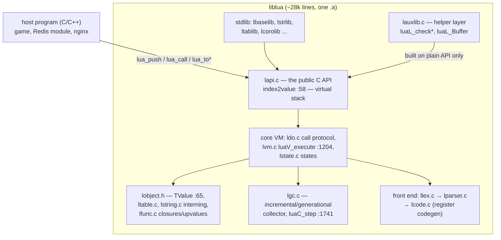
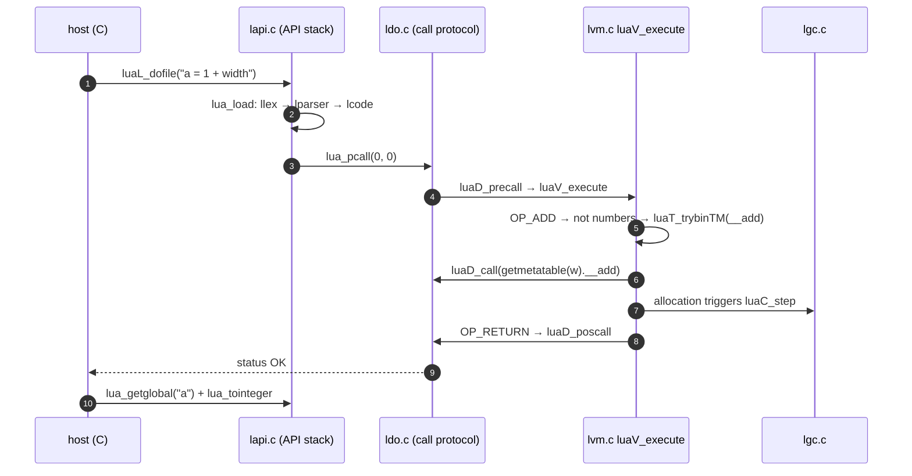
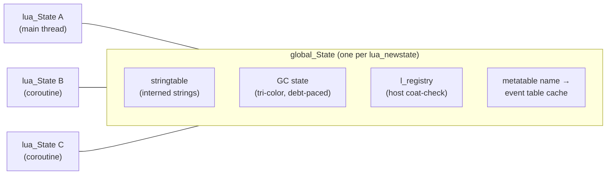

# Lua: one tagged union, a register VM, and the friendliest embedding API in the business

> **Atlas id:** `lua` · **Domains:** `language, runtime` ·
> **Upstream:** https://github.com/lua/lua · **License:** MIT ·
> **Pinned commit:** `0b29f408433e92953cc72b1d3e06c7ac8139e439` (2026-09-16)

Lua is a whole programming language — lexer, parser, a register-based
virtual machine, an incremental garbage collector, coroutines, and a
standard library — in ~28k lines of C with almost no dependencies.
Other languages are *applications* you run; Lua's defining design
decision is the opposite: **it is a library you embed**, with a C API
so disciplined that games, Redis, nginx, Neovim, and OpenWrt all
carry it inside themselves as their scripting engine. The deep-dive
teaches how far a few orthogonal primitives get you: one tagged-union
value type (`TValue`), one table structure doing duty as object,
package and namespace, one metamethod protocol replacing class
systems, and one *virtual stack* between host and VM that makes the
embedding boundary safe without ever exposing a pointer.

Read it against the [CPython](cpython.md) dive: same problem domain,
inverted priorities. CPython optimizes for being a platform (batteries,
C extensions reaching *into* objects); Lua optimizes for being a
tenant (tiny, reentrant, no global state beyond one `lua_State`
per interpreter, values you may only touch through the tray).

## Explain like I'm 10

**A craftsman's workshop that fits inside anyone's garage.** The big
machine (your game, your server — the host program, written in C)
installs a small workbench (the Lua interpreter, `lua_State`) in the
corner. Between the big machine and the workbench is a **tray** (the
API stack): to ask the craftsman anything, you place materials on the
tray (`lua_pushnumber`), press the button (`lua_call`), and take the
result off the tray (`lua_tonumber`). You never grab his tools
directly — everything crosses the tray, so nobody gets hurt. His
workbench has **named cubbies** (the registry, a coat-check room) where
the big machine can store its own precious items without the
craftsman seeing them. While he works, a **janitor** (the incremental
garbage collector) quietly sweeps the floor, marking things that are
still needed and binning the rest — a little at a time so work never
stops for a big cleanup. And the craftsman can suspend himself
mid-task (a coroutine yielding) to let another craftsman work, since
each has his own tray but shares the one supply closet (the
`global_State`).

**Why the grown-ups did it this way:** a language that must live
inside *other people's* programs has to be small, reentrant, and
pointer-free at its boundary — so its designers spent their complexity
budget on the embedding protocol, not on the type system.

## 1. Architecture overview

- **The embedding boundary is `lapi.c`.** Every public function
  (`lua_pushinteger`, `lua_gettable`, `lua_call`, …) resolves its
  arguments through `index2value` (`lapi.c:58`), which translates an
  integer index — positive from the bottom of the stack, negative
  from the top, and the pseudo-indices `LUA_REGISTRYINDEX` and
  upvalue slots — into a `TValue*`. Host code holds *no* object
  pointers, only stack indexes.
- **The spine of a script** is `luaL_dofile` → `lua_load` (lex,
  parse, generate bytecode) → `lua_pcall` → `luaD_precall`
  (`ldo.c:717`) → `luaV_execute` (`lvm.c:1204`, the dispatch loop)
  → per-instruction `vmcase(OP_...)` blocks → returns bubble back up
  the CallInfo chain.
- **Core object layer**: `lobject.h` defines every runtime value —
  `TValue` (the tagged union), `TString` (interned, with a hash),
  `Table` (array part + hash part), `LClosure`/`CClosure` and
  `UpVal` (open while on a stack, closed when the stack goes away),
  `Proto` (a function's bytecode + constant pool).
- **The collector** (`lgc.c`) runs interleaved with allocation in
  small steps (`luaC_step`, line 1741), paced by a memory "debt"
  (`setpause`, line 1122), in either incremental or generational
  mode; mutator barriers keep the tri-color invariant.
- **`lauxlib.c` is the demonstration that the API is complete**:
  the entire auxiliary library (type checking, buffers, argument
  error messages) is written *on top of* the plain API, not beside
  it — the same discipline SQLite applies with its own test harness.

## Walkthrough: one script, source to metamethod

The spine as a story — on the site you can step through it with Next;
in the repo it reads top to bottom.

**Step 1 — Load.** `luaL_dofile` (lauxlib) reads the file, calls
`lua_load`, and the front end runs without ever touching the VM:
`llex.c` tokenizes, `lparser.c` builds the syntax tree in the same
pass (a one-pass recursive-descent parser), and `lcode.c` emits
bytecode for a *register* machine — `OP_ADD A B C` means "registers
B and C add into A", with constants reachable via `OP_LOADK`.

**Step 2 — The call protocol.** `lua_pcall` pushes the function and
arguments per the stack convention, then `ldo.c:717 luaD_precall`
classifies the callee: a C function gets its own little frame and
returns immediately; a Lua closure extends the stack, allocates a
`CallInfo`, and `luaV_execute` (`lvm.c:1204`) takes over.

**Step 3 — The dispatch loop.** `luaV_execute` is a computed-goto
(`vmdispatch`) loop over instructions; `vmfetch` decodes, `RA/RB/RC`
macros compute operand addresses relative to the frame base, and
each `vmcase(OP_...)` block is short enough to read at a glance —
`OP_MOVE` is two lines.

**Step 4 — A metamethod detour.** Evaluating `1 + width` where
`width` is a userdata lands in `OP_ADD`'s "not numbers" branch,
which calls `luaT_trybinTM` (`ltm.c`) to look up `__add` in the
value's metatable — the entire extensibility story of Lua is this
one uniform lookup protocol, not a class system.

**Step 5 — GC ticks on allocation.** The `__add` C function
allocates a result; `lmem.c`'s allocation wrapper sees the GC "debt"
and runs `luaC_step` (`lgc.c:1741`) — a bounded amount of marking or
sweeping, then back to the program. Big cleanups never happen; the
floor is swept a few squares at a time.

**Step 6 — Return.** `OP_RETURN` moves results down, `luaD_poscall`
pops the `CallInfo`, and control unwinds to `luaV_execute`'s caller
loop or, at the outermost frame, back to the host's `lua_pcall` with
status `LUA_OK` — the API stack now holds exactly the declared
results.

**Outcome — The host holds the answer, nothing else.** The host
reads `a` with `lua_getglobal` + `lua_tointeger` — two tray round
trips — and the interpreter retains no ambient state from the call:
no registers, no leaked frames, one tidy `lua_State`.

## 2. Core data structures — and why these

- **`TValue` — one tagged union for every value.**
  **What:** `Value value_` (a union of pointer/integer/float/C
  function) plus a one-byte tag with variant bits
  (`lobject.h:49` union, `:65` struct; collectable vs primitive
  variants).
  **Why:** one representation means one set of macros
  (`setivalue`, `ttisnumber`, …) for the whole VM — the dispatch
  loop stays uniform, the GC needs exactly one "is it an object?"
  test (the `iscollectable` bit), and C hosts never guess a layout.
  The rejected alternative (unboxed doubles via NaN-boxing, as some
  JITs do) buys speed and pays in debugging pain — Lua keeps the
  honest 16-byte value everywhere except where it caches.

- **`Table` — array part and hash part in one struct.**
  **What:** a `TValue *array` prefix plus a `Node` hash array,
  auto-rebalanced by `rehash` which *migrates integer keys into the
  array part*; `lastfree` cached just before the node block (the
  `Limbox` layout trick at `ltable.c:55`).
  **Where:** `ltable.c` (`luaH_new`, `luaH_set`, `rehash`).
  **Why:** Lua's tables are simultaneously arrays, dictionaries,
  objects, modules and environments; the hybrid makes the two common
  shapes (`t[1]`, `t.name`) both fast without two user-visible types
  — the same "one structure, two access paths" economy as
  Redis's ziplist/listpack conversions, but at language level.

- **`lua_State` + `CallInfo` — the stack is the interpreter.**
  **What:** per-thread value stack with a linked chain of `CallInfo`
  activation frames (`lstate.h:285`); `L->ci->func.p + 1` is the
  current frame base, the API's pseudo-index arithmetic hangs off
  the same stack.
  **Why:** one contiguous `TValue` array serves interpreter frames,
  C-call frames, and host API traffic — coroutines are then just a
  second `lua_State` sharing the `global_State`, and context switch
  is a pointer swap, not a copy.

- **Interned strings + the `stringtable`.**
  **What:** every string is a `TString` hash-consed into a global
  hash table (`lstring.c:269` `luaS_new`, `:133 luaS_init`).
  **Why:** string comparison becomes pointer equality (the hot path
  in every dynamic language), table keys get cheap hashing
  (`hashstr`, `ltable.c:115`), and interning gives the GC a single
  place to find all strings — the same trick Java and Python use,
  visible here in ~100 lines.

- **Closures and upvalues.**
  **What:** `LClosure` references up to 254 `UpVal` handles
  (`lfunc.c`); an `UpVal` is *open* (points into a live stack slot,
  linked in `L->openupval`) until its variable goes out of scope,
  then it is closed — its value copied into the cell itself.
  **Why:** open upvalues make nested functions share mutable locals
  with zero copying while the parent frame lives, and closing is a
  one-shot snapshot the GC can own. C functions get the same
  mechanism (`CClosure` upvalues reachable as pseudo-indexes), so
  *host* closures and *script* closures are the same concept.

## 3. Concurrency and failure model

- **One OS thread, many `lua_State`s.** The VM assumes it owns its
  thread; concurrency is *cooperative* coroutines (`lcorolib.c`,
  `lua_resume` on the state machine in `ldo.c`) — never preemption,
  never shared-memory threading. Embedders needing parallelism run
  one `lua_newstate` per OS thread (that is the entire isolation
  model, and why it composes with hosts like nginx per-worker).
- **Errors are longjmp, contained by `lua_pcall`.** `luaD_throw`
  (`ldo.c:125`) jumps to the nearest recovery point
  (`LUAI_THROW`); `luaD_rawrunprotected` brackets calls. Error
  values are ordinary values on the stack, and the panic boundary —
  what happens if a C callback throws without a `pcall` — is
  explicit (`lua_atpanic`). Same shape as SQLite's `setjmp`
  transaction aborts: one cheap non-local exit instead of errno
  plumbing through every VM function.
- **Crash mid-GC:** the incremental design means the mutator never
  observes a half-moved world; barriers (`luaC_barrier`) are the
  protocol that keeps every intermediate state valid — recovery is
  simply "keep stepping the collector."
- **Yield across C boundaries** is the subtle failure case: a C
  function cannot keep its C stack frame while yielded, so resumable
  C calls get *continuation functions* (`k` argument of `lua_callk`)
  and the unfinished-C-call state is replayed by `unroll` /
  `finishCcall` (`ldo.c:868`). This is the price paid for
  coroutines-as-language-feature rather than OS threads, paid once,
  in `ldo.c`, by the implementors instead of every user.

## 4. API and extension design

- **The virtual stack is the API.** Push, call, read: three verbs
  cover everything; `lapi.c:58 index2value`'s positive/negative/
  pseudo-index rules are the entire addressing scheme. No handles,
  no refcounts handed to hosts, no struct layouts in headers beyond
  `lua_State`'s opaque declaration.
- **The registry** (`LUA_REGISTRYINDEX`, `index2value`'s branch at
  line 71) is a normal table only the host can conveniently see —
  the coat-check for C-side references (module tables, callbacks,
  userdata metatables). `luaL_ref`/`luaL_unref` hand out integer
  tickets.
- **Seams:** metatables (per-type default tables in the registry),
  `__index`/`__newindex` chains (including `__gc`, `__close`
  to-be-closed variables — see `L->tbclist` in `lstate.h`), userdata
  with per-object environments, and module loading via `require`
  (`loadlib.c`) with searchers as a table the host can extend.
- **Honest wart:** the copy-through-the-tray discipline means every
  host interaction is O(1) stack traffic but *visibly* bureaucratic —
  a five-line C computation is ten calls. Lua 5.x's answer (luaL
  helpers, `luaL_Buffer`) papers over it, but the friction is the
  price of safety, and the API has grown pseudo-index exceptions
  (upvalues, registry, `lua_upvalueindex`) that every wrapper
  library must re-derive.

## 5. The defining trade-offs

### Trade-off 1: one uniform `TValue` over specialized representations
- **Tension:** dynamic languages pay per value; unboxed or tagged-in-
  pointer schemes are faster but leak layout assumptions everywhere.
- **Choice:** a plain 16-byte tagged union for *every* value on every
  stack and in every table.
- **Evidence:** `lobject.h:49`/`:65`; the VM's uniform
  `setobjs2s`/`ttis*` macros throughout `lvm.c`.
- **Given up:** cache density and the last factor of interpreter
  speed (LuaJIT took exactly the other path and shows what was left
  on the table).
- **Verdict:** right for a *portable, embeddable* core where the host
  compiler and target CPU are unknowable; wrong for a JIT whose whole
  job is representation specialization.

### Trade-off 2: incremental, debt-paced GC over stop-the-world
- **Tension:** hosts embed Lua inside soft-realtime loops (game
  frames, request handlers); a 50ms GC pause inside them is a bug
  report.
- **Choice:** the collector advances in small steps on every
  allocation, paced by a debt accumulator, with barriers preserving
  the invariants in between (`lgc.c:1741 luaC_step`, `:1122
  setpause`; generational mode switches in the same file).
- **Evidence:** every table write macro funnels through
  `luaC_barrier` variants — the mutator pays a branch per store to
  keep steps valid.
- **Given up:** the simple two-line "mark all, sweep all" collector,
  and some throughput — incremental collectors do more total work.
- **Verdict:** right whenever you are a guest in someone else's
  latency budget — the same reasoning that drove [Redis's](redis.md)
  incremental rehash and [ZooKeeper's](zookeeper.md) steady-state
  design. Wrong for short-lived CLI processes where a sweep at exit
  is free.

### Trade-off 3: copy semantics through a virtual stack over direct references
- **Tension:** C hosts want speed and convenience; the language wants
  to stay portable and GC-safe across an FFI boundary it cannot
  police.
- **Choice:** all traffic goes through the stack with explicit
  push/convert/pop; hosts hold indexes, never pointers.
- **Evidence:** `lapi.c:58 index2value`; `lua_pushvalue` /
  `lua_to*` copies rather than aliasing; `lauxlib.c` existing at all
  is proof the raw protocol is usable from the outside.
- **Given up:** ergonomic FFI — contrast LuaJIT's `ffi` (blazing,
  unsafe, C-layout-coupled). The stock API makes it *impossible* to
  hold a stale object pointer.
- **Verdict:** right for a library whose customers include
  sandboxes and 20-year ABIs; wrong when both sides are one
  tightly-coupled build, where a zero-copy FFI is honest.

## 6. Reading path

1. `lua.h` — the *entire* public API, in one commented header;
   notice how few functions there are, and that `lua_State` is
   opaque. This header *is* the design document.
2. `lapi.c:58 index2value` — every API call's front door; master the
   positive/negative/pseudo index rules here before anything else.
3. `lstate.c` `lua_newstate`/`f_luaopen` — what one interpreter
   costs: stacks, string table, metatables, registry seeded.
4. `ldo.c:717 luaD_precall` — the call protocol: C vs Lua closures,
   frame layout, then `luaD_call`/`luaD_poscall`; also `ldo.c:125
   luaD_throw` and `luaD_rawrunprotected` for the error model.
5. `lvm.c:1204 luaV_execute` — spend an hour here. Read `vmfetch`,
   `RA/RB/RKC`, then follow `OP_MOVE`, `OP_ADD` (numbers fast path,
   metamethod slow path), `OP_GETTABUP` (how globals actually work:
   an upvalue pointing at the environment table), `OP_TAILCALL`,
   `OP_RETURN`.
6. `lobject.h` from line 49 — `TValue`, then walk the object zoo
   (`TString`, `Table`, `Proto`, `LClosure`/`CClosure`, `UpVal`);
   every later file speaks this vocabulary.
7. `ltable.c` — `luaH_new`/`luaH_set`, the array/hash split, and
   `rehash` migrating integer keys; the `Limbox` at line 55 is a
   nice trick for hiding `lastfree` in the allocation header.
8. `lgc.c` — colors and states (`lgc.h` first), `singlestep`, the
   atomic phase, then `luaC_step:1741` and `setpause:1122`; find the
   barrier macros used in `ltable.c` writes from step 7.
9. `ltm.c` — the ~20 event names and `luaT_gettmbyobj`; connect it
   back to the `OP_ADD` slow path you read in step 5.
10. `lauxlib.c` — `luaL_checkinteger`, `luaL_Buffer`,
    `luaL_ref`/`luaL_unref`; the proof-by-construction that the API
    composes.
11. `lbaselib.c` (`print` is ~15 lines) and `lcorolib.c` (`coroutine
    .resume` wrapping `lua_resume`) — libraries as ordinary API
    clients; then `lundump.c` if you care about precompiled chunks.

You have now traced one script from bytes through bytecode, a
register-VM loop, a metamethod dispatch, and a garbage-collection
step — plus the tray that made it all embeddable.

## 7. What to steal

- **Make your library's boundary a virtual stack (or queue) of
  values, not object references.** `lapi.c` shows that one
  addressing rule (positive/negative/pseudo) plus push/convert/pop
  covers everything, and stays ABI-stable for decades.
- **A registry with integer tickets** (`luaL_ref`) is the minimal
  safe "host owns a reference" mechanism whenever a GC lives
  underneath — steal it for any plugin host.
- **Pace background work by allocation debt**, not timers:
  `luaC_step`'s "every malloc pays a slice" trick keeps GC cost
  proportional to allocation with zero scheduling machinery.
- **One representation discipline beats N special cases**: the
  uniform `TValue` is why 28k lines cover strings-to-coroutines;
  resist per-type fast paths until measurement demands them.
- **Implement your own helpers on your own public API.** `lauxlib`
  and the stdlib never cheat — so the API's completeness is
  continuously testable by its own product.
- **Metadata-driven extensibility** (one metatable protocol instead
  of class hierarchies) keeps the core small while users build
  inheritance, prototypes, or DSLs themselves.

## 8. Difficulty and prerequisites

- Difficulty: `moderate`. Realistic budget: 6 hours for this path;
  10 if you also read `lgc.c` in full.
- Prerequisites: comfortable C (function pointers, unions,
  `setjmp`); basic compiler vocabulary (lexer/parser/bytecode — any
  intro post suffices); no prior VM knowledge needed — `lvm.c`'s
  comments teach register machines as you go. The Lua reference
  manual's §4 (the C API) is the ideal pre-read.

## 9. Further reading

- *Programming in Lua* (4th edition), Roberto Ierusalimschy —
  especially the stack-protocol chapters and the C API part.
- The Lua 5.5 reference manual — https://www.lua.org/manual/5.5/
- Ierusalimschy et al., *Lua: an extensible extension language* and
  *The Evolution of Lua* (HOPL III paper) — the design history
  behind "small core, embed everywhere."
- `lua-users.org` wiki — the C/Lua binding idioms and `luaL_ref`
  patterns this dive cites.
- The [CPython](cpython.md) dive in this atlas for the contrasting
  "language as platform" design.
