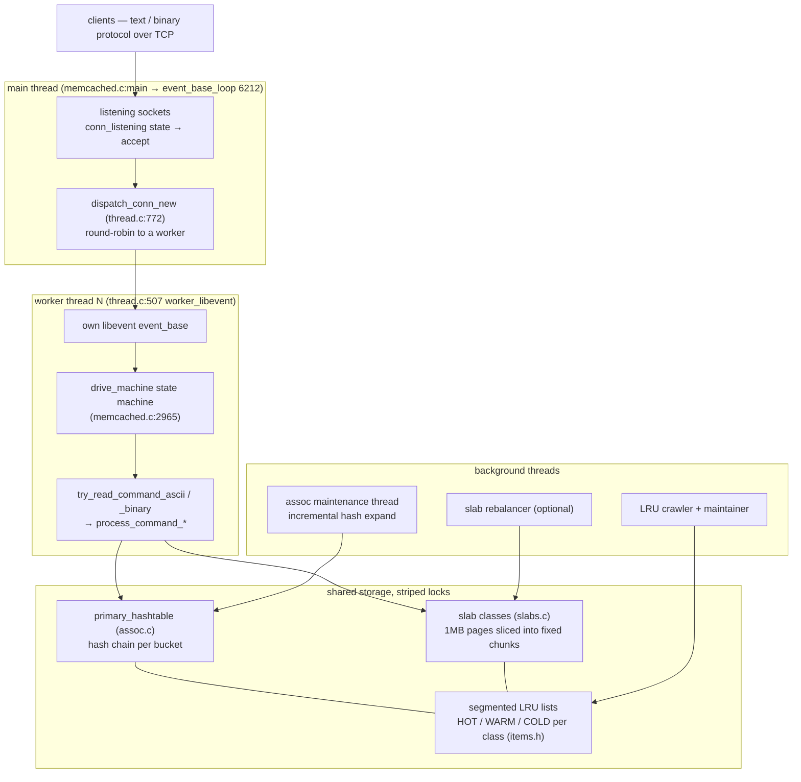
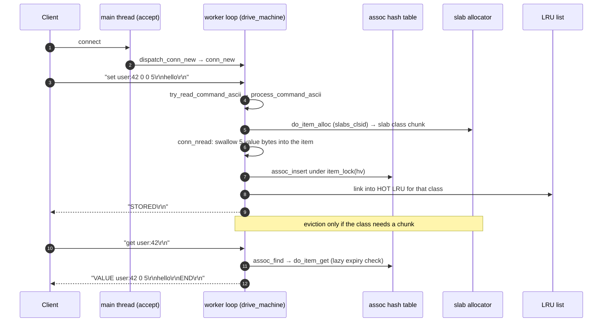
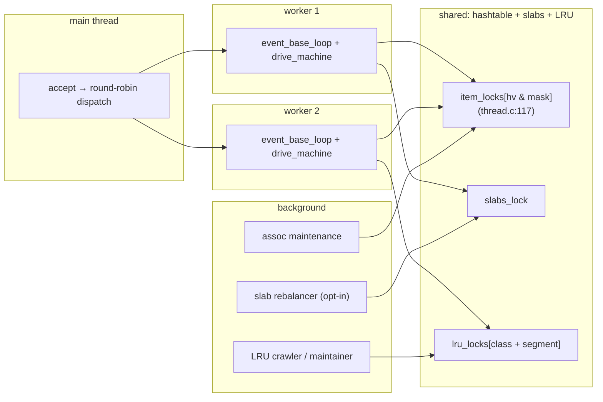

# Memcached: the cache that kept the server dumb

> **Atlas id:** `memcached` · **Domains:** `cache` ·
> **Upstream:** https://github.com/memcached/memcached · **License:** BSD-3-Clause ·
> **Pinned commit:** `2d51e364799bc9698bd4b11728ea978cea12da6e` (2026-07-09)

Memcached is a networked hash map, and its design thesis is that this is
*enough*: the server allocates memory in fixed slab classes, evicts by
(approximate) LRU, speaks a protocol you can type in netcat — and refuses
every other job. No persistence, no replication, no clustering: sharding,
failover, and consistent hashing all live in client libraries. This
deep-dive teaches what that refusal buys (predictable latency, a tiny
server that scaled the mid-2000s web) and where it hurts, by walking one
`SET` and one `GET` through worker event loops, striped locks, and the
slab allocator that never frees.

Read it alongside [Redis](redis.md): two opposite answers to the same
problem. Memcached keeps the server minimal and pays in features; Redis
builds the data structures in and pays in complexity.

## Explain like I'm 10

**A wall of mail slots in fixed sizes.** Memcached is a post office wall
where every slot is one of a few fixed sizes (slab classes): small,
medium, large. When a letter arrives (a `SET`), the clerk picks the
smallest slot it fits in — never a custom one — because carving slots to
order leaves unusable gaps (fragmentation). Each counter line has its own
clerk (a worker thread with its own event loop), and a sorter at the
door (the main thread) hands new customers to clerks round-robin so no
line is longer than another. When the wall is full, a janitor quietly
throws away the oldest mail nobody asked about (approximate LRU eviction)
instead of buying more wall. The building never promises to remember
anything if the power goes out (no persistence) — if a branch burns
down, customers just switch to another branch using a directory they
each keep in their own pocket (consistent hashing in the *client*
libraries). Nothing in the post office even knows the other branches
exist.

**Why the grown-ups did it this way:** every hard distributed problem was
pushed out of the server — into clients, or into "the cache can be cold"
— so the server itself stays so simple it almost cannot fall over.

## 1. Architecture overview



- **Main thread** owns the listening sockets and nothing else. Its
  `drive_machine` in `conn_listening` state accepts, then hands the fd to
  a worker via `dispatch_conn_new` (`thread.c:772`) — a queue item plus a
  pipe write to wake that worker's event loop (`notify_worker`).
- **Worker threads** (default count = cores) each run `worker_libevent`
  (`thread.c:507`): an `event_base_loop` around per-connection state
  machines (`drive_machine`, `memcached.c:2965`).
- **Storage** is shared and protected by *striped* locks, not one global
  lock: `item_lock(hv)` maps a key's hash to one of a few thousand
  mutexes (`thread.c:117`); slab allocation takes the global `slabs_lock`
  briefly; each LRU segment has its own `lru_locks[]`.
- **Background threads** do the amortized work: the assoc maintenance
  thread migrates buckets during hash expansion (`assoc.c:197`), the LRU
  crawler/maintainer ages items between segments, and an optional slab
  rebalancer moves pages between classes.
- The **spine** of a command: fd readable → `drive_machine` conn_read →
  `try_read_command_ascii` (`proto_text.c:357`) → `process_command_ascii`
  (`proto_text.c:1529`) → per-command handler → `assoc_*` / `do_item_*`
  under the item lock → reply queued, flushed by the event loop.

## Walkthrough: one SET and one GET, socket to slab

The spine as a story — on the site you can step through it with Next;
in the repo it reads top to bottom.



**Step 1 — The sorter assigns a line.** The client connects; the main
thread's `drive_machine` accepts (`conn_listening` case,
`memcached.c:2965`) and calls `dispatch_conn_new` (`thread.c:772`),
which picks a worker round-robin and wakes it. The fd now belongs to
that worker's event loop forever — no migration, no shared sockets.

**Step 2 — Parse the verb.** Bytes arrive; the worker's loop calls
`try_read_command_ascii` (`proto_text.c:357`), which finds the line
ending and hands the line to `process_command_ascii`
(`proto_text.c:1529`) — a hand tokenizer, not a grammar.

**Step 3 — Allocate before you promise.** `process_update_command`
(`proto_text.c:764`) sizes the item (header + key + flags suffix + value
bytes), calls `do_item_alloc` (`items.c:249`), which maps the size to a
slab class with `slabs_clsid` (`slabs.c:77`) and pulls a chunk from that
class's freelist (`do_slabs_alloc`, `slabs.c:411`). If the class is
empty, `do_item_alloc_pull` (`items.c:162`) evicts from the COLD tail
to make room — the value isn't even read off the wire yet.

**Step 4 — Swallow the value.** The connection enters `conn_nread`
state and `drive_machine` reads exactly the announced value length into
the chunk the allocator handed out: header, key, and value end up in
*one* contiguous allocation (`item` struct, `memcached.h:613`).

**Step 5 — Publish under the stripe.** `assoc_insert` (`assoc.c:153`)
links the item into the hash bucket — under `item_lock(hv)`, the striped
mutex chosen by the key's hash (`thread.c:117`) — and the item joins the
HOT LRU list of its class. Only writers touching keys that hash to the
same stripe wait for each other.

**Step 6 — Reply at the loop's edge.** `STORED\r\n` is queued in the
connection's response object and written when the socket is writable;
the worker immediately moves on to other connections.

**Step 7 — A GET walks the same spine, minus the write.**
`process_get_command` (`proto_text.c:429`) iterates keys;
`do_item_get` (`items.c:974`) finds the item and applies *lazy* expiry —
an item whose `exptime` passed is unlinked on touch, not by a timer.

**Outcome — The client sees its value or END.** Memory came from a
fixed class, sharing was bounded by one stripe lock, and nothing was
fsynced anywhere — a cache's contract is speed, and recovery is "the
clients refill it."

## 2. Core data structures — and why these

### item — header, key, and value in one chunk (`memcached.h:613`)

```c
typedef struct _stritem {
    struct _stritem *next;      /* LRU links, protected by LRU locks */
    struct _stritem *prev;
    struct _stritem *h_next;    /* hash chain, protected by item lock */
    rel_time_t      time;       /* least recent access */
    rel_time_t      exptime;
    int             nbytes;
    ...
} item;   /* followed by key, flags suffix, then the data bytes */
```

One allocation, three roles: LRU membership (`next/prev`), hash
membership (`h_next`), and inline payload. A pointer-graph design
(header object + separate value buffer) would need two frees, two
allocations, and an indirection per `GET`; here one slab chunk is the
whole item. The comment in `memcached.h` documents which lock protects
which field — LRU fields vs hash fields vs refcount — the lock-striping
design made visible.

### slab classes — fixed-size chunks that are never freed (`slabs.c:202`)

`slabs_init` builds `slabclass[]` with sizes growing by a factor
(default 1.25) from 80 bytes up; a 1MB page (`slab_page_size`) is cut
into `perslab` equal chunks per class. `do_slabs_alloc` (`slabs.c:411`)
serves from the class freelist (`p->slots`); "freeing" an item only
returns it to that freelist — memory is *never* returned to the OS, and
pages are only re-carved by the optional slab-reassign machinery. Why:
general malloc fragments fatally under cache workloads (this is the
allocator's origin story — the 2002 fork of a memory manager for
LiveJournal); size classes turn fragmentation into bounded internal
waste (on average under half a class step, and tunable with `-f`).

### primary_hashtable — chained, with incremental expansion (`assoc.c`)

An open-chaining table indexed by the key hash (`assoc_find`,
`assoc.c:70`). When it fills, `assoc_expand` allocates a doubled table
and a *background thread* moves `hash_bulk_move` buckets per iteration
(`assoc_maintenance_thread`, `assoc.c:197`) — under item locks, in the
same striping scheme the request path uses (the comment at `assoc.c:207`
explains why one stripe lock suffices per bucket move). Why
incremental: the same reasoning as Redis's incremental rehash — a
multi-GB rehash on the request path would be a latency spike measured in
seconds.

### segmented LRU — HOT, WARM, COLD, TEMP per class (`items.h:1-4`)

Not one list per class but four segments (`#define HOT_LRU 0` …
`TEMP_LRU 192`), with a maintainer thread moving items between them and
evicting only from COLD. `lru_pull_tail` (`items.c:1072`) is the
eviction engine: take the tail under the LRU lock, trylock the item's
stripe, skip what's busy, evict what's expired or coldest. Why segments:
classic LRU lets a one-time scan flush the whole working set ("list
poisoning"); splitting hot/warm/cold means a burst of junk lands in COLD
and dies there, while repeatedly-read keys get bumped (the
`lru_bump_buf` defers bumps off the request path entirely).

## 3. Concurrency and failure model



- **What runs concurrently:** N worker loops, one per core by default,
  plus the background threads. **What is serialized:** access to a given
  *key* (stripe lock), a given slab class's freelist (`slabs_lock`), a
  given LRU segment. The rule is written down at `thread.c:109`:
  "item_lock() must be held for an item before any modifications to
  either its data or the LRU links."
- **Races are chosen, not eliminated.** `do_item_alloc_pull`
  (`items.c:162`) carries a comment that is the whole philosophy in
  three lines: the eviction path is *allowed* to occasionally OOM rather
  than coordinate — "This is a race in order to simplify lru_pull_tail."
  An LRU you only approximate is one you never wait on.
- **Crash model: there is none.** No WAL, no snapshot, no replay. A dead
  memcached is a cold cache; clients mark the shard dead in their
  consistent-hash ring and life goes on. (The modern escape hatches —
  `extstore` for SSD offload and a restart-mode memory file — are opt-in
  additions, not the design.)
- **Overload behavior:** per-connection limits (`read_buf_mem_limit`),
  global memory limit enforced by eviction, `maxconns_fast` rejection at
  accept time, and the LRU crawler with a sleep budget so background
  scanning never steals the foreground's CPU.

## 4. API and extension design

- The **text protocol** is the API: `get/set/add/gets/cas/delete/
  incr/decr/touch`, plus the newer meta commands (`mg/me/ma/ms`,
  `proto_text.c`). It is line-oriented, unversioned, and speakable from
  netcat — which is why a hundred client libraries existed within a few
  years. The **binary protocol** (`proto_bin.c`) adds framing, opaque
  tokens, and a SASL path behind the same verbs; the server auto-negotiates
  on the first bytes (`conn_new` picks `try_read_command_negotiate`).
- The **seams are internal, not a plugin API**: `EXTSTORE` (an external
  storage device for cold items) and `PROXY` (a Lua-configured routing
  mode, `proxy/proxy_lua.c` + `proxy_luafgen.c`) are compile-time feature sets, not loadable
  modules. This is the honest cost of the minimal-server bet: where
  nginx has a module API, memcached has a Makefile flag.
- The extension surface that *mattered* is the client protocol + the
  client-side conventions built on it: consistent hashing (Ketama),
  add-or-get locking patterns, flags as a poor man's MIME type. The
  server stayed stable because it promised so little.
- The wart: because the text protocol grew by accretion, each verb
  reimplements argument parsing; `process_command_ascii`
  (`proto_text.c:1529`) is a long dispatch over near-duplicated token
  walks — compare Redis's generated command table for the same problem
  solved as data.

## 5. The defining trade-offs

### Trade-off 1: fixed slab classes over general-purpose malloc
- **Tension:** hold millions of short-lived, similar-sized objects
  forever without fragmenting.
- **Choice:** size classes with factor growth; chunks recycle inside
  their class; memory never goes back to the OS.
- **Evidence:** `slabs_init` (`slabs.c:202`) builds the classes;
  `do_slabs_alloc` (`slabs.c:411`) serves chunks; `slabs_clsid`
  (`slabs.c:77`) rounds every request up to a class. The optional
  reassign thread (`start_slab_maintenance_thread` in `slabs.c`) exists
  only because pages *can't* move between classes by default — the
  cost of the choice, patched.
- **Given up:** memory flexibility — a workload of 129-byte items in a
  128-byte class wastes ~50%; large values need chunked item chains
  (`item_chunk`, `items.c:208`), a whole subsystem malloc would have
  made unnecessary.
- **Verdict:** right when value sizes cluster (sessions, rendered
  fragments, denormalized rows) — which is what a *cache* holds. Wrong
  for arbitrary-size documents, where Redis's SDS strings with their own
  allocator discipline are the better tool.

### Trade-off 2: approximate LRU with striped locks over a strict global list
- **Tension:** real LRU order is global state; updating it per access
  costs serialization on every `GET`.
- **Choice:** per-class segmented lists, stripe locks by hash, deferred
  bump buffers, and eviction that *skips* locked items instead of
  waiting.
- **Evidence:** `lru_pull_tail` (`items.c:1072`) walks the tail with
  `item_trylock` and simply `continue`s past contention; the race
  comment in `do_item_alloc_pull` (`items.c:166`) blesses occasional
  failure over coordination; `thread.c:109-117` draws the lock rules.
- **Given up:** strict recency — a contended item can be evicted while
  "hot", and stats are per-thread approximations (`THR_STATS_LOCK`
  only guards the per-thread counters).
- **Verdict:** right because a cache's product is p99 latency, not
  exact staleness order — an approximate LRU that never blocks beats a
  precise one that does. Wrong when every object is expensive to
  recompute and false evictions are visible as load — then you want
  Redis's sampled + segmented scheme or an explicit admission policy
  (e.g. TinyLFU), not more precision inside the same shape.

### Trade-off 3: dumb server, smart clients over a coordinated cluster
- **Tension:** scale a cache across many machines without making the
  server a distributed system.
- **Choice:** the server has zero cluster code — no membership, no
  replication, no rebalancing protocol. Clients shard via consistent
  hashing and treat a dead node as a cache miss funnel to peers/DB.
- **Evidence:** the command table in `proto_text.c` — the *entire*
  server surface is per-key verbs; there is no `CLUSTER`, no `REPLICA`,
  no forwarding state anywhere in `memcached.c`. The main thread's only
  routing decision is worker round-robin (`select_thread_round_robin`
  in `dispatch_conn_new`, `thread.c:772`).
- **Given up:** server-side durability and rebalance-free elasticity;
  the ecosystem had to standardize hashing *outside* the repo (Ketama),
  which took years and client-by-client adoption.
- **Verdict:** right for a *cache*, where the source of truth lives
  elsewhere and a cold start is survivable. The exact same choice is
  fatal for a *database* — which is the Kafka deep-dive's mirror-image
  lesson ("dumb broker, smart clients" works when the broker is a log
  everyone can reread, and fails when it isn't).

## 6. Reading path

1. `memcached.c:main` (line 4714) — settings parse, then the startup
   order: `memcached_thread_init` (workers) → assoc maintenance thread →
   LRU crawler → LRU maintainer → slab reassign → clock → listen →
   `event_base_loop(main_base, EVLOOP_ONCE)` at line 6212. Notice how
   *few* things the main thread does after setup.
2. `memcached.c:drive_machine` (line 2965) — the connection state
   machine: `conn_listening` accepts and dispatches; read the
   `conn_read → conn_parse_cmd → conn_nread` cycle once for a `SET` and
   once for a `GET`.
3. `thread.c:dispatch_conn_new` (line 772) + `worker_libevent`
   (line 507) — connection handoff by queue + pipe wakeup; each worker
   runs its own `event_base_loop`. This is the "event loop per core"
   shape nginx arrived at with processes.
4. `thread.c:109-134` — the lock-striping contract (`item_lock`,
   `item_trylock`) and the comment that defines who may touch what.
5. `proto_text.c:try_read_command_ascii` (line 357) →
   `process_command_ascii` (line 1529) → `process_update_command`
   (line 764) — parse, then allocate-before-read; the value bytes are
   swallowed later by `conn_nread`, directly into the slab chunk.
6. `slabs.c:slabs_init` (line 202) + `do_slabs_alloc` (line 411) — size
   classes, per-class freelists, the never-free discipline; then
   `slabs_clsid` (line 77) for the rounding rule.
7. `items.c:do_item_alloc` (line 249) → `do_item_alloc_pull`
   (line 162) — the retry loop that makes eviction a fallback for
   allocation failure, and the race comment that explains why.
8. `assoc.c` — `assoc_find` (70), `assoc_insert` (153),
   `assoc_expand` (123-126), and `assoc_maintenance_thread` (197) —
   the incremental rehash story, done by a thread instead of Redis's
   per-op steps.
9. `items.c:lru_pull_tail` (line 1072) — eviction: tail walk under LRU
   lock, trylock per item, expired-first; then
   `start_lru_maintainer_thread` (line 1649) for the segment moves.
10. `items.c:do_item_get` (line 974) — lazy expiry and the refcount
    handshake (`refcount_incr`) that lets one thread read an item
    another thread is evicting.
11. `memcached.h:613` — the `item` struct with its inline key+value and
    the lock annotations; compare with Redis's `robj` to see
    value-object design vs slab-native design.

You have now traced a `SET` and a `GET` from socket to slab class and
back, and seen the three refusals (no malloc, no strict LRU, no cluster)
that make the whole design cohere.

## 7. What to steal

- **Refuse the hard problem your system doesn't own.** Memcached pushed
  durability and distribution to clients because a cache *may* forget —
  name the thing your system may forget, and design around that license.
- **Allocation by size class recycles without fragmenting** — apply
  wherever millions of same-shaped objects live and die
  (`slabs.c:do_slabs_alloc`).
- **Stripe your locks by hash, not by structure**: contention follows
  keys, so lock by key hash (`thread.c:item_lock`) and document the
  ownership of every field next to its declaration (`memcached.h:613`).
- **Amortize growth into a background thread with the same lock
  discipline as the foreground** (`assoc_maintenance_thread`) — a
  pattern that scales from hash tables to any resizable structure.
- **Prefer an occasional miss over coordination**: the race comments in
  `items.c` are the cleanest statements of "good enough, cheaper" you
  will read in systems code.

## 8. Difficulty and prerequisites

- Difficulty: **moderate**. Plain C, no macros beyond the event library.
- Budget: ~4 hours for the reading path; a weekend adds `thread.c`,
  `items.c`, and `slabs.c` cover to cover (~8k lines total, dense).
- Prerequisites: hash tables and freelists at a data-structures level;
  what an event loop is (the [Redis](redis.md) dive covers the shape);
  pthread mutex basics.

## 9. Further reading

- The memcached docs — https://memcached.org/ — especially the tuning
  pages on slab growth factor and the LRU crawler.
- B. Fitzpatrick, "Distributed Caching with Memcached" (Linux Journal,
  2004) — the origin story, including why the allocator was written.
- D. Karger et al., "Consistent Hashing and Random Trees" (1997) — the
  paper Ketama-style client hashing implements; read it to see the
  "smart client" half of the design.
