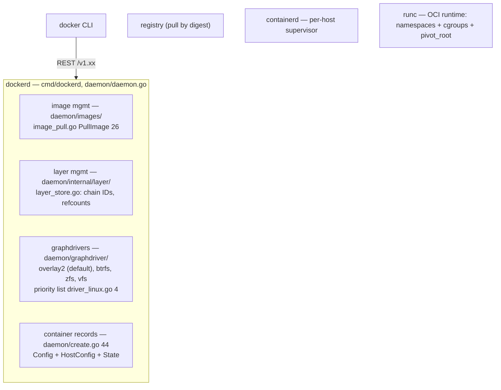
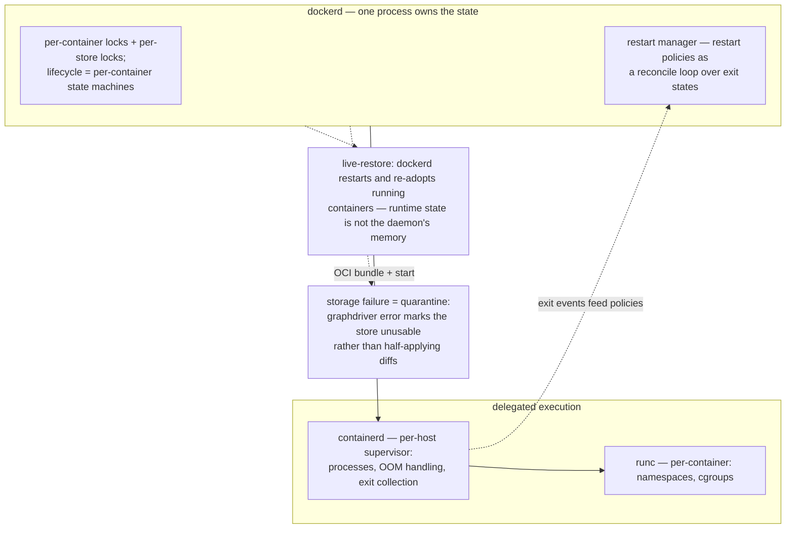

# Moby/Docker: images as content-addressed layers, execution as delegation

> **Atlas id:** `moby` · **Domains:** `container` ·
> **Upstream:** https://github.com/moby/moby · **License:** Apache-2.0 ·
> **Pinned commit:** `9fabd6dfbb926381278c436a866bc8d6ac222274` (2026-10-09, master)

Docker (the Moby project) made containers the default unit of software
delivery by wrapping Linux primitives in one product-shaped design:
**images as immutable, content-addressed, copy-on-write layer stacks**
plus **one daemon with a REST API** behind a single-command UX. This
deep-dive teaches how a packaging format became an ecosystem contract
(layer digests, registries, OCI), how the daemon delegates execution
down a deliberate chain (dockerd → containerd → runc), and what the
daemon-centric bet bought and cost.

## Explain like I'm 10

**A program shipped as a stack of clear plastic sheets.** Instead of
mailing someone a whole heavy toy box (a whole computer disk image),
Docker ships a stack of clear sheets: each sheet has part of the drawing
(a layer), plus a fingerprint of exactly what's drawn on it (a digest).
Running the program = laying the stack on a lightbox and putting ONE
blank sheet on top to draw on (the writable layer): everything you change
shows up on the top sheet, and the sheets below never get ink on them —
so a hundred people can share the same bottom sheets. A butler (the
dockerd daemon) answers your walkie-talkie (the REST API), fetches the
sheets from a library (the registry), checks every fingerprint, and
hands the actual running-around work to specialists (containerd, then
runc).

**Why the grown-ups did it this way:** fingerprints mean two strangers
can exchange sheets with zero trust — if the fingerprint matches, the
sheet is provably identical — so sharing, caching, and verifying
programs became free, and that made "works on my machine" a solved
problem.

## 1. Architecture overview


    IMG -->|"manifest → layer blobs"| REG
    IMG --> LAYERS --> GD
    CREAT --> LAYERS
    daemon -->|"prepare OCI bundle, delegate"| CD --> RUNC

- The **spine** — `docker run nginx` — is: CLI POSTs to the daemon →
  image resolved/pulled (`daemon/images/image_pull.go:PullImage:26`) →
  layers registered in the layer store
  (`daemon/internal/layer/layer_store.go`) → container record created
  (`daemon/create.go:CreateManagedContainer:44`) → a writable layer
  mounted over the image stack (`CreateRWLayer:474` in the layer
  store) → start (`daemon/start.go:ContainerStart:49`) hands the
  prepared bundle to the runtime (containerd/runc).

## Walkthrough: docker run nginx, walkie-talkie to running container

The spine as a story — step through it on the site or read straight
down. Notice how the fingerprints do the heavy lifting.

```mermaid
sequenceDiagram
    autonumber
    participant U as User (docker CLI)
    participant D as dockerd (REST API)
    participant R as Registry
    participant L as Layer store + graphdriver
    participant RT as containerd → runc
    U->>D: POST /containers/create + start (image: nginx)
    D->>R: PullImage (26) — manifest → layer blobs by digest
    R-->>L: blobs arrive; every digest verified
    L->>L: register layers by ChainID, dedupe across images
    L->>L: CreateRWLayer (474) — blank sheet on top of the stack
    D->>RT: prepare OCI bundle, delegate start
    RT-->>U: container running (namespaces + cgroups)
    Note over L,RT: identical digests = identical filesystem, on any host
```

**Step 1 — The ask.** `docker run nginx` is two REST calls: create and
start. The CLI is a thin client — every tool built on Docker speaks the
same versioned API (`api/types/` is the typed surface).

**Step 2 — Fetch the sheets.** The image isn't local, so
`daemon/images/image_pull.go:PullImage` (26) talks to the registry:
read the manifest, then download each layer blob — each one named by
its digest, each one verified as it lands.

**Step 3 — File them once.** The layer store
(`daemon/internal/layer/layer_store.go:31`) registers each blob under
its `ChainID` with reference counting. Two images sharing a base layer
store it once; the fingerprint IS the name, so dedup is automatic.

**Step 4 — Make the container record.** `CreateManagedContainer`
(`daemon/create.go:44`) writes the declarative triple — `Config`
(what to run), `HostConfig` (where and how: mounts, resources, restart
policy), `State` (what we observed) — and pins the image reference.

**Step 5 — Blank sheet on top.** `CreateRWLayer` (474) mounts the image
stack read-only through the graphdriver (overlay2 by default) plus one
writable layer — copy-on-write: reads fall through the stack, writes
land on top.

**Step 6 — Delegate the running.** `ContainerStart` (`daemon/start.go:49`)
checks the state-machine gates, prepares an OCI bundle, and hands off
down the chain: containerd supervises, runc sets up namespaces/cgroups
and execs the process. The daemon re-adopts running containers on
restart (live-restore) because execution state isn't in its memory.

**Outcome — Same bytes, same world.** The container runs in an
environment provably identical on every host that trusts the same
fingerprints — which is the entire product, delivered by content
addressing plus delegation.

## 2. Core data structures — and why these

### The layer store: content-addressed CoW stack
(`daemon/internal/layer/`)

An image is a chain of layers; each layer is identified by a digest of
its content, and a stack's identity is its `ChainID` (digest of
parent+diff). `layerStore` (`layer_store.go:31`) maps chain IDs to
read-only layers (`layer.go:62`) with reference counting; containers
add one writable layer (`RWLayer:95`, created by `CreateRWLayer:474`).
Why content-addressed: identical layers dedupe globally (across images
and hosts), integrity is free, and registries become dumb digest-keyed
blob stores — the same CAS bet git makes, applied to filesystems.

### Graphdrivers: pluggable CoW filesystems
(`daemon/graphdriver/`)

Layers materialize via a driver interface — `overlay2` by default,
priority list at `driver_linux.go:4` (`overlay2,fuse-overlayfs,btrfs,
zfs,vfs`). Each driver implements the same diff/apply/quotas surface;
the daemon never learns filesystem specifics. Why: the CoW mechanism
is kernel- and storage-backend-specific, but the *model* (stacked
immutable diffs + one writable top) is universal — isolate the varying
part.

### Container records: Config + HostConfig + State
(`api/types/container/config.go:25`, `hostconfig.go:418`,
`daemon/container/container.go:70`)

A container is *declarative config* (`Config`: image, env, cmd) +
*host binding* (`HostConfig`: mounts, resources, restart policy) +
*observed state* (`Container` embeds `State`, JSON-marshaled back for
`docker inspect`). The split mirrors Kubernetes' spec/status — intent
vs placement vs observation — and makes the REST API self-describing.

## 3. Concurrency and failure model

- **One daemon process** owns all state: image metadata, layer mounts,
  container supervision. The daemon holds locks per container
  (`Container` embeds its `State`'s mutex) and per store; the REST API
  serializes lifecycle transitions per container (create/start/stop
  are per-container state machines, restart policies implemented by a
  restart manager).
- **Delegation for execution**: process supervision, OOM handling, and
  exit collection live one level down (containerd per-host supervisor,
  runc per-container). The daemon's failure story: dockerd can restart
  and re-adopt running containers (live-restore) because the runtime
  state is not the daemon's memory.
- **Storage failure = quarantine**: a graphdriver error marks the
  store unusable rather than half-applying diffs; layer metadata lives
  on disk in its own files (`filestore.go`), so a crashed pull leaves
  unreferenced blobs for GC, never a corrupt chain.
- **Root daemon, by history**: dockerd needed root for namespaces/
  mounts (hence the rootless mode work, `daemon/internal/rootless/`) —
  the security story is a direct consequence of the daemon-centric
  architecture.



## 4. API and extension design

- The REST API *is* the interface that built the ecosystem: every
  tool (Compose, Swarm, Kubernetes-early, IDEs) speaks it; versioned
  (`/v1.xx/`) with negotiated deprecations, machine-readable types in
  `api/types/`. The CLI is a thin client — compare nginx's config
  language vs Docker's API-first surface.
- **Extension seams**: volume plugins, network drivers, and log
  drivers are socket-based plugin protocols; graphdrivers are compile-
  time pluggable; OCI image/runtime formats made the *outputs* of the
  system interoperable with an entire ecosystem (podman, buildkit,
  registries).
- Honest wart: the monolithic daemon accumulated every subsystem
  (build, network, cluster, volumes), which is why execution was split
  out to containerd and build to BuildKit — a live example of a
  successful monolith deliberately decomposing along its natural
  seams.

## 5. The defining trade-offs

### Trade-off 1: content-addressed layers + CoW over machine images
- **Tension:** ship applications reproducibly without shipping whole
  disks.
- **Choice:** images are ordered diffs, digest-named; running = mount
  the stack read-only plus one writable layer on top.
- **Evidence:** `layerStore` chain IDs (`layer_store.go:31`); `RWLayer`
  creation (`CreateRWLayer:474`); `graphdriver/driver_linux.go:4` —
  the CoW backends that make mounting cheap.
- **Given up:** in-place image edits (images are immutable — commit
  writes new layers), disk-space GC complexity, performance cliffs
  when the writable layer fills or many containers share small base
  images with heavy writes.
- **Verdict:** the packaging format won because digests compose:
  registries cache, builds reuse cache, CI verifies. The same CAS
  lesson as git, paying off in a different domain.

### Trade-off 2: daemon-centric REST architecture over per-tool CLIs
- **Tension:** one coherent UX and API vs Unix-style small tools.
- **Choice:** a single daemon owning images/containers/networks,
  fronted by REST; CLI talks to it.
- **Evidence:** everything routes through `daemon/` (`create.go:44`,
  `start.go:49`, `images/image_pull.go:26`); `api/types/` is the typed
  surface.
- **Given up:** the root-daemon attack surface, a single point of
  failure (mitigated by live-restore), and API-locked innovation
  (daemons must version carefully forever).
- **Verdict:** for its era, overwhelmingly right: one daemon + one API
  turned kernel machinery into a product that developers (not admins)
  adopted. The cost profile is what later tools (podman, daemonless)
  market against.

### Trade-off 3: delegate execution (containerd/runc) over own it
- **Tension:** control the runtime vs share an ecosystem.
- **Choice:** dockerd orchestrates images/lifecycle; containerd
  supervises; runc executes; all glued by OCI specs
  (`daemon/containerd/` adapters, image service there too).
- **Evidence:** the adapter layer `daemon/containerd/` (image pull
  delegation alongside classic `daemon/images/`); container records
  prepared as OCI bundles before start.
- **Given up:** latency (another IPC hop), cross-project coordination
  overhead for every runtime feature.
- **Verdict:** standardizing the runtime boundary (OCI) grew the pie:
  Kubernetes, podman, and BuildKit all consume the same runtimes —
  a rare case where a market leader's openness amplified rather than
  diluted its position.

## 6. Reading path

1. `cmd/dockerd/` (main) → `daemon/daemon.go` — boot order: graphdriver
   selection, layer store init, container re-adopt; note what a daemon
   owns vs delegates.
2. `daemon/graphdriver/driver_linux.go:4` + `overlay2/` — the priority
   list and one driver: how diffs become overlayfs mounts.
3. `daemon/internal/layer/layer_store.go` — `layerStore` (31),
   `Register` (digest computation), `CreateRWLayer` (474): reference
   counting, chain IDs, metadata files (`filestore.go`).
4. `daemon/images/image_pull.go:PullImage` (26) — the registry
   protocol in action: manifest → layer blobs → apply to graphdriver;
   run a pull with `--debug` alongside.
5. `api/types/container/config.go:25` + `hostconfig.go:418` — the
   declarative surface; compare to Kubernetes' PodSpec.
6. `daemon/create.go:CreateManagedContainer` (44) — config → container
   record → RWLayer → image reference pinning.
7. `daemon/start.go:ContainerStart` (49) and `containerStart` (82) —
   state machine gates (already-running? paused?), then the handoff
   down the delegation chain.
8. `daemon/containerd/` (image service + adapters) — where dockerd
   meets containerd; then read the atlas `runc` entry for the syscall
   floor beneath.
9. `daemon/images/image_delete.go` — untagging vs layer GC: how
   reference counts decide what blobs can die; the classic "dangling
   image" explanation lives here.
10. `volume/` and one network driver — the other two extension axes;
    note both are plugin protocols, unlike the compile-time
    graphdrivers.

You have now traced `docker run` from REST call through registry pull,
layer dedup, CoW mount, and container creation to the delegation
boundary — the full path of the packaging innovation.

## 7. What to steal

- **Content-address your artifacts** (layers as digests): caching,
  integrity, and distribution all become generic infrastructure —
  git, OCI, and Nix all harvested the same field.
- **Model intent/binding/observation separately** (Config/HostConfig/
  State) — the split composes into REST APIs, inspect tools, and later
  orchestrators without redesign.
- **Isolate the varying backend behind a narrow interface**
  (graphdrivers): CoW mechanism changed every few years without
  touching the layer model.
- **Standardize the boundary below you, integrate above you**:
  OCI-under/Docker-API-over grew an ecosystem instead of a walled
  garden.
- **Watch for the monolith's natural seams** — execution and builds
  left the daemon along exactly the boundaries the specs had already
  drawn.

## 8. Difficulty and prerequisites

- Difficulty: **demanding** — large Go codebase with historical
  sediment (classic + containerd-backed paths coexist); stick to the
  spine.
- Budget: ~6 hours for the reading path.
- Prerequisites: containers = namespaces+cgroups (read the `runc`
  catalog entry first), Go reading fluency, REST basics, overlayfs at
  a conceptual level.

## 9. Further reading

- OCI image spec (https://github.com/opencontainers/image-spec) — the
  formalized version of the layer model read here.
- The atlas entries for `runc` (the syscall floor) and `kubernetes`
  (the orchestrator above) — this deep-dive sits between them.
- Docker docs on storage drivers (overlay2) for operational context
  on the graphdriver trade-offs.
