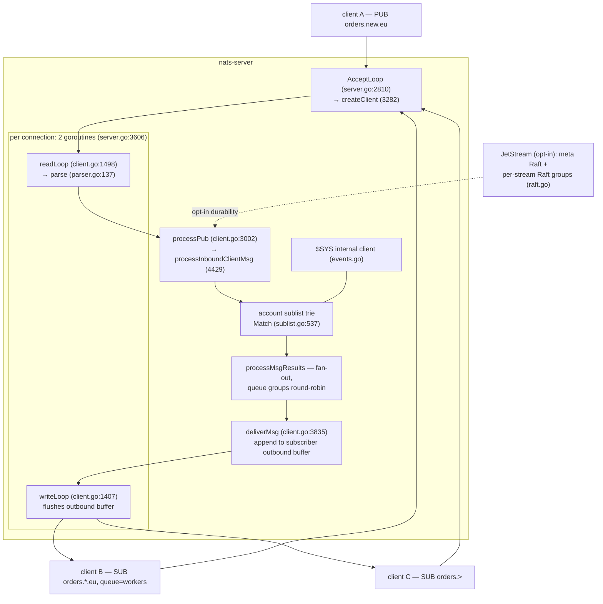
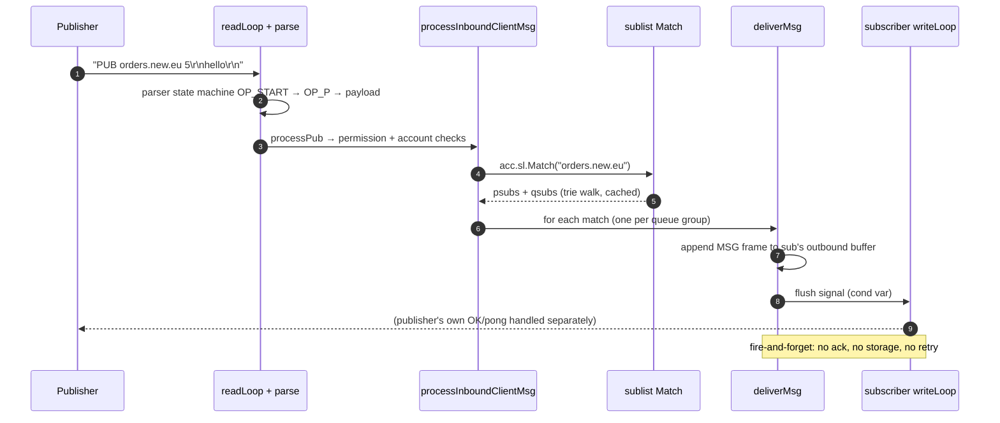
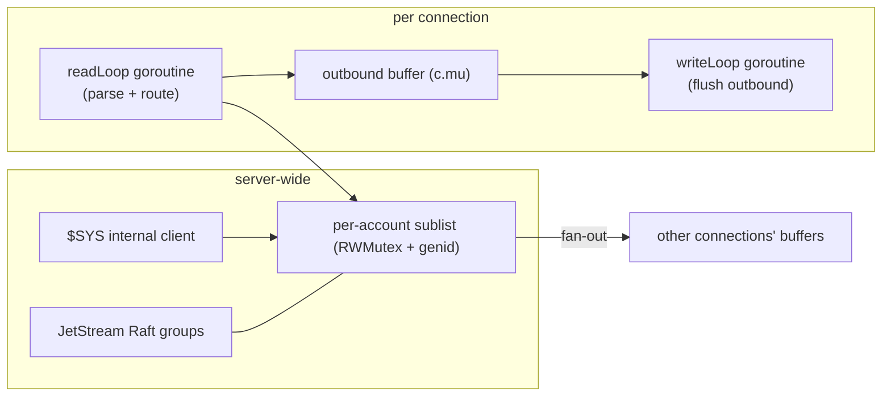

# NATS: a subject trie with a wire protocol small enough to memorize

> **Atlas id:** `nats` · **Domains:** `queue-log, networking` ·
> **Upstream:** https://github.com/nats-io/nats-server · **License:** Apache-2.0 ·
> **Pinned commit:** `64dda80fdd87b41b2afcdc5faf5d846db6c189b0` (2026-10-09)

NATS is a messaging server whose entire design is subtraction: a wire
protocol of a handful of text verbs (INFO/CONNECT/PUB/SUB/UNSUB/PING),
subject strings with two wildcards, and a server that is — at its core
— **a subject-matching trie plus per-connection read/write goroutines
that copy bytes from one socket buffer to another**. No per-message
persistence, no acks, no broker-side queues by default: fire-and-forget
delivery (at-most-once), with durability available as an opt-in layer
(JetStream: Raft-replicated streams) for the messages that need it.
This deep-dive teaches how far protocol minimalism plus one well-chosen
data structure gets you — millions of messages per second in plain Go —
and how NATS makes delivery semantics a *per-feature* decision instead
of a system-wide one.

Read it against the [Kafka](kafka.md) dive: the same problem space,
inverted. Kafka's broker is a dumb append-only log with heavy clients;
NATS's broker is a smart in-memory router with featherweight clients —
and JetStream is what it takes to bolt the log back on when "at most
once" stops being acceptable.

## Explain like I'm 10

**A switchboard for mail addressed by topic.** Anyone can shout "letter
for `orders.new.eu`!" (PUB) and hand it to the operator; anyone can say
"I want everything about `orders.*.eu`" or "everything under `orders.>`"
(SUB with wildcards). The operator keeps a card catalog — a tree of
drawers, one level per word between dots — so finding who gets a letter
means walking four or five drawers, never the whole catalog. Letters are
handed over instantly and then forgotten (at-most-once: if you weren't
at your desk, the letter is gone). If your request needs a *certified*
copy, there's a side office (JetStream) that logs every certified
letter in a ledger replicated across three offices before saying
"accepted" — the same trick the regular switchboard deliberately
refuses to do. And if one desk in a workgroup (queue group) is busy,
the letter goes to the next desk round-robin, so ten copies of a worker
share one mailbox.

**Why the grown-ups did it this way:** when the common case is "tell
everyone interested, right now," the fastest correct design is a
router, not a database — and making durability an *option* keeps the
common case fast for everyone.

## 1. Architecture overview



- **Connection setup**: `AcceptLoop` (`server/server.go:2810`) accepts,
  `createClient` (line 3282) allocates a `client`, and exactly two
  goroutines start per connection (line 3606): `readLoop` and
  `writeLoop` (`server/client.go:1498`, `1407`). Everything else is
  shared mutable state guarded by `c.mu`.
- **The spine of a PUB**: readLoop reads bytes → `parse`
  (`server/parser.go:137`, a hand-rolled byte state machine) dispatches
  the op → `processPub` (`client.go:3002`) validates subject/size →
  once the payload is in, `processInboundMsg` →
  `processInboundClientMsg` (`client.go:4429`) checks permissions and
  accounts → `acc.sl.Match(subject)` (`sublist.go:537`) →
  `processMsgResults` fans out → `deliverMsg` (`client.go:3835`)
  appends `MSG <subj> <sid> [reply]\r\n<payload>\r\n` to each
  subscriber's outbound buffer → writeLoop flushes when signaled.
- **Accounts** partition the subject space: each `Account` owns its own
  sublist and exports/imports subjects between accounts
  (`server/accounts.go`) — multi-tenancy as first-class structure, so
  `foo.bar` in account X and account Y never collide.
- **Clustering** (routes, gateways, leaf nodes — `server/route.go`,
  `gateway.go`, `leafnode.go`) spreads subscriptions so each server can
  route locally when it has interest and forward to peers when it
  doesn't.
- **JetStream** (`server/jetstream.go:430` `enableJetStream`) layers
  persistence on the same subject fabric: a meta Raft group for stream
  configuration, one Raft group per replicated stream
  (`server/raft.go`), and message stores (`filestore.go`,
  `memstore.go`).

## Walkthrough: one PUB, socket to subscribers

The spine as a story — on the site you can step through it with Next;
in the repo it reads top to bottom.



**Step 1 — Two goroutines own the connection.** On connect,
`createClient` (`server.go:3282`) started `readLoop` and `writeLoop`
(`server.go:3606-3609`). The read side parses; the write side sleeps on
a condition variable until there is data (`client.go:1407`).

**Step 2 — Parse without allocating.** `parse` (`server/parser.go:137`)
is a per-byte state machine (`OP_START` → `OP_P` → …): it tokenizes
`PUB orders.new.eu 5` into byte slices of the read buffer — no string
copies, no reflection. Each op ends with the parser handing a zero-copy
argument slice to its handler and resetting to `OP_START`.

**Step 3 — Validate the publish.** `processPub` (`client.go:3002`)
unrolls its own argument splitter onto a stack array
(`[MAX_PUB_ARGS][]byte`), records subject, optional reply, and size
into `c.pa` (the parser's "publish args" slot), and enforces
`max_payload` (a per-connection atomic).

**Step 4 — Route through the account.** When the payload bytes land,
`processInboundClientMsg` (`client.go:4429`) checks publish
permissions, reserved-subject rules (`$NRG.` etc.), and then — the
line the whole server exists for — calls `acc.sl.Match(subject)` to
find interest.

**Step 5 — The trie answers.** The sublist (`server/sublist.go`) is a
radix-ish walk over subject tokens: `match` (line 564) descends
`root`'s levels following literal tokens, the partial-wildcard `*`
node, and the full-wildcard `>` tail, accumulating matches; a bounded
per-account result cache (`slCacheMax = 1024`, line 49) short-circuits
hot subjects. Queue-group subscriptions are collected as `qsubs`
alongside plain `psubs`.

**Step 6 — Fan out, round-robin inside queue groups.**
`processMsgResults` walks the match: plain subscribers each get the
message; for each queue group one member is picked round-robin
(`rr`) and the others are skipped — load balancing as a data-structure
property of the trie result.

**Step 7 — Append and signal.** `deliverMsg` (`client.go:3835`) locks
the subscriber's `c.mu`, appends the `MSG` protocol line plus payload
to its outbound buffer, updates stats, and signals a flush. If the
subscriber can't keep up and its pending bytes exceed the limit, the
*connection is closed* — the slow-consumer policy (`isSlowConsumer`
flag, `client.go:155`): NATS protects the server, never queues for the
laggard.

**Outcome — Subscribers see the message in microseconds.** No disk was
touched, no ack was requested; if a subscriber was absent, the message
is simply gone — the contract the client picked by *not* using
JetStream.

## 2. Core data structures — and why these

### The parser state machine (`server/parser.go:137`)

`parse` walks the read buffer one byte at a time through states
(`OP_START`, `OP_P`, `OP_INFO`, …) set up per first letter of each op,
producing zero-copy argument slices. Why not a general text-protocol
framework: the parser is the hot path — at millions of msgs/sec, one
allocation per message is the difference between GC pressure and none.
This is the same discipline as memcached's hand tokenizer, but pushed
into a formally stateful machine so arbitrary chunking of the TCP
stream works.

### The sublist trie (`server/sublist.go:100` `level`, `:91` `node`)

```go
type level struct {
    nodes    map[string]*node
    pwc, fwc *node      // '*' partial and '>' full wildcard
}
type node struct {
    next  *level
    psubs map[*subscription]struct{}
    qsubs map[string]map[*subscription]struct{}   // queue groups
    plist []*subscription
}
```

Subscriptions are indexed token-by-token (`orders` → `new` → `eu`),
with wildcard children at every level; `Match` (537/543) descends with
backtracking only across wildcard branches, and a `sync.RWMutex` plus
a `genid` counter invalidates the result cache on any subscription
change (the `genidAddr` check in `processInboundClientMsg` is the
cache-buster). Why a trie over a linear scan of subscriptions: matching
cost is bounded by subject depth (typically < 10 tokens) instead of
subscription count (can be millions); why maps per level instead of a
sorted array: subscription churn is constant in dynamic systems, and
`map[string]*node` gives O(1) child lookup with cheap insert/delete.

### The per-connection outbound buffer + flush signaling (`client.go`)

Each client has one outbound byte buffer guarded by `c.mu`, a
condition variable (`sg`) the writeLoop waits on, and pending-flush
counters (`fsp`, `out.pb`) — see `writeLoop` (1407) and the
`flushSignal` paths around lines 1989-1995. Deliveries append; one
syscall per flush drains many messages. Why shared-buffer-plus-signaler
over per-message channel sends: channels would allocate and queue
per message; here a publish fan-out to 10k subscribers is 10k memcpys
and one wakeup, with slow consumers cut off by byte count, not
detected by backpressure.

### Queue groups (`node.qsubs`, `processMsgResults`)

Group membership lives inside the trie nodes (`qsubs` keyed by group
name); a matching message triggers exactly one round-robin delivery
per group. Why inside the trie: the load-balancing decision must cost
the same as routing itself — NATS's "competing consumers" feature is
not a scheduler bolted on top, it is a field of the match result.

### Raft node over NATS subjects (`server/raft.go:162` `type raft`)

JetStream's consensus is implemented *in the server itself*, using
NATS subjects as the transport: append-entry and vote requests are
messages on internal subjects (`$NRG.` — the prefix
`processInboundClientMsg` reserves), with `sendAppendEntry` /
`handleAppendEntry` pairs (`server/raft.go`). Why in-process: a Raft
that talks its own cluster's wire protocol to itself has zero extra
deployment surface — and demonstrates the design's recursion: the
durable layer is built from the same messaging primitive it
strengthens.

## 3. Concurrency and failure model



- **What runs concurrently:** everything (Go's scheduler), but each
  connection's state is serialized by `c.mu`, and the match structure
  by an RWMutex with generation-based cache invalidation. A publish on
  one connection appends to many other connections' buffers — briefly
  taking each subscriber's lock in turn (`deliverMsg`).
- **Slow consumer: cut, don't queue.** Pending bytes over the max, or
  a write deadline exceeded, and the connection is flagged
  `isSlowConsumer` (`client.go:155-194`) and closed. There is no
  unbounded broker-side queue anywhere in the core — the anti-pattern
  Kafka's producer buffer represents is deliberately absent.
- **Crash = total memory loss, by design.** Core NATS holds no state
  that survives: clients auto-reconnect (the protocol's PING/PONG and
  `INFO` exchange make reconnection trivial) and resubscribe. The
  *system* stays up because the server is stateless, not because it
  recovers.
- **JetStream is the failure story for the messages that need one**:
  Raft replication across replicas before acknowledging a publish
  (`server/raft.go` commit paths), file-based message blocks
  (`server/filestore.go`) with per-stream state; the meta layer
  (itself a Raft group) assigns streams to servers and converges
  toward the *desired* placement (`desiredRaftGroup`,
  `server/jetstream_cluster.go:206`) — a reconcile loop, at a smaller
  scale, of the kind the [Kubernetes](kubernetes.md) dive covers.
- **Graceful shutdown** drains connections (`shutdown`/`drain`
  modes in the protocol): subscriptions are unsubscribed with
  flushes so in-flight deliveries complete before close.

## 4. API and extension design

- **The protocol is the API** — and it fits on a postcard:
  `CONNECT {json}`, `PUB <subj> [reply] <size>`, `SUB <subj> [queue]
  <sid>`, `UNSUB <sid> [max]`, `MSG <subj> <sid> [reply] <size>`
  (server→client), `PING/PONG`, `INFO {json}`. Any language with a
  socket speaks it in an afternoon — dozens of client libraries exist,
  several written from the spec by third parties.
- **The seams are subject-shaped.** Request-reply is a convention
  (`reply` inbox subjects like `_INBOX.xxxx`); service discovery,
  latency tracking, and events are subjects under `$SYS`/`$JS` served
  by an *internal client* (`s.sys`, `server.go:1887`) that is
  indistinguishable from a network client — observability uses the
  public API rather than a privileged side door. Accounts + exports/
  imports extend the same idea to multi-tenancy.
- **Polyglot frontends**: the same core serves MQTT and WebSocket
  clients (`server/websocket.go`, the `mqttParse` branch in
  `parser.go:143`) — protocol adapters that end in the same `client`
  routing internals.
- **The wart**: semantics are chosen per feature, so the *default is
  lossy*. A team that doesn't internalize "core NATS is at-most-once"
  ships a system that drops messages under disconnects and only finds
  out in production. The fix is discipline (JetStream for anything
  that matters) — the docs' own framing — but the footgun is real,
  and it is the price of the default's speed.

## 5. The defining trade-offs

### Trade-off 1: at-most-once routing core with opt-in durable layering
- **Tension:** most messages want "fast, now"; some messages must
  survive anything.
- **Choice:** the core does zero durable work — no disk, no acks,
  no replication — and JetStream (Raft + file store) is a layer you
  opt into per stream.
- **Evidence:** `deliverMsg` (`client.go:3835`) ends at a buffer
  append — search it for any persistence call; contrast
  `server/raft.go`, where the same messaging primitive gets
  append-entry, quorum, and commit semantics for JetStream streams.
- **Given up:** core guarantees. Disconnect = loss; there is no
  replay, no ack, no dedup unless you bought the JetStream tier (and
  then you pay its latency: fsync + quorum before ack).
- **Verdict:** right when the *system* is the durability unit (metrics
  that also exist in the source system, presence, cache invalidation)
  and overwhelmingly common messaging is fire-and-forget. Wrong for
  order/payment events on the core tier — the exact workload where
  Kafka's "the log is the product" is the correct inversion.

### Trade-off 2: slow-consumer cutoff over backpressure
- **Tension:** a subscriber slower than its publishers will either
  exhaust server memory or stall the publishers.
- **Choice:** bounded buffers plus disconnect. `deliverMsg` counts
  pending bytes; exceeding `max_pending` (or a write deadline) flips
  `isSlowConsumer` (`client.go:155`, `SlowConsumerPendingBytes` at
  194) and closes the connection.
- **Evidence:** the flags and counters threaded through
  `client.go:1405-2000` — `out.pb` accounting in the flush path
  (lines 1786-1995) and the write-deadline handling in `writeLoop`.
- **Given up:** the laggard's liveness (it must reconnect and
  resync), and any illusion of end-to-end flow control; upstream
  publishers never learn their consumer fell behind.
- **Verdict:** right for a router whose promise is latency for the
  many over completeness for the one — the same call memcached makes
  with evictions. Wrong when every subscriber is entitled to every
  message; then you need a per-subscriber cursor over a retained log
  (Kafka consumer offsets), which is a different architecture, not a
  tuning knob.

### Trade-off 3: hand parser + subject trie over generic protocol machinery
- **Tension:** be the fastest message fabric possible, in a language
  with a GC.
- **Choice:** a zero-allocation byte state machine for the protocol
  and a token trie for routing; argument slices reference the read
  buffer directly (`c.pa`), and result structures are reused.
- **Evidence:** `parser.go:137` `parse` with its `OP_*` states and
  `c.drop/c.as/c.state` resets; `processPub`'s stack-array arg splitter
  (`client.go:3002`); the trie's `match` (sublist.go:564) and its
  bounded cache (line 49).
- **Given up:** the readable-protocol layering of generic frameworks;
  every protocol change touches the machine by hand; and subject
  matching is *approximate-load-bearing* — pathological wildcard
  patterns (`a.*.b.*.c`) multiply branches the trie can't compress.
- **Verdict:** right when the protocol is small and frozen — NATS's
  verb set has been stable for a decade, so the machine never grows.
  Wrong the moment the protocol accretes features; that's when you
  want Redis-style generated command tables or a real schema, not a
  bigger switch statement.

## 6. Reading path

1. `server/server.go:2810` `AcceptLoop` → `createClient` (3282) →
   lines 3606-3609 — the two-goroutine-per-connection model; note
   what is *not* there (no thread pool, no event loop machinery).
2. `server/parser.go:137` `parse` — read the state constants (line 59)
   and one full op cycle (`OP_START` → `OP_P` at line 401 →
   `processPub` call at 453); appreciate that the TCP stream can split
   anywhere.
3. `server/client.go:3002` `processPub` — argument splitting on a
   stack array, `c.pa` population, `max_payload` enforcement.
4. `server/client.go:1498` `readLoop` — buffer management, the
   `readLoop` stall reporting, and the call into `parse` (1611).
5. `server/client.go:4429` `processInboundClientMsg` — permission
   checks, account resolution, then the `acc.sl.Match` call (~4544)
   and `processMsgResults` — the routing decision in one screen.
6. `server/sublist.go` — `level`/`node` (100/91), `Insert` (373),
   `Match` (537) and `match` (564) with the wildcard branches, then
   the cache constants (49) and the genid invalidation story.
7. `server/client.go:3835` `deliverMsg` — lock discipline, the
   outbound append, queue-group and echo checks; then
   `client.go:1407` `writeLoop` and the flush-signal fields (`sg`,
   `fsp`) it waits on.
8. `server/client.go:155-194` — the slow-consumer flags and the
   `SlowConsumerPendingBytes` / `SlowConsumerWriteDeadline` reasons;
   trace where a violation closes the connection.
9. `server/server.go:1887` — the `$SYS` internal client; follow one
   event (`sendInternalAccountMsg`, `server/events.go:708`) to see
   observability ride the same fabric.
10. `server/accounts.go` — subject spaces per account and the
    export/import model; connect it back to the `$NRG.` reservation
    you saw in `processInboundClientMsg`.
11. `server/jetstream.go:430` `enableJetStream`, then
    `server/raft.go:162` (`type raft`) and its append-entry handling
    (`n.subscribe(n.asubj, n.handleAppendEntry)` at line 2758) — the durability layer as a
    subject-transported Raft; finish with the `desiredRaftGroup`
    reconcile types in `server/jetstream_cluster.go:206`.

You have now traced one PUB from a socket through a parser state
machine, a trie match, and fan-out into other sockets — plus the layer
that adds Raft when the same message must survive a datacenter fault.

## 7. What to steal

- **Make delivery semantics a per-feature decision, not a system
  identity**: core at-most-once, opt-in durable tiers — one system
  serves both latency and survival workloads (`deliverMsg` vs
  `server/raft.go`).
- **A trie over tokens beats a scan over subscriptions** whenever your
  routing keys are hierarchical and wildcards are few (`sublist.go`) —
  and load balancing can live *inside* the match result (queue groups).
- **Parse into borrowed slices of the read buffer** (`parser.go`):
  zero-copy argument handling is the biggest single win available to a
  text protocol server.
- **Protect the many by cutting the one**: bounded per-connection
  buffers with slow-consumer disconnects beats unbounded queueing in
  every system whose promise is latency (`client.go:194`).
- **Serve your own internals through your public API**: the `$SYS`
  internal client means NATS dogfoods NATS for events and monitoring —
  no privileged back door to drift from the real protocol.
- **Build durable subsystems from the messaging primitive you already
  have** (Raft over NATS subjects): recursive reuse shrinks both the
  deployment surface and the number of wire formats you must keep
  alive.

## 8. Difficulty and prerequisites

- Difficulty: **moderate**. Idiomatic Go, one clever data structure,
  no kernel-level tricks.
- Budget: ~4 hours for the reading path; a weekend adds JetStream
  internals (the raft.go + filestore.go pair are a second deep-dive's
  worth).
- Prerequisites: goroutines and channels at a working level; tries;
  what Raft gives you (the [etcd](etcd.md) dive is the best primer in
  this atlas); the [Kafka](kafka.md) dive for the contrasting broker
  philosophy.

## 9. Further reading

- NATS documentation — https://docs.nats.io/ — the protocol page is
  the spec, and it is genuinely one page.
- D. Richards, "NATS - A Cloud Native Messaging System" (ACM Queue /
  CACM 2022) — the design rationale from the authors.
- JetStream documentation — https://docs.nats.io/nats-concepts/jetstream —
  for the durability tier's semantics (acks, retention, limits).
