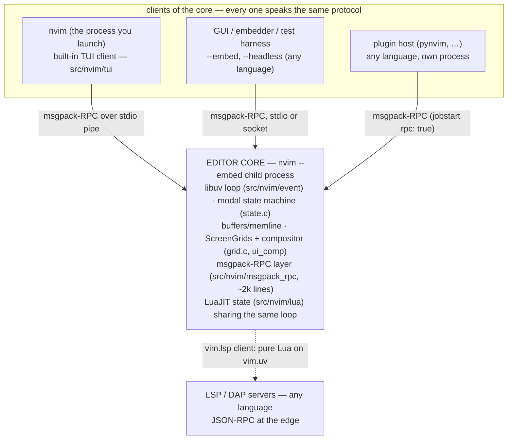
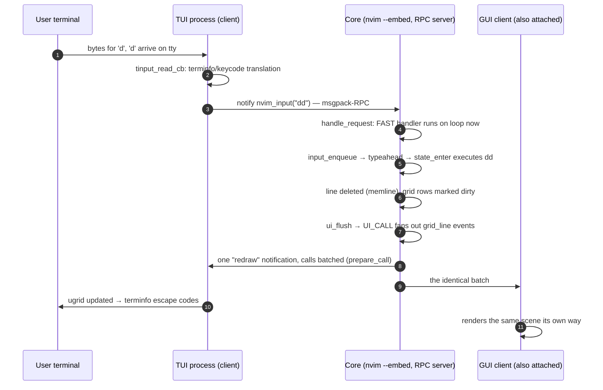
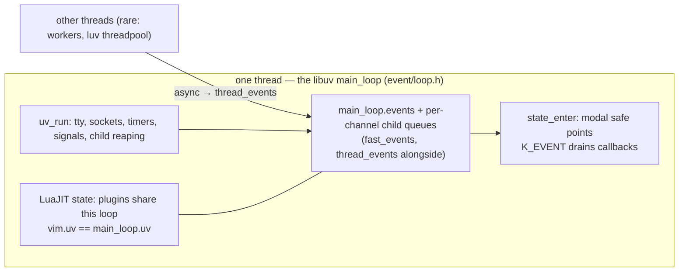

# Neovim: the editor as an RPC server — one seam for every face

> **Atlas id:** `neovim` · **Domains:** `editor` ·
> **Upstream:** https://github.com/neovim/neovim · **License:** Apache-2.0 ·
> **Pinned commit:** `1cfebe93d5f9463acda4aa6f69e4faa244734193` (2026-10-21)

Neovim is a 40-year-old editor architecture (Vim's modal core, itself a
refinement of Vi) rebuilt around one idea: **the editor core is a msgpack-RPC
server, and everything else — including the terminal UI you think you
launched — is a client**. Run `nvim` in a terminal and two processes appear:
the one attached to your terminal is a *UI client*; the editor core runs in a
child it spawned with `--embed`, and keystrokes go *out* as `nvim_input`
notifications while screen updates come *back* as `redraw` event batches.
GUIs, embedders, plugin hosts in any language, and headless test harnesses
attach through the exact same seam. The second idea completes the design:
the one language allowed *inside* the core — Lua on an embedded LuaJIT — is
bound to the core's own libuv event loop, so plugin code and editor code meet
at the same named safe points instead of at locks. This dive teaches how to
re-architect a working, widely-deployed system by drawing one boundary and
moving everything else outside it.

Read it against [VS Code](vscode.md) — the same era's answer to "how do
plugins extend an editor safely?", choosing process isolation for a
marketplace ecosystem where Neovim chooses in-process latency for
configuration-as-code — and against [Lua](lua.md), whose embedding API is
the very tray this editor reaches through.

## Explain like I'm 10

**A stage director in a control room, with every screen just another camera
crew.** The director (the editor core, `nvim --embed`) never touches a
screen; she dictates the scene as numbered lists (msgpack-RPC `redraw`
events) over a wire. When you "open nvim", you actually hire a crew (the TUI
process): it sets up a second desk in a back room, connects a wire, and its
whole job is translating between your terminal's blinking lights and the
director's lists. You type a letter; the crew sends it up the wire as a
message (`nvim_input`); the director decides what it means (the modal state
machine), erases a line from her sketch of the stage (a screen grid), and
tells *every* crew the same scene change. A fancy TV studio (a GUI) plugged
into the same wire sees the identical broadcast. The director also keeps an
assistant at her desk (Lua plugins, running inside the control room on
LuaJIT) who shares her stopwatch (the libuv event loop): whenever she pauses
between scenes (a safe point in the input loop), assistants may take their
turn — never mid-scene. And the translators for foreign experts (language
servers) are assistants too: they send and receive postcards in a standard
international format (LSP), which any editor can read.

**Why the grown-ups did it this way:** if the core speaks one protocol to
everyone, then faces (terminals, GUIs, tests, other programs) can multiply
and be replaced without ever re-architecting the core — and the core can be
modernized underneath without breaking a single face.

## 1. Architecture overview

- **The core is deliberately process-shaped.** `main.c:main` (255) is a
  fork in the road: with a terminal and no `--embed`, it *becomes* the TUI
  client — `ui_client_start_server` (350) spawns the real editor as a
  child with `--embed` and `ui_client_run` (361, no-return) takes over.
  With `--embed`/`--headless` the process *is* the core and `server_init`
  (366) accepts external clients instead. One binary, two roles, one wire
  between them — the "built-in UI" differs from a GUI only by being
  auto-spawned.
- **The extension seam is msgpack-RPC, ~2,000 lines** in
  `src/nvim/msgpack_rpc/` plus the API layer that sits on it. The same
  transport serves UIs (`nvim_ui_attach`), embedders (`nvim_exec_lua`),
  remote plugins (`rpcrequest`/`rpcnotify` over a spawned channel), and
  even Nvim-as-client-of-another-Nvim. Compare [Redis](redis.md) or
  [SQLite](sqlite.md): a tiny protocol layer carrying the whole product's
  extensibility.
- **The spine** — "type `dd` in a terminal, watch the line vanish on two
  screens" — is: TUI reads tty bytes (`tui/input.c:tinput_read_cb`) →
  `nvim_input` notification → core's RPC layer parses and dispatches
  (`msgpack_rpc/channel.c:parse_msgpack` → `handle_request`) → typeahead →
  modal loop executes the operator (`state.c:state_enter`) → affected
  grid rows marked dirty → `ui_flush` (`ui.c:540`) emits `grid_line`
  events → `RemoteUI` packs them into one batched `redraw` notification
  (`api/ui.c:prepare_call`) → every client (TUI, GUIs) updates its own
  grids.

## Walkthrough: one dd command, typed in a terminal, seen by two screens

**Step 1 — The keystroke crosses the first process boundary.** The TUI
process reads terminal bytes on a libuv stream
(`tui/input.c:tinput_read_cb:897`), translates escape sequences to keys via
its bundled terminfo/keycode tables, and forwards them as data:
`rpc_send_event(ui_client_channel_id, "nvim_input", keys)`
(`tui/input.c:207`). The process you typed in does not edit text; it
*reports typing*.

**Step 2 — The core parses, dispatches, and queues input.** The stdio
channel's read event runs `parse_msgpack` (`msgpack_rpc/channel.c:249`),
which feeds the unpacker and hands complete messages to `handle_request`
(312). `nvim_input` is declared `FUNC_API_FAST` (`api/vim.c:376`), so its
wrapper runs immediately on the loop and only enqueues bytes into the
typeahead ring (`os/input.c:input_enqueue:285`) — editor state is touched
later, at a safe point, never from the socket read.

**Step 3 — The modal loop reaches a safe point.** `state_enter`
(`state.c:34`) is the editor's heart: each mode (normal, insert, cmdline)
is a `VimState` with `check`/`execute` callbacks (`state_defs.h:8`). When
keys are pending it consumes them via `safe_vgetc`; when the event queues
are non-empty it injects the synthetic `K_EVENT` key so mode handlers can
drain callbacks at a moment of *their* choosing. `dd` executes as
operator+motion: one line leaves the memline, its grid rows are marked
dirty, not repainted yet.

**Step 4 — Redraw becomes protocol.** `ui_flush` (`ui.c:540`) walks dirty
rows and emits `grid_line` events per row segment
(`ui.c:482`). The `UI_CALL` macro (`ui.c:104`) fans each event out to every
attached `RemoteUI` — the TUI channel, the GUI channel, all of them — through
`remote_ui_*` packer functions *generated* from the declarative protocol
(`api/ui_events.in.h` → `src/gen/gen_api_ui_events.lua`). Rendering is
not a subroutine call; it is a broadcast of facts.

**Step 5 — Events are batched under a cell budget.** `push_call` →
`prepare_call` (`api/ui.c:600`) bundles adjacent calls to the same method
into one msgpack array inside a single `redraw` notification, flushing when
the pack buffer nears `UI_BUF_SIZE` or 500 cells (`ncells_pending`) are
pending; array sizes unknown at pack time are back-patched afterwards
(`flush_event`, 583). A full-screen redraw crosses the wire as bundled
batches (4 KiB pack buffer per flush), not one notification per event.

**Step 6 — Two clients render the same facts.** The TUI process receives
`redraw`, dispatches each event by hash to a `ui_client_event_*` handler
(`ui_client.c:ui_client_get_redraw_handler`) that updates its own
`ScreenGrid`, then writes terminfo escape sequences to the terminal. The
GUI, attached on another channel through the *same* `nvim_ui_attach`
handshake (`api/ui.c:208`, with its `ext_*` capability negotiation), got
the identical batch and drew it with entirely different code.

**Outcome — The core never knew who was watching.** One edit executed once;
input arrived as data, the scene change left as data. Swap the TUI for a
test harness, a GUI, or a browser — the core cannot tell the difference,
and that indifference *is* the architecture.

## 2. Core data structures — and why these

### `Channel` — one struct for every transport (`channel.h:18`)
**What:** id, refcount, a private child event queue, `is_rpc`, an optional
attached `Terminal`, and a tagged union over the stream: spawned process,
libuv process, pty, socket, stdio, or *internal* (an in-process loopback
used so even same-process traffic follows the queue discipline).
**Why:** UIs over stdio, plugin hosts over spawned pipes, sockets from
`--listen`, terminal emulator sessions — all one lifetime, refcounting,
and error-propagation story. Adding a transport touches this struct and
nothing above it (the same "one interface, many drivers" economy as
[libuv](libuv.md)'s handles or the [Linux kernel](../../catalog.yaml)'s VFS).

### `RemoteUI` + its packer budget (`ui_defs.h:38`, `api/ui.c:600`)
**What:** per-client state: negotiated `ui_ext[]` capabilities, the
terminal facts it reported, cursor/pum bookkeeping, and the msgpack
`PackerBuffer` with `nevents_pos`/`ncalls_pos` patch-back pointers and a
`ncells_pending` counter (flush at 500 cells or near buffer end).
**Why:** batching is per-client state, not a global pass — a slow GUI
can't delay the TUI's frames, and the wire format (bundled calls inside
one `redraw`) exists precisely because per-event notifications would
drown interactive latency.

### `MultiQueue` — parent/child event queues (`event/multiqueue.c`)
**What:** a linked hierarchy where each emitter (channel, job, timer
subsystem) owns a child queue propagated to the main loop's parent queue;
one-shot events fan out to several queues once. The file's top comment
draws the whole diagram.
**Why:** the editor can *focus* on one emitter while blocking (a
`jobwait()` on job 1 keeps polling only job 1's queue) without other
emitters' events being lost — the mechanism that lets single-threaded
Vim semantics coexist with fully async I/O.

### `ScreenGrid` — cells as the shared vocabulary (`grid_defs.h:45`)
**What:** rectangular cell arrays with dirty-line tracking and line-wrap
bookkeeping; windows, the message area, and floats each own one, and the
compositor (`ui_comp*.c`) merges them into the `grid_line` stream clients
receive. **Why:** grids are the *protocol's* unit, not just the core's:
multigrid clients learn about per-window grids directly, so the data
structure and the wire format agree — the same "make the internal model
the public model" move as [Kafka](kafka.md)'s log.

### `vim_state` — modes as objects (`state_defs.h:8`)
**What:** two function pointers, `check` and `execute`; normal, insert,
cmdline modes are structs embedding it, driven by the generic loop in
`state.c:state_enter`. **Why:** an ancient modal editor refactored into a
tiny state machine without changing a single user-visible behavior —
incremental re-architecture in miniature.

## 3. Concurrency and failure model

- **One thread, many queues.** All I/O — RPC traffic, jobs, terminals,
  timers, signals — multiplexes on a single libuv loop wrapped by
  `event/loop.c`. Editor state is only ever mutated from `state_enter`'s
  safe points or from within a request handler drained through the
  queues, which is why the core has almost no locks. The classic hazard
  is handled by name: `nvim_get_mode` is deliberately deferred to the
  `ch_before_blocking_events` queue (`msgpack_rpc/channel.c:312`) so a
  client polling it while the editor blocks on input still gets an answer
  — the queue hierarchy *is* the concurrency design.
- **FAST vs deferred dispatch.** `handle_request` splits the API in two:
  handlers flagged `FUNC_API_FAST` run inline on the loop's read event
  (they only enqueue or read atomics); everything else becomes a
  `RequestEvent` on the channel's child queue, executed in the main loop.
  This is the line between "cheap enough to run mid-read" and "touches
  editor state" — drawn per-function, in the API declaration itself.
- **Crash model: the faces are expendable, the core is not.** A crashed
  or hung GUI takes down only its channel; the core drops the `RemoteUI`
  and keeps serving others. The TUI dying leaves the core running until
  the channel-close path shuts it down. A crashed *remote plugin* is an
  exited job — its callbacks report the exit, the editor continues. The
  one thing the model cannot survive is a misbehaving *in-process Lua*
  plugin: an infinite loop in Lua blocks the single loop. That is a
  chosen trade (section 5), not an oversight.
- **Backpressure.** Slow clients can't stall the editor: redraw writes go
  through the stream's write buffers, and a failed/overflowed channel is
  closed with an error (`channel_write`'s error path), detaching the UI
  rather than freezing the core.

## 4. API and extension design

- **One versioned surface for everyone.** ~180 public `nvim_*` functions
  across the `api/*.c` files, each annotated with `FUNC_API_SINCE` /
  `FUNC_API_FAST` / `FUNC_API_REMOTE_ONLY` attributes. The contract
  (`runtime/doc/api.txt` §api-contract) is additive-only — signatures
  freeze at release, parameters may only grow, deprecations wait for a
  hypothetical 2.0 — explicitly inspired by "versionless evolution".
  Clients get the full machine-readable surface at runtime via
  `nvim_get_api_info` (`api/vim.c:1660`), served from a pre-packed
  metadata blob (`api/private/helpers.c:api_metadata:605`).
- **The surface is generated from one annotated source.**
  `gen_api_dispatch.lua` (in `src/gen/`) parses the C annotations and
  emits: a *perfect-hash* dispatch table (lookup in
  `api/private/dispatch.c:msgpack_rpc_get_handler_for`), the C→Lua
  wrappers, and the exported-functions metadata; sibling generators turn
  the same annotations into Lua type definitions and the user
  documentation. Add one annotated function; dispatch, bindings, types,
  and docs all appear.
  The UI protocol gets the same treatment from `api/ui_events.in.h` —
  the server's packers and the client's handlers are twin generations of
  one declaration. (Atlas pattern: [generate the surface from
  data](PATTERNS.md#12-generate-the-surface-from-data).)
- **Lua in-process is first-class, not bolted on.** `nlua_init`
  (`lua/executor.c:1005`) creates the interpreter on pinned LuaJIT
  (`cmake.deps/deps.txt`); `nlua_common_vim_init` (721) binds `vim.uv` to
  *the editor's own loop* — a timer, socket, or subprocess started by a
  plugin is scheduled by the same `uv_loop_t` that reads your keystrokes,
  and its callbacks cross into editor context through `vim.schedule`
  (`executor.c:nlua_schedule_event:546`), which queues onto the main
  events queue — the same safe-point door the state machine opens for
  everything else. Values cross via a converter that honestly encodes
  msgpack's ambiguities (`vim.NIL`, the empty-dict marker tables).
- **Out-of-process extension is the same seam.** `jobstart(…, {'rpc':
  true})` spawns any program as a channel; plugin hosts like pynvim wrap
  that into decorated commands/autocommands (`runtime/doc/
  remote_plugin.txt`), loaded lazily. And the boundary is symmetric:
  Neovim can itself attach *as a UI client* to another Neovim
  (`--server`/`--remote-ui`), including surviving a server restart via
  the `restart` UI event — the protocol is rich enough for one editor to
  be another editor's face.
- **Honest wart:** nothing isolates a Lua plugin from the core (by
  design, see trade-off 2), and the dual heritage shows: `vim.fn` (the
  legacy Vimscript surface) and `vim.api` (the frozen seam) coexist,
  with three subtly different ways to do common tasks and a compatibility
  layer (ongoing Vim patch merges via `scripts/vim-patch.sh`) that
  constrains refactors the architecture would otherwise invite.

## 5. The defining trade-offs

### Trade-off 1: the UI as protocol client over in-process terminal drawing
- **Tension:** Vim draws its own terminal synchronously in-process —
  minimal latency, minimal moving parts. But a modernized core wants many
  faces: GUIs, tests, remote sessions, embedding.
- **Choice:** rendering *is* the protocol; even the built-in terminal UI
  runs in a separate process speaking msgpack-RPC like any GUI.
- **Evidence:** `main.c:350-361` — `ui_client_start_server` spawns the
  core as an `--embed` child, then `ui_client_run` (no-return) owns this
  process; `api/ui_events.in.h` (the event vocabulary);
  `api/ui.c:prepare_call:600` (the batching that makes it affordable).
- **Given up:** every keystroke and every frame now crosses a process
  boundary and a serializer; startup has one more moving part; the grid
  protocol (multigrid, compositor semantics) is a real specification to
  maintain.
- **Verdict:** right because the editor's product is its ecosystem —
  GUIs, embedders, and the headless test harness that keeps the core
  honest all ride the same seam for free. Wrong for a tool whose only
  face will ever be one local terminal and whose budget is per-frame
  cost; classic Vim's synchronous drawing remains leaner there.

### Trade-off 2: plugins in-process on the shared loop over isolated plugin processes
- **Tension:** the VS Code question — plugin power and latency versus
  host stability. A marketplace of unknown authors needs walls; a
  user's own configuration needs speed.
- **Choice:** first-party extension runs inside the core, on LuaJIT
  bound to the editor's own libuv loop, entering editor context only at
  named safe points; *other* languages use remote plugins out-of-process
  over the same RPC.
- **Evidence:** `executor.c:nlua_common_vim_init:721`
  (`luv_set_loop(lstate, &main_loop.uv)` — one loop for editor and
  plugins alike); `executor.c:nlua_schedule_event:546` + `state.c`'s
  `K_EVENT`; `runtime/lua/vim/lsp/rpc.lua` wrapping every dispatcher in
  `vim.schedule_wrap` — the LSP client itself is the pattern's biggest
  user.
- **Given up:** fault isolation (one infinite Lua loop freezes the
  editor), per-plugin CPU/memory accounting, crash containment.
- **Verdict:** right for a trust model of "my config, my machine" where
  every keystroke pays the latency; wrong for ecosystems distributing
  thousands of third-party plugins of unknown quality — precisely the
  case [VS Code](vscode.md) spends a process and an RPC object graph on.

### Trade-off 3: a frozen, additive, generated API over fast-moving in-tree APIs
- **Tension:** the seam must carry a decade of independent clients
  (embedders, GUIs, hosts in a dozen languages); in-tree code wants to
  refactor signatures freely.
- **Choice:** declare each function once with attributes; generate
  dispatch (perfect hash), bindings, types, and docs from it; freeze the
  contract additively at release time.
- **Evidence:** `runtime/doc/api.txt:235` (the contract, down to
  "Deprecated functions will not be removed until Nvim 2.0");
  `src/gen/gen_api_dispatch.lua` + `gen/hashy.lua` (dispatch
  generation); `api/private/dispatch.c:msgpack_rpc_get_handler_for`
  (the generated hash in use); `api/deprecated.c` (the debt carried
  rather than broken).
- **Given up:** signature changes ever; duplicate deprecated twins;
  one indirection layer of generated code when debugging.
- **Verdict:** right whenever third parties must ride your evolution —
  the same discipline [VS Code](vscode.md) applies to `vscode.d.ts`,
  arrived at from the opposite direction. The alternative, breaking
  embedders every release, kills the smallest clients first.

## 6. Reading path

1. `runtime/doc/api.txt` §api-contract (line 235) — read the contract
   first; everything about attribute annotations exists to serve it.
2. `src/nvim/main.c:main` (255) — the fork in the road: find
   `use_builtin_ui`, `ui_client_start_server` (350), `ui_client_run`
   (361), `server_init` (366). One binary, two roles; everything after
   this stop explains the wire between them.
3. `src/nvim/ui_client.c:ui_client_run` (155) and `ui_client_attach`
   (87) — the built-in UI as an ordinary client: capability options
   (`ext_linegrid`), `nvim_set_client_info`. Notice there is no editor
   code in this process.
4. `src/nvim/tui/input.c:tinput_read_cb` (897) and `tui.c` — bytes to
   keys to `nvim_input` notifications; then the mirror image,
   `ui_client.c:ui_client_get_redraw_handler`, turning `redraw` batches
   into grid updates and terminal escape codes.
5. `src/nvim/msgpack_rpc/channel.c` — the RPC state machine:
   `parse_msgpack` (249), `handle_request` (312) and the FAST/deferred
   split, `request_event`, and `serialize_response`. Under 800 lines
   including comments — the whole seam.
6. `src/nvim/api/private/dispatch.c` then `src/gen/gen_api_dispatch.lua`
   — a 23-line runtime lookup meeting a generator: the perfect
   hash, the metadata, the wrappers. Open `api/vim.c:376` to see the
   annotations the generator eats.
7. `src/nvim/os/input.c:input_enqueue` (285) and `src/nvim/state.c:
   state_enter` (34) — typeahead and safe points; find `K_EVENT` and
   the `nvim_get_mode` deferral from stop 5 to see both ends of the
   queue discipline.
8. `src/nvim/event/multiqueue.c` — the parent/child queue hierarchy and
   one-shot events; the ASCII diagram in the file's header is the
   concurrency model in one picture.
9. `src/nvim/ui.c` — `UI_CALL` (104) and `ui_flush` (540): how editor
   code emits protocol events without knowing a client exists; then
   `api/ui.c:prepare_call` (600) and `ui_defs.h`'s `RemoteUI` for the
   batching budget that makes the wire affordable.
10. `src/nvim/channel.h:struct Channel` (18) and `channel.c:
    channel_job_start` (371) — one lifetime story for stdio, socket,
    spawned process, and pty; this is also where remote plugins and
    terminal-emulator sessions plug in.
11. `src/nvim/lua/executor.c` — `nlua_init` (1005),
    `nlua_common_vim_init` (721), `nlua_schedule_event` (546): the
    embedded interpreter sharing the loop; skim `lua/converter.c` for
    the msgpack↔Lua value mapping.
12. `runtime/lua/vim/lsp/rpc.lua` and `lsp/client.lua` — the second
    protocol at the edge: a full LSP client in Lua on `vim.uv`, with
    `vim.schedule_wrap` at every dispatcher. Compare with the JSON
    plumbing VS Code ships per-language; here it is a library inside
    the editor, not an extension.

You have now traced one keystroke through two processes and two
protocols (msgpack-RPC in, LSP out), and seen every seam the architecture
offers: client, embedder, plugin host, and in-process assistant all
meeting the same core the same way.

## 7. What to steal

- **Make your first UI just another client** — your terminal UI becomes
  your own headless test harness and every GUI becomes a plugin; seen at
  `main.c` spawning `--embed` and `ui_client.c` running the TUI as pure
  client.
- **One seam for every integrator** (UIs, embedders, hosts, tests)
  instead of N ad-hoc interfaces: the ~2k-line `msgpack_rpc/` +
  `Channel` union carries the entire extensibility story.
- **Bind your embedded scripting language to *your own* event loop, and
  cross into the host only at named safe points** (`vim.uv` on
  `main_loop`, `vim.schedule`, `K_EVENT`) — plugin async I/O and editor
  scheduling become one problem.
- **Freeze the protocol additively and generate everything from one
  annotated declaration** — dispatch hash, bindings, docs, types;
  `api.txt`'s contract plus `gen_api_dispatch.lua` is the whole
  apparatus.
- **Batch chatty outbound events under an explicit budget** (500-cell
  flush in `prepare_call`) so a protocol UI can match a direct-draw UI
  on interactive latency.
- **Re-architect by adding boundaries, not by rewriting**: modes became
  a state machine, rendering became protocol, scripting became embedded
  — while Vim patches still merge (`scripts/vim-patch.sh`) and the
  user's muscle memory was never the thing that changed.

## 8. Difficulty and prerequisites

- Difficulty: **demanding** (matches the catalog) — not because any file
  is impenetrable, but because the design lives across a process
  boundary and two protocols; you must hold the client and server in
  your head at once. C reading fluency plus basic Lua.
- Budget: ~7 hours for the reading path; stops 2, 5, 7, and 9 are the
  core (do not skip the multiqueue diagram).
- Prerequisites: what an RPC is (request/notification distinction);
  msgpack at a glance (https://msgpack.org); terminal escape sequences
  at a user level; the [Lua](lua.md) dive's embedding-API section
  makes stop 11 twice as rewarding.

## 9. Further reading

- `runtime/doc/api.txt` (§api-contract) and
  `runtime/doc/api-ui-events.txt` — the protocol contract and the UI
  event vocabulary, from the source tree.
- `runtime/doc/remote_plugin.txt` — plugin hosts from the producer
  side; `runtime/doc/dev_arch.txt` — upstream's own module map.
- msgpack-RPC specification — https://github.com/msgpack-rpc/msgpack-rpc
- LSP specification — https://microsoft.github.io/language-server-protocol/
- The [VS Code](vscode.md) dive in this atlas for the contrasting
  "isolate the plugin" answer to the same question, and the
  [Lua](lua.md) dive for the embedding API the core reaches through.
