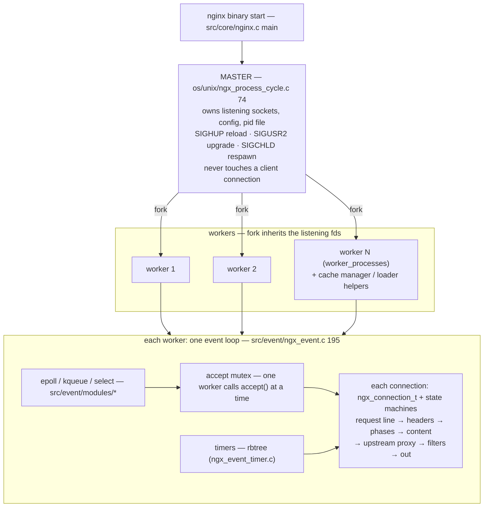
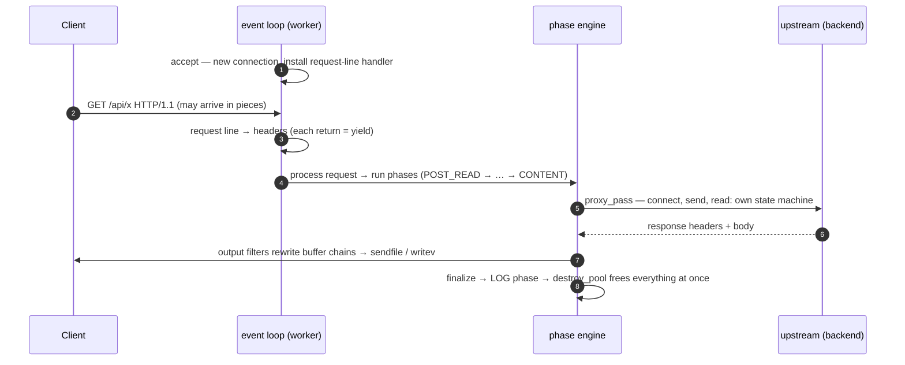
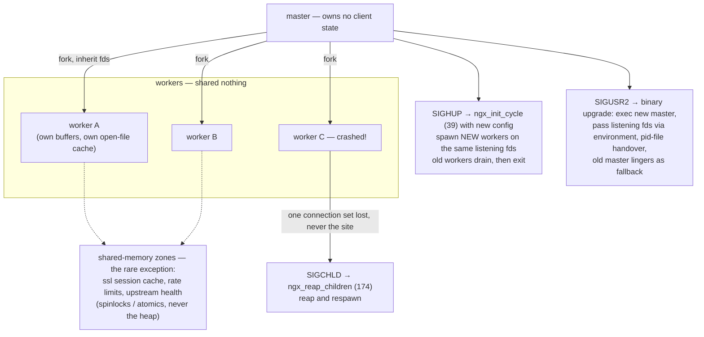

# nginx: shared-nothing processes, state machines, and ownership by lifetime

> **Atlas id:** `nginx` · **Domains:** `web-server, proxy-lb` ·
> **Upstream:** https://github.com/nginx/nginx · **License:** BSD-2-Clause ·
> **Pinned commit:** `2b5c2b605b5df669da5dec6749dcc76c07d1315d` (2026-09-30)

nginx is the server that answered the C10K question at internet scale
and now fronts a large share of the busiest sites. Its design is three
intertwined commitments: **a master process that owns nothing but
supervision; workers that share no memory and never block; and per-
connection state machines driven by one event loop per process** — with
memory freed not by `free()` but by destroying a request-lifetime pool.
This deep-dive teaches how architecture (not tuning) produces both the
throughput and the operational properties nginx is famous for: zero-
downtime reload and binary upgrade.

## Explain like I'm 10

**An ice cream shop where every order gets a tray.** nginx is a shop with
one manager (the master process) who never scoops ice cream — the
manager's whole job is hiring, watching, and replacing scoop workers
(worker processes). Each worker serves MANY customers at once by taking
tiny turns — one spoonful for you, one for the next person, round and
round (the event loop + state machines) — instead of standing next to
one customer until they finish licking. Every order gets a tray (a memory
pool): all the mess goes on the tray, and when the order is done the
whole tray is thrown away — nobody washes individual spoons mid-shift.
And because workers each have their own tray and scoop, one clumsy worker
dropping theirs closes one lane, not the shop; the manager just hires a
replacement instantly.

**Why the grown-ups did it this way:** serving thousands of customers at
once needs turns, not one staff member per customer — and workers that
share nothing can't trip each other, which is also why the menu can
change (reload) without ever closing the shop.

## 1. Architecture overview

- The **spine** — one HTTP request — is: accept →
  `src/http/ngx_http_request.c:ngx_http_init_connection` (211) sets
  `ngx_http_process_request_line` (1115) as the read handler → headers
  (1229) → `ngx_http_process_request` (2126) → phase engine
  (`src/http/ngx_http_core_module.c:ngx_http_core_run_phases`, 894) →
  content handler (static file, or `ngx_http_upstream_init`,
  `src/http/ngx_http_upstream.c:549`, which is its *own* set of state
  machines toward the backend) → output filters → finalize.
- Every step is a callback driven by socket readiness; nothing between
  accept and response is ever blocked on I/O.

## Walkthrough: one proxied request, accept to pool teardown

Follow one HTTP request through a worker — step through it on the site,
or read it top to bottom. Notice how every "waiting" is a yield, never
a block.

**Step 1 — The knock.** A listening socket becomes readable; the worker
holding the accept mutex calls `ngx_event_accept`
(`src/event/ngx_event_accept.c:21`): a new `ngx_connection_t` is
created and `ngx_http_init_connection` (`src/http/ngx_http_request.c:211`)
installs the first state — `ngx_http_process_request_line` (1115) — as
the read handler.

**Step 2 — Read the request line, piecewise.** Bytes arrive in dribs;
`ngx_http_process_request_line` parses what it has and *returns* on a
partial line (a yield — the loop goes off to serve other connections).
Complete line → install the next handler:
`ngx_http_process_request_headers` (1229).

**Step 3 — Headers, then the phase engine.** With headers done,
`ngx_http_process_request` (2126) hands over to
`ngx_http_core_run_phases` (`src/http/ngx_http_core_module.c:894`) — a
resumable loop over POST_READ, SERVER_REWRITE, FIND_CONFIG, REWRITE,
PREACCESS, ACCESS, PRECONTENT, CONTENT. Async handlers return
`NGX_AGAIN` and resume exactly where they stopped on a later event.

**Step 4 — Proxy to the backend.** The content handler for `proxy_pass`
is `ngx_http_upstream_init` (`src/http/ngx_http_upstream.c:549`): its
own state machines connect, send the request, parse the upstream
response, buffer to disk if needed, mark failures, retry peers — never
blocking the worker.

**Step 5 — Filters and out.** The response flows as chains of
`ngx_buf_t` — filters (charset, gzip, ranges) rewrite chains, not
streams; whole file ranges can be handed to `sendfile` without copying.
A partial write leaves the chain pointing at the unsent remainder.

**Step 6 — Tear down the tray.** finalize → LOG phase →
`ngx_destroy_pool` (`src/core/ngx_palloc.c:47`): every allocation made
for this request disappears in one call (cleanup handlers close files
first). Ownership by lifetime: free is O(1).

**Outcome — One request, zero blocks.** From accept to teardown the
worker never slept on this connection: it rotated among hundreds of
them, resuming each state machine exactly where it yielded. That, plus
tray-shaped memory, is the throughput story — architecture, not tuning.

## 2. Core data structures — and why these

### Memory pools per connection/request (`src/core/ngx_palloc.c`)

`ngx_create_pool` (19) carves a block; `ngx_palloc` (123) bumps a
pointer for small allocations (large ones get dedicated blocks); cleanup
handlers (line 316) run file closes/frees; `ngx_destroy_pool` (47)
releases everything at once. Why: a request's lifetime is the unit of
ownership — bulk free turns memory management into *lifetime
management*, eliminating per-allocation bookkeeping and the leak/fault
classes that come with it. (The cost: you cannot free early; bounded
waste is accepted by design.)

### Event-driven connection objects (`src/event/ngx_event.c`)

Each fd has an `ngx_connection_t` with read/write `ngx_event_t`s whose
`handler` fields *are* the current state: the request parser literally
installs the next state (`rev->handler = ngx_http_process_request_headers`,
request.c:1229). Timers live in a red-black tree
(`src/event/ngx_event_timer.c:13`). The event module itself is a vtable
— `#define ngx_process_events ngx_event_actions.process_events`
(`src/event/ngx_event.h:401`) — so epoll/kqueue/select are drop-in.

### The phase engine (`src/http/ngx_http.c`)

Requests walk a fixed sequence of phases — POST_READ, SERVER_REWRITE,
FIND_CONFIG, REWRITE, PREACCESS, ACCESS, PRECONTENT, CONTENT (+LOG) —
initialized in `ngx_http_init_phases` (`src/http/ngx_http.c:351`) and
flattened into a handler array by `ngx_http_init_phase_handlers` (18).
Modules register handlers into phases; `ngx_http_core_run_phases` (894)
is the whole engine — a loop that resumes where it stopped. Why: it
makes module composition *ordered and inspectable*, and it is
suspendable (async handlers return NGX_AGAIN and resume on the next
event).

### Buffer chains (`ngx_buf_t`/`ngx_chain_t`)

Response bytes flow as linked chains of buffers — multiple buffers can
reference one file range or memory without copying, and filters
(filetype/charset/gzip) rewrite chains, not streams. Why: zero-copy
`sendfile` and partial writes fall out; the chain is the unit that
survives "the socket accepted 3KB of 10KB."

## 3. Concurrency and failure model

- **Master/worker, shared-nothing**: workers are forked clones
  (`ngx_process_cycle.c:130` → `ngx_spawn_process`, 366) that *inherit*
  the listening sockets. One mutex (`ngx_accept_mutex`,
  `src/event/ngx_event.c:52`, tried at line 224) decides which worker
  may call accept — preventing the thundering herd — and workers drop
  the lock under load so kernels with `SO_REUSEPORT`-style balancing
  still spread connections.
- **Crash containment**: a segfaulting worker kills one connection set;
  the master's SIGCHLD path reaps and respawns
  (`ngx_reap_children`, process_cycle.c:20/174). The supervisor never
  holds client state, so it cannot be corrupted by request handling.
- **Zero-downtime reload** (SIGHUP): the master re-runs
  `ngx_init_cycle` (`src/core/ngx_cycle.c:39`) with the new config,
  spawns *new* workers on the (already open) listening sockets, and
  signals old workers to drain. No connection is dropped because the
  listening fds never close.
- **Binary upgrade** (SIGUSR2, `NGX_CHANGEBIN_SIGNAL` in
  `src/os/unix/ngx_process.c:65`): the master execs the new binary,
  passing the listening sockets through the environment; the new master
  takes over the pid file while the old master lingers as a fallback
  (`ngx_new_binary`, process_cycle.c:47) — an atomic handover
  choreography that survives failure at every step.
- **Graceful vs immediate shutdown**: SIGQUIT drains (no new requests,
  existing finish), SIGTERM stops; timeouts hard-stop stragglers.

## 4. API and extension design

- The "API" is **configuration as a language**: directives nest into
  http → server → location contexts; modules declare directives and
  receive parsed per-context config structs. Extension = write a module:
  `ngx_module_t` with a type-specific ctx (core/event/http), handlers
  hooked into phases, header/body filters chained onto the output path.
- **Upstream is a protocol-framework**, not just "proxy_pass":
  `ngx_http_upstream_init` (549) drives load-balanced peer selection,
  connect/read/write state machines, buffering to disk, and failure
  marking — with pluggable load balancers and protocols (fastcgi,
  uwsgi, grpc...) as modules over it.
- Shared state between workers is *explicit and rare*: shared-memory
  zones (ssl session cache, rate limit state, upstream health) with
  spinlock/atomic primitives — the exception that proves the
  shared-nothing rule.
- Honest wart: because blocking is forbidden, ordinary procedural logic
  (a slow filesystem hit, a DNS lookup) must be re-expressed as evented
  state machines — this is why the codebase has handlers-installing-
  handlers and why module code has a learning cliff.

## 5. The defining trade-offs

### Trade-off 1: processes over threads for connection handling
- **Tension:** use all cores without sharing memory.
- **Choice:** N worker processes, forked from a supervisor, zero shared
  mutable state (one accept mutex as the only coordination).
- **Evidence:** `ngx_start_worker_processes` (process_cycle.c:130);
  lock usage confined to accept gating (`ngx_event.c:224`) and shm
  zones.
- **Given up:** in-process shared caches (each worker has its own open
  file cache, its own buffers — memory multiplies by worker count);
  slower context creation than threads.
- **Verdict:** right when isolation, reload semantics, and crash
  containment beat memory costs — the classic web-tier calculus. The
  same decision looks different in a latency-critical monolith.

### Trade-off 2: evented state machines over thread-per-connection
- **Tension:** 10k+ concurrent connections per machine.
- **Choice:** one epoll loop per worker; every connection phase is a
  resumable handler; blocking calls are architecturally forbidden.
- **Evidence:** `ngx_process_events_and_timers` (195); request parsing
  as handler installation (`request.c:533`, `1229`); upstream as a
  machine (upstream.c:549).
- **Given up:** simple blocking code style; CPU-heavy work (TLS at
  scale, compression) eats the loop; every third-party integration must
  be re-architected as async.
- **Verdict:** right for I/O-bound multiplexing where per-connection
  state is small; wrong for long CPU-bound streaming — that's why
  nginx offloads TLS termination concerns to dedicated machines and
  keeps gzip buffers bounded.

### Trade-off 3: pool memory with lifetime ownership over general allocation
- **Tension:** millions of tiny allocations per second vs allocator
  overhead and fragmentation.
- **Choice:** per-request pools, bump allocation, wholesale free.
- **Evidence:** `ngx_palloc.c:19/47/123`; cleanup handlers (316) for
  resources that need real closing.
- **Given up:** early frees (memory held until request end), precise
  per-object lifetimes.
- **Verdict:** right when lifetimes align with a natural unit
  (request/connection); in systems with long-lived mixed-lifetime
  objects it would waste badly — note how Redis's per-client buffers
  and SQLite's per-statement allocations make the same bet in different
  shapes.

## 6. Reading path

1. `src/os/unix/ngx_process_cycle.c:ngx_master_process_cycle` (74) —
   the supervisor's entire life: signal set (lines 92-97), the
   respawn/reload/upgrade switch. Read `src/os/unix/ngx_process.c:40-66`
   alongside for the signal table mapping SIGHUP/SIGUSR2 to semantic
   names.
2. `ngx_start_worker_processes` (130) → `ngx_spawn_process` (366) —
   fork, slot bookkeeping, fd inheritance; note what the master does
   *not* do afterward.
3. `ngx_worker_process_cycle` (729) + `ngx_worker_process_init` (23) —
   per-worker setup (affinity, priority, channels), then the loop that
   is the whole worker: `ngx_process_events_and_timers` (751).
4. `src/event/ngx_event.c:ngx_process_events_and_timers` (195) — the
   loop's anatomy: timer computation, accept-mutex acquire/release,
   event dispatch, posted-event processing.
5. `src/event/ngx_event_timer.c` (whole file, ~200 lines) — the rbtree
   timer wheel that makes timeouts O(log n) without a timer thread.
6. `src/event/ngx_event_accept.c:ngx_event_accept` (21) — what accept
   means here: new `ngx_connection_t`, handler install, client
   connection limits.
7. `src/http/ngx_http_request.c:ngx_http_init_connection` (211) →
   `ngx_http_process_request_line` (1115) → `ngx_http_process_request`
   (2126) — trace one request's parser states; note every early
   `return` is a yield, not a block.
8. `src/http/ngx_http.c:ngx_http_init_phases` (351) +
   `src/http/ngx_http_core_module.c:ngx_http_core_run_phases` (894) —
   the phase pipeline: registration at init, resumable loop at runtime.
9. `src/core/ngx_palloc.c` (whole file, ~450 lines) — pools, large
   blocks, cleanup handlers; then spot `ngx_pool_t` owners across the
   codebase (connection pool, request pool).
10. `src/http/ngx_http_upstream.c:ngx_http_upstream_init` (549) and the
    handlers it installs — the deepest state machine in the tree:
    connect, send request, process header, body filters, retries/fail
    marking.
11. Back to `src/os/unix/ngx_process_cycle.c` for the SIGHUP path:
    `ngx_init_cycle` (`src/core/ngx_cycle.c:39`) builds the new config
    world, then old workers are told to drain — draw the timeline of
    one reload on paper. Finally read the SIGUSR2 dance
    (`NGX_CHANGEBIN_SIGNAL`, process.c:65/374) for in-place binary
    upgrade.

You have now followed one connection from fork inheritance through
accept, parse, phase execution, proxying, and pool teardown — plus both
zero-downtime operations (reload, upgrade) from the master's side.

## 7. What to steal

- **Make the supervisor stateless**: a master that owns no client state
  can supervise, reload, and upgrade forever; put all risk in
  expendable workers.
- **Ownership by lifetime** (pools): choose allocation units equal to
  natural lifetimes (request, connection, statement) and free becomes
  O(1) — the same lesson as Redis's client buffers.
- **Serialize only the contentious primitive**: one accept mutex (and
  nothing else) buys fair distribution without a shared heap.
- **Config as a compiled tree with per-context override** — nginx's
  directive model makes "same code, per-location behavior" a data
  problem, which is why one binary serves wildly different sites.
- **Design reload and upgrade as protocol dances, not reboots**:
  inherited listening fds + pid-file handover + lingering old master is
  a reusable zero-downtime upgrade pattern for any long-running server.

## 8. Difficulty and prerequisites

- Difficulty: **demanding** — the C is idiomatic and dense, and the
  state-machine style requires re-orienting how you read control flow.
- Budget: ~7–8 hours for the reading path; the process/event chapters
  (steps 1–6) alone are a rewarding 3 hours.
- Prerequisites: `fork`/exec and fd inheritance, epoll basics, HTTP/1.1
  message framing, and comfort reading function-pointer-driven C.

## 9. Further reading

- nginx internals primer (Evan Miller, "Guide to Nginx Module
  Development" and the internals series) — the classic orientation for
  `ngx_module_t`/phase machinery.
- The nginx docs (https://nginx.org/en/docs/) — events module and
  worker/accept mutex directives (`accept_mutex`, `reuseport`).
- Kegel, "The C10K Problem" — the problem statement this architecture
  answered.
