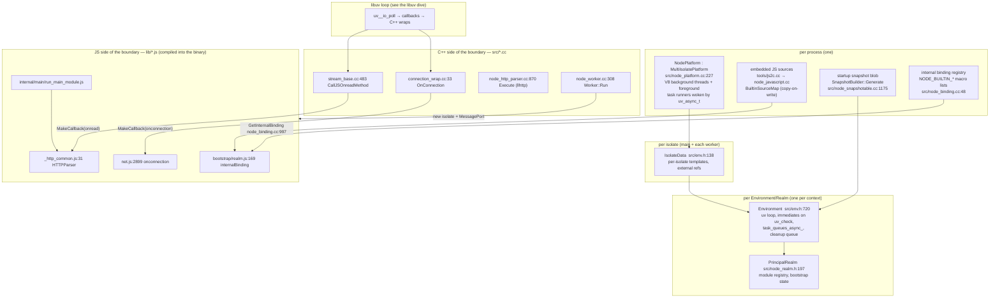
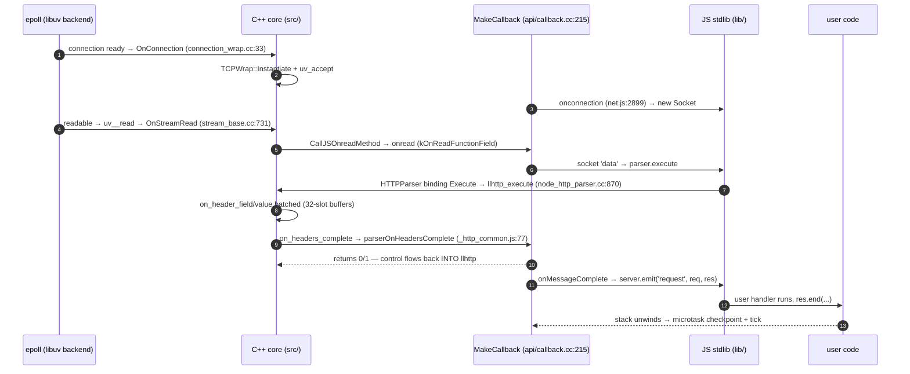

# Node.js: the boundary is the platform — an engine and a loop behind one JS-facing seam

> **Atlas id:** `nodejs` · **Domains:** `runtime` ·
> **Upstream:** https://github.com/nodejs/node · **License:** MIT ·
> **Pinned commit:** `dd7235cb6a55e9987551719ee57de9c3ff59d115` (2026-10-14)

Node.js is V8 plus libuv plus a glue layer — and the glue layer is
the product. Its design thesis is **the language boundary as the
architecture**: the C++ core (`src/*.cc`) contains no HTTP, no
streams-as-API, no `require` — only the machinery that turns C++
events into JavaScript calls (lifetimes, contexts, one callback
choke point), while almost the entire standard library lives on the
JS side (`lib/*.js`), *on top of* the boundary, calling back into C++
through narrow, unstable "internal bindings." This deep-dive teaches
how an embeddable engine (V8 isolates, contexts, handle scopes) and
an embeddable event loop (the [libuv](libuv.md) loop) are assembled
into a coherent platform: the bootstrap chain, the single
`MakeCallback` door every I/O event walks through, the startup
snapshot that skips it all, and the two-tier ABI (private
`internalBinding` vs stable N-API) that let the core churn while
native addons survived — the decision that made `npm` possible.

Read it after [libuv](libuv.md) (what the loop underneath does) and
alongside [CPython](cpython.md) (the other great "wrap an engine
into a platform" story, with the opposite ABI instincts) and
[Lua](lua.md) (a boundary designed as a virtual-stack C API):
Node is what an embedding looks like when the stdlib itself lives on
the guest side of the seam.

## Explain like I'm 10

**A factory with one translator's desk.** The factory floor is full
of machines that only speak Machine — sockets, files, clocks (libuv
handles and OS syscalls) — and one brilliant engineer who only
speaks Human (your JavaScript, running on V8). The translator (the
C++ core) never designs the engineer's projects and never runs the
machines; he only translates. When a machine finishes, the
management (the event loop) taps the translator, who walks to
**one single desk** (InternalMakeCallback in `src/api/callback.cc`),
stamps the logbook (async_hooks bookkeeping), hands the report to
the engineer, and — crucially — waits until she is done to flush her
inbox (microtask checkpoint: resolved promises, queued `then`s)
before letting anything else through. A second workroom (a
`worker_threads` isolate) never shares tools with the first; the two
pass notes through pneumatic tubes (MessagePort, an
`uv_async_t` doorbell) — copies, never shared tools. And the best
part: the factory's own instruction manual (the standard library,
`lib/*.js`) is written in the engineer's language, not Machine — so
any engineer can read how her factory works, and even fix it.

**Why the grown-ups did it this way:** one serial desk keeps all
JavaScript single-threaded and hookable in one place, while a
guest-language stdlib turned every Node user into a potential Node
developer — which is how an ecosystem of a million packages grew.

## 1. Architecture overview

- **Three nested lifetimes.** A process owns the V8 platform and the
  embedded JS sources; an isolate owns V8-level state
  (`IsolateData`, `src/env.h:138`); an `Environment` owns one event
  loop, its context, and all per-context state (`src/env.h:720`) —
  with `Realm` (`src/node_realm.h:78`) now separating per-context
  module registries from the Environment itself, because `vm` and
  ShadowRealms create several per Environment. This layering *is*
  the embedding API: one process, many isolates, one Environment per
  (isolate, context) pair.

- **The C++ core is boundary machinery, not features.** Look at what
  `src/` contains: wrapping (`stream_wrap`, `connection_wrap`),
  lifetime (`base_object`, `async_wrap`, `cleanup_queue`), bootstrap
  (`node`, `env`, `node_realm`, `node_builtins`, `node_binding`),
  and per-syscall bindings (`node_fs`, `node_tcp_wrap`...). HTTP
  routing, streams-as-API, the module loader, `EventEmitter` — the
  *product* features — are JS files under `lib/`, loaded like user
  code but embedded into the binary at build time.

- **The spine of every event** (the walkthrough below walks it in
  detail): libuv callback → a C++ `AsyncWrap` subclass calls
  `MakeCallback` (`src/async_wrap.cc:672`) → `InternalMakeCallback`
  (`src/api/callback.cc:215`) enters an `InternalCallbackScope`,
  calls the JS function, and on unwind drains microtasks and runs
  the tick callback → back in C++, the next libuv event proceeds.
  Every crossing — socket read, timer, threadpool completion,
  worker message — passes through that one function.

- **Bootstrap is a chain of scripts, not a C++ init sequence.**
  `main` (`src/node_main.cc:96`) → `node::Start`
  (`src/node.cc:1876`) → `StartInternal` (`:1804`: platform init,
  snapshot load) → `NodeMainInstance::Run`
  (`src/node_main_instance.cc:89`: isolate + Environment +
  `CreateEnvironment` deserializing the bootstrapped context from
  the snapshot, `src/api/environment.cc:470`) → `LoadEnvironment`
  (`src/api/environment.cc:597`) → `StartExecution` selects a main
  script (`src/node.cc:407` routes CLI flags to e.g.
  `internal/main/run_main_module`) → CJS/ESM loaders run your file.
  In release builds most of the bootstrap has already happened — at
  build time, inside the snapshot.

## Walkthrough: one HTTP request, kernel to user callback and back

**Step 1 — The kernel wakes libuv, not Node.** A TCP connection
completes the handshake; epoll reports the listening socket readable
and libuv's accept machinery fires (all of this is the
[libuv](libuv.md) dive's loop). The callback registered for that
socket is `ConnectionWrap<TCPWrap, uv_tcp_t>::OnConnection`
(`src/connection_wrap.cc:33`) — Node-specific C++ begins here.

**Step 2 — Accept and wrap, then cross once.** `OnConnection`
instantiates a fresh `TCPWrap` (a C++ object with a persistent V8
handle), calls `uv_accept` into it, and crosses the boundary with
one call: `wrap_data->MakeCallback(env->onconnection_string(), ...)`
— invoking the `onconnection` function stored on the JS server
handle (`lib/net.js:2495` assigns it, `lib/net.js:2899` implements
it). That function builds a `net.Socket` around the C++ handle and
emits `'connection'` — the HTTP server's listener attaches the
parser. Note the pattern: the C++ side created the resource; the JS
side gets a ready-made object.

**Step 3 — Reads arrive as buffers via one internal field.** The
socket is registered for reads; libuv allocates/readies a buffer
(Node now uses a per-Environment read slab — `stream_read_slab`),
reads into it, and `EmitToJSStreamListener::OnStreamRead`
(`src/stream_base.cc:731`) commits exactly the bytes read into an
`ArrayBuffer`, then `CallJSOnreadMethod` (`:483`) fetches the JS
`onread` function from internal field `kOnReadFunctionField` and
fires it through `MakeCallback` with `(nread, buffer)` smuggled via
the aliased `stream_base_state`. Net cost of the crossing: one JS
call per chunk of I/O, zero copies beyond the slab.

**Step 4 — JS asks C++ to parse, and the boundary goes
bidirectional.** The socket feeds `HTTPParser` — a thin JS wrapper
(`lib/_http_common.js:31`) over the C binding in
`src/node_http_parser.cc`, which drives llhttp (C). `Execute`
(`:870`) calls `llhttp_execute`, and llhttp's C callbacks
(`on_header_field`, `on_header_value` at `:377`) *batch* header
fragments into fixed 32-slot buffers (`kMaxHeaderFieldsCount`,
`:85`), crossing into JS only on `Flush` — when a header chunk is
big or the message completes. The design lesson: batch at the seam,
don't cross per fragment.

**Step 5 — A JS function returns a value into the C parser.** At
`on_headers_complete` (`src/node_http_parser.cc`, the
`on_headers_complete()` method around `:430`), C++ builds the full
argument vector and calls `parserOnHeadersComplete`
(`lib/_http_common.js:77`) *synchronously* — inside
`InternalCallbackScope::kSkipTaskQueues` — and reads back an
integer that llhttp itself uses (should the parser skip the request
body?). Control flows C → JS → C inside one parse call. The
boundary is a function-call interface, not just a callback faucet.

**Step 6 — The user's handler runs on the JS side of everything.**
`onMessageComplete` completes `IncomingMessage`/`ServerResponse`
objects (all JS classes in `lib/_http_*.js`) and the server emits
`'request'`. Your handler runs; `res.end(...)` walks the same
boundary in reverse — JS stream machinery ends up in
`LibuvStreamWrap::DoWrite` → `uv_write` → the kernel. At no point
did user code see C++; at no point did C++ see your code.

**Step 7 — The unwind is a checkpoint.** When the callback stack
that entered via `InternalMakeCallback` unwinds,
`InternalCallbackScope::Close` (`src/api/callback.cc:138`) fires
`after` async hooks, pops the async-context stack, runs a
**microtask checkpoint** (`PerformCheckpoint` — resolved promise
callbacks), and if ticks are scheduled, the tick callback. This is
why `.then` callbacks "just run" between I/O events without anyone
calling into JS: the checkpoint is bolted to the same choke point
every event already crosses.

**Outcome — One desk, two directions, single-threaded JS.** The
request crossed the C++/JS boundary exactly where the platform
decided — accept, per-chunk read, batched headers, one completion —
and every crossing paid for async context tracking, microtasks, and
hooks by passing through the same function.

## 2. Core data structures — and why these

### Environment + Realm — the platform's unit of embedding

**What:** `Environment` (`src/env.h:720`) owns the uv loop, the
timer/immediate handles, async-hook state, the cleanup queue, and
module-registry state for one context; `Realm` (`src/node_realm.h:78`)
holds the per-context parts (builtins cache, binding data), with
`PrincipalRealm` (`:197`) as the default. **Where:**
`src/api/environment.cc:438` `CreateEnvironment` builds it — from a
deserialized snapshot context when one exists. **Why:** one struct
per (isolate, context) is what makes embedding the *contract*:
workers, `vm.createContext`, and embedders
(`CommonEnvironmentSetup`, `src/node.h:1044`) all create
Environments instead of globals. The CPython parallel is the
interpreter state vs `PyThreadState` split; Node's version leans on
V8's isolate/context model so the GC does the isolation.

### BaseObject → AsyncWrap — the dual citizenship object

**What:** `BaseObject` (`src/base_object.h:46`) pairs a C++ object
with a JS object: it *is* the JS object's internal field, holding a
persistent handle; `AsyncWrap` (`src/async_wrap.h:120`) adds an
async-resource identity (`provider_type`, `async_id`, trigger id)
and the `MakeCallback` entry. Every I/O object — `TCPWrap`,
`FSReqPromise`, `MessagePort` — is an `AsyncWrap`. **Why:** the
boundary needs bidirectional identity lookup cheap: C++ reaches the
JS object via the persistent handle, JS-land reaches C++ via
`UNWRAP` on the internal field, and lifetime is explicit (`BaseObjectPtr`
ref counting) rather than fighting the GC. The async ids carried on
the same object are what `async_hooks` and stack traces later read.

### AliasedBuffer — shared state as a typed array

**What:** `AliasedBufferBase<T>` (`src/aliased_buffer.h:33`) wraps
one native `T[]` and one V8 `ArrayBuffer` view of the *same*
memory; sub-buffers can alias regions of a parent. **Where:** the
whole `AsyncHooks` state machine (`src/env.h:378`): hook counters
in a `Uint32Array`, async-id stack in a `Float64Array`; the JS side
literally reads/writes the same array (`lib/internal/async_hooks.js`,
whose header comment documents the aliasing). **Why:** counters
crossed per operation would make the hottest state in the runtime
pay an FFI-style toll; a typed array gives C++ and JS zero-copy
shared mutable state with no API calls, and the enum-indexed layout
(`kInit`, `kBefore`, ...) is the de facto ABI between the two
sides. The cost — layouts must be versioned in lockstep — is
accepted because both sides ship in one binary.

### The embedded source table + BuiltinModule — stdlib as data

**What:** at build time, `tools/js2c.cc` emits `node_javascript.cc`
containing every `lib/*.js` as static byte arrays in a
`ThreadsafeCopyOnWrite<BuiltinSourceMap>` (the template for the
generated file is the `kTemplate` string in `tools/js2c.cc`; the
generated `BuiltinLoader::LoadJavaScriptSource` just assigns it).
At runtime, `lib/internal/bootstrap/realm.js:245` (`class
BuiltinModule`) compiles them lazily via the C++ `compileFunction`
binding (`src/node_builtins.cc:300` `LookupAndCompile` — with V8
code cache), calling each source as a function with exactly the
parameters declared in `src/builtin_info.h`'s `parameter_map`
(`exports, require, module, process, internalBinding, primordials`
for stdlib modules — a stricter CommonJS wrapper). **Why:** the
binary is a complete, single-file runtime (no disk reads at boot,
works from any cwd), the map is copy-on-write so worker isolates
share it, and compiling lazily with code cache keeps startup fast
without shipping precompiled blobs for modules never used.

### The binding registry — a linked list of `node_module`

**What:** each C++ binding is a static `node_module` struct
registered into `modlist_internal` (macro lists like
`NODE_BUILTIN_STANDARD_BINDINGS`, `src/node_binding.cc:48`);
`GetInternalBinding` (`:997`) is a memoized lookup that runs the
module's `nm_context_register_func` to fill an exports template.
**Why:** static-registration linked lists (no constructors, no
dynamic init order) are how C++ builds plugin tables that also work
when Node itself is linked as a static library — the comment above
the macro list says exactly this. It is the same instinct as
SQLite's core+extensions registration: the registry is data, and
the loader is one small function.

## 3. Concurrency and failure model

- **One thread per Environment runs all JS.** Concurrency exists at
  three levels below that: V8 background threads (GC, compilation)
  owned by `NodePlatform` (`src/node_platform.cc:227`), whose
  per-isolate foreground task runner is itself a `uv_async_t`
  (`PerIsolatePlatformData`, `src/node_platform.cc:318`) — the
  libuv async doorbell again; the libuv threadpool for blocking
  syscalls (see the [libuv](libuv.md) dive); and worker threads,
  each a full isolate. JS-level shared state between threads is
  only `SharedArrayBuffer` and the message system.

- **The choke point enforces the model.** Because every C++→JS
  entry goes through `InternalMakeCallback`
  (`src/api/callback.cc:215`), "no two JS callbacks interleave" and
  "microtasks run at the unwind, not mid-callback" are not
  conventions — they are enforced by one function's scoping
  (`InternalCallbackScope` guards nesting; `kSkipTaskQueues` lets
  the parser suppress it when reentrancy would corrupt parse
  state).

- **Immediates and cross-thread tasks are loop handles.**
  `Environment::InitializeLibuv` (`src/env.cc:1314`) wires
  `setImmediate` to a `uv_check` handle (`CheckImmediate`, `:1824`
  — the libuv check phase, right after the poll), and native
  cross-thread callbacks (including interrupts and V8 foreground
  tasks) to `task_queues_async_`, an `uv_async_t` that workers and
  background threads can ring from any thread.

- **Workers: replicate, don't share.** `Worker::Run`
  (`src/node_worker.cc:308`) creates a *new isolate* on a new
  thread (with per-worker resource limits — heap caps set before
  the isolate exists), bootstraps a full Environment (deserialized
  from the worker-context snapshot with a few bootstrap "switches"
  re-run, `src/api/environment.cc`'s `is_not_main_thread` path),
  and communicates only via `MessagePort`: a queue plus an
  `uv_async_t` doorbell whose callback (`node_messaging.cc:675`)
  deserializes V8-serialized messages on the receiving isolate —
  with an explicit starvation budget (at least 1000 messages, then
  re-trigger) so a message flood cannot pin the loop.

- **Failure: exceptions travel; crashes kill; teardown is LIFO.** A
  JS exception inside a native callback propagates as an empty
  `MaybeLocal`, is caught by `TryCatch` scopes at the choke point,
  and (uncaught) reaches the fatal handler — the process exits by
  default; Node never "recovers" a broken Environment, which keeps
  teardown honest. Teardown order: `SpinEventLoopInternal`
  (`src/api/embed_helpers.cc:23`) exits the loop-again loop,
  `FreeEnvironment` forbids further JS execution
  (`DisallowJavascriptExecutionScope`), then `Environment::RunCleanup`
  (`src/env.cc:1550`) drains the `CleanupQueue` (`src/cleanup_queue.cc:27`
  `Drain`) — hooks run **most-recently-added first**, like stack
  destructors, so an addon that grabs a resource can depend on
  whoever registered after it having released theirs. Addons and
  embedders register via `AddEnvironmentCleanupHook`
  (`src/node.h:1521`) — the documented way to not leak when the
  isolate dies. The loop's exit condition itself — run until no
  refs, emit `beforeExit`, run again if that scheduled work — is
  ref-counting as process lifetime, the same bet libuv makes per
  handle.

## 4. API and extension design

- **Three tiers of seam, by audience.** (1) `internalBinding` —
  private, unstable, zero-cost-of-evolution: the stdlib's own
  C++ surface, free to break every minor release because both sides
  ship together. (2) N-API (`src/js_native_api.cc`, header
  `src/js_native_api.h`) — a C ABI of ~130 functions over opaque
  `napi_env`/`napi_value` handles, versioned by `NAPI_VERSION`
  (currently 8, `src/js_native_api_types.h:15`): a precompiled
  addon works across Node versions *and* across V8 upgrades. (3)
  The embedding API (`src/node.h`: `InitializeOncePerProcess`,
  `CreateEnvironment`, `CommonEnvironmentSetup`) — Node as a
  library inside someone else's process, documented in
  `doc/api/embedding.md`. Note the deliberate asymmetry with
  CPython: CPython made its internal C API quasi-public and paid
  for decades of constraint; Node kept internals private and
  built a *smaller stable one* beside them.

- **The public surface is `node:` modules + `process`.** Core
  modules are exposed through `BuiltinModule` policies
  (`lib/internal/bootstrap/realm.js`'s
  `builtinModulePolicies` — which builtins are requirable, with or
  without the `node:` scheme, some gated behind flags), and the
  CommonJS loader (`lib/internal/modules/cjs/loader.js`,
  `Module._load`) is itself stdlib JS that user code can intercept
  (`require.extensions` history, `--require` preload hooks) — the
  platform's own loader is an extension point of the platform.

- **The honest warts.** The dual-module-system decade (CommonJS and
  ESM loaders coexisting, with `Module._load` special-casing
  `node:` URLs) is the visible debt of evolving a live stdlib in
  the guest language. The `primordials` discipline — internal code
  capturing pristine copies of every JS builtin so user
  monkey-patching cannot break the platform (`lib/internal/bootstrap/node.js`
  documents the chain) — is a permanent tax paid because the
  stdlib shares a heap with untrusted user code; Lua's and
  CPython's cores never pay it. And `process.binding`, the
  pre-internalBinding escape hatch, lingers for compatibility
  exactly because too much userland reached into the internals.

## 5. The defining trade-offs

### Trade-off 1: the standard library in the guest language, over a C++ stdlib
- **Tension:** Node needed far more surface (HTTP, streams, module
  loading, fs) than the small team could write and maintain in C++
  against V8 — and needed users to trust and extend it.
- **Choice:** implement everything not syscall-shaped as JS in
  `lib/`, calling C++ only through narrow internal bindings; even
  HTTP's control flow is JS (`lib/_http_server.js`) with only the
  byte parser (llhttp) in C.
- **Evidence:** `lib/_http_common.js:31` imports the parser as a
  binding; `src/node_http_parser.cc`'s C callbacks batch into
  32-slot buffers and cross only at completion (`Flush`); the
  parameter map (`src/builtin_info.h`) compiles stdlib sources as
  plain functions over `internalBinding` — the entire mechanism
  exists to keep the C++ side *thin*.
- **Given up:** every crossing pays V8-API costs a monolithic C++
  stdlib would not; hot per-byte work must be pushed back into C
  (that's why llhttp exists); and sharing a heap with user code
  forced the primordials discipline.
- **Verdict:** right for a platform whose success metric is
  ecosystem — users could read `lib/http.js`, subclass its classes,
  and publish fixes, which seeded npm. Wrong for a stable,
  performance-critical runtime with few extension points — there,
  CPython's (mostly) one-language core is easier to keep correct.

### Trade-off 2: two ABI tiers — private churn beside a frozen C ABI
- **Tension:** the internal C++/JS surface must evolve freely (V8
  changes under it every few weeks), but native addons must not
  recompile per release or the ecosystem dies.
- **Choice:** keep `internalBinding` private (no stability promise,
  `NODE_MODULE_VERSION` guards even the legacy addon path), and
  build N-API as a stable C ABI with opaque handles; versions tell
  the story — `NODE_MODULE_VERSION` is 152 (`src/node_version.h:108`,
  bumped with V8 ABI), `NAPI_VERSION` is 8
  (`src/js_native_api_types.h:15`, stable for years).
- **Evidence:** `src/node_binding.cc:997` `GetInternalBinding`
  resolves a *linked list of statically registered* modules — free
  to change shape because callers are in-repo; while
  `src/js_native_api.cc` implements every napi entry point with
  explicit status codes and no V8 types in the API — stable because
  callers are compiled elsewhere.
- **Given up:** N-API's opaque handles are slower and less
  expressive than raw V8 API (each value op is a function call and
  a lookup), so perf-critical addons (or Node's own bindings) don't
  use it; and the legacy `NODE_MODULE_VERSION` path still exists,
  doubling the support matrix.
- **Verdict:** right whenever a platform has a native-plugin
  ecosystem that must outlive its engine upgrades — the frozen-seam
  pattern. Wrong for internal hot paths; that's what the private
  tier is for, and conflating the two (as CPython did for years)
  freezes your internals.

### Trade-off 3: isolate-per-worker over shared-heap threads
- **Tension:** JS has no memory model for shared objects; but
  servers need parallelism beyond one core.
- **Choice:** each `worker_threads` worker gets a fresh isolate and
  loop (`src/node_worker.cc:308` `Run` — `NewIsolate` per worker,
  resource limits applied before creation); communication is
  structured-clone messages via `MessagePort` (`uv_async_t`
  doorbell + V8 serializer, `src/node_messaging.cc`), with
  `SharedArrayBuffer` as the deliberate escape hatch.
- **Evidence:** `WorkerThreadData` (`src/node_worker.cc:163`)
  initializes its own `uv_loop_t`; `MessagePort::OnMessage`
  (`src/node_messaging.cc`) drains with a ≥1000-message budget then
  re-rings the async handle — starvation-guarded queueing, not
  shared data structures.
- **Given up:** cheap sharing — everything else is copied on post;
  per-worker bootstrap cost (mitigated by the worker-context
  snapshot, `src/api/environment.cc` deserializing
  `kNodeMainContextIndex` with worker "switches" re-applied); and
  same-process latency on every message.
- **Verdict:** right because it preserves the single-threaded
  correctness model users actually have — an isolated heap cannot
  data-race. Wrong for workloads needing fine-grained sharing;
  those need SAB+Atomics (which is why the escape hatch exists) or
  a different runtime entirely.

## 6. Reading path

1. `lib/internal/bootstrap/node.js` (just the header comment) —
   the codebase's own map of startup: what runs, in what order,
   what the snapshot replaced. Best single comment in the repo.
2. `src/node_main.cc:96` `main` → `src/node.cc:1876` `Start` →
   `:1804` `StartInternal` — per-process init; note
   `InitializeOncePerProcessInternal`, snapshot loading, and the
   `NodeMainInstance` handoff. Nothing JS has happened yet.
3. `src/node_main_instance.cc:89` `NodeMainInstance::Run` then
   `:127` `CreateMainEnvironment` — isolate scope, Environment
   creation via `src/api/environment.cc:438` `CreateEnvironment`;
   read the `Context::FromSnapshot` branch (`:470`) to see release
   builds deserialize an already-bootstrapped heap.
4. `src/api/embed_helpers.cc:23` `SpinEventLoopInternal` — the
   outer `uv_run` loop, `DrainTasks`, the `beforeExit` re-check
   dance; this is where "the process exits when nothing is left"
   lives.
5. `src/node_realm.cc:326` `PrincipalRealm::BootstrapRealm` and
   `ExecuteBootstrapper` — the bootstrap script chain
   (`internal/bootstrap/realm` → `node` → per-thread/process
   "switches"); this path runs only when there is no snapshot, so
   run `node --no-node-snapshot` to watch it.
6. `lib/internal/bootstrap/realm.js:169` `internalBinding`,
   `:245` `class BuiltinModule`, `:425` `compileForInternalLoader` —
   the JS stdlib loader for the stdlib itself; match the arguments
   against `src/builtin_info.h`'s `parameter_map`, then open
   `src/node_builtins.cc:300` `LookupAndCompile` (code cache!) and
   the `kTemplate` string in `tools/js2c.cc` to see where the
   sources came from.
7. `src/node_binding.cc:48` the `NODE_BUILTIN_*` macro lists and
   `:997` `GetInternalBinding` — the private C++ surface: a linked
   list, a memoized loader, one function template per binding.
8. `src/async_wrap.cc:672` `MakeCallback` → `src/api/callback.cc:215`
   `InternalMakeCallback` and `:138` `InternalCallbackScope::Close` —
   **read this twice**: async-hook push/pop, the trampoline branch,
   the microtask checkpoint and tick at unwind. Every behavior
   users ascribe to "the event loop" is in these 150 lines.
9. `src/connection_wrap.cc:33` `OnConnection` next to
   `lib/net.js:2899` `onconnection` — the accept crossing; note
   who creates what (C++ instantiates the handle, JS builds the
   socket object) and that `MakeCallback(onconnection_string())`
   is the entire handoff.
10. `src/stream_base.cc:731` `EmitToJSStreamListener::OnStreamRead`
    and `:483` `CallJSOnreadMethod` — the data crossing: read
    slab, ArrayBuffer commit, the `kOnReadFunctionField` internal
    field; then skim `lib/internal/stream_base_commons.js` to see
    the JS twin reading `stream_base_state` — AliasedBuffer in
    action (declaration: `src/aliased_buffer.h:33`).
11. `src/node_http_parser.cc` — `Execute` (`:870`), the batching
    `on_header_field`/`on_header_value` (`:377`), and
    `on_headers_complete` (≈`:430`): the only place where a JS
    return value steers a C parser. Then `lib/_http_common.js:77`
    `parserOnHeadersComplete` for the JS end of the contract.
12. `src/env.cc:1314` `InitializeLibuv`, `:1824` `CheckImmediate` —
    `setImmediate` as a `uv_check` handle, cross-thread tasks as
    `task_queues_async_`; connect each handle to the libuv loop
    phases from the [libuv](libuv.md) dive.
13. `src/node_worker.cc:308` `Worker::Run` and
    `src/node_messaging.cc:675` `OnMessage` — the second isolate:
    per-worker loop, snapshot reuse, the port's async doorbell and
    its message-budget starvation guard.
14. `src/cleanup_queue.cc:27` `Drain` and `src/env.cc:1550`
    `RunCleanup` — LIFO teardown; then `src/node.h:1521`
    `AddEnvironmentCleanupHook` — the addon-facing slice of it.

You have now traced one HTTP request from the kernel to a user
callback and back out through teardown — and every crossing it made
was through the same desk.

## 7. What to steal

- **Make the boundary one choke point** (`InternalMakeCallback`,
  `src/api/callback.cc:215`): routing *every* engine-entry callback
  through one function is what makes cross-cutting state — async
  context, microtask timing, hooks — enforceable instead of
  conventional.
- **Write the stdlib in the guest language** (`lib/*.js` over
  `internalBinding`): a platform whose users can read its own
  source recruits its maintainers from its user base — npm is the
  compounding return on that decision.
- **Run two ABI tiers: private-and-fast, public-and-frozen**
  (`NODE_MODULE_VERSION` 152 vs `NAPI_VERSION` 8): freeze a small
  C-ABI seam for out-of-tree code, and let internals churn — never
  one tier doing both jobs.
- **Share hot counters through aliased typed arrays**
  (`AliasedBuffer`, `src/aliased_buffer.h:33`): when two runtimes
  must share small fast state, shared memory under enum-indexed
  layout beats API calls per access.
- **Teardown as a LIFO queue** (`CleanupQueue::Drain`): cleanup
  hooks running most-recently-first give arbitrary resources stack
  discipline — destructors for things that were never on a stack.
- **Do boot work once, at build time** (`SnapshotBuilder::Generate`,
  `src/node_snapshotable.cc:1175`): serializing the bootstrapped
  heap and deserializing at startup turned milliseconds of JS
  execution into a memcpy — the snapshot is the ultimate startup
  budget.

## 8. Difficulty and prerequisites

- Difficulty: **demanding**. The code is clean modern C++, but the
  concepts stack: V8 embedding, an event loop, and a JS-level
  module system all at once.
- Budget: ~6–8 hours for the reading path (the choke-point and
  bootstrap files deserve slow reading; the parser and worker files
  can be skimmed once the pattern is clear).
- Prerequisites: the [libuv](libuv.md) dive (the loop underneath);
  a working idea of V8's isolate/context/handle-scope model (the
  V8 "Embedder's Guide" is enough — you need the vocabulary, not
  the details); comfort with RAII/scope guards in C++; the
  [Lua](lua.md) dive's embedding chapter for contrast on how small
  a language boundary can be.

## 9. Further reading

- Node's own `doc/api/embedding.md` (in-repo) — the supported
  story for the `CommonEnvironmentSetup` API this dive cites.
- V8 Embedder's Guide — https://v8.dev/docs/embed — the
  isolate/context/handle-scope model the C++ core lives inside.
- The `lib/internal/bootstrap/node.js` and
  `src/node_binding.cc` header comments — unusually good
  in-tree documentation of the bootstrap order and the binding
  registry.
- This atlas's [libuv](libuv.md) deep-dive — the loop that every
  crossing in this dive eventually waits on; and
  [CPython](cpython.md) for the sibling embedding with opposite
  ABI instincts.
