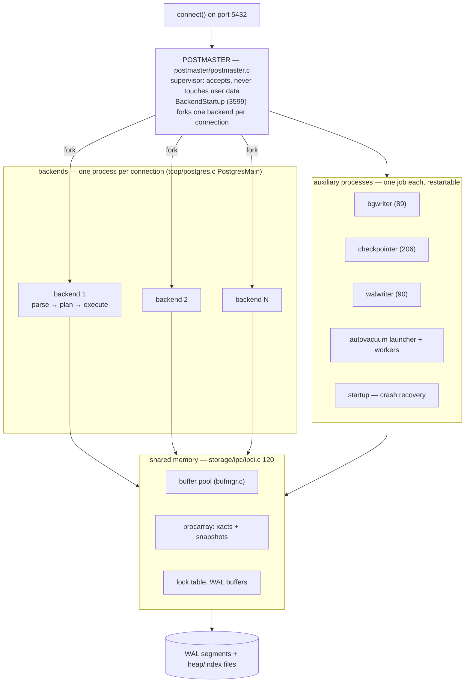
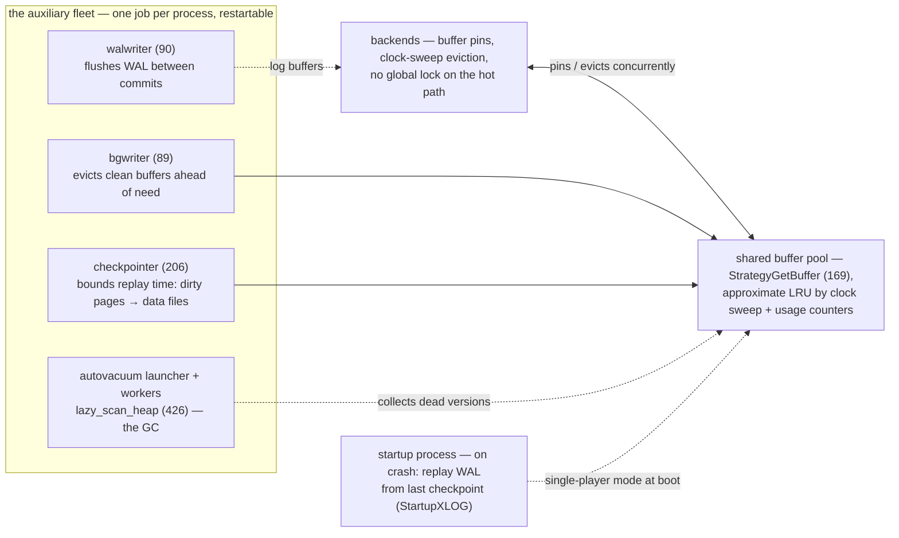

# PostgreSQL: the relational server as a federation of cooperating processes

> **Atlas id:** `postgresql` · **Domains:** `database, storage-engine` ·
> **Upstream:** https://github.com/postgres/postgres · **License:** PostgreSQL (BSD-like) ·
> **Pinned commit:** `f5635c2786af2322e1e21006a13a2c19f68fa591` (2026-10-10, master)

PostgreSQL is the open-source database that outlived every proprietary
rival, and its longevity is architectural: **one process per connection**
coordinated through shared memory, **MVCC by tuple versioning** so readers
never lock writers, and **write-ahead logging** as the single durability
mechanism that every subsystem funnels through. This deep-dive teaches
how a large system stays coherent for decades — narrow contracts between
layers, extensibility as load-bearing design — and what the
process-per-connection bet costs and buys at scale.

## Explain like I'm 10

**A bank where every customer gets their own clerk — and receipts are
never erased.** Walk in (connect) and the bank manager (the postmaster)
assigns you a personal clerk (a backend process) who stays with you the
whole visit; clerks never share desks — they coordinate through a shared
vault in the middle of the bank (shared memory: the buffer pool and
locks). When money moves, the clerk never erases the old receipt: a NEW
receipt is written, stamped with who and when (`xmin`/`xmax`), so a
reader can ask for "the world as of 10:00am" and never wait for a writer
mid-scribble; a janitor (VACUUM) bins receipts that nobody can possibly
still see. And before any change becomes real, the clerk pens it into a
diary chained to the wall (the WAL, fsync'd at commit) — so even a fire
only means replaying the diary, never losing a committed penny.

**Why the grown-ups did it this way:** readers never wait for writers
and a crash never loses committed work — the two promises that keep a
bank (or any database) trusted for thirty years, paid for with extra
receipt paper (dead tuples) and a janitor (vacuum) to collect it.

## 1. Architecture overview



- The **spine** — one `INSERT` — is: backend parses
  (`src/backend/tcop/postgres.c:pg_parse_query:617`) → analyze/rewrite
  (`pg_analyze_and_rewrite_fixedparams:683`) → plan
  (`pg_plan_queries:988`) → execute (`ExecutorRun`,
  `src/backend/executor/execMain.c:308`) → `heap_insert`
  (`src/backend/access/heap/heapam.c:2007`) registers the change with
  WAL (`XLogInsert`, `src/backend/access/transam/xloginsert.c:481`) →
  commit flushes (`RecordTransactionCommit` in
  `src/backend/access/transam/xact.c:1338` → `XLogFlush`).
- Every subsystem is a directory with a README — `src/backend/*/README`
  files are the contract documentation between layers.

## Walkthrough: one INSERT, parse to fsync'd commit

Follow the spine end to end — step through it on the site or read it
straight down. The moment "committed" becomes true is the WAL fsync,
not the data-file write.

```mermaid
sequenceDiagram
    autonumber
    participant C as Client
    participant B as Backend (exec_simple_query 1030)
    participant H as heap_insert (heapam.c 2007)
    participant X as XLogInsert (481)
    participant D as Disk (WAL)
    C->>B: INSERT INTO users VALUES (7, 'ada')
    B->>B: pg_parse_query → analyze/rewrite → pg_plan_queries
    B->>H: ExecutorRun → ExecInsert
    H->>H: new tuple version: xmin = my xid (xmax empty)
    H->>X: register change (+ full-page image if first since checkpoint)
    B->>X: RecordTransactionCommit (xact.c 1338)
    X->>D: XLogFlush — fsync: committed is NOW true
    B-->>C: CommandComplete
    Note over H,D: data pages flush lazily; crash recovery replays WAL from the last checkpoint
```

**Step 1 — Parse, plan, execute.** The backend's `exec_simple_query`
(`src/backend/tcop/postgres.c:1030`) runs the whole pipeline:
`pg_parse_query` (617) → `pg_analyze_and_rewrite_fixedparams` (683) →
`pg_plan_queries` (988) → `ExecutorRun` (`src/backend/executor/execMain.c:308`).

**Step 2 — Write the new version.** `heap_insert`
(`src/backend/access/heap/heapam.c:2007`) does NOT overwrite anything:
it adds a new tuple whose header carries `t_xmin` = this transaction's
id (`src/include/access/htup_details.h:122`). Update is insert + mark;
"current" is a query, not a place.

**Step 3 — Describe the change for the diary.** The insert registers its
change with `XLogInsert` (`src/backend/access/transam/xloginsert.c:481`):
block references plus payload — and a full-page image of the page if it
is the first modification since the last checkpoint (torn-page
insurance).

**Step 4 — Commit means fsync.** `RecordTransactionCommit`
(`src/backend/access/transam/xact.c:1338`) appends the commit record and
`XLogFlush` fsyncs the WAL. THIS is the instant the insert is durable —
the heap page may still be dirty in the shared buffer pool, flushed much
later by bgwriter/checkpointer.

**Step 5 — Visibility for others.** Another backend reading the table
computes a snapshot from the procarray (`GetSnapshotData`); it sees our
row only when our xmin is committed *in that snapshot* — no locks
between our writer and their reader, ever.

**Step 6 — The crash subplot.** Power loss before the data page flushed?
The startup process replays WAL from the last checkpoint: `heap_redo`
(`src/backend/access/heap/heapam_xlog.c:1290`) dispatches to
`heap_xlog_insert` (400) and mechanically reapplies our change — same
code for every subsystem, zero special cases.

**Outcome — A row version is born.** Parse → plan → execute → WAL →
fsync → visible-by-snapshot; later VACUUM collects the versions that
die. You have traced the durable, the visible, and the
garbage-collected parts of one INSERT.

## 2. Core data structures — and why these

### Versioned heap tuples (`src/include/access/htup_details.h`)

Every row version carries `t_xmin`/`t_xmax` transaction ids
(`HeapTupleFields`, line 122-125) plus *hint bits* (`HEAP_XMIN_COMMITTED`
etc., line 204+) that memoize visibility decisions. A row's "current
version" is a predicate over xmin/xmax evaluated per-snapshot
(`src/backend/access/heap/heapam_visibility.c:HeapTupleSatisfiesMVCC`,
around line 917), not a physical property. Why: updating means inserting
a new version and marking the old one dead — no writer ever blocks a
reader that holds an older snapshot. The cost (dead tuples) is paid
later by VACUUM.

### Snapshots from the procarray (`src/backend/storage/ipc/procarray.c`)

A snapshot is the set of in-flight transaction ids — computed from the
process array, not from data. `GetSnapshotData` (procarray.c, see the
comment around line 125) is on the hottest path in the system, which is
why it is computed once per transaction and stashed by
`src/backend/utils/time/snapmgr.c`.

### The shared buffer pool with clock-sweep eviction
(`src/backend/storage/buffer/`)

All backends share one page cache; a victim page is chosen by an
approximate-LRU *clock sweep* (`freelist.c:ClockSweepTick` at 104,
`StrategyGetBuffer` at 169) using a per-buffer usage counter — no global
LRU list to lock. Why: thousands of processes must evict concurrently;
an approximate, decentralized policy with per-buffer pin counts scales
where an exact policy would serialize.

### WAL records as typed redo programs (`src/backend/access/transam/`)

A WAL record = resource-manager id + block references + payload;
`XLogInsert` (xloginsert.c:481) assembles it from `XLogRegister*` calls,
attaching full-page images the first time a page changes after a
checkpoint. Replay is a dispatch: `heap_redo`
(`src/backend/access/heap/heapam_xlog.c:1290`) switches on op code to
`heap_xlog_insert` (400) and siblings, applying changes via
`XLogReadBufferForRedo` (`xlogutils.c:303`). Why: redo programs make
recovery *mechanical* — the same code proves correctness on every crash,
for every subsystem, with zero special cases.

### B-tree indexes (`src/backend/access/nbtree/`)

Postgres's B-tree (Lehman-Yao high-concurrency variant) splits pages so
readers walk without blocking writers; insertion descends with
right-link chasing (`_bt_doinsert`, `nbtinsert.c:105`; page changes at
`_bt_insertonpg:49`). Included to note: index entries point at row
*tids* (page, offset) — never at versions — so MVCC and index
structures stay decoupled.

## 3. Concurrency and failure model

- **Process per connection**: `BackendStartup` (postmaster.c:3599)
  forks a backend; a crashing backend takes down one connection, never
  the cluster. Coordination happens through shared memory
  (`CreateSharedMemoryAndSemaphores`, `storage/ipc/ipci.c:120`):
  buffer pool, lock table, procarray, WAL buffers.
- **The auxiliary fleet**: bgwriter (`postmaster/bgwriter.c:89`),
  checkpointer (`checkpointer.c:206`), walwriter (`walwriter.c:90`),
  autovacuum launcher + workers — each a separate process with a single
  job, each restartable. Supervision is the postmaster's only product.
- **Durability = WAL before data**: changes hit WAL (fsync'd at commit,
  `RecordTransactionCommit` → `XLogFlush`); data pages flush lazily.
  Crash recovery is the *startup process* replaying WAL from the last
  checkpoint (`StartupXLOG`, xlog.c:18's comment block introduces it).
  Full-page images turn torn-page risk into a solved problem at the
  cost of write amplification.
- **VACUUM is the garbage collector**: dead versions accumulate until
  `lazy_scan_heap` (`src/backend/access/heap/vacuumlazy.c:426`) removes
  them and freezes old xmin values so old WAL/txids can be recycled.
  Autovacuum tunes itself from statistics — a GC pause story, in a
  database.



## 4. API and extension design

- The client API is one protocol (libpq) over which SQL flows; the real
  "API" story is **extension in depth**: loadable C modules with
  `PG_MODULE_MAGIC` (`src/include/fmgr.h:443`), versioned catalogs so
  `CREATE EXTENSION` (`src/backend/commands/extension.c:1836`) installs
  SQL + C objects as a unit.
- **Hooks are the plugin seams**: `planner_hook`
  (`optimizer/plan/planner.c:74`, invoked at 344), `set_rel_pathlist_hook`
  (`optimizer/path/allpaths.c:89`), ExecutorRun_hook (`execMain.c:71`)...
  Extensions like Citus, pg_stat_statements, and TimescaleDB are built
  almost entirely from these hook points — the proof that the seams were
  placed where the design actually flexes.
- Custom types/operators/index access methods (tableam) mean the
  storage engine itself is pluggable *per table*.
- Honest wart: process-per-connection costs memory per connection and
  makes connection pooling mandatory at scale; Postgres's answer
  (pgbouncer, poolers as infrastructure) lives outside the server
  process model.

## 5. The defining trade-offs

### Trade-off 1: process per connection over thread pool
- **Tension:** serve thousands of concurrent clients without shared-state
  corruption.
- **Choice:** fork one backend per connection; share only via the buffer
  pool/locks in carefully partitioned shared memory.
- **Evidence:** `BackendStartup` (postmaster.c:3599); backends never
  share heap pointers; inter-process state is explicit shared memory
  (ipci.c:120).
- **Given up:** per-connection memory (each backend duplicates catalogs
  caches), expensive connection churn — pooling becomes mandatory.
- **Verdict:** bought 30 years of crash isolation and a simpler
  debugging model (a backend is a normal Unix process you can gdb);
  costs real money only at extreme connection counts — a trade most
  systems should envy.

### Trade-off 2: MVCC by versioning + vacuum over locking
- **Tension:** readers and writers of the same rows.
- **Choice:** writers create versions; readers filter by snapshot; a
  background GC removes dead versions.
- **Evidence:** `HeapTupleFields` xmin/xmax (htup_details.h:122);
  `HeapTupleSatisfiesMVCC` (heapam_visibility.c:917);
  `lazy_scan_heap` (vacuumlazy.c:426).
- **Given up:** space (bloat between vacuums), write amplification
  (every update writes a full new row), and an entire operational
  discipline around vacuum tuning.
- **Verdict:** the read-never-blocks-write guarantee is what made
  long-running analytics on an OLTP database survivable. Systems with
  strict overwrite-in-place (or without a GC story) pay in lock waits
  or corruption risk instead.

### Trade-off 3: WAL + full-page images + redo over direct writes
- **Tension:** crash safety without double-write complexity everywhere.
- **Choice:** all durability flows through one log; recovery is
  mechanical replay of typed redo programs; checkpoints bound replay
  time.
- **Evidence:** `XLogInsert` (xloginsert.c:481) from `heap_insert`
  (heapam.c:2007); commit fsync at `RecordTransactionCommit` (xact.c:1338);
  replay dispatch `heap_redo` (heapam_xlog.c:1290) via
  `XLogReadBufferForRedo` (xlogutils.c:303).
- **Given up:** write amplification (log + full-page image after each
  checkpoint), sequential log forces group-committing all backends.
- **Verdict:** one durability mechanism, audited for decades, beat
  per-subsystem cleverness — the same bet SQLite, LevelDB, and etcd
  make in this atlas. Steal this shape.

## 6. Reading path

1. `src/backend/main/main.c:main` (71) → `src/backend/postmaster/postmaster.c`
   main loop → `BackendStartup` (3599): accept, fork, exec the backend —
   notice the postmaster touches no user data ever.
2. `src/backend/tcop/postgres.c:exec_simple_query` (1030) — the whole
   query pipeline in one function: `pg_parse_query` (617) →
   `pg_analyze_and_rewrite_fixedparams` (683) → `pg_plan_queries` (988)
   → `ExecutorRun` (execMain.c:308).
3. `src/backend/utils/time/snapmgr.c` — where a snapshot is minted and
   cached per transaction; then `src/backend/storage/ipc/procarray.c`
   `GetSnapshotData` — the concurrency "truth table" of live xacts.
4. `src/include/access/htup_details.h` (lines 100-260) — tuple headers,
   xmin/xmax, hint bits: read this until version visibility feels
   physical.
5. `src/backend/access/heap/heapam_visibility.c:HeapTupleSatisfiesMVCC`
   (~917) — the predicate that *is* isolation; walk each branch for a
   committed, in-flight, and deleted tuple.
6. `src/backend/storage/buffer/bufmgr.c:ReadBufferExtended` (887) →
   `BufferAlloc` (645) → `freelist.c:StrategyGetBuffer` (169) — the
   shared cache: pins, clock sweep, no global lock on the hot path.
7. `src/backend/access/heap/heapam.c:heap_insert` (2007) — one insert:
   buffer pin, WAL registration, `RelationPutHeapTuple` (2070); notice
   the update path (`heap_update`) is insert+mark, not overwrite.
8. `src/backend/access/transam/xloginsert.c:XLogInsert` (481) — record
   assembly, full-page-image decision; then `xact.c:RecordTransactionCommit`
   (1338) → `XLogFlush` — the moment "committed" becomes true.
9. `src/backend/access/heap/heapam_xlog.c:heap_redo` (1290) →
   `heap_xlog_insert` (400) with `xlogutils.c:XLogReadBufferForRedo`
   (303) — crash recovery as program replay; pair with
   `transam/xlog.c`'s StartupXLOG intro comment (line 18).
10. `src/backend/access/nbtree/nbtinsert.c:_bt_doinsert` (105) — index
    descent and the right-link chase that keeps readers lock-free.
11. `src/backend/access/heap/vacuumlazy.c:lazy_scan_heap` (426) — the
    GC: dead-version removal, freezing; then skim
    `postmaster/autovacuum.c` for the self-tuning trigger.
12. `src/backend/postmaster/{bgwriter,checkpointer,walwriter}.c` mains
    (89/206/90) — the auxiliary fleet, one job per process; finish with
    `optimizer/plan/planner.c:74` (`planner_hook`) to see where
    third-party systems graft themselves in.

You have now traced one INSERT from socket to WAL-flushed commit,
through crash recovery, index maintenance, and garbage collection —
the complete life of a row version.

## 7. What to steal

- **One durability mechanism, one recovery mechanism** (WAL + redo
  dispatch): subsystems register changes; nobody invents their own
  crash story.
- **Isolation via versions + snapshots, not locks** — and budget the
  GC (vacuum) from day one; an MVCC system without a garbage story
  suffocates in its own history.
- **Crash containment by process** where threads would share fate:
  a supervisor that owns no user data plus expendable workers is the
  nginx lesson at database scale.
- **Place extension hooks where the design genuinely flexes**
  (planner, executor, path generation) — PostGIS, Citus, and pg_stat_
  statements are the proof your seams were well chosen.
- **Document layer contracts in-tree** (the `src/backend/*/README`
  files): twenty years of contributors found the map because it ships
  with the territory.

## 8. Difficulty and prerequisites

- Difficulty: **demanding** — a large C codebase; the layering and
  comments carry you, but plan real time.
- Budget: ~8 hours for the reading path; the buffer/MVCC/WAL trio is
  a full day each to internalize.
- Prerequisites: SQL execution model (parse/plan/execute), transactions
  and isolation levels at a textbook level, shared memory vs processes,
  comfort with large C.

## 9. Further reading

- The in-tree docs: `src/backend/*/README*` (the buffer manager, WAL,
  MVCC, and btree READMEs are the canonical internals texts).
- PostgreSQL documentation Part VII "Internals"
  (https://www.postgresql.org/docs/current/internals.html).
- "The Internals of PostgreSQL" (interdb.jp) — chapter-per-subsystem
  walkthrough that pairs well with this reading path.
