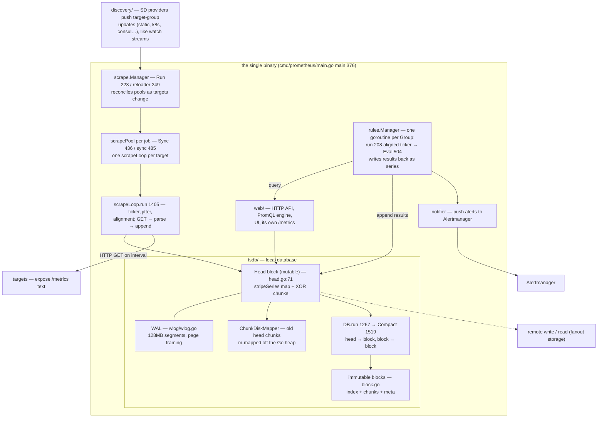
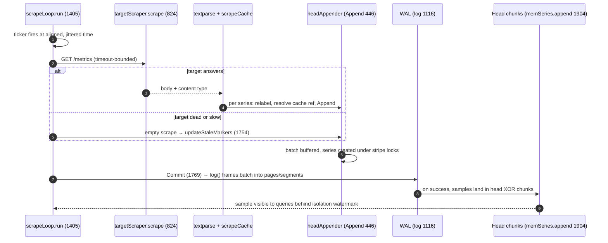
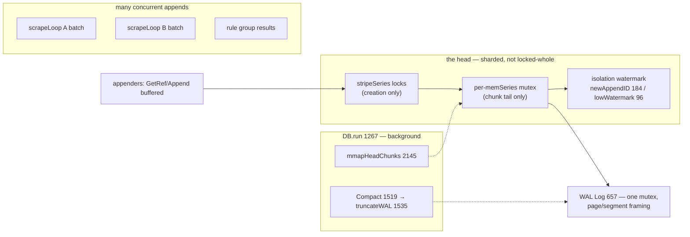

# Prometheus: the pull model — polling made correct by absence-as-data

> **Atlas id:** `prometheus` · **Domains:** `observability, storage-engine` ·
> **Upstream:** https://github.com/prometheus/prometheus · **License:** Apache-2.0 ·
> **Pinned commit:** `bae3eced0a5369e050e83ea73bc381d7c4b1a719` (v3.15.1, 2026-10-21)

Prometheus is the monitoring system that won the metrics slot under
Kubernetes and then defined the whole CNCF observability vocabulary —
PromQL, `/metrics` exposition, Alertmanager, OpenMetrics all descend
from it. It won with one architectural bet: **pull, not push**. The server
polls every target on a known interval over plain HTTP, so it always
knows who is alive, who is slow, and when every sample was taken. The
rest of the design is what it takes to make polling *correct*: absence
becomes explicit data (staleness markers), the local time-series
database is a two-tier engine — a mutable head block protected by a WAL,
compacted into immutable blocks — and alerting is a scheduled reconcile
loop whose results (and even its own restart state) are written back as
ordinary series. This deep-dive traces one scrape from HTTP GET to
immutable block, and one alert rule from ticker to notification.

## Explain like I'm 10

**A health inspector who visits every house on a schedule.** Instead of
waiting for houses to phone in complaints (push), the inspector
(Prometheus) rings every doorbell on the street every 15 seconds (a
scrape of `/metrics`), and each house reads out a list of numbers from
its clipboard (the exposition format). If nobody answers, the inspector
writes "no answer" in the notebook (a staleness marker) — the silence
itself is a recorded fact, so nobody mistakes an empty house for a quiet
one. All numbers go into one diary written in two stages: first onto a
loose page (the head block) with a carbon copy underneath (the WAL), so
a crash loses only the last few scribbles; every couple of hours the
loose pages get bound into a finished book that is never edited again
(an immutable block), and the carbon copies of what was bound can be
thrown away (WAL truncation). Finally, an alarm clock (rule groups)
rings on its own schedule and asks the diary questions ("is any room
still too hot?") — and it writes the answers back into the diary, so
even the alarm's own memory survives a restart.

**Why the grown-ups did it this way:** when you fetch the data yourself
on your own clock, a dead target is immediately visible as *your*
failed request — no trusting a sender to tell you it is gone — and
every sample's age is known by construction, which is what makes
alerting on time series trustworthy.

## 1. Architecture overview

- **`discovery/`** turns the outside world (Kubernetes pods, Consul
  services, EC2 instances, static files) into streams of target groups.
  Each provider (a `Discoverer`) pushes full group snapshots up a
  channel; `discovery.Manager.updater` (383) collects them — the
  watch/notify shape, the same *level-triggered* idea as etcd's watch
  and Kubernetes informers: updates replace state, they don't append.
- **`scrape/`** owns the pull model. `Manager.reloader` wakes on
  discovery changes, `scrapePool.Sync` diffs the target set and starts
  or stops one `scrapeLoop` per target. Each loop is an independent
  ticker-aligned HTTP client.
- **`tsdb/`** is the database: a mutable `Head` in memory (plus
  m-mapped chunk files), a WAL for crash recovery, immutable `Block`s
  for history, and a background compactor converting one into the
  other — the same two-tier shape as LevelDB's memtable/SSTables (see
  that dive) executed at block granularity.
- **`promql/` + `rules/`** are the consumers: rule groups run on
  aligned timestamps, evaluate PromQL against head+blocks, and append
  their results back into the same TSDB. Recording rules create new
  series; alerting rules maintain an alert state machine whose `for`
  timer is stored as the `ALERTS_FOR_STATE` series.
- **`notifier/`** delivers firing alerts to Alertmanager (the only
  push out of the server, besides optional remote write).

The **spine** — one scrape of one target — is: `scrapeLoop.run`
(scrape/scrape.go:1405) ticks → `targetScraper.scrape` (824) does the
HTTP GET → `scrapeAndReport` (1488) reads and parses →
`scrapeLoopAppender.append` (1779) resolves labels and series refs →
`headAppender.Append` (tsdb/head_append.go:446) buffers into an
appender batch → `Commit` (1769) writes the batch to the WAL first,
then into head chunks. Later, `DB.Compact` (tsdb/db.go:1519) freezes
head ranges into immutable blocks.

## Walkthrough: one scrape, HTTP GET to durable sample

Step through the pull model's core loop on the site, or read straight
down. Count how many failure modes collapse into the same answer: write
a stale marker.

**Step 1 — The clock decides.** `scrapeLoop.run` (scrape/scrape.go:1405)
is one goroutine per target with a ticker. The first scrape is offset
by the target's hash XOR the server's `offsetSeed`
(scrape/target.go:170, manager.go:320) so thousands of targets spread
across the interval, and two HA Prometheus servers scrape the same
fleet at different moments. Ticks are re-aligned to wall-clock
boundaries (`AlignScrapeTimestamps`) to keep timestamps on the grid
that `rate()` expects.

**Step 2 — Ask, don't wait.** `targetScraper.scrape` (824) issues an
HTTP GET with the negotiated content type (`Accept` for text,
OpenMetrics, or protobuf), gzip/zstd, and a per-target timeout. This
request *is* the pull model: no inbound connection is ever trusted
with data; a target that cannot be reached is a fact about the target.

**Step 3 — Read the clipboard.** `scrapeAndReport` (1488) streams the
body into a pooled buffer (`readResponse`, 844), decompressing as
needed, then hands the bytes to the parser inside
`scrapeLoopAppender.append` (1779). Parsing is incremental
(`textparse.New`) — labels are interned in a symbol table, series are
looked up in the `scrapeCache` by metric bytes so steady-state scrapes
touch no label allocations.

**Step 4 — Name every series.** For a new series, the parser's label
set goes through relabeling (`sampleMutator`, config-driven drop/keep),
target labels (`job`, `instance`) are applied, and limits are checked;
only then does the sample reach the appender. A series dropped here is
remembered in the cache (`addDropped`) and skipped until the target's
output changes.

**Step 5 — Buffer in the head.** `headAppender.Append`
(tsdb/head_append.go:446) resolves the series by reference or creates
it under the `stripeSeries` sharded locks (tsdb/head.go:2294), checks the
sample against the series' last timestamp (`memSeries.appendable`, 694
— out-of-order and too-old rules, with an optional OOO window), and
buffers `(ref, t, v)` into the appender's batch. Nothing is queryable
yet.

**Step 6 — Pay the durability toll.** `Commit` (1769) calls `log`
(1116) first: series-creation records, then sample records are framed
into the WAL — 128MB segments, 32KB pages, no per-sample fsync
(wlog/wlog.go:657 `Log`). Only after the WAL write do samples land in
in-memory XOR chunks (`memSeries.append`, 1904), the head's
`minTime/maxTime` advance, and the appender's isolation watermark
retires so queries can see the batch as a unit.

**Step 7 — When the door stays shut.** A failed scrape is treated as an
*empty scrape*: `scrapeAndReport` still calls `append` with zero bytes,
and `updateStaleMarkers` (1754) writes a `StaleNaN` for every series
the cache saw last time but not this time. `endOfRunStaleness` (1663)
does the same when a target disappears entirely — after waiting two
intervals in case it flaps back. Staleness is why `rate()` and graph
gaps behave when a deploy restarts every target at once.

**Outcome — Truth with a timestamp.** The sample is now: queryable
from the head, protected by the WAL, attributed to a target whose
liveness was proven by this very request — and if it ever stops
arriving, the database itself will record that it stopped.

## 2. Core data structures — and why these

### The striped series map (`tsdb/head.go:2294`)

`stripeSeries` shards series by hash into `stripeSize` independent
lock+map+hashmap stripes (`getByHash` 2693, `setUnlessAlreadySet`
2713); each `memSeries` additionally owns its own mutex for appends
(`lockForAppend`, head_append.go:594). Why: get-or-create for millions
of series from thousands of concurrent scrapers must not serialize on
one lock — the map is sharded by data, the mutation is serialized per
series. This is Prometheus' answer to the lock-contention problem Redis
solves by having one thread at all.

### The appender batch (`tsdb/head_append.go:434`, `getCurrentBatch`)

Samples accumulate as `record.RefSample{Ref, T, V}` slices — series
references, not label sets — until `Commit`. Why: the append path pays
per-sample only a map lookup and a struct append; all I/O (WAL framing,
chunk encoding) happens once per batch in `Commit`. The batch is also
the exact unit of the WAL record, so one scrape ≈ few WAL records.

### The WAL as pages and segments (`tsdb/wlog/wlog.go:41`, `log` 675)

Records are framed (type byte + length + CRC + snappy-optional) into
32KB pages inside 128MB segment files; `flushPage` (583) writes full
pages with plain `write(2)`; fsync happens at segment rotation, not per
record. A torn last page is zero-padded on open (124) and a CRC
failure at replay means `Repair` (400) truncates everything after the
corruption. Why: the WAL is a recovery log for re-scrapeable data, not
an accounting ledger — seconds of loss on power failure is a rounding
error next to losing the whole head. Kafka made the same call when its
log became the product (see that dive); etcd's WAL is the strict
counter-example, because it fronts consensus.

### XOR chunks and the ChunkDiskMapper (`tsdb/chunkenc/xor.go`, `tsdb/chunks/head_chunks.go:194`)

Each series' samples are delta-encoded (Gorilla-style XOR of float
bits) into ~120-sample chunks; when a chunk fills, the head cuts a new
one and `mmapHeadChunks` (tsdb/head.go:2145, run from the DB loop) m-maps
full chunks out of the Go heap into a `chunks_head/` file the kernel
pages in on demand. Why: the heap holds only the active tail per
series; history rides the page cache — bounded GC pause, unbounded
retention inside the head window.

### The immutable block (`tsdb/block.go:164` `BlockMeta`)

A block is a directory of `index` (inverted label index + postings),
`chunks/` segments, `meta.json`, and tombstones; blocks are never
edited — deletion is tombstoning, compaction writes new blocks and
atomically swaps directory presence. Why: immutable files are cheap to
query concurrently (no locks), trivially cacheable, and safely
deletable for retention — the same immutability lesson as git objects
and LevelDB SSTables, applied to time windows.

## 3. Concurrency and failure model

- **Goroutines as units of work, not of scale.** One goroutine per
  scrape loop (ticker-driven), one per rule group, one for the DB
  background loop (`DB.run` 1267), one actor goroutine inside the WAL
  (`WL.run` 380). Concurrency lives in the *number of loops*, and each
  loop is sequential — the event-loop discipline of the atlas, minus
  the loop library, because goroutines are the loop.
- **Append-path synchronization** is three-tiered: stripe locks for
  series creation (sharded), a per-series mutex for the chunk tail,
  and per-appender batches that make cross-appender interleaving the
  norm. Queries never take series locks.
- **Snapshot reads without MVCC storage:** `isolation.go` gives every
  appender a monotonically increasing `appendID`
  (`newAppendID` 184); a querier records the current watermark
  (`lowWatermark` 96) and skips samples from appends still in flight —
  a lightweight snapshot *of appends*, not of data versions (etcd and
  PostgreSQL pay for real MVCC because they need history; Prometheus
  re-reads the source).
- **Crash recovery is WAL replay.** On startup `open` (db.go:994)
  loads blocks, sets `minValidTime` to the newest block's maxt (older
  samples are rejected as out-of-bounds), and `Head.Init` (tsdb/head.go:738)
  replays WAL+WBL into the head, optionally from a memory snapshot,
  then GCs dead series. Corruption is answered with truncation
  (`Repair`), not refusal to boot: a monitoring server that won't
  start can't monitor anything.
- **Backpressure and overload:** per-target scrape timeouts bound each
  loop; `sample_limit`/`body_size_limit` cap hostile targets; the
  m-mapping and truncation keep heap bounded; if head compaction takes
  longer than the block range, `Compact` logs that compaction is
  falling behind (db.go:1593) — the operator's cue that ingestion
  outran disk. Remote write, when enabled, is an outbound queue with
  its own retry/shard machinery — push, at the system's edge only.

## 4. API and extension design

- **The API is the wire format, and it made the ecosystem.** The
  exposition format — text lines of `metric{labels} value [timestamp]`
  on `GET /metrics` — is so simple that every runtime, proxy, and
  database grew an exporter in a weekend. That format (and its data
  model: a metric name is just a label) is Prometheus' single most
  copied design decision — OpenMetrics standardized it, and Datadog,
  InfluxDB, and Grafana all speak some dialect of it. The negotiated
  upgrade path (`scrape_protocols`, protobuf/OpenMetrics text) shows
  how to evolve a text API without breaking it.
- **PromQL** is the read surface: one language for instant queries,
  range queries, recording rules, and alert expressions — read it as
  "metrics become a database with a query planner," the move that made
  monitoring compositional (`sum by (job) (rate(...))` composes over
  anything that exposes counters).
- **Extension seams:** discovery (implement `Discoverer`, push target
  groups), the remote read/write protocols (swap the storage backend),
  rule files on disk (hot-reloaded), and the Alertmanager API (swap the
  notifier's destination). Plugins for SD and remote storage live
  behind `discovery/` and prompb interfaces — third parties extend
  without forking.
- **Honest wart:** every subsystem re-implements `ApplyConfig` and the
  reload chain in main.go orders them by hand (scrape before discovery,
  1173) — configuration is still imperative plumbing, not declarative
  state; and the single-binary scope means HA is "run two servers,
  dedupe at Alertmanager," which surprises everyone expecting
  clustering. Both are deliberate scope trades, visible in the code as
  the absence of the thing.

## 5. The defining trade-offs

### Trade-off 1: pull over push
- **Tension:** pushed metrics arrive whenever the sender feels like
  it; the monitor can't tell a dead sender from a quiet one, and
  senders define the load profile.
- **Choice:** the server scrapes every target on its own ticker
  (`scrapeLoop.run` 1405, `targetScraper.scrape` 824); nothing is ever
  accepted inbound.
- **Evidence:** `scrape/manager.go:setOffsetSeed` (320) — the server
  hashes itself into every target's scrape offset precisely *because*
  two servers pulling the same fleet should not collide; a failed
  scrape produces staleness markers (`updateStaleMarkers` 1754,
  `endOfRunStaleness` 1663), i.e. the code pays for the model by
  making absence a write.
- **Given up:** targets behind NAT, short-lived batch jobs, and
  lambdas can't be dialed — the Pushgateway exists as the sanctioned
  escape hatch; and the server's address book (discovery) must be
  maintained.
- **Verdict:** for long-lived services the trade is dominant: liveness
  is proven by the request, timestamps are grid-aligned by
  construction, and a misbehaving target hurts only itself. Wrong for
  you when your producers are ephemeral or mobile — then you need a
  push gateway or a broker in front.

### Trade-off 2: seconds of WAL loss over fsync-per-write
- **Tension:** the head must survive crashes, but a monitoring server
  ingests millions of samples per minute; an fsync per sample is
  orders of magnitude slower than the data.
- **Choice:** WAL pages are written with `write(2)` only
  (`flushPage` 583); fsync happens at segment rotation and
  checkpoints; torn tails are zero-padded and corrupted tails are
  truncated (`Repair` 400).
- **Evidence:** `tsdb/wlog/wlog.go:657` `Log` → `log` (675) →
  `flushPage` — no Sync call on the sample path; the durability point
  is the 128MB segment boundary.
- **Given up:** on power loss, up to ~2h of segment + unflushed pages
  can lose their tail; strict accounting correctness.
- **Verdict:** metrics are re-scrapeable — the source of truth is the
  live system, and the next scrape repairs the gap. This is the exact
  inverse of etcd's WAL (durable-before-quorum), and both are right:
  choose the durability point by whether the data can be re-derived.
  Wrong for you the moment the data is a transaction (billing without
  reconciliation, audit logs).

### Trade-off 3: mutable head + immutable blocks over one store
- **Tension:** recent data needs cheap appends and instant visibility;
  history needs cheap concurrent reads and deletion — one data
  structure can't be both.
- **Choice:** a Head (in-memory chunks + m-mapped tails, WAL-backed)
  freezes ranges into immutable blocks
  (`head.compactable` 2034 — past ~1.5× the block range —
  `DB.Compact` 1519, `LeveledCompactor.Compact` compact.go:588),
  then the WAL for that range is checkpointed and truncated
  (`truncateWAL` 1535); blocks themselves merge upward through
  exponential ranges (2h, 6h, …).
- **Evidence:** `tsdb/db.go:Compact` — the whole function is the
  trade: freeze head → truncate WAL → merge blocks, in that order;
  `DB.Querier` (2583) fans a query out over overlapping blocks plus a
  `RangeHead` view — the read side pays for the write side's split.
- **Given up:** query fanout across N blocks per range; compaction as
  a background tax (with a "falling behind" warning when it loses, db.go:1597);
  the two-clock problem (head clock vs block clock) that
  `minValidTime` and OOO machinery exist to arbitrate.
- **Verdict:** the LevelDB lesson transplanted to time series: the
  mutable surface stays small and hot, everything else is immutable
  and shareable. Right whenever reads dominate and data has a time
  axis; wrong when you need point updates or deletes to be fast —
  tombstoning whole blocks is the only delete this design offers.

## 6. Reading path

1. `cmd/prometheus/main.go:main` (376) — the wiring: discovery
   managers, scrape manager, rule manager, notifier, fanout storage
   all constructed in order; then `reloadConfig` (1718) — every
   subsystem hides behind `ApplyConfig`/`Update`, one config file is
   the whole control plane.
2. `discovery/manager.go:updater` (383) — one goroutine per SD
   provider, pushing full target-group snapshots up a channel: the
   watch side of the system, level-triggered like etcd's watch.
3. `scrape/manager.go:Run` (223) → `reloader` (249) → `reload` (283)
   — discovery updates trigger pool reconciliation; notice pools are
   synced in parallel and pools create/stop per-target loops.
4. `scrape/scrape.go:scrapePool.sync` (485) — the target diff: new
   target → `newLoop` + `go l.run()`; removed → `stop()` and wait, so
   a flapping target's old and new loops never double-append.
5. `scrape/scrape.go:scrapeLoop.run` (1405) — the pull clock: offset
   from `Target.offset` (target.go:170) and `setOffsetSeed`
   (manager.go:320), alignment to the grid, missed-tick arithmetic.
6. `scrapeAndReport` (1488) — the whole transaction: scrape → parse →
   append → commit, with the failed-scrape-equals-empty-scrape rule
   that drives staleness; then `updateStaleMarkers` (1754) and
   `endOfRunStaleness` (1663).
7. `tsdb/head_append.go:headAppender.Append` (446) — ref-based
   buffering; read `memSeries.appendable` (694) closely for the
   OOO/too-old/out-of-bounds decision table, and `getOrCreate` (563)
   → `tsdb/head.go:2082` for the optimistic-create-under-stripe-lock
   dance.
8. `tsdb/head_append.go:Commit` (1769) with `log` (1116) — WAL
   before memory, batches before records; then
   `tsdb/wlog/wlog.go:log` (675) for the page/segment framing and
   `Repair` (400) for the corruption answer.
9. `tsdb/head.go:truncateWAL` (1535) + `tsdb/wlog/checkpoint.go:Checkpoint`
   (112) — the log's GC: checkpoint lower segments, truncate, keep
   ~3h of WAL; compare with Kafka's retention-by-time on the log.
10. `tsdb/db.go:Compact` (1519) — head → immutable block → WAL
    truncation → block merging, with `head.compactable` (2034) as the
    trigger and `mmapHeadChunks` (tsdb/head.go:2145) as the heap escape;
    then `DB.Querier` (2583) to see the read-side fanout you paid for.
11. `rules/group.go:run` (208) → `Eval` (504) — aligned evaluation
    (`EvalTimestamp` 422), results appended back, and stale markers
    for series the previous eval produced but this one didn't —
    a reconcile loop whose diff is written as data.
12. `rules/alerting.go:AlertingRule.Eval` (387) — pending → firing
    state machine over `r.active`; then `rules/group.go:RestoreForState`
    (761) — after restart, the `for` timers are read back from the
    `ALERTS_FOR_STATE` series the rule itself wrote: state restored by
    querying the database.

You have now traced one sample from an HTTP GET into the WAL, the
head, an immutable block, and back out through a rule into an alert —
the full pull-model loop, and the whole reason the system looks the
way it does.

## 7. What to steal

- **Make absence explicit data** (StaleNaN on failed/empty scrapes):
  silence is ambiguous, "no answer at t" is information — anywhere
  polling can fail, write the failure into the dataset itself.
- **Durability is a dial, not a switch**: pick the fsync point where
  the data's re-derivability runs out (segment rotation here; quorum
  in etcd) — the WAL structure is identical, the durability policy is
  the design.
- **Two-tier storage: small mutable surface + immutable snapshots**:
  head/WAL/blocks is memtable/SSTables on a time axis; queries fan
  out, compaction merges, deletes tombstone — reuse the whole shape
  whenever writes append and reads scan.
- **Schedule on aligned grids with per-instance jitter**
  (`EvalTimestamp`, `offsetSeed`): alignment makes rate windows
  well-defined, jitter spreads load — the two together are why a
  50k-target Prometheus doesn't thunder at second zero.
- **Store derived state back into the store**
  (`ALERTS_FOR_STATE`): if a computed value must survive your restart,
  make it a series and restore it with a query — no extra state
  machinery to invent, crash, and reconcile.
- **Shard by hash, lock per item** (`stripeSeries` + per-series
  mutex): get-or-create under contention without a global lock, the
  same trick as any hot registry.

## 8. Difficulty and prerequisites

- Difficulty: **demanding** — each subsystem is readable Go, but the
  dive crosses four of them (scrape, WAL/head, compaction, rules) and
  the interactions (isolation, OOO, truncation) are where the real
  subtlety lives.
- Budget: ~7 hours for the reading path; steps 5–10 are the core.
- Prerequisites: HTTP and Go basics; time-series vocabulary (samples,
  series, labels); the LSM idea (read the LevelDB deep-dive first);
  for the pairing, the Kafka dive (log retention/segments) and etcd
  dive (watch, WAL-for-consensus).

## 9. Further reading

- Upstream `docs/storage.md` (in the repo) — the operational contract
  of the TSDB: block layout, WAL retention, head behavior.
- Upstream `tsdb/docs/format/` — the on-disk specs: WAL records,
  block index, chunks, head chunks; the best short documents on the
  formats this dive cites from code.
- Upstream `docs/querying/` — PromQL semantics, including how
  staleness markers interact with range functions.
- The atlas pairings: [Kafka](kafka.md) for segments/retention on a
  log, [LevelDB](leveldb.md) for the leveled immutable-tier pattern,
  [etcd](etcd.md) for the strict-WAL counterpoint and the
  watch/notify shape that discovery mirrors.
