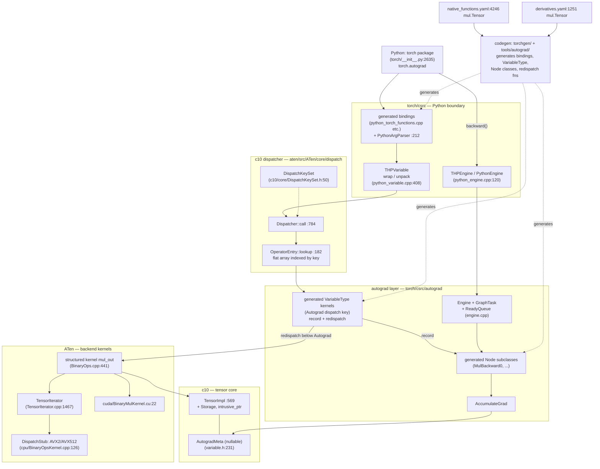
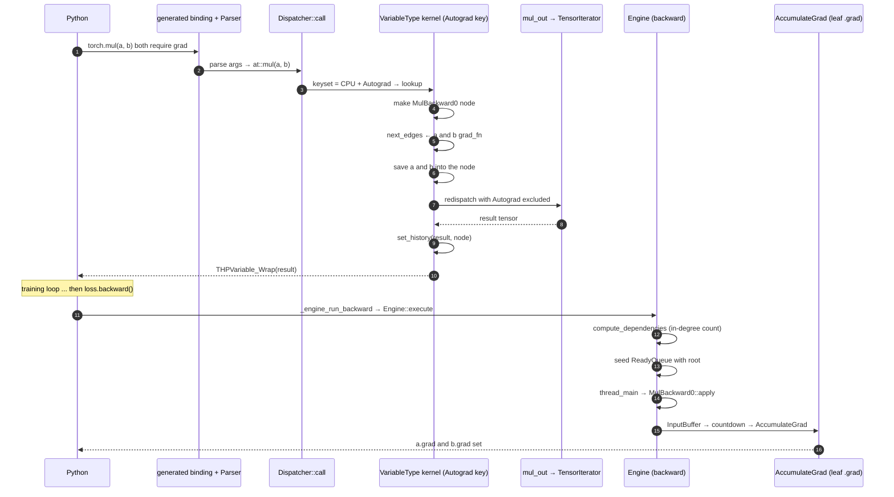

# PyTorch: the forward pass that records its own graph

> **Atlas id:** `pytorch` · **Domains:** `ml-framework` ·
> **Upstream:** https://github.com/pytorch/pytorch · **License:** BSD-3-Clause ·
> **Pinned commit:** `4290a8548a523d960de21ae86fec8eaa9803c5b1` (2026-10-13)

PyTorch is a tensor library that became the dominant ML training
framework through one architectural bet: **define-by-run
autodiff**. There is no graph-building phase separate from
computation — every eager `a * b` call *is* graph construction. The
call flows from Python through a generated C++ binding into a
central dispatcher, which routes to an autograd kernel whose job is
twofold: run the real kernel for the backend, and leave a receipt
(a `Node`) on the output tensor describing how to invert the
operation. `loss.backward()` is then a tiny DAG scheduler — ready
queues, in-degree countdowns, one worker thread per device —
walking those receipts in reverse topological order. The lesson
this codebase teaches better than any other: how to layer a thin
Python frontend over a C++ core through *one* dispatch table, how
to generate that entire surface (bindings, kernels, autograd
nodes, signatures) from two YAML schemas, and what it costs to
make every single operation carry the weight of an implicit,
user-invisible tracing system.

## Explain like I'm 10

**A restaurant where every cook writes a receipt for what they
made, and at closing time a cleanup crew walks the receipts
backwards to pay everyone back.** When you order (call `torch.mul`
in Python), the receptionist (the dispatcher, in C++) looks at
where your ingredients came from (each tensor carries a tag — the
dispatch key set — saying CPU or GPU, needs-grad or not) and routes
the order to the right kitchen (the kernel). As the cook works,
the receptionist also staples a receipt (the autograd `Node`) onto
the finished dish, and each receipt points back to the receipts of
the dishes it was made from (`next_edges`). At closing time
(`loss.backward()`), the cleanup crew (the autograd engine) has
one clerk per room (one worker thread per device), each with a
pile of receipts to process (the `ReadyQueue`); a clerk may only
process a receipt once every dish that contributed to it has
delivered its share, because contributions going to the same cook
must be added together first (the `InputBuffer`). If someone
sneaks back and rewrites a saved ingredient after its receipt was
stapled, the crew refuses to close the books (the version counter
check). And because receipts are *generated* for every operation
in advance from a recipe book (the `derivatives.yaml` schema), no
cook ever has to write one by hand.

**Why the grown-ups did it this way:** when the computation graph
depends on Python control flow (loop lengths, data-dependent
branches), the only graph builder that can capture it faithfully
is the execution itself — so the design records while it runs, and
pays for that choice on every single op call.

## 1. Architecture overview

- **Python is a skin, not the body.** `torch/__init__.py:2635`
  does `from torch._C._VariableFunctions import *`; those
  functions are *generated* C bindings (`tools/autograd/templates/
  python_torch_functions.cpp`), one static `PyObject*` function per
  operator, each fronting a cached `PythonArgParser`
  (`torch/csrc/utils/python_arg_parser.h:212`). The result wraps
  back into Python via `THPVariable_WrapWithType`
  (`torch/csrc/autograd/python_variable.cpp:408`), which allocates
  (or finds — see the PyObject slot below) the Python wrapper for
  a `TensorImpl`.
- **One dispatcher is the entire language boundary.** Every op —
  Python-called, C++-called, custom, or compiled — goes through
  `Dispatcher::call` (`Dispatcher.h:784`): compute a
  `DispatchKeySet` from the arguments' tensors (each tensor carries
  its key set in its `TensorImpl`), then `OperatorEntry::lookup`
  (`OperatorEntry.h:182`) — a single array index into a per-op
  table of kernels, sized to stay cache-resident. What looks like
  "the C++ API" is the same table reached from the other side.
- **The Autograd layer is a dispatch key, not a wrapper class.**
  Old frameworks wrapped tensors in differentiable shells. PyTorch
  registers *generated autograd kernels* at the `Autograd` dispatch
  key (`tools/autograd/gen_variable_type.py:912` emits the
  `TORCH_LIBRARY_IMPL(aten, Autograd, ...)` registrations). Each
  kernel runs the backward-recipe (from `derivatives.yaml`),
  saves what backward needs, redispatches to the backend key
  *below* autograd, then staples the `Node` onto the output
  (`set_history`, `torch/csrc/autograd/functions/utils.h:67`).
- **ATen kernels never know autograd exists.** A structured op
  like `mul.out` implements one `TORCH_IMPL_FUNC(mul_out)`
  (`aten/src/ATen/native/BinaryOps.cpp:441`) that hands a prepared
  `TensorIterator` to a `DispatchStub` (`aten/src/ATen/native/
  DispatchStub.h`) — which picks the AVX2/AVX512/NEON-compiled
  version of `mul_kernel` (`cpu/BinaryOpsKernel.cpp:126`) or the
  CUDA one (`cuda/BinaryMulKernel.cu:22`). `TensorIterator::build`
  (`TensorIterator.cpp:1467`) did the hard part: broadcasting,
  dtype promotion, dimension reordering, dimension coalescing —
  so the kernel body is a flat, vectorizable loop.
- **The spine** is one op call end-to-end: Python `torch.mul` →
  generated binding → `Dispatcher::call` → generated Autograd
  kernel (record) → redispatch → `mul_out` → `TensorIterator` →
  vectorized CPU loop → wrapped output with a fresh
  `grad_fn` — and later, `backward()` walking the same receipts
  in reverse. The Walkthrough traces exactly this.

## Walkthrough: one multiply recorded, then walked backwards

**Step 1 — The order enters reception.** `torch.mul(a, b)` lands
in a generated binding (shaped by `tools/autograd/
gen_python_functions.py:835`): a static `PythonArgParser`
(`python_arg_parser.h:212`) compiled once per process matches the
arguments against the overload signatures generated from
`native_functions.yaml` — `mul.Tensor` before `mul.Scalar`, zero-dim
tensors binding to Scalar unless they require grad (the parser's
header comment documents these rules). The tensors are unwrapped
from their Python wrappers (`THPVariable_Unpack`) — no copies, the
Python object and the C++ tensor share one `TensorImpl`.

**Step 2 — Dispatch by tag, not by type.** `Dispatcher::call`
(`Dispatcher.h:784`) extracts each tensor argument's
`DispatchKeySet` and ORs them; `a` and `b` on CPU with
`requires_grad=True` yield a set containing `AutogradCPU`. One
array lookup (`OperatorEntry::lookup`, `OperatorEntry.h:182`)
selects the highest-priority functionality's kernel — the
generated VariableType kernel registered at the `Autograd` key.

**Step 3 — The receipt is prepared before the dish exists.** The
kernel (generated from `tools/autograd/derivatives.yaml:1251`,
the `mul.Tensor` entry whose formula is `grad * other` and
`grad * self`) checks whether any input requires grad and grad
mode is on; if so it creates a `MulBackward0` `Node`
(`tools/autograd/gen_variable_type.py:637` `ASSIGN_GRAD_FN`,
`:704` `SET_HISTORY` templates show the generated shape), whose
`next_edges` come from `collect_next_edges(a, b)`
(`torch/csrc/autograd/function.h:71`) — i.e. the *inputs'*
existing `grad_fn`s (or their `AccumulateGrad` accumulators, for
leaves). The operands the backward formula needs are saved into
the node (`SavedVariable`), each pinned at its current version
counter.

**Step 4 — Compute, below autograd.** The kernel calls the
generated `at::redispatch::mul_` with the autograd keys excluded
(`gen_variable_type.py:664` `CALL_REDISPATCH`): the dispatcher
lands on the CPU backend kernel `TORCH_IMPL_FUNC(mul_out)`
(`BinaryOps.cpp:441`) → `mul_stub` → `mul_kernel`
(`cpu/BinaryOpsKernel.cpp:126`). `TensorIterator::build`
(`TensorIterator.cpp:1467`) has broadcast shapes, promoted dtypes,
reordered and coalesced dimensions; `mul_kernel` then runs
`cpu_kernel_vec` with a scalar lambda and a `Vectorized<T>` lambda
side by side — with special cases for bool (logical and) and a
fast path when one operand is a Python scalar. The result
`TensorImpl` shares nothing with the inputs' storage.

**Step 5 — Staple and return.** Back in the autograd kernel,
`set_history` (`functions/utils.h:67`) calls
`impl::set_gradient_edge(result, {node, output_nr})` — the output's
`AutogradMeta::grad_fn_` now points at `MulBackward0`. The
generated binding wraps the tensor (`THPVariable_WrapWithType`,
`python_variable.cpp:408`); the PyObject and the TensorImpl keep
each other alive (an `impl::PyObjectSlot` on the TensorImpl,
`c10/core/TensorImpl.h:2269`). The forward pass *was* the graph
builder. Nothing else was recorded anywhere.

**Step 6 — Close the books.** `loss.backward()` goes
`torch/autograd/graph.py:1100 _engine_run_backward` →
`THPEngine_run_backward` (`python_engine.cpp:179`) →
`PythonEngine::execute` (`python_engine.cpp:120`, which
`TORCH_CHECK`s the GIL is *released* — expensive C++ work must
not serialize Python) → `Engine::execute`
(`engine.cpp:1428`). It builds a `GraphTask`
(`graph_task.h:18`), wraps the roots in a `GraphRoot`, and
`compute_dependencies` (`engine.cpp:1360`) walks `next_edges`
counting each node's in-degree into `dependencies_` — a plain
`unordered_map<Node*, int>`; no topological sort, no locks per
edge.

**Step 7 — Walk the receipts.** The calling thread itself becomes
the CPU worker (`thread_main`, `engine.cpp:575`); GPU-device nodes
are executed by one persistent thread per device created lazily by
`start_device_threads` (`engine.cpp:1725`, each named
`pt_autograd_N`, `engine.cpp:344 thread_init`). Each
`evaluate_function` (`engine.cpp:1168`) runs the node's `apply`
via `call_function` (`engine.cpp:1114` — pre-hooks, the node call,
post-hooks, output shape validation), then for each output edge
decrements the target's dependency count; a target whose count
reaches zero graduates from its staging `InputBuffer` (partial
gradient sums accumulated in `not_ready_`, `input_buffer.h:41`)
into a `NodeTask` pushed on the target device's `ReadyQueue`
(`engine.h:87` — a priority queue ordered by `sequence_nr`, which
is why `AccumulateGrad` constructs itself with
`sequence_nr = UINT64_MAX` to always sort first (set in its
constructor at `functions/accumulate_grad.cpp:87`, applied in
`AccumulateGrad::apply` at `:92`).

**Outcome — Leaves hold their gradients, and the tape is spent.**
Gradient paths ending at leaves reach `AccumulateGrad::apply`
(`accumulate_grad.cpp:92`): under the node's mutex it either
steals the incoming gradient (when the engine's refcount protocol
says nobody else holds it — `call_function` bumps the expected
count exactly when post-hooks exist) or accumulates into
`variable.grad_` in place. When `outstanding_tasks_` — incremented
by every `ReadyQueue::push` (`engine.cpp:234`) and decremented on
every completed task — hits zero, the GraphTask's future
completes; `Engine::execute`'s `fut->wait()` returns the captured
gradients. With `keep_graph=False` each node released its saved
tensors as it ran: the tape is single-use by default.

## 2. Core data structures — and why these

- **`TensorImpl` — one refcounted body, three optional souls.**
  **What:** `c10/core/TensorImpl.h:569` — storage pointer, dtype,
  device, sizes/strides (possibly symbolic), a `DispatchKeySet`,
  a nullable `AutogradMeta` pointer, a `PyObject` slot, and a
  shared `VariableVersion` counter. Owned by `intrusive_ptr`; the
  Python `torch.Tensor` and the C++ `Tensor` are both thin handles
  to it. **Why:** Python refcounting, C++ refcounting, and
  autograd state each get to exist or *not exist* independently —
  a plain float tensor pays zero autograd bytes (`autograd_meta_`
  stays null, see the invariant note at `TensorImpl.h:3003`), and
  a C++-only workload (libtorch) never materializes a PyObject.
  The descriptor/physical split of [llama.cpp](llama-cpp.md)'s
  `ggml_tensor`, taken further: here even *language identity* is
  an optional slot.

- **`DispatchKeySet` — dispatch as a uint64 bitmap.**
  **What:** `c10/core/DispatchKeySet.h:50` — a 64-bit word of
  ordered "functionality" bits (Autograd above backend) plus
  backend bits; every tensor carries one, and per-thread
  include/exclude masks (guards like `torch.no_grad` clear the
  Autograd bit) refine it at call time (`DispatchKeyExtractor`,
  `aten/src/ATen/core/dispatch/DispatchKeyExtractor.h:39`).
  **Why:** multiple dispatch over N arguments collapses into an
  OR of bitsets plus one `countr_zero`-style priority pick — the
  dispatch step is O(1), branch-predictable, and needs no per-op
  virtual call. The cost is a fixed bit budget (see the "No More
  Than 16 Backends" note in the header) and aliasing rules that
  the file documents at length — a fair price versus a
  type-tower.

- **`Edge` and `Node` — the tape as ownership graph.**
  **What:** `torch/csrc/autograd/edge.h` — an `Edge` is exactly
  `(intrusive_ptr<Node>, input_nr)`; a `Node`
  (`torch/csrc/autograd/node.h`) owns its `next_edges_` via
  refcounted pointers, plus `sequence_nr` (creation order →
  queue priority), `topological_nr` (an internal DAG property
  used to prune traversal), input metadata for shape validation,
  and a `mutex_` for concurrent `apply` (`node.h:682` documents
  exactly when users must lock it). **Why:** the tape is not a
  separate data structure the framework stores somewhere — it is
  *literally* the ownership chain of small objects hanging off
  tensors' `AutogradMeta::grad_fn_`. Free the tensor, and if no
  other output keeps the node alive, the subgraph below it
  deallocates itself. Liveness and graph extent are one fact.

- **`GraphTask` — the run-state of one backward.**
  **What:** `torch/csrc/autograd/graph_task.h:18` — atomic
  `outstanding_tasks_`, the `dependencies_` in-degree map,
  `not_ready_` staged `InputBuffer`s, `exec_info_` (which paths to
  actually execute when `inputs=` is passed), captured leaf
  streams for CUDA, and the completion future. **Why:** everything
  a lock-light dataflow scheduler needs, and nothing else: no
  global pass over the graph at completion (the counter *is* the
  barrier), no scheduler thread (workers pull), no per-node
  promise. Compare the countdown pattern with
  [Kubernetes](kubernetes.md) controllers — same "count dependent
  edges" idea, here paid per-node in nanoseconds.

- **`TensorIterator` — the great leveler of elementwise kernels.**
  **What:** `aten/src/ATen/TensorIterator.cpp:1467 build` —
  fills operand slots, checks memory overlap, computes the
  broadcast shape, promotes a common dtype, permutes dimensions
  for coalescing, coalesces adjacent dims, allocates outputs;
  afterwards the kernel sees flat pointers/strides and (usually)
  a contiguous 1-D loop. **Why:** one C++ class absorbs the
  combinatorial horror of NumPy semantics (broadcast + cast +
  layout) so that ~200 pointwise ops are each a dozen lines —
  `mul_kernel` is literally `a * b` twice, scalar and vector. The
  ATen "structured kernel" split (`mul.Tensor` delegates to
  `mul.out` via `structured_delegate` in the yaml) means the
  out-variant owns the iterator setup for all three variants.

- **`SavedVariable` + `VariableVersion` — snapshots that can
  complain.** **What:** saving for backward pins the tensor's
  data pointer and records its version counter
  (`saved_variable.h`); `unpack` (`saved_variable.cpp:166`)
  refuses if `saved_version_ != current_version` — the error
  users know as "one of the variables needed for gradient
  computation has been modified by an inplace operation."
  **Why:** in-place ops bump the shared counter
  (`TensorImpl.h`'s `bump_version`, shared between a view and its
  base), so correctness of the tape doesn't require copying
  saved inputs — just detecting staleness cheaply. A validation
  budget of one atomic counter, checked once per save.

## 3. Concurrency and failure model

- **Two parallelism worlds, deliberately separate.** Forward
  execution is single-threaded *per op call*; parallelism lives
  inside kernels (CPU thread pools, CUDA streams). Backward is
  parallel across the DAG: `Engine` runs one worker thread per
  device (created on first backward touching that device,
  `engine.cpp:1725`) plus whatever thread called `backward()` as
  the CPU worker (`engine.cpp:1585`). No lock protects "the
  graph" — the graph is immutable during execution; coordination
  happens through per-queue mutexes, the in-degree map, and
  `InputBuffer` accumulation under the GraphTask's own mutex
  (`engine.cpp:1223`).

- **Readiness is a countdown, not a scheduler.** A node runs when
  its dependency count hits zero (`engine.cpp:1295`), because all
  its incoming gradients have arrived and been summed into its
  `InputBuffer` — an implicit addition node (the file comment in
  `input_buffer.h` calls it exactly that). Priorities inside each
  `ReadyQueue` are `(reentrant depth, sequence_nr)`
  (`engine.h:87`), so within a device, work is *approximately*
  topological, which keeps peak memory of intermediate gradients
  bounded without any global ordering pass.

- **CUDA correctness is streams-and-events bookkeeping.** Each
  produced gradient records the stream it was computed on;
  `InputBuffer::add` (`input_buffer.cpp:350`) records events and
  `evaluate_function` (`engine.cpp:1203`) makes the consumer's
  stream wait on the producer's event when they differ. The
  GraphTask collects `leaf_streams` and `exec_post_processing`
  syncs them with the caller's streams — the semantics documented
  publicly as "stream semantics of backward passes." The Node
  `mutex_` (`node.h:682`) serializes concurrent `apply` on the
  same node, which is what makes the whole scheme safe without
  per-gradient locks.

- **Failure: poison the task, not the thread.** A throwing node's
  exception is captured into the GraphTask
  (`graph_task.h:set_exception`), `has_error_` flips, other
  workers drain the queue without executing further nodes, and
  the exception is rethrown to the caller when the future is
  joined in `Engine::execute`. A Python exception raised in a
  Python-side node crosses this boundary through
  `PythonEngine::execute`'s `python_error` restore path
  (`python_engine.cpp:120`). CUDA kernels failing asynchronously
  surface at the next synchronization point — by design, the
  engine never polls the GPU.

- **Reentrant backwards are a bounded recursion.** A `Node::apply`
  that itself calls `backward()` would recurse through
  `Engine::execute`; beyond `MAX_DEPTH = 60` levels
  (`engine.h:38`) the engine stops recursing and hands the new
  GraphTask to a small standby thread pool (`Note [Reentrant
  backwards]`, `engine.cpp:146`). The constant is honest about
  why: TSAN deadlocks past ~65 held mutexes.

## 4. API and extension design

- **The public surface is schema-first.** An operator exists once
  in `aten/src/ATen/native/native_functions.yaml` (with aliasing
  and mutation annotations like `Tensor(a!)`), and codegen emits:
  C++ declarations, Python bindings, `out=` variants, structured
  kernel scaffolding, meta (shape) kernels, the dispatch
  registrations — and, paired with a `derivatives.yaml` entry,
  the autograd kernel and the `Node` class. The yaml *is* the API
  reference; the [Redis](redis.md) commands.json pattern at
  2,000-op scale.

- **Five extension seams, all funnels into one table.** (1)
  `torch.library` / `TORCH_LIBRARY`
  (`torch/library.h:974`): register a new operator and kernels at
  *any* dispatch key — Python's `torch._library.custom_ops.py:272
  CustomOpDef` wraps it with schema inference and a pt2-compliance
  tag. (2) Custom `autograd.Function` — a Python `Node` subclass
  the engine runs with the GIL held just for it. (3) `PrivateUse1`
  — a reserved dispatch key so out-of-tree backends (TPUs, NPUs)
  plug in without forking. (4) TorchDispatch/TorchFunction modes
  — thread-local interceptors that see every op call (how
  functionalization, functorch, and profiling are built). (5)
  `torch.compile` backends — a registry of graph handlers
  receiving the FX graph Dynamo extracted. All five converge on
  the same dispatcher; there is no second system.

- **torch.compile is the eager design's honest sequel, not a
  replacement.** Dynamo installs a CPython frame-evaluation hook
  (PEP 523; `torch/csrc/dynamo/eval_frame.c:329
  enable_eval_frame_shim` → `_PyInterpreterState_SetEvalFrameFunc`),
  rewrites bytecode to trace tensor ops into an FX graph guarded
  on shapes/properties (`torch/_dynamo/convert_frame.py:1703
  _compile`), and lowers through AOTAutograd and Inductor's
  generated Triton/C++ (`torch/_inductor/compile_fx.py:3130`).
  Because ops were already funneled through one dispatcher with
  schema and meta kernels, capture did not require a new runtime —
  the same seams that gave custom backends gave the compiler.

- **Honest warts.** The generated layer is invisible in a fresh
  clone: `torch/csrc/autograd/generated/` exists only after a
  build, so reading the "real" autograd kernel means reading
  Python generators — and the codebase knows it (the generated
  `VariableTypeEverything.cpp` exists "for ease of inspection...
  only for convenience; not actually used in the build," per the
  sharding note in `tools/autograd/templates/VariableType.cpp`).
  Schema-string overload sprawl (`mul.Tensor` / `mul.Scalar` /
  `mul.out` / `mul_.Tensor`...) is the price of uniformity. And
  the compile stack's depth (Dynamo → AOTAutograd → Inductor)
  makes failure diagnosis a genuinely hard skill — the flexibility
  that won research is exactly what capture must fight to
  recover.

## 5. The defining trade-offs

### Trade-off 1: define-by-run recording over pre-declared static graphs
- **Tension:** ML frameworks before PyTorch made you declare the
  graph, then run it — enabling whole-graph optimization but
  breaking Python control flow, debugging, and shape dynamism.
- **Choice:** make execution the graph builder. The generated
  Autograd kernel records while computing; the "graph" is never
  materialized anywhere else but the live tensors' `grad_fn`
  chain.
- **Evidence:** `tools/autograd/gen_variable_type.py:664`
  `CALL_REDISPATCH` and `:704` `SET_HISTORY` templates — the
  generated kernel *first* computes with the backend kernel,
  *then* attaches the node; `tools/autograd/derivatives.yaml:1251`
  supplies the backward formula as data; `functions/utils.h:67
  set_history` is the staple. The bill for the choice is paid
  later: no eager pass can fuse ops, so the codebase eventually
  built a tracing compiler on top (`eval_frame.c:329`) to recover
  the static graphs it deliberately never had.
- **Given up:** whole-graph optimization in the default path
  (fused kernels, memory planning), plus per-op dispatch cost —
  both recovered only partially, and ten years later, by
  torch.compile.
- **Verdict:** right for the research workload that made PyTorch
  dominant — models whose structure changes with every run, where
  the value of printing/branching/debugging mid-graph exceeds
  fused-kernel throughput. Wrong when your model is fixed and
  shapes are static — ship the compiled artifact (the same
  codebase's `torch.compile`/`torch.export` exist precisely for
  that phase transition).

### Trade-off 2: thin generated bindings over a C++ dispatcher core
- **Tension:** the frontend everyone wanted was Python, but the
  kernels needed C++ speed and vendors needed a Python-free
  path; per-call overhead of crossing CPython is real.
- **Choice:** Python bindings exist only as generated stubs over
  `at::` functions; all real logic sits behind one dispatcher
  reachable identically from C++ (libtorch) and Python.
- **Evidence:** the cost side is visible at
  `gen_python_functions.py:835` (every call parses Python objects
  against compiled signature strings) and `Dispatcher.h:784
  call` → `OperatorEntry.h:182 lookup` (keyset computation and
  one more indirect call per op); the payoff side is that
  `autograd_not_implemented_fallback.cpp`, TorchDispatch modes,
  profiling, and torch.compile all hook the *same* single point —
  and libtorch ships the whole engine with no CPython linked.
- **Given up:** a hand-tuned Python-first fast path; the per-op
  constant factor that frameworks like [llama.cpp](llama-cpp.md)
  eliminate by having no frontend at all — PyTorch pays it on
  every call and eventually attacks it with a bytecode-level JIT.
- **Verdict:** right when many frontends and many backends must
  meet at one semantic core, and ops are heavy enough (real
  matmuls) that a few hundred ns of dispatch vanish in the
  kernel. Wrong for tiny-op-dominated workloads — which is a
  large part of why torch.compile exists.

### Trade-off 3: generate everything from two YAML schemas
- **Tension:** 2,000+ operators × 4–6 artifacts each (C++ decl,
  Python binding, dispatch registration, autograd kernel, Node
  class, meta kernel) — hand-maintaining them guarantees drift.
- **Choice:** `native_functions.yaml` + `derivatives.yaml` are
  the single source; `torchgen/` and `tools/autograd/` generate
  everything (the `VariableType.cpp` template even splits itself
  into compile-parallel shards because the unsplit file was
  36,000 lines — the template's own sharding note).
- **Evidence:** `native_functions.yaml:4246` declares all four
  `mul` overloads in 40 lines, including sparse/Mkldnn dispatch
  map entries; `tools/autograd/gen_autograd.py`'s header states
  the build destination (`torch/csrc/autograd/generated/`);
  `torchgen/gen.py:2606-2646` writes `RegisterBackendSelect.cpp`,
  `RegisterSchema.cpp`, `Operators.cpp`, `Functions.cpp` from the
  same parse.
- **Given up:** a readable, greppable implementation — the "real"
  autograd code for `mul` does not exist as a committed file,
  and reviewing a PR means reading generator templates plus
  imagined output. Build complexity and a Python-based build
  step are permanent tenants.
- **Verdict:** right at this scale — the alternative is the
  pre-2017 framework world where bindings, docs, and autograd
  drifted apart per-op. Wrong below a few dozen ops, where
  codegen is ceremony ([curl](curl.md) hand-writes its surface
  and stays coherent). This is PATTERNS.md's "generate the
  surface from data," taken to its maximum credible extent.

## 6. Reading path

1. `torch/csrc/autograd/variable.h:53` — the Variable doc block:
   leaf vs. interior, `grad_fn` vs. `grad_accumulator`, versions,
   views. The densest design document in the codebase; do not
   skip it.
2. `torch/csrc/autograd/edge.h` then `torch/csrc/autograd/node.h`
   — `Edge` is `(Node, input_nr)`; read `Node`'s `next_edges_`,
   `sequence_nr`, `topological_nr`, the `mutex_` contract at
   `:682`, and `operator()` at `:172`.
3. `aten/src/ATen/native/native_functions.yaml:4246` — the four
   `mul` overloads; notice `Tensor(a!)` mutation annotations,
   `structured: True` on `mul.out`, and per-backend dispatch
   entries. Then `tools/autograd/derivatives.yaml:1251` — the
   backward formulas as data.
4. `tools/autograd/gen_variable_type.py:614-726` — the templates
   that *are* the autograd kernels (`SETUP_DERIVATIVE`,
   `CALL_REDISPATCH` at `:664`, `SET_HISTORY` at `:704`); then
   `:912` for the `TORCH_LIBRARY_IMPL(aten, Autograd)` wrapper
   generation. Optionally run `python -m tools.autograd.gen_autograd`
   (its docstring shows the invocation) to materialize
   `torch/csrc/autograd/generated/` and read the real
   `VariableTypeEverything.cpp`.
5. `torch/csrc/autograd/functions/utils.h:67 set_history` — the
   staple: `add_input_metadata` + `set_gradient_edge`. Three
   lines that make every differentiable op "record."
6. `torch/csrc/autograd/python_variable.cpp:408
   THPVariable_WrapWithType` and `torch/csrc/utils/
   python_arg_parser.h:212 PythonArgParser` — the CPython
   boundary in two structures; note the PyObject/TensorImpl
   co-ownership and the overload-matching gotchas in the header
   comment.
7. `aten/src/ATen/core/dispatch/Dispatcher.h:784 call` +
   `OperatorEntry.h:182 lookup` + `c10/core/DispatchKeySet.h:50`
   — the O(1) heart: bitset OR, one array index. Then
   `DispatchKeyExtractor.h:39` for how TLS guards
   (`no_grad`, inference mode) mask keys in and out.
8. `aten/src/ATen/native/BinaryOps.cpp:441 TORCH_IMPL_FUNC
   (mul_out)` → `aten/src/ATen/native/cpu/BinaryOpsKernel.cpp:126
   mul_kernel` → `aten/src/ATen/native/DispatchStub.h` — the
   kernel side: structured op → arch-dispatched stub → a
   two-lambda loop body. Read `cpu/Loops.h`'s `basic_loop` next.
9. `aten/src/ATen/TensorIterator.cpp:1467 build` — walk one call:
   `compute_shape`, `compute_types`, `reorder_dimensions` at
   `:226`, `coalesce_dimensions` at `:602`. This is where
   NumPy semantics are actually implemented.
10. `torch/autograd/graph.py:1100 _engine_run_backward` →
    `torch/csrc/autograd/python_engine.cpp:179
    THPEngine_run_backward` and `:120 PythonEngine::execute` —
    backward's front door, and the GIL discipline around it.
11. `torch/csrc/autograd/engine.cpp` in this order: `:1428
    execute` (GraphTask, GraphRoot, dependencies) → `:1360
    compute_dependencies` → `:234 ReadyQueue::push` → `:575
    thread_main` → `:1168 evaluate_function` (the countdown, the
    InputBuffer staging, the stream guards) → `:1114
    call_function`. This file is the best-written ~2,000 lines of
    scheduling code you will read this year.
12. `torch/csrc/autograd/functions/accumulate_grad.cpp:92
    AccumulateGrad::apply` — steal-vs-clone refcount logic, the
    `sequence_nr = UINT64_MAX` trick (constructor at `:87`), the mutex; then
    `torch/csrc/autograd/saved_variable.cpp:166` — the version
    check every "modified by an inplace operation" error comes
    from.
13. `torch/csrc/dynamo/eval_frame.c:329 enable_eval_frame_shim`
    and `torch/_dynamo/convert_frame.py:1703 _compile` — the
    sequel: how the codebase later recovered static graphs
    without breaking the eager contract from steps 1–12.

You have now traced one multiply from a Python call through the
generated binding, the dispatcher, a recorded autograd node, a
vectorized CPU kernel, and back — and then the entire backward
pass that the recorded tape made possible.

## 7. What to steal

- **Make execution the recorder** — when users can't or won't
  describe the structure up front (control-flow-dependent work,
  debugging workflows), build the trace as a side effect of the
  real path, one receipt at a time. Seen at
  `gen_variable_type.py`'s SET_HISTORY template: three lines
  after every compute.
- **Nullable capability fields on hot objects** — a tensor that
  doesn't need autograd stores null `AutogradMeta` and pays
  nothing; a tensor Python never touches stores no PyObject.
  Zero-cost abstractions via optional slots, not subclass trees
  (`TensorImpl.h:569`).
- **Schedule DAGs with counters and buffers, not a scheduler** —
  in-degree map + staged input buffers + per-worker queues +
  one atomic outstanding counter as the barrier: no scheduler
  thread, no graph locks, naturally parallel across devices
  (`engine.cpp:1168 evaluate_function`).
- **Version counters to make cheap snapshots safe** — share one
  atomic counter between an object and its views; snapshots pin
  the version and refuse to run if it moved (`saved_variable.cpp:166`).
- **Generate the API surface from schema data** — one yaml
  entry becomes bindings, kernels, autograd, docs, and compile
  metadata; drift between them becomes structurally impossible
  (`native_functions.yaml`, the [Redis](redis.md) pattern at
  100× scale).
- **Put every extension point at the same dispatch table** —
  custom ops, custom backends, tracing modes, and compilers all
  register at one seam (`torch/library.h:974`), so the ecosystem
  never forks the core — the placement decision that made
  PyTorch a platform rather than a library.

## 8. Difficulty and prerequisites

- Difficulty: `demanding`. Realistic budget: 9–12 hours for this
  path. The C++ is modern and heavily commented, but two
  genuinely hard things await: the generated-code indirection
  (much of what runs does not exist as committed source — budget
  an hour to run the codegen or read generators fluently) and
  the engine's synchronization reasoning (read it twice).
- Prerequisites: what a gradient and the chain rule are;
  comfortable C++ (templates, `intrusive_ptr` refcounting);
  Python C API at the level of "a `PyObject*` wraps our object";
  DAG vocabulary (topological order, in-degree). CUDA streams
  only for section 3's depth — the CPU path tells the full story.
  [CPython](cpython.md) is the natural companion dive; bring
  [llama.cpp](llama-cpp.md) as the deliberately opposite design
  (no frontend, no dispatcher) for contrast.

## 9. Further reading

- The upstream *Autograd mechanics* note and *The dispatcher*
  notes on docs.pytorch.org — the public version of what section
  1 walks.
- In the clone: `GLOSSARY.md` (operation/kernel/node vocabulary),
  `aten/src/ATen/core/dispatch/README.md`, and the notes
  referenced in `engine.cpp` (Note [Reentrant backwards],
  Note [Streaming backwards]).
- *PyTorch: An Imperative Style, High-Performance Deep Learning
  Library* (Paszke et al., NeurIPS 2019) — the design rationale
  in the authors' words, including the eager-over-static
  argument this dive's Trade-off 1 reconstructs.
- *Automatic Differentiation in Machine Learning: a Survey*
  (Baydin et al., 2018) — where "define-by-run" vs
  "define-and-run" got their names.
- *Deep Learning Compiler PyTorch 2.0* (Ansel et al., 2023,
  arXiv 2309.06180) — what torch.compile (section 4) does with
  the tape-less eager design once graphs are recovered.
