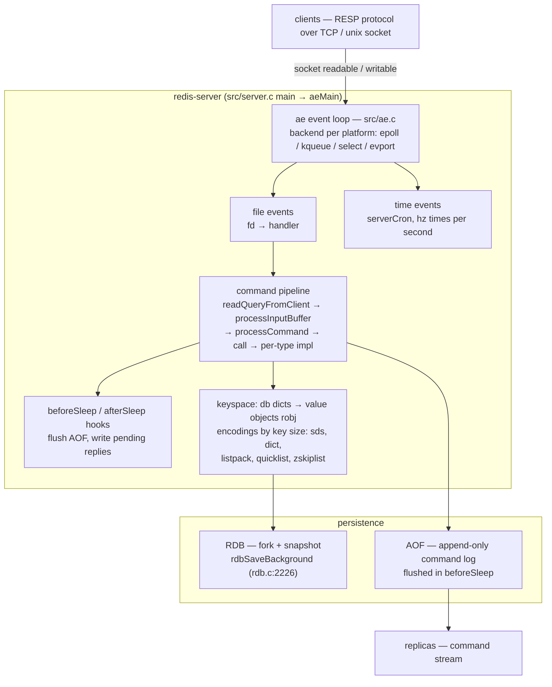
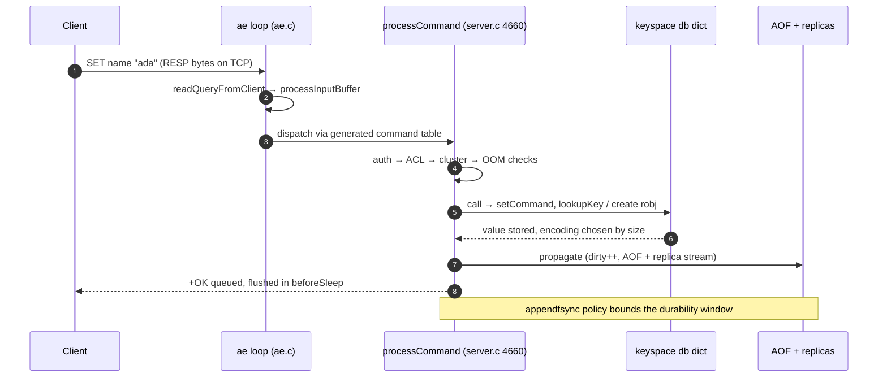
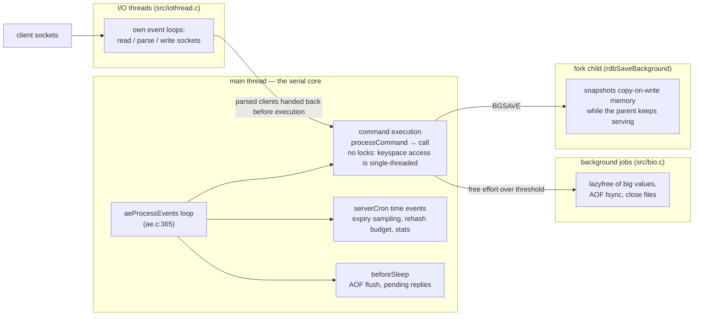

# Redis: an event loop plus data structures built like they're the product

> **Atlas id:** `redis` · **Domains:** `cache, database, networking` ·
> **Upstream:** https://github.com/redis/redis · **License:** RSALv2 OR SSPLv1 OR AGPLv3 ·
> **Pinned commit:** `3c7e951c3dc13fdeb905092e4a921ca7823e6faa` (2026-10-10, trunk)

Redis is an in-memory data structure server, and its design thesis is
radical simplicity of execution: **one thread runs all commands**, so every
command is atomic and almost no locks exist; around that serial core the
code invests everything in (a) a small, portable event loop and (b)
purpose-built data structures whose encodings are chosen per-key-size.
This deep-dive teaches how far that bet scales — and where the code now
pays to extend it with I/O threads without giving up the serial core.

## Explain like I'm 10

**A restaurant with exactly one chef.** Redis is a kitchen with one chef
(one thread runs all commands) and a doorbell — the event loop — that
rings whenever a table needs something or a timer goes off (`serverCron`).
The chef finishes one order completely before starting the next, so a dish
never comes out as half of one table's order mixed into another's (every
command is atomic, and there are almost no locks because nobody else is in
the kitchen). Most orders are tiny — pass the salt, read a note — so one
chef serves tens of thousands of tables. Slow chores get helpers: a huge
pile of leftovers is carried out by a dishwasher (a background thread
freeing a big value), and a snapshot of the whole pantry is taken by an
instant camera that freezes the room for a moment (a `fork` child writing
an RDB file over copy-on-write memory). The menu itself is printed from a
recipe book (`src/commands/*.json` → a generated command table), so adding
a new dish never rewires the kitchen.

**Why the grown-ups did it this way:** one cook means nothing is ever
half-made and nothing needs locking — the simplest design that keeps every
answer instant, with the slow jobs pushed off the chef's clock.

## 1. Architecture overview

- The **spine** of a command: event fires → `src/networking.c:readQueryFromClient`
  → `processInputBuffer` → `src/server.c:processCommand` → `src/server.c:call`
  → type implementation (e.g. `src/t_string.c:setCommand`) touching the keyspace
  via `src/db.c:lookupKey`.
- **Event loop** (`src/ae.c`): a ~500-line library written originally for a Tcl
  interpreter (the file header says so). File events map fd → callback; time
  events run `src/server.c:serverCron` (hz times per second) for expiry,
  resizing, stats. Platform backends are one file each: `ae_epoll.c`,
  `ae_kqueue.c`, `ae_select.c`, `ae_evport.c`.
- **Command metadata is data**: `src/commands/*.json` (one file per command,
  e.g. `src/commands/set.json`) is compiled by `generate-command-code.py` into
  `src/commands.def` — the generated `redisCommandTable` drives dispatch,
  ACL checks, key-spec extraction, and docs. Commands are declared, not
  hand-registered.

## Walkthrough: one SET, socket to keyspace

The spine as a story — on the site you can step through it with Next;
in the repo it reads top to bottom. The sequence diagram shows the same
trip at a glance.

**Step 1 — The doorbell rings.** The client's `SET name "ada"` arrives
as RESP bytes on a TCP socket. epoll reports the socket readable and the
ae loop (`aeProcessEvents`, `src/ae.c:365`) calls the file event's
handler: `readQueryFromClient` (`src/networking.c:3990`).

**Step 2 — Read and parse.** `readQueryFromClient` pulls bytes into that
client's query buffer and hands them to `processInputBuffer`
(`src/networking.c:3787`), which parses the RESP multibulk protocol into
an argv array: `SET`, `name`, `ada`.

**Step 3 — The policy gauntlet.** `processCommand` (`src/server.c:4660`)
runs every gate a command must pass — auth, ACL rights, cluster
redirect, OOM limits, transaction queueing — and only then dispatches,
via a table generated from `src/commands/*.json`.

**Step 4 — Execute on the serial core.** `call` (`src/server.c:4151`)
invokes `setCommand` (`src/t_string.c:430`): lookup or create the key in
the db dict (`src/db.c:lookupKey`), set the value object, and pick its
encoding by size (int, embstr, or raw). No other command can interleave:
there is exactly one chef.

**Step 5 — Bookkeeping and propagation.** The command marks the database
dirty, propagates itself to the AOF and to replicas, and notifies
`WATCH`ers. `addReply` queues `+OK` in the client's output buffer.

**Step 6 — Reply at the loop's edge.** Between two poll waits, in
`beforeSleep` (`src/server.c:1960`) — or on an I/O thread — the reply is
written to the socket. Durability is whatever `appendfsync` policy the
operator chose (everysec by default).

**Outcome — The client sees OK.** One command has traveled socket →
loop → parser → checks → keyspace → replication queue, all on a single
thread, so it could never interleave with another command's half-finished
work. After a restart, the AOF replays this very SET and the key is back.

## 2. Core data structures — and why these

### SDS — binary-safe strings with O(1) length (`src/sds.h`)

Five packed header variants (`sdshdr5`, `sdshdr8/16/32/64`) sized to the
string, all ending in `char buf[]`, plus a null terminator for free C-string
compatibility. Because the header sits *before* the pointer handed to
callers (`SDS_HDR` macro at `src/sds.h:64-65`), `sdslen` is O(1), appends
can check capacity inline, and the string may contain arbitrary bytes.
C strings were rejected for the same reason every network server rejects
them: length is metadata you already know, so don't rescan for it.

### dict — hash table with incremental rehash (`src/dict.c`)

The keyspace and hash/set values use a chaining hash table that rehashes
**incrementally**: during a resize, two tables live side by side
(`ht_size_exp[2]`), and every operation moves a few buckets
(`src/dict.c:_dictRehashStep`, called at lines 950, 1237...; bulk work in
`dictRehash` at line 406, capped by `empty_visits = n*10`, and
`dictRehashMicroseconds` at line 449 bounds it by time in `serverCron`).
Why: a full-table rehash of a multi-GB keyspace would be a multi-second
latency spike — unacceptable for a server whose promise is sub-millisecond
p95. Incremental rehash trades a small memory window (two tables) and a
slightly costlier lookup during migration for bounded per-operation work.

### listpack — compact serialized containers (`src/listpack.c`)

Small hashes, lists, sorted sets, and streams store as a listpack: one
allocation, elements back-to-back with varint lengths, no pointers.
Combined with `src/object.c`'s encoding switch (`OBJ_ENCODING_LISTPACK`,
growing into `OBJ_ENCODING_LISTPACK_EX` with per-entry TTL at
`src/server.h:3214`), small collections cost a few bytes per entry instead
of a pointer-graph. The old ziplist had cascade-update problems (an insert
could force rewriting all subsequent entry headers); listpack's lengths are
backwards-only, killing that pathology. Larger collections convert to
dict/quicklist/skiplist at `hash-max-listpack-entries`-style thresholds.

### zskiplist — sorted sets with rank queries (`src/server.h:1830`)

A skip list node carries `score`, a `backward` pointer, and per-level
`{forward, span}` (`src/server.h:1830-1840`); insertion is
`src/t_zset.c:zslInsert` (line 326). Spans make `Z Rank`/`ZRange` O(log n)
by summing spans along the descent — something a balanced BST gives you
only with subtree sizes. Why a skip list and not a red-black tree: simpler
code (~200 lines vs ~1000), no rebalancing cases to get wrong, and
lock-free-friendly in other engines. This is the classic "pick the
structure your operations actually need" decision.

### quicklist (`src/quicklist.c`)

Large lists become a doubly-linked list of listpack nodes — a hybrid that
keeps per-element overhead tiny while making pushes/pops at both ends
O(1) without moving the whole collection.

## 3. Concurrency and failure model

- **Serial command execution.** `processCommand` (`src/server.c:4660`) and
  `call` (line 4151) run on the main thread. At this pinned commit Redis
  is evolving its threading (`src/iothread.c`, new in the 8.x era): I/O
  threads now own their own event loops and parse/write client traffic,
  but command *execution* is handed back — see `processClientsFromIOThread`
  (`src/iothread.c:599`) setting `c->running_tid = IOTHREAD_MAIN_THREAD_ID`.
  The design lesson: parallelize the I/O around the serial core, never the
  core itself; atomicity of commands is the product.
- **Slow work is deferred, not threaded**, through the background-I/O job
  queue (`src/bio.c`) — e.g. `lazyfree.c` routes big-value frees to a bio
  thread when `lazyfreeGetFreeEffort` (`src/lazyfree.c:140`) exceeds a
  threshold (`UNLINK` vs `DEL` is the user-visible seam,
  `src/db.c:dbAsyncDelete` line 943).
- **Expiry is two-phase**: lazy on access (`src/db.c` lookup path) plus an
  active cycle that samples keys with a time budget
  (`src/expire.c:activeExpireCycle`, line 295; `activeExpireCycleTryExpire`
  line 40). Expired-key cleanup is treated like rehashing: amortized with
  hard per-iteration bounds so the loop never stalls.
- **Persistence without stopping the world**: RDB snapshotting forks the
  process (`src/rdb.c:rdbSaveBackground`, line 2226) — the child writes a
  consistent point-in-time view over copy-on-write memory while the parent
  serves. The AOF is an append-only log of commands flushed in
  `beforeSleep` (`src/server.c:1960`) with configurable `appendfsync`
  durability. Crash recovery = load RDB and/or replay AOF; the failure
  story is "lose at most the last fsync window," chosen by config, not
  code.

## 4. API and extension design

- The client API is the **RESP protocol**: a handful of verbs whose
  semantics map 1:1 onto data-structure operations. Because the protocol
  is typed arrays of bulk strings, adding a command never breaks the
  protocol — the table entry (`src/commands.def`, generated) declares
  arity, flags, key positions, and ACL category (see the `MAKE_CMD("set",...)`
  entry around line 13223).
- **Modules** (`src/module.c`) expose a large C API (`RedisModule_*`) so
  extensions add commands and data types without touching the core —
  with an explicit thread-safety contract (modules may block; the core
  unblocks clients).
- The honest wart: the single-process, single-port model made clustering
  an overlay (`src/cluster.c`) with slot migration as protocol state
  machine rather than a native distributed design — powerful, but the
  most criticized surface in the system.

## 5. The defining trade-offs

### Trade-off 1: single-threaded execution over lock-based parallelism
- **Tension:** serve tens of thousands of connections on many cores.
- **Choice:** one thread runs commands; concurrency lives in the event
  loop (and now I/O threads for socket work only).
- **Evidence:** `src/server.c:call` has no locks around keyspace access;
  `src/iothread.c:processClientsFromIOThread` marshals clients back to the
  main thread before execution.
- **Given up:** CPU-bound commands (e.g. big `SORT`, Lua) block everyone;
  one core does all command work.
- **Verdict:** right when per-command cost is microscopic and the workload
  is I/O-bound. Wrong when commands are compute-heavy — which is exactly
  why the module API allows moving work into threads under an explicit
  blocking contract.

### Trade-off 2: per-key adaptive encodings over uniform structures
- **Tension:** memory vs code complexity in an in-memory server.
- **Choice:** every value type has 2+ encodings switched by size/threshold
  (listpack → dict/quicklist/skiplist; `OBJ_ENCODING_*` in
  `src/server.h`).
- **Evidence:** `src/object.c`'s encoding getters (lines ~1317+);
  `setGenericCommand` (`src/t_string.c:87`) picks int/embstr/raw per value.
- **Given up:** predictable worst-case latency on conversion boundaries
  and a much larger test matrix; encodings leak to observability
  (`OBJECT ENCODING`).
- **Verdict:** right because cache economics are memory economics — the
  small-key regime dominates real workloads. The same choice would be
  over-engineering in a system where values are uniformly large.

### Trade-off 3: fork-based snapshots over in-place checkpointing
- **Tension:** durability without latency spikes.
- **Choice:** `rdbSaveBackground` forks; the child walks a frozen view
  while the parent keeps mutating copy-on-write pages.
- **Evidence:** `src/rdb.c:2226`; child status reaped in `serverCron`.
- **Given up:** fork cost scales with page-table size; heavy write load
  during a snapshot can double memory (CoW copies).
- **Verdict:** brilliant on Linux with modest datasets — a whole
  consistent snapshot with zero locking in the parent. It degrades on
  huge datasets with high write churn; that's the gap AOF-everysec and
  hybrid RDB+AOF headers fill.

## 6. Reading path

1. `src/server.c:main` (line ~8246) — startup order: config →
   `initServerConfig` → module loading → `initServer` (creates the event
   loop, registers listeners) → `aeMain`.
2. `src/ae.c:aeProcessEvents` (line 365) — the loop's heart: poll, dispatch
   file events, run due time events; notice `beforeSleep`/`afterSleep`
   hooks (`src/server.c:1960`, `2175`) — all "between epoll waits" work
   (flush AOF, write pending replies, handle just-unblocked clients)
   happens there.
3. `src/networking.c:readQueryFromClient` (line 3990) — read into the
   client's query buffer, hand to `processInputBuffer` (line 3787);
   notice the inline-vs-multibulk RESP parsing split.
4. `src/server.c:processCommand` (line 4660) — the policy gauntlet every
   command passes: auth → ACL → cluster redirect → OOM → blocked-client
   → transaction queue. Dispatch is a table lookup; the table came from
   `src/commands/*.json`.
5. `src/server.c:call` (line 4151) → `src/t_string.c:setCommand` (line
   430) — trace one `SET` end to end: parse args, `lookupKeyWrite` on
   `src/db.c:lookupKey` (line 296) or create, `setKey`, propagate to
   AOF/replicas, dirty counters, notify watchers (`WATCH`).
6. `src/sds.h` (whole file, ~350 lines) — read the five packed headers and
   `sdsnewlen`/`sdsMakeRoomFor` in `src/sds.c`; this is the smallest
   complete lesson in the repo.
7. `src/dict.c:dictRehash` (line 406) + `_dictRehashStep` (471) — see how
   "two tables + move a little every op" bounds latency; then find where
   `serverCron` calls the time-bounded variant.
8. `src/server.h:1824-1845` + `src/t_zset.c:zslInsert` (line 326) — walk
   the level-by-level descent; the `span` fields answer "what rank is
   this element" without subtree sizes.
9. `src/expire.c:activeExpireCycle` (line 295) — expiry as a sampling
   loop with a millisecond budget; compare with lazy expiry on the
   lookup path.
10. `src/rdb.c:rdbSaveBackground` (line 2226) — fork, serialize the frozen
    view, atomically rename; then `src/aof.c:flushAppendOnlyFile` for the
    complementary log-based story.
11. `src/iothread.c` (top + `processClientsFromIOThread`, line 599) — the
    modern layer: per-thread event loops, pending-client queues with
    mutexes, and the invariant that execution stays on the main thread.

You have now traced one `SET` from socket to keyspace to disk, and seen
every mechanism (loop, dict, encoding, expiry, persistence, threading)
that a Redis command's latency budget pays for.

## 7. What to steal

- **Amortize every unbounded operation** (rehash, expiry, freeing) into
  the main loop with explicit time/step budgets — the pattern that keeps
  p99 flat as data grows.
- **Generate your API surface from data** (commands.json → table): one
  source drives dispatch, docs, ACLs, and client tooling.
- **Adaptive encodings per key size** buy memory where the workload
  actually lives; put the conversion threshold in config, not code.
- **Fork is a persistence primitive**: copy-on-write gives consistent
  snapshots of mutable state with zero locks — if you're on Unix.
- **Parallelize I/O, serialize semantics**: the newer iothread layer
  shows how to add threads to a serial design without breaking its
  atomicity promise.

## 8. Difficulty and prerequisites

- Difficulty: **moderate**. C reading fluency required; no kernel
  knowledge needed.
- Budget: ~4–6 hours for the reading path; a weekend to also read
  `dict.c` and `t_zset.c` completely.
- Prerequisites: hash tables and skip lists at a data-structures level;
  what `fork(2)` + copy-on-write means (any OS textbook chapter);
  event-driven I/O basics (select/epoll).

## 9. Further reading

- Redis documentation: https://redis.io/docs/ — especially the topics
  pages on persistence, replication, and cluster.
- The `src/ae.c` header comment credits antirez's blog-era writing; the
  canonical history is Salvatore Sanfilippo's blog archives on Redis
  internals (e.g. the incremental rehash posts).
- P. E. O'Neil, "The Log-Structured Merge-Tree" — not Redis, but the
  appendix-log mindset that AOF shares.
