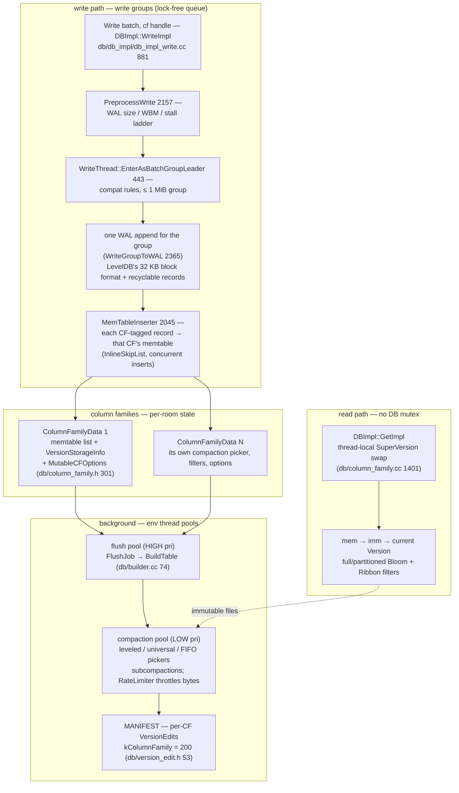
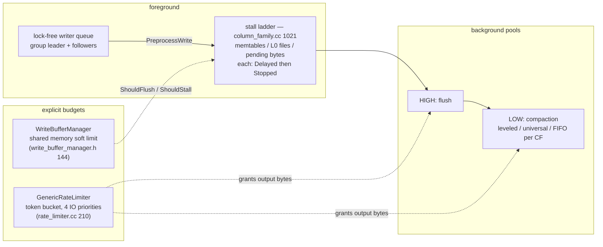

# RocksDB: LevelDB paged into Flash-scale production — column families, budgets, and a tuning surface

> **Atlas id:** `rocksdb` · **Domains:** `storage-engine` ·
> **Upstream:** https://github.com/facebook/rocksdb · **License:** GPLv2 OR Apache-2.0 ·
> **Pinned commit:** `a215c38a8ed34848edc152f7435eabc128208111` (2026-10-14)

LevelDB is the textbook LSM engine; RocksDB is what that textbook became
after a decade of carrying production traffic (Facebook's MySQL storage,
TiKV, Flink state) on Flash hardware shared with everything else. The
skeleton is unchanged — WAL, memtable skip list, immutable SSTables,
levels, manifest — so read the [LevelDB dive](leveldb.md) first; this
dive teaches what production *did to* that design: **one WAL and one
manifest multiplexed across column families, a stall ladder and token
bucket that turn overload into explicit budgets, compaction as a
pluggable filing style, and reads that skip the big lock entirely**. It
is an education in how constraints, not taste, evolve an architecture.

## Explain like I'm 10

**From one kid's desk to an office building.** LevelDB was one desk:
one diary (the WAL), one scratch page (the memtable), one tidy-up robot
(compaction). RocksDB turned the desk into a shared building: many rooms
(column families), each with its own scratch pages and folder drawers
and even its own filing style (leveled or tiered compaction) — but only
ONE front desk and ONE diary. Every visitor queues at the front desk
(the write group); the first in line takes the whole crowd's papers and
writes them into the shared diary in one pen stroke (one WAL append for
many tenants), then everyone scribbles into their own room's scratch
page. A budget office (the rate limiter) says how many pages per hour
the printers and shredders may move, and a building inspector (the write
controller) slows or halts the front desk when rooms overflow.

**Why the grown-ups did it this way:** when one machine runs storage for
many workloads at once, fairness and memory bounds stop being tuning
advice and become part of the data structure — so the budget moved into
the engine itself.

## 1. Architecture overview



- One `DBImpl` owns the write thread, the WAL set, the manifest, and the
  thread pools; each `ColumnFamilyData` (`db/column_family.h:301`) owns
  its memtable list, its level layout (`VersionStorageInfo`), and its
  mutable options — the per-room state. `ColumnFamilySet` is the
  building directory.
- The **spine** — one `Put` on a named column family — is:
  `DBImpl::WriteImpl` (881) → `write_thread_.JoinBatchGroup` (1113) →
  leader: `PreprocessWrite` (2157) → `EnterAsBatchGroupLeader` (1210) →
  `WriteGroupToWAL` (2365) → `InsertInto` per-CF memtables (1126).

## Walkthrough: one Put on a column family, into the shared WAL and back out of Get

The complete life of a RocksDB record — through the building LevelDB
kept as a single desk. Step through it on the site, or read straight
down.

```mermaid
sequenceDiagram
    autonumber
    participant C as Caller (Put, cf "users")
    participant WT as WriteThread queue
    participant L as group leader
    participant W as WAL (shared, all CFs)
    participant M as users CF memtable (skip list)
    participant BG as flush/compaction pools
    participant R as Reader (Get)
    C->>WT: JoinBatchGroup (write_thread.cc 404)
    WT->>L: leader elected (lock-free newest_writer_ list)
    L->>L: PreprocessWrite 2157 — stall ladder, WBM, WAL switch
    L->>WT: EnterAsBatchGroupLeader 443 — group ≤ 1 MiB, compat rules
    L->>W: WriteGroupToWAL 2365 — one append, seq range assigned
    Note over L,W: whole group durable together, atomic across CFs
    L->>M: InsertInto → MemTableInserter::SeekToColumnFamily<br/>(write_batch.cc 2045)
    M->>BG: memtable full → flush (HIGH pri) under WriteBufferManager budget
    BG->>BG: compaction (LOW pri): leveled or universal picker,<br/>RateLimiter grants bytes
    BG->>L: install via VersionSet::LogAndApply 6605 (per-CF edit)
    R->>R: GetImpl — thread-local SuperVersion (column_family.cc 1401), no mutex
    R->>M: mem → imm → levels; Bloom/Ribbon filters skip files
```

**Step 1 — Caller picks a room.** The batch is a flat byte string: a
12-byte header (8-byte sequence + 4-byte count,
`db/write_batch_internal.h:82`) followed by records, each tagged with a
value type — and for non-default column families, a CF-tagged variant
of that type plus the CF id (`kTypeColumnFamilyValue = 0x5` …
`kTypeColumnFamilyRangeDeletion = 0xE`, `db/dbformat.h:41-78`). The same
enum carries transaction markers (`kTypeBeginPrepareXID`,
`kTypeCommitXID`, `kTypeRollbackXID`): the WAL stopped being a dumb log
and became a protocol.

**Step 2 — The front desk queue.** `JoinBatchGroup`
(`db/write_thread.cc:404`) CAS-links the writer onto a lock-free
`newest_writer_` stack and, unless it is first, parks it with an atomic
state wait (`AwaitState`). Whoever linked first becomes
`STATE_GROUP_LEADER` — no mutex ever guards the queue itself.

**Step 3 — The leader checks the building.** `PreprocessWrite`
(`db/db_impl/db_impl_write.cc:2157`) is LevelDB's `MakeRoomForWrite`
grown into a ladder: WAL size over budget → `SwitchWAL`; the shared
`WriteBufferManager::ShouldFlush()` (`include/rocksdb/write_buffer_manager.h:144`)
→ schedule flushes; `WriteController` stopped or delaying →
`DelayWrite`; WBM over hard limit → stall writers across all DBs
sharing the manager.

**Step 4 — One pen stroke for the whole group.**
`EnterAsBatchGroupLeader` (`db/write_thread.cc:443`) walks the queue
and admits writers with compatible options — sync and non-sync never
mix, WAL-disabled never mixes in, group capped at 1 MiB
(`max_write_batch_group_size_bytes = 1 << 20`,
`include/rocksdb/options.h:1473`). The merged group is appended to the
WAL in one call (`WriteGroupToWAL`, db_impl_write.cc:2365) — the record
format is still LevelDB's 32 KB `<crc|length|type>` blocks, extended
with recyclable records carrying the log number (`db/log_format.h`,
types 5-8). One sequence range covers the whole group.

**Step 5 — Scribble into each room's scratch page.** The leader replays
the group through `WriteBatchInternal::InsertInto` (db_impl_write.cc:1126)
into a `MemTableInserter` (`db/write_batch.cc:2045`), whose
`SeekToColumnFamily` resolves each CF id via
`ColumnFamilyMemTablesImpl::Seek` (`db/column_family.h:996`) and inserts
into that CF's `InlineSkipList` (`memtable/skiplistrep.cc:18`) — the
memtable skip list gained lock-free concurrent inserts precisely so the
leader can hand followers their own inserts
(`allow_concurrent_memtable_write` → `LaunchParallelMemTableWriters`).

**Step 6 — The page fills, under budget.** A flush can fire per-CF
(memtable count, L0 trigger `level0_file_num_compaction_trigger = 4`)
or building-wide (WBM crossing its shared soft limit).
`MaybeScheduleFlushOrCompaction` (`db/db_impl/db_impl_compaction_flush.cc:3664`)
dispatches flush jobs to the HIGH-priority pool and compactions to the
LOW-priority pool; the flush writes an immutable SST via `BuildTable`
(`db/builder.cc:74`), and every output byte asks the `GenericRateLimiter`
token bucket for permission (`util/rate_limiter.cc:210`).

**Step 7 — Each room tidies its own way.** Compaction strategy is a
per-CF picker: `LevelCompactionBuilder::PickCompaction`
(`db/compaction/compaction_picker_level.cc:532`) scores levels
(files-size / `MaxBytesForLevel`) exactly like LevelDB; the universal
(tiered) picker merges whole **sorted runs** — an L0 file or an entire
non-zero level — and fires on size amplification or run-count
(`UniversalCompactionBuilder::PickCompaction`,
`db/compaction/compaction_picker_universal.cc:69`, size-amp pick at
line 193). The `CompactionIterator`
(`db/compaction/compaction_iterator.h:142`) merges, drops versions
below the oldest snapshot, and can split the key range into parallel
subcompactions. Installation is still a manifest write:
`VersionSet::LogAndApply` (`db/version_set.cc:6605`) appends per-CF
edits, each record prefixed with `kColumnFamily = 200`
(`db/version_edit.h:53-55`).

**Outcome — Same LSM bargain, multiplexed and budgeted.** The key was
durable with its whole write group at step 4, in its room at step 5,
and ordered later — exactly LevelDB's sequence, but one WAL append
served many tenants, and every background byte was paid for out of a
budget. Reads (`DBImpl::GetImpl` in
`db/db_impl/db_impl_sync_and_async.h:155`) grab the CF's SuperVersion
from thread-local storage — swap, not lock (`db/column_family.cc:1401`)
— then walk mem → imm → levels past Bloom or Ribbon filters without the
DB mutex.

## 2. Core data structures — and why these

### ColumnFamilyData / ColumnFamilySet (`db/column_family.h:301`)

Every per-CF concern is folded into one object: memtable list, level
layout, mutable options, its own compaction picker, its own stall
ladder state. The header's ASCII diagram (top of the file) is the map:
handles → ColumnFamilySet → many ColumnFamilyData, each holding
SuperVersions over Version + memtables. Why: a column family is
LevelDB's whole `DBImpl` state minus the WAL and manifest, factored so
those two stay *shared* (one log, one install point, atomic batches
across CFs). Creation is a `VersionEdit` with `kColumnFamilyAdd`
persisted in the MANIFEST (`ColumnFamilySet::CreateColumnFamily`,
`db/column_family.cc:2012`) — not a file-format fork.

### SuperVersion + thread-local swap (`db/column_family.h:209`)

A SuperVersion bundles the pointer triple `{mem, imm, current}` a read
needs. Threads cache it in thread-local storage; a background install
swaps `kSVObsolete` into every thread's slot
(`ResetThreadLocalSuperVersions` from `InstallSuperVersion`,
`db/column_family.cc:1449`), and readers re-check with a CAS on return
(`GetThreadLocalSuperVersion`, line 1401). Why: the common read path
never takes the DB mutex — generations, not locks. This is LevelDB's
ref-counted `Version` idea pushed all the way off the lock.

### The CF-tagged WriteBatch (`db/write_batch_internal.h:82`, `db/dbformat.h:41`)

A flat byte string (header + records) whose record types double as a
routing and transaction protocol: CF variants for WAL records,
prepare/commit/rollback markers for transactions, blob indexes,
user-defined-timestamp markers. Why: one append format gives group
commit across CFs *and* 2PC *and* recovery replay into the right rooms,
with no second log.

### GenericRateLimiter (`util/rate_limiter.cc:210`)

A token bucket refilled every 100 ms (default), with one FIFO per I/O
priority (IO_USER/HIGH/MID/LOW), randomized fairness between the
non-user queues (`GeneratePriorityIterationOrderLocked`), and optional
auto-tuning that raises/lowers the rate by 5% around a 50-90% drain
band (`TuneLocked`). Why a *budget office*: on a shared host, "how
much background I/O is allowed" is a correctness-of-SLO question, not a
nicety — flushes and compactions `RequestToken` before writing.

### Filter blocks: full, partitioned, Bloom or Ribbon (`util/dynamic_bloom.h:34`, `include/rocksdb/filter_policy.h`)

LevelDB put a small Bloom per data block; RocksDB defaults to a **full
filter** (one per SST — one probe answers for the file), offers
partitioned filters for cache-granular blocks, and adds **Ribbon**
filters (~30% smaller for the same FP rate at ~3x build CPU). The
`bloom_before_level` knob encodes the production insight: hot small
levels want fast Bloom, cold deep levels want dense Ribbon
(`include/rocksdb/filter_policy.h:180-215`).

## 3. Concurrency and failure model

- **Writers:** the queue is a lock-free intrusive list
  (`newest_writer_`, `db/write_thread.cc:404-441`); the leader writes
  the WAL for the group, then either inserts all memtables itself or
  launches parallel memtable writers (each follower inserts its own
  batch into the CF's lock-free skip list). `two_write_queues_` adds a
  second write thread so WritePrepared transactions can write WAL and
  memtables concurrently.
- **Readers:** SuperVersion thread-local swap (above) — no mutex, no
  copy; snapshots are still just sequence numbers.
- **Stall ladder (`GetWriteStallConditionAndCause`,
  `db/column_family.cc:1021`):** three causes — memtable count, L0
  file count, pending-compaction bytes (soft 64 GiB / hard 256 GiB
  defaults) — each with a *Delayed* and a *Stopped* severity, plus the
  WBM's cross-DB stall. The WriteController hands out delay and stop
  *tokens* (`db/write_controller.h:41,46`); `no_slowdown` writers get
  `Incomplete` instead of waiting. This is LevelDB's two triggers
  turned into a designed control surface with published events
  (`OnStallConditionsChanged` events,
  `include/rocksdb/listener.h:866`).
- **Background:** env thread pools — flushes on HIGH, compactions on
  LOW, bounded by `max_background_flushes/compactions`
  (`MaybeScheduleFlushOrCompaction`, 3664). Compactions may split into
  subcompactions for range parallelism.
- **Failure/recovery:** startup replays the MANIFEST per CF
  (`version_edit_handler.cc`), then the shared WALs, routing each
  CF-tagged record to its room (`DBImpl::RecoverLogFiles`,
  `db/db_impl/db_impl_open.cc:1237`); transaction markers let
  uncommitted prepares be skipped or committed on recovery. A WAL
  cannot be retired until every CF has flushed past it — the price of
  one shared log. Orphan SSTs from crashed flushes are adopted or GC'd
  after the install, same rule as LevelDB: *installation is the
  manifest write*.



## 4. API and extension design

- The public surface (`include/rocksdb/`) keeps LevelDB's shape —
  `DB::Put/Get/Delete/Write`, `Iterator`, `WriteBatch` — but every
  operation takes a `ColumnFamilyHandle*`, and the surface grew a
  second tier: `TransactionDB` / `OptimisticTransactionDB` (three
  write policies, `include/rocksdb/utilities/transaction_db.h:28-36`),
  `DBWithTTL`, backups, checkpoints, `SstFileWriter` ingestion, a
  secondary read-only mode, external compaction via `CompactionService`.
- **Seams, all pluggable:** `MemTableRep` (skip list, hash-skiplist,
  vector), `TableFactory` (block-based, plain, cuckoo), `FilterPolicy`
  (Bloom/Ribbon/custom), `MergeOperator`, `CompactionFilter`,
  `Comparator` with user-defined timestamps, `Env` split into
  `FileSystem` + `SystemClock`, `EventListener` (stall, flush,
  compaction events), `Statistics`/`PerfContext`, `WriteBufferManager`,
  `RateLimiter`, `ConcurrentTaskLimiter`.
- Honest wart: **options became a language.** Hundreds of interacting
  knobs (per-CF mutable via `SetOptions`), a `Configurable` system to
  serialize them, whole wikis of tuning guidance. This is the tax of
  being everyone's storage engine — the interface that stayed small
  (LevelDB's) couldn't have survived; the one that grew pays in
  operability.

## 5. The defining trade-offs

### Trade-off 1: one shared WAL multiplexed over column families
- **Tension:** tenants want isolated lifecycle (retire old logs, tune,
  drop) but writes must be atomic across rooms and cheap to make
  durable.
- **Choice:** a single WAL whose records carry CF ids; one append per
  write group covers all CFs; the MANIFEST carries CF create/drop.
- **Evidence:** `WriteGroupToWAL` (db_impl_write.cc:2365) writes the
  merged group once; `MemTableInserter::SeekToColumnFamily`
  (write_batch.cc:2045) routes on replay; CF ops are `VersionEdit`
  tags (`db/version_edit.h:53-55`).
- **Given up:** per-CF WAL independence — a WAL lives until *every* CF
  has flushed past it (`SwitchWAL` coupling in `PreprocessWrite`);
  recovery replays all rooms; one hot tenant's flush pressure touches
  the shared budget (WBM).
- **Verdict:** right when cross-CF atomicity and one fsync for many
  tenants matter (most applications); wrong if tenants are truly
  adversarial strangers — give them separate DBs.

### Trade-off 2: tiered (universal) compaction as a peer of leveled
- **Tension:** leveled compaction re-reads/re-writes data as it sinks
  through levels (write amplification); Flash-era workloads would
  rather pay reads than rewrites.
- **Choice:** compaction is a per-CF picker. Universal merges whole
  sorted runs and triggers on size amplification or run count
  (`PickCompactionToReduceSizeAmp`, compaction_picker_universal.cc:193);
  leveled stays the default; FIFO exists for TTL-ish caches.
- **Evidence:** the two builders side by side —
  `LevelCompactionBuilder::PickCompaction`
  (compaction_picker_level.cc:532, score = level size / target) vs
  `UniversalCompactionBuilder` sorting runs by age/size
  (compaction_picker_universal.cc:69, `SortedRun` struct).
- **Given up:** tiered trades bounded read amplification away — point
  reads and scans touch more sorted runs, so filters and
  `max_read_amp` tuning become load-bearing.
- **Verdict:** right for write-heavy streams where SSD writes are the
  scarce resource; wrong for read-hot indexes, where leveled + Bloom
  wins. RocksDB's answer is telling: don't choose globally — make
  strategy per-room.

### Trade-off 3: explicit budgets (token bucket + stall ladder) over best-effort background work
- **Tension:** LevelDB's stalls existed (slowdown/stop triggers) but
  compaction I/O was unregulated; on a shared host that starves
  co-tenants and SLOs.
- **Choice:** all background I/O passes the rate limiter (user-settable
  bytes/sec per priority); memory has a shared WBM budget; overload
  surfaces as a published stall ladder with tokens.
- **Evidence:** `GenericRateLimiter::RequestImpl` (rate_limiter.cc:210)
  with per-priority FIFOs and partial grants;
  `WriteBufferManager::ShouldFlush/ShouldStall`
  (write_buffer_manager.h:144,169);
  `GetWriteStallConditionAndCause` (column_family.cc:1021).
- **Given up:** peak throughput (budgets deliberately leave headroom)
  and a real tuning burden — the knobs in trade-off 2 and here
  interact.
- **Verdict:** right whenever the engine shares a machine or an SLO
  (the MySQL/TiKV reality it was built for); wrong for a dedicated
  appliance chasing benchmark numbers, where ceilings only cost you.

## 6. Reading path

1. `include/rocksdb/db.h` + `include/rocksdb/write_batch.h` — compare
   against LevelDB's `db.h`: every method grew a
   `ColumnFamilyHandle*`; note the surface tiers
   (transactions, TTL, backups live in `include/rocksdb/utilities/`).
2. `db/column_family.h` (whole file header comment) — the ASCII
   diagram of handles → ColumnFamilySet → ColumnFamilyData →
   SuperVersion → Version/memtables is the architecture in one picture.
3. `db/db_impl/db_impl_write.cc:DBImpl::WriteImpl` (881) — the write
   spine; identify the three states a writer can end in
   (completed-by-leader, parallel memtable writer, group leader).
4. `db/write_thread.cc:JoinBatchGroup` (404) and
   `EnterAsBatchGroupLeader` (443) — the lock-free queue mechanics and
   the group compatibility rules (sync/WAL/size).
5. `db/db_impl/db_impl_write.cc:PreprocessWrite` (2157) — the stall
   ladder, WBM flush, and WAL-size switch; then
   `WriteGroupToWAL` (2365) and `MergeBatch` (2277) for the one-append
   trick.
6. `db/write_batch.cc:MemTableInserter` (2045) with
   `SeekToColumnFamily`, and `db/dbformat.h:41-78` — record types as
   routing/transaction protocol; then
   `db/column_family.h:ColumnFamilyMemTablesImpl` (996).
7. `db/log_format.h` (~35 lines) — diff against LevelDB's identical
   file: recyclable records, compression-type and timestamp records,
   WAL-verification records.
8. `db/column_family.cc:GetThreadLocalSuperVersion` (1401) and
   `InstallSuperVersion` (1449) — the kSVInUse/kSVObsolete swap; read
   the invariant comment carefully.
9. `db/db_impl/db_impl_sync_and_async.h` (`GetImpl` body, line 155) —
   read spine: SuperVersion → snapshot seq → `sv->mem->Get` →
   `sv->imm->Get` → `sv->current->Get`.
10. `db/db_impl/db_impl_compaction_flush.cc:MaybeScheduleFlushOrCompaction`
    (3664) — pool split and limits; then `db/builder.cc:BuildTable`
    (74) for the flush output.
11. `db/compaction/compaction_picker_level.cc:LevelCompactionBuilder::PickCompaction`
    (532) then `db/compaction/compaction_picker_universal.cc` (69, 193)
    — one mechanism, two filing styles; then
    `db/compaction/compaction_iterator.h:142` for the merge/drop rules.
12. `util/rate_limiter.cc:RequestImpl` (210) +
    `RefillBytesAndGrantRequestsLocked` — the budget office; then
    `db/version_set.cc:LogAndApply` (6605) — installation is still the
    manifest write, now grouped per CF like the write path.

You have now traced the same key the LevelDB dive traced — WAL,
memtable, flush, compaction, manifest, Get — through a building instead
of a desk, and seen every production pressure that reshaped it.

## 7. What to steal

- **Multiplex tenants over one log** (CF-tagged records): one fsync
  buys atomic multi-tenant batches — isolation where it pays (options,
  layout), sharing where it counts (durability).
- **Make the read path generation-based, not lock-based**: publish
  immutable SuperVersions and swap thread-local slots (kSVInUse /
  kSVObsolete) — readers never queue behind installers.
- **Ladder your backpressure and budget your I/O**: delay tokens →
  stop tokens → cross-instance stalls, plus a token bucket with
  priorities, turn "overloaded" into a managed state machine instead of
  a failure.
- **Separate compaction policy from mechanism**: pickers choose *what*
  to merge; the job machinery only executes — that seam is why
  leveled, tiered, FIFO, and even remote compaction services coexist.
- **Match filter technology to level temperature** (Bloom hot, Ribbon
  deep): the same dial-thinking applied to read amplification, not
  just write amplification.
- **When your API surface becomes a language, own it**: Configurable
  serialization and per-CF `SetOptions` beat pretending hundreds of
  knobs aren't there.

## 8. Difficulty and prerequisites

- Difficulty: **demanding** — the pairing dive is mandatory
  ([LevelDB](leveldb.md)); at ~900K lines of C++ (tests included) you
  read along the spine, not cover to cover.
- Budget: ~10-12 hours for the reading path; the `db/` + `db/compaction/`
  + `db/db_impl/` core repays several focused sittings.
- Prerequisites: LevelDB dive's concepts (WAL framing, levels, manifest
  edits), C++11 atomics and thread-local storage, token-bucket basics,
  Bloom-filter math (bits per key vs FP rate).

## 9. Further reading

- The RocksDB wiki (https://github.com/facebook/rocksdb/wiki) — read
  "Column Families", "Universal Compaction", "Rate Limiter", and
  "Write Stalls" as the production post-mortems of LevelDB's design.
- The [LevelDB deep-dive](leveldb.md) in this atlas — the before
  picture this dive deliberately builds on.
- The in-repo Ribbon filter post: `docs/_posts/2021-12-29-ribbon-filter.markdown`.
- MyRocks (MySQL on RocksDB) and TiKV (KV on RocksDB) design docs —
  what the budget and CF machinery looks like from a consumer.
