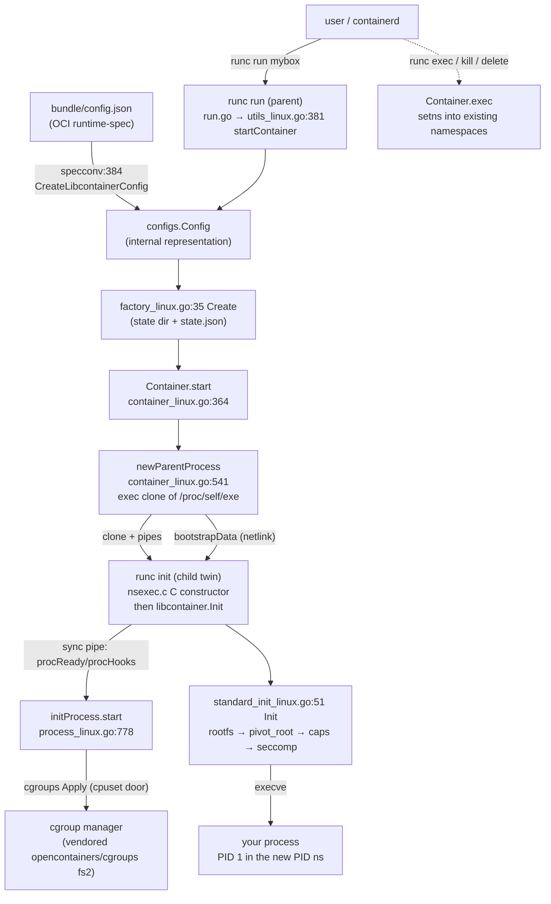
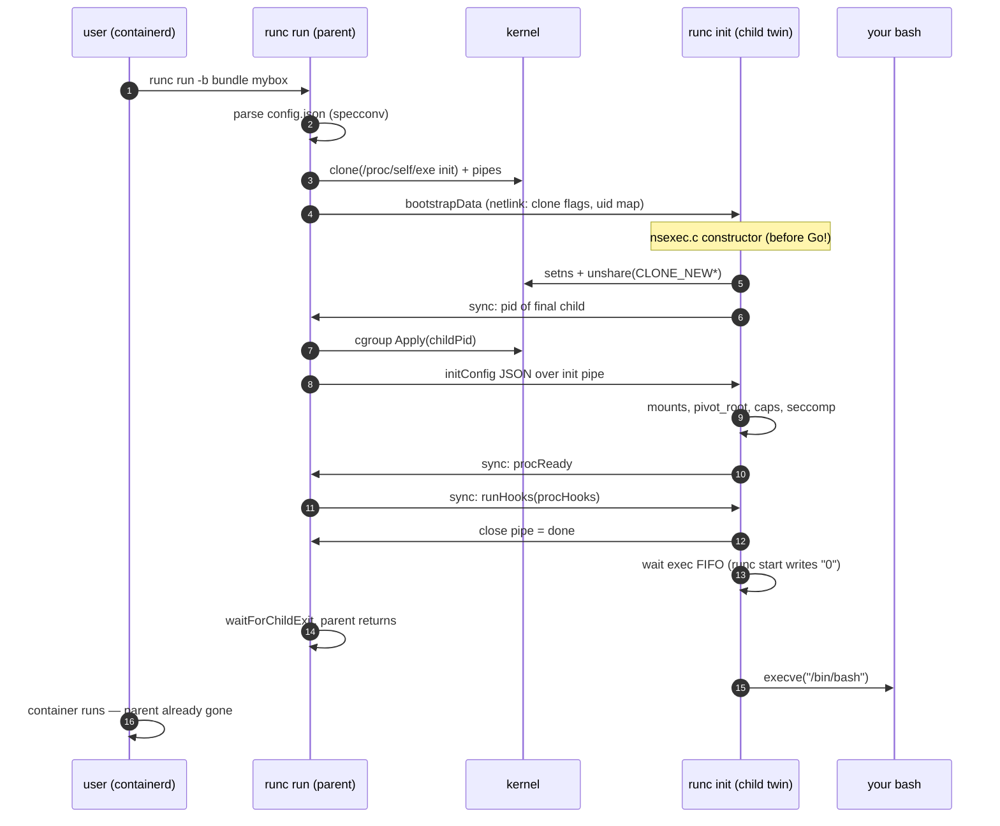
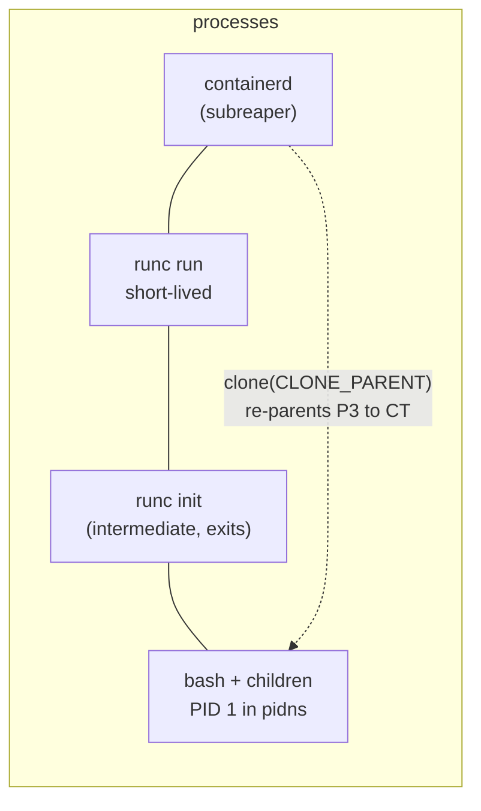

# runc: a container is a config file plus a choreographed chain of syscalls

> **Atlas id:** `runc` · **Domains:** `container` ·
> **Upstream:** https://github.com/opencontainers/runc · **License:** Apache-2.0 ·
> **Pinned commit:** `9e3a9a3ecd065f6993fca674a022ead4d302f475` (2026-10-08)

runc is the program that actually *makes* a container. It reads an OCI
bundle (a directory with `config.json` and a root filesystem), and turns
that JSON into Linux namespace entries, cgroup membership, a pivoted
root filesystem, capability drops and a seccomp filter — then execs
your process and leaves. There is no daemon, no long-lived supervisor:
**the entire system is a one-shot parent process that clones a copy of
itself, hands that child a choreographed sequence of syscalls to
perform inside the new namespaces, and exits**. Docker, containerd,
Kubernetes (via CRI-O and containerd) all shell out to this ~30k-line
Go program. The design lesson: a "container runtime" is not a
technology — it is a *specification made executable*, and the hardest
engineering is not the syscalls but the two-process bootstrap protocol
that must be safe across privilege boundaries.

Read it against the [Moby](moby.md) dive: Moby wraps images, layers,
volumes and networks around a daemon; runc is the bottom turtle — the
place where "container" finally resolves into `clone(2)`, `pivot_root(2)`
and `execve(2)`.

## Explain like I'm 10

**A porter who builds you a hotel room and then quits.** The hotel is
the Linux kernel (it owns all the rooms forever). The porter (the
`runc run` you type) reads your wishlist (`config.json`: one room,
no window onto other guests, a $5/day budget, no phone calls except
these three numbers). The porter doesn't build the room himself — he
hires a twin (a second copy of the very same runc program, `runc init`)
and gives him the wishlist through a pipe (a cardboard tube the twins
shout through, the init pipe). The twin gets the keys to an empty room
(namespaces: your own PID numbers, your own network cards, your own
`/`), repaints the walls so old decorations can't be seen (pivot_root),
sticks the budget notice on the door (cgroups), and only *then* lets
you in — becoming you (execve of your command). When everything is
done the porter quits entirely (the parent exits); the room keeps
existing because the hotel — not the porter — owns it. If the twin
makes a mistake he shouts it back up the tube before quitting
(the sync pipe error protocol).

**Why the grown-ups did it this way:** namespaces and cgroups attach to
processes, so the setup must be performed by a process that will *stay*
inside the container — and keeping the setup logic in a second, throwaway
copy of the same binary lets the parent stay outside, privileged and
unpolluted, which is exactly what a supervisor needs to trust.

## 1. Architecture overview

- **The CLI layer** (`run.go`, `create.go`, `start.go`, `exec.go`,
  `kill.go`, `delete.go`) maps the OCI runtime-spec lifecycle verbs
  one-to-one onto library calls; `utils_linux.go:381 startContainer`
  is the shared spine that every verb funnels through.
- **libcontainer** is the real library: `specconv/spec_linux.go:384
  CreateLibcontainerConfig` translates the spec JSON into the internal
  `configs.Config`; `factory_linux.go:35 Create` allocates the
  on-disk state directory; `container_linux.go` owns the lifecycle.
- **The two processes**: the parent (`runc run`) stays outside the
  container holding privileges; the child (`runc init`, a clone of the
  same binary via `exec.Command(exePath, "init")` in
  `container_linux.go:541 newParentProcess`) performs every step that
  must happen *inside* the new namespaces. They communicate over
  three pipes: init pipe (config JSON), sync pipe (state machine
  handshake), log pipe (child logs).
- **The C bootstrap** (`libcontainer/nsenter/nsexec.c`) is the
  remarkable seam: a `__attribute__((constructor))` C function that
  runs *before* the Go runtime even starts, reads the netlink-encoded
  `bootstrapData` from the init pipe, and performs the namespace joins
  (`setns`) and `unshare`s — because a multi-threaded Go runtime
  cannot safely change its own namespaces after the fact.
- **`runc exec` and `runc kill`** take the other path:
  `container_linux.go:699 newSetnsProcess` joins the *existing*
  namespaces listed in `state.json` via `setns(2)` instead of
  creating them — the same twin trick, different bootstrap payload.

## Walkthrough: one runc run, bundle to bash prompt

The spine as a story — on the site you can step through it with Next;
in the repo it reads top to bottom.

**Step 1 — Parse the bundle.** `runc run` (`run.go`) calls
`utils_linux.go:381 startContainer` → `setupSpec` loads
`config.json` and `specconv/spec_linux.go:384
CreateLibcontainerConfig` turns it into the internal `configs.Config`
— namespaces list, mounts, cgroup resources, capabilities, seccomp
profile, hooks. Everything runc will do is already decided by this
data; there is no policy inside runc itself.

**Step 2 — Create the container record.** `factory_linux.go:35
Create` makes the per-container state directory and writes
`state.json` (the `State` struct in
`libcontainer/container_linux.go:49`) — the
disk memory that lets a *future* `runc exec` or `runc kill` find the
container's init PID and namespace paths after today's parent is gone.

**Step 3 — Clone the twin.** `container_linux.go:364 start` →
`newParentProcess` (line 541) builds an `exec.Command` of a *cloned
copy of its own binary* (`exeseal.CloneSelfExe`, a memfd-safe
`/proc/self/exe` copy — CVE-2024-21626 hardening) with argv `init`,
plus init/sync/log pipes passed as extra file descriptors with
`_LIBCONTAINER_INITPIPE`-style env-var door numbers.

**Step 4 — Parent arms cgroups, then lets the child proceed.**
`initProcess.start` (`process_linux.go:778`) starts the child, then —
*before* answering its first sync — calls `p.manager.Apply(p.pid())`
so the child is already inside its cgroup the moment it can spawn
anything ("no children can escape the cgroup", the comment says).

**Step 5 — The C bootstrap runs first.** In the child, the dynamic
loader runs `nsexec.c`'s constructor before `main`: it parses the
netlink `bootstrapData`, `setns`-joins requested namespaces
(`nsexec.c:560`), `unshare`s the rest (`try_unshare`, `nsexec.c:675`),
and uses the `clone(CLONE_PARENT | SIGCHLD)` trick (`nsexec.c:322`) so
the final container process is re-parented to *runc's* caller — a
containerd subreaper, not a dead runc.

**Step 6 — The Go side builds the room.** Control reaches
`libcontainer/init_linux.go:106 Init` → `startInitialization` (line
128) reads the initConfig JSON, then `standard_init_linux.go:51 Init`
does the room setup in order: network (`setupNetwork`), rootfs mounts
(`rootfs_linux.go:170 prepareRootfs`), `pivotRoot` (line 1139 —
`pivot_root(".", ".")` without a scratch directory), console,
hostname, sysctls, AppArmor, `setupUser` (line 467: uid/gid switch
inside the user namespace), capabilities.

**Step 7 — Last checks, then become the payload.** The child tells
the parent `procReady`, waits for `procHooks` (parent runs
CreateContainer hooks outside), applies seccomp *as late as possible*
("just before execve so as few syscalls take place after it"),
restores the parent-death signal, re-checks `getppid()` hasn't
changed (kill self if it did), and finally `utils.UnsafeCloseFrom`
closes every fd not intentionally passed — then
`linux.Exec` (`syscall.Exec`) replaces the twin with `/bin/bash`.

**Outcome — The room exists, the porter is gone.** The exec FIFO
(`/run/mybox/exec.fifo`, created by `container_linux.go:492
createExecFifo`) gates the final exec for `runc create` → `runc start`
splits; for `runc run` the parent opens it immediately. The parent
process has already exited (`waitForChildExit` in `process_linux.go`);
the container persists purely as kernel state — namespaces, cgroup,
rootfs mount — pointed at by `state.json`.

## 2. Core data structures — and why these

- **`specs.Spec` (config.json) → `configs.Config`.**
  **What:** the OCI runtime-spec document versus runc's internal,
  Linux-shaped equivalent (namespaces as a typed list, mounts
  pre-resolved, devices as `devices.Device` entries).
  **Where:** `libcontainer/specconv/spec_linux.go:384
  CreateLibcontainerConfig` (with `CreateCgroupConfig` at line 778).
  **Why:** keeping the wire format (spec) separate from the operational
  format (config) means the spec can evolve its JSON while runc's
  library users keep a stable Go structure — the same translation
  seam SQLite uses between SQL and its internal byte formats.

- **`bootstrapData` — a netlink-encoded message.**
  **What:** clone flags, namespace paths and the user-namespace ID map
  encoded as a netlink attribute stream.
  **Where:** built by `container_linux.go:1082 bootstrapData` from
  `c.config.Namespaces.CloneFlags()`, consumed by the C code in
  `libcontainer/nsenter/nsexec.c`.
  **Why netlink-of-all-things:** the message must be parseable by C
  code that runs *before the Go runtime exists*; netlink attribute
  walking is tiny, dependency-free, and battle-tested in the kernel.
  A protobuf or JSON parser in that slot would drag a runtime in.

- **`State` (state.json).**
  **What:** container ID, init PID, namespace paths, cgroup paths,
  init start time, bundle path — everything a *fresh* runc invocation
  needs to re-attach.
  **Where:** `libcontainer/container_linux.go:49` (struct), written under
  `factory_linux.go:35 Create` and `container_linux.go`'s state
  serialization.
  **Why:** because runc is one-shot and parentless by design, its only
  durable state is this JSON on disk — the filesystem *is* the
  database, exactly like etcd's member dir or git's refs. Process
  metadata that dies with the parent (PIDs) is paired with kernel
  paths (`/proc/<pid>/ns/*`) that let a later process verify it.

- **The pipe trio (`processComm`).**
  **What:** init pipe (config JSON, bootstrapData), sync pipe
  (`syncT{Type, Arg, File}` JSON messages), log pipe.
  **Where:** `container_linux.go:541 newParentProcess` (env-var fd
  passing) and `libcontainer/init_linux.go:128 startInitialization`
  (the receiving side); `message_linux.go` defines `procReady`,
  `procHooks`, `procMountPlease` etc.
  **Why:** pipes are the only IPC that survives exec, carries FDs
  (SCM_RIGHTS via sockets), and has a natural EOF = "done" semantic —
  the child closing the sync pipe doubles as its final message.

- **The cgroup manager.**
  **What:** an interface (`cgroups.Manager`) with fs2 (unified) and
  rootless implementations from the vendored
  `github.com/opencontainers/cgroups` package.
  **Where:** applied in `process_linux.go` `initProcess.start`
  (`p.manager.Apply(p.pid())`) before the child is allowed to fork;
  filesystem writes under `/sys/fs/cgroup/...`.
  **Why an interface:** cgroup v1/v2 and rootless delegation differ
  wildly in capability; the seam keeps `container_linux.go` free of
  kernel-version policy.

## 3. Concurrency and failure model

- **No threads, no event loop, no shared memory.** runc is a chain of
  short-lived processes: the parent exits as soon as the child is
  launched (`process_linux.go` `waitForChildExit`); the intermediate
  `runc init` twin exits at `execve`; what remains is your payload.
  Everything that looks concurrent is either the kernel (namespaces,
  cgroups) or the two-process sync protocol.
- **The sync protocol is the failure model.** Every stage of the
  child's setup is bracketed by sync messages; on error the child
  writes `procError` with the message back up the pipe
  (`init_linux.go:128 startInitialization`'s deferred handler), so
  `runc run` reports *why* the room couldn't be built even though the
  failure happened in a different process and PID namespace.
- **Crash mid-setup:** the child `kill`s itself if its parent died
  (`unix.Getppid() != l.parentPid` check in `standard_init_linux.go`)
  — a half-built container that outlived its porter would be a
  security hole, not a feature. The parent, for its part, terminates
  and destroys the cgroup if any sync fails
  (`initProcess.start`'s deferred `p.terminate()` + `p.manager.Destroy()`).
- **Crash after exec:** PID 1 semantics take over — killing the
  container's init with SIGKILL from outside takes the whole PID
  namespace down with it (`container_linux.go` `signal` and its
  pid_namespaces(7) comment); without a private PID ns, runc
  signal-all-via-cgroup freeze instead.
- **Backpressure:** there is none to speak of — runc is not a server.
  The closest analogues are the exec FIFO (a *gate*, not a queue) and
  the O_CLOEXEC/`UnsafeCloseFrom` sweeps that make fd leakage —
  the classic runc CVE vector — structurally impossible
  (`utils.CloseExecFrom(3)` in the parent,
  `utils.UnsafeCloseFrom(passed+3)` in the child).

## 4. API and extension design

- **The public surface is a specification, not a library.** runc's
  de-facto API is the OCI runtime-spec: the bundle format, the
  lifecycle verbs (`create`, `start`, `kill`, `delete`, `state`), and
  the state machine they walk. Any compliant runtime (crun, youki,
  runsc) is a drop-in replacement — that interchange is the point.
- **libcontainer as the embeddable seam.** Under the CLI sits a Go
  library (`factory.Create` / `container.Run`) that Docker-era code
  linked directly; the spec layer is deliberately thin over it, so a
  manager that wants `create`/`start` split or custom state dirs can
  skip the CLI entirely.
- **Extension points inside config.json:** hooks
  (CreateRuntime/StartContainer/PostStart — arbitrary host commands
  fired at protocol-defined moments, `configs.Hooks.Run`), prestart
  hooks' execution *outside* the namespaces vs StartContainer's
  *inside*), plus runc-specific knobs (rootless mode, no-pivot) that
  the spec leaves as annotations.
- **Honest wart:** the two-process protocol means `runc exec` pays the
  full twin-bootstrap cost (C constructor, setns choreography) for
  every command, and the state.json/PID pairing is racy against PID
  reuse — hence the init start-time recorded in state and checked
  before signaling. The interface optimizes for the *manager* (one
  short-lived trusted helper per operation), not for interactive use.

## 5. The defining trade-offs

### Trade-off 1: re-exec self over in-process setup
- **Tension:** namespaces must be entered by the process that will
  live in them, but Go's runtime is multi-threaded, and
  `unshare(CLONE_NEWUSER)` et al. apply per-thread with surprising
  semantics.
- **Choice:** clone a fresh copy of the runc binary (`runc init`) and
  do namespace work there — in C, via a constructor, before the Go
  runtime spins up its threads at all.
- **Evidence:** `container_linux.go:541 newParentProcess`
  (`exec.Command(exePath, "init")` of a safe `/proc/self/exe` clone);
  `libcontainer/nsenter/nsenter.go` registers the constructor;
  `nsexec.c:675 try_unshare`.
- **Given up:** simplicity and speed — every container start pays a
  process clone, a C/Go boundary, and a pipe protocol; debugging the
  bootstrap needs both sides of the story.
- **Verdict:** right for a security boundary that must run under
  arbitrary managers; wrong for a hot path — nobody re-execs per
  request. The pattern (fresh process = clean namespace context) is
  the general lesson.

### Trade-off 2: parent-side cgroup arming over child-side
- **Tension:** the child must be cgroup-limited before it can execute
  *any* attacker-influenced code, but only the parent is privileged
  enough to write cgroupfs.
- **Choice:** `initProcess.start` calls `p.manager.Apply(p.pid())`
  *between* the child's namespace bootstrap and its permission to
  proceed — the sync protocol creates exactly this rendezvous.
- **Evidence:** `process_linux.go:778 initProcess.start` (comment:
  "Do this before syncing with child so that no children can escape
  the cgroup").
- **Given up:** a strict "child does everything about itself" story;
  the parent must stay alive and privileged through setup, and rootless
  mode needs the delegation fallback instead.
- **Verdict:** the two-phase handshake is the design — whenever two
  privilege domains must cooperate on setup, make the *handoff* itself
  a protocol stage. It would be wrong only when no privilege gap
  exists, where it's pure ceremony.

### Trade-off 3: no daemon over a resident runtime
- **Tension:** managers need to manipulate running containers (exec,
  kill, stats) — the classic reason to build a daemon.
- **Choice:** runc exits after setup; later operations re-enter via
  fresh processes reading `state.json` and `setns` into the recorded
  namespaces.
- **Evidence:** `factory_linux.go:35 Create` + `Load` (state on disk);
  `container_linux.go:699 newSetnsProcess` for exec.
- **Given up:** O(1) in-memory operations, an obvious place for
  container-wide logic, immunity to PID-reuse races.
- **Verdict:** right because the kernel already *is* the daemon —
  namespaces, cgroups and PID 1 semantics do the bookkeeping. A
  resident runc would re-implement (insecurely) what the kernel
  tracks for free; containerd took that supervisor role instead, one
  layer up. Wrong for you if your "kernel" lacks such primitive
  bookkeeping.

## 6. Reading path

1. `PRINCIPLES.md` — four paragraphs on runc's priorities (security
   over features, no daemon); the whole codebase obeys them.
2. `run.go` → `utils_linux.go:381 startContainer` →
   `utils_linux.go:184 createContainer` — how a verb becomes a
   `runner`; note `enableSubreaper` and where `notifySocket`
   (systemd sd_notify passthrough) hooks in.
3. `libcontainer/specconv/spec_linux.go:384
   CreateLibcontainerConfig` — the spec-to-Linux translation; watch
   namespaces become `configs.Namespace{Type, Path}` entries and
   devices get default entries injected.
4. `libcontainer/factory_linux.go:35 Create` + `libcontainer/
   container_linux.go:49 State` — the state directory; open a
   `state.json` from a real container
   if you have one and map every field.
5. `libcontainer/container_linux.go:364 start` → `:541
   newParentProcess` — the twin clone; read the fd-passing env vars
   and the `CloseExecFrom(3)` sweep; then `:670 newInitProcess`
   building the netlink `bootstrapData`.
6. `libcontainer/process_linux.go:778 initProcess.start` — the
   parent's half of the protocol: cgroup arming, bootstrap write,
   `getChildPid`, `waitForChildExit`, and the `parseSync` loop's
   `procMountPlease` mount-remapping service (the parent opens source
   files the rootless child cannot).
7. `libcontainer/nsenter/nsexec.c` — start at `nsexec()`; follow
   `join_namespaces` (`setns` at line 560), `try_unshare` (675), the
   `clone(CLONE_PARENT)` at line 322, and the userns map writes. This
   is the most instructive C you'll read all week.
8. `init.go` (repo root) + `libcontainer/init_linux.go:106 Init` →
   `:128 startInitialization` → `:241 containerInit` — the child's
   re-entry into Go; note `runtime.LockOSThread()` and `os.Clearenv()`.
9. `libcontainer/standard_init_linux.go:51 Init` — the setup ladder in
   order; ask yourself why each step is *after* the previous one (the
   comments answer).
10. `libcontainer/rootfs_linux.go:170 prepareRootfs` → `:1139
    pivotRoot` (`pivot_root(".", ".")` — no scratch dir needed) →
    `:277 finalizeRootfs` — the mount story, including the
    propagation-flag note about *why* it comes after pivot.
11. `libcontainer/init_linux.go:297 finalizeNamespace` → `:467
    setupUser` — caps, uid/gid, the last fd sweep; then the tail of
    `standard_init_linux.go Init`: exec-FIFO wait, `UnsafeCloseFrom`,
    `linux.Exec`.
12. `container_linux.go:492 createExecFifo` + `start.go` — the
    create/start gate; finally `exec.go` + `container_linux.go:699
    newSetnsProcess` — the same twins, but joining an existing room.

You have now traced one `runc run` from a JSON file through a
C-level namespace bootstrap, a two-process sync protocol, a pivoted
root, and an execve — the complete anatomy of "a container".

## 7. What to steal

- **Re-exec your own binary to get a clean execution context** —
  namespaces, privileges, or just an uncontaminated environment; you
  saw it in `container_linux.go:541` and it is how Chrome, nginx and
  sshd all isolate risky phases.
- **Make the handoff a protocol, not a flag.** The sync-pipe state
  machine (`procReady`/`procHooks`) turns "parent ready? child
  ready?" into explicit, auditable stages — steal it for any
  two-process bootstrap, launcher/worker, or supervisor handoff.
- **Encode pre-runtime messages in a parser-free format.** netlink
  attributes walked by ~50 lines of C (`bootstrapData`) beat pulling
  a serialization library into a process that must not have one.
- **Record kernel handles (PIDs, namespace paths) with liveness
  metadata (start time) on disk.** `state.json` plus a start-time
  check is the minimal honest database for one-shot tools.
- **Sweep file descriptors at boundaries.** `CloseExecFrom(3)` /
  `UnsafeCloseFrom` — and the CVEs that motivated them — teach that
  fd hygiene must be structural (at exec boundaries), not aspirational.
- **Push policy into a spec, keep the engine dumb.** runc's entire
  "container" definition lives in config.json; the codebase only
  *executes* it, which is why crun could replace it wholesale.

## 8. Difficulty and prerequisites

- Difficulty: `moderate`. Realistic budget: 5–6 hours for this path
  (add 2 for nsexec.c if C is rusty).
- Prerequisites: reading Go comfortably; the man pages
  `namespaces(7)`, `cgroups(7)`, `pivot_root(2)`, `user_namespaces(7)`
  (an hour each, skim the parts this dive cites); the OCI
  runtime-spec's *lifecycle* section (20 minutes). No kernel-module
  knowledge needed — everything is visible from userspace.

## 9. Further reading

- The OCI runtime-spec — the contract runc implements:
  https://github.com/opencontainers/runtime-spec (read *Lifecycle*
  and *Linux-specific* first).
- The runc security page and the CVE-2024-21626 (leaked fds /
  `/proc/self/exe` escape) write-ups — the trade-offs in section 5
  are visibly scar tissue from these.
- `man 7 namespaces`, `man 7 user_namespaces`, `man 2 pivot_root`,
  `man 7 cgroups` — the syscall-level ground truth.
- The [Moby](moby.md) and [libuv](libuv.md) dives in this atlas —
  the layers above (image/daemon) and below (portable event loop)
  of the same stack.
