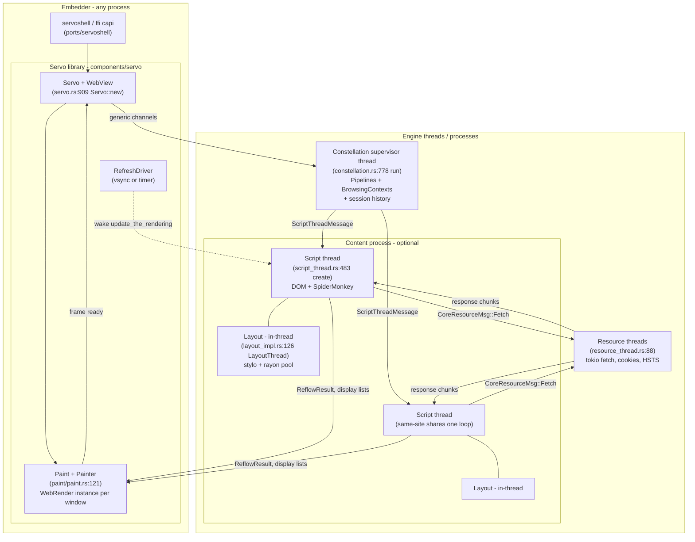
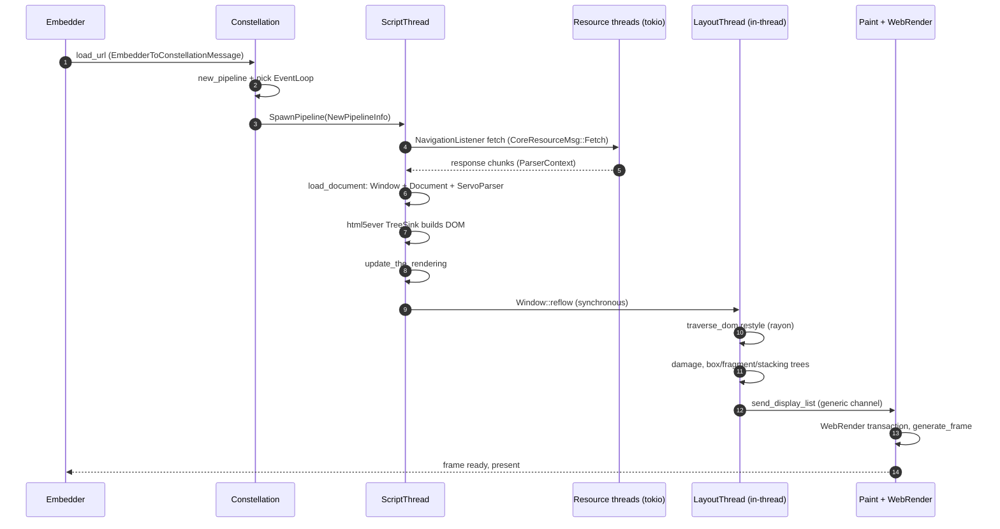
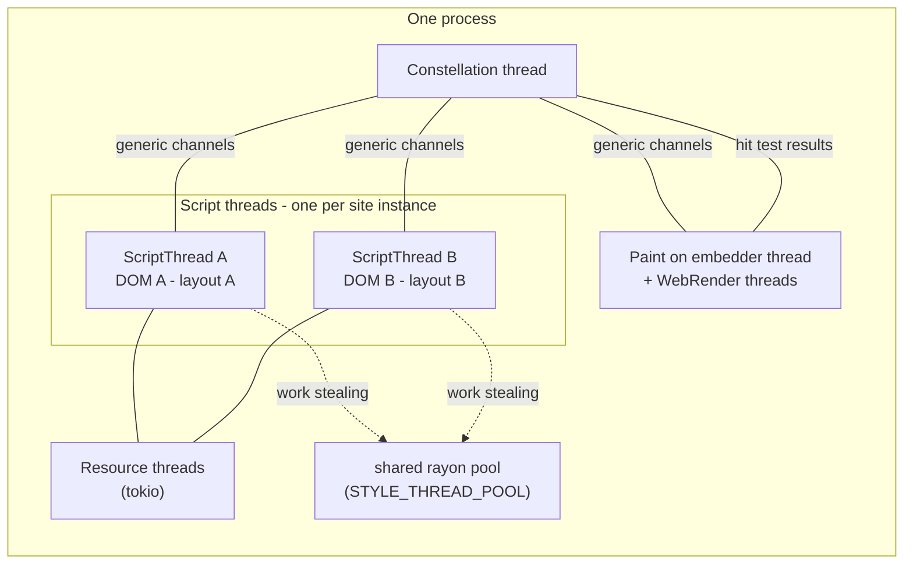

# Servo: a browser engine as a supervised graph of message-passing pipelines

> **Atlas id:** `servo` · **Domains:** `browser-engine` ·
> **Upstream:** https://github.com/servo/servo · **License:** MPL-2.0 ·
> **Pinned commit:** `72437e508875e1cbdad812f49d3f5f959b3369d3` (2026-10-12)

Servo is a parallel, memory-safe browser engine written in Rust, and
its single defining idea is **decomposition by ownership**: every
subsystem is a component crate with private state, reachable from the
others *only* through typed message channels — and the message layer
is built so the same engine runs as cooperating threads or as sandboxed
processes with zero code changes. At the center sits the
**Constellation**, a supervisor thread that owns no page content: it
only creates, routes, and reaps **Pipelines** (its view of one
document), each living in an **EventLoop** (a script thread) that may
be shared by same-site documents or isolated into its own
operating-system process and gaol sandbox. Within a script thread,
Rust's hardest problem in this codebase — making SpiderMonkey's
garbage-collected DOM and Rust's borrow checker coexist — is solved
with a vocabulary of pointer types (`Dom`, `DomRoot`, `LayoutDom`,
`Trusted`) that each encode one legal access pattern, and with a
layout engine that runs *inside* the script thread, reading the DOM
through `unsafe` wrappers made sound by the fact that the single
script thread is, by construction, paused. The lesson this codebase
teaches better than any other: how to carve a legacy-shaped
gigasystem (the web platform) into communicating components with hard
boundaries, and what Rust's ownership model buys — and costs — when
data races are the historical bug class.

## Explain like I'm 10

**An office building where each website gets a workroom, run by a
building manager who never does any of the tenants' work herself.**
The building manager (the Constellation thread) assigns rooms
(Pipelines), connects intercoms (message channels), and when a room
misbehaves or catches fire, she seals that one room and reroutes —
the building stands (constellation.rs:778 `run`). Each room has one
worker (a script thread) who opens her mail one envelope at a time
(the task queue in `handle_msgs`), so nobody can edit her papers
while she thinks. When it's time to redecorate (a reflow), the worker
doesn't leave: a measurement crew (rayon style workers) floods in and
reads her papers directly — safe only because she stands still, and
every door is labeled with who may enter (the `thread_state` checks,
assert.rs:12). Their measurements become blueprints (display lists)
mailed to the projector room (Paint), which layers slides from every
room into one picture on a magic overhead projector (WebRender on the
GPU, painter.rs:997). Rooms in other buildings (content processes)
are reachable only by official city mail (ipc-channel), are locked in
a filing cabinet (the gaol sandbox, sandboxing.rs:190) — and because
every intercom can be rewired at runtime between in-building wiring
(crossbeam channels) and city mail (generic_channel/mod.rs:42
`use_ipc`), nobody in the building even notices which kind is
installed.

**Why the grown-ups did it this way:** a browser runs untrusted,
concurrently-updating, garbage-collected worlds side by side, so
correctness has to come from architecture — supervised message
passing makes every boundary auditable, and Rust makes every
boundary-crossing pointer a compile-time or debug-time event.

## 1. Architecture overview

- **The embedder owns the window; the engine owns the web.** Modern
  Servo is a library, not an application: `Servo::new`
  (`components/servo/servo.rs:909`) wires up every internal thread and
  hands the embedder proxies — `ConstellationProxy`, `PaintProxy`,
  event receivers — plus a `WebView` per browsing surface
  (`components/servo/webview.rs`). `ports/servoshell` is just a
  windowing shell around it; `ffi/capi` exposes the same API to C.
  The embedder calls `spin_event_loop` (`servo.rs`) to pump delegate
  callbacks and presentation. This is the CEF shape, arrived at from
  the opposite direction: engine-first, shell-later.
- **The Constellation is the supervisor and nothing else.** It owns
  the maps of `Pipeline`s and `BrowsingContext`s, session history,
  and the policy that decides which script thread a new page goes to
  — but zero page content. Its loop (`constellation.rs:778 run`)
  does `handle_request` (route one message), reap finished event
  loops, and — under a debug flag — randomly kill pipelines to
  harden itself (`maybe_close_random_pipeline`,
  constellation.rs:6061, an in-tree chaos test of the supervisor).
- **A Pipeline is a *view*, deliberately starved.** "A `Pipeline` is
  the constellation's view of a `Window`" (pipeline.rs:21) — id,
  event-loop handle, URL, child iframe contexts, animation state:
  exactly what a supervisor needs to route and reap, and no DOM
  pointer at all. The `EventLoop` (`event_loop.rs:31`) is the
  constellation's handle to one script thread: a `GenericSender` of
  `ScriptThreadMessage`s whose `Drop` *is* the shutdown message
  (`event_loop.rs:55` sends `ExitScriptThread` when dropped) — the
  ownership graph implements the lifecycle protocol.
- **Script threads are per site-instance, not per page.** A new
  pipeline first tries to join the event loop of its registered
  domain (eTLD+1) within the same WebView; `about:blank` must join
  its creator's loop; sandboxed origins never join anything
  (`get_event_loop_for_new_pipeline`, constellation.rs:~963 — the
  same-site rule, in code). Otherwise the constellation spawns a new
  script thread (`event_loop.rs:159 spawn_in_process`) — or, with
  `--multiprocess`, re-executes the binary as a sandboxed child and
  passes the boot payload over a one-shot IPC token
  (`sandboxing.rs:190 spawn_multiprocess`).
- **Layout is not a thread anymore.** The Layout 2020 project moved
  layout from its own message-passed thread into the script thread
  itself: each `Window` owns a `Box<dyn Layout>`
  (`components/shared/layout/lib.rs:293`) created through the
  injected `LayoutFactory` when the window is born
  (`script_thread.rs:3502`). A reflow is a synchronous call,
  `self.layout.borrow_mut().reflow(...)` inside `Window::reflow`
  (window.rs:2659), and parallelism comes
  from a shared rayon pool (`STYLE_THREAD_POOL`, layout_impl.rs:107)
  that work-steals style and box-tree construction across *all*
  script threads in the process.
- **The spine** is one navigation to first paint: embedder →
  constellation (`load_url` → `new_pipeline` → event loop) →
  `ScriptThreadMessage::SpawnPipeline` → fetch on the resource
  thread (tokio) → `ParserContext` → html5ever builds the DOM →
  first `update_the_rendering` → `Window::reflow` → restyle
  traversal → damage-driven box/fragment/stacking-context trees →
  display list → `Paint` → WebRender transaction → frame. The
  Walkthrough traces exactly this.

## Walkthrough: one navigation, from URL to first paint

**Step 1 — The embedder asks, the constellation plans.** A navigation
request arrives as `EmbedderToConstellationMessage`
(`constellation.rs:1237 handle_request_from_embedder`) and lands in
`load_url` (constellation.rs:4106): the constellation walks session
history, builds `LoadData`, and calls `new_pipeline`
(constellation.rs:955). Two decisions happen here that shape
everything after: which `EventLoop` the pipeline joins — same
registered domain in the same WebView reuses the existing script
thread, `about:blank`/`about:srcdoc` join their creator, sandboxed
origins get a fresh one (`get_or_create_event_loop_for_new_pipeline`,
constellation.rs:921) — and whether that event loop needs to be
spawned now, in-thread or in a new process.

**Step 2 — A pipeline is born as one message.** `Pipeline::spawn`
(pipeline.rs:91) does not construct a document; it *sends*
`ScriptThreadMessage::SpawnPipeline(NewPipelineInfo)` into the chosen
event loop and immediately records a skeletal `Pipeline` in the
constellation's map. If the event loop is new, `EventLoop::spawn`
(event_loop.rs:66) either starts a thread
(`spawn_in_thread`→`ScriptThreadFactory::create`,
script_thread.rs:483, an 8 MiB stack "to be consistent with other
browsers") or, in multiprocess mode, re-execs the binary with
`--content-process <token>` and hands over an
`UnprivilegedContent` payload through an `IpcOneShotServer` handshake
(sandboxing.rs:190) — the child then installs a gaol sandbox profile
that allows little more than font files and `/dev/urandom`
(`content_process_sandbox_profile`, sandboxing.rs:52).

**Step 3 — The script thread goes shopping.** The script thread's
event loop (`handle_msgs`, script_thread.rs:1373) receives
`SpawnPipeline` and calls `pre_page_load` (script_thread.rs:4068):
it parks a `ParserContext` (servoparser/mod.rs:953) in
`incomplete_parser_contexts` and starts the fetch itself via
`NavigationListener::initiate_fetch` toward the resource threads.
There, `CoreResourceMsg::Fetch` (resource_thread.rs:409) runs the
Fetch spec as a Rust async fn on a tokio runtime
(`fetch/methods.rs:180 fetch` → `:401 main_fetch`) — redirects,
CORS, HSTS, cookies all live on that side of the channel.

**Step 4 — Bytes come home and a document appears.** Response chunks
flow back and land in `ParserContext::process_response_chunk`
(servoparser/mod.rs:1599), which first buffers 1445 bytes to sniff
the MIME type/encoding (the mimesniff resource-header rule), then
calls `load_document`: here the `Window` and `Document` DOM objects
are created, with the injected layout engine attached to the window
(`layout_factory.create(layout_config)`, script_thread.rs:3502), and
a `ServoParser` (servoparser/mod.rs:128) is born holding two input
streams — script input (for `document.write`) and network input —
around one html5ever tokenizer.

**Step 5 — html5ever builds the tree, script suspends it.**
The parser module's `Sink` implements html5ever's `TreeSink` trait
(servoparser/mod.rs:1819), so the spec-exact tokenizer/tree-builder
drives DOM mutations directly: `append`, `create_element`,
`set_quirks_mode`. A classic
`<script>` suspends the parser (`suspended` cell) until execution
finishes; the async tokenizer variant (async_html.rs) instead runs
html5ever on a dedicated parser thread against a lightweight
`ParseNode` tree and streams `ParseOperation`s back — the DOM
mutator and the spec state machine are decoupled by a message log,
so parsing can overlap script-thread work. Either way, when the
document finishes loading, `process_response_eof`
(servoparser/mod.rs:1629) runs a final synchronous parse and fires
load events.

**Step 6 — The first rendering opportunity.** Animation-frame
scheduling or a script-triggered reflow need brings the script
thread to `update_the_rendering` (script_thread.rs:1094), which
walks its documents in tree order and calls `Window::reflow`
(window.rs:2659). Reflow first drains `RestyleReason`s — the
document's `dirty_root`, pending restyles, changed stylesheets —
packs a `ReflowRequest` carrying a `TrustedNodeAddress` (a raw DOM
pointer plus a promise that script stays still), and makes the
synchronous call `self.layout.borrow_mut().reflow(reflow)`.

**Step 7 — Style and layout as parallel visitors on a paused DOM.**
`LayoutThread::handle_reflow` (layout_impl.rs:1060) runs the stylo
cascade as a parallel top-down traversal —
`driver::traverse_dom(&recalc_style_traversal, token, rayon_pool)`
(layout_impl.rs:1340) — where the `RecalcStyle` traversal
(traversal.rs:21) walks the DOM through `ServoLayoutNode` wrappers.
Computed damage (`RestyleDamage`, `LayoutDamage`) then decides how
much of the cached `BoxTree`/`FragmentTree`/`StackingContextTree`
must be rebuilt: if nothing needs it, layout phases are skipped
entirely (`can_skip_reflow_request_entirely`). When a display list
is due, `build_display_list` (layout_impl.rs:1545) walks the
stacking-context tree and hands a WebRender `BuiltDisplayList` to
`paint_api.send_display_list` (components/shared/paint/lib.rs:330).

**Outcome — Pixels, and a supervisable system.** `Paint` receives
the display list on the embedder's side
(`Painter::handle_new_display_list`, painter.rs:997), installs the
new scroll tree, wraps the list in a WebRender `Transaction`, and
`generate_frame` (painter.rs:603) asks the GPU-side scene builder
for a frame; the notifier wakes the embedder to present. Every
component on the trip — constellation, script thread, resource
thread, paint — held only channels to its collaborators, so any of
them can crash, be killed (or be chaos-killed) without the others
losing more than the messages still in flight.

## 2. Core data structures — and why these

- **`Pipeline` + `EventLoop` — supervision as starved records.**
  **What:** pipeline.rs:26 and event_loop.rs:31 — the pipeline
  record carries ids, the event-loop handle, URL, iframe children,
  animation state; the `EventLoop` carries one `GenericSender` and a
  `Drop` impl that sends `ExitScriptThread`. **Why:** the supervisor
  deliberately sees *less* than the supervised: no DOM pointers, no
  layout state, nothing to corrupt or leak. Lifecycle is encoded in
  ownership (drop = exit message), so the constellation cannot leak
  a thread even by forgetting cleanup code — compare
  [Kubernetes](kubernetes.md)'s informers, where the controller's
  view is also a projection rather than the truth.

- **The DOM pointer zoo — one type per legal access.** **What:**
  `Dom<T>` (root.rs:153) — a bare `NonNull<T>` allowed only as a
  *field* of another DOM object, traced by the GC; `DomRoot<T> =
  Root<Dom<T>>` (root.rs:297) — a stack root registered in the
  thread-local `STACK_ROOTS` (root.rs:440) that the SpiderMonkey GC
  scans; `LayoutDom<'dom, T>` (script/dom/bindings/root.rs:50) — a
  lifetime-scoped, debug-asserted "layout is on the DOM now" view;
  `Trusted<T>` (refcounted.rs:66) — an `Arc`-counted pin for
  *another thread*, backed by the `LIVE_DOM_REFERENCES` weak-table
  the GC treats as roots (refcounted.rs:34). **Why:** GC and borrow
  checker disagree about object lifetimes; rather than one
  unsafe escape hatch, Servo names each access pattern as a type,
  and each dereference debug-asserts its thread state
  (`assert_in_script`/`assert_in_layout`, assert.rs:12). The
  `#[dom_struct]`/`must_root` lint makes unrooted field pointers a
  compile error — the shape CPython's C API could not retrofit.

- **`Node` — a GC-traced doubly-linked tree with a layout side-slot.**
  **What:** node/node.rs:127 — parent/first/last/next/prev as
  `MutNullableDom<Node>`; `rare_data: Option<Box<NodeRareData>>` so
  plain nodes pay nothing for rare fields; an
  `inclusive_descendants_version: Cell<u64>` bumped on mutation; and
  `layout_data: DomRefCell<Option<Box<GenericLayoutData>>>` — the
  hole where the style/layout engines hang *their* per-node state on
  the DOM itself. **Why:** sibling links (not child vectors) make
  tree mutation O(1) with no allocator traffic; the version counter
  and dirty-descendant flags are what incremental restyle keys off;
  and the layout side-table inverts the usual "layout owns its
  parallel tree" model (the pre-2020 design) into "layout decorates
  the DOM" — one tree, two owners separated by thread state.

- **`GenericSender`/`GenericReceiver` — channels whose backend is a
  runtime choice.** **What:** components/shared/base/generic_channel/
  mod.rs — enum senders/receivers wrapping either crossbeam (same
  process) or ipc-channel (cross process), selected once per process
  by `use_ipc()` (:42) from the `--multiprocess`/`--force-ipc`
  flags; plus `GenericSharedMemory` for bulk payloads. **Why:** it
  is the load-bearing seam of the whole engine: every subsystem
  (`PaintProxy`, `ConstellationProxy`, `CoreResourceThread`,
  `ScriptThreadMessage`) speaks through it, so the threaded and
  process-isolated builds are the *same code* — and the display
  list crosses as shared memory in one mode and (nearly) free
  crossbeam messages in the other. The cost is honesty in the type
  system: everything sent must be `Serialize + Deserialize`, which
  is why `ReflowRequest` carries `TrustedNodeAddress` (a raw
  pointer!) rather than nodes — and why that is only sound in the
  same-process mode.

- **The cached layout trees + damage bits.** **What:** `BoxTree`,
  `FragmentTree`, `StackingContextTree` on `LayoutThread`
  (layout_impl.rs:126), kept between reflows, with
  `RestyleDamage`/`LayoutDamage`/`need_new_display_list` cells
  deciding which phases run this time
  (`handle_reflow`'s phase list, layout_impl.rs:1060). **Why:** a
  browser reflows 60 times a second but almost nothing changes
  between frames — the entire rendering pipeline is a skip-if-
  undamaged cache, the same bet as [PostgreSQL](postgresql.md)'s
  MVCC or [Kafka](kafka.md)'s index: pay to detect change, not to
  redo work.

## 3. Concurrency and failure model

- **What runs concurrently:** the constellation thread, paint on the
  embedder's thread, resource threads on tokio, one script thread
  per site-instance (possibly in a sandboxed child process), one
  WebRender scene/frame builder pair per window, and — during
  reflow — the shared rayon pool fanning style/box-tree work out
  across cores. **What is serialized:** everything within one
  script thread: JS execution, DOM mutation, parser, timers, and
  layout/reflow all take turns on that single thread's event loop
  (`handle_msgs`, script_thread.rs:1373), which is precisely why
  layout's `unsafe` DOM reads are sound. A hung page hangs *its*
  document, never another site's — the concurrency unit is the
  site, not the tab.
- **The deadlock-avoidance rule is written down:** "`Paint` and all
  of its contained structs should **never** block on the
  Constellation, because sometimes the Constellation blocks on us"
  (paint.rs:119). Message graphs need cycle rules; this is Servo's,
  and it is documented at the one place a violator would read.
- **Crash containment is the architecture.** A panicking or
  poisoned script thread surfaces as a channel send error in the
  constellation — `handle_send_error` (constellation.rs:2922) closes
  the pipeline, notifies the embedder, and keeps serving the rest.
  The constellation itself is tested against random pipeline death
  (`maybe_close_random_pipeline`, constellation.rs:6061 — an
  in-tree chaos monkey behind `--random-pipeline-closure-probability`).
  A script thread that can no longer be talked to is detected by the
  background hang monitor (the `closing` flag checked from
  SpiderMonkey's interrupt callback, script_thread.rs:860) — slow
  pages get flagged, wedged threads get abandoned. In multiprocess
  mode the OS reaps the whole child; the supervisor loses nothing it
  cannot recreate from `LoadData`.
- **Backpressure and throttling are supervisor policy:** hidden or
  inactive pipelines are throttled — timers slowed, updates coalesced
  — by `Pipeline::send_throttle_messages` (pipeline.rs:~223) and the
  "never unthrottle a pipeline without a document" rule; the paint
  side coalesces frames through the `RefreshDriver`
  (refresh_driver.rs:23), which the embedder can drive from real
  vsync.

## 4. API and extension design

- **The public surface is an embedding API, not a browser.**
  `ServoBuilder` → `Servo` → `WebView` + delegates
  (`ServoDelegate`, `WebViewDelegate` in components/servo/) is the
  whole product surface: hosts supply a window, GL context,
  clipboard, permission prompts, and protocol handlers
  (`ProtocolRegistry`), and receive navigation events, input
  routing, and frames. `ports/servoshell` proves the API by being a
  complete browser in a few thousand lines; `ffi/capi` proves it
  again in C. Compare [VS Code](vscode.md): the engine became a
  platform by growing an embedder seam *before* it needed one.
- **The seams are factories on crate boundaries.** The script crate
  never depends on the layout or image-cache implementations:
  `InitialScriptState` carries `Arc<dyn LayoutFactory>` /
  `Arc<dyn ImageCacheFactory>` (shared/layout/lib.rs:289) from the
  embedding layer down. Dependency arrows point *up* into the
  engine, so component crates stay independently testable and the
  engine can be re-hosted with different engines at each slot — the
  same inversion [runc](runc.md) uses for its factories.
- **The web API is generated from 576 WebIDL files.**
  `components/script_bindings/webidls/*.webidl` are parsed by a
  Python codegen forked from SpiderMonkey's
  (script_bindings/codegen/run.py, driven from build.rs) into Rust
  binding modules, `FooMethods` traits, and JS glue; the DOM side
  is written once, by hand, as `#[dom_struct]` structs. Adding a
  new interface is an IDL file plus one struct — the [Redis](redis.md)
  commands.json pattern at web scale, with the same payoff: docs,
  types, and dispatch cannot drift apart.
- **Honest warts.** The unsafe DOM access from layout is guarded by
  `debug_assert!` only — release builds trust the discipline, so a
  missed thread-state bug is UB, not an error. The IPC boundary
  forces every message to be serde-serializable, which the display
  list pays on every frame in multiprocess mode. And the bindings
  codegen being Python means `cargo build` silently shells out to a
  whole second toolchain — the price of inheriting SpiderMonkey's
  generator instead of rewriting it (a trade VS Code never had to
  make, and one [CPython](cpython.md) also accepted with its
  generated cases tables).

## 5. The defining trade-offs

### Trade-off 1: message passing over shared state, everywhere
- **Tension:** a browser is many worlds — untrusted pages, network,
  GPU, embedder — that must not be able to corrupt each other, but
  that also must cooperate at 60 fps.
- **Choice:** subsystem state is private; the only road between
  components is a typed message channel (`GenericSender`), with the
  backend — crossbeam or ipc-channel — chosen at runtime
  (generic_channel/mod.rs:42 `use_ipc`). Even the window↔layout
  boundary, once a channel to a layout thread, is now a synchronous
  call — the one place the design let data stay shared.
- **Evidence:** `Pipeline::spawn` (pipeline.rs:91) — creating a page
  *is* sending `SpawnPipeline`; `send_display_list`
  (shared/paint/lib.rs:330) — a frame *is* a message with shared
  memory inside; `CoreResourceMsg::Fetch` (resource_thread.rs:409).
  The bill: `ReflowRequest` cannot carry DOM nodes across IPC, so it
  carries `TrustedNodeAddress` and works only in-process — the
  message design quietly assumes which mode it is in.
- **Given up:** zero-copy sharing between engine parts in the
  multiprocess mode (every display list serializes), one extra hop
  of latency per subsystem boundary, and stack traces that end at
  channels.
- **Verdict:** right when components are untrusted or crashable —
  the whole point of a browser. Wrong for a single-tenant embedded
  library chasing maximum throughput — which is exactly why the
  same code keeps the threaded mode: one engine, two deployment
  shapes, one message vocabulary.

### Trade-off 2: unsafe DOM sharing for layout, guarded by thread identity
- **Tension:** layout needs parallel reads of the whole DOM, but the
  DOM is a garbage-collected SpiderMonkey graph that Rust cannot
  borrow across threads; copying it per reflow would be ruinous.
- **Choice:** layout runs *on the script thread's time*: the script
  thread pauses (it made the synchronous call), layout wraps DOM
  nodes in `unsafe` Send/Sync handles
  (layout_dom/servo_layout_node.rs:52–63), and fan-out happens via
  the shared rayon pool while the one thread that could mutate is
  standing still. Every access debug-asserts its `thread_state`
  (assert.rs:12); mutation of DOM nodes from layout is forbidden by
  construction (only `layout_data` side-slots are written).
- **Evidence:** `Window::reflow` (window.rs:2659) — the synchronous
  `self.layout.borrow_mut().reflow(reflow)` (window.rs:2792) that
  makes the pause true;
  `driver::traverse_dom(..., rayon_pool)` (layout_impl.rs:1340) —
  the parallel read; `GenericLayoutData` in `Node::layout_data`
  (node/node.rs:164) — the sanctioned write path for layout
  results. The soundness argument is *architectural*: the HTML
  event loop guarantees no interleaved mutation during the call.
- **Given up:** layout cannot overlap script execution on the same
  document (no concurrent reflow-during-JS), correctness in release
  builds rests on a discipline enforced only in debug builds, and
  the pre-2020 message-passing layout thread's crash isolation was
  traded away.
- **Verdict:** right when mutation is single-threaded *by spec* —
  which the HTML event loop guarantees — and the data is huge
  relative to traversal cost. Wrong the moment you need concurrent
  writers: then pay for a copy or a message log, as the async HTML
  tokenizer did (async_html.rs).

### Trade-off 3: one engine, two process topologies, runtime-switchable
- **Tension:** an embeddable engine wants cheap in-process threading;
  a web-facing product needs OS-level site isolation and sandboxing;
  maintaining two engines would fork every subsystem.
- **Choice:** the `GenericChannel` enum makes topology a runtime
  flag; `spawn_multiprocess` (sandboxing.rs:190) re-executes the
  engine binary with a one-shot token payload and optionally
  installs a gaol sandbox (`content_process_sandbox_profile`,
  sandboxing.rs:52) so untrusted content processes can read fonts
  and little else; the `ProcessManager` (process_manager.rs:40)
  registers child processes into the constellation's select loop so
  a dead child is just another closed channel.
- **Evidence:** `use_ipc()` (generic_channel/mod.rs:42) — one
  `OnceLock` decides the whole engine's channel mode; the
  multiprocess-only guards in `Servo::new` (servo.rs:948 — single
  JS-engine init happens only in single-process mode);
  `UnprivilegedContent` (sandboxing.rs:31) — the entire child boot
  state as one serializable enum. The bill is paid everywhere a
  message must be `Serialize + Deserialize` even when it will ride
  a crossbeam channel.
- **Given up:** the ability to hand a pointer between components
  ever (everything is designed for the hostile mode even when
  running friendly), and a class of bugs that only exist in one
  mode (IPC failures, routing through the ipc-channel router
  thread).
- **Verdict:** right when the same product must ship as an embedded
  library and a hardened browser — one codebase, one set of
  message types, two trust domains. Wrong when one topology is
  truly impossible: then the abstraction is dead weight, as the
  single-process-only `TrustedNodeAddress` in `ReflowRequest`
  already hints.

## 6. Reading path

1. `docs/ORGANIZATION.md` and the repo root — Servo's architecture
   lives in the crate graph itself; then `Cargo.toml`'s
   `[workspace.dependencies]` for the satellite projects (stylo,
   html5ever, webrender, ipc-channel, gaol are *separate repos*).
2. `components/servo/servo.rs:909 Servo::new` — the wiring diagram
   of the whole engine as one function; note which pieces are
   created here (paint, resource threads, constellation) and which
   are deferred to pipelines. Then `create_constellation` at :1233
   for what the supervisor is handed at birth.
3. `components/constellation/constellation.rs:778 run` — the
   supervisor loop; read `maybe_close_random_pipeline` (:6061) next
   to believe the crash-containment story, then `handle_request`
   (:1135) just to see how many message families one thread routes.
4. `components/constellation/pipeline.rs:26` and
   `event_loop.rs:31` — the two records the constellation supervises
   with; do not miss `Drop for EventLoop` (:55): shutdown as
   ownership.
5. `constellation.rs:921 get_or_create_event_loop_for_new_pipeline`
   and the `get_event_loop_for_new_pipeline` just above it (:875) — the
   site-instance policy in ~60 lines: same-site reuse, about:blank
   inheritance, sandbox isolation.
6. `components/constellation/sandboxing.rs:190 spawn_multiprocess` —
   re-exec, one-shot token, gaol; then `process_manager.rs:40` to
   see how children plug into the supervisor's select loop.
7. `components/script/event_loop/script_thread.rs:483 create` — how
   a script thread is born (8 MiB stack, thread-state init, BHM),
   then `:1037 start` → `:1373 handle_msgs` — the HTML event loop
   as a channel multiplexer; note the task queue and the interrupt
   callback that honors the hang monitor's `closing` flag.
8. `components/script/dom/mod.rs` — the finest internal
   documentation in the codebase: the DOM-object/reflector split,
   inheritance-by-first-field, construction rules. Then
   `components/script_bindings/root.rs:153` (`Dom`), `:297`
   (`DomRoot`), `:440` (`STACK_ROOTS`) and `refcounted.rs:66`
   (`Trusted`) — the pointer zoo, one type per legal access.
9. `components/script/dom/node/node.rs:127 Node` — the linked-tree
   DOM; find `layout_data` (:164), `inclusive_descendants_version`,
   and `rare_data`, and ask of each field who writes it and when.
10. `components/script/layout_dom/servo_layout_node.rs:52` — the
    unsafe bridge layout crosses; read the `unsafe impl Send/Sync`
    at :62 together with `components/script_bindings/assert.rs` and
    convince yourself the pause argument holds (it is the same
    argument Trade-off 2 prices).
11. `components/script/dom/window/window.rs:2659 reflow` — the
    script-side restyle invalidation harvest, then the synchronous
    hand-in to layout; cross to `components/layout/layout_impl.rs:
    1060 handle_reflow` → `:1255` (rayon pool) → `:1340
    traverse_dom` → `:1545 build_display_list` — one reflow, phase
    by phase, with the damage flags gating each.
12. `components/script/dom/servoparser/mod.rs:128 ServoParser` (and
    its doc comment on the two input streams) with a skim of
    `async_html.rs`'s `ParseOperation` log — two designs of the
    same spec algorithm, chosen by a preference flag
    (`dom_servoparser_async_html_tokenizer_enabled`,
    config/prefs.rs:458).
13. `components/paint/paint.rs:121` — the `Paint` doc comment
    (including the never-block rule), then `painter.rs:997
    handle_new_display_list` and `refresh_driver.rs:23` — where
    display lists become WebRender transactions and vsync becomes
    `update_the_rendering` pressure.
14. `components/shared/base/generic_channel/mod.rs:42 use_ipc` —
    the seam that makes everything above runnable as threads or
    processes; end here, because this is the file that explains why
    every other file could ignore the question.

You have now traced one navigation from embedder click to first
presented frame — through a supervisor that owns nothing, a script
thread that owns everything for one site, a layout engine that
borrows it all for one call, and channels that did not care whether
their peers were threads or processes.

## 7. What to steal

- **Supervise by projection, not by participation** — give the
  supervisor records that contain handles and ids but no domain
  data (`Pipeline`, pipeline.rs:26), and it can never be corrupted
  by what it supervises; kill/restart stays O(1). Seen in the
  constellation's maps versus the script thread's DOM.
- **Make channel backend a runtime choice** — wrap crossbeam and
  ipc-channel behind one enum type (generic_channel/mod.rs), and
  "threaded or multiprocess" stops being two architectures; you pay
  only serde bounds on messages.
- **Encode lifecycle in ownership** — `Drop for EventLoop` sends
  the exit message (event_loop.rs:55), so forgetting to clean up is
  impossible by construction; the ownership graph *is* the shutdown
  protocol.
- **Name each legal access pattern as a type** — `Dom` (heap field,
  traced), `DomRoot` (stack, rooted), `LayoutDom` (borrowed window
  during reflow), `Trusted` (cross-thread pin counted as a GC
  root): one unsafe mechanism, four vocabularies, each
  debug-asserted against `thread_state` (assert.rs). This is how to
  marry a GC runtime to Rust without lying to either.
- **Gate every pipeline phase on damage bits** — reflow runs only
  the phases whose cached trees were invalidated
  (`can_skip_reflow_request_entirely`, layout_impl.rs:1060): at 60
  fps, the fast path *is* the product, and correctness of skip
  logic is the real engineering.
- **Chaos-test your supervisor** — `maybe_close_random_pipeline`
  (constellation.rs:6061) randomly kills pipelines under a debug
  flag, exactly like Netflix's Chaos Monkey for processes: the
  crash-containment story is executable, not aspirational.

## 8. Difficulty and prerequisites

- Difficulty: `demanding`. Realistic budget: 12–16 hours for this
  path. The codebase is enormous (~40 crates), the Rust is
  idiomatic but leans hard on `unsafe` in exactly the places this
  dive stops, and the HTML/CSS/JS platform concepts (event loop
  processing model, the cascade, quirks mode) are assumed
  knowledge, not taught here.
- Prerequisites: solid Rust — lifetimes, `Send`/`Sync`, `unsafe`,
  interior mutability (`Cell`/`RefCell`); how a tracing GC finds
  roots (the [CPython](cpython.md) dive covers the same problem in
  a smaller system); the shape of the HTML spec's event loop and
  tree construction (skim WHATWG §8 "the HTML syntax" if needed);
  roughly what WebIDL is. The [libuv](libuv.md) dive is good
  contrast for a single-loop world; [Kubernetes](kubernetes.md)
  for the other end — supervision with reconcile loops instead of
  message graphs.

## 9. Further reading

- The Servo Book's design documentation
  (book.servo.org/design-documentation/) — the crate-by-crate map
  this dive's section 1 walks, upstream's own words.
- In the clone: `docs/ORGANIZATION.md`, `docs/glossary.md`, the
  header documentation of `components/script/dom/mod.rs` (the
  DOM-ownership document), and the ASCII diagram in
  `components/script/dom/servoparser/async_html.rs` explaining the
  parser-thread protocol.
- The satellite repositories, each a lesson on its own:
  [html5ever](https://github.com/servo/html5ever) (spec-exact
  parsing without a parser generator), [stylo](https://github.com/servo/stylo)
  (the CSS engine Servo built and Firefox adopted as Quantum CSS),
  [WebRender](https://github.com/servo/webrender) (the GPU display
  list model this dive treats as a black box),
  [ipc-channel](https://github.com/servo/ipc-channel) and
  [gaol](https://github.com/servo/gaol).
- Lin Clark, *Inside a super fast CSS engine: Quantum CSS (Stylo)*
  (Mozilla Hacks, 2017) — the story of stylo's migration into
  Firefox, i.e. this codebase's style system running in ~500M
  browsers.
- The WHATWG HTML Standard's "Event loops" and "Parsing HTML
  documents" sections — the specifications `handle_msgs`,
  `update_the_rendering`, and `ServoParser` implement line by
  line, with spec quotes pasted at the implementation sites.
