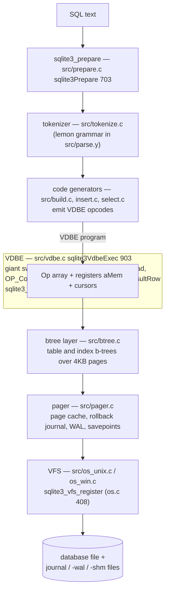
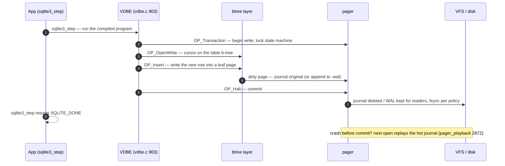
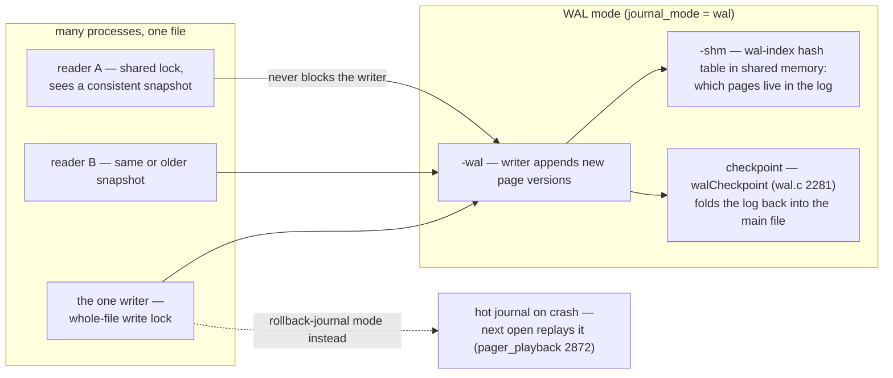

# SQLite: a database as a layered library — and a query as compiled bytecode

> **Atlas id:** `sqlite` · **Domains:** `database, storage-engine` ·
> **Upstream:** https://github.com/sqlite/sqlite · **License:** public domain ·
> **Pinned commit:** `d76e14d85ee6688763c9e91ab95bfe33652b1684` (2026-10-10, version 3.55.0)

SQLite is the most deployed database in the world — every phone, browser,
and messaging app embeds it — and it earned that by two architectural
commitments: it is a **library, not a server** (the database file is the
contract), and it is **strictly layered**, with every environment
assumption quarantined behind one interface. This deep-dive teaches how a
SQL statement becomes bytecode for a tiny virtual machine, how pages flow
through pager to disk, and how crash-safety is layered (journal vs WAL) —
the same problems a client/server database solves, solved without a
process of its own.

## Explain like I'm 10

**A magic cookbook that lives inside your toy box.** Most databases are
restaurants: you phone a waiter (a server process) who talks to the
kitchen. SQLite is a cookbook that lives in YOUR box — nothing to
install, nothing to call. You ask a question in a special language (SQL);
the book turns your question into a little recipe card (a bytecode
program for the VDBE virtual machine); a tiny cook follows the card one
step at a time (`sqlite3VdbeExec`). The cook reads and writes recipe
pages stored in one box (b-tree pages in the single database file), and a
careful librarian (the pager) makes sure nothing is ever half-rewritten:
either the librarian photocopies a page before changing it, so juice
spilled mid-recipe can be undone (the rollback journal), or the librarian
writes new pages at the back of a notebook so friends can keep reading
the old pages while you write (WAL mode). The book even works on any
shelf — phones, browsers, planes — because the only thing it needs to
know about the outside world is one small adapter (the VFS).

**Why the grown-ups did it this way:** putting the whole database in one
file, built from layers that each only talk to their neighbor, made it
run anywhere with zero setup — which is why it is the most deployed
database on earth.

## 1. Architecture overview

- The **spine** — the story of one `SELECT`/`INSERT` — is the vertical
  path above. Each layer speaks only to its neighbors; the btree layer
  has *no idea* what SQL is, the pager has no idea what a btree is.
- The layer contracts are documented as header comments at the top of
  each file — read the first ~300 lines of `src/btree.c`, `src/pager.c`,
  and `src/btreeInt.h` (the file-format spec lives in prose there) before
  any code.
- No network, no daemon: `sqlite3_open` (`src/main.c:3757` →
  `openDatabase` at 3388) is a library call; concurrency is file locking
  (POSIX advisory locks in `src/os_unix.c`).

## Walkthrough: one INSERT from SQL text to bytes on disk

The spine as a story — step through it on the site, or read it top to
bottom here. One `INSERT INTO users VALUES (7, 'ada')` travels the whole
stack.

**Step 1 — Compile the question.** `sqlite3_prepare` (`src/prepare.c:703`)
runs the pipeline: the tokenizer (`src/tokenize.c:sqlite3GetToken`, 273)
feeds the LEMON-generated parser (`src/parse.y` is the readable grammar),
the planner picks a strategy, and code generators emit a VDBE program —
for our INSERT, `src/insert.c:sqlite3Insert` (888) emits constraint
checks, rowid assignment, and index maintenance as opcodes.

**Step 2 — Step the machine.** `sqlite3_step` (`src/vdbeapi.c:980`) is a
thin driver around `sqlite3VdbeExec` (`src/vdbe.c:903`): one `for(;;)`
loop, one colossal switch, operands in registers `aMem[]`.

**Step 3 — Open the transaction.** `OP_Transaction` (4246) asks the
pager to begin a write: its state machine walks `PAGER_READER →
WRITER_LOCKED → WRITER_CACHEMOD`, and in journal mode the original pages
are saved to the rollback journal before any modification.

**Step 4 — Position and write.** `OP_OpenWrite` (the write-side sibling
of `OP_OpenRead` at 4530) opens a cursor on the table b-tree; `OP_Insert`
(5913) descends to the leaf page and adds the row as a cell —
`maxLocal/minLocal` decide whether large payloads spill to overflow
pages.

**Step 5 — Commit.** `OP_Halt` ends the program: the pager syncs the
journal (or leaves the new pages in the `-wal` log), releases locks, and
`sqlite3_step` returns `SQLITE_DONE`. "Committed" means the log record is
durable — the database pages themselves may still be flushed lazily.

**Step 6 — The crash subplot.** If the process dies mid-transaction,
nothing repairs anything at crash time. The next `sqlite3_open` finds a
hot journal and `pager_playback` (`src/pager.c:2872`) restores the
pre-transaction page images — recovery on open, not on crash.

**Outcome — One row, durably.** A SQL sentence became a bytecode
program, executed against pages behind a pager, behind a VFS — five
layers, each only knowing its neighbor. `EXPLAIN` shows you the exact
recipe card your query compiled to.

## 2. Core data structures — and why these

### B-tree pages (`src/btreeInt.h:MemPage`, line 273)

Every table and index is a b-tree over 4KB pages: interior pages route,
leaf pages hold cells (rows / index entries), overflow pages spill large
payloads. `MemPage` is the in-memory image of one page, with the packed
on-disk header mirrored into typed fields (`leaf`, `nCell`, `cellOffset`,
`maxLocal/minLocal` — the payload-splitting thresholds that decide when a
cell overflows). Cell arrays grow toward the middle of the page; free
space is coalesced by `allocateBtreePage`/`sqlite3BtreeInsert` machinery
in `src/btree.c`. Why a clustered page b-tree: table scans and range
scans are page-sequential, the unit of I/O is the unit of caching, and
row size decisions (maxLocal/minLocal) become explicit, tunable policy.

### The VDBE program (`src/vdbe.c`, `src/vdbe.h`)

A compiled statement is an array of `Op` structs plus registers
(`Mem aMem[]`) and cursors (`VdbeCursor`, one per open b-tree). The
interpreter is one `for(;;)` loop with a colossal switch —
`sqlite3VdbeExec` at `src/vdbe.c:903` is among the largest functions in
the atlas (tens of thousands of lines with cases like `OP_Column` at
3036, `OP_Transaction` at 4246, `OP_OpenRead` at 4530, `OP_Insert` at
5913). Why bytecode over an AST-walking interpreter: the program is
data — you can count opcodes for cost estimation (`sqlite3_stmt` status),
rewrite plans, and test one engine instead of N statement forms.

### The pager and its page cache (`src/pager.c`)

The pager owns database pages between btree and VFS: read-through cache,
dirty-page tracking, journal and WAL, savepoints. Its state machine
(`PAGER_READER → WRITER_LOCKED → WRITER_CACHEMOD → ...`, documented in
the header comment around lines 150–330) is the single place transaction
state transitions live. Why here: btree stays pure, and every durability
policy (journal vs WAL, sync modes) becomes pager configuration.

### WAL + wal-index (`src/wal.c`)

Write-ahead logging appends changed pages to `-wal` while readers see a
consistent snapshot through the wal-index (a hash table mapped in shared
memory, `-shm`, built by `unixOpenSharedMemory` in `src/os_unix.c:4952`).
Checkpointing (`walCheckpoint`, `src/wal.c:2281`) folds the log back
into the main file. Why: readers never block the writer — the
reader/writer concurrency SQLite couldn't offer with rollback journals.

## 3. Concurrency and failure model

- **Single writer, many readers.** Writes take the database file lock
  (whole-file, not page-level): simple, correct, and fine for the
  embedded workloads SQLite targets. In WAL mode, readers and one writer
  proceed concurrently.
- **Crash safety is recovery-on-open, not recovery-on-crash**: nothing
  repairs mid-write; instead the next open detects a *hot journal*
  (journal file newer than db) and replays it — `pager_playback`
  (`src/pager.c:2872`, with `pager_playback_one_page` at 2336) restores
  pre-transaction page images. In WAL mode, the wal-index is rebuilt from
  the log itself.
- **Savepoints and nested transactions** are pager-level journal marks
  (`SAVEPOINT` SQL maps to journal save/rollback points), not btree
  concepts — one more reason the layering pays.
- **Failure surfaces as return codes + `SQLITE_IOERR`/`SQLITE_FULL`
  classes**; the library never crashes the host process on data errors.
  (The project's famous testing regime — TH3, 100% branch coverage
  ambitions, dozens of generated test DBs — is the credibility engine
  behind this promise; see sqlite.org/testing.html.)

## 4. API and extension design

- The C API is a **state-machine lifecycle**: `sqlite3_open` →
  `sqlite3_prepare` (compile once, reuse) → bind parameters →
  `sqlite3_step` (execute one row at a time) → `sqlite3_column_*` →
  reset/finalize. `sqlite3_step` (`src/vdbeapi.c:980`) is just a driver
  around `sqlite3VdbeExec`. The streaming `step` design means memory
  usage is O(1) per row regardless of result size — an API decision that
  is an architecture decision.
- **Extension seams, each orthogonal:**
  - *VFS*: swap the entire OS layer (`sqlite3_vfs_register`,
    `src/os.c:408`) — this is how SQLite runs on phones, in-memory
    (`memdb.c`), or over user-space files.
  - *Virtual tables*: `sqlite3_create_module` (`src/vtab.c:108`) —
    tables backed by arbitrary code (see `src/dbstat.c`, a virtual table
    over SQLite's own btree internals, used to inspect itself).
  - *Loadable extensions*: `sqlite3_load_extension`
    (`src/loadext.c:731`) with a strict ABI (`SQLITE_EXTENSION_INIT`).
  - Functions, collations, authorizers, progress handlers — each a
    C callback registered on the connection.
- Honest wart: the single `sqlite3*` connection is not thread-safe for
  concurrent use without serialized mode or separate connections, and
  the whole-file write lock scales poorly for writers — by design, since
  client/server was explicitly out of scope.

## 5. The defining trade-offs

### Trade-off 1: library over client/server
- **Tension:** durability and query power vs deployment friction.
- **Choice:** no process, no wire protocol; the file (plus locks) is the
  interface.
- **Evidence:** `openDatabase` (`src/main.c:3388`) mostly wires VFS and
  mutexes; locking lives in `src/os_unix.c` (`unixRead` 3512,
  `unixWrite` 3643, POSIX advisory fcntl locks).
- **Given up:** network access, per-user auth/quotas, concurrent writers
  across machines.
- **Verdict:** right whenever the trust boundary is the process (apps,
  browsers, devices); wrong for multi-tenant servers — which is why
  PostgreSQL (this atlas) exists as the complement, not a rival.

### Trade-off 2: bytecode VM over direct statement execution
- **Tension:** SQL has unbounded statement shapes; you still want one
  fast, testable engine.
- **Choice:** code generators (`src/build.c`, `src/insert.c:sqlite3Insert`
  at 888, `src/select.c:sqlite3Select` at 7739) emit VDBE programs; one
  interpreter runs them all.
- **Evidence:** prepare a statement with `EXPLAIN` and you see the
  program; in code, the emitters in `insert.c`/`select.c` append `Op`s
  (e.g. `OP_Insert` emitted by the insert generator, executed at
  `src/vdbe.c:5913`).
- **Given up:** peak per-statement specialization (no JIT); compile cost
  must be amortized via prepared statements.
- **Verdict:** right when statements repeat and workloads are I/O-bound —
  the interpreter's simplicity became SQLite's testability. This is the
  same bet Postgres makes with its own executor, and that JVM/BEAM make
  at larger scale.

### Trade-off 3: rollback journal AND WAL — durability policy as a mode
- **Tension:** crash safety with either maximum compatibility or
  reader/writer concurrency.
- **Choice:** journal mode writes original pages to a rollback journal
  before modifying the db; WAL mode appends new pages to a log and
  checkpoints later (`PRAGMA journal_mode`).
- **Evidence:** journal lifecycle in `src/pager.c` (state machine comment
  lines ~150–330; playback 2872) vs `src/wal.c:walCheckpoint` (2281);
  the pager hides which mode is active from btree entirely.
- **Given up:** journal mode blocks readers during writes; WAL adds
  `-wal`/`-shm` files, checkpoint pauses, and network-filesystem
  caveats.
- **Verdict:** offering both, selected by pragma, keeps the embedded
  contract ("it's just files") while letting read-heavy apps scale —
  a reminder that durability semantics are a *deployment* decision your
  architecture must be able to defer.

## 6. Reading path

1. `src/btreeInt.h` header comment + `struct MemPage` (line 273) — the
   on-disk format spec in prose; internal vs leaf pages, cell layout,
   overflow. Read before any btree code.
2. `src/main.c:openDatabase` (3388) — what "opening a database" means:
   VFS lookup, mutexes, pager/btree construction. Notice what is *not*
   there: no sockets, no threads.
3. `src/tokenize.c:sqlite3GetToken` (273) and `sqlite3RunParser` (600) —
   the one-pass tokenizer feeding the LEMON-generated parser
   (`src/parse.y` is the readable grammar; parse.c is generated).
4. `src/prepare.c:sqlite3Prepare` (703) — the compile pipeline entry:
   parse → resolve names → plan → codegen.
5. `src/insert.c:sqlite3Insert` (888) — watch a real code generator:
   constraint checks, rowid assignment, index maintenance, all as
   emitted opcodes.
6. `src/vdbe.c:sqlite3VdbeExec` (903) — read the loop skeleton, then
   three cases only: `OP_Transaction` (4246), `OP_OpenRead` (4530),
   `OP_Column` (3036). Notice register-machine style: every op reads and
   writes `aMem[]`.
7. `src/btree.c` cursor functions (`sqlite3BtreeCursorHasMoved`, 949) and
   `allocateBtreePage` (6546) — how cursors walk pages and how page
   allocation/defragmentation works.
8. `src/pager.c` header comment (lines ~1–350) — the transaction state
   machine; then `pager_playback` (2872): crash recovery as replay of
   the rollback journal.
9. `src/wal.c:walCheckpoint` (2281) and the wal-index build path via
   `src/os_unix.c:unixOpenSharedMemory` (4952) — the concurrent
   read/write story.
10. `src/vtab.c:sqlite3_create_module` (108) + `src/dbstat.c` — a
    virtual table implemented over SQLite's own internals; the best
    "extension API done well" example in the tree.
11. `src/os.c:sqlite3_vfs_register` (408) + `src/os_unix.c:unixRead`
    (3512) — the end of the stack: every byte SQLite touches goes through
    a swappable method table.

You have now traced one SQL statement from text to tokens to bytecode to
pages to bytes on disk — and back through crash recovery.

## 7. What to steal

- **Quarantine environment assumptions behind one interface** (VFS) —
  portability is an architectural decision, not a build-system chore.
- **Compile to a small program, interpret it** — one bytecode engine
  made of a giant switch turns unbounded input shapes into one testable
  unit, and makes `EXPLAIN` free.
- **Document layer contracts in the file headers** — SQLite's header
  comments (btree format, pager states) are why a 200k-line codebase
  stays navigable; the docs live where the code lives.
- **Recovery on open, not on crash** — a system that repairs itself
  lazily at next mount is simpler and more robust than one that tries to
  be crash-aware in-flight.
- **Make durability a mode, not a fate** — journal vs WAL selected by
  pragma shows how to offer conflicting guarantees without forking the
  architecture.

## 8. Difficulty and prerequisites

- Difficulty: **demanding** (the size of `vdbe.c`/`btree.c`/`pager.c`
  demands patience) but the layering keeps it tractable.
- Budget: ~6–8 hours for the reading path; a full week to internalize
  btree + pager.
- Prerequisites: b-tree basics (any DB textbook chapter), what a WAL is
  conceptually, C reading fluency including `#ifdef` discipline. No SQL
  internals background needed — the header comments teach it.

## 9. Further reading

- SQLite architecture overview and file-format docs:
  https://www.sqlite.org/arch.html , https://www.sqlite.org/fileformat2.html
- SQLite testing philosophy: https://www.sqlite.org/testing.html
- The LEMON parser generator (ships in the repo under `tool/lemon/`).
