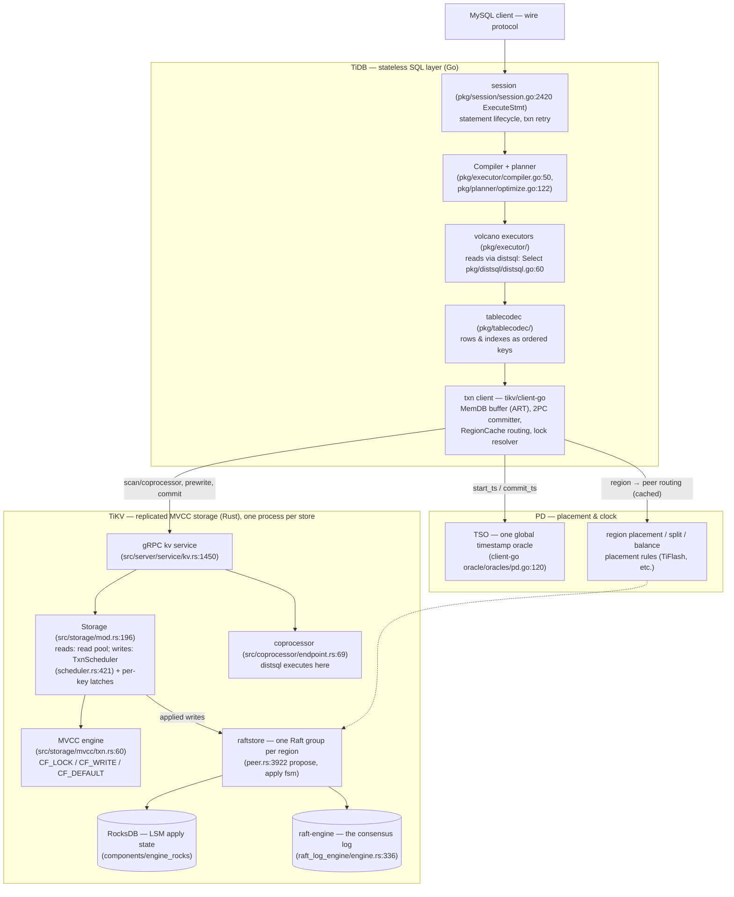
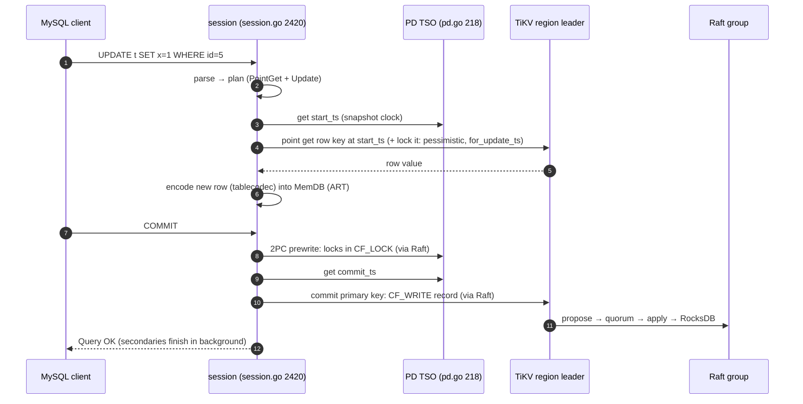
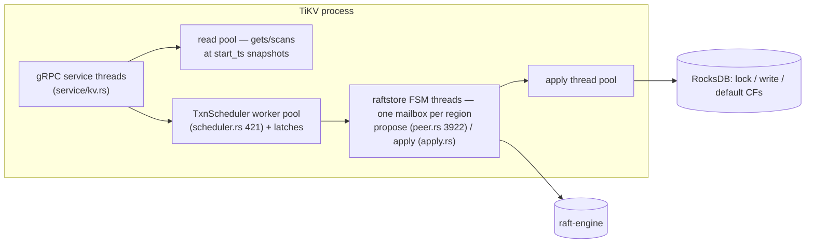

# TiDB: SQL as a thin skin over three services that trust nobody

> **Atlas id:** `tidb` · **Domains:** `database, distributed` ·
> **Upstream:** https://github.com/pingcap/tidb (txn client in
> https://github.com/tikv/client-go, storage in https://github.com/tikv/tikv) ·
> **License:** Apache-2.0 ·
> **Pinned commits:** TiDB `f00709065bd31eeaa2be618bbd93400803251c8f`
> (v26.3.20, 2026-10-15), client-go `7ee0b27f5157bc49b9d32f612159522c03923ff7`
> (2026-09-29, the exact version in TiDB's `go.mod`), TiKV
> `a1fdd6a59bb9c8a282c15677e1894501a52425cf` (v8.5.8, 2026-08-21)

TiDB is an open-source distributed SQL database that speaks the MySQL
dialect — and it is really **three services behind one narrow contract**:
stateless SQL nodes (TiDB), a placement-and-clock service (PD), and
Raft-replicated MVCC storage (TiKV, RocksDB underneath). The single
design idea this deep-dive teaches is **disaggregation by contract**:
the SQL layer holds no data and knows nothing about placement; the
storage layer knows nothing about SQL; the only shared truths are
*ordered bytes*, *timestamps from one global clock*, and a KV protocol.
Every hard problem — ACID across machines, snapshot isolation, scaling
out — is solved with just those three primitives, largely by reusing
designs this atlas has already dived alone: Raft (the etcd lineage),
timestamp-stamped MVCC (the PostgreSQL lesson, different mechanism), and
an LSM engine (the LevelDB/RocksDB lineage).

## Explain like I'm 10

**A chain of translator offices, one town clock, and guarded warehouses.**
TiDB is a company with many friendly front offices (the stateless SQL
nodes): they answer your questions in your language (SQL), but keep
*nothing* on the shelves — you can open or close offices freely. The town
hall (PD) owns the only official clock and the master map saying which
guarded warehouse holds which range of shelf numbers. Each warehouse
shelf-range (a region) is watched by a small committee of clerks (the
Raft replicas) who agree on every line before writing it, so no warehouse
ever contradicts its twin. A multi-warehouse contract (a distributed
transaction) is signed in two phases: first a yellow sticky note
(a prewrite lock) goes on every drawer involved — one note is declared
the *master* (the primary key) — and only when the master's committee
has confirmed its note does every drawer swap its sticky note for a
permanent stamp (the commit record), each stamped with the town-hall time
(the commit timestamp). Anyone who later finds a stray sticky note just
asks the master's drawer what happened (lock resolution). And because
every version of every line carries a town-hall time, "show me the books
as of 10:04" (a snapshot read) works in every office identically.

**Why the grown-ups did it this way:** if the front office, the clock,
and the shelves each trust only the shared contract — bytes, time, and
protocol — then each can be added, replaced, or scaled without asking
permission from the others, which is what makes one database survive
growing from three machines to hundreds.

## 1. Architecture overview

- **TiDB (SQL layer)** parses (`pkg/parser`, a yacc grammar in
  `parser.y`), plans (`pkg/planner`), and executes (`pkg/executor`,
  a classic volcano iterator set) — but stores nothing. Its working
  state is a per-transaction in-memory write buffer (client-go's
  `MemDB`) and caches (schema, region routing). Add SQL nodes freely;
  sessions are just goroutines.
- **PD (Placement Driver)** is the town hall: it allocates every
  transaction's timestamps through one TSO (timestamp oracle), and owns
  the region map — which TiKV peer leads which key range — plus
  split/balance decisions and placement rules (how a row store and a
  columnar store can both hold the same data).
- **TiKV (storage)** is a shared-nothing cluster of stores; each store
  runs hundreds of Raft groups (one per region, a contiguous key range
  that splits as it grows). A txn-aware MVCC engine sits between the
  gRPC service and Raft; RocksDB persists applied state while a
  dedicated log engine (raft-engine) persists Raft logs — the log is the
  WAL, and TiKV can even skip RocksDB's own WAL on the apply path
  (`fsm/apply.rs:461`).
- **The spine** — one `UPDATE t SET x=1 WHERE id=5` under the default
  pessimistic mode — is: `session.ExecuteStmt` (session.go:2420) →
  compile/plan (compiler.go:50, optimize.go:122) → point-get read at a
  snapshot timestamp → pessimistic lock → executor encodes the new row
  (`tables.go:748 addRecord` → `tablecodec.go:114`) into the MemDB
  buffer → on COMMIT, `session.CommitTxn` (session.go:981) → driver
  (`txn_driver.go:115`) → client-go `KVTxn.Commit` (txn.go:791) →
  `twoPhaseCommitter.execute` (2pc.go:1701): prewrite per region, a
  fresh commit timestamp from PD, commit of the primary key — each
  write entering TiKV's scheduler (`scheduler.rs:795`), becoming an
  MVCC modify (`mvcc/txn.rs:175-187`), proposed through Raft
  (`peer.rs:3922`), applied to RocksDB (`fsm/apply.rs:1473`).

This is the atlas's three-layer pairing made flesh: **Raft** from the
etcd dive (raft-rs, `Cargo.toml:206`, is the Rust sibling of etcd's
library), **SQL semantics and MVCC** in the PostgreSQL dive's sense
(same snapshot-isolation goals, completely different mechanism), and
**the LSM engine** from the LevelDB/RocksDB lineage as the bottom
substrate. TiDB's design lesson is what it *adds*: the narrow contract
that lets the three evolve independently.

## Walkthrough: one UPDATE, parse to Raft commit

The spine as a story. Default settings: pessimistic transaction mode,
one table with a primary key `id`, the row present.

**Step 1 — Receive and plan.** The session loop `ExecuteStmt`
(`pkg/session/session.go:2420`) hands the AST to the compiler
(`pkg/executor/compiler.go:50`), which runs the planner
(`pkg/planner/optimize.go:122`) and gets back a physical plan — here a
point-get feeding an Update executor. Notice how little the SQL layer
assumes about storage: the plan speaks in table/index terms and only
later becomes keys.

**Step 2 — Buy a snapshot time.** The transaction's `start_ts` comes
from PD's TSO (`oracle/oracles/pd.go:218 GetTimestamp`; the client
implements the tiny `Oracle` interface, `oracle/oracle.go:49`). One
clock for the whole cluster is what makes "read as of T" mean the same
thing everywhere — TiDB's replacement for PostgreSQL's per-cluster
snapshot bookkeeping.

**Step 3 — Read, then lock what you read.** The point-get resolves the
row's key (`tablecodec.go:114 EncodeRowKeyWithHandle`) and reads via the
snapshot (`pkg/store/driver/txn/snapshot.go:55` → client-go
`KVSnapshot.Get`, `txnkv/txnsnapshot/snapshot.go:734`). Under pessimistic
mode the same trip also acquires a lock on the key with a newer
`for_update_ts` (`KVTxn.lockKeys`, `txnkv/transaction/txn.go:1387` →
TiKV `actions/acquire_pessimistic_lock.rs`), so competing writers block
here rather than failing at commit — TiDB's default answer to the
optimistic-retry storms that plague wide transactions.

**Step 4 — Write into the buffer, not the database.** The Update
executor encodes the new row: `TableCommon.addRecord`
(`pkg/table/tables/tables.go:748`) lays out columns via the codec and
writes the mutation into the transaction's MemDB — an Adaptive Radix
Tree in an arena (`internal/unionstore/memdb.go:52`, `art/art.go:31`).
Nothing has left the SQL node; TiKV has never seen a tentative version.

**Step 5 — COMMIT starts the two-phase dance.** `session.CommitTxn`
(`session.go:981`) → `tikvTxn.Commit` (`txn_driver.go:115`) →
`KVTxn.Commit` (`txn.go:791`) builds the `twoPhaseCommitter`
(`2pc.go:126`), whose `execute` (`2pc.go:1701`) drains the MemDB into
mutations (`initKeysAndMutations`, `2pc.go:561`), groups them by region
(`groupMutations`, `2pc.go:896`), and prewrites each group — locks land
in TiKV's `CF_LOCK` with one key designated primary (`primary()`,
`2pc.go:779`), each lock carrying a TTL sized by transaction footprint
(`txnLockTTL`, `2pc.go:812`).

**Step 6 — Buy a commit time.** A second TSO round gets `commit_ts`
(`execute` → `GetTimestampForCommit`, `2pc.go:1941`). Between prewrite
and this call the transaction checks its own staleness — schema
compatibility and a max-lifetime bound (`IsExpired`, `2pc.go:1956`) —
the moments where a distributed txn is declared too old to live.

**Step 7 — Commit the primary, and only then relax.** The committer
sends the commit for the primary key first with a long backoff budget
(`commitTxn`, `2pc.go:2035`): the moment that write is Raft-applied,
the transaction is committed — secondary keys are finished in the
background (`asyncSecondaries`, `2pc.go:790`). Inside TiKV the request
entered at the gRPC service (`src/server/service/kv.rs:1450`), was
serialized against other writers by per-key latches (`latch.rs:158`),
performed its MVCC write (`actions/commit.rs:48`: delete `CF_LOCK`,
put `CF_WRITE` at `key + commit_ts`), and reached Raft through
`RaftKv::async_write` (`src/server/raftkv/mod.rs:503`) →
`Peer::propose` (`peer.rs:3922`).

**Outcome — A row updated across a cluster, crash-anywhere safe.** The
row's new version is visible at `commit_ts` to any snapshot at or after
it; the old version stays until GC. If this SQL node had died between
phases, the next transaction to trip over the locks would resolve them
by consulting the primary key's fate (`LockResolver.ResolveLocks`,
`txnkv/txnlock/lock_resolver.go:453`) — no coordinator was ever needed.

## 2. Core data structures — and why these

### The encoded keyspace: tables are key ranges

`EncodeRowKeyWithHandle` (`pkg/tablecodec/tablecodec.go:114`) turns
`(tableID, handle)` into `t<tableID>_r<handle>`; index entries become
`t<tableID>_i<idxID><indexValues>` under the same `t` prefix
(`tablePrefix`, tablecodec.go:50). **Why:** this one encoding collapses
"SQL storage" into "an ordered byte range" — and every downstream
problem (sharding, routing, balancing, range scans) becomes TiKV's
region-splitting problem, which it already knows how to solve. The
alternative — keeping row-heap/tablespace semantics à la PostgreSQL and
adding a distributed mapping layer — would put SQL knowledge inside the
storage tier, breaking the disaggregation contract.

### MVCC keys with a timestamp suffix, in three column families

TiKV's `Key` (`components/txn_types/src/types.rs:81`) appends an 8-byte
big-endian timestamp (`append_ts`, types.rs:150). User keys get a `z`
prefix (`data_key`, `components/keys/src/lib.rs:206`), then land in
three RocksDB column families (`components/engine_traits/src/cf_defs.rs`):
`CF_DEFAULT` holds values at `key+start_ts`; `CF_WRITE` holds commit
records at `key+commit_ts` (`src/storage/mvcc/txn.rs:175-187` puts both);
`CF_LOCK` holds in-flight intents at the bare key (txn.rs:127). **Why:**
this is Google Percolator's bigtable layout transplanted onto an LSM
engine — the write CF *is* the version index, reads resolve a key by
seeking `CF_WRITE` backwards (`SnapshotReader.seek_write`,
`src/storage/mvcc/reader/reader.rs:99`), and commit/rollback are single
CF operations. Compare PostgreSQL: same MVCC goals, but versions live
in the heap with visibility bits, because there the storage *knows*
about transactions. Here the layout must be legible to a client that
only speaks KV.

### The MemDB transaction buffer: an ART in an arena

All uncommitted writes of a transaction live client-side in
`MemDB` (`internal/unionstore/memdb.go:52`) — an Adaptive Radix Tree
with its own arena (`internal/unionstore/art/art.go:31`), supporting
iteration, per-key flags, and rollback checkpoints (a Red-Black-tree
implementation still sits beside it, `memdb_rbt.go`, for comparison).
Reads union the buffer with the snapshot (`UnionIter`,
`internal/unionstore/union_iter.go:58`). **Why:** keeping tentative
state out of TiKV means the storage engine never touches uncommitted
versions (no PostgreSQL-style abort-cleanup server-side), and the whole
transaction arrives at prewrite time already batched per region — which
is also what makes 1PC and pipelined flush (for huge transactions,
`txnkv/transaction/pipelined_flush.go`) implementable as client-side
protocol tweaks.

### The twoPhaseCommitter: commit status stored in the data

The committer (`txnkv/transaction/2pc.go:126`) needs no log, no
recovery service: prewrite leaves a `Lock` record
(`components/txn_types/src/lock.rs:87`) whose bytes say who is primary;
commit/rollback of the primary updates a `CF_WRITE`/rollback record
that every resolver can read. `execute` (2pc.go:1701) is the whole
protocol; `cleanup` (2pc.go:1630) is rollback. **Why:** Percolator's
primary-key trick makes a coordinator-free 2PC — atomicity is a
property of the data, and crash recovery is an algorithm any client can
run (see the resolver below), not a service to keep alive.

### The RegionCache: a routing table every client maintains

`RegionCache` (`internal/locate/region_cache.go:655`) maps key ranges
to region/peer versions, refreshing from PD on `epoch` mismatches and
demoting stores on errors (`OnSendFail`, region_cache.go:1829); the
`RegionRequestSender` (`region_request.go:110`) retries and redirects.
**Why:** stateless SQL nodes need placement knowledge with no proxy hop;
a client-maintained, epoch-validated cache gives them freshness where
it matters and no coordination where it doesn't — the same smart-client
bet as Memcached in this atlas, but backed by an authority (PD) instead
of a hash function, because ranges move.

## 3. Concurrency and failure model

- **SQL layer:** concurrency is trivial by design — sessions are
  goroutines over a stateless node; the only cross-session state is
  cached (schema, regions, statistics). Conflict handling lives at
  commit: optimistic transactions that hit `WriteConflict` are retried
  by *re-executing their statements* against a new snapshot
  (`doCommitWithRetry` → `session.retry`, `pkg/session/session.go:805`)
  — safe because statements are deterministic given the plan and
  snapshot, an unusually strong bet that PostgreSQL, with its
  server-side transaction state, could not make.
- **TiKV write path:** per-region single-threaded FSMs (the
  batch-system: `PeerFsm` `fsm/peer.rs:142`, `ApplyFsm`
  `fsm/apply.rs:4007`) serialize Raft work; txn writes are additionally
  serialized by per-key **latches** (`src/storage/txn/latch.rs:158`)
  before `process_write` (`scheduler.rs:1952`) runs on a worker pool.
  The latch table is a striped slot array hashing keys — two writers
  touching disjoint keys never see each other.
- **Reads:** point gets and scans run on a read pool against RocksDB
  snapshots at `start_ts`; linearizable Raft reads go through ReadIndex
  (`peer.rs:4242 read_index`), the same leader-confirmation idea as
  etcd's ReadIndex — with local reads allowed under leader lease
  (`read_local`, peer.rs:4159).

- **Crash mid-transaction:** locks outlive their client; any blocked
  reader or writer resolves them — `LockResolver.ResolveLocks`
  (`txnkv/txnlock/lock_resolver.go:453`) checks the primary key's
  status via TiKV's `CheckTxnStatus` action and drives commit/rollback
  of secondaries, honoring the TTL (`txnLockTTL`, 2pc.go:812) that
  decides when a lock's owner is presumed dead. Undeclared outcomes
  surface as `ErrResultUndetermined` (`2pc.go:1863`) — TiDB refuses to
  pretend a lost RPC meant failure.
- **Crash mid-Raft:** raft-engine holds the log; on restart the store
  replays entries past the applied index into RocksDB
  (`ApplyFsm`, `fsm/apply.rs:1473 apply_raft_cmd`); Raft guarantees a
  quorum agreed on every applied line before any client saw it.
- **Backpressure:** TiKV stalls writers through a flow controller on
  memtable size (`src/storage/txn/flow_controller`), and TiDB
  schedules by resource group (RU tokens) — overload degrades latency
  per-class rather than collapsing the cluster.

## 4. API and extension design

- **The public API is a personality, not a protocol surface: MySQL
  compatibility.** TiDB speaks the MySQL wire protocol (`pkg/server`)
  and dialect, so the ecosystem (drivers, ORMs, tools) adopts it for
  free — the same compatibility-as-API bet as SQLite's embedding. The
  trade is that MySQL semantics (from `SHOW` quirks to implicit
  commits) constrain every layer below, forever.
- **The real extension seams are protocol-level.** Between TiDB and
  TiKV lies kvproto — gRPC services for KV ops, coprocessor requests,
  and Raft-transport — and between PD and everyone lies the region
  epoch + placement-rule model. Those two contracts are why **TiFlash**
  (a columnar store) can join as *another Raft replica* of the same
  regions without the SQL layer changing: placement rules say
  "learner on that store," TiKV replicates, TiFlash applies to a
  columnar engine. Compare LSP/DAP in the VS Code dive: standardize the
  contract at the process boundary and heterogeneous implementations
  compose.
- **Computation extends downward too:** the coprocessor
  (`src/coprocessor/endpoint.rs:69`) executes pushed-down selection /
  aggregation over a region's data, and TiDB's distsql layer
  (`pkg/distsql/distsql.go:60`) decides per-plan what to push — the
  map-reduce seam that keeps network traffic proportional to answers,
  not data.
- **Honest wart:** three pinned repos to understand one commit — the
  disaggregation is also fragmentation. Cross-repo features (say,
  async commit, 2pc.go:1538) must ship in lockstep across SQL layer,
  client library, and storage; and MySQL compatibility plus distributed
  semantics occasionally collide (auto-retry is disabled for
  non-repeatable statements for exactly this reason —
  `doCommitWithRetry`'s `CouldRetry` gate, session.go:867).

## 5. The defining trade-offs

### Trade-off 1: coordinator-free 2PC (Percolator) over a central transaction manager
- **Tension:** transactions span regions on many machines; something
  must guarantee all-or-nothing across crashes of any participant,
  including the client itself.
- **Choice:** commit state lives in the data — prewrite locks with an
  elected primary key; the primary's commit record is the transaction's
  single point of truth; recovery is data-driven.
- **Evidence:** `twoPhaseCommitter.execute` (`2pc.go:1701`) — no
  persistent coordinator anywhere; `actions/prewrite.rs:37` /
  `actions/commit.rs:48` write `CF_LOCK`/`CF_WRITE`;
  `LockResolver.ResolveLocks` (`lock_resolver.go:453`) is the
  recovery algorithm any stranger can run.
- **Given up:** latency (prewrite RTT + TSO + commit RTT — three
  network rounds minimum), lock TTL machinery, and a garbage-collection
  story for abandoned locks.
- **Verdict:** right when write volume and client count are huge and a
  coordinator would be the bottleneck and the SPOF; wrong if you need
  single-digit-millisecond commits — which is exactly why TiDB later
  added 1PC (single-region txns commit in prewrite, `checkOnePC`,
  2pc.go:1572) and async commit (client proceeds after prewrite,
  `checkAsyncCommit`, 2pc.go:1538) — protocol patches on the same
  data layout.

### Trade-off 2: one global TSO over distributed clocks
- **Tension:** snapshot isolation needs a total order on transaction
  boundaries; Spanner buys one with atomic clocks, CockroachDB with
  hybrid logical clocks and uncertainty windows.
- **Choice:** PD runs a single timestamp oracle; every `start_ts` and
  `commit_ts` comes from it (`Oracle` interface `oracle/oracle.go:49`,
  `pdOracle.GetTimestamp` `pd.go:218`).
- **Evidence:** `KVTxn` allocates `start_ts` lazily and
  `twoPhaseCommitter` takes `commit_ts` from the same source
  (`2pc.go:1941`); external consistency falls out — a committed txn's
  commit_ts is globally ordered, no uncertainty retries anywhere in
  TiKV.
- **Given up:** PD is an availability point (a TSO outage stalls *new*
  transactions, though not in-flight ones) and a latency floor (every
  transaction pays two TSO round trips in the naive path).
- **Verdict:** right for a system whose value is "MySQL, but elastic":
  the complexity budget went to disaggregation, and one clock keeps
  isolation semantics brain-dead simple to reason about. Wrong for
  write-everywhere multi-region designs — TiDB itself routes global
  transactions through one region's PD rather than pretend many clocks
  are one.

### Trade-off 3: SQL nodes that store nothing over smart storage everywhere
- **Tension:** where does the system's intelligence live —
  per-connection compute with local state (PostgreSQL) or shared
  storage with pushdown compute (a storage-disaggregated database)?
- **Choice:** TiDB nodes are stateless executors; TiKV is "dumb bytes"
  at the contract level but increasingly smart in practice (MVCC,
  coprocessor, 1PC, resolve) — the split tracks the *contract*, not
  raw intelligence.
- **Evidence:** the executor reads only through distsql/snapshot
  interfaces (`distsql.go:60`, `snapshot.go:55`); row layout is decided
  unilaterally by the SQL layer (`tablecodec.go:114`) and TiKV never
  decodes it — coprocessor pushed-down plans are shipped as encoded
  DAGs (`endpoint.rs:205 parse_request`), not as SQL knowledge.
- **Given up:** every read is a network round trip (no local buffer
  pool), and cross-node operations (e.g., one query joining two
  regions) pay a shuffle tax PostgreSQL never sees.
- **Verdict:** right when elasticity and per-layer scaling dominate
  (OLTP that must grow beyond one machine, HTAP with TiFlash
  replicas); wrong for latency-critical single-node workloads, where
  PostgreSQL's process-local everything is simply faster. TiDB's
  answer is not to pretend otherwise — it is coprocessor pushdown:
  move the filter to the data.

## 6. Reading path

Prereq: shallow-clone all three repos at the pinned commits (TiDB and
TiKV are direct clones; client-go is a normal clone checked out at
`7ee0b27f…` — TiDB's `go.mod` pins it). Roughly a day's focused
reading; the TiDB spine is Go and reads fast, TiKV's raftstore is the
deepest stop.

1. `pkg/session/session.go:2420` (`ExecuteStmt` → `executeStmtImpl`) —
   the session spine: statement context, txn preparation, compile,
   execute. Notice everything is per-session; nothing is shared state.
2. `pkg/executor/compiler.go:50` (`Compile`) →
   `pkg/planner/optimize.go:122` (`Optimize`) — AST to physical plan;
   the volcano executors the planner emits are pure iterators, storage
   access hidden behind a single interface.
3. `pkg/tablecodec/tablecodec.go:114` — encode one row key and one
   index key by hand; then `pkg/table/tables/tables.go:748`
   (`addRecord`) to watch a row become KV mutations.
4. `client-go internal/unionstore/memdb.go:52` + `art/art.go:31` —
   the ART MemDB: your transaction so far, in one node's RAM. Note the
   checkpoints (savepoints) and the RBT alternative beside it.
5. `txnkv/transaction/txn.go:791` (`KVTxn.Commit`) → `2pc.go:126`
   (`twoPhaseCommitter` struct) — the transition point: buffer becomes
   protocol. Inventory the struct's fields against the walkthrough.
6. `2pc.go:1701` (`execute`) — read top to bottom once for the happy
   path, then again for the failure defers (`cleanup` at 1630,
   `undeterminedErr`). This function *is* Percolator's Section 4.
7. `prewrite.go:222` (`handleSingleBatch`) + `2pc.go:896`
   (`groupMutations`) — mutations grouped per region; note the
   pre-split hint (`2pc.go:928`) when a client sees a hot region
   coming.
8. `internal/locate/region_cache.go:655` + `region_request.go:110` —
   how a request finds its region leader, and what happens when the
   answer is stale (epoch bumps, `OnSendFail` at 1829).
9. TiKV: `src/server/service/kv.rs:1450` — the generated dispatch
   (macro at 2325) — then `src/storage/txn/scheduler.rs:795`
   (`execute`): snapshot, latch, `process_write`, engine write. This
   is where a KV RPC becomes MVCC bytes.
10. `src/storage/txn/actions/prewrite.rs:37` and
    `actions/commit.rs:48`, with `src/storage/mvcc/txn.rs:60` and
    `reader/reader.rs:40` open beside them — the three CFs in action:
    who writes `CF_LOCK`, who reads it, and what a commit record looks
    like.
11. `src/server/raftkv/mod.rs:503` (`async_write`) →
    `components/raftstore/src/store/peer.rs:3922` (`propose`) — the
    request becomes a Raft entry; then `fsm/peer.rs:2224`
    (`collect_ready`) and `fsm/apply.rs:1473` (`apply_raft_cmd`) to
    see it reach RocksDB. Compare with etcd's raft adapter: the same
    library discipline, in Rust.
12. Finish with `txnkv/txnlock/lock_resolver.go:453`
    (`ResolveLocks` → `resolveLock` at 1536) — kill your client between
    phases in a test cluster, then watch another transaction resolve
    the corpse's locks by asking the primary key what happened.

You have now traced one UPDATE from MySQL bytes to Raft-committed LSM
writes — and back out through the failure path that makes the whole
thing work without a coordinator.

## 7. What to steal

- **Encode your domain into an ordered keyspace before you design
  distribution:** tables-as-key-ranges (tablecodec.go:114) turned
  "distributed SQL storage" into "range splitting," a solved problem
  one layer down.
- **Store commit status in the data, not in a coordinator:** the
  Percolator primary-key pattern (2pc.go:779) gives you atomic
  multi-machine writes whose crash recovery is an algorithm, not a
  service you must keep alive.
- **One logical clock beats N clever clocks when isolation must be
  explainable:** a single TSO (oracle.go:49) makes snapshot isolation
  and external consistency trivially true; pay the availability price
  knowingly and route around it, don't pretend it away.
- **Buffer writes on the client until commit:** MemDB (memdb.go:52)
  keeps tentative state out of the storage engine and batches the
  commit per region — protocol upgrades (1PC, async commit, pipelined
  flush) become client-side variations.
- **Group work by placement owner before you send it:** mutations
  grouped per region (2pc.go:896) is the difference between one RPC
  per key and one per region — the batching seam every distributed
  client needs.
- **Put extension contracts at process boundaries:** kvproto + PD
  placement rules are why a columnar engine (TiFlash) could join a row
  engine's Raft groups without touching the SQL layer — protocols
  compose, APIs merely get called.

## 8. Difficulty and prerequisites

- Difficulty: **demanding** — three repositories, two languages, and
  the full distance from SQL semantics to Raft consensus in one spine.
- Budget: ~10–12 hours for the reading path. Stops 1–7 (the Go side)
  are a comfortable half; stops 9–11 (TiKV's storage and raftstore)
  deserve the rest.
- Prerequisites: SQL execution basics (the PostgreSQL deep-dive's
  planner/executor and MVCC sections), Raft (the etcd deep-dive, or
  the Raft paper), and LSM fundamentals (the LevelDB deep-dive). The
  Percolator paper's Section 4 is short and makes step 6 twice as
  readable.

## 9. Further reading

- Peng & Dabek, "Large-scale Incremental Processing Using Distributed
  Transactions and Notifications" (Percolator, OSDI 2010), Section 4 —
  the transaction protocol TiKV implements, from the source.
- Corbett et al., "Spanner: Google's Globally-Distributed Database"
  (OSDI 2012) — the other answer to trade-off 2 (TrueTime vs a TSO).
- TiDB's own docs series "TiDB Internals"
  (https://docs.pingcap.com/tidb/stable/tidb-internals-overview) —
  especially the "The Life of a Write" pages; read after the spine,
  not before.
- The async-commit and 1PC design discussions in the TiDB blog
  (https://www.pingcap.com/blog/) — what it took to shave network
  rounds off trade-off 1 while keeping the same data layout.
