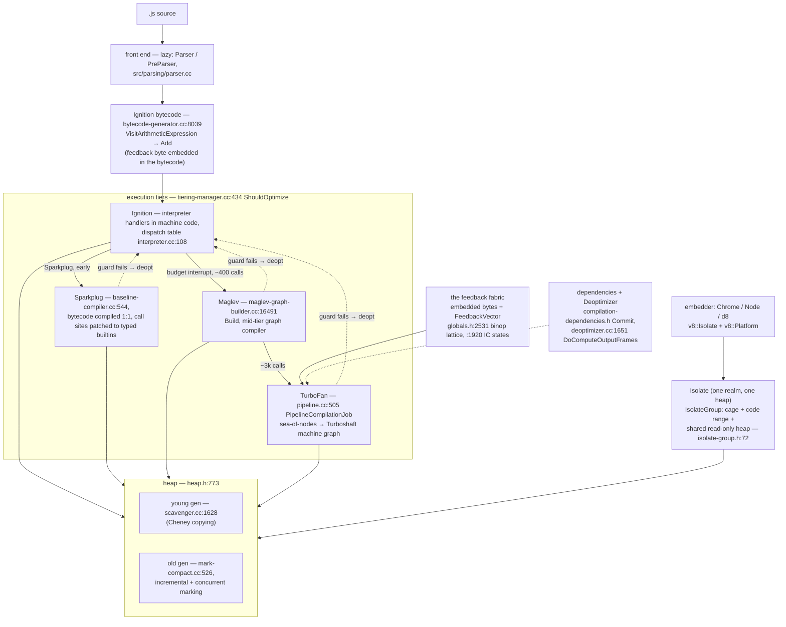
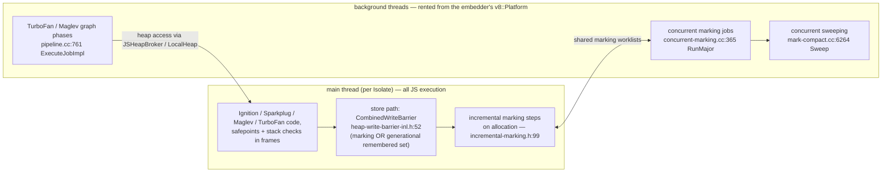

# V8: an engine that bets — tiers, feedback, and the machinery for taking bets back

> **Atlas id:** `v8` · **Domains:** `runtime, language` ·
> **Upstream:** https://github.com/v8/v8 · **License:** BSD-3-Clause ·
> **Pinned commit:** `c22aa636c65fc075c2287c775a962a3013c21e45` (2026-10-16)

V8 is the JavaScript engine in Chrome, Node.js, Deno, and Electron —
billions of executions a day of a language with **no static types**,
whose users nonetheless measure it in milliseconds. The design idea
this dive teaches is **speculation as architecture**: V8 observes
types and object shapes while code runs (feedback), compiles the same
function through four increasingly aggressive tiers (Ignition
interpreter → Sparkplug baseline → Maglev mid-tier → TurboFan
optimizing compiler), wraps every assumption in a machine-level guard,
and — the part that makes the whole gamble honest — has a complete,
designed mechanism for **taking a bet back** (the Deoptimizer plus a
dependency registry that invalidates optimized code when a Map
transition proves it wrong). Around that core sit two more betable
structures: hidden classes (`Map`s) that turn dynamic property access
into constant-offset loads, and a concurrent, incremental collector
that never stops the world for long. The unit of embedding is the
`Isolate` — one heap, one realm — grouped into cages that share only
immutable state.

Read it against the atlas's other runtimes: [CPython](cpython.md)
took the same feedback idea only as far as *specializing an
interpreter* and stayed portable C; [Lua](lua.md) skipped speculation
entirely and spent its budget on embeddability; V8 is the maximalist
answer — everything is speculated, and the engine's size is the
price. The [Node.js](nodejs.md) dive shows the customer side of this
API at full scale.

## Explain like I'm 10

**A theater troupe where the actors memorize only the lines that keep
repeating — and can forget them instantly.** A new play starts with
the understudy reading straight from the script (the Ignition
interpreter running bytecode). Each time a line is spoken, a tally
mark goes in the margin of the script itself (the feedback byte
embedded in the bytecode): "this plus sign has always seen two small
whole numbers." After the line repeats often enough, a coach (first
Sparkplug, then Maglev, finally TurboFan) rehearses a *special
version of the scene* where the props are guaranteed to be two
numbers — much faster to perform. Every prop room has labeled shelf
diagrams (hidden classes, `Map`s): each toy box carries a pointer to
its diagram, and two boxes shelved the same way share one diagram,
so "grab the third shelf" never needs searching. The moment a string
walks on stage where a number was promised, the special scene is
torn up *on the spot* (a deoptimization) and the understudy resumes
reading the script — no crash, just a slower scene until a new,
wider bet is rehearsed. Meanwhile janitors sweep the stage *during
the show* (concurrent marking), keeping sticky notes on shelves that
changed (write barriers), and the newest toys live in a small
side room that gets emptied wholesale every few scenes (the young
generation scavenger). Each theater (an `Isolate`) owns its own
stage and prop room; theaters in the same building share only the
blueprint cabinet (the read-only heap) — never live props.

**Why the grown-ups did it this way:** a language without types whose
product is speed must *discover* types at runtime — so V8 spends its
complexity budget on observing (feedback), specializing (tiers), and
cheaply retracting (deopt + GC), not on the language itself.

## 1. Architecture overview



- **The front end is lazy.** Scripts are pre-parsed cheaply
  (`Parser`/`PreParser`, `src/parsing/parser.h`); a function's real
  bytecode is generated on first call via `Runtime_CompileLazy`
  (`src/runtime/runtime-compiler.cc:228`) → `Compiler::Compile`
  (`src/codegen/compiler.cc:3051`). Cold functions never cost more
  than a stub.
- **Four tiers, one function.** The same `BytecodeArray` backs all of
  them. Ignition executes it through generated handler code; Sparkplug
  compiles each bytecode to machine code one-to-one
  (`src/baseline/baseline-compiler.cc:544 VisitSingleBytecode`);
  Maglev builds a fast graph (`src/maglev/maglev-graph-builder.cc:16491
  Build`); TurboFan is the top tier (`src/compiler/pipeline.cc:505
  PipelineCompilationJob`). Promotion is decided by budget counters,
  not timers (section 3).
- **The feedback fabric.** Binary and compare operations carry their
  type feedback *in the bytecode itself* — a byte operand that can
  only widen (`kSignedSmall` → `kNumber` → `kAny`; the bitmask lattice
  at `src/common/globals.h:2531`). Property accesses use
  `FeedbackVector` slots whose IC state matures from MONOMORPHIC to
  MEGAMORPHIC (`globals.h:1920`). Both feed the optimizing tiers.
- **The heap is split by lifetime.** New objects in a semispace young
  generation collected by Cheney-style copying (`Heap::Scavenge`,
  `src/heap/heap.cc:2617`); survivors are promoted to an old
  generation collected by mark-compact with incremental marking on the
  main thread and concurrent marking on platform jobs
  (`src/heap/concurrent-marking.cc:365 RunMajor`). Write barriers are
  the protocol that lets collectors and mutator coexist.
- **The isolate model.** One `Isolate` = one heap, one stack, one
  realm; an `IsolateGroup` (`src/init/isolate-group.h:72`) owns the
  pointer-compression cage, the code range, and the read-only heap
  shared by its isolates. Embedders create many isolates per process —
  Chrome one per site, Node one per worker — and V8 owns no OS threads
  itself: it rents them through `v8::Platform`.

The **spine** of this dive is one function — `function add(a, b) {
return a + b; }` — called ten thousand times: lazy compile →
interpreted with feedback → baseline → optimized with guards → a
string arrives → deopt → re-optimize. Every subsystem above appears
in that story, in that order.

## Walkthrough: one add, source to guarded machine code and back

The spine as a story — step through it on the site or read straight
down. It is the complete speculation cycle: bet placed, bet won,
bet retracted, wider bet placed.

```mermaid
sequenceDiagram
    autonumber
    participant S as source (add function)
    participant I as Ignition (builtins-x64.cc:1075)
    participant F as feedback (embedded byte / FeedbackVector)
    participant T as TieringManager (tiering-manager.cc:585)
    participant O as TurboFan (pipeline.cc:505)
    participant D as Deoptimizer (deoptimizer.cc:290)
    S->>I: lazy compile → BytecodeArray: Ldar, Add, Return
    I->>F: Add handler (interpreter-generator.cc:1052) runs Smi path,<br/>records kSignedSmall via binary-op-assembler.cc:27
    I->>T: FeedbackCell budget hits zero →<br/>Runtime_BytecodeBudgetInterrupt_Ignition
    T->>T: ShouldOptimize: invocation counts<br/>(maglev 400 / turbofan 3000)
    T->>O: queue Maglev, then TurboFan job
    O->>O: PrepareJobImpl (main thread, heap broker) →<br/>ExecuteJobImpl (background: graph, inlining, lowering) →<br/>FinalizeJobImpl (install + dependencies Commit)
    O-->>I: optimized add(int32/double + guards), entry via JSDispatchTable
    Note over I,D: 10,000 calls later: add("a", 1)
    I->>D: guard fails → DeoptimizationEntry_Eager (builtins-x64.cc:5594)
    D->>D: DoComputeOutputFrames rebuilds Ignition frames<br/>from TranslatedState (translated-state.h:48)
    D-->>I: resume in interpreter; feedback byte widens (kAny)
```

**Step 1 — Lazy compile, with room for guesses.** The script is
pre-parsed; `add` is a stub until first call. Then
`Runtime_CompileLazy` → `Compiler::Compile` runs the real parser and
`BytecodeGenerator::VisitArithmeticExpression`
(`src/interpreter/bytecode-generator.cc:8039`) emits `Ldar a; Add b;
Return` — where `Add` reserves an operand byte for its feedback
(`kFeedbackIsEmbedded`, `src/common/globals.h:972`). The bytecode is
born with a place to learn.

**Step 2 — First call: execute and observe.** The call lands in
`Builtins::Generate_InterpreterEntryTrampoline`
(`src/builtins/x64/builtins-x64.cc:1075`), which decrements the
closure's `FeedbackCell` interrupt budget by the bytecode's length,
then jumps through the dispatch table to the handler for `Add` —
generated machine code (`IGNITION_HANDLER(Add)`,
`src/interpreter/interpreter-generator.cc:1052`). Its fast path in
`BinaryOpAssembler::Generate_AddWithFeedback`
(`src/ic/binary-op-assembler.cc:27`) tries Smi+Smi, and on success
writes `kSignedSmall` into the embedded feedback byte before
returning the result. Observation is a side effect of execution.

**Step 3 — The feedback matures.** Call it with `1.5` and the same
handler falls through Smi checks to the double path, widening the
byte to `kNumber` — the lattice only ever widens (combine, never
reset: `UpdateEmbeddedFeedback`, `src/runtime/runtime-compiler.cc:163`).
In baseline code, the observed type additionally rewrites the call
site to a typed builtin (`TryPatchBaselineCodeImpl`,
`src/runtime/runtime-compiler.cc:176`) — shipped as "Sparkplug+"
(`src/flags/feature-flags.h:239`).

**Step 4 — The budget interrupt.** Each entry decremented the budget
by the function's bytecode size, so after enough calls it goes
negative: the trampoline calls `Runtime_BytecodeBudgetInterrupt_Ignition`
(`src/runtime/runtime-internal.cc:482`) →
`TieringManager::OnInterruptTick` (`src/execution/tiering-manager.cc:585`)
→ `ShouldOptimize` (`:434`) against invocation counts: Maglev at
~400 invocations on desktop (1000 under `ANDROID`), TurboFan at ~3000
(`src/flags/flag-definitions.h:1123` and `:1140`). No timers, no
profilers — promotion is paid for in the hot path itself.

**Step 5 — Optimize off the hot path.** The TurboFan job is a
three-act play over three thread contexts (`src/compiler/pipeline.cc`):
`PrepareJobImpl` (`:692`) serializes heap access on the main thread
through the JSHeapBroker; `ExecuteJobImpl` (`:761`) builds and
optimizes the sea-of-nodes graph on a background thread — reading
the matured feedback (`kSignedSmall`), inlining small callees,
lowering `+` to untagged int32/float64 arithmetic behind type and
Map guards — then translates to Turboshaft for machine code;
`FinalizeJobImpl` (`:804`) installs the code and commits its
assumptions via `CompilationDependencies::Commit`
(`src/compiler/compilation-dependencies.h:38`): "this Map was
stable," "this field was const," "the NoElements protector held."

**Step 6 — Hot and guarded.** The function's entry now lives in the
`JSDispatchTable` (`src/sandbox/js-dispatch-table.h`); installing a
tier is an entrypoint swap under the function's dispatch handle
(`src/objects/js-function-inl.h:221`). Calls no longer tag, untag, or
dispatch bytecodes — they execute guarded machine code. The bet is
paying off thousands of times a second.

**Step 7 — The string arrives: deopt.** `add("a", 1)` fails the
guard. Control lands in `Builtins::Generate_DeoptimizationEntry_Eager`
(`src/builtins/x64/builtins-x64.cc:5594`) → `Deoptimizer::New`
(`src/deoptimizer/deoptimizer.cc:290`), and
`DoComputeOutputFrames` (`:1651`) reconstructs complete Ignition
frames from the `TranslatedState` (`src/deoptimizer/translated-state.h:48`)
metadata the compiler left behind — every live variable, at the exact
bytecode offset it belongs to. Execution resumes in the interpreter
as if nothing happened, except the feedback byte now says `kAny`, so
the *next* optimized version bets on both.

**Outcome — Speculation, closed loop.** Nothing crashed and nothing
was lost: the function fell back to the tier that always works, the
feedback recorded the truth, and the engine is free to bet again on
wider grounds. Invalidate a *Map* instead of a value and the same
retraction happens to whole swaths of code at once —
`DependentCode::DeoptimizeDependencyGroups`
(`src/objects/dependent-code.cc:176`) sweeps every optimized function
that bet on the old shape.

## 2. Core data structures — and why these

- **`Map` — the hidden class.**
  **What:** every heap object starts with a pointer to its `Map`
  (`src/objects/map.h:257`): instance size, elements kind, and the
  `DescriptorArray` of named properties
  (`instance_descriptors`, `map.h:793`) with each field's offset and
  representation. Adding a property doesn't touch the object's
  layout — it follows or extends a transition tree
  (`raw_transitions`, `map.h:583`; encodings in
  `src/objects/transitions.h:252`), so objects of the same shape
  literally share one diagram.
  **Why:** property access `point.x` becomes "map check, then load at
  constant offset 12" — the load ICs and the optimizing tiers both
  key on Maps. The alternative (per-object dictionaries) exists as
  the *slow mode* escape hatch; the price of Maps is transition
  churn and deprecation: field types generalize over time, old Maps
  are deprecated and instances migrated
  (`src/objects/map-updater.cc:1102 DeprecateTransitionTree`,
  `:368 TryUpdateNoLock`), and every generalization is a chance to
  invalidate code that bet on the old shape.

- **Feedback: an embedded byte lattice, plus IC slots.**
  **What:** arithmetic/comparison bytecodes carry their feedback as a
  byte operand inside the `BytecodeArray` (operand indices pinned at
  `src/common/globals.h:981`); its values form a bitmask lattice
  (`kSignedSmall = 0x1` … `kAny = 0x1FF`, `globals.h:2531`) that
  combines by widening. Property ICs instead hold slots in a
  `FeedbackVector` (`src/objects/feedback-vector.h:306`) whose state
  walks UNINITIALIZED → MONOMORPHIC → POLYMORPHIC → MEGAMORPHIC
  (`globals.h:1920`); megamorphic sites lean on a global two-level
  stub cache of 4096 + 1024 entries (`src/ic/stub-cache.h:88`).
  **Why:** speculation needs observation that is cheap (one byte
  write or one slot store in the same cache line as the work),
  monotone (the lattice never narrows, so no oscillation), and
  readable offline by compilers. This is CPython's
  adaptive-specialization idea (`Python/specialize.c`) taken to the
  extreme of patching generated code — and it is why the two engines
  converged: both discover types they were never told.

- **`FeedbackCell` budget + `JSDispatchTable`.**
  **What:** each closure's `FeedbackCell` holds an `interrupt_budget`
  (decremented by bytecode length per call in the trampoline); each
  `JSFunction` holds a dispatch handle into the isolate's
  `JSDispatchTable` (`src/objects/js-function.h:203`), whose entries
  carry the current entrypoint, code, and parameter count
  (`src/sandbox/js-dispatch-table.h:242`).
  **Why:** tiering state lives *on the function*, priced by its own
  size — and because the entrypoint is indirect, promoting or
  deoptimizing a function is one table write
  (`src/objects/js-function-inl.h:221`), atomic with respect to
  every caller. Cheap bets require cheap switches.

- **`BytecodeArray` + the generated dispatch table.**
  **What:** Ignition is a register machine whose roughly 250
  bytecodes each have *generated machine-code* handlers, one per
  bytecode and operand scale,
  installed into a dispatch table at startup
  (`src/interpreter/interpreter.cc:108 SetBytecodeHandler`, `:333
  Initialize`); each handler ends by computing the next bytecode and
  jumping (`DispatchToBytecode`, `src/interpreter/interpreter-assembler.cc:1245`).
  Handlers are written once as assembler macros
  (`IGNITION_HANDLER` in `src/interpreter/interpreter-generator.cc`),
  with a Turboshaft-based generator being introduced alongside
  (`src/interpreter/interpreter-generator-tsa.cc`).
  **Why:** one DSL generates the whole interpreter for every
  architecture — the same move as CPython's `bytecodes.c`, except
  the output is machine code, so "interpreter" here is already
  compiled, and handlers can inline Smi fast paths without a C
  compiler in the loop at runtime.

- **Handle scopes — the embedding currency.**
  **What:** everything crossing the C++ boundary is a `Local<T>`
  handle into the current `HandleScope`'s block
  (`include/v8-local-handle.h:99`, `:112`; backing allocation
  `src/handles/handles.h:288 CreateHandle`).
  **Why:** the GC moves objects; the embedder must never hold a raw
  pointer. A handle is an indirect slot the GC rewrites — Lua's
  virtual-stack discipline (its API tray), scaled to millions of
  calls per second and wrapped in C++ types.

## 3. Concurrency and failure model



- **JS execution is single-threaded per isolate; everything else is
  a guest.** The interpreter/baseline/optimized code and the mutator
  run on the embedder's main thread. Marking (major GC) proceeds as
  small steps interleaved on that thread — paced by allocation, like
  Lua's debt-paced `luaC_step` — *and* as concurrent jobs posted to
  the embedder's platform (`V8::GetCurrentPlatform()->PostJob`,
  `src/heap/concurrent-marking.cc:701`). V8 owns zero threads;
  Chrome's scheduler or Node's default platform supply them. This is
  the same "rent, don't own" inversion as libuv's thread pool, and
  it is why V8 composes with arbitrary hosts.
- **The write barrier is the contract.** Every tagged store funnels
  through `WriteBarrier::CombinedWriteBarrierInternal`
  (`src/heap/heap-write-barrier-inl.h:52`), which decides on the
  spot: is the collector marking (record this slot in a marking
  worklist) or is this an old→new pointer (record in the remembered
  set the young-gen scavenger will walk)? One branch on the hot
  store path buys the right to move marking and evacuation off the
  critical path — the mutator pays a tax so the collectors can be
  lazy. (`--disable-write-barriers` implies disabling incremental
  marking: `src/flags/flag-definitions.h:473` — the coupling is
  explicit.)
- **Young GC is a wholesale evacuation, old GC is a negotiated
  pause.** `Heap::Scavenge` (`src/heap/heap.cc:2617`) copies live
  young objects between semispaces ("Implements Cheney's copying
  algorithm") — young deaths are free. Major collection
  (`MarkCompactCollector::CollectGarbage`, `src/heap/mark-compact.cc:526`)
  marks incrementally/concurrently, then takes a short pause for the
  final atomic step, then sweeps concurrently (`:6264`).
- **Failure is layered by design**: a failed speculation is not an error
  at all — it is a deopt (step 7 of the walkthrough). Invalidated
  *dependencies* batch-deoptimize dependent code
  (`DependentCode::DeoptimizeDependencyGroups`,
  `src/objects/dependent-code.cc:176`). Exhausted memory raises the
  `RangeError` every JS programmer knows; a corrupted internal
  invariant is a `CHECK` crash — V8 is deliberately *not* resilient
  to its own bugs, trading recovery for auditability (same stance as
  SQLite's assert-heavy core).
- **Isolation across realms.** Isolates in one process share only
  their group's cage, code range, and read-only heap
  (`src/init/isolate-group.h:150`, `:198`); a shared space exists
  for explicitly shared objects (shared strings/structs), and every
  other object is unreachable across isolates. One page's crash is
  one isolate's crash — the model Chrome needs per-site and Node
  needs per-worker.

## 4. API and extension design

- **The API is `Isolate` in, handles out.** `v8::Isolate::New`
  (`src/api/api.cc:10320`) takes a `CreateParams` — snapshot blob,
  resource constraints — and hands back an isolate the embedder must
  `Enter`/`Exit` like a room. Inside, all values are `Local<T>`
  handles under a `HandleScope`; contexts (`v8::Context`) are the
  realm units. Compare [Lua](lua.md)'s tray: same "never hand out a
  pointer" rule, opposite scale — Lua optimizes for being small
  enough to embed anywhere; V8 optimizes for being *the* engine,
  embeddable by a handful of huge hosts.
- **The embedder supplies the machine.** `v8::Platform` (see
  `include/v8-platform.h`) is the inversion seam: V8 asks the host
  for worker threads, foreground task runners, and monotonically
  increasing time. Concurrent marking, optimizing compilation, and
  even GC scheduling callbacks all flow through it — which is how
  the same engine ticks inside Chrome's renderer scheduler and a
  plain Node process.
- **Snapshots are the startup story.** V8 deserializes a
  pre-serialized heap image at boot (`Snapshot::Initialize`,
  `src/snapshot/snapshot.cc:178`), so a fresh isolate starts with the
  entire built-in library materialized — and `SnapshotCreator` lets
  embedders bake *their own* initialized heap into a custom blob.
  Cold-start cost is paid once, at build time.
- **Templates stamp out objects from C++.** `FunctionTemplate` /
  `ObjectTemplate` let the host define functions and object shapes
  with interceptors, so the DOM (in Chrome) or `fs` (in Node) is
  built as native code behind JS-callable shapes — the same slot the
  metatable protocol serves in Lua, done at object-stamp time.
- **Honest wart:** the surface is enormous and version-volatile.
  V8's API churns with the engine because it *is* the engine's
  internals with a veneer; the proof is Node.js needing N-API — a
  second, deliberately frozen ABI — for native addons to survive
  V8 upgrades (see the [Node.js](nodejs.md) dive's two-tier seam).
  Lua kept one header stable for decades by never letting the API
  grow; V8 chose the opposite and pays in adapter layers.

## 5. The defining trade-offs

### Trade-off 1: speculation with guards over static types or plain interpretation
- **Tension:** JavaScript gives no type information up front; the
  product is speed on long-running programs anyway.
- **Choice:** observe types at runtime (feedback bytes, IC slots),
  compile specialized guarded machine code in tiers, and re-frame
  wrong guesses as ordinary deopts instead of errors.
- **Evidence:** the feedback lattice (`globals.h:2531`) and its
  embedded-byte update (`runtime-compiler.cc:163`); guards + the
  deopt entry (`builtins-x64.cc:5594`); installed assumptions
  (`compilation-dependencies.h:38 Commit`, with `DependOnStableMap`,
  `DependOnFieldConstness`, and protector cells).
- **Given up:** simplicity (four compilers and a deoptimizer instead
  of one loop), memory (feedback vectors, Maps, several code objects
  per function), and warmup latency — a fresh function is *slower*
  than a naive interpreter until feedback exists, and deopt storms
  can make steady state oscillate.
- **Verdict:** right when code runs long enough to amortize the
  bets — browsers and servers, exactly V8's hosts. CPython shows the
  portable middle path (specialize, never JIT); Lua shows the
  minimalist one (no speculation at all). If your workload is
  run-once scripts, the whole ladder is overhead — which is why V8
  itself ships `--jitless` and `--single-threaded` fallback modes.

### Trade-off 2: hidden classes over dictionaries for every object
- **Tension:** property access dominates JS execution; dictionaries
  make every access a hash lookup, but objects are wildly dynamic by
  spec.
- **Choice:** give every object a `Map` describing its shape; grow
  shapes through transition trees; let ICs and compilers key on Maps
  and bet on stability.
- **Evidence:** `Map` itself (`map.h:257`), the elements-kind ladder
  that generalizes packed Smi → double → tagged arrays
  (`src/objects/elements-kind.h:94`), and the price tag:
  `MapUpdater` deprecation/migration machinery (`map-updater.cc:1102`,
  `map-updater.h:101 GeneralizeField`) plus megamorphic fallbacks
  (`stub-cache.h:88`).
- **Given up:** memory per shape (every distinct layout is a live
  object), write-time costs on every transition, and a whole
  subsystem (map deprecation) that exists only to reconcile old bets
  with new shapes. Genuinely shapeless programs (thousands of
  distinct keys) force dictionary mode and pay a mode tax both ways.
- **Verdict:** right because real programs stamp objects from few
  constructors — the bet almost always has few shapes to learn. It
  would be wrong for data that is truly schema-on-write (JSON blobs
  with arbitrary keys): there, prefer a dictionary-first design like
  CPython's `dict` — or V8's own slow mode.

### Trade-off 3: concurrent, incremental GC over stop-the-world
- **Tension:** heaps are hundreds of MB; hosts enforce frame budgets
  (16ms) and request latencies that a full mark pause would blow.
- **Choice:** never collect in one burst. Young gen: copying
  scavenger (deaths free, survivors promoted). Old gen: incremental
  marking steps on the main thread, concurrent marking on platform
  jobs, short atomic pause, concurrent sweeping
  (`heap.cc:2617`, `mark-compact.cc:526`/`:6264`,
  `concurrent-marking.cc:365`).
- **Evidence:** the store-path barrier every mutator pays
  (`heap-write-barrier-inl.h:52`), and the job hand-off to the
  embedder's thread pool (`concurrent-marking.cc:701`).
- **Given up:** raw throughput (barriers + worklist synchronization
  do more total work than a batch collector) and a great deal of
  complexity (safepoints, `LocalHeap` for off-thread access,
  collection barriers between threads).
- **Verdict:** right whenever you are a guest in someone else's
  latency budget — the same reasoning as Lua's debt-paced GC and
  [Redis](redis.md)'s incremental rehash, at the scale where the
  janitors get their own threads. Wrong for batch jobs, where a
  stop-the-world sweep of a short-lived heap is simply cheaper.

## 6. Reading path

1. `include/v8-local-handle.h` (99–180) — `HandleScope` and `Local`:
   the entire embedding protocol is "create a scope, receive
   handles." Compare Lua's `lapi.c` tray while it is fresh; notice
   both engines ban raw object pointers for the same GC reason.
2. `src/init/isolate-group.h:72` — what a *group* owns (cage at
   `:150`, code range, shared read-only heap at `:198`) vs what each
   `Isolate` owns; this is Chrome's per-site isolation in miniature.
3. `src/objects/map.h:257` — the hidden class. Read the field
   diagram comment near the top, then `raw_transitions` (`:583`) and
   `instance_descriptors` (`:793`); open `src/objects/transitions.h`
   for how one pointer encodes "no transitions / one weak ref / a
   whole array."
4. `src/objects/elements-kind.h:94` — the packed-Smi → packed-double
   → packed ladder; arrays generalize one way, like the feedback
   lattice. Then `src/objects/map-updater.cc:1102` to see how
   generalization deprecates old maps.
5. `src/interpreter/bytecode-generator.cc:8039` — watch `a + b`
   become bytecode; find the `kFeedbackIsEmbedded` constant it uses
   (`src/common/globals.h:972`) and the operand-index constants
   below it (`:981`).
6. `src/builtins/x64/builtins-x64.cc:1075` — the trampoline: budget
   decrement, stack-limit check, dispatch-table load, `call`, and
   the loop back to `do_dispatch`. Read it as assembly-level prose:
   there is no interpreter loop *here* — handlers jump to handlers
   (`DispatchToBytecode`), and the trampoline is the re-entry and
   return point they fall back to.
7. `src/interpreter/interpreter-generator.cc:1052` (`Add`) and
   `:610` (`GetNamedProperty`) — two handler shapes: arithmetic with
   embedded feedback vs. property access through a `FeedbackVector`
   slot. Then the whole Add ladder in `src/ic/binary-op-assembler.cc:27`
   — Smi, double, string, oddball, generic.
8. `src/common/globals.h:1920` and `:2531` — the two lattices this
   engine runs on: IC states and binary-operation feedback. These
   enums are the contract between every tier.
9. `src/execution/tiering-manager.cc:585 OnInterruptTick` and `:434
   ShouldOptimize` — the promotion decision; cross-check thresholds
   in `src/flags/flag-definitions.h:1115–1142` (feedback at 8 calls,
   Maglev at 400 on desktop, 1000 on Android, TurboFan at 3000, OSR
   at 500).
10. `src/compiler/pipeline.cc:505` — `PipelineCompilationJob`: read
    `PrepareJobImpl` (`:692`), `ExecuteJobImpl` (`:761`), and
    `FinalizeJobImpl` (`:804`) in order; notice which thread each
    runs on and where the JSHeapBroker serializes main-thread heap
    access. Then `src/compiler/compilation-dependencies.h` — the
    catalogue of bets (stable maps, field constness, protectors) —
    and the `turbolev` flag (`flag-definitions.h:1802`) hinting the
    graph builder itself is being replaced by Maglev's.
11. `src/deoptimizer/deoptimizer.cc:290` and `:1651`, plus
    `src/deoptimizer/translated-state.h:48` — how a deopt rebuilds
    interpreter frames; finish with
    `src/objects/dependent-code.cc:176` — invalidation deopt, the
    lazy counterpart that catches dependency breakers.
12. `src/heap/heap.h:773–787` — the space map; then `Heap::Scavenge`
    (`heap.cc:2617`) and `src/heap/scavenger.cc:1628` for the young
    gen; then `src/heap/mark-compact.cc:526`,
    `src/heap/incremental-marking.h:99`, `src/heap/concurrent-marking.cc:365`,
    and the barrier at `src/heap/heap-write-barrier-inl.h:52` —
    the whole latency story of section 3 in five functions.

You have now traced one function from lazy source through four tiers
of guarded machine code, back down through a deopt, and across two
garbage collectors — the complete speculation cycle V8 exists to
run. Fire up `d8 --trace-opt --trace-deopt --trace-gc` with your own
`add` and watch the same story logged live.

## 7. What to steal

- **Make observation a side effect, and monotone.** Feedback bytes
  written by the same instruction that computes the answer, in a
  lattice that only widens (`BinaryOperationFeedback`,
  `globals.h:2531`): adaptation with zero scheduling and no
  oscillation. Steal for any self-tuning system.
- **Validate bets at install time, and register their retraction.**
  `CompilationDependencies::Commit` checks every assumption the
  optimizer made and attaches the code to the objects that could
  disprove it, so invalidation is automatic
  (`DependentCode::DeoptimizeDependencyGroups`). Optimistic
  concurrency — for code.
- **Price promotion in the hot path, not with timers.** The
  interrupt budget decremented by bytecode length
  (`builtins-x64.cc:1075`) is Lua's allocation-debt trick applied to
  compilation tiering: cost proportional to work done, no scheduler.
- **Design the fallback before the fast path.** TurboFan emits
  `TranslatedState` metadata so a deopt can resurrect exact
  interpreter state (`deoptimizer.cc:1651`). Any speculative system
  without a complete, tested retraction path is a crash with extra
  steps.
- **Generate the interpreter from one DSL.** `IGNITION_HANDLER`
  macros (and the Turboshaft generator being phased in) produce
  per-architecture handler code from one source — the lesson
  CPython learned the same year, in portable C.
- **Rent your threads from the host.** V8 owns no threads;
  `v8::Platform` inverts control so the same engine runs under
  Chrome's scheduler or a bare Node loop (`concurrent-marking.cc:701`).
- **Share only the immutable.** Isolate groups share a cage, code
  range, and read-only heap — never mutable state
  (`isolate-group.h:198`). Cheap isolation plus cheap sharing is the
  pairing that made per-site/per-worker embedding viable.

## 8. Difficulty and prerequisites

- Difficulty: `demanding`. Realistic budget: 10–12 hours — 4 for the
  tiering spine (stops 5–11 of the reading path), 3 for the
  feedback/Maps substrate, 3 for the heap, and the rest for
  experimenting with `d8`. Do not try to read V8 breadth-first; the
  codebase is ~2M lines and the atlas method (one story, every
  landmark opened) is the only sane way in.
- Prerequisites: comfortable C++ (macros, templates, RAII); compiler
  vocabulary (AST, bytecode, SSA/graph IR — the
  [CPython](cpython.md) dive is the gentlest on-ramp); tagged
  pointers and tracing GC basics ([Lua](lua.md)'s `TValue` and
  `luaC_step` cover the ideas at 1/1000th the scale); enough x64
  assembly to read `Generate_InterpreterEntryTrampoline` as
  pseudo-code. Building V8 itself is optional — `d8` binaries (or
  jsvu) plus `--trace-*` flags deliver the runtime evidence without
  a gn/ninja build.

## 9. Further reading

- v8.dev blog — the primary-source history of everything this dive
  cites in code: "Ignition: V8's interpreter" (2016), "Launching
  Ignition and TurboFan" (2017), "Sparkplug" (2021), the Maglev
  announcement (2023), "Concurrent marking" (2018), "Jank Busters"
  parts I–II (the Orinoco project: incremental/concurrent GC,
  2015–16), and the pointer-compression post (2020).
- v8.dev/docs — "Embedding V8" (the API walkthrough this dive's
  section 4 summarizes) and the TurboFan/Turboshaft internals docs.
- The [CPython](cpython.md) and [Lua](lua.md) dives in this atlas —
  the two other points on the feedback-vs-simplicity axis, and the
  friendliest way to hold V8's size in perspective.
- The [Node.js](nodejs.md) dive — V8's largest embedder, where the
  handle-scope API and `v8::Platform` meet libuv.
