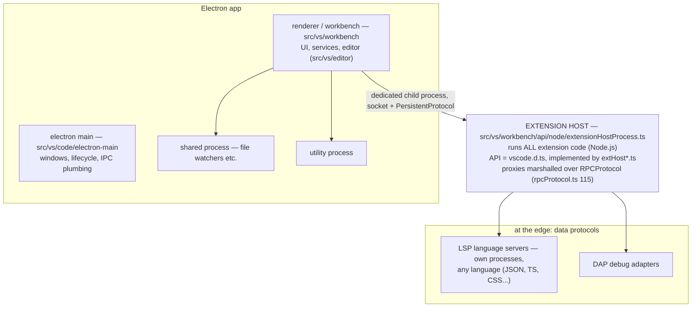
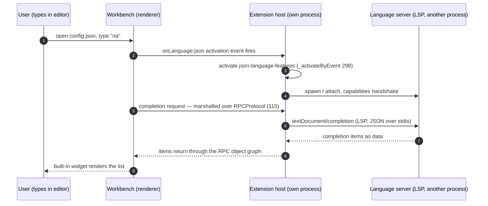
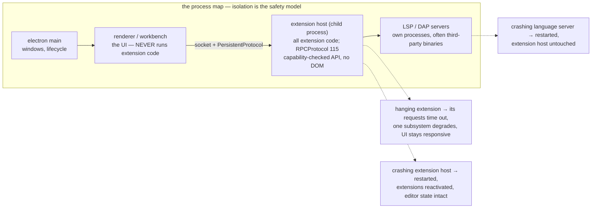

# VS Code: extension architecture as the product — process isolation and protocol seams

> **Atlas id:** `vscode` · **Domains:** `editor` ·
> **Upstream:** https://github.com/microsoft/vscode · **License:** MIT ·
> **Pinned commit:** `a5aeadabe1ee5b1c2bf70e9e61706f4e7b684282` (2026-10-09, master)

VS Code became the most-used code editor of its era on an unfashionable
stack (Electron: Chromium + Node) because its real product is not the
editor — it is the **extension architecture**: every language
intelligence, every debugger, every theme arrives through a designed
seam. The two load-bearing decisions: **extensions run in a separate
process** and speak the product only through a versioned API over RPC;
and **heavy tool integrations (LSP, DAP) are data protocols at the
edge**, so ecosystems can be polyglot. This deep-dive teaches how to
design extensibility so a plugin explosion cannot kill the host.

## Explain like I'm 10

**A school where guest teachers get their own room — never the office.**
VS Code is a school. The front office (the workbench — the UI you see)
never lets guest teachers (extensions) teach from inside the office:
each guest gets their own room next door (the extension host process),
and talks to the office only through a mail slot with strict rules (a
versioned API marshalled over RPC). A guest who breaks things can only
wreck their own room — the school stays open, and the principal just
reopens the room. The fanciest helpers — the ones who understand Python
or C++ — don't even get a room in the building: they live in a separate
building (their own process) and communicate by postcards written in a
standard format (LSP) that ANY school can read — which is why the same
helper works in other editors too.

**Why the grown-ups did it this way:** with thousands of guest teachers
of every skill level, isolation IS the feature — one bad guest must
never be able to freeze or crash the editor everyone is typing in.

## 1. Architecture overview

- The **spine** — "open a .json file, get completions" — is: the
  workbench sees the file type → `json-language-features` extension's
  *activation event* fires (`extensions/json-language-features/
  package.json:16`) → ext host activates it
  (`src/vs/workbench/api/common/extHostExtensionService.ts:
  _activateByEvent:298` → `_activateExtension:421` → `_callActivate:494`)
  → the extension spawns/attaches a language server over LSP →
  completions flow back as data, rendered by built-in UI widgets.

## Walkthrough: open a .json file, type a dot, get completions

The spine as a story — step through it on the site or read straight
down. Watch how many process boundaries the keystroke crosses without
the UI ever risking a crash.

**Step 1 — The file opens.** The workbench resolves the file's language
from the `json` extension's declarative contribution. Nothing has run
yet: contributions in `package.json` are data, merged at startup and
rendered without executing extension code.

**Step 2 — The activation event.** Opening a JSON file fires the
`onLanguage:json` activation event declared in
`extensions/json-language-features/package.json:16`. The host side
asks the extension host to activate that extension:
`_activateByEvent` (298) → `_activateExtension` (421) →
`_callActivate` (494), with per-extension error capture.

**Step 3 — The mail slot.** The extension's code runs in the extension
host process and calls the `vscode` API — but every call is a proxy
marshalled by `RPCProtocol` (`rpcProtocol.ts:115`): contexts hold
named object references; arguments (URIs, buffers, positions) are
serialized with revivers. The rich typed API is one uniform
marshalling problem.

**Step 4 — The postcard.** The extension starts (or attaches) a JSON
language server in yet another process and speaks LSP: capabilities
handshake, then `textDocument/completion` as JSON over stdio. The
helper could be written in any language — the protocol is the contract,
not the runtime.

**Step 5 — Data comes home.** Completion items arrive as plain data,
cross back through the RPC boundary, and are rendered by built-in UI
widgets. The extension never touched a DOM node; the editor never ran
extension code on its thread.

**Outcome — Intelligence without risk.** A third-party language expert
added deep editor behavior while isolated two process boundaries away.
If it hangs, its requests time out; if it crashes, its process restarts
— your unsaved buffer never noticed.

## 2. Core data structures — and why these

### The RPC object graph (`src/vs/workbench/services/extensions/common/rpcProtocol.ts:115`)

`RPCProtocol` marshals calls between host and extension process:
contexts hold named object references; calls address
`extHost`/`mainThread` identifiers; arguments are serialized with
revivers (URIs, buffers, positions). The API surface the extension
sees (`vscode.d.ts`) is implemented by dozens of `extHost*.ts`
classes whose *proxies* live on the other side lazily. Why an object
graph over raw IPC: a rich, typed API (80+ namespaces) stays a
uniform marshalling problem, and references (event emitters,
disposables) cross the boundary with identity.

### Contribution points + activation events (extension manifests)

Every extension declares, as *data*: what it contributes (languages,
commands, menus, themes — `contributes` in `package.json`) and when to
load (`activationEvents`). The host merges manifests at startup
(`extensionPoints.json`, `extensionDescriptionRegistry.ts`) and
activates lazily. Why: a thousand extensions must not cost a thousand
processes or a slow startup — declarations render UI *before* code
runs, and code runs only on trigger.

### The piece-tree text buffer
(`src/vs/editor/common/model/pieceTreeTextBuffer/pieceTreeBase.ts:268`)

The editor's text model is a balanced tree of *pieces* (references
into chunked storage) with prefix-sum line indexes
(`prefixSumComputer.ts`). Why: line-start lookup must be O(log n) on
gigabyte files, and edits must not shift a whole ArrayBuffer; a
piece tree gives cheap inserts plus cheap line indexing where a flat
buffer gives one or the other. (Same family as the rope; the
neighbor `intervalTree.ts` serves decorations.)

### Remote extension kinds (`extensionRunningLocationTracker.ts`)

Extensions are classified local/remote/web-worker by their API usage
— the *same* extension model spans desktop, remote (SSH/container), and
the browser, because "where does this code run" became data, not
build config.

## 3. Concurrency and failure model

- **Process isolation is the safety model**: an extension crash kills
  the extension host, not your unsaved editor state; the host is
  restarted and extensions reactivated. A hanging extension degrades
  one subsystem (its protocol requests time out) rather than the UI
  — the workbench stays responsive because *its* thread never runs
  extension code.
- **The host never trusts the extension**: capability-checked API
  surface (no `require` of arbitrary host modules in the API, no DOM
  access from ext host beyond provided views), telemetry/marketside
  gating of proposed APIs.
- **LSP/DAP push failure further out**: language servers are yet
  another process, often third-party binaries — a crashing server
  restarts without touching the extension host. Compare Neovim (this
  catalog): same conclusion (RPC peers) reached from a different
  history.
- **Latency is managed, not denied**: RPC calls are batched; the
  protocol aggressively avoids round trips (bulk registration,
  buffered writes in `PersistentProtocol` from
  `base/parts/ipc/common/ipc.net.js`).

## 4. API and extension design

- **Two-tier API**: `src/vscode-dts/vscode.d.ts` is the stable,
  semver'd contract every extension compiles against; new capability
  incubates as `vscode.proposed.*.d.ts` behind explicit opt-in, then
  graduates. This is the mechanism that let an enormous ecosystem
  ride years of host evolution without breakage.
- **Activation as data** (manifests) plus **commands as uniform
  verbs** (`ExtHostCommands`,
  `src/vs/workbench/api/common/extHostCommands.ts:46`): anything can
  invoke anything's commands — keybindings, menus, other extensions —
  without link-time knowledge.
- **The escape hatch is protocol**: LSP (language) and DAP (debug)
  moved the highest-churn integrations out of the process API into
  versioned data protocols — which is why language tooling became
  polyglot and editor-agnostic, arguably VS Code's deepest ecosystem
  effect.
- Honest wart: the Electron substrate's memory footprint, and an API
  surface so successful it ossifies: retiring or fixing misdesigned
  stable APIs takes years (hence the proposed-API treadmill).

## 5. The defining trade-offs

### Trade-off 1: extension host out-of-process over in-process plugins
- **Tension:** rich, fast extension APIs vs host stability.
- **Choice:** all extension code in a child process; API access only
  through marshalled object graphs.
- **Evidence:** `extensionHostProcess.ts` (ext host bootstrap,
  `_createExtHostProtocol:180`); `rpcProtocol.ts:115`; host-side
  management in `extensionHostManager.ts:58` /
  `extensionService.ts:46`.
- **Given up:** call latency (every API touch is IPC), API shapes
  constrained to serializable graphs, and a hard debugging boundary.
- **Verdict:** for a platform whose plugins are written by thousands
  of third parties at every skill level, isolation *is* the feature.
  In-process wins only when you control all plugin authors (compare
  CPython's opposite bet in this atlas).

### Trade-off 2: stable surface + gated proposals over fast-moving API
- **Tension:** ecosystem stability vs host velocity.
- **Choice:** one versioned `vscode.d.ts`; everything risky starts
  proposed and opt-in.
- **Evidence:** `src/vscode-dts/` — `vscode.d.ts` beside dozens of
  `vscode.proposed.*.d.ts` files.
- **Given up:** rapid API iteration (design pressure to get stable
  APIs right), dual API maintenance.
- **Verdict:** the reason a 2015-era extension still installs today.
  Any platform with third-party developers needs this discipline —
  most skip it and break their ecosystems.

### Trade-off 3: protocols (LSP/DAP) at the edge over richer in-process APIs
- **Tension:** deep host integration vs ecosystem reach.
- **Choice:** language/debug intelligence normalized into data
  protocols owned by their own communities; the host provides client
  plumbing and UI.
- **Evidence:** `extensions/json-language-features` (manifest
  activation events at line 16; `vscode-languageclient` dependency;
  servers under `server/`); same pattern for TS, CSS, HTML, debuggers.
- **Given up:** peak integration (an in-process extension can do
  more), one more process per language.
- **Verdict:** the call that made tooling editor-agnostic and turned
  VS Code into a platform other editors (incl. Neovim) also build
  on. Protocols beat APIs wherever the ecosystem is broader than
  the product.

## 6. Reading path

1. `src/vs/code/` directory tree — name the processes (electron-main,
   renderer/workbench, shared, utility) before reading any code.
2. `extensions/json-language-features/package.json` — a complete
   extension as *data*: activation events (16), contributions,
   dependencies. Everything else in this path explains how this
   manifest becomes running code.
3. `src/vs/workbench/services/extensions/common/extensionService.ts:46`
   and `extensionHostManager.ts:58` — the host side: scanning,
   enabling, launching extension hosts (local/remote kinds decided by
   `extensionRunningLocationTracker.ts`).
4. `src/vs/workbench/api/node/extensionHostProcess.ts` — the child's
   `main()`: handshaking over the socket
   (`_createExtHostProtocol:180`, `PersistentProtocol`), initData,
   then hand off to the API implementation.
5. `src/vs/workbench/services/extensions/common/rpcProtocol.ts:115` —
   read `RPCProtocol` end to end (~600 lines): contexts, lazy
   proxies, serialization. This file *is* the extension boundary.
6. `src/vs/workbench/api/common/extHostExtensionService.ts:81` —
   `AbstractExtHostExtensionService`: `_activateByEvent` (298),
   `_activateExtension` (421), `_callActivate` (494): activation as
   promise-managed lifecycle with error capture per extension.
7. `src/vs/workbench/api/common/extHostCommands.ts:46` — the command
   system; register one command yourself from a scratch extension to
   feel the proxy round-trip.
8. `src/vscode-dts/vscode.d.ts` (skim namespace list) + one
   `vscode.proposed.*.d.ts` — the two-tier contract; note how much
   surface is documentation.
9. `extensions/json-language-features/server/` + its client wiring —
   LSP in miniature: process spawn, capabilities handshake, requests
   flowing as JSON.
10. `src/vs/editor/common/model/pieceTreeTextBuffer/pieceTreeBase.ts:268`
    — the editor's own data-structure lesson: pieces, prefix sums,
    and why line lookup survives gigabyte buffers.
11. `src/vs/workbench/services/extensions/common/extensionPoints.json`
    — every contribution point the host knows: the manifest schema
    as the real extension API's table of contents.

You have now traced one completion from keystroke → buffer →
activation event → extension host → language server and back, through
every designed boundary of the product.

## 7. What to steal

- **Run third-party code out-of-process, expose a marshalled object
  graph**: stability and capability control in one decision; batch
  the RPC and the latency is payable.
- **Declarative manifests + lazy activation**: a thousand plugins
  must cost less than a thousand loads — contributions as data,
  code only on trigger.
- **Version the platform API; incubate additions behind flags**:
  ecosystem longevity is a discipline, not luck.
- **Push churn-y integrations into data protocols** (LSP/DAP): when
  the ecosystem is broader than your product, protocols beat APIs.
- **Classify "where code runs" as data** (local/remote/web-worker
  kinds): one extension model, many execution targets.

## 8. Difficulty and prerequisites

- Difficulty: **moderate** — TypeScript throughout, services are
  readable, the challenge is the sheer scale (know your path).
- Budget: ~5–6 hours for the reading path; steps 4–6 are the core.
- Prerequisites: event-driven UI concepts, what a language server
  does at a user level, basic IPC; TypeScript reading fluency.

## 9. Further reading

- LSP (https://microsoft.github.io/language-server-protocol/) and
  DAP (https://microsoft.github.io/debug-adapter-protocol/) specs.
- The extension authoring docs (https://code.visualstudio.com/api)
  — the manifest/activation model from the producer side.
- Compare with Neovim's remote-plugin architecture (atlas catalog
  entry `neovim`): two answers to "how do plugins extend an editor
  safely".
