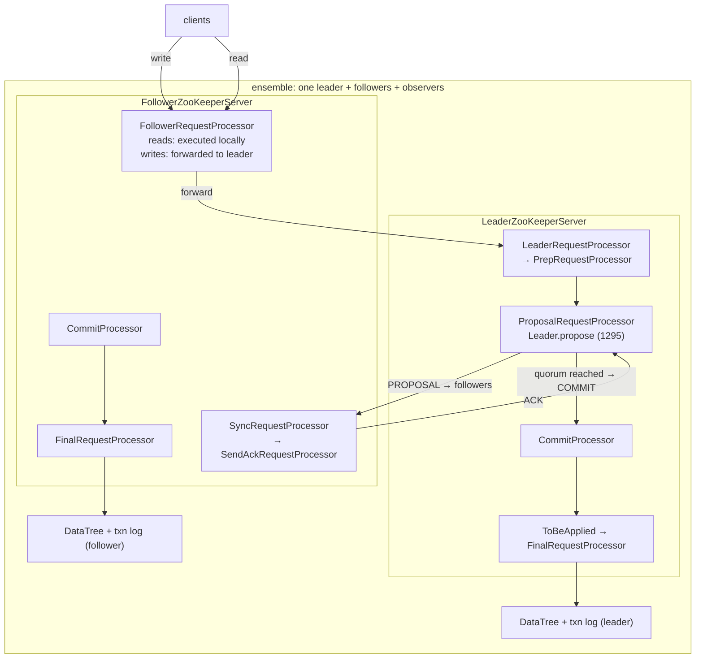
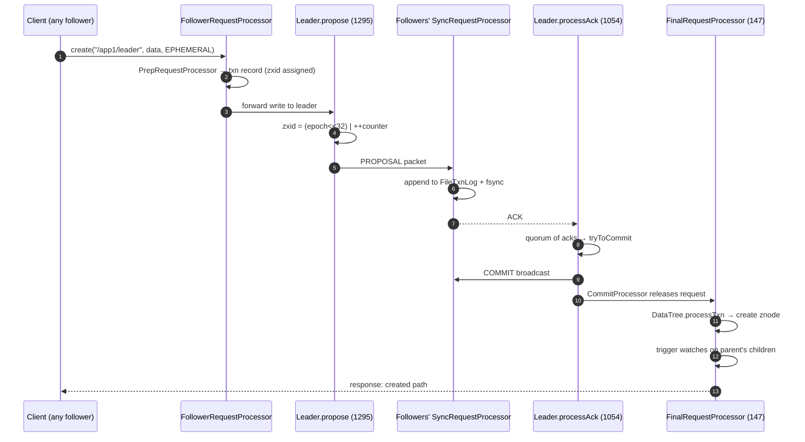

# ZooKeeper: consensus wrapped in a tiny ordered filesystem

> **Atlas id:** `zookeeper` · **Domains:** `distributed, database` ·
> **Upstream:** https://github.com/apache/zookeeper · **License:** Apache-2.0 ·
> **Pinned commit:** `48f7cb00e2d48d4563e45bebcd0f4665c30772a2` (2026-10-05)

ZooKeeper is the coordination kernel the entire Hadoop-era stack was
built on, and its design thesis is that **a consensus protocol becomes
usable when you hide it inside a data structure everyone already
understands**: a small hierarchical namespace of znodes, replicated on
every server via atomic broadcast (ZAB), with ephemeral nodes and
one-shot watches layered on top as client-side conventions. The write
path is one leader, totally ordered, fsync-per-proposal; the read path
is any server, answered locally, no quorum. This deep-dive teaches that
split, the request-processor pipeline that makes it real, and the
trade-offs (strict ordering over throughput, one-shot watches over
persistent streams, local reads over linearizable ones) that later
systems — etcd, Consul — inherited or corrected.

Read it after [etcd](etcd.md): the same problem (a small, strongly
consistent, watchable store), solved a decade earlier with a bespoke
protocol (ZAB instead of Raft) and a tree instead of a flat keyspace.

## Explain like I'm 10

**A notebook copied identically across several offices.** Every office
(an ensemble server) keeps the exact same notebook of pages
(znodes: `/app1/leader`, `/jobs/17/status`). Writes always go to head
office (the leader): the head office numbers each change
(`zxid` — epoch in the high 32 bits, counter in the low), mails a copy
(proposal) to every branch, and only when a majority of branches write
the page in their own notebook does everyone stamp it "official"
(commit). Reads, though, you can ask any office — the answer comes from
that office's notebook instantly, without a company-wide meeting
(reads are local; writes are quorum). You can also ask an office to
buzz you the moment a page changes (a watch) — the buzz fires *once*,
then you must ask again. Some pages are written in erasable pencil
(ephemeral znodes): if the member who created them stops paying rent
(the session times out), the pages erase themselves — which is how the
company knows who is still alive without anyone watching everyone.

**Why the grown-ups did it this way:** one serialized write path makes
every update atomic and ordered for free, and pushing liveness to
client-side conventions (sessions + ephemerals + watches) keeps the
server from becoming a failure detector itself.

## 1. Architecture overview

- **Roles.** Every server is a `QuorumPeer`
  (`server/quorum/QuorumPeer.java:579` — states `LOOKING / FOLLOWING /
  LEADING / OBSERVING`). The leader owns the single write pipeline;
  followers forward writes and answer reads locally; observers replicate
  but never vote (scaling the read path without changing quorum math).
- **The request pipeline is a chain of one-threaded processors** — the
  architecture's central idea:
  - Leader: `LeaderZooKeeperServer.setupRequestProcessors` —
    `LeaderRequestProcessor → PrepRequestProcessor →
    ProposalRequestProcessor → CommitProcessor → ToBeApplied →
    FinalRequestProcessor`.
  - Follower: `FollowerZooKeeperServer.setupRequestProcessors` —
    `FollowerRequestProcessor → CommitProcessor → FinalRequestProcessor`,
    plus a side `SyncRequestProcessor → SendAckRequestProcessor` that
    logs and acks incoming proposals.
  - Standalone: `ZooKeeperServer.java:855` — `PrepRequestProcessor →
    SyncRequestProcessor → FinalRequestProcessor` (same chain, minus
    the network).
- **The spine** of a write at the leader: `ZooKeeperServer.processPacket`
  (`ZooKeeperServer.java:1731`) → `submitRequest` (1229) → Prep
  (turns a request into a txn record) → `Leader.propose`
  (`Leader.java:1295`) → followers `SyncRequestProcessor` log + ACK →
  `Leader.processAck` (`Leader.java:1054`) → `tryToCommit` → COMMIT
  broadcast → `CommitProcessor` releases → `FinalRequestProcessor`
  applies to `DataTree` and answers the client.
- **Persistence**: every proposal is an append to `FileTxnLog`
  (`server/persistence/FileTxnLog.java:393` `commit`, fsync at 410),
  snapshots of the DataTree via `FileSnap`. Recovery = load snapshot +
  replay log; leader election picks the server with the highest
  committed zxid to lead.

## Walkthrough: one create, client to DataTree

The spine as a story — on the site you can step through it with Next;
in the repo it reads top to bottom.

**Step 1 — The packet lands on whichever server the client talks to.**
`processPacket` (`ZooKeeperServer.java:1731`) parses the request header
and builds a `Request` — the unit that flows through the whole
pipeline — then `submitRequest` (line 1229) hands it to the throttler
and the first processor.

**Step 2 — Reads stay home, writes travel.** On a follower,
`FollowerRequestProcessor.run` (`FollowerRequestProcessor.java`) walks
its queue: for `create/delete/setData/setACL/…` it calls
`zks.getFollower().request(request)` — forward to the leader — while
`get/exists/getChildren` simply fall through the local chain to
`FinalRequestProcessor`. The comment in the code says why writes queue
locally first: "We want to queue the request to be processed before we
submit the request to the leader so that we are ready to receive the
response."

**Step 3 — Prep turns intent into a transaction.** `PrepRequestProcessor`
(`PrepRequestProcessor.java:93`, `pRequest2Txn` at 314) validates path,
ACLs, and session state, and produces a `TxnHeader` + record (e.g.
`CreateTxn`) — the operation is now a serializable fact, not a wish.

**Step 4 — The leader proposes with a number.** `Leader.propose`
(`Leader.java:1295`) assigns the zxid (monotonic counter under the
current epoch — see `ZxidUtils.makeZxid`,
`server/util/ZxidUtils.java:21`), puts the proposal in
`outstandingProposals`, and broadcasts a PROPOSAL packet to every
LearnerHandler. Note the rollover guard: at 0xffffffff counter bits it
forces re-election rather than wrap.

**Step 5 — Followers make it durable before they agree.** Each
follower's `SyncRequestProcessor` appends the proposal to its
`FileTxnLog` — `commit()` (`FileTxnLog.java:393`) batches writes and
`channel.force(false)` (line 410) fsyncs (skippable only via
`zookeeper.forceSync=no`) — then `SendAckRequestProcessor` sends ACK.
An ack means "on disk," not "applied."

**Step 6 — A quorum commits.** `Leader.processAck` (`Leader.java:1054`)
adds the ack to the proposal and calls `tryToCommit`: when the
quorum-verifier is satisfied, the leader broadcasts COMMIT, moves the
proposal to `toBeApplied`, and the `CommitProcessor` (which held the
client request) releases it in order.

**Step 7 — Apply and answer.** `FinalRequestProcessor.processRequest`
(`FinalRequestProcessor.java:147`) runs `DataTree.processTxn`
(`DataTree.java` — create path at `createNode`, watch firing at line
531), touches the session, builds the reply, and returns it to the
client — on whichever server the client is connected to.

**Outcome — The znode exists everywhere.** The same zxid is in every
surviving server's log and DataTree; a client watching the parent got
one `NodeChildrenChanged` event; if the creating session dies, the
node will vanish when the leader expires the session and replays that
rule as a delete transaction.

## 2. Core data structures — and why these

### DataTree + DataNode — the namespace (`server/DataNode.java:40`, `server/DataTree.java`)

A `DataNode` is `byte[] data` + `StatPersisted stat` + a `Set<String>`
of child *names* (not paths — the tree is edges-in-memory, children
stored by last token) + `Long acl` into a shared ACL cache. The
`DataTree` holds `ConcurrentHashMap<String, DataNode> nodes`, an
`ephemerals` map (session → znode set) for expiry, and the two watch
managers. Why a tree of small byte arrays and not a document store:
coordination state is tiny (`/leader`, `/locks/17`, config blobs);
keeping values opaque makes the server generic, and makes the *tree
structure itself* the API (children lists are a query primitive).

### zxid — epoch « 32 | counter (`server/util/ZxidUtils.java:21`)

One 64-bit number that totally orders all history: the epoch half
increments at every leader change (so a stale leader's proposals
compare *lower* than the new leader's), the counter half increments
per proposal. Election, log comparison, and commit ordering all reduce
to integer comparison — the same trick Raft uses with (term, index),
pulled into a single comparable long.

### WatchManager — two maps and one-shot semantics (`server/watch/WatchManager.java:135`)

Watches live in two indexes: `watchTable` (path → watchers) for firing
and `watch2Paths` (watcher → paths) so a dead connection can be
reaped. `triggerWatch` (line 135) fires and *removes* the watcher in
one synchronized pass — the one-shot contract is enforced by the data
structure, not by client discipline. Why one-shot: a persistent watch
would require acked, resumable event streams (what etcd's watch with
revisions eventually built); one-shot events over a client session
were the 2008-feasible answer, and they force the safe pattern —
re-read state, then re-watch — instead of trusting a stale event.

### SessionTracker with bucketed expiry (`server/SessionTrackerImpl.java:45`, `server/ExpiryQueue.java:35`)

Sessions are tracked with rounded expiry deadlines:
`ExpiryQueue.update` (`ExpiryQueue.java:84`) rounds "now + timeout" to
the next bucket boundary, so thousands of sessions with individually
random timeouts collapse into a manageable set of expiry buckets; the
tracker thread (`SessionTrackerImpl.run`, line 158) sleeps to the next
bucket and expires the whole batch. The rounding is paid for by
clients (timeouts are minimums, not exact). Ephemeral cleanup and
connection death are joined at the hip: `killSession`
(`DataTree.java:1140`) deletes ephemerals as ordinary transactions, so
even liveness changes go through the ordered log.

### FileTxnLog with preallocation (`server/persistence/FileTxnLog.java`)

Append-only transaction log with preallocated padded space
(`padFile`, line 309, filling the file with zeros ahead of the write
head) so appends stay sequential, group commit (`commit` at 393, with
`toFlush` batching in `SyncRequestProcessor.java:85`), and fsync
before ack (line 410). Same WAL discipline as the etcd dive — the log
is the truth, the DataTree is a materialized view.

## 3. Concurrency and failure model

- **One serialized write path.** All mutations funnel through the
  leader's proposal queue; ordering is the protocol's guarantee, so
  there is no write-write concurrency to manage — only pipeline
  concurrency (prep can run ahead of commit). Each processor is a
  thread with a blocking queue; the `CommitProcessor` is the join point
  where agreed order and local execution meet, holding client requests
  until their zxid commits.
- **Election as state machine.** `QuorumPeer.run`
  (`QuorumPeer.java`, `LOOKING/FOLLOWING/LEADING/OBSERVING` at lines
  579-582) drives `FastLeaderElection` (`quorum/FastLeaderElection.java`):
  votes compare (epoch, zxid, sid); the winner is the highest logged
  state, and the new epoch (`Leader.getEpochToPropose`, `Leader.java:1469`)
  makes all old proposals forever smaller than all new ones.
- **Recovery sync per follower.** On connect, the leader's
  `LearnerHandler` compares the follower's last zxid against its own
  and sends DIFF (replay missing proposals), TRUNC (drop a divergent
  tail from a dead leader's uncommitted proposal), or SNAP (a full
  snapshot) — `LearnerHandler.java` cases at lines 424-593. After
  NEWLEADER acks and `waitForEpochAck` (`Leader.java:1515`) unblocks,
  `startForwarding` (line 1367) turns on live proposals.
- **Crash of the leader mid-commit** is safe by construction: a
  proposal with a quorum of acks is in a quorum of logs, so election
  (highest zxid wins) guarantees it survives; a proposal without
  quorum dies in the TRUNC. The classic ZAB invariant — committed
  prefix, never a hole — falls out of fsync-before-ack plus
  highest-zxid election.
- **Overload behavior**: the request throttler (`requestThrottler` in
  `submitRequest`, `ZooKeeperServer.java:1260`) bounds queued requests;
  sessions shed load naturally (timeouts), and `BlueThrottle`
  (`server/BlueThrottle.java`) can drop connection storms. There is no
  backpressure protocol to clients beyond errors and session expiry —
  one more reason the docs beg you not to use ZooKeeper as a queue.

## 4. API and extension design

- **The API is the znode operations**, not a generic KV store:
  `create/getChildren/setData/exists/delete/getACL/setACL`, multi
  (transactional batch), sync, reconfig. Sessions are first-class —
  every connection has one, and ephemerals + watches are defined in
  terms of it. This is API design by *what the coordination use cases
  need* (leader election, locking, group membership, config), and it is
  why the recipes (in `zookeeper-recipes/`) are short.
- **Observers** (`server/quorum/Observer*.java`) are the scaling seam:
  add read-serving replicas without touching quorum size. **The admin
  surface** moved from four-letter words (`stat`, `srvr` — still in
  `server/command/`) to an HTTP admin server; **authentication** is
  pluggable per-server (Digest, SASL) and per-znode ACLs are stored in
  the DataTree's acl cache.
- **The extension wart**: everything is fixed. You cannot add a new
  operation, a new watch semantic, or a new consistency mode without
  forking the protocol — the JUTE-generated records
  (`zookeeper-jute/`) fix the wire format. Compare etcd, where the
  watch API, lease API, and KV API sit behind gRPC endpoints that grew
  independently; ZooKeeper's 2008 wire protocol is a single frozen
  struct family.
- **The read consistency wart is documented, not hidden**: reads are
  *linearizable only per server* (a client may read stale data after a
  failover). The escape hatch is the `sync()` call — literally "flush
  my server up to the leader" — which on followers goes through the
  full proposal path (`pendingSyncs` in
  `FollowerRequestProcessor.java`).

## 5. The defining trade-offs

### Trade-off 1: total order through one leader over parallel writes
- **Tension:** every client wants atomic, ordered updates; disks and
  networks want parallelism.
- **Choice:** one leader, one counter, fsync per proposal batch, quorum
  acks, in-order commit.
- **Evidence:** `Leader.propose` (`Leader.java:1295`) assigns zxids
  sequentially and inserts into `outstandingProposals`;
  `processAck`/`tryToCommit` (1054) commit strictly in zxid order;
  `FileTxnLog.commit` fsyncs before the follower's
  `SendAckRequestProcessor` acks.
- **Given up:** write throughput bounded by one leader's log fsync and
  network fan-out — the documented reason ZooKeeper tops out at tens of
  thousands of writes per second and why the docs forbid using it as a
  data store.
- **Verdict:** right for coordination (small, hot, correctness-critical
  state — the workload where ordering *is* the product). Wrong the
  moment writes are a firehose; that is Kafka-land, where the log is
  sharded per partition and each partition is its own serialized
  leader — the same trade, made per-shard instead of globally.

### Trade-off 2: one-shot watches over persistent subscriptions
- **Tension:** clients need change notification; the server must not
  become an event-delivery system with per-client queues and acks.
- **Choice:** a watch fires exactly once, then is gone; the client
  re-reads and re-watches.
- **Evidence:** `WatchManager.triggerWatch`
  (`server/watch/WatchManager.java:135`) removes the watcher from both
  maps as it collects the fire set, inside the same synchronized block
  that builds the event.
- **Given up:** no event history, no missed-update detection, and the
  classic bug pattern (read state → set watch has a gap; the one-shot
  re-watch protocol is client-side and easy to get wrong). etcd's
  revision-stamped watch streams are the direct fix for this gap.
- **Verdict:** right when state is small and re-reading is cheap —
  coordination state again. Wrong when events are frequent or the
  watched payload is large; then you need a log with offsets, not a
  doorbell.

### Trade-off 3: locally-served reads over quorum-verified reads
- **Tension:** a coordination service is read-dominated (every
  leader-election loop polls); quorum reads would double its latency
  and halve its capacity.
- **Choice:** any server answers reads from its own DataTree; only
  `sync()` forces the follower to catch up to the leader first.
- **Evidence:** `FollowerRequestProcessor.run` — read opcodes fall
  through the local `CommitProcessor → FinalRequestProcessor` chain,
  while write opcodes branch to `zks.getFollower().request(request)`;
  the `sync` opcode is the one "read" that joins the write path
  (`pendingSyncs`).
- **Given up:** linearizable reads across failover — after a leader
  change, a client talking to a slow follower can observe older state
  than it just wrote elsewhere (bounded by one election; documented as
  "session guarantees," not linearizability).
- **Verdict:** right for leases, locks, and group membership where
  the fencing number (zxid/version) — not the read freshness — carries
  correctness. Wrong when clients treat the store as a source of truth
  for decisions made *on read value alone*; that design needs etcd's
  ReadIndex or Serializable-vs-Linearizable choice made explicit per
  call.

## 6. Reading path

1. `server/quorum/QuorumPeer.java:579` — the four states and the
   `run()` loop that transitions between them; the whole system is one
   instance of this state machine per process.
2. `server/ZooKeeperServer.java:1731` `processPacket` — where client
   bytes become `Request`s; then `submitRequest` (1229) and the
   throttler.
3. `server/ZooKeeperServer.java:855` `setupRequestProcessors` — the
   standalone chain (Prep → Sync → Final); memorize this shape before
   the quorum variants.
4. `server/quorum/LeaderZooKeeperServer.java` and
   `FollowerZooKeeperServer.java`, both `setupRequestProcessors` —
   the same chain, extended: leader adds Proposal/ToBeApplied between
   Prep and Commit; follower adds the forwarding rule and the ack
   side-chain. This diff *is* the architecture.
5. `server/quorum/FollowerRequestProcessor.java:64` `run` — the
   read/write split in one switch statement; note `pendingSyncs` for
   `sync`.
6. `server/quorum/Leader.java:1295` `propose` — zxid assignment,
   `outstandingProposals`, the xid-rollover guard; then
   `processAck` (1054) and the `tryToCommit` call inside it.
7. `server/persistence/FileTxnLog.java:393` `commit` — append, group
   flush, `channel.force` at 410; then `FileSnap`/`FileTxnSnapLog` for
   the snapshot side.
8. `server/DataTree.java` — `processTxn` (867) and `createNode` (410,
   watch trigger at 531), `killSession` (1140) for ephemeral semantics as
   ordinary transactions.
9. `server/watch/WatchManager.java:135` `triggerWatch` — the two-map,
   fire-and-remove design in one synchronized method.
10. `server/SessionTrackerImpl.java:45` + `server/ExpiryQueue.java:84`
    `update` — bucketed expiry rounding; then `run` (158) for the
    batching loop.
11. `server/quorum/Leader.java:1469` `getEpochToPropose`, 1515
    `waitForEpochAck`, and `server/quorum/LearnerHandler.java` lines
    424-593 — election → epoch agreement → DIFF/TRUNC/SNAP sync →
    `startForwarding` (1367): the crash-recovery story end to end.
12. `server/quorum/FastLeaderElection.java` — vote exchange and the
    (epoch, zxid, sid) comparison; compare with etcd's raft vote
    request to see election as protocol data vs. protocol logic.

You have now traced a `create` from a follower's socket, to the
leader's counter, to a quorum's disks, back to the DataTree and the
watch that fired — and the recovery story that makes the whole thing
survive the leader dying at step 6.

## 7. What to steal

- **Hide a consensus protocol inside a familiar data structure**: a
  filesystem API made ZAB usable to people who never read the paper —
  the interface, not the algorithm, drove adoption.
- **One comparable number for history** (zxid = epoch « 32 | counter,
  `ZxidUtils.makeZxid`): election, ordering, and staleness checks
  become integer comparisons everywhere in the code.
- **Make the ack mean "on disk"** (`FileTxnLog.commit` fsync before
  `SendAckRequestProcessor`): durability claims attach to a specific,
  checkable moment, not to vibes.
- **Pipeline correctness through single-threaded stages with queues**
  (the RequestProcessor chain): each invariant (validation, ordering,
  application) gets its own thread and its own place to be enforced.
- **Round expiry into buckets** (`ExpiryQueue.update`): thousands of
  timers collapse into a handful of wakeups — session management at O(1)
  amortized.
- **Encode liveness as data** (ephemerals + sessions): the system
  detects failure with its existing machinery (expiry transactions
  through the same log) instead of a parallel failure-detector
  subsystem.

## 8. Difficulty and prerequisites

- Difficulty: **demanding**. Java reading fluency plus distributed
  systems vocabulary; the hard parts are protocol invariants, not the
  code.
- Budget: ~8 hours for the reading path; the election/sync path
  (stops 11-12) deserves a second pass with the ZAB papers open.
- Prerequisites: what a WAL gives you (the [etcd](etcd.md) dive
  builds the same background with Raft); quorum arithmetic (2f+1);
  sessions/leases as a concept. The original ZooKeeper paper (Hunt et
  al., 2008 — see below) is a genuine prerequisite, not decoration.

## 9. Further reading

- P. Hunt, M. Konar, F. P. Junqueira, B. Reed, "ZooKeeper: Wait-free
  coordination for Internet-scale systems" (USENIX ATC 2010).
- F. P. Junqueira, B. Reed, M. Serafini, "Zab: High-performance broadcast
  for primary-backup systems" (DSN 2011) — the protocol this code
  implements.
- Apache ZooKeeper documentation — https://zookeeper.apache.org/doc/ —
  especially the "ZooKeeper Internals" and "Guarantees" pages (the
  read-consistency caveats are documented there, honestly).
- The [etcd](etcd.md) deep-dive in this atlas — the same store, one
  protocol generation later.
